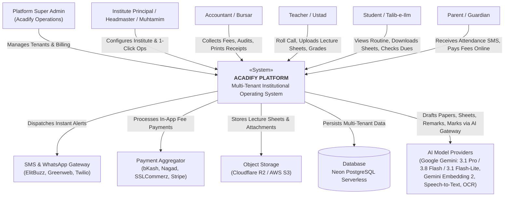
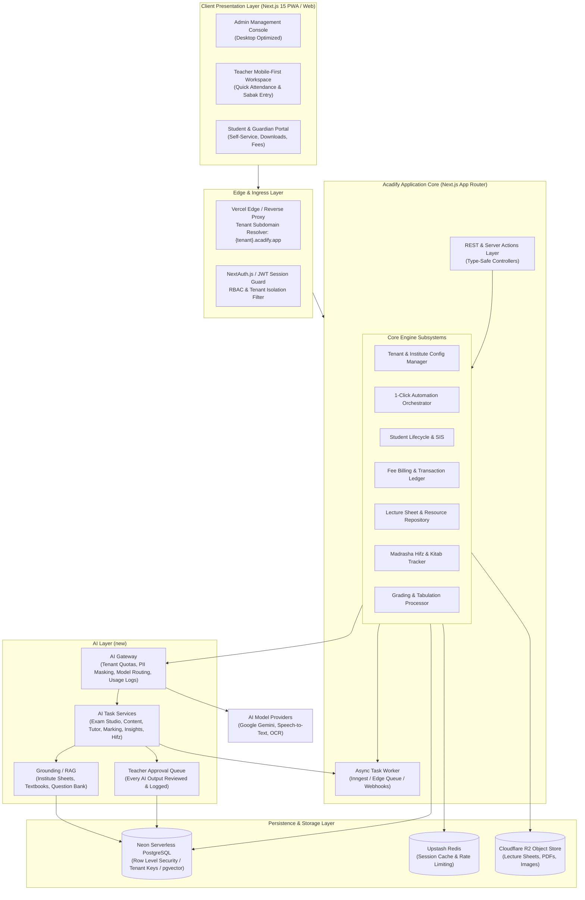
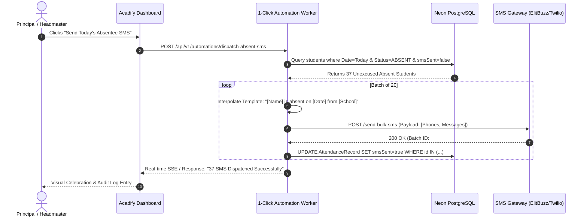
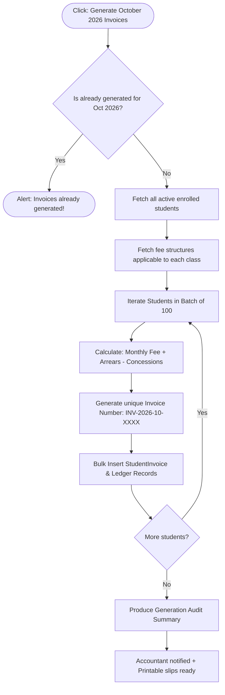
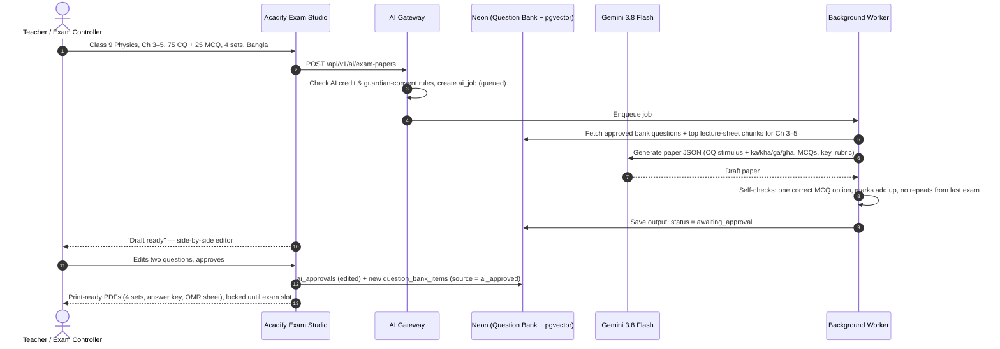
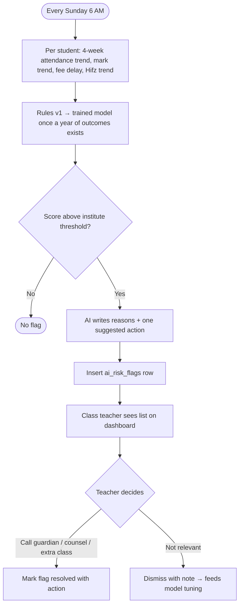
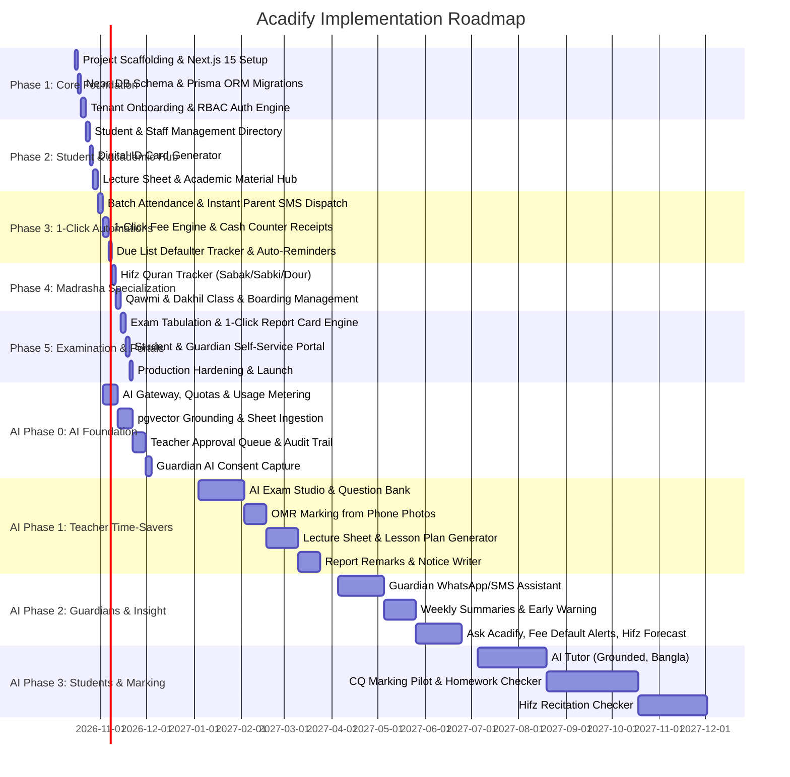

# ACADIFY: High-Level & Low-Level Architecture and Implementation Plan
**AI-Driven Institutional Operating System (IOS) for Schools, Colleges, and Madrasahs**

---

## 1. Executive Summary & Vision

**Acadify** is an all-in-one, AI-driven Institutional Operating System designed to replace fragmented legacy school management software with a unified, modern multi-tenant SaaS platform. 

The primary differentiator of Acadify is **"1-Click Automations"**: repetitive daily operations (such as marking attendance and blasting SMS to absent parents, generating monthly tuition invoices for 2,000 students, calculating terminal GPA rankings, distributing daily lecture sheets, or logging daily Hifz Quran memorization progress) that traditionally take hours are executed automatically with a single click.

The second differentiator is the **AI Layer: "AI does the paperwork, the teacher decides"**. Work that automation alone cannot do (writing a CQ + MCQ question paper, drafting a lecture sheet, writing 2,000 report card remarks, marking OMR sheets, answering guardians on WhatsApp, flagging students at risk of dropping out, forecasting Hifz completion) is drafted by AI from the institute's own data and material. Every AI output waits in a teacher approval queue before it reaches a student or guardian, and every approval is logged. This keeps teachers in charge and keeps automated decisions about children within Bangladesh's Personal Data Protection Ordinance 2025.

> Research behind the AI Layer (Bangladesh context, 38 AI features across 11 areas, fit by institution type, competitors, costs, risks): see the R&D doc *AI-Driven Institution OS — Bangladesh R&D*.

### Key Capabilities Matrix
| Dimension | General Schools & Colleges | Madrasahs (Qawmi & Dakhil/Alim) |
| :--- | :--- | :--- |
| **Academic Hierarchy** | Nursery to Class 12 / Higher Secondary (Science, Arts, Commerce) | Ibtidaiyah, Mutawassitah, Sanawiyah, Fazilat, Takmil + Hifzul Quran |
| **Daily Automations** | 1-Click Absent SMS, Daily Class Routine Substitution, Automated Fee Invoicing | 1-Click Daily Sabak/Amokhta Evaluation, Namaz Attendance, Boarding Meal Count |
| **Curriculum & Materials**| National/Cambridge Curriculum, Lecture Sheets, Syllabi, Model Tests | Dars-e-Nizami, Arabic Grammar, Hadith/Fiqh Texts, Lecture Sheets, Tajweed notes |
| **Fee Architecture** | Tuition, Lab, Exam, Library, Transport, Development Fees | Monthly Khoraaki (Meal), Mahana (Tuition), Lillah/Yateem Fund, Custom Waqf |
| **Evaluation Model** | GPA (Letter Grades A+, A, B, C, F), Terminal Tabulation Sheets | Mumtaz (Outstanding), Jayyid Jiddan, Jayyid, Maqbool, Rasib + General GPA |
| **AI Assistance** | AI Exam Studio (CQ + MCQ papers, question bank, Ka/Kha/Ga/Gha sets), OMR marking, lecture sheet & lesson plan drafts, report card remarks, early warning, AI tutor | AI Exam Studio with Arabic, Hifz completion forecast, recitation mistake checker, Bangla ↔ Arabic translation, donor/Lillah report drafts |

---

## 2. High-Level Design (HLD)

### 2.1 System Context Diagram (C4 Level 1)



---

### 2.2 System Architecture & Container Diagram (C4 Level 2)



---

### 2.3 Multi-Tenancy Strategy

To guarantee data isolation while maintaining low infrastructure overhead and instant tenant provisioning, Acadify utilizes a **Shared Database, Isolated Tenant Key with Row-Level Security (RLS)** architecture:

1. **Tenant Identification**: Every incoming HTTP request resolves the tenant context via:
   - Custom subdomain: `https://tamirul-millat.acadify.app` $\to$ Tenant `tenant_tm_01`
   - Custom domain mapping: `https://portal.tamirulmillat.edu.bd`
   - Header injection in API: `x-tenant-id`
2. **Data Partitioning**:
   - Every operational entity (`users`, `students`, `fee_invoices`, `lecture_sheets`, `attendance_records`) includes a non-nullable `tenant_id` foreign key indexed with composite indexes (e.g., `(tenant_id, id)`, `(tenant_id, class_id)`).
   - Database middleware automatically injects `where: { tenantId }` into all queries, preventing cross-tenant leakage.
3. **AI Isolation**:
   - Embeddings, question bank items, AI jobs and approvals carry the same `institute_id` key, so retrieval for one institute can never surface another institute's sheets or questions.
   - AI usage is metered per institute against the plan's monthly AI credit; the gateway refuses jobs once the credit is spent.

---

### 2.4 Core Subsystems Breakdown

#### 1. 1-Click Automation Orchestrator
- **1-Click Absentee SMS Broadcast**: At 10:00 AM, teachers complete roll calls. The principal hits "Dispatch Absent SMS". The system queries unexcused absent students, formats bilingual SMS (`"Dear Guardian, [Student Name] is absent today from [Institute Name]"`), and queues batch SMS gateway dispatches.
- **1-Click Batch Monthly Fee Generation**: Runs on the 1st of each month. Invoices all active students based on their enrolled class fee structure, applies personal waivers/stipends, and generates printable bank-ready/cash-ready bill slips.
- **1-Click Exam Tabulation**: Aggregates continuous assessments, MCQ, creative (CQ), and practical marks, calculates GPA, determines class rank, and generates printable marksheets with institute watermarks.

#### 2. Academic Resource & Lecture Sheet Hub
- Structured by **Academic Year $\to$ Class $\to$ Section/Stream $\to$ Subject $\to$ Chapter**.
- Teachers can upload PDF documents, hand-written notes, slide decks, and homework instructions.
- Integrated lightweight PDF previewer for students without requiring external downloads.
- Anti-leaking dynamic watermarks (stamps student name & ID on downloaded lecture sheets).

#### 3. Madrasha-Specific Operating System Module
- **Hifz Department**:
  - **Sabak (New Lesson)**: Daily Surah and Ayat range memorized.
  - **Amokhta / Sabki (Recent Revision)**: Last 1 to 5 Paras.
  - **Dour / Nazira (General Quran Recitation & Long-term Revision)**: Retention grading.
  - Progress metrics: Paras completed, status (Nazira $\to$ Hifz $\to$ Revision), completion forecast.
- **Kitab / Dars-e-Nizami Department**:
  - Class structure: Ibtidaiyah $\to$ Mutawassitah $\to$ Sanawiyah $\to$ Fazilat $\to$ Takmil (Dawra-e-Hadith).
  - Kitab-wise syllabus tracking, Jamat-based attendance and examination.
- **Boarding (Matbakh) & Residential Care**:
  - Daily meal count tracking (Breakfast, Lunch, Dinner).
  - Lillah Boarding, Orphan (Yateem) stipend, and donor allocation.

#### 4. Financial & Fee Management Engine
- **Fee Heads**: Flexible setup (Monthly Tuition, Admission, Annual Session, Exam, Transport, Meal/Boarding, Late Fine).
- **Payment Methods**: Cash Counter, bKash/Nagad Merchant integration, Direct Bank Deposit.
- **Receipts**: Auto-generates three-copy money receipts (Student Copy, Bank/Account Copy, Office Copy).
- **Accounts Ledger**: Income vs. Expense tracking with daily cash closure.

#### 5. AI Layer ("AI does the paperwork, the teacher decides")
One new layer that every module calls; it never writes to students or guardians directly.

- **AI Gateway**: single entry point for all AI calls. Enforces per-institute AI credit, masks personal data (names, phones) where the task does not need it, routes each task to a model, and logs model, prompt version, tokens and cost.
- **Provider: Google Gemini** (decided Oct 2026, replacing the first Claude-based plan). One provider for text, vision (PDF and photo sheets), and embeddings, so grounding needs no second vendor.
- **Model routing** (Gemini API paid tier, USD per 1M tokens input / output; prices from [ai.google.dev/gemini-api/docs/pricing](https://ai.google.dev/gemini-api/docs/pricing), checked 16 Oct 2026):
  | Task type | Model | Price now → from 1 Jan 2027 | Examples |
  | :--- | :--- | :--- | :--- |
  | Hard judgement | `gemini-3.1-pro-preview` | $2.00 / $12.00 (preview; `gemini-2.5-pro` $1.25 / $10.00 as the stable fallback) | CQ answer-script marking (pilot) |
  | Generation & analysis | `gemini-3.8-flash` | $0.75 / $3.75 → $1.50 / $7.50 | Question papers, lecture sheets, lesson plans, Ask Acadify data chat, result analysis |
  | High-volume chat & short text | `gemini-3.1-flash-lite` | $0.25 / $1.50 | Report card remarks, guardian WhatsApp/SMS replies, AI tutor, notice drafts |
  | Embeddings | `gemini-embedding-2` | $0.20 input | Lecture-sheet and question-bank search (pgvector) |
  | Speech & handwriting | Gemini multimodal input + OCR/speech services | — | Hifz recitation check, handwritten note digitiser |

  Model IDs live in one config file in the gateway, so a price or model change is a one-line edit. Batch API jobs (term remarks, bulk sheets) are billed at 50%.
- **Grounding (RAG)**: uploaded lecture sheets, textbooks and past papers are chunked and embedded with `gemini-embedding-2` into `pgvector` in Neon, filtered by `institute_id`. Generation uses the institute's own material, never the open web, so papers and answers match the taught syllabus and curriculum version (2012 curriculum streams for Grades 9–10, board CQ + MCQ pattern).
- **AI Task Services**:
  - **AI Exam Studio**: generates CQ + MCQ papers from chapters, marks, difficulty mix and board pattern; answer key, CQ rubric per part (knowledge, comprehension, application, higher-order), OMR sheet, Ka/Kha/Ga/Gha sets. Approved papers feed back into the institute's question bank.
  - **Marking Assistant**: OMR marking from phone photos (deterministic); CQ handwritten marking as suggestions with a reason per mark (pilot only).
  - **Content**: lecture sheet and lesson plan drafts in the institute's template; Bangla ↔ English ↔ Arabic translation.
  - **Insights**: report card remarks, result analysis, early warning (attendance + marks + fee delay + Hifz trend, with reasons per flag), fee default prediction, Ask Acadify (Bangla questions over the institute's data).
  - **Communication**: guardian WhatsApp/SMS assistant answering dues, results and routine from Acadify data; weekly AI-written child summaries; notice and circular drafts.
  - **Hifz**: completion forecast from daily Sabak/Sabki/Dour logs; recitation checker flagging missed, wrong or extra words for the Ustad (no tajweed rulings).
  - **AI Tutor**: Bangla/English/Banglish doubt solver grounded on the institute's sheets; hint-first, locked during exams.
- **Teacher Approval Queue**: every draft, mark, remark or risk flag lands here first. A teacher approves, edits or rejects; nothing is printed, published or sent before approval. Edits are kept to improve prompts.
- **Guardrails**: MCQ key self-check, repeat-question check against last year's papers, papers locked until the exam slot, recitation audio deleted after scoring, guardian consent captured at enrolment (PDPO 2025), no profiling or ads, no automatic penalties from risk scores.
- **Cost envelope** (approximate, Gemini prices from 1 Jan 2027, BDT at ~122 per USD, before thinking-token overhead): a question paper (≈30K in / 8K out on 3.8 Flash) ≈ BDT 13, a chapter lecture sheet ≈ BDT 7, a CQ script marked on 3.1 Pro ≈ BDT 8, a report remark on 3.1 Flash-Lite ≈ BDT 0.08, a tutor answer ≈ BDT 0.3. The tutor dominates: 40 answers a month ≈ BDT 12 per student, so cap tutor questions per student or route them to `gemini-2.5-flash-lite` ($0.10 / $0.40) if quality holds. Bulk jobs run through the background worker on batch pricing (50% cheaper).

---

## 3. Low-Level Design (LLD)

### 3.1 Entity-Relationship Data Model (Prisma Schema Specification)

```mermaid
erDiagram
    TENANT ||--o{ USER : contains
    TENANT ||--o{ CLASS : configures
    TENANT ||--o{ STUDENT : manages
    TENANT ||--o{ FEE_STRUCTURE : defines
    TENANT ||--o{ LECTURE_SHEET : hosts
    
    CLASS ||--o{ SECTION : divides
    CLASS ||--o{ SUBJECT : teaches
    SECTION ||--o{ STUDENT : enrolls
    
    STUDENT ||--o{ ATTENDANCE_RECORD : logs
    STUDENT ||--o{ STUDENT_INVOICE : billed
    STUDENT ||--o{ HIFZ_RECORD : tracks
    
    FEE_STRUCTURE ||--o{ STUDENT_INVOICE : generates
    STUDENT_INVOICE ||--o{ PAYMENT_TRANSACTION : collects
    
    SUBJECT ||--o{ LECTURE_SHEET : contains
    LECTURE_SHEET ||--o{ RESOURCE_ATTACHMENT : has

    TENANT ||--o{ AI_JOB : runs
    LECTURE_SHEET ||--o{ EMBEDDING_CHUNK : "is chunked into"
    SUBJECT ||--o{ QUESTION_BANK_ITEM : holds
    AI_JOB ||--|| AI_APPROVAL : "is reviewed by"
    AI_JOB ||--o{ QUESTION_BANK_ITEM : "proposes"
    STUDENT ||--o{ AI_RISK_FLAG : "may receive"
```

#### Core Schema Definition (PostgreSQL / Prisma format)

```prisma
// Tenant definition
model Tenant {
  id              String         @id @default(uuid())
  slug            String         @unique // e.g. "dhaka-college", "darul-uloom"
  name            String
  instituteType   InstituteType  // SCHOOL, COLLEGE, MADRASHA_GENERAL, MADRASHA_QAWMI
  einNumber       String?        // Government Institute EIIN
  phone           String
  email           String
  address         String
  logoUrl         String?
  config          Json           // Specific configs: SMS templates, grading scale, branding
  createdAt       DateTime       @default(now())
  updatedAt       DateTime       @updatedAt

  users           User[]
  classes         Class[]
  students        Student[]
  feeStructures   FeeStructure[]
  invoices        StudentInvoice[]
  lectureSheets   LectureSheet[]
  attendance      AttendanceRecord[]
  hifzRecords     HifzRecord[]
}

enum InstituteType {
  SCHOOL
  COLLEGE
  MADRASHA_GENERAL // Dakhil, Alim, Fazil, Kamil (Alia)
  MADRASHA_QAWMI   // Dars-e-Nizami, Hifzul Quran
  COMBINED
}

// User & RBAC
model User {
  id              String         @id @default(uuid())
  tenantId        String
  tenant          Tenant         @relation(fields: [tenantId], references: [id], onDelete: Cascade)
  email           String
  phone           String?
  name            String
  passwordHash    String
  role            UserRole
  status          UserStatus     @default(ACTIVE)
  createdAt       DateTime       @default(now())
  updatedAt       DateTime       @updatedAt

  createdSheets   LectureSheet[]
  conductedHifz   HifzRecord[]

  @@unique([tenantId, email])
}

enum UserRole {
  SUPER_ADMIN
  INSTITUTE_ADMIN
  PRINCIPAL
  MUHTAMIM
  TEACHER
  USTAD
  ACCOUNTANT
  STUDENT
  GUARDIAN
}

enum UserStatus {
  ACTIVE
  INACTIVE
  SUSPENDED
}

// Academic Hierarchy
model Class {
  id              String         @id @default(uuid())
  tenantId        String
  tenant          Tenant         @relation(fields: [tenantId], references: [id], onDelete: Cascade)
  name            String         // e.g. "Class 6", "Alim 1st Year", "Mizan", "Hifz"
  orderIndex      Int
  sections        Section[]
  subjects        Subject[]
  students        Student[]
  feeStructures   FeeStructure[]

  @@unique([tenantId, name])
}

model Section {
  id              String         @id @default(uuid())
  classId         String
  class           Class          @relation(fields: [classId], references: [id], onDelete: Cascade)
  name            String         // e.g. "A", "Morning Shift", "Noorani Section"
  roomNumber      String?
  capacity        Int            @default(50)
  students        Student[]
}

model Subject {
  id              String         @id @default(uuid())
  classId         String
  class           Class          @relation(fields: [classId], references: [id], onDelete: Cascade)
  code            String         // e.g. "BAN-101", "ARABIC-1"
  name            String
  isElective      Boolean        @default(false)
  lectureSheets   LectureSheet[]
}

// Student Entity
model Student {
  id              String         @id @default(uuid())
  tenantId        String
  tenant          Tenant         @relation(fields: [tenantId], references: [id], onDelete: Cascade)
  studentIdNo     String         // e.g. "STD-2026-0042"
  fullName        String
  fullNameBengali String?
  fullNameArabic  String?
  gender          Gender
  dob             DateTime
  bloodGroup      String?
  photoUrl        String?
  
  // Placement
  classId         String
  class           Class          @relation(fields: [classId], references: [id])
  sectionId       String?
  section         Section?       @relation(fields: [sectionId], references: [id])
  rollNumber      Int
  
  // Madrasah Specifics
  isResidential   Boolean        @default(false)
  isHifzStudent   Boolean        @default(false)
  isZakatEligible Boolean        @default(false)
  
  // Guardian Information
  guardianName    String
  guardianPhone   String         // Crucial for 1-Click SMS
  guardianRelation String
  address         String

  status          StudentStatus  @default(ENROLLED)
  enrollmentDate  DateTime       @default(now())

  attendance      AttendanceRecord[]
  invoices        StudentInvoice[]
  hifzRecords     HifzRecord[]

  @@unique([tenantId, studentIdNo])
  @@index([tenantId, classId, sectionId])
}

enum Gender {
  MALE
  FEMALE
}

enum StudentStatus {
  ENROLLED
  GRADUATED
  TRANSFERRED
  DROPPED_OUT
}

// Attendance
model AttendanceRecord {
  id              String         @id @default(uuid())
  tenantId        String
  tenant          Tenant         @relation(fields: [tenantId], references: [id], onDelete: Cascade)
  studentId       String
  student         Student        @relation(fields: [studentId], references: [id], onDelete: Cascade)
  date            DateTime       @db.Date
  status          AttendanceStatus
  remarks         String?
  smsSent         Boolean        @default(false)
  recordedBy      String         // User ID

  @@unique([tenantId, studentId, date])
  @@index([tenantId, date, status])
}

enum AttendanceStatus {
  PRESENT
  ABSENT
  LATE
  EXCUSED
}

// Lecture Sheets & Academic Repository
model LectureSheet {
  id              String         @id @default(uuid())
  tenantId        String
  tenant          Tenant         @relation(fields: [tenantId], references: [id], onDelete: Cascade)
  subjectId       String
  subject         Subject        @relation(fields: [subjectId], references: [id], onDelete: Cascade)
  title           String         // e.g. "Chapter 4: Linear Algebra Lecture Note"
  chapterNumber   Int?
  description     String?
  fileUrl         String         // PDF / doc file stored in Cloudflare R2
  fileSize        Int            // In bytes
  fileType        String         // "application/pdf"
  downloadCount   Int            @default(0)
  isPublished     Boolean        @default(true)
  createdById     String
  createdBy       User           @relation(fields: [createdById], references: [id])
  createdAt       DateTime       @default(now())
  updatedAt       DateTime       @updatedAt

  @@index([tenantId, subjectId])
}

// Madrasha Hifz Progress Tracker
model HifzRecord {
  id              String         @id @default(uuid())
  tenantId        String
  tenant          Tenant         @relation(fields: [tenantId], references: [id], onDelete: Cascade)
  studentId       String
  student         Student        @relation(fields: [studentId], references: [id], onDelete: Cascade)
  date            DateTime       @db.Date
  
  // Sabak (Today's new lesson)
  sabakPara       Int?           // Para 1-30
  sabakSurah      String?
  sabakFromAyat   Int?
  sabakToAyat     Int?
  sabakQuality    HifzQuality?   // EXCELLENT, GOOD, AVERAGE, POOR

  // Sabki / Amokhta (Past 5 paras)
  sabkiPara       Int?
  sabkiQuality    HifzQuality?

  // Dour (General Revision)
  dourPara        Int?
  dourQuality     HifzQuality?

  ustadId         String
  ustad           User           @relation(fields: [ustadId], references: [id])
  comments        String?

  @@index([tenantId, studentId, date])
}

enum HifzQuality {
  MUMTAZ      // Outstanding
  JAYYID_JIDDAN // Very Good
  JAYYID      // Good
  MAQBOOL     // Fair / Needs Revision
  DAIF        // Weak
}

// Fees & Financial Ledger
model FeeStructure {
  id              String         @id @default(uuid())
  tenantId        String
  tenant          Tenant         @relation(fields: [tenantId], references: [id], onDelete: Cascade)
  classId         String
  class           Class          @relation(fields: [classId], references: [id], onDelete: Cascade)
  title           String         // e.g. "Monthly Tuition - Class 10"
  amount          Decimal        @db.Decimal(10, 2)
  frequency       FeeFrequency   // MONTHLY, ANNUAL, ONE_TIME, EXAM
  dueDayOfMonth   Int            @default(10)
  lateFineAmount  Decimal        @default(0) @db.Decimal(10, 2)
  isActive        Boolean        @default(true)
}

enum FeeFrequency {
  MONTHLY
  QUARTERLY
  HALF_YEARLY
  ANNUAL
  ONE_TIME
}

model StudentInvoice {
  id              String         @id @default(uuid())
  tenantId        String
  tenant          Tenant         @relation(fields: [tenantId], references: [id], onDelete: Cascade)
  invoiceNumber   String         // e.g. "INV-2026-10-00832"
  studentId       String
  student         Student        @relation(fields: [studentId], references: [id], onDelete: Cascade)
  month           Int            // 1-12
  year            Int            // e.g. 2026
  dueDate         DateTime
  totalAmount     Decimal        @db.Decimal(10, 2)
  discountAmount  Decimal        @default(0) @db.Decimal(10, 2) // Waivers/Stipends
  payableAmount   Decimal        @db.Decimal(10, 2)
  paidAmount      Decimal        @default(0) @db.Decimal(10, 2)
  status          InvoiceStatus  @default(UNPAID)
  createdAt       DateTime       @default(now())

  transactions    PaymentTransaction[]

  @@unique([tenantId, invoiceNumber])
  @@index([tenantId, studentId, status])
}

enum InvoiceStatus {
  UNPAID
  PARTIALLY_PAID
  PAID
  OVERDUE
  CANCELLED
}

model PaymentTransaction {
  id              String         @id @default(uuid())
  invoiceId       String
  invoice         StudentInvoice @relation(fields: [invoiceId], references: [id], onDelete: Cascade)
  receiptNumber   String         // e.g. "REC-2026-00431"
  amountPaid      Decimal        @db.Decimal(10, 2)
  paymentMethod   PaymentMethod  // CASH, BKASH, NAGAD, BANK_TRANSFER, CARD
  paymentReference String?       // TrxID
  collectedBy     String         // User ID
  transactionDate DateTime       @default(now())
}

enum PaymentMethod {
  CASH
  BKASH
  NAGAD
  UPAY
  BANK_TRANSFER
  CARD
}
```

#### AI Layer Schema Extension (Drizzle, as in `lib/db/schema.ts`)

The live codebase uses Drizzle with `institute_id` as the tenant key, so the AI tables are specified in that format. They need the `vector` extension on Neon (`CREATE EXTENSION IF NOT EXISTS vector;`) in the migration that adds them.

```ts
import { vector, jsonb, numeric, real } from "drizzle-orm/pg-core";

export const aiJobKind = pgEnum("ai_job_kind", [
  "question_paper", "lecture_sheet", "lesson_plan", "report_remarks", "result_analysis",
  "omr_marking", "cq_marking", "notice", "guardian_reply", "weekly_summary",
  "early_warning", "hifz_forecast", "recitation_check", "tutor_answer", "data_question", "translation",
]);
export const aiJobStatus = pgEnum("ai_job_status", ["queued", "running", "awaiting_approval", "approved", "rejected", "failed"]);
export const aiApprovalDecision = pgEnum("ai_approval_decision", ["approved", "edited", "rejected"]);
export const questionType = pgEnum("question_type", ["mcq", "cq", "short", "practical"]);
export const bloomLevel = pgEnum("bloom_level", ["knowledge", "comprehension", "application", "higher_order"]);
export const questionSource = pgEnum("question_source", ["teacher", "ai_approved", "past_paper", "import"]);

/** One AI request: what was asked, what came back, which model, what it cost. Every user-facing output goes through ai_approvals. */
export const aiJobs = pgTable(
  "ai_jobs",
  {
    id: uuid("id").primaryKey().defaultRandom(),
    instituteId: uuid("institute_id")
      .notNull()
      .references(() => institutes.id, { onDelete: "cascade" }),
    kind: aiJobKind("kind").notNull(),
    status: aiJobStatus("status").notNull().default("queued"),
    /** Inputs the teacher chose, e.g. { classId, subjectId, chapters, totalMarks, cqCount, mcqCount, sets: 4, language: "bn" }. */
    params: jsonb("params").notNull(),
    /** Structured result (paper JSON, remarks per student, suggested marks…). */
    output: jsonb("output"),
    /** embedding_chunks / question_bank_items used to ground the answer, for the audit trail. */
    sourceIds: jsonb("source_ids").$type<string[]>().notNull().default([]),
    model: text("model").notNull(),
    promptVersion: text("prompt_version").notNull(),
    inputTokens: integer("input_tokens").notNull().default(0),
    outputTokens: integer("output_tokens").notNull().default(0),
    /** Cost charged against the institute's AI credit, in BDT. */
    costBdt: numeric("cost_bdt", { precision: 10, scale: 2 }).notNull().default("0"),
    requestedBy: text("requested_by").notNull(),
    error: text("error"),
    ...timestamps,
  },
  (t) => [index("ai_jobs_institute_status_idx").on(t.instituteId, t.status), index("ai_jobs_institute_kind_idx").on(t.instituteId, t.kind)]
);

/** The human decision on an AI job. Nothing is printed, published or sent until a row here says approved/edited. */
export const aiApprovals = pgTable(
  "ai_approvals",
  {
    id: uuid("id").primaryKey().defaultRandom(),
    instituteId: uuid("institute_id")
      .notNull()
      .references(() => institutes.id, { onDelete: "cascade" }),
    jobId: uuid("job_id")
      .notNull()
      .references(() => aiJobs.id, { onDelete: "cascade" }),
    decision: aiApprovalDecision("decision").notNull(),
    /** The teacher's final version when they edited the AI draft. */
    finalOutput: jsonb("final_output"),
    note: text("note"),
    decidedBy: text("decided_by").notNull(),
    decidedByName: text("decided_by_name").notNull(),
    decidedAt: timestamp("decided_at", { withTimezone: true }).notNull().defaultNow(),
  },
  (t) => [uniqueIndex("ai_approvals_job_idx").on(t.jobId)]
);

/** The institute's own question bank; grows every time a teacher approves an AI paper. */
export const questionBankItems = pgTable(
  "question_bank_items",
  {
    id: uuid("id").primaryKey().defaultRandom(),
    instituteId: uuid("institute_id")
      .notNull()
      .references(() => institutes.id, { onDelete: "cascade" }),
    classId: uuid("class_id")
      .notNull()
      .references(() => classes.id, { onDelete: "cascade" }),
    subjectId: uuid("subject_id")
      .notNull()
      .references(() => subjects.id, { onDelete: "cascade" }),
    chapter: text("chapter").notNull(),
    /** e.g. "nctb-2012"; papers only draw from the curriculum version the class follows. */
    curriculumVersion: text("curriculum_version").notNull(),
    type: questionType("type").notNull(),
    bloom: bloomLevel("bloom"),
    /** 1 (easy) to 5 (hard). */
    difficulty: integer("difficulty").notNull().default(3),
    language: text("language").notNull().default("bn"),
    /** Stem, MCQ options + correct index, or CQ stimulus + parts (ka, kha, ga, gha) with marks and rubric. */
    body: jsonb("body").notNull(),
    marks: integer("marks").notNull(),
    source: questionSource("source").notNull(),
    createdByJobId: uuid("created_by_job_id").references(() => aiJobs.id, { onDelete: "set null" }),
    /** Last exam this question appeared in, to avoid repeats. */
    lastUsedExamId: uuid("last_used_exam_id").references(() => exams.id, { onDelete: "set null" }),
    ...timestamps,
  },
  (t) => [index("qbank_institute_subject_chapter_idx").on(t.instituteId, t.subjectId, t.chapter)]
);

/** Searchable pieces of lecture sheets, textbooks and past papers used to ground AI output. */
export const embeddingChunks = pgTable(
  "embedding_chunks",
  {
    id: uuid("id").primaryKey().defaultRandom(),
    instituteId: uuid("institute_id")
      .notNull()
      .references(() => institutes.id, { onDelete: "cascade" }),
    lectureSheetId: uuid("lecture_sheet_id").references(() => lectureSheets.id, { onDelete: "cascade" }),
    classId: uuid("class_id").references(() => classes.id, { onDelete: "cascade" }),
    subjectId: uuid("subject_id").references(() => subjects.id, { onDelete: "set null" }),
    chapter: text("chapter"),
    pageNumber: integer("page_number"),
    content: text("content").notNull(),
    embedding: vector("embedding", { dimensions: 1024 }).notNull(),
    createdAt: timestamp("created_at", { withTimezone: true }).notNull().defaultNow(),
  },
  (t) => [
    index("embedding_chunks_institute_subject_idx").on(t.instituteId, t.subjectId),
    index("embedding_chunks_vector_idx").using("hnsw", t.embedding.op("vector_cosine_ops")),
  ]
);

/** Early-warning flags. A flag is advice to a class teacher, never an automatic action. */
export const aiRiskFlags = pgTable(
  "ai_risk_flags",
  {
    id: uuid("id").primaryKey().defaultRandom(),
    instituteId: uuid("institute_id")
      .notNull()
      .references(() => institutes.id, { onDelete: "cascade" }),
    studentId: uuid("student_id")
      .notNull()
      .references(() => students.id, { onDelete: "cascade" }),
    /** 0–1; shown with its reasons, never alone. */
    score: real("score").notNull(),
    /** e.g. ["absent 6 of last 10 days", "marks down 18% since half-yearly"]. */
    reasons: jsonb("reasons").$type<string[]>().notNull(),
    suggestedAction: text("suggested_action").notNull(),
    jobId: uuid("job_id").references(() => aiJobs.id, { onDelete: "set null" }),
    resolvedBy: text("resolved_by"),
    resolvedAt: timestamp("resolved_at", { withTimezone: true }),
    createdAt: timestamp("created_at", { withTimezone: true }).notNull().defaultNow(),
  },
  (t) => [index("ai_risk_flags_institute_open_idx").on(t.instituteId, t.resolvedAt)]
);
```

Plan-level additions: `plans.aiCreditBdt` (monthly AI credit per plan) and an `ai_usage` monthly roll-up per institute, both read by the AI Gateway before it accepts a job. Guardian consent for AI processing is stored on the student record (`students.aiConsentAt`, `students.aiConsentBy`) and checked before tutor, risk and recitation jobs.

---

### 3.2 1-Click Automation Workflows & State Machines

#### A. 1-Click Absentee SMS Broadcast Engine


#### B. 1-Click Monthly Fee Invoicing Engine


#### C. AI Exam Studio (Draft → Approve → Print)


#### D. Early Warning (Weekly)


---

### 3.3 REST & Server Actions API Contracts

| Route | Method | Role | Description |
| :--- | :--- | :--- | :--- |
| `/api/v1/tenants/onboard` | `POST` | Super Admin | Creates new school/college/madrasha workspace & admin user |
| `/api/v1/students` | `GET/POST` | Admin, Teacher | List students with filters / Enroll new student |
| `/api/v1/students/:id/id-card` | `GET` | Admin, Student | Generates printable digital vector ID card |
| `/api/v1/attendance/batch` | `POST` | Teacher | Submits section roll call in a single payload |
| `/api/v1/automations/absent-sms` | `POST` | Principal, Admin | **1-Click**: Blasts absent SMS to all unexcused absentees |
| `/api/v1/automations/generate-invoices` | `POST` | Accountant, Admin | **1-Click**: Batch-creates monthly fees for the entire institute |
| `/api/v1/lecture-sheets` | `GET/POST` | Teacher, Student | Uploads new lecture note / Fetches categorized lecture sheets |
| `/api/v1/lecture-sheets/:id/download` | `GET` | Student, Teacher | Returns secure signed download URL with dynamic watermark |
| `/api/v1/madrasha/hifz/daily-entry` | `POST` | Ustad | Logs daily Sabak, Sabki, and Dour evaluation |
| `/api/v1/madrasha/hifz/progress/:id` | `GET` | Ustad, Guardian | Visual Quran tracker (Paras completed, retention index) |
| `/api/v1/fees/collect` | `POST` | Accountant | Records cash/online fee collection & issues official 3-copy receipt |
| `/api/v1/fees/defaulters` | `GET` | Accountant, Admin | Generates due fee list with 1-click SMS reminder dispatch |
| `/api/v1/ai/exam-papers` | `POST` | Teacher, Exam Controller | **AI**: Drafts CQ + MCQ paper, key, rubric, OMR sheet and sets from the question bank |
| `/api/v1/ai/question-bank` | `GET/POST` | Teacher | Searches / adds tagged questions (chapter, Bloom level, difficulty, curriculum version) |
| `/api/v1/ai/omr-scan` | `POST` | Teacher | **AI**: Marks photographed OMR sheets and writes into `exam_marks` |
| `/api/v1/ai/cq-marking` | `POST` | Teacher | **AI (pilot)**: Suggested CQ marks with reasons per part for scanned scripts |
| `/api/v1/ai/lecture-sheets` | `POST` | Teacher | **AI**: Drafts a chapter lecture sheet or lesson plan in the institute template |
| `/api/v1/ai/report-remarks` | `POST` | Class Teacher | **AI**: Drafts remarks for every student in a section (batch job) |
| `/api/v1/ai/ask` | `POST` | Principal, Admin | **AI**: Answers a Bangla/English question over the institute's data with a chart |
| `/api/v1/ai/tutor` | `POST` | Student | **AI**: Grounded doubt solver (text, photo, voice); locked during exams |
| `/api/v1/ai/guardian-webhook` | `POST` | WhatsApp/SMS gateway | **AI**: Answers guardian questions on dues, results, routine; hands off to office |
| `/api/v1/ai/hifz/forecast/:studentId` | `GET` | Ustad, Guardian | **AI**: Completion forecast and revision-risk from Hifz logs |
| `/api/v1/ai/hifz/recitation-check` | `POST` | Ustad | **AI**: Flags missed, wrong or extra words in a recitation recording |
| `/api/v1/ai/jobs/:id` | `GET` | Requester | Job status and draft output |
| `/api/v1/ai/jobs/:id/approve` | `POST` | Teacher, Principal | Approve / edit / reject an AI draft; required before print, publish or send |
| `/api/v1/ai/risk-flags` | `GET/PATCH` | Class Teacher, Principal | Lists early-warning flags with reasons / resolves them |
| `/api/v1/ai/usage` | `GET` | Admin, Super Admin | AI credit used this month per feature |

---

## 4. UI/UX & Frontend Architecture

### 4.1 Design System & Aesthetic Principles
1. **Theme & Palette**:
   - Primary: Deep Emerald Slate (`#064e3b` / `#059669`) for Madrasha & Academic dignity, paired with Crisp Royal Indigo (`#4338ca`) accents for Schools/Colleges.
   - Backgrounds: Pristine Light Mode (`#f8fafc`) with a deeply refined Dark Mode (`#0b0f17`).
   - Cards & Surfaces: Subtle glassmorphic elevation, border glow, and modern micro-interactions.
2. **Typography**:
   - Modern Inter / Plus Jakarta Sans for English interface.
   - Noto Sans Bengali for Bengali localization.
   - Amiri / Scheherazade New for Madrasha Arabic & Quranic verses.
3. **Responsive Execution**:
   - Fully optimized for desktop large screens (Data tables, bulk invoice printing, tabulation sheets).
   - Touch-first responsive view for teachers taking quick roll call and Ustads recording Hifz sabak from smartphone/tablet in classroom.

---

## 5. Phased Implementation & Build Plan



**AI phase gates** — each AI phase starts only when the previous gate is met:

| Gate | Criterion |
| :--- | :--- |
| After Phase 0 | Pilot ready in 5 schools and 2 madrasas (1 Qawmi, 1 Alia); their syllabus, past papers and sheets ingested |
| After Phase 1 | Teachers keep most AI drafts with light edits; measured hours saved per teacher per term |
| After Phase 2 | Guardians use the assistant instead of calling the office; consent flow live under PDPO 2025 |
| After Phase 3 | CQ marks agree with teacher marks in the pilot before CQ marking is offered widely |

Later (2028): spoken English coach, face attendance, counselling assistant, Kitab study aids.

### Detailed Milestone Breakdown

#### Milestone 1: Multi-Tenant Core & Architecture Foundation
- Initialize Next.js 15 App Router with TypeScript, Tailwind CSS, and Lucide icons.
- Set up Neon Serverless PostgreSQL with Prisma schema covering all tenant entities.
- Implement Tenant context resolver (subdomain extraction & tenant middleware).
- Build Role-Based Access Control (Admin, Teacher/Ustad, Accountant, Student/Guardian).

#### Milestone 2: Student Lifecycle & Digital ID Cards
- Student enrollment form with photo upload, Bengali/Arabic name support, and auto-roll generation.
- Class, Section, and Shift configuration.
- Dynamic, printable Student & Teacher ID card studio with QR code verification.

#### Milestone 3: 1-Click Automation Suite
- **1-Click Attendance**: Quick-tap grid for teachers + 1-Click Instant SMS Gateway integration to notify parents of absentees.
- **1-Click Monthly Fee Invoicing**: Instant automated bill creation for all students according to their class structure.
- Daily activity log and operational dashboard.

#### Milestone 4: Fee Management, Cash Counter & Defaulters
- Fee head configuration (Tuition, Exam, Session, Hostel, Late Fine).
- Counter POS collection interface: accepts cash/bKash, generates 3-copy printable receipts.
- Due fee tracker with 1-click overdue payment SMS notices.

#### Milestone 5: Lecture Sheet & Study Material Repository
- Subject and chapter-wise lecture sheet upload (PDF, docs).
- In-browser PDF previewer with download controls.
- Search and filter by class, subject, and exam term.

#### Milestone 6: Madrasha Specialized Module
- Hifz Progress Tracker: Daily Sabak (Para/Surah/Ayat), Sabki, and Dour record keeping with quality ratings (Mumtaz, Jayyid, etc.).
- 30-Para visual completion roadmap for each Hifz student.
- Boarding (Matbakh) meal count and residential care management.

#### Milestone 7: Examination, Tabulation & Report Cards
- Marks entry sheet by subject and section.
- Automatic GPA and Letter Grade calculation (School GPA 5.0 scale + Madrasha Mumtaz/Jayyid scale).
- 1-Click printable academic transcript / progress report card.

#### Milestone 8: Student & Guardian Portal + Production Readiness
- Student self-service dashboard to view attendance, download lecture sheets, and check fee dues.
- Export to Excel/PDF across all financial and academic reports.
- Comprehensive security testing, rate limiting, and deployment setup.

#### AI Milestone 0: AI Foundation (Nov–Dec 2026, alongside Milestones 6–8)
- Migration enabling `vector` on Neon and adding `ai_jobs`, `ai_approvals`, `question_bank_items`, `embedding_chunks`, `ai_risk_flags`.
- AI Gateway: per-institute AI credit (`plans.aiCreditBdt`), PII masking, model routing, token and BDT cost logging.
- Ingestion job: lecture sheets → text → chunks → embeddings, re-run on upload.
- Teacher approval queue UI (draft vs. edit side by side) and audit trail.
- Guardian AI consent captured at enrolment and in the portal.

#### AI Milestone 1: Teacher Time-Savers (Jan–Mar 2027)
- AI Exam Studio: CQ + MCQ generator, Ka/Kha/Ga/Gha sets, answer key, rubric, OMR sheet, print-ready PDFs in Bangla/English/Arabic; approved papers grow the question bank.
- OMR marking from phone photos straight into `exam_marks`.
- Lecture sheet and lesson plan generator publishing into the existing lecture sheet hub.
- Report card remarks (batch) and notice/circular writer.

#### AI Milestone 2: Guardians & Insight (Apr–Jun 2027)
- Guardian WhatsApp/SMS assistant with office hand-off; AI-written weekly child summaries.
- Early warning flags with reasons and suggested action; result analysis after each exam.
- Ask Acadify (Bangla data chat) for principals and governing bodies; fee default prediction.
- Hifz completion forecast on the 30-Para roadmap.

#### AI Milestone 3: Students & Marking (Jul–Dec 2027)
- AI tutor in the student portal, grounded on the institute's sheets, hint-first, locked during exams, with a teacher view of most-asked questions.
- CQ handwritten marking pilot (suggestions only) and homework photo checker.
- Hifz recitation checker (word-level mistakes) for Ustads.

---

## 6. AI Implementation Progress

**Status (16 Oct 2026): on hold.** The AI provider is switching from Claude to Google Gemini. The first AI Exam Studio was built against Claude and is merged; its code stays in place, unused, until the Gemini switch is done. No AI feature works in production yet: there is no AI key configured.

| Area | Status | Where |
| :--- | :--- | :--- |
| AI tables `ai_jobs`, `ai_approvals`, `question_bank_items`, `plans.ai_credit_bdt` | Done, migration 0018 applied | `lib/db/schema.ts`, `drizzle/0018_ai_exam_studio.sql` |
| AI gateway (client, cost per call in BDT, monthly AI credit check) | Done for Claude; **needs switching to Gemini** | `lib/ai/claude.ts` |
| AI Exam Studio: new-paper form (class, subject, chapters, CQ/MCQ counts, language, difficulty, sets, up to 5 PDF/photo lecture sheets) | Done | `app/(dashboard)/dashboard/exam-studio`, `components/dashboard/exam-studio.tsx` |
| Paper generation in the background with automatic checks (counts, 4 parts per CQ, one valid MCQ answer, repeated options/questions) | Done for Claude; **needs switching to Gemini** | `lib/ai/exam-studio.ts`, `lib/ai/paper.ts` |
| Teacher review: edit any question, approve or reject; only the requester or principal decides | Done | `lib/ai/actions.ts` |
| Approved questions added to the question bank | Done | `lib/ai/actions.ts` |
| Printable Ka/Kha/Ga/Gha sets (shuffled MCQs and options) and answer keys | Done | `components/dashboard/question-paper.tsx`, `.../exam-studio/[jobId]/print` |
| Super admin UI to set each plan's AI credit | Not started | — |
| Embeddings + pgvector grounding | Not started (Gemini Embedding 2 planned) | — |
| OMR marking, lecture sheet generator, report remarks, notice writer (rest of Phase 1) | Not started | — |
| Phases 2–3 | Not started | — |

**To resume (Gemini switch):**
1. Add `GEMINI_API_KEY` to `.env.local` and install Google's Gen AI SDK (`@google/genai`).
2. Replace `lib/ai/claude.ts` with a Gemini gateway (`lib/ai/gemini.ts`): model IDs from the routing table above, Gemini prices in the cost function, same `aiConfigured()` / `getAiCredit()` API.
3. In `lib/ai/exam-studio.ts`, call `gemini-3.8-flash` with a JSON response schema built from `PaperSchema`, and send lecture sheets as inline PDF/image parts; keep `checkPaper()` and the job flow as they are.
4. Generate a first real paper end to end (Bangla and English) in a pilot institute, then compare quality and cost with the estimates in section 2.4.
