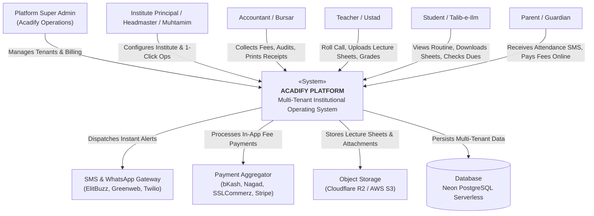
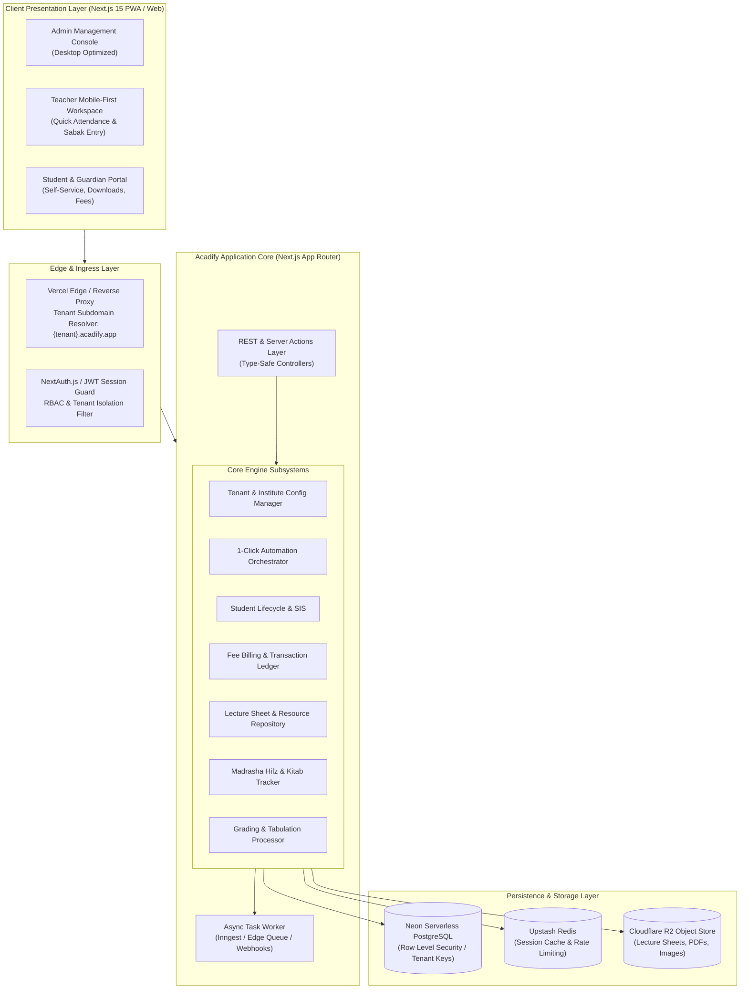
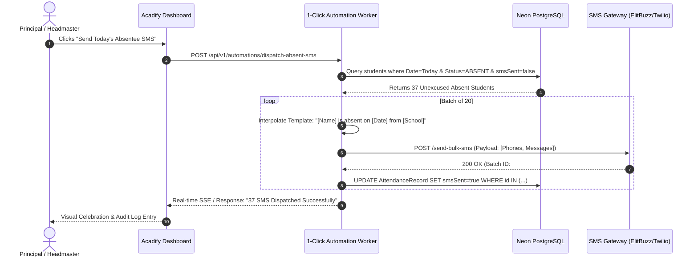
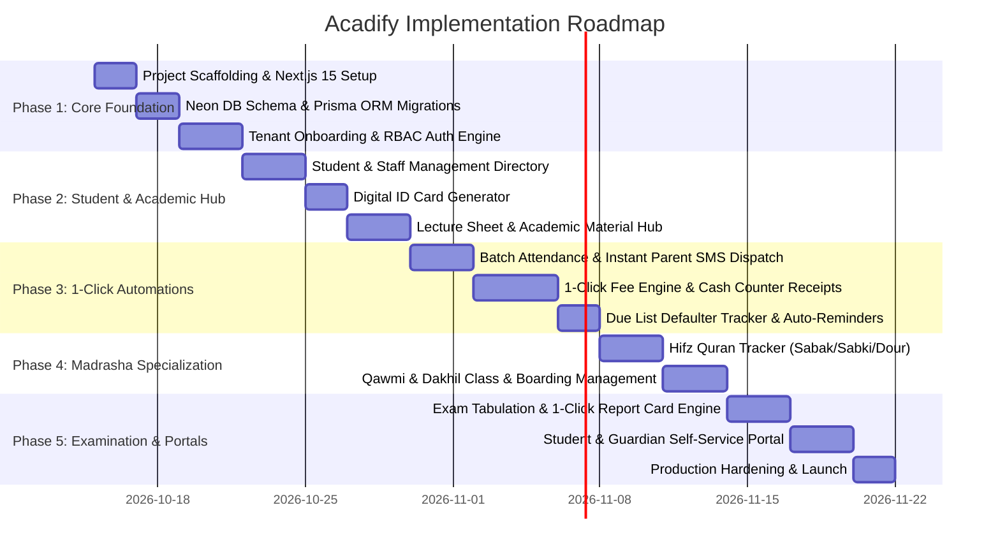

# ACADIFY: High-Level & Low-Level Architecture and Implementation Plan
**Institutional Operating System (IOS) for Schools, Colleges, and Madrasahs**

---

## 1. Executive Summary & Vision

**Acadify** is an all-in-one Institutional Operating System designed to replace fragmented legacy school management software with a unified, modern multi-tenant SaaS platform. 

The primary differentiator of Acadify is **"1-Click Automations"**: repetitive daily operations (such as marking attendance and blasting SMS to absent parents, generating monthly tuition invoices for 2,000 students, calculating terminal GPA rankings, distributing daily lecture sheets, or logging daily Hifz Quran memorization progress) that traditionally take hours are executed automatically with a single click.

### Key Capabilities Matrix
| Dimension | General Schools & Colleges | Madrasahs (Qawmi & Dakhil/Alim) |
| :--- | :--- | :--- |
| **Academic Hierarchy** | Nursery to Class 12 / Higher Secondary (Science, Arts, Commerce) | Ibtidaiyah, Mutawassitah, Sanawiyah, Fazilat, Takmil + Hifzul Quran |
| **Daily Automations** | 1-Click Absent SMS, Daily Class Routine Substitution, Automated Fee Invoicing | 1-Click Daily Sabak/Amokhta Evaluation, Namaz Attendance, Boarding Meal Count |
| **Curriculum & Materials**| National/Cambridge Curriculum, Lecture Sheets, Syllabi, Model Tests | Dars-e-Nizami, Arabic Grammar, Hadith/Fiqh Texts, Lecture Sheets, Tajweed notes |
| **Fee Architecture** | Tuition, Lab, Exam, Library, Transport, Development Fees | Monthly Khoraaki (Meal), Mahana (Tuition), Lillah/Yateem Fund, Custom Waqf |
| **Evaluation Model** | GPA (Letter Grades A+, A, B, C, F), Terminal Tabulation Sheets | Mumtaz (Outstanding), Jayyid Jiddan, Jayyid, Maqbool, Rasib + General GPA |

---

## 2. High-Level Design (HLD)

### 2.1 System Context Diagram (C4 Level 1)



---

### 2.2 System Architecture & Container Diagram (C4 Level 2)



---

### 2.3 Multi-Tenancy Strategy

To guarantee data isolation while maintaining low infrastructure overhead and instant tenant provisioning, Acadify utilizes a **Shared Database, Isolated Tenant Key with Row-Level Security (RLS)** architecture:

1. **Tenant Identification**: Every incoming HTTP request resolves the tenant context via:
   - Custom subdomain: `https://tamirul-millat.acadify.app` $\to$ Tenant `tenant_tm_01`
   - Custom domain mapping: `https://portal.tamirulmillat.edu.bd`
   - Header injection in API: `x-tenant-id`
2. **Data Partitioning**:
   - Every operational entity (`users`, `students`, `fee_invoices`, `lecture_sheets`, `attendance_records`) includes a non-nullable `tenant_id` foreign key indexed with composite indexes (e.g., `(tenant_id, id)`, `(tenant_id, class_id)`).
   - Database middleware automatically injects `where: { tenantId }` into all queries, preventing cross-tenant leakage.

---

### 2.4 Core Subsystems Breakdown

#### 1. 1-Click Automation Orchestrator
- **1-Click Absentee SMS Broadcast**: At 10:00 AM, teachers complete roll calls. The principal hits "Dispatch Absent SMS". The system queries unexcused absent students, formats bilingual SMS (`"Dear Guardian, [Student Name] is absent today from [Institute Name]"`), and queues batch SMS gateway dispatches.
- **1-Click Batch Monthly Fee Generation**: Runs on the 1st of each month. Invoices all active students based on their enrolled class fee structure, applies personal waivers/stipends, and generates printable bank-ready/cash-ready bill slips.
- **1-Click Exam Tabulation**: Aggregates continuous assessments, MCQ, creative (CQ), and practical marks, calculates GPA, determines class rank, and generates printable marksheets with institute watermarks.

#### 2. Academic Resource & Lecture Sheet Hub
- Structured by **Academic Year $\to$ Class $\to$ Section/Stream $\to$ Subject $\to$ Chapter**.
- Teachers can upload PDF documents, hand-written notes, slide decks, and homework instructions.
- Integrated lightweight PDF previewer for students without requiring external downloads.
- Anti-leaking dynamic watermarks (stamps student name & ID on downloaded lecture sheets).

#### 3. Madrasha-Specific Operating System Module
- **Hifz Department**:
  - **Sabak (New Lesson)**: Daily Surah and Ayat range memorized.
  - **Amokhta / Sabki (Recent Revision)**: Last 1 to 5 Paras.
  - **Dour / Nazira (General Quran Recitation & Long-term Revision)**: Retention grading.
  - Progress metrics: Paras completed, status (Nazira $\to$ Hifz $\to$ Revision), completion forecast.
- **Kitab / Dars-e-Nizami Department**:
  - Class structure: Ibtidaiyah $\to$ Mutawassitah $\to$ Sanawiyah $\to$ Fazilat $\to$ Takmil (Dawra-e-Hadith).
  - Kitab-wise syllabus tracking, Jamat-based attendance and examination.
- **Boarding (Matbakh) & Residential Care**:
  - Daily meal count tracking (Breakfast, Lunch, Dinner).
  - Lillah Boarding, Orphan (Yateem) stipend, and donor allocation.

#### 4. Financial & Fee Management Engine
- **Fee Heads**: Flexible setup (Monthly Tuition, Admission, Annual Session, Exam, Transport, Meal/Boarding, Late Fine).
- **Payment Methods**: Cash Counter, bKash/Nagad Merchant integration, Direct Bank Deposit.
- **Receipts**: Auto-generates three-copy money receipts (Student Copy, Bank/Account Copy, Office Copy).
- **Accounts Ledger**: Income vs. Expense tracking with daily cash closure.

---

## 3. Low-Level Design (LLD)

### 3.1 Entity-Relationship Data Model (Prisma Schema Specification)

```mermaid
erDiagram
    TENANT ||--o{ USER : contains
    TENANT ||--o{ CLASS : configures
    TENANT ||--o{ STUDENT : manages
    TENANT ||--o{ FEE_STRUCTURE : defines
    TENANT ||--o{ LECTURE_SHEET : hosts
    
    CLASS ||--o{ SECTION : divides
    CLASS ||--o{ SUBJECT : teaches
    SECTION ||--o{ STUDENT : enrolls
    
    STUDENT ||--o{ ATTENDANCE_RECORD : logs
    STUDENT ||--o{ STUDENT_INVOICE : billed
    STUDENT ||--o{ HIFZ_RECORD : tracks
    
    FEE_STRUCTURE ||--o{ STUDENT_INVOICE : generates
    STUDENT_INVOICE ||--o{ PAYMENT_TRANSACTION : collects
    
    SUBJECT ||--o{ LECTURE_SHEET : contains
    LECTURE_SHEET ||--o{ RESOURCE_ATTACHMENT : has
```

#### Core Schema Definition (PostgreSQL / Prisma format)

```prisma
// Tenant definition
model Tenant {
  id              String         @id @default(uuid())
  slug            String         @unique // e.g. "dhaka-college", "darul-uloom"
  name            String
  instituteType   InstituteType  // SCHOOL, COLLEGE, MADRASHA_GENERAL, MADRASHA_QAWMI
  einNumber       String?        // Government Institute EIIN
  phone           String
  email           String
  address         String
  logoUrl         String?
  config          Json           // Specific configs: SMS templates, grading scale, branding
  createdAt       DateTime       @default(now())
  updatedAt       DateTime       @updatedAt

  users           User[]
  classes         Class[]
  students        Student[]
  feeStructures   FeeStructure[]
  invoices        StudentInvoice[]
  lectureSheets   LectureSheet[]
  attendance      AttendanceRecord[]
  hifzRecords     HifzRecord[]
}

enum InstituteType {
  SCHOOL
  COLLEGE
  MADRASHA_GENERAL // Dakhil, Alim, Fazil, Kamil (Alia)
  MADRASHA_QAWMI   // Dars-e-Nizami, Hifzul Quran
  COMBINED
}

// User & RBAC
model User {
  id              String         @id @default(uuid())
  tenantId        String
  tenant          Tenant         @relation(fields: [tenantId], references: [id], onDelete: Cascade)
  email           String
  phone           String?
  name            String
  passwordHash    String
  role            UserRole
  status          UserStatus     @default(ACTIVE)
  createdAt       DateTime       @default(now())
  updatedAt       DateTime       @updatedAt

  createdSheets   LectureSheet[]
  conductedHifz   HifzRecord[]

  @@unique([tenantId, email])
}

enum UserRole {
  SUPER_ADMIN
  INSTITUTE_ADMIN
  PRINCIPAL
  MUHTAMIM
  TEACHER
  USTAD
  ACCOUNTANT
  STUDENT
  GUARDIAN
}

enum UserStatus {
  ACTIVE
  INACTIVE
  SUSPENDED
}

// Academic Hierarchy
model Class {
  id              String         @id @default(uuid())
  tenantId        String
  tenant          Tenant         @relation(fields: [tenantId], references: [id], onDelete: Cascade)
  name            String         // e.g. "Class 6", "Alim 1st Year", "Mizan", "Hifz"
  orderIndex      Int
  sections        Section[]
  subjects        Subject[]
  students        Student[]
  feeStructures   FeeStructure[]

  @@unique([tenantId, name])
}

model Section {
  id              String         @id @default(uuid())
  classId         String
  class           Class          @relation(fields: [classId], references: [id], onDelete: Cascade)
  name            String         // e.g. "A", "Morning Shift", "Noorani Section"
  roomNumber      String?
  capacity        Int            @default(50)
  students        Student[]
}

model Subject {
  id              String         @id @default(uuid())
  classId         String
  class           Class          @relation(fields: [classId], references: [id], onDelete: Cascade)
  code            String         // e.g. "BAN-101", "ARABIC-1"
  name            String
  isElective      Boolean        @default(false)
  lectureSheets   LectureSheet[]
}

// Student Entity
model Student {
  id              String         @id @default(uuid())
  tenantId        String
  tenant          Tenant         @relation(fields: [tenantId], references: [id], onDelete: Cascade)
  studentIdNo     String         // e.g. "STD-2026-0042"
  fullName        String
  fullNameBengali String?
  fullNameArabic  String?
  gender          Gender
  dob             DateTime
  bloodGroup      String?
  photoUrl        String?
  
  // Placement
  classId         String
  class           Class          @relation(fields: [classId], references: [id])
  sectionId       String?
  section         Section?       @relation(fields: [sectionId], references: [id])
  rollNumber      Int
  
  // Madrasah Specifics
  isResidential   Boolean        @default(false)
  isHifzStudent   Boolean        @default(false)
  isZakatEligible Boolean        @default(false)
  
  // Guardian Information
  guardianName    String
  guardianPhone   String         // Crucial for 1-Click SMS
  guardianRelation String
  address         String

  status          StudentStatus  @default(ENROLLED)
  enrollmentDate  DateTime       @default(now())

  attendance      AttendanceRecord[]
  invoices        StudentInvoice[]
  hifzRecords     HifzRecord[]

  @@unique([tenantId, studentIdNo])
  @@index([tenantId, classId, sectionId])
}

enum Gender {
  MALE
  FEMALE
}

enum StudentStatus {
  ENROLLED
  GRADUATED
  TRANSFERRED
  DROPPED_OUT
}

// Attendance
model AttendanceRecord {
  id              String         @id @default(uuid())
  tenantId        String
  tenant          Tenant         @relation(fields: [tenantId], references: [id], onDelete: Cascade)
  studentId       String
  student         Student        @relation(fields: [studentId], references: [id], onDelete: Cascade)
  date            DateTime       @db.Date
  status          AttendanceStatus
  remarks         String?
  smsSent         Boolean        @default(false)
  recordedBy      String         // User ID

  @@unique([tenantId, studentId, date])
  @@index([tenantId, date, status])
}

enum AttendanceStatus {
  PRESENT
  ABSENT
  LATE
  EXCUSED
}

// Lecture Sheets & Academic Repository
model LectureSheet {
  id              String         @id @default(uuid())
  tenantId        String
  tenant          Tenant         @relation(fields: [tenantId], references: [id], onDelete: Cascade)
  subjectId       String
  subject         Subject        @relation(fields: [subjectId], references: [id], onDelete: Cascade)
  title           String         // e.g. "Chapter 4: Linear Algebra Lecture Note"
  chapterNumber   Int?
  description     String?
  fileUrl         String         // PDF / doc file stored in Cloudflare R2
  fileSize        Int            // In bytes
  fileType        String         // "application/pdf"
  downloadCount   Int            @default(0)
  isPublished     Boolean        @default(true)
  createdById     String
  createdBy       User           @relation(fields: [createdById], references: [id])
  createdAt       DateTime       @default(now())
  updatedAt       DateTime       @updatedAt

  @@index([tenantId, subjectId])
}

// Madrasha Hifz Progress Tracker
model HifzRecord {
  id              String         @id @default(uuid())
  tenantId        String
  tenant          Tenant         @relation(fields: [tenantId], references: [id], onDelete: Cascade)
  studentId       String
  student         Student        @relation(fields: [studentId], references: [id], onDelete: Cascade)
  date            DateTime       @db.Date
  
  // Sabak (Today's new lesson)
  sabakPara       Int?           // Para 1-30
  sabakSurah      String?
  sabakFromAyat   Int?
  sabakToAyat     Int?
  sabakQuality    HifzQuality?   // EXCELLENT, GOOD, AVERAGE, POOR

  // Sabki / Amokhta (Past 5 paras)
  sabkiPara       Int?
  sabkiQuality    HifzQuality?

  // Dour (General Revision)
  dourPara        Int?
  dourQuality     HifzQuality?

  ustadId         String
  ustad           User           @relation(fields: [ustadId], references: [id])
  comments        String?

  @@index([tenantId, studentId, date])
}

enum HifzQuality {
  MUMTAZ      // Outstanding
  JAYYID_JIDDAN // Very Good
  JAYYID      // Good
  MAQBOOL     // Fair / Needs Revision
  DAIF        // Weak
}

// Fees & Financial Ledger
model FeeStructure {
  id              String         @id @default(uuid())
  tenantId        String
  tenant          Tenant         @relation(fields: [tenantId], references: [id], onDelete: Cascade)
  classId         String
  class           Class          @relation(fields: [classId], references: [id], onDelete: Cascade)
  title           String         // e.g. "Monthly Tuition - Class 10"
  amount          Decimal        @db.Decimal(10, 2)
  frequency       FeeFrequency   // MONTHLY, ANNUAL, ONE_TIME, EXAM
  dueDayOfMonth   Int            @default(10)
  lateFineAmount  Decimal        @default(0) @db.Decimal(10, 2)
  isActive        Boolean        @default(true)
}

enum FeeFrequency {
  MONTHLY
  QUARTERLY
  HALF_YEARLY
  ANNUAL
  ONE_TIME
}

model StudentInvoice {
  id              String         @id @default(uuid())
  tenantId        String
  tenant          Tenant         @relation(fields: [tenantId], references: [id], onDelete: Cascade)
  invoiceNumber   String         // e.g. "INV-2026-10-00832"
  studentId       String
  student         Student        @relation(fields: [studentId], references: [id], onDelete: Cascade)
  month           Int            // 1-12
  year            Int            // e.g. 2026
  dueDate         DateTime
  totalAmount     Decimal        @db.Decimal(10, 2)
  discountAmount  Decimal        @default(0) @db.Decimal(10, 2) // Waivers/Stipends
  payableAmount   Decimal        @db.Decimal(10, 2)
  paidAmount      Decimal        @default(0) @db.Decimal(10, 2)
  status          InvoiceStatus  @default(UNPAID)
  createdAt       DateTime       @default(now())

  transactions    PaymentTransaction[]

  @@unique([tenantId, invoiceNumber])
  @@index([tenantId, studentId, status])
}

enum InvoiceStatus {
  UNPAID
  PARTIALLY_PAID
  PAID
  OVERDUE
  CANCELLED
}

model PaymentTransaction {
  id              String         @id @default(uuid())
  invoiceId       String
  invoice         StudentInvoice @relation(fields: [invoiceId], references: [id], onDelete: Cascade)
  receiptNumber   String         // e.g. "REC-2026-00431"
  amountPaid      Decimal        @db.Decimal(10, 2)
  paymentMethod   PaymentMethod  // CASH, BKASH, NAGAD, BANK_TRANSFER, CARD
  paymentReference String?       // TrxID
  collectedBy     String         // User ID
  transactionDate DateTime       @default(now())
}

enum PaymentMethod {
  CASH
  BKASH
  NAGAD
  UPAY
  BANK_TRANSFER
  CARD
}
```

---

### 3.2 1-Click Automation Workflows & State Machines

#### A. 1-Click Absentee SMS Broadcast Engine


#### B. 1-Click Monthly Fee Invoicing Engine


---

### 3.3 REST & Server Actions API Contracts

| Route | Method | Role | Description |
| :--- | :--- | :--- | :--- |
| `/api/v1/tenants/onboard` | `POST` | Super Admin | Creates new school/college/madrasha workspace & admin user |
| `/api/v1/students` | `GET/POST` | Admin, Teacher | List students with filters / Enroll new student |
| `/api/v1/students/:id/id-card` | `GET` | Admin, Student | Generates printable digital vector ID card |
| `/api/v1/attendance/batch` | `POST` | Teacher | Submits section roll call in a single payload |
| `/api/v1/automations/absent-sms` | `POST` | Principal, Admin | **1-Click**: Blasts absent SMS to all unexcused absentees |
| `/api/v1/automations/generate-invoices` | `POST` | Accountant, Admin | **1-Click**: Batch-creates monthly fees for the entire institute |
| `/api/v1/lecture-sheets` | `GET/POST` | Teacher, Student | Uploads new lecture note / Fetches categorized lecture sheets |
| `/api/v1/lecture-sheets/:id/download` | `GET` | Student, Teacher | Returns secure signed download URL with dynamic watermark |
| `/api/v1/madrasha/hifz/daily-entry` | `POST` | Ustad | Logs daily Sabak, Sabki, and Dour evaluation |
| `/api/v1/madrasha/hifz/progress/:id` | `GET` | Ustad, Guardian | Visual Quran tracker (Paras completed, retention index) |
| `/api/v1/fees/collect` | `POST` | Accountant | Records cash/online fee collection & issues official 3-copy receipt |
| `/api/v1/fees/defaulters` | `GET` | Accountant, Admin | Generates due fee list with 1-click SMS reminder dispatch |

---

## 4. UI/UX & Frontend Architecture

### 4.1 Design System & Aesthetic Principles
1. **Theme & Palette**:
   - Primary: Deep Emerald Slate (`#064e3b` / `#059669`) for Madrasha & Academic dignity, paired with Crisp Royal Indigo (`#4338ca`) accents for Schools/Colleges.
   - Backgrounds: Pristine Light Mode (`#f8fafc`) with a deeply refined Dark Mode (`#0b0f17`).
   - Cards & Surfaces: Subtle glassmorphic elevation, border glow, and modern micro-interactions.
2. **Typography**:
   - Modern Inter / Plus Jakarta Sans for English interface.
   - Noto Sans Bengali for Bengali localization.
   - Amiri / Scheherazade New for Madrasha Arabic & Quranic verses.
3. **Responsive Execution**:
   - Fully optimized for desktop large screens (Data tables, bulk invoice printing, tabulation sheets).
   - Touch-first responsive view for teachers taking quick roll call and Ustads recording Hifz sabak from smartphone/tablet in classroom.

---

## 5. Phased Implementation & Build Plan



### Detailed Milestone Breakdown

#### Milestone 1: Multi-Tenant Core & Architecture Foundation
- Initialize Next.js 15 App Router with TypeScript, Tailwind CSS, and Lucide icons.
- Set up Neon Serverless PostgreSQL with Prisma schema covering all tenant entities.
- Implement Tenant context resolver (subdomain extraction & tenant middleware).
- Build Role-Based Access Control (Admin, Teacher/Ustad, Accountant, Student/Guardian).

#### Milestone 2: Student Lifecycle & Digital ID Cards
- Student enrollment form with photo upload, Bengali/Arabic name support, and auto-roll generation.
- Class, Section, and Shift configuration.
- Dynamic, printable Student & Teacher ID card studio with QR code verification.

#### Milestone 3: 1-Click Automation Suite
- **1-Click Attendance**: Quick-tap grid for teachers + 1-Click Instant SMS Gateway integration to notify parents of absentees.
- **1-Click Monthly Fee Invoicing**: Instant automated bill creation for all students according to their class structure.
- Daily activity log and operational dashboard.

#### Milestone 4: Fee Management, Cash Counter & Defaulters
- Fee head configuration (Tuition, Exam, Session, Hostel, Late Fine).
- Counter POS collection interface: accepts cash/bKash, generates 3-copy printable receipts.
- Due fee tracker with 1-click overdue payment SMS notices.

#### Milestone 5: Lecture Sheet & Study Material Repository
- Subject and chapter-wise lecture sheet upload (PDF, docs).
- In-browser PDF previewer with download controls.
- Search and filter by class, subject, and exam term.

#### Milestone 6: Madrasha Specialized Module
- Hifz Progress Tracker: Daily Sabak (Para/Surah/Ayat), Sabki, and Dour record keeping with quality ratings (Mumtaz, Jayyid, etc.).
- 30-Para visual completion roadmap for each Hifz student.
- Boarding (Matbakh) meal count and residential care management.

#### Milestone 7: Examination, Tabulation & Report Cards
- Marks entry sheet by subject and section.
- Automatic GPA and Letter Grade calculation (School GPA 5.0 scale + Madrasha Mumtaz/Jayyid scale).
- 1-Click printable academic transcript / progress report card.

#### Milestone 8: Student & Guardian Portal + Production Readiness
- Student self-service dashboard to view attendance, download lecture sheets, and check fee dues.
- Export to Excel/PDF across all financial and academic reports.
- Comprehensive security testing, rate limiting, and deployment setup.
