# 2. পদার্থের অবস্থা

Source: Chemistry Bangla Version, printed pp. 17-34

## 2.0 ভূমিকা ও শিখনফল

<!-- chemistry-9-10-bn-c02-t2.0-p001 · figure · p.17 -->
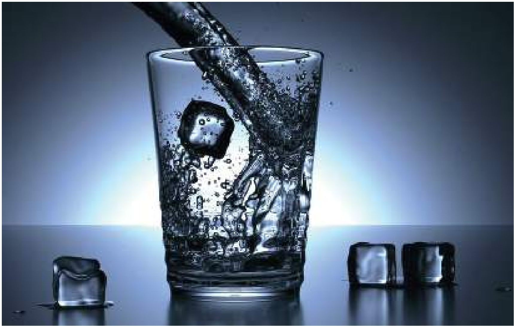

<!-- chemistry-9-10-bn-c02-t2.0-p002 · text · p.17 · review: known-confusable-corrected -->
পদার্থের বিশেষ বৈশিষ্ট্য হলো- এগুলোর ভর আছে এবং এরা স্থান দখল করে। যেমন- চেয়ার, টেবিল, খাতা, কলম, বরফ, পানি, বাতাস ইত্যাদি। একটি পদার্থ কঠিন, তরল ও গ্যাসীয়—এ তিন অবস্থাতেই থাকতে পারে। এ তিন অবস্থাতেই প্রত্যেক পদার্থের নিজস্ব কিছু ধর্ম ও বৈশিষ্ট্য দেখা যায়। এ বিষয়গুলোই এ অধ্যায়ে আলোচনা করা হবে।

### এ অধ্যায় পাঠ শেষে আমরা

<!-- chemistry-9-10-bn-c02-t2.0-p003 · text · p.18 -->
* কণার গতিতত্ত্বের সাহায্যে পদার্থের ভৌত অবস্থা ব্যাখ্যা করতে পারব।
* কণার গতিতত্ত্বের সাহায্যে ব্যাপন ও নিঃসরণ ব্যাখ্যা করতে পারব।
* পদার্থের ভৌত অবস্থা ও তাপের মধ্যে সম্পর্ক ব্যাখ্যা করতে পারব।
* তাপমাত্রা বৃদ্ধিতে ব্যাপন হার বৃদ্ধি পরীক্ষার মাধ্যমে দেখাতে পারব।
* কঠিন পদার্থের গলন ও উর্ধ্বপাতন এবং তরল পদার্থের স্ফুটন প্রক্রিয়া বর্ণনা করতে পারব।
* কঠিন পদার্থের গলন ও উর্ধ্বপাতন এবং তরল পদার্থের স্ফুটন প্রক্রিয়া পরীক্ষার মাধ্যমে দেখাতে পারব।
* প্রকৃতিতে সংযুটিত বাস্তব ঘটনা রসায়নের দৃষ্টিতে বিশ্লেষণ করতে পারব।
* রাসায়নিক দ্রব্য ও থার্মোমিটার সঠিকভাবে ব্যবহার করতে পারব।

## 2.1 পদার্থ ও পদার্থের অবস্থা (Matter and States of Matter)

<!-- chemistry-9-10-bn-c02-t2.1-p001 · text · p.19 -->
যে বস্তুর নির্দিষ্ট ভর আছে এবং জায়গা দখল করে তাকে পদার্থ বলে। কক্ষ তাপমাত্রায় কোনো কোনো পদার্থ কঠিন, কোনো কোনো পদার্থ তরল আবার কোনো কোনো পদার্থ গ্যাসীয় অবস্থায় থাকে। যেমন— কক্ষ তাপমাত্রায় চিনি, খাদ্য লবণ, মার্বেল ইত্যাদি কঠিন অবস্থায়; পানি, তেল, কেরোসিন ইত্যাদি তরল অবস্থায় এবং নাইট্রোজেন, অক্সিজেন, কার্বন ডাই-অক্সাইড ইত্যাদি গ্যাসীয় অবস্থায় থাকে। তাপমাত্রা পরিবর্তন করে একই পদার্থকে কঠিন, তরল এবং গ্যাসীয় অবস্থায় রূপান্তর করা যায়। নিচে কঠিন, তরল ও গ্যাসীয় পদার্থের কিছু ধর্ম এবং বৈশিষ্ট্য আলোচনা করা হলো।

### ২.১.১ কঠিন পদার্থ (Solids)

<!-- chemistry-9-10-bn-c02-t2.1-p002 · text · p.19 -->
কঠিন পদার্থের নির্দিষ্ট ভর, নির্দিষ্ট আকার এবং নির্দিষ্ট আয়তন থাকে। সব পদার্থের কণাগুলোর মধ্যেই এক ধরনের আকর্ষণ বল থাকে। একে আন্তঃকণা আকর্ষণ বল বলা হয়। কঠিন পদার্থের কণাগুলোর মধ্যে আন্তঃকণা আকর্ষণ বল সবচেয়ে বেশি। এ কারণে কঠিন পদার্থের কণাগুলো খুব কাছাকাছি এবং নির্দিষ্ট অবস্থানে থাকে, ফলে কঠিন পদার্থের নির্দিষ্ট আকার হয়। কঠিন পদার্থের উপর চাপ প্রয়োগ করলে এরা সংকুচিত হয় না। আবার, তাপমাত্রা বাড়ালে কঠিন পদার্থের আয়তন খুবই কম পরিমাণ বৃদ্ধি পায়। কঠিন পদার্থের কণাগুলো চলাচল বা স্থান ত্যাগ করতে পারেনা। তবে নিজস্ব স্থানে কম্পন সৃষ্টি করতে পারে।

### ২.১.২ তরল পদার্থ (Liquids)

<!-- chemistry-9-10-bn-c02-t2.1-p003 · text · p.19 -->
তরল পদার্থের নির্দিষ্ট ভর ও নির্দিষ্ট আয়তন আছে কিন্তু নির্দিষ্ট কোনো আকার নেই। তরল পদার্থকে যে পাত্রে রাখা হয় সেই পাত্রের আকার ধারণ করে। তরল পদার্থের কণাগুলো কঠিন পদার্থের কণাগুলোর চেয়ে তুলনামূলকভাবে বেশি দূরত্বে থাকায় এদের মধ্যে আন্তঃকণা আকর্ষণ বল কঠিন পদার্থের চেয়ে কম হয়। তরল পদর্থে চাপ প্রয়োগ করলে আয়তন হ্রাস পায় না। তবে তাপ প্রয়োগ করলে তরল পদার্থের আয়তন বৃদ্ধি পায়। এই আয়তন বৃদ্ধির পরিমাণ কঠিন পদার্থের চেয়ে বেশি।

### ২.১.৩ গ্যাসীয় বা বায়বীয় পদার্থ (Gases)

<!-- chemistry-9-10-bn-c02-t2.1-p004 · text · p.19 -->
গ্যাসীয় পদার্থের নির্দিষ্ট ভর আছে কিন্তু নির্দিষ্ট আকার বা আয়তন নেই। যেকোনো পরিমাণ গ্যাসীয় পদার্থ ভিন্ন ভিন্ন আয়তনের পাত্রে রাখলে পদার্থটি ধারক পাত্রের পুরো আয়তন দখল করে। গ্যাসীয় পদার্থের কণাগুলো কঠিন ও তরল পদার্থের চেয়ে অনেক বেশি দূরে দূরে অবস্থান করে। তাই এদের আন্তঃকণা আকর্ষণ বল খুবই কম। চাপ প্রয়োগ করলে গ্যাসীয় পদার্থের আয়তন অনেক কমে যায়। আবার, তাপ প্রয়োগ করলে গ্যাসীয় পদার্থের আয়তন অনেক বেড়ে যায়।

## 2.2 কণার গতিতত্ত্ব (Kinetic Theory of Particles)

<!-- chemistry-9-10-bn-c02-t2.2-p001 · text · p.20 -->
সকল পদার্থই সূত্র সূত্র কণা দ্বারা গঠিত। এই কণাগুলো একে অপরকে আকর্ষণ করে যাকে আন্তঃকণা আকর্ষণ শক্তি বলে। আবার কণাগুলোর গতিশক্তিও রয়েছে। আন্তঃকণা আকর্ষণ শক্তি এবং কণাগুলোর গতিশক্তি দিয়ে পদার্থের কঠিন, তরল ও গ্যাসীয় অবস্থা ব্যাখ্যা করার তত্ত্বেই কণার গতিতত্ত্ব বলা হয়। যখন কোনো পদার্থের আন্তঃকণা আকর্ষণ শক্তি খুব বেশি থাকে তখন কণাগুলো খুব কাছাকাছি অবস্থান করে এবং নিজেদের অবস্থান পরিবর্তন করতে পারে না। এই অবস্থা হলো পদার্থটির কঠিন

<!-- chemistry-9-10-bn-c02-t2.2-p002 · figure · p.20 -->
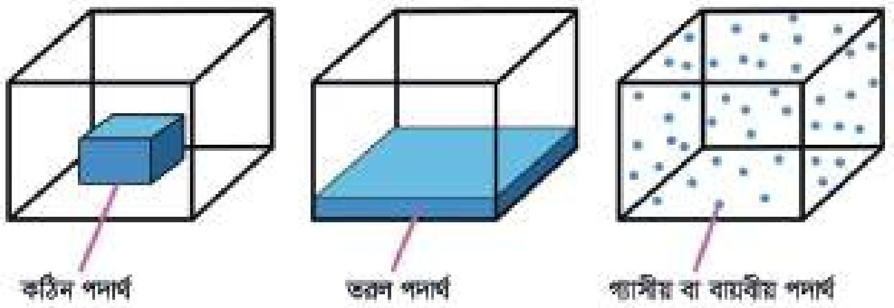

<!-- chemistry-9-10-bn-c02-t2.2-p003 · text · p.20 -->
**কঠিন পদার্থ**      **তরল পদার্থ**      **গ্যাসীয় বা বায়বীয় পদার্থ**

<!-- chemistry-9-10-bn-c02-t2.2-p004 · figure · p.20 -->
**চিত্র ২.০১: কণার গতিতত্ত্ব**

<!-- chemistry-9-10-bn-c02-t2.2-p005 · text · p.20 -->
অবস্থা। কঠিন পদার্থে তাপ দেওয়া হলে পদার্থের কণাগুলো তাপশক্তি গ্রহণ করে কাঁপতে থাকে। ফলে আন্তঃকণা আকর্ষণ শক্তি কমে যায় এবং কণাগুলো কিছুটা গতিশক্তি প্রাপ্ত হয়। পদার্থের এই অবস্থাকে তরল অবস্থা বলে। তরল পদার্থের নির্দিষ্ট আয়তন থাকলেও নির্দিষ্ট আকার থাকে না। তরল অবস্থায় পদার্থে আরো বেশি তাপ দেওয়া হলে কণাগুলো তাপশক্তি নিয়ে গতিশক্তি বৃদ্ধি করতে থাকে এবং এক সময় গতিশক্তি এত বেড়ে যায় যে কণাগুলো আন্তঃকণা আকর্ষণ শক্তি থেকে প্রায় মুক্ত হয়ে বিক্ষিপ্তভাবে ছুটেতে থাকে। পদার্থের এই অবস্থাকে গ্যাসীয় অবস্থা বলে। গ্যাসীয় অবস্থায় পদার্থের কোনো নির্দিষ্ট আয়তন থাকে না। তাকে যে আয়তনের পাত্রে রাখা হবে কণাগুলো সেই আয়তনেই ছোটোছোটি করতে থাকে। এজন্য গ্যাসীয় পদার্থের নির্দিষ্ট কোনো আয়তন নেই। যে পাত্রে রাখা হয় সে পাত্রের আয়তনই গ্যাসের আয়তন এতে পরিমাণ যাই হোক না কেন। গ্যাসীয় অবস্থায় পৌঁছানোর পর যদি আরও তাপ দেওয়া হয় তখন কণাগুলো আরও জোরে ছুটে থাকবে অর্থাৎ গতিশক্তি আরও বেড়ে যাবে।

## 2.3 ব্যাপন (Diffusion)

<!-- chemistry-9-10-bn-c02-t2.3-p001 · text · p.21 -->
কঠিন, তরল ও বায়বীয় মাধ্যমে কোন পদার্থের কণাসমূহের স্বতঃস্ফূর্ত ও সমানভাবে ছড়িয়ে পড়ার প্রক্রিয়াকে ব্যাপন বলে। ব্যাপন প্রক্রিয়ায় কণাসমূহ উচ্চ ঘনমাত্রার স্থান থেকে নিম্ন ঘনমাত্রার স্থানের দিকে স্বতঃস্ফূর্তভাবে ছড়িয়ে পড়ে। যেমন- ঘরের এক কোণে কোনো একটি সুগন্ধির শিশির মুখ খুলে রাখলে কিছুক্ষণের মধ্যে সারা ঘরে সুগন্ধ ছড়িয়ে পড়ে। এটি ব্যাপন প্রক্রিয়ার উদাহরণ। যে মাধ্যমে কণাগুলি ছড়িয়ে পড়তে কম সময় লাগে, সে মাধ্যমে ব্যাপন হার বেশি এবং যে মাধ্যমে কণাগুলি ছড়িয়ে পড়তে বেশি সময় লাগে, সে মাধ্যমে ব্যাপন হার কম। যেমন বায়বীয় মাধ্যমে ব্যাপন হার তরল মাধ্যম হতে বেশি। একইভাবে তরল মাধ্যমে ব্যাপনের হার কঠিন মাধ্যম হতে বেশি। আবার একই মাধ্যমে যে পদার্থের আণবিক ভর বেশি সে পদার্থের কণাগুলির ব্যাপনের হার কম হবে।

<!-- chemistry-9-10-bn-c02-t2.3-p002 · text · p.21 · review: known-confusable-corrected -->
নিচের পরীক্ষাগুলোর মাধ্যমে এ বিষয়ে আরও পরিষ্কার ধারণা নিতে পারবে।

### পরীক্ষা নং: ১

<!-- chemistry-9-10-bn-c02-t2.3-p003 · text · p.21 -->
কক্ষ তাপমাত্রায় একটি কাচের পাত্রে কিছু বিশুদ্ধ পানি নাও। এ পানিতে সামান্য গোলাপি বর্ণের কঠিন পটাশিয়াম পারম্যাঙ্গানেট (KMnO4) ছেড়ে দাও। লক্ষ্য করো? কিছুক্ষণ পর দেখবে KMnO4 এর দানাগুলো দ্রবীভূত হয়ে গোলাপি দ্রবণে পরিণত হচ্ছে এবং পটাশিয়াম পারম্যাঙ্গানেটের কণাগুলো পানির মধ্যে এদিক-সেদিক ছড়িয়ে পড়ছে। ফলে কিছু সময় পর দেখা যাবে পুরো পাত্রেই গোলাপি রং ছড়িয়ে পড়ছে। এক্ষেত্রে পানিতে তথা তরল মাধ্যমে KMnO4 এর কণা ব্যাপিত হয়েছে। এ ব্যাপন সংঘটিত হতে কয়েক মিনিট থেকে প্রায় ঘণ্টা খানেক সময় লাগতে পারে। তবে এক্ষেত্রে তাপ প্রয়োগ করা হলে ব্যাপন হার বৃদ্ধি পায়।

<!-- chemistry-9-10-bn-c02-t2.3-p004 · text · p.21 -->
যেমন- গরম পানিতে KMnO4 এর ব্যাপনের পরীক্ষাটি সম্পন্ন করা হলে দেখা যাবে ঠান্ডা পানির চেয়ে গরম পানিতে KMnO4 কণাগুলো দ্রুত ছড়িয়ে পড়ে সমগ্র পানিকে গোলাপি বর্ণে পরিণত করছে।

<!-- chemistry-9-10-bn-c02-t2.3-p005 · figure · p.21 -->
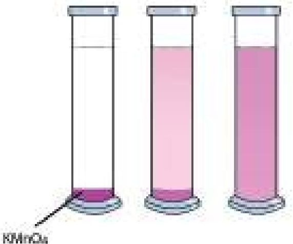

<!-- chemistry-9-10-bn-c02-t2.3-p006 · figure · p.21 -->
**চিত্র ২.০২: পানিতে KMnO4 এর ব্যাপন**

### পরীক্ষা নং: ২

<!-- chemistry-9-10-bn-c02-t2.3-p007 · text · p.22 · review: known-confusable-corrected -->
কক্ষ তাপমাত্রায় একটি বিকারে কিছু পরিমাণ বিশুদ্ধ পানি নিয়ে এতে সামান্য পরিমাণ তরল নীলের দ্রবণ যোগ করো। কিছুক্ষণের মধ্যে দেখবে বিকারের সমস্ত পানি নীল রং ধারণ করেছে। অর্থাৎ নীলের দ্রবণের কণাগুলো সমস্ত পানিতে ছড়িয়ে পড়েছে। এক্ষেত্রে পানিতে তরল পদার্থ (নীলের দ্রবণ) ব্যাপিত হয়েছে। কক্ষ তাপমাত্রায় কঠিন KMnO4-এর ব্যাপনের চেয়ে তরল নীলের দ্রবণের ব্যাপনের সময় অনেক কম লেগেছে। অর্থাৎ তরল মাধ্যমে কঠিন পদার্থের ব্যাপন হার-এর চেয়ে তরল মাধ্যমে তরল পদার্থের ব্যাপন হার বেশি। তাপের প্রভাবে এই ব্যাপন হার আরও বেশি হয়।

<!-- chemistry-9-10-bn-c02-t2.3-p008 · text · p.22 · review: known-confusable-corrected -->
কঠিন এবং তরল পদার্থের ন্যায় গ্যাসীয় পদার্থ তরল মাধ্যমে ব্যাপিত হয়। তবে একটি নির্দিষ্ট তাপমাত্রায় তরল মাধ্যমে কঠিন এবং তরল পদার্থের চেয়ে গ্যাসীয় পদার্থের ব্যাপন হার বেশি।

<!-- chemistry-9-10-bn-c02-t2.3-p009 · figure · p.22 -->
**চিত্র ২.০৩: তরল (পানি) মাধ্যমে তরল পদার্থ (নীলের দ্রবণ)**

### দুটি গ্যাসের ব্যাপন হার

<!-- chemistry-9-10-bn-c02-t2.3-p010 · text · p.22 · review: known-confusable-corrected -->
এই পরীক্ষার জন্য দুই মুখ খোলা একটি লম্বা কাচনল ও দুই খণ্ড তুলা নাও। এক খণ্ড তুলাকে ঘন হাইড্রোক্লোরিক এসিড (HCl) দ্রবণে ভিজাও এবং অপর খণ্ড তুলাকে অ্যামোনিয়াম হাইড্রোক্সাইড (NH4OH) দ্রবণে ভিজাও। এবার ঐ লম্বা কাচনলটির এক মুখে হাইড্রোক্লোরিক এসিড দ্রবণে সিঙ্ক তুলা এবং অপর মুখে অ্যামোনিয়াম হাইড্রোক্সাইড দ্রবণে সিঙ্ক তুলা দিয়ে বন্ধ করো। এখানে হাইড্রোক্লোরিক এসিড দ্রবণ থেকে হাইড্রোজেন ক্লোরাইড গ্যাস এবং অ্যামোনিয়াম হাইড্রোক্সাইড দ্রবণ থেকে অ্যামোনিয়া (NH3) গ্যাস টিউবের ভিতরের বাতাসের মধ্যে দিয়ে ব্যাপিত হবে। বাতাস একটি বায়বীয় বা গ্যাসীয় মাধ্যম।

<!-- chemistry-9-10-bn-c02-t2.3-p011 · text · p.23 · review: known-confusable-corrected -->
কিছুক্ষণের মধ্যে দেখতে পাবে কাচনলের ভিতরে একটি নির্দিষ্ট স্থানে হাইড্রোজেন ক্লোরাইড গ্যাস ও অ্যামোনিয়া গ্যাস পরস্পরের সাথে বিক্রিয়া করে অ্যামোনিয়াম ক্লোরাইডের (NH4Cl) সাদা ধোঁয়ার সৃষ্টি করেছে। এ সাদা ধোঁয়া তৈরিতে এক মিনিটেরও কম সময় লাগে। সাদা ধোঁয়ার অবস্থান কাচনলের ঠিক মাঝামাঝি হবে না। এটি হাইড্রোক্লোরিক এসিড দ্রবণের কাছে এবং অ্যামোনিয়াম হাইড্রোক্সাইড দ্রবণ থেকে দূরে অবস্থান করবে। অর্থাৎ একই সময়ে হাইড্রোজেন ক্লোরাইড গ্যাস কম দূরত্ব এবং অ্যামোনিয়া গ্যাস বেশি দূরত্ব অতিক্রম করেছে। এ পরীক্ষা থেকে বোঝা যায় যে, অ্যামোনিয়া গ্যাস হাইড্রোজেন ক্লোরাইড গ্যাস থেকে দ্রুত ছড়িয়ে পড়ে বা বেশি দূরত্ব অতিক্রম করে অর্থাৎ অ্যামোনিয়া গ্যাসের ব্যাপন হার হাইড্রোজেন ক্লোরাইড গ্যাসের ব্যাপন হারের চেয়ে বেশি। এর কারণ মূলত এদের আণবিক ভর। যে গ্যাসের আণবিক ভর যত কম তার ব্যাপন হার তত বেশি। এখানে অ্যামোনিয়া গ্যাসের আণবিক ভর (17) হাইড্রোজেন ক্লোরাইড গ্যাসের আণবিক ভর (36.5) এর চেয়ে কম। তাই NH3 গ্যাস HCl গ্যাসের চেয়ে দ্রুত ব্যাপিত হয়েছে অর্থাৎ বেশি দূরত্ব অতিক্রম করেছে। H2, He, N2, O2 এবং CO2 গ্যাসগুলোর আণবিক ভর যথাক্রমে 2, 4, 28, 32 এবং 44। এই গ্যাসগুলোর মধ্যে H2 এর আণবিক ভর সবচেয়ে কম।

<!-- chemistry-9-10-bn-c02-t2.3-p012 · figure · p.23 -->
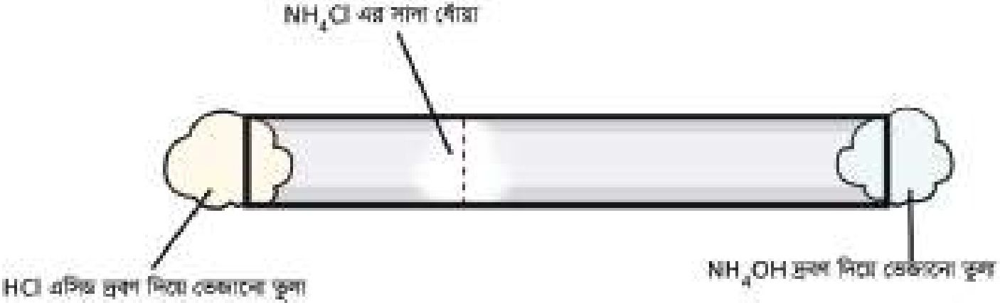

<!-- chemistry-9-10-bn-c02-t2.3-p013 · figure · p.23 -->
**চিত্র ২.০৪: দুটি গ্যাসের ব্যাপন**

<!-- chemistry-9-10-bn-c02-t2.3-p014 · text · p.23 -->
তাই H2 এর ব্যাপন হার সবচেয়ে বেশি হবে এবং CO2 এর আণবিক ভর সবচেয়ে বেশি, কাজেই CO2 এর ব্যাপন হার সবচেয়ে কম হবে। আমরা দেখলাম তরল মাধ্যম থেকে বায়বীয় মাধ্যমে পদার্থের ব্যাপনের হার বেশি যা ৫০ থেকে ১০০ গুণ পর্যন্ত হতে পারে।

## 2.4 নিঃসরণ (Effusion)

<!-- chemistry-9-10-bn-c02-t2.4-p001 · text · p.24 -->
নিঃসরণ হলো এমন একটি প্রক্রিয়া যার মাধ্যমে গ্যাসের কণাগুলো খুব ছোট একটি ছিদ্র দিয়ে পারস্পরিক সংঘর্ষ ছাড়াই একে একে বের হয়ে যায়। যেমন বেলুনের ছোট ছিদ্র দিয়ে গ্যাস নির্গমন। বেলুনে যদি অতি সূক্ষ্ম বা মাইক্রোস্কোপিক ছিদ্র থাকে, তাহলে কিছু সময় পর সেটি ধীরে ধীরে হাওয়া ছেড়ে সঙ্কুচিত হয়ে যায়। এটি হয় কারণ গ্যাসের কণাগুলো একটি একটি করে সেই সূক্ষ্ম ছিদ্র দিয়ে বাইরে বেরিয়ে আসে। এই ধরনের ধীর গ্যাস নির্গমনকে নিঃসরণ (Effusion) বলা হয়।

<!-- chemistry-9-10-bn-c02-t2.4-p002 · text · p.24 -->
এছাড়া যদি কোনো টায়ার খুব ছোট একটি ছিদ্র থাকে, তবে সেই ছিদ্র দিয়ে গ্যাস ধীরে ধীরে কণার আকারে বের হয়ে যায়। এটি জোর বের হওয়া বা হঠাৎ বিস্ফোরণের মতো নয়। এই ধরনের ধীর গতিতে ও ধাপে ধাপে নির্গমনই নিঃসরণ বা Effusion।

### গ্যাস সিলিন্ডার ও পাইপলাইনে লিক শনাক্তকরণ

<!-- chemistry-9-10-bn-c02-t2.4-p003 · text · p.24 · review: latin-junk -->
গ্যাস সিলিন্ডার বা পাইপলাইনে সূক্ষ্ম ছিদ্র দিয়ে ধীরে ধীরে গ্যাস নির্গমন হলে তা নিঃসরণের মাধ্যমে ঘটে। এই ধীর গ্যাস নির্গমন পর্যবেক্ষণের মাধ্যমে লিক বা ত্রুটি শনাক্ত করা যায়। সাবান পানি দিয়ে এল পি জি সিলিন্ডার এর ভালভ ও লাইনে নিয়মিত লিক টেস্ট করা যায়। যেমন গ্যাস সিলিন্ডার বা পাইপলাইন সাবান পানিতে ঢেকে ফেলা হয়। যদি ছোট ছোট বদবুদের মতো কিছু দেখা যায়, তাহলে বুঝা যায় সিলিন্ডারে বা পাইপলাইনে সূক্ষ্ম ছিদ্র আছে যা দিয়ে effusion হচ্ছে।

<!-- chemistry-9-10-bn-c02-t2.4-p004 · text · p.24 -->
**সাবান পানি ব্যবহার করে লিক টেস্ট**

### গ্যাসের মোলার ভর নির্ণয়

<!-- chemistry-9-10-bn-c02-t2.4-p005 · text · p.24 · review: latin-junk -->
দুটি অজানা গ্যাসের effusion হার নিণয় করে গবেষকরা তাদের মোলার ভরের তুলনা করেন। হালকা গ্যাস দ্রুত বের হয়, ভারী গ্যাস ধীরে, আর এভাবেই জানা যায় কোন গ্যাস কতটা ভারী।

## 2.5 মোমবাতির প্রজ্বলন এবং মোমের তিন অবস্থা

### (Burning of a Candle and the Three States of Wax)

<!-- chemistry-9-10-bn-c02-t2.5-p001 · figure · p.25 -->
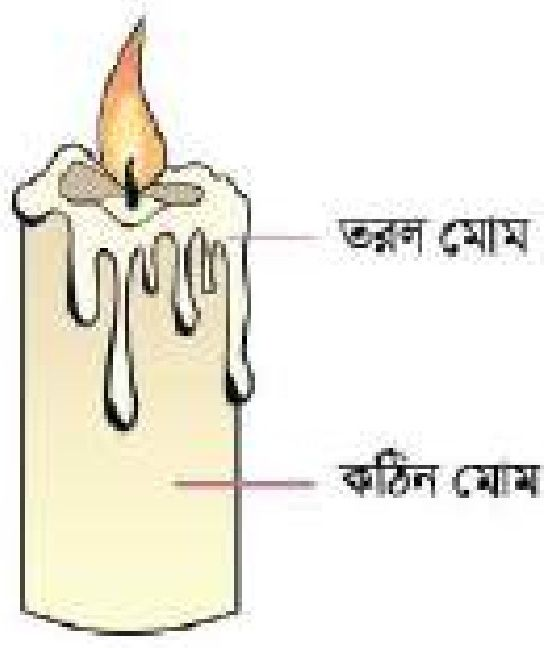

<!-- chemistry-9-10-bn-c02-t2.5-p002 · figure · p.25 -->
**চিত্র ২.০৫: মোমবাতির জ্বলন**

<!-- chemistry-9-10-bn-c02-t2.5-p003 · text · p.25 -->
মোম হলো বিভিন্ন হাইড্রোকার্বনের মিশ্রণ। হাইড্রোজেন এবং কার্বন মিলে গঠিত জৈব যৌগই হলো হাইড্রোকার্বন। মোমের প্রজ্বলনে আমরা মোমের কঠিন, তরল এবং গ্যাসীয় এই তিনটি অবস্থাই দেখতে পাই। মোমবাতিতে মোমের মধ্যে একটি সুতা থাকে। এ সুতাতে আগুন জ্বালালে সুতার চারদিকে হাইড্রোকার্বন অণুগুলো তাপে গলে তরলে পরিণত হয়। অর্থাৎ কঠিন অবস্থা থেকে তরল অবস্থায় পরিণত হয়।

<!-- chemistry-9-10-bn-c02-t2.5-p004 · text · p.25 -->
ঐ তরল মোম আগুনের তাপে প্রথমে বাষ্পে পরিণত হয়। অতপর ঐ বাষ্পীয় মোম বাতাসের অক্সিজেনের সাথে বিক্রিয়া করে কার্বন ডাই-অক্সাইড, জলীয় বাষ্প, আলো এবং তাপ উৎপন্ন করে। তরল মোমের কিছু অংশ ঠান্ডা হলে তা কঠিন মোমে পরিণত হয়। অর্থাৎ তাপের প্রভাবে মোমের কঠিন, তরল ও গ্যাসীয় এই তিন অবস্থারই অস্তিত্ব পাওয়া যায়।

## 2.6 গলন ও স্ফুটন (Melting and Boiling)

<!-- chemistry-9-10-bn-c02-t2.6-p001 · text · p.25 -->
তাপ প্রয়োগে কোনো পদার্থের কঠিন অবস্থা থেকে তরল অবস্থায় রূপান্তর করার প্রক্রিয়াকে গলন বলে। 1.0 বায়ুমণ্ডলীয় চাপে তাপ প্রয়োগের ফলে যে তাপমাত্রায় কোনো কঠিন পদার্থ তরলে পরিণত হয় সেই তাপমাত্রাকে উষ্ণ কঠিন পদার্থের গলনাঙ্ক বলে। প্রত্যেক বিশুদ্ধ কঠিন পদার্থের একটি নির্দিষ্ট গলনাঙ্ক থাকে। যেমন— 1.0 বায়ুমণ্ডলীয় চাপে বরফের গলনাঙ্ক 0°C।

<!-- chemistry-9-10-bn-c02-t2.6-p002 · text · p.25 -->
তাপ প্রয়োগ করে তরলকে গ্যাসে রূপান্তর করার প্রক্রিয়াকে স্ফুটন বলে। 1.0 বায়ুমণ্ডলীয় চাপে তাপ প্রয়োগের ফলে যে তাপমাত্রায় কোনো তরল পদার্থ গ্যাসীয় পদার্থে পরিণত হয় সেই তাপমাত্রাকে উষ্ণ তরল পদার্থের স্ফুটনাঙ্ক বলে। প্রত্যেক বিশুদ্ধ তরলের একটি নির্দিষ্ট স্ফুটনাঙ্ক থাকে। যেমন— 1.0 বায়ুমণ্ডলীয় চাপে পানির স্ফুটনাঙ্ক 100°C। স্ফুটনের বিপরীত প্রক্রিয়াটির নাম ঘনীভবন। স্ফুটনের জন্য তাপ দিতে হয়, ঘনীভবনের সময় তাপ সরিয়ে নিতে হয়।

### কঠিন পদার্থের গলনাঙ্ক নির্ণয় পদ্ধতি

<!-- chemistry-9-10-bn-c02-t2.6-p003 · text · p.26 -->
ধরা যাক, আমরা একটি বিশুদ্ধ কঠিন পদার্থ/ইউরিয়া সারের গলনাঙ্ক নির্ণয় করতে চাই। এম্ব্রে প্রথমে একটি ত্রিপদী স্ট্যান্ডের উপর তারজালি রেখে তার উপর একটি ওয়াচ গ্লাস রাখতে হবে। এবার ঐ ওয়াচ গ্লাসের উপর কিছু পরিমাণ ইউরিয়া সার রাখতে হবে। এবার একটি স্ট্যান্ডের সাথে সূতা দিয়ে থার্মোমিটারকে বেঁধে থার্মোমিটারের বাল্বকে ইউরিয়ার মধ্যে প্রবেশ করাতে হবে। এবার একটি বার্নার দিয়ে ইউরিয়াকে তাপ দিতে হবে। তাপ দেওয়ার এক পর্যায়ে দেখা যাবে 133°C তাপমাত্রায় ইউরিয়া সার গলতে শুরু করেছে এবং ঐ তাপমাত্রায় সকল ইউরিয়া সার গলে যাবে। এই 133°C তাপমাত্রাই ইউরিয়ার গলনাঙ্ক।

<!-- chemistry-9-10-bn-c02-t2.6-p004 · figure · p.26 -->
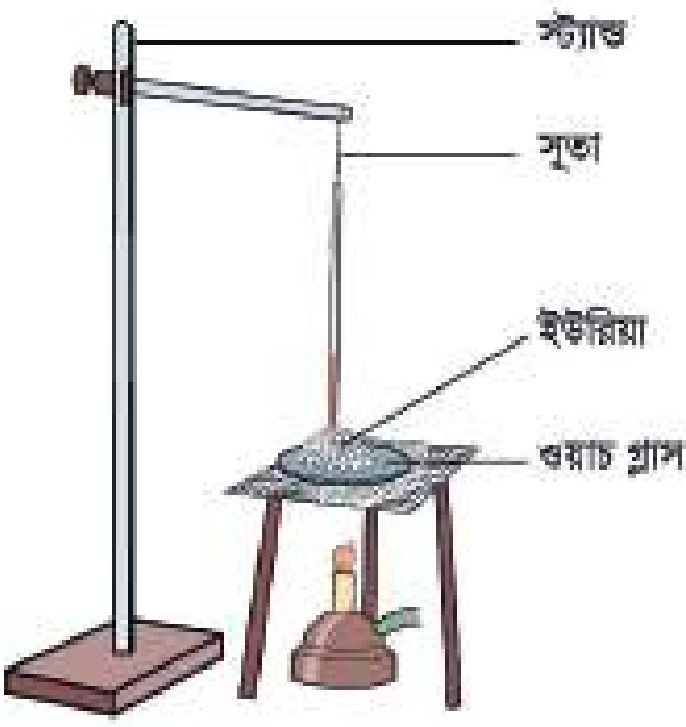

<!-- chemistry-9-10-bn-c02-t2.6-p005 · figure · p.26 -->
**চিত্র ২.০৬: ইউরিয়ার গলনাঙ্ক নির্ণয়**

<!-- chemistry-9-10-bn-c02-t2.6-p006 · text · p.26 -->
আবার ধরা যাক, আমরা একটি অবিশুদ্ধ পদার্থ মোমের গলনাঙ্ক বের করতে চাই। মোম কিছু পদার্থের মিশ্রণ। মোমের গলনাঙ্ক নির্ণয় করতে হলে প্রথমে মোমকে চূর্ণ করে পাউডার বা গুঁড়ায় পরিণত করতে হবে। এরপর মোমের গুঁড়াকে একটি এক মুখ বন্ধ কাচনলে নিয়ে ২.০৭ চিহ্নের মতো করে সেখানে একটি থার্মোমিটার রাখতে হবে। এবারে কাচনলটি বিকারের পানিতে এমনভাবে ডুবাতে হবে যেন কাচনলের খোলা মুখে পানি প্রবেশ না করে। এখন বিকারটিতে ধীরে ধীরে তাপ প্রয়োগ করতে হবে। এক পর্যায়ে দেখা যাবে একটি নির্দিষ্ট তাপমাত্রায় মোম না গলে তাপমাত্রার একটি পরিসরে (range)

<!-- chemistry-9-10-bn-c02-t2.6-p007 · text · p.26 -->
মোম গলতে থাকে এবং তাপমাত্রার এই পরিসরই হলো মোমের গলনাঙ্ক।

<!-- chemistry-9-10-bn-c02-t2.6-p008 · text · p.26 -->
অবিশুদ্ধ পদার্থের গলনাঙ্ক বিশুদ্ধ পদার্থ থেকে কম এবং স্ফুটনাঙ্ক বেশি হয়। মিশ্র পদার্থের সুনির্দিষ্ট গলনাঙ্ক ও স্ফুটনাঙ্ক থাকে না।

<!-- chemistry-9-10-bn-c02-t2.6-p009 · figure · p.27 -->
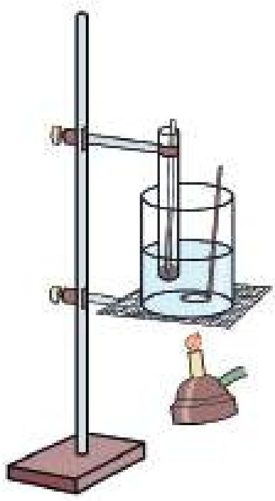

<!-- chemistry-9-10-bn-c02-t2.6-p010 · figure · p.27 -->
**চিত্র ২.০৭: মোমের গলনাঙ্ক নির্ণয়**

<!-- chemistry-9-10-bn-c02-t2.6-p011 · text · p.27 -->
যেহেতু প্রত্যেক বিশুদ্ধ কঠিন পদার্থের একটি নির্দিষ্ট গলনাঙ্ক থাকে সেইহেতু কঠিন পদার্থ একটি নির্দিষ্ট তাপমাত্রায় গলে থাকে। যদি দেখা যায় কোনো কঠিন পদার্থ তার নির্দিষ্ট গলনাঙ্ক ছাড়া অন্য কোনো তাপমাত্রায় গলছে সেক্ষেত্রে ধরে নিতে হবে কঠিন পদার্থটি বিশুদ্ধ নয়। আবার যদি দেখা যায় কঠিন পদার্থটি একটি নির্দিষ্ট তাপমাত্রার পরিসরে গলে থাকে তাহলেও ধরে নিতে হবে কঠিন পদার্থটি বিশুদ্ধ নয়। যেমন— 1.0 বায়ুমণ্ডলীয় চাপে বিশুদ্ধ সালফারের গলনাঙ্ক 115°C। কিন্তু কোনো একটি সালফার নমুনার গলনাঙ্ক নির্ণয় করার সময় যদি দেখা যায় ঐ সালফার নমুনা 115°C অপেক্ষা কম তাপমাত্রায় গলছে, তবে বুঝতে হবে ঐ নমুনা সালফার বিশুদ্ধ নয়। এটি ভেজাল যুক্ত সালফার। গলনাঙ্ক নির্ণয় প্রক্রিয়ার মাধ্যমে কোনো কঠিন পদার্থের বিশুদ্ধতা নির্ণয় করা যায়।

### তরল পদার্থের স্ফুটনাঙ্ক নির্ণয়ের পদ্ধতি

<!-- chemistry-9-10-bn-c02-t2.6-p012 · text · p.27 -->
যে তরল পদার্থের স্ফুটনাঙ্ক নির্ণয় করতে হবে ঐ তরল পদার্থের (যেমন— পানি) কিছু পরিমাণ একটি বিকারে নেওয়া হয়। এই বিকারের মধ্যে একটি থার্মোমিটার রাখা হয়। এখন সতর্কতার সাথে বুনসেন বার্নার দিয়ে বিকারটিকে উত্তপ্ত করা হয়। এক পর্যায়ে সমস্ত পানি একটি নির্দিষ্ট তাপমাত্রায় বাষ্পে পরিণত হবে। এই তাপমাত্রাই পানির স্ফুটনাঙ্ক। যেমন- পানিকে বিকারে নিয়ে উত্তপ্ত করলে 100°C তাপমাত্রায় সমস্ত পানি বাষ্পে পরিণত হয়। অর্থাৎ পানির স্ফুটনাঙ্ক 100°C (1 atm চাপে)। যেহেতু প্রত্যেক বিশুদ্ধ তরলের স্ফুটনাঙ্ক নির্দিষ্ট সেইহেতু একাধিক তরলের একই স্ফুটনাঙ্ক হতে পারে না। আবার, কোনো তরলে ভেজাল মিশ্রিত থাকলে সেটি তার নির্দিষ্ট স্ফুটনাঙ্ক ব্যতীত ভিন্ন তাপমাত্রায় ফুটতে থাকে।

<!-- chemistry-9-10-bn-c02-t2.6-p013 · text · p.28 -->
যেমন-পানিতে সামান্য পরিমাণ অ্যালকোহল যোগ করলে পানির স্ফুটনাঙ্ক 100°C তাপমাত্রা না হয়ে অন্য কোনো তাপমাত্রায় হবে। স্ফুটনাঙ্কের মাধ্যমে কোনো তরল পদার্থ বিশুদ্ধ নাকি অবিশুদ্ধ তা নির্ণয় করা যায়।

<!-- chemistry-9-10-bn-c02-t2.6-p014 · figure · p.28 -->
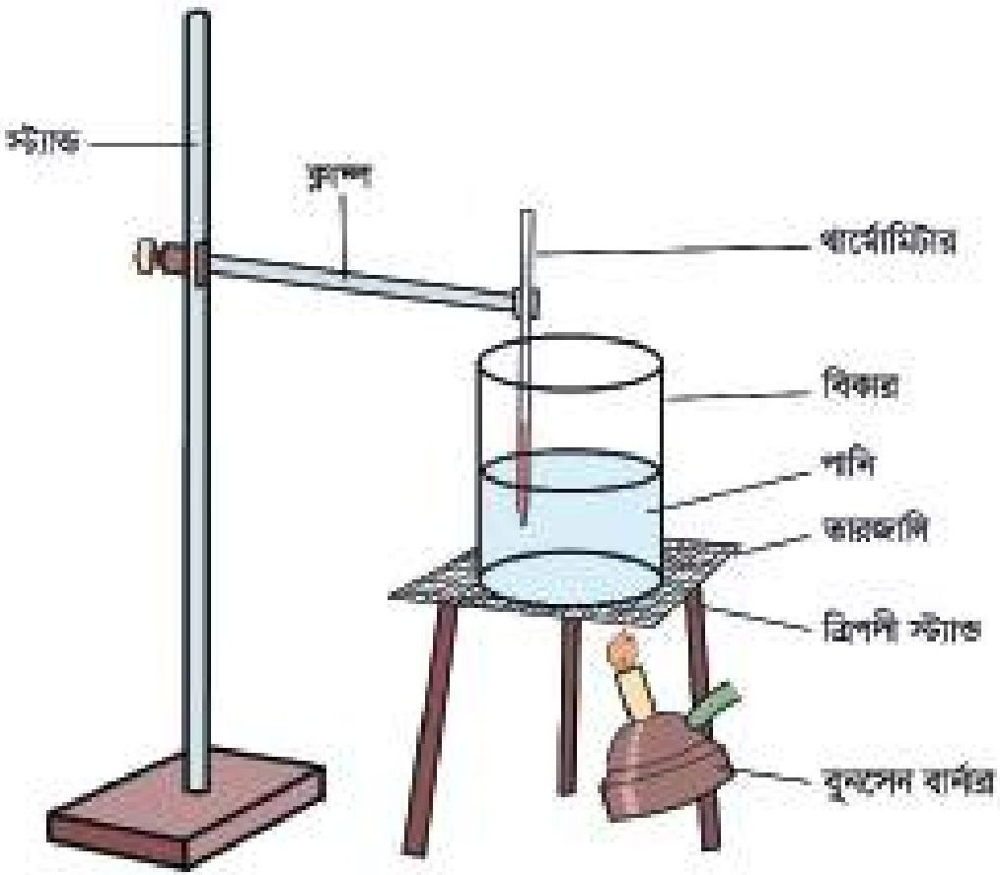

<!-- chemistry-9-10-bn-c02-t2.6-p015 · figure · p.28 -->
**চিত্র ২.০৮: পানির স্ফুটনাঙ্ক নির্ণয়**

<!-- chemistry-9-10-bn-c02-t2.6-p016 · text · p.28 -->
ইতোমধ্যে তোমরা জানতে পেরেছ একটি বিশুদ্ধ পদার্থের গলন এবং স্ফুটনের সময় তাপ দেওয়া হলেও তাপমাত্রার পরিবর্তন হয় না। এই সময় যে তাপ দেওয়া হয় সেই তাপটুকু অবশিষ্ট পদার্থ শোষণ করে কঠিন থেকে তরল কিংবা তরল থেকে গ্যাসে পরিণত হয়।

<!-- chemistry-9-10-bn-c02-t2.6-p017 · text · p.28 -->
আমরা যদি তাপ প্রয়োগ করে একটি কঠিন পদার্থকে প্রথমে তরল পরে তরলকে বাষ্পে পরিণত করি তাহলে তাপমাত্রার কী ঘটবে? নিচের পরীক্ষাটি দেখে আমরা সেটি বুঝতে পারি।

### পরীক্ষা নং: ৬

<!-- chemistry-9-10-bn-c02-t2.6-p018 · text · p.28 -->
কয়েক টুকরা বরফকে একটি বিকারে নিয়ে সেটিতে ধীরে ধীরে তাপ প্রদান করা হলো এবং তাপ প্রয়োগের পুরো সময় একটি থার্মোমিটারের সাহায্যে সারণ্যণ এর তাপমাত্রা পরিমাণ করা হলো। ধরা যাক, কঠিন বরফ খণ্ডগুলোর প্রাথমিক তাপমাত্রা ছিল -40°C (২.০৯ চিত্রটি দেখো)।

### তাপমাত্রা (°C) vs (তাপ শোষণ) — X অক্ষ: সময়; Y অক্ষ: তাপমাত্রা (°C)

<!-- chemistry-9-10-bn-c02-t2.6-p019 · table · p.29 · review: verify-table -->
<table><tr><th>সময় (X অক্ষ)</th><th>তাপমাত্রা (°C) (Y অক্ষ)</th><th>অবস্থা</th></tr>
<tr><th>0</th><td>-40</td><td>বরফের গলনাঙ্ক রেখা</td></tr>
<tr><th>1</th><td>0</td><td>বরফের গলনাঙ্ক রেখা</td></tr>
<tr><th>2</th><td>0</td><td>বরফের গলনাঙ্ক রেখা</td></tr>
<tr><th>3</th><td>100</td><td>পানি</td></tr>
<tr><th>4</th><td>100</td><td>পানির স্ফুটনাঙ্ক রেখা</td></tr>
<tr><th>5</th><td>100</td><td>পানির স্ফুটনাঙ্ক রেখা</td></tr>
<tr><th>6</th><td>120</td><td>জলীয় বাষ্প</td></tr></table>

<!-- chemistry-9-10-bn-c02-t2.6-p020 · figure · p.29 -->
**চিত্র ২.০৯: বরফে তাপ প্রদানের লেখচিত্র**

<!-- chemistry-9-10-bn-c02-t2.6-p021 · text · p.29 · review: latin-junk -->
তাপ প্রয়োগের সাথে সাথে কঠিন অবস্থার বরফের তাপমাত্রা ধীরে ধীরে বাড়তে থাকে এবং বাড়তে বাড়তে যখন ০°C তাপমাত্রায় পৌঁছায়, তখন কঠিন বরফ গলনের মাধ্যমে তরল পানিতে পরিণত হয়। কঠিন বরফের গলনের পুরো সময় তাপমাত্রা ০°C তাপমাত্রায় স্থির থাকে এবং এই ০°C তাপমাত্রায়ই সমস্ত বরফ পানিতে পরিণত হয়। অর্থাৎ ০°C তাপমাত্রা হলো বরফের গলনাঙ্ক। গলনাঙ্কের তাপমাত্রায় যে সরলরেখা পাওয়া যায় তাকে গলনাঙ্ক রেখা বলা হয়। ২.০৯ চিত্রে AB রেখা বরফের গলনাঙ্ক রেখা। এই রেখা বরাবর বরফ ও পানি উভয়ই অবস্থান করে। এরপরও তাপ দিতে থাকলে তরল পানির তাপমাত্রা ধীরে ধীরে বাড়তে থাকে এবং পানির তাপমাত্রা যখন ১০০°C এ পৌঁছে তখন পানিতে তাপ প্রদান করলেও তরল পানির তাপমাত্রা আর বাড়ো না। ঐ তাপমাত্রায় পানি ফুটতে থাকে। এই ১০০°C তাপমাত্রায়ই সমস্ত পানি জলীয় বাষ্পে পরিণত হয়। এরপরও তাপ প্রয়োগ করা হলে জলীয় বাষ্পের তাপমাত্রা ধীরে ধীরে বাড়তে থাকে। পানির স্ফুটনাঙ্ক ১০০°C। চিত্রে CD রেখা পানির স্ফুটনাঙ্ক রেখা। এই রেখা বরাবর পানি এবং জলীয়বাষ্প উভয়ই একসাথে অবস্থান করে।

<!-- chemistry-9-10-bn-c02-t2.6-p022 · text · p.30 -->
বিপরীতক্রমে জলীয় বাষ্পকে ক্রমশঃ শীতল করা হলে প্রাপ্ত ফলাফল একটি গ্রাফ পেপারের X অক্ষে সময় এবং Y অক্ষে তাপমাত্রা নিয়ে লেখচিত্র অঙ্কন করলে নিম্নরূপ রেখা পাওয়া যাবে:

### তাপমাত্রা (°C) vs সময় (X অক্ষ) — জলীয় বাষ্প থেকে তরল পানি পর্যন্ত

<!-- chemistry-9-10-bn-c02-t2.6-p023 · table · p.30 · review: verify-table -->
<table><tr><th>সময় (X অক্ষ)</th><th>তাপমাত্রা (°C) (Y অক্ষ)</th><th>অবস্থা</th></tr>
<tr><th>0</th><td>140</td><td>জলীয় বাষ্প</td></tr>
<tr><th>1</th><td>100</td><td>অবস্থানান্তর (Condensation)</td></tr>
<tr><th>2</th><td>100</td><td>তরল পানি (Liquid)</td></tr>
<tr><th>3</th><td>0</td><td>অবস্থানান্তর (Freezing)</td></tr>
<tr><th>4</th><td>-40</td><td>বরফ (Ice)</td></tr></table>

<!-- chemistry-9-10-bn-c02-t2.6-p024 · figure · p.30 -->
**চিত্র ২.১০: জলীয় বাষ্পকে শীতলকরণের লেখচিত্র**

<!-- chemistry-9-10-bn-c02-t2.6-p025 · text · p.30 -->
লেখচিত্র থেকে দেখা যায়, শুরুতে জলীয় বাষ্পের তাপমাত্রা 140°C। এই জলীয় বাষ্পকে ধীরে ধীরে শীতল বা ঠান্ডা করে যখন তাপমাত্রা 140°C থেকে কমিয়ে 100°C এ নিয়ে যাওয়া হয় তখন জলীয় বাষ্প পানিতে পরিণত হতে শুরু করে। যতক্ষণ জলীয় বাষ্প পানিতে পরিণত হতে থাকে ততক্ষণ পানির তাপমাত্রা 100°Cতে স্থির থাকে। এরপরও পানিকে আরো ঠান্ডা করা হলে পানির তাপমাত্রা কমতে থাকে। ঠান্ডা করতে করতে যখন পানির তাপমাত্রা 0°C তাপমাত্রায় পৌঁছে তখন তরল পানি কঠিন বরফে পরিণত হতে শুরু করে। এর পরেও পানিকে ঠান্ডা করলে পানির তাপমাত্রা আর কমে না। সমস্ত তরল পানি কঠিন বরফে পরিণত হওয়ার পর আরও ঠান্ডা করা হলে বরফের তাপমাত্রা 0°C থেকে কমতে থাকে। চিত্রে -40°C তাপমাত্রা পর্যন্ত বরফের তাপমাত্রা কমানো দেখানো হয়েছে।

## 2.7 পাতন এবং ঊর্ধ্বপাতন (Distillation and Sublimation)

<!-- chemistry-9-10-bn-c02-t2.7-p001 · text · p.31 -->
তাপ প্রয়োগের দ্বারা একটি তরল পদার্থকে বাষ্পে পরিণত করার প্রক্রিয়াকে বাষ্পীভবন বলে। যেমন— একটি পাত্রে পানিসহ চা- এ তাপ প্রয়োগ করা হলে ঐ গরম চা থেকে পানি বাষ্পাকারে উড়ে যায়। এটি বাষ্পীভবনের উদাহরণ। আবার, উষ্ণ বাষ্পকে শীতল করলে তা তরলে পরিণত হয় যাকে ঘনীভবন বলে। যেমন— জলীয় বাষ্প তাপশক্তি নির্গত করে ঠান্ডা হয়ে পানিতে পরিণত হয়। এটি ঘনীভবন প্রক্রিয়ার উদাহরণ। কোনো তরলকে তাপ প্রয়োগের মাধ্যমে বাষ্পে পরিণত করে তাকে পুনরায় শীতলীকরণের মাধ্যমে তরলে পরিণত করার পদ্ধতিকে পাতন বলে। অর্থাৎ পাতন হলো বাষ্পীভবন এবং ঘনীভবন প্রক্রিয়াদ্বয়ের সম্মিলিত একটি প্রক্রিয়া।

<!-- chemistry-9-10-bn-c02-t2.7-p002 · text · p.31 -->
> পাতন = বাষ্পীভবন + ঘনীভবন (Distillation = Vaporization + Condensation)

<!-- chemistry-9-10-bn-c02-t2.7-p003 · text · p.31 · review: known-confusable-corrected -->
২.১১ নং চিত্রে তাপ প্রয়োগে একটি উদ্বায়ী পদার্থের অবস্থার পরিবর্তন দেখানো হলো।

<!-- chemistry-9-10-bn-c02-t2.7-p004 · figure · p.31 -->
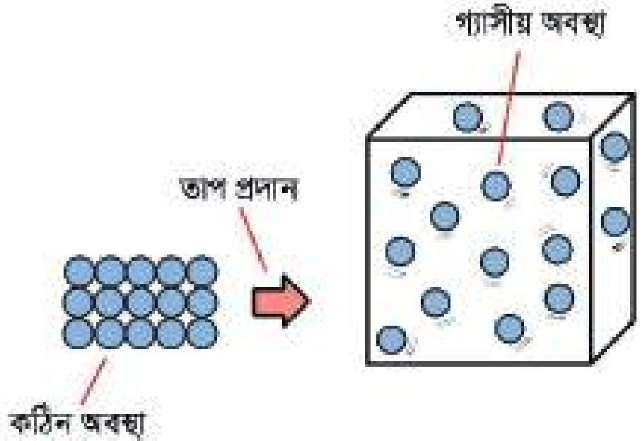

<!-- chemistry-9-10-bn-c02-t2.7-p005 · figure · p.31 · review: known-confusable-corrected -->
**চিত্র ২.১১: উদ্বায়ী পদার্থের ঊর্ধ্বপাতন**

<!-- chemistry-9-10-bn-c02-t2.7-p006 · text · p.31 · review: known-confusable-corrected -->
যে প্রক্রিয়ায় কোনো কঠিন পদার্থে তাপ প্রয়োগ করা হলে কঠিন পদার্থটি তরলে পরিণত না হয়ে সরাসরি বাষ্পে পরিণত হয়, সেই প্রক্রিয়াকে ঊর্ধ্বপাতন বলে। নিশাদল (NH4Cl), কপূর (C10H16O), ন্যাপথলিন (C10H8), কঠিন কার্বন ডাই-অক্সাইড (CO2), আয়োডিন (I2), অ্যালুমিনিয়াম ক্লোরাইড (AlCl3) ইত্যাদি পদার্থগুলোতে তাপ প্রয়োগ করা হলে সেগুলো তরলে পরিণত না হয়ে সরাসরি বাষ্পে পরিণত হয়। এই পদার্থগুলোকে উদ্বায়ী পদার্থ বলা হয়।

### পরীক্ষা নং: ৭

<!-- chemistry-9-10-bn-c02-t2.7-p007 · figure · p.32 -->
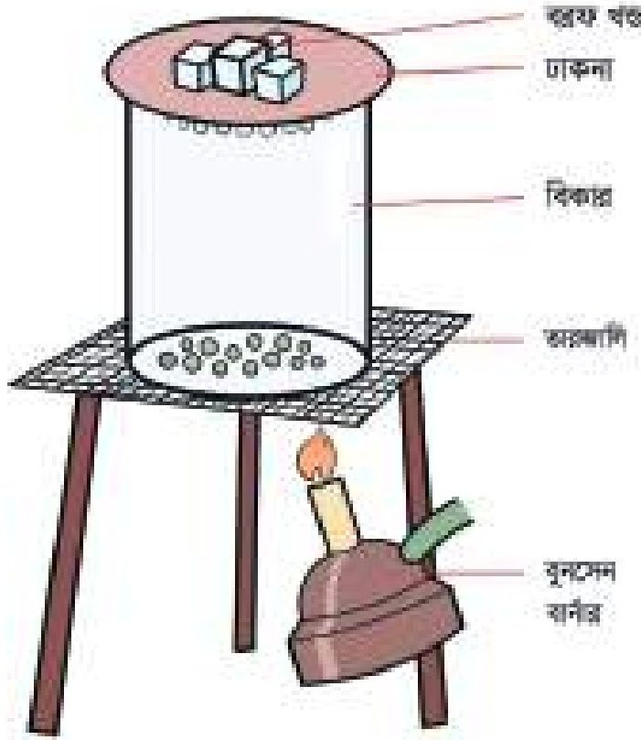

<!-- chemistry-9-10-bn-c02-t2.7-p008 · figure · p.32 · review: known-confusable-corrected -->
**চিত্র ২.১২: AlCl3 এর ঊর্ধ্বপাতন**

<!-- chemistry-9-10-bn-c02-t2.7-p009 · text · p.32 -->
২.১২ নং চিত্রের ন্যায় একটি বিকারে কিছু পরিমাণ কঠিন অ্যালুমিনিয়াম ক্লোরাইড (AlCl3) লবণ নাও। বিকারের খোলা মুখ একটি কাচের ঢাকনা দিয়ে ঢেকে দাও। কাচের ঢাকনার উপর কিছু বরফ রাখো। এরপর ধীরে ধীরে বিকারটিতে তাপ প্রয়োগ করো। তাপ প্রয়োগে দেখা যাবে কঠিন AlCl3 গ্যাসীয় AlCl3 এ পরিণত হচ্ছে। সেটি উপরে উঠে ঢাকনায় গিয়ে শীতল হয়ে কঠিন AlCl3 হিসেবে ঢাকনার নিচে জমা হয়েছে।

### ঊর্ধ্বপাতন প্রক্রিয়ার প্রয়োগ

<!-- chemistry-9-10-bn-c02-t2.7-p010 · text · p.32 · review: known-confusable-corrected -->
কোনো কঠিন পদার্থের মিশ্রণের মধ্যে একটি উদ্বায়ী পদার্থ মিশ্রিত থাকলে ঐ উদ্বায়ী পদার্থকে মিশ্রণ থেকে সহজে পৃথক করা যায়, যেমন - নিশাদল বা অ্যামোনিয়াম ক্লোরাইড (NH4Cl) এর সাথে খাদ্য লবণ (NaCl) মিশ্রিত থাকলে ঊর্ধ্বপাতন পদ্ধতির মাধ্যমে নিশাদলকে পৃথক করা যাবে।

<!-- chemistry-9-10-bn-c02-t2.7-p011 · text · p.32 · review: known-confusable-corrected -->
কঠিন অবস্থায় ঊর্ধ্বপাতিত পদার্থে তাপ প্রয়োগ করতে থাকলে ঊর্ধ্বপাতিত পদার্থ সহজেই বাষ্পীভূত হয়। আয়োডিনমিশ্রিত খাদ্যলবণের মধ্যে আয়োডিন একটি ঊর্ধ্বপাতিত পদার্থ। কাজেই ঐ আয়োডিন মিশ্রিত খাদ্যলবণের মিশ্রণকে তাপ দিলে আয়োডিন সহজেই বাষ্পীভূত হয়। ঐ বাষ্পকে ঠান্ডা করে কঠিন আয়োডিনে পরিণত করা যায়। বালি এবং গ্লুকোজের মিশ্রণের মধ্যে কোনো উদ্বায়ী পদার্থ নেই। কাজেই তাপ প্রয়োগ করে বালি এবং গ্লুকোজের মিশ্রণ থেকে বালি বা গ্লুকোজকে আলাদা করা যায় না।

<!-- chemistry-9-10-bn-c02-t2.7-p012 · text · p.32 · review: known-confusable-corrected -->
১. কাপে গরম চা রাখলে নিচের কোন প্রক্রিয়াটি ঘটে?

<!-- chemistry-9-10-bn-c02-t2.7-p013 · text · p.32 · review: known-confusable-corrected -->
(ক) বাষ্পীভবন                      (খ) ঊর্ধ্বপাতন
(গ) ব্যাপন                              (ঘ) নিঃসরণ

<!-- chemistry-9-10-bn-c02-t2.7-p014 · text · p.33 · review: known-confusable-corrected -->
২. জলীয় বাষ্পকে ঘনীভবন করার পর কণাসমূহের ক্ষেত্রে কী ঘটবে?

<!-- chemistry-9-10-bn-c02-t2.7-p015 · text · p.33 · review: known-confusable-corrected -->
(ক) আকার সংকুচিত হবে
(খ) আন্তঃকণা আকর্ষণ হ্রাস পায়
(গ) একই অবস্থানে থেকে কাঁপতে থাকবে
(ঘ) গতি শক্তি হ্রাস পাবে

<!-- chemistry-9-10-bn-c02-t2.7-p016 · text · p.33 · review: known-confusable-corrected -->
৩. নিচের কোন চিত্রটি উর্ধ্বপাতনের জন্য প্রয়োজন?

<!-- chemistry-9-10-bn-c02-t2.7-p017 · figure · p.33 · review: known-confusable-corrected -->
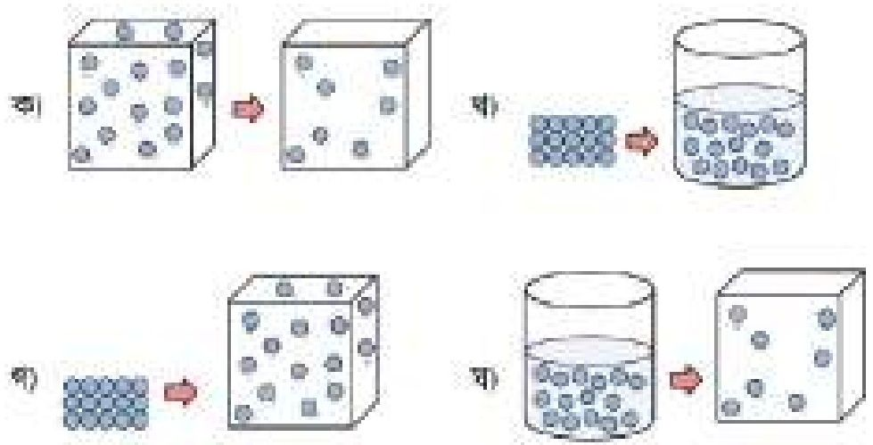

<!-- chemistry-9-10-bn-c02-t2.7-p018 · text · p.33 · review: known-confusable-corrected -->
৪. অজানা কঠিন বস্তু Z-এর তাপীয় বক্ররেখা চিত্র হতে বোঝা যায়—

<!-- chemistry-9-10-bn-c02-t2.7-p019 · text · p.33 · review: latin-junk,known-confusable-corrected -->
i. Z বস্তুটির গলনাঙ্ক 154°C
ii. Z বস্তুটি উদ্বায়ী
iii. AB ও CD রেখা বস্তুটির গলনাঙ্ক ও স্ফুটনাঙ্ক বোঝায়

<!-- chemistry-9-10-bn-c02-t2.7-p020 · text · p.33 · review: known-confusable-corrected -->
নিচের কোনটি সঠিক?

<!-- chemistry-9-10-bn-c02-t2.7-p021 · text · p.33 · review: latin-junk,known-confusable-corrected -->
(ক) i ও ii
(খ) ii ও iii
(গ) i ও iii
(ঘ) i, ii ও iii

### অজানা বস্তু Z-এর তাপীয় বক্ররেখা — তাপমাত্রা (°C) vs সময় (মিনিট)

<!-- chemistry-9-10-bn-c02-t2.7-p022 · table · p.33 · review: verify-table -->
<table><tr><th>সময় (মিনিট)</th><th>তাপমাত্রা (°C)</th><th>রেখা</th></tr>
<tr><th>0</th><td>0</td><td>Start</td></tr>
<tr><th>2</th><td>154</td><td>A</td></tr>
<tr><th>3</th><td>154</td><td>AB (Plateau)</td></tr>
<tr><th>5</th><td>154</td><td>B</td></tr>
<tr><th>6</th><td>250</td><td>C</td></tr>
<tr><th>8</th><td>250</td><td>CD (Plateau)</td></tr>
<tr><th>9</th><td>250</td><td>D</td></tr>
<tr><th>12</th><td>300</td><td>F</td></tr></table>

<!-- chemistry-9-10-bn-c02-t2.7-p023 · text · p.33 -->
৫. কোনটির ব্যাপনের হার বেশি?

<!-- chemistry-9-10-bn-c02-t2.7-p024 · text · p.33 -->
(ক) CO2
(খ) NH3
(গ) HCl
(ঘ) H2SO4

<!-- chemistry-9-10-bn-c02-t2.7-p025 · text · p.33 -->
৬. কোনটি উর্ধ্বপাতিত হয়?

<!-- chemistry-9-10-bn-c02-t2.7-p026 · text · p.33 -->
(ক) আয়োডিন
(খ) খাদ্যলবণ
(গ) তুঁতে
(ঘ) সোডা অ্যাস

## 2.ex সৃজনশীল প্রশ্ন

<!-- chemistry-9-10-bn-c02-t2.ex-p001 · exercise · p.34 -->
১.

<!-- chemistry-9-10-bn-c02-t2.ex-p002 · exercise · p.34 -->
(ক) ব্যাপন কাকে বলে?

<!-- chemistry-9-10-bn-c02-t2.ex-p003 · exercise · p.34 -->
(খ) ‘গ্যাস সিলিন্ডারের মুখ খুললে ব্যাপন ও নিঃসরণ উভয়ই ঘটে’-ব্যাখ্যা করো।

<!-- chemistry-9-10-bn-c02-t2.ex-p004 · exercise · p.34 -->
(গ) তাপমাত্রা বাড়াতে থাকলে উদ্দীপকের কোন পদার্থটি সবার আগে বাষ্পীভূত হবে? ব্যাখ্যা করো।

<!-- chemistry-9-10-bn-c02-t2.ex-p005 · figure · p.34 -->
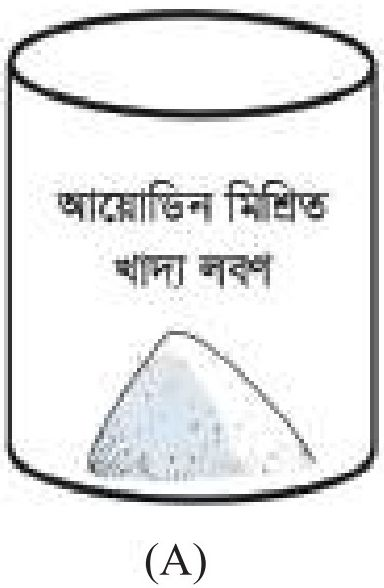

<!-- chemistry-9-10-bn-c02-t2.ex-p006 · exercise · p.34 -->
(ঘ) একই পদ্ধতিতে A ও B পাত্রের উপাদানগুলো পৃথকীকরণের সম্ভাব্যতা যাচাই করো।

<!-- chemistry-9-10-bn-c02-t2.ex-p007 · exercise · p.34 -->
২.

<!-- chemistry-9-10-bn-c02-t2.ex-p008 · exercise · p.34 -->
(ক) নিঃসরণ কাকে বলে?

<!-- chemistry-9-10-bn-c02-t2.ex-p009 · exercise · p.34 -->
(খ) একই পদার্থের গলনাঙ্ক ও স্ফুটনাঙ্ক ভিন্ন কেন? ব্যাখ্যা করো।

<!-- chemistry-9-10-bn-c02-t2.ex-p010 · exercise · p.34 -->
(গ) উদ্দীপকে সাদা ধোঁয়া তৈরির প্রক্রিয়া সমীকরণসহ ব্যাখ্যা করো।

<!-- chemistry-9-10-bn-c02-t2.ex-p011 · exercise · p.34 -->
(ঘ) সাদা ধোঁয়া A পাত্রের কাছাকাছি উৎপন্ন হওয়ার যৌক্তিকতা ব্যাখ্যা করো।

<!-- chemistry-9-10-bn-c02-t2.ex-p012 · figure · p.34 · review: latin-junk -->

### সংক্ষিপ্ত-উত্তর প্রশ্ন

<!-- chemistry-9-10-bn-c02-t2.ex-p013 · exercise · p.34 -->
১. আয়োডিনকে তরল অবস্থায় পাওয়া যায় না কেন? ব্যাখ্যা করো।

<!-- chemistry-9-10-bn-c02-t2.ex-p014 · exercise · p.34 -->
২. NH3 এর ব্যাপনের হার HCl থেকে বেশি কেন? ব্যাখ্যা করো।

<!-- chemistry-9-10-bn-c02-t2.ex-p015 · exercise · p.34 -->
৩. ‘পানির স্ফুটনাঙ্ক ১০০° C’ বলতে কী বোঝায়? ব্যাখ্যা করো।
