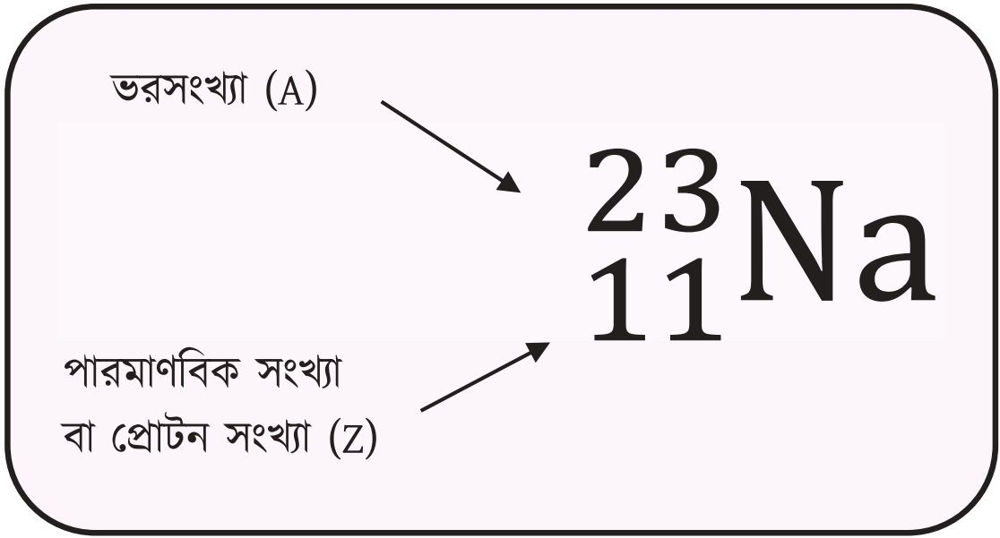
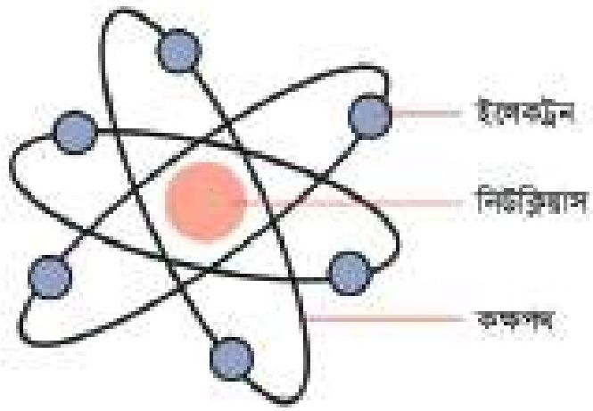
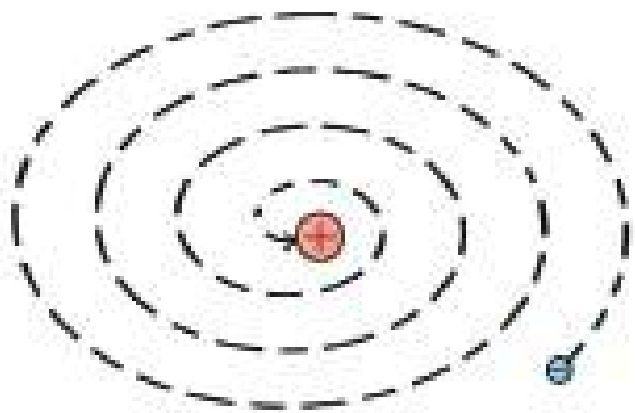
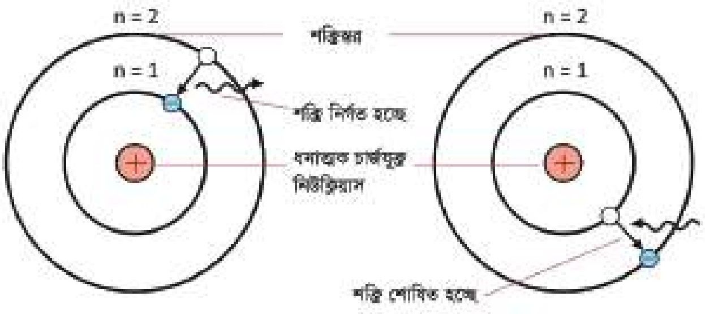
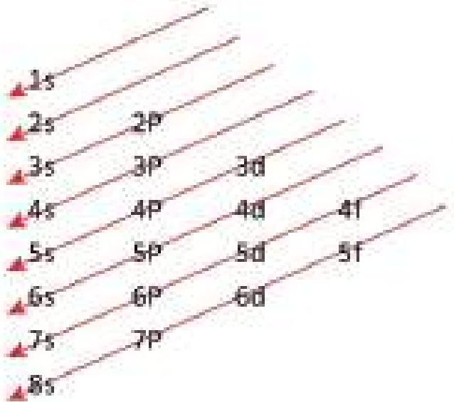

# 3. পদার্থের গঠন

Source: Chemistry Bangla Version, printed pp. 35-58

## 3.0 ভূমিকা ও শিখনফল

### হাইড্রোজেন পরমাণুর বিভিন্ন শক্তিস্তরে ইলেকট্রনের বিন্যাস

<!-- chemistry-9-10-bn-c03-t3.0-p001 · text · p.35 -->
কৌতূহলী মানুষের স্বাভাবিক চিন্তা হলো, আমাদের চারপাশের জিনিসগুলো কী দিয়ে তৈরি? আমাদের শরীরই বা কী দিয়ে তৈরি? হ্যাঁ, আমাদের মতো প্রাচীন দার্শনিকেরাও এ নিয়ে বহু চিন্তাভাবনা করেছেন। প্রাচীন গ্রিক দার্শনিকেরা ভাবতেন মাটি, পানি, বায়ু এবং আগুন ইত্যাদি মৌলিক পদার্থ আর অন্য সকল বস্তু এদের মিশ্রণে তৈরি।

<!-- chemistry-9-10-bn-c03-t3.0-p002 · text · p.35 -->
গ্রিসের দার্শনিক ডেমোক্রিটাস প্রথম বলেছিলেন, প্রতিেক পদার্থের একক আছে যা অতি ক্ষুদ্র আর অবিভাজ্য। তিনি এর নাম দেন এটম। কোনো বৈজ্ঞানিক পরীক্ষা দিয়ে এটি প্রমাণ করা সম্ভব হয়নি এবং সে সময়ের সবচেয়ে বড় বিজ্ঞানী এরিস্টটল এর বিরোধিতা করেছিলেন। তাই এটি কোনো গ্রহণযোগ্যতা পায়নি। প্রায় 2500 বছর পর 1803 সালে ব্রিটিশ বিজ্ঞানী জন ডাল্টন বিভিন্ন পরীক্ষায় প্রাপ্ত ফলাফলের উপর ভিত্তি করে ডেমোক্রিটাসের ধারণাপ্রসূত পরমাণু সম্পর্কে একটি মতবাদ দেন। এই মতবাদ অনুসারে প্রতিটি পদার্থ অজস্র ক্ষুদ্র এবং অবিভাজ্য কণার সমষ্টিয়ে গঠিত। তিনি দার্শনিক ডেমোক্রিটাসের সম্মানে এ একক ক্ষুদ্র কণার নাম দেন Atom, যার অর্থ পরমাণু। পরে প্রমাণিত হয় যে, পরমাণু অবিভাজ্য নয়। এদের ভাঙলে পরমাণুর চেয়েও ক্ষুদ্র কণিকা ইলেকট্রন, প্রোটন, নিউট্রন ইত্যাদি পাওয়া যায়। অর্থাৎ পরমাণু কতকগুলো ক্ষুদ্রতর কণার সমষ্টিয়ে গঠিত। পরমাণুর গঠন সম্পর্কিত বিভিন্ন মডেল, পরমাণুর সাংগঠনিক কণাসমূহ, পরমাণুর ইলেকট্রন বিন্যাস ইত্যাদি এ অধ্যায়ে আলোচনা করা হবে।

<!-- chemistry-9-10-bn-c03-t3.0-p003 · text · p.36 -->
* মৌলের ইংরেজি ও ল্যাটিন নাম থেকে তাদের প্রতীক লিখতে পারব।
* মৌলিক ও স্থায়ী কণিকাগুলোর বৈশিষ্ট্য বর্ণনা করতে পারব।
* পারমাণবিক সংখ্যা, ভর সংখ্যা, আপেক্ষিক পারমাণবিক ভর ব্যাখ্যা করতে পারব।
* আপেক্ষিক পারমাণবিক ভর থেকে আপেক্ষিক আণবিক ভর হিসাব করতে পারব।
* পরমাণুর ইলেকট্রন, প্রোটন ও নিউট্রন সংখ্যা হিসাব করতে পারব।
* আইসোটোপের ব্যবহার ব্যাখ্যা করতে পারব।
* পরমাণুর গঠন সম্পর্কে রাদারফোর্ড ও বোর পরমাণু মডেলের বর্ণনা করতে পারব।
* রাদারফোর্ড ও বোর পরমাণু মডেলের মধ্যে কোনটি বেশি গ্রহণযোগ্য তা ব্যাখ্যা করতে পারব।
* পরমাণুর বিভিন্ন কক্ষপথে এবং কক্ষপথের বিভিন্ন উপস্তরে পরমাণুর ইলেকট্রনসমূহকে বিন্যাস করতে পারব।

## 3.1 মৌলিক ও যৌগিক পদার্থ (Elements and Compounds)

### মৌলিক পদার্থ

<!-- chemistry-9-10-bn-c03-t3.1-p001 · text · p.37 · review: known-confusable-corrected -->
সোনা, রূপা বা লোহা ইত্যাদি বিশুদ্ধ পদার্থকে তুমি যতই ভাঙ না কেন সেখানে তাদের ক্ষুদ্রতর কণা ছাড়া আর কিছু পাবে না। যে পদার্থকে ভাঙলে সেই পদার্থ ছাড়া অন্য কোনো পদার্থ পাওয়া যায় না তাকে মৌলিক পদার্থ বা মৌল বলে। এরকম আরও কিছু মৌলের উদাহরণ হলো নাইট্রোজেন, ফসফরাস, কার্বন, অক্সিজেন, হিলিয়াম, ক্যালসিয়াম, আর্গন, ম্যাগনেসিয়াম, সালফার ইত্যাদি। এ পর্যন্ত ১১৪টি মৌল আবিষ্কৃত হয়েছে। এগুলোর মধ্যে ৭৪টি মৌল প্রকৃতিতে পাওয়া যায়। বাকি মৌলগুলো গবেষণাগারে তৈরি করা হয়েছে। এগুলোকে কৃত্রিম মৌল বলে। তুমি কি জানো মানব শরীরে মোট ২৬ ধরনের ভিন্ন ভিন্ন মৌল আছে?

### যৌগিক পদার্থ

<!-- chemistry-9-10-bn-c03-t3.1-p002 · text · p.37 · review: known-confusable-corrected -->
ইতিমধ্যে তোমরা জেনেছ যে, মৌলিক পদার্থকে ভাঙলে শুধু ঐ পদার্থই পাওয়া যায়। কিন্তু পানিকে যদি ভাঙা হয় (অর্থাৎ রাসায়নিকভাবে বিশ্লেষণ করা যায়) তবে কিন্তু দুটি ভিন্ন মৌল হাইড্রোজেন ও অক্সিজেন পাওয়া যায়। আবার, লেখার চককে যদি ভাঙা যায় তাহলে সেখানে ক্যালসিয়াম, কার্বন ও অক্সিজেন এ তিনটি মৌল পাওয়া যায়। যে সকল পদার্থকে ভাঙলে দুই বা দুইয়ের অধিক মৌল পাওয়া যায় তাদেরকে যৌগ বা যৌগিক পদার্থ বলে। যৌগের মধ্যে মৌলসমূহের সংখ্যার অনুপাত সব সময় একই থাকে। যেমন— যেখান থেকেই পানির নমুনা সংগ্রহ করা হোক না কেন রাসায়নিকভাবে বিশ্লেষণ করা হলে সব সময় দুই ভাগ হাইড্রোজেন এবং এক ভাগ অক্সিজেন পাওয়া যায় অর্থাৎ পানিতে হাইড্রোজেন ও অক্সিজেনের পরমাণুর সংখ্যার অনুপাত ২:১। যৌগের ধর্ম কিন্তু মৌলসমূহের ধর্ম থেকে সম্পূর্ণ আলাদা। যেমন— সাধারণ তাপমাত্রায় হাইড্রোজেন ও অক্সিজেন গ্যাসীয় কিন্তু এদের থেকে উৎপন্ন যৌগ পানি সাধারণ তাপমাত্রায় তরল।

## 3.2 পরমাণু ও অণু (Atoms and Molecules)

<!-- chemistry-9-10-bn-c03-t3.2-p001 · text · p.37 · review: known-confusable-corrected -->
পরমাণু হলো মৌলিক পদার্থের ক্ষুদ্রতম কণা যার মধ্যে মৌলের গুণাগুণ বর্তমান থাকে। যেমন— নাইট্রোজেনের পরমাণুতে নাইট্রোজেনের ধর্ম বিদ্যমান আর অক্সিজেনের পরমাণুতে অক্সিজেনের ধর্ম বিদ্যমান থাকে।

<!-- chemistry-9-10-bn-c03-t3.2-p002 · text · p.37 · review: known-confusable-corrected -->
দুই বা দুইয়ের অধিক সংখ্যক পরমাণু পরস্পরের সাথে রাসায়নিক বন্ধনের মাধ্যমে যুক্ত থাকলে তাকে অণু বলে। রাসায়নিক বন্ধন সম্পর্কে তোমরা পঞ্চাম অধ্যায়ে বিস্তারিত জানবে। দুটি অক্সিজেন পরমাণু (O) পরস্পরের সাথে যুক্ত হয়ে অক্সিজেন অণু (O2) গঠিত হয়। আবার, একটি কার্বন পরমাণু (C) দুটি অক্সিজেন পরমাণুর (O) সাথে যুক্ত হয়ে একটি কার্বন ডাই-অক্সাইড অণু (CO2) গঠিত হয়। একই মৌলের একাধিক পরমাণু পরস্পরের সাথে যুক্ত হলে তাকে মৌলের অণু বলে। যেমন—O2। ভিন্ন ভিন্ন মৌলের পরমাণু পরস্পর যুক্ত হলে তাকে যৌগের অণু বলে। যেমন—CO2।

## 3.3 মৌলের প্রতীক (Symbols of Elements)

<!-- chemistry-9-10-bn-c03-t3.3-p001 · text · p.38 -->
কোনো মৌলের ইংরেজি বা ল্যাটিন নামের সংক্ষিপ্ত রূপকে প্রতীক বলে। প্রত্যেকটি মৌলকে সংক্ষিপে প্রকাশ করতে তাদের আলাদা আলাদা প্রতীক ব্যবহার করা হয়। মৌলের প্রতীক লিখতে কিছু নিয়ম অনুসরণ করতে হয়।

<!-- chemistry-9-10-bn-c03-t3.3-p002 · text · p.38 -->
(a) প্রথমত মৌলের ইংরেজি নামের প্রথম অক্ষর দিয়ে প্রতীক লেখা হয় এবং তা ইংরেজি বর্ণমালার বড় হাতের অক্ষর দিয়ে প্রকাশ করা হয়। যেমন- হাইড্রোজেন (Hydrogen) এর প্রতীক (H), কার্বন (Carbon) এর প্রতীক (C), অক্সিজেনের প্রতীক (O) ইত্যাদি।

<!-- chemistry-9-10-bn-c03-t3.3-p003 · text · p.38 · review: known-confusable-corrected -->
(b) যদি দুই বা দুইয়ের অধিক মৌলের ইংরেজি নামের প্রথম অক্ষর একই হয় তবে একটি মৌলকে নামের প্রথম অক্ষর (ইংরেজি বর্ণমালার বড় হাতের) দিয়ে প্রকাশ করা হয়। অন্যগুলোর ক্ষেত্রে প্রতীকটি দুই অক্ষরে লেখা হয়। নামের প্রথম অক্ষরটি ইংরেজি বর্ণমালার বড় হাতের অক্ষর এবং নামের অন্য একটি অক্ষর ছোট হাতের অক্ষর দিয়ে লেখা হয়। যেমন-

<!-- chemistry-9-10-bn-c03-t3.3-p004 · table · p.38 · review: verify-table -->
**টেবিল ৩.০১: মৌলের নামকরণ**
<table><tr><th>মৌল</th><th>ইংরেজি নাম</th><th>প্রতীক</th></tr>
<tr><td>হাইড্রোজেন</td><td>Hydrogen</td><td>H</td></tr>
<tr><td>অক্সিজেন</td><td>Oxygen</td><td>O</td></tr>
<tr><td>নাইট্রোজেন</td><td>Nitrogen</td><td>N</td></tr></table>

<!-- chemistry-9-10-bn-c03-t3.3-p005 · table · p.38 · review: verify-table -->
**টেবিল ৩.০২: মৌলের নামকরণ (প্রথম অক্ষর এক)**
<table><tr><th>মৌল</th><th>ইংরেজি নাম</th><th>প্রতীক</th></tr>
<tr><td>কার্বন</td><td>Carbon</td><td>C</td></tr>
<tr><td>ক্লোরিন</td><td>Chlorine</td><td>Cl</td></tr>
<tr><td>ক্যালসিয়াম</td><td>Calcium</td><td>Ca</td></tr></table>

<!-- chemistry-9-10-bn-c03-t3.3-p006 · table · p.38 · review: verify-table -->
<table><tr><th>মৌল</th><th>ইংরেজি নাম</th><th>প্রতীক</th></tr>
<tr><td>কোবাল্ট</td><td>Cobalt</td><td>Co</td></tr>
<tr><td>ক্যাডমিয়াম</td><td>Cadmium</td><td>Cd</td></tr>
<tr><td>ক্রোমিয়াম</td><td>Chromium</td><td>Cr</td></tr></table>

<!-- chemistry-9-10-bn-c03-t3.3-p007 · text · p.38 -->
(c) কিছু মৌলের প্রতীক তাদের ল্যাটিন নাম থেকে নেওয়া হয়েছে। যেমন-

<!-- chemistry-9-10-bn-c03-t3.3-p008 · table · p.38 · review: verify-table -->
**টেবিল ৩.০৩: মৌলের নামকরণ (ল্যাটিন নাম)**
<table><tr><th>মৌল</th><th>ল্যাটিন নাম</th><th>প্রতীক</th></tr>
<tr><td>সোডিয়াম</td><td>Natrium</td><td>Na</td></tr>
<tr><td>কপার</td><td>Cuprum</td><td>Cu</td></tr>
<tr><td>পটাশিয়াম</td><td>Kalium</td><td>K</td></tr>
<tr><td>সিলভার</td><td>Argentum</td><td>Ag</td></tr>
<tr><td>টিন</td><td>Stannum</td><td>Sn</td></tr>
<tr><td>এন্টিমনি</td><td>Stibium</td><td>Sb</td></tr></table>

<!-- chemistry-9-10-bn-c03-t3.3-p009 · table · p.38 · review: verify-table -->
<table><tr><th>মৌল</th><th>ল্যাটিন নাম</th><th>প্রতীক</th></tr>
<tr><td>গোল্ড</td><td>Aurum</td><td>Au</td></tr>
<tr><td>লেড</td><td>Plumbum</td><td>Pb</td></tr>
<tr><td>ট্যাংস্টেন</td><td>Wolfram</td><td>W</td></tr>
<tr><td>আয়রন</td><td>Ferrum</td><td>Fe</td></tr>
<tr><td>মারকরি</td><td>Hydrurgyrum</td><td>Hg</td></tr></table>

### একক কাজ

<!-- chemistry-9-10-bn-c03-t3.3-p010 · activity · p.39 -->
**কাজ:** চতুর্থ অধ্যায়ের পর্যায় সারণি থেকে কিছু মৌলের নাম ও প্রতীক সংগ্রহ করে তোমার রসায়ন শিক্ষককে দেখাও।

## 3.4 সংকেত (Formula)

<!-- chemistry-9-10-bn-c03-t3.4-p001 · text · p.39 -->
হাইড্রোজেনের একটি অণুকে প্রকাশ করতে H2 ব্যবহার করা হয়। যার অর্থ হলো একটি হাইড্রোজেনের অণুতে দুটি হাইড্রোজেনের পরমাণু (H) আছে। আবার, পানির একটি অণুকে প্রকাশ করতে H2O ব্যবহার করা হয়। এর অর্থ হচ্ছে পানির একটি অণুতে দুটি হাইড্রোজেন (H) এবং একটি অক্সিজেন পরমাণু (O) থাকে। পাশের তালিকায় সাধারণ কয়েকটি অণুর সংকেত দেখানো হলো।

<!-- chemistry-9-10-bn-c03-t3.4-p002 · table · p.39 · review: verify-table -->
**টেবিল ৩.০৪: অণুর সংকেত**
<table><tr><th>অণুর নাম</th><th>সংকেত</th></tr>
<tr><td>নাইট্রোজেন</td><td>N2</td></tr>
<tr><td>অ্যামোনিয়া</td><td>NH3</td></tr>
<tr><td>ক্লোরিন</td><td>Cl2</td></tr>
<tr><td>সালফিউরিক এসিড</td><td>H2SO4</td></tr>
<tr><td>হাইড্রোক্লোরিক এসিড</td><td>HCl</td></tr></table>

## 3.5 পরমাণুর সাংগঠনিক কণা (The fundamental particles of an atom)

<!-- chemistry-9-10-bn-c03-t3.5-p001 · text · p.39 -->
একমাত্র হাইড্রোজেন ছাড়া সকল পদার্থের পরমাণু তিনটি কণা দিয়ে তৈরি। সেগুলো হচ্ছে ইলেকট্রন, প্রোটন এবং নিউট্রন। এই কণাগুলোকে পরমাণুর সাংগঠনিক (fundamental) বা মৌলিক কণা বলে। পরমাণুর কেন্দ্রে বা নিউক্লিয়াসে প্রোটন ও নিউট্রন থাকে এবং ইলেকট্রন নিউক্লিয়াসকে ঘিরে ঘুরতে থাকে।

<!-- chemistry-9-10-bn-c03-t3.5-p002 · text · p.39 · review: verify-formula -->
**ইলেকট্রন:** ইলেকট্রন হলো পরমাণুর একটি মৌলিক কণিকা যার আধান বা চার্জ ঋণাত্মক (নেগেটিভ)। এ আধানের পরিমাণ $-1.60 \times 10^{-19}$ কুলম্ব। একে e প্রতীক দিয়ে প্রকাশ করা হয়। একটি ইলেকট্রনের ভর $9.11 \times 10^{-28}$ g। ইলেকট্রনের আপেক্ষিক আধান $-1$ ধরা হয় এবং এর ভর প্রোটন ও নিউট্রনের ভরের তুলনায় 1840 গুণ কম। তাই এর আপেক্ষিক ভরকে শূন্য ধরা হয়।

<!-- chemistry-9-10-bn-c03-t3.5-p003 · text · p.40 · review: verify-formula -->
**প্রোটন:** প্রোটন হলো পরমাণুর অপর একটি মৌলিক কণিকা যার চার্জ বা আধান ধনাত্মক (পজিটিভ)। এ আধানের পরিমাণ $+1.60 \times 10^{-19}$ কুলম্ব। একে p প্রতীক দিয়ে প্রকাশ করা হয়। একটি প্রোটনের ভর $1.67 \times 10^{-24}$ g। প্রোটনের আপেক্ষিক আধান $+1$ এবং আপেক্ষিক ভর ১ ধরা হয়।

<!-- chemistry-9-10-bn-c03-t3.5-p004 · text · p.40 -->
**নিউট্রন:** নিউট্রন হলো পরমাণুর আরেকটি মৌলিক কণিকা যার কোনো আধান বা চার্জ নেই। হাইড্রোজেন ছাড়া সকল মৌলের পরমাণুতেই নিউট্রন রয়েছে। একে n প্রতীক দিয়ে প্রকাশ করা হয়। এর ভর প্রোটনের ভরের চেয়ে সামান্য বেশি। নিউট্রনের আপেক্ষিক আধান ০ আর আপেক্ষিক ভর ১ ধরা হয়।

<!-- chemistry-9-10-bn-c03-t3.5-p005 · text · p.40 -->
পরমাণুর সাংগঠনিক বা মৌলিক কণাসমূহের বৈশিষ্ট্যমূলক ধর্মাবলি নিচের তালিকায় উপস্থাপন করা হলো।

<!-- chemistry-9-10-bn-c03-t3.5-p006 · table · p.40 · review: verify-table -->
**টেবিল ৩.০৫: মৌলিক কণিকা**
<table><tr><th>মৌলিক কণিকার নাম</th><th>প্রতীক</th><th>প্রকৃত আধান বা চার্জ</th><th>প্রকৃত ভর</th><th>আপেক্ষিক আধান</th><th>আপেক্ষিক ভর</th></tr>
<tr><td>ইলেকট্রন</td><td>e</td><td>-1.60 × 10-19 কুলম্ব।</td><td>9.11 × 10-28 g</td><td>-1</td><td>0</td></tr>
<tr><td>প্রোটন</td><td>p</td><td>+1.60 × 10-19 কুলম্ব।</td><td>1.67 × 10-24 g</td><td>+1</td><td>1</td></tr>
<tr><td>নিউট্রন</td><td>n</td><td>0</td><td>1.67 × 10-24 g</td><td>0</td><td>1</td></tr></table>

### ৩.৫.১ পারমাণবিক সংখ্যা (Atomic Number)

<!-- chemistry-9-10-bn-c03-t3.5-p007 · text · p.40 -->
কোনো মৌলের একটি পরমাণুর নিউক্লিয়াসে উপস্থিত প্রোটনের সংখ্যাকে ঐ মৌলের পারমাণবিক সংখ্যা বলা হয়। যেমন— হিলিয়াম (He) এর একটি পরমাণুর নিউক্লিয়াসে দুটি প্রোটন থাকে। তাই হিলিয়ামের পারমাণবিক সংখ্যা হলো দুই। আবার, অক্সিজেন (O) পরমাণুর নিউক্লিয়াসে আটটি প্রোটন থাকে। তাই অক্সিজেনের পারমাণবিক সংখ্যা হলো আট। কোনো পরমাণুর পারমাণবিক সংখ্যা দ্বারা ঐ পরমাণুকে চেনা যায়। তাই পারমাণবিক সংখ্যাকে একটি মৌলের আইডি নম্বরও বলা যায়। পারমাণবিক সংখ্যা ১ হলে ঐ পরমাণুটি হাইড্রোজেন, পারমাণবিক সংখ্যা ২ হলে ঐ পরমাণুটি হিলিয়াম। পারমাণবিক সংখ্যা ৭ হলে ঐ পরমাণুটি ফ্লোরিন। অর্থাৎ পারমাণবিক সংখ্যাই কোনো পরমাণুর আসল পরিচয়। প্রোটন সংখ্যা বা পারমাণবিক সংখ্যাকে Z দিয়ে প্রকাশ করা হয়। যেহেতু প্রত্যেকটা পরমাণুই চার্জ নিরপেক্ষ অর্থাৎ মোট চার্জ বা আধান শূন্য তাই পরমাণুর নিউক্লিয়াসে যতটি প্রোটন থাকে নিউক্লিয়াসের বাইরে ঠিক ততটি ইলেকট্রন থাকে।

### ৩.৫.২ ভরসংখ্যা (Mass Number)

<!-- chemistry-9-10-bn-c03-t3.5-p008 · text · p.41 -->
কোনো পরমাণুর নিউক্লিয়াসে উপস্থিত প্রোটন ও নিউট্রন সংখ্যার যোগফলকে ঐ পরমাণুর ভরসংখ্যা বলে। ভরসংখ্যাকে A দিয়ে প্রকাশ করা হয়। যেহেতু ভরসংখ্যা হলো প্রোটন সংখ্যা ও নিউট্রন সংখ্যার যোগফল, কাজেই ভরসংখ্যা থেকে প্রোটন সংখ্যা বিয়োগ করলে নিউট্রন সংখ্যা পাওয়া যায়। যেমন- সোডিয়ামের (Na) ভরসংখ্যা হলো 23, এর প্রোটন সংখ্যা 11, ফলে এর নিউট্রন সংখ্যা হচ্ছে 23 - 11 = 12

<!-- chemistry-9-10-bn-c03-t3.5-p009 · text · p.41 -->
কোনো পরমাণুর পারমাণবিক সংখ্যা পরমাণুর প্রতীকের নিচে বাম পাশে লেখা হয়, পরমাণুর ভরসংখ্যা প্রতীকের বাম পাশে উপরের দিকে লেখা হয়। যেমন- সোডিয়াম পরমাণুর প্রতীক Na, এর পারমাণবিক সংখ্যা 11 এবং ভরসংখ্যা 23। এটাকে নিম্নোক্তভাবে প্রকাশ করা যায়:

<!-- chemistry-9-10-bn-c03-t3.5-p010 · figure · p.41 -->

<!-- chemistry-9-10-bn-c03-t3.5-p011 · table · p.41 · review: verify-table -->
**টেবিল ৩.০৬: মৌলের সংক্ষিপ্ত প্রকাশ**
<table><tr><th>মৌলের প্রতীক</th><th>পারমাণবিক সংখ্যা বা প্রোটন সংখ্যা Z</th><th>ভরসংখ্যা A</th><th>ইলেকট্রন সংখ্যা</th><th>নিউট্রন সংখ্যা A - Z</th><th>সংক্ষিপ্ত প্রকাশ</th></tr>
<tr><td>H</td><td>1</td><td>1</td><td>1</td><td>0</td><td>11H</td></tr>
<tr><td>He</td><td>2</td><td>4</td><td>2</td><td>2</td><td>42He</td></tr></table>

<!-- chemistry-9-10-bn-c03-t3.5-p012 · text · p.41 · review: verify-formula -->
**শিক্ষার্থীর কাজ:** 7$_3$Li এবং 9$_4$Be মৌলের ভর সংখ্যা, প্রোটন সংখ্যা এবং ইলেকট্রন সংখ্যা গণনা করো।

## 3.6 পরমাণুর মডেল (Atomic Model)

### ৩.৬.১ রাদারফোর্ডের পরমাণু মডেল

<!-- chemistry-9-10-bn-c03-t3.6-p001 · text · p.42 -->
১৯১১ খ্রিস্টাব্দে বিজ্ঞানী রাদারফোর্ড পরমাণুর গঠন সম্পর্কে একটি মডেল প্রদান করেন। এ মডেল অনুসারে-

<!-- chemistry-9-10-bn-c03-t3.6-p002 · text · p.42 -->
(a) প্রত্যেকটি পরমাণু একটি কেন্দ্র আছে। এই কেন্দ্রের নাম নিউক্লিয়াস। নিউক্লিয়াসের ভেতরে প্রোটন ও নিউট্রন এবং নিউক্লিয়াসের বাইরে ইলেকট্রন অবস্থান করে। যেহেতু আপেক্ষিকভাবে ইলেকট্রনের ভর শূন্য ধরা হয় কাজেই নিউক্লিয়াসের ভেতরে অবস্থিত প্রোটন এবং নিউট্রনের ভরই পরমাণুর ভর হিসেবে বিবেচনা করা হয়।

<!-- chemistry-9-10-bn-c03-t3.6-p003 · text · p.42 -->
(b) নিউক্লিয়াস অত্যন্ত ক্ষুদ্র এবং নিউক্লিয়াসের বাইরে ও পরমাণুর ভেতরে বেশির ভাগ জায়গাই ফাঁকা।

<!-- chemistry-9-10-bn-c03-t3.6-p004 · text · p.42 -->
(c) সৌরজগতে সূর্যকে কেন্দ্র করে বিভিন্ন কক্ষপথে যেমন গ্রহগুলো ঘুরে তেমনি নিউক্লিয়াসকে কেন্দ্র করে বিভিন্ন কক্ষপথে ইলেকট্রনগুলো ঘুরছে। কোনো পরমাণুর নিউক্লিয়াসে যে কয়টি প্রোটন থাকে নিউক্লিয়াসের বাইরে ঠিক সেই কয়টি ইলেকট্রন থাকে। যেহেতু প্রোটন এবং ইলেকট্রনের চার্জ একে অপরের সমান ও বিপরীত চিহ্নের, তাই পরমাণু সামগ্রিকভাবে চার্জ শূন্য।

<!-- chemistry-9-10-bn-c03-t3.6-p005 · text · p.42 -->
(d) ধনাত্মক চার্জবাহী নিউক্লিয়াসের প্রতি ঋণাত্মক চার্জবাহী ইলেকট্রন এক ধরনের আকর্ষণ বল অনুভব করে। এই আকর্ষণ বল কেন্দ্রমুখী। এই কেন্দ্রমুখী বল এবং আবর্তনশীল ইলেকট্রনের কেন্দ্রবিমুখী বল পরস্পর সমান ও বিপরীতমুখী।

<!-- chemistry-9-10-bn-c03-t3.6-p006 · figure · p.42 -->

<!-- chemistry-9-10-bn-c03-t3.6-p007 · figure · p.42 -->
**চিত্র ৩.০১: রাদারফোর্ডের পরমাণু মডেল**

<!-- chemistry-9-10-bn-c03-t3.6-p008 · text · p.42 -->
রাদারফোর্ডের পরমাণু মডেলকে সৌরজগতের সাথে তুলনা করা হয়েছে বলে এ মডেলটিকে সোলার সিস্টেম মডেল বা সৌর মডেল বলে। আবার, এ মডেলের মাধ্যমে বিজ্ঞানী রাদারফোর্ড সর্বপ্রথম নিউক্লিয়াস সম্পর্কে ধারণা দেন বলে এ মডেলটিকে নিউক্লিয়ার মডেলও বলা হয়।

### রাদারফোর্ডের পরমাণু মডেলের সীমাবদ্ধতা

<!-- chemistry-9-10-bn-c03-t3.6-p009 · text · p.42 -->
রাদারফোর্ডই সর্বপ্রথম নিউক্লিয়াস এবং ইলেকট্রনের কক্ষপথ সম্বন্ধে ধারণা দেন। তিনিই সর্বপ্রথম একটি গ্রহণযোগ্য পরমাণু মডেল প্রদান করলেও তার পরমাণু মডেলের কিছু সীমাবদ্ধতা ছিল। সেগুলো হলো:

<!-- chemistry-9-10-bn-c03-t3.6-p010 · text · p.43 -->
(a) এই মডেল ইলেকট্রনের কক্ষপথের আকার (ব্যাসার্থ) ও আকৃতি সম্বন্ধে কোনো ধারণা দিতে পারেনি।

<!-- chemistry-9-10-bn-c03-t3.6-p011 · text · p.43 -->
(b) সৌরজগতের সূর্য ও গ্রহগুলোর সামগ্রিকভাবে কোনো আধান বা চার্জ নেই কিন্তু পরমাণুতে ইলেকট্রন এবং নিউক্লিয়াসের আধান বা চার্জ আছে। কাজেই চার্জহীন সূর্য এবং গ্রহগুলোর সাথে চার্জযুক্ত নিউক্লিয়াস এবং ইলেকট্রনের তুলনা করা সঠিক নয়।

<!-- chemistry-9-10-bn-c03-t3.6-p012 · text · p.43 -->
(c) একের অধিক ইলেকট্রনবিশিষ্ট পরমাণুতে ইলেকট্রনগুলো কীভাবে নিউক্লিয়াসের চারদিকে পরিভ্রমণ করে তার কোনো ধারণা এ মডেলে দেওয়া হয়নি।

<!-- chemistry-9-10-bn-c03-t3.6-p013 · text · p.43 -->
(d) ম্যাক্সওয়েলের তত্ত্বানুসারে ইলেকট্রন নিউক্লিয়াসকে কেন্দ্র করে ঘূর্ণনের সময় ক্রমাগত শক্তি হারাতে থাকবে। ফলে ইলেকট্রনের ঘূর্ণন পথও ছোট হতে থাকবে এবং এক সময় ইলেকট্রনটি নিউক্লিয়াসে পতিত হবে। অর্থাৎ পরমাণুর অস্তিত্ব বিলুপ্ত হবে। কিন্তু বাস্তবে সেটা ঘটে না অর্থাৎ ম্যাক্সওয়েলের তত্ত্বানুসারে রাদারফোর্ডের পরমাণু মডেল সঠিক নয়।

<!-- chemistry-9-10-bn-c03-t3.6-p014 · figure · p.43 -->

<!-- chemistry-9-10-bn-c03-t3.6-p015 · figure · p.43 -->
**চিত্র ৩.০২: ইলেকট্রন শক্তি হারিয়ে নিউক্লিয়াসে পতিত হচ্ছে**

### ৩.৬.২ বোর পরমাণু মডেল

<!-- chemistry-9-10-bn-c03-t3.6-p016 · text · p.43 -->
রাদারফোর্ডের পরমাণু মডেলের ত্রুটিগুলোকে সংশোধন করে 1913 খ্রিস্টাব্দে বিজ্ঞানী নীলস বোর পরমাণুর একটি মডেল প্রদান করেন। এই মডেলকে বোরের পরমাণু মডেল বলা হয়। বোর পরমাণু মডেলের মতবাদগুলো এরকম—

<!-- chemistry-9-10-bn-c03-t3.6-p017 · text · p.43 -->
(a) পরমাণুতে যে সকল ইলেকট্রন থাকে সেগুলো নিউক্লিয়াসকে কেন্দ্র করে ইচ্ছামতো যেকোনো কক্ষপথে ঘুরতে পারে না। শুধু নির্দিষ্ট ব্যাসার্ধের কতগুলো অনুমোদিত বৃত্তাকার কক্ষপথে ঘুরে। এই নির্দিষ্ট ব্যাসার্ধের অনুমোদিত বৃত্তাকার কক্ষপথগুলোকে প্রধান শক্তিস্তর বা শেল বা অরবিট বা স্থির কক্ষপথ বলে। স্থির কক্ষপথে ঘুরার সময় ইলেকট্রনগুলো কোনোরূপ শক্তি শোষণ বা বিকিরণ করে না। স্থির কক্ষপথকে n দ্বারা প্রকাশ করা হয়। n = 1, 2, 3, 4 ইত্যাদি। অন্যভাবে বলা যায়, n = 1 হলে K প্রধান শক্তিস্তর, n = 2 হলে L প্রধান শক্তিস্তর, n = 3 হলে M প্রধান শক্তিস্তর, n = 4 হলে N প্রধান শক্তিস্তর ইত্যাদি।

<!-- chemistry-9-10-bn-c03-t3.6-p018 · text · p.43 -->
(b) বোর মডেল অনুসারে কোনো শক্তিস্তরে ইলেকট্রনের কৌণিক ভরবেগ

<!-- chemistry-9-10-bn-c03-t3.6-p019 · formula · p.44 · review: verify-formula -->
$$mvr = \frac{nh}{2\pi}$$

<!-- chemistry-9-10-bn-c03-t3.6-p020 · text · p.44 · review: verify-formula -->
এখানে,
m হচ্ছে ইলেকট্রনের ভর ($9.11 \times 10^{-31}$ kg)
r হচ্ছে ইলেকট্রন যে কক্ষপথ বা শক্তিস্তরে ঘুরবে তার ব্যাসার্ধ
v হচ্ছে ইলেকট্রন যে কক্ষপথ বা শক্তিস্তরে ঘুরবে সেই কক্ষপথে ইলেকট্রনের বেগ
h হচ্ছে প্ল্যাঙ্ক ধ্রুবক ($h = 6.626 \times 10^{-34}$ m$^2$ kg/s)
n হচ্ছে প্রধান শক্তিস্তর বা প্রধান কোয়ান্টাম সংখ্যা ($n = 1, 2, 3$ ইত্যাদি।)

<!-- chemistry-9-10-bn-c03-t3.6-p021 · text · p.44 · review: verify-formula -->
এখানে যে শক্তিস্তরের $n$ এর মান কম সেই শক্তিস্তর নিম্ন শক্তিস্তর এবং যে শক্তিস্তরের $n$ এর মান বেশি সেই শক্তিস্তর উচ্চ শক্তিস্তর হিসেবে পরিচিত।

<!-- chemistry-9-10-bn-c03-t3.6-p022 · figure · p.44 -->

<!-- chemistry-9-10-bn-c03-t3.6-p023 · figure · p.44 -->
**চিত্র ৩.০৩: বোরের পরমাণু মডেল**

<!-- chemistry-9-10-bn-c03-t3.6-p024 · text · p.44 -->
(c) কোনো প্রধান শক্তিস্তরে ঘূর্ণনের সময় ইলেকট্রন কোনো শক্তি শোষণ বা বিকিরণ করে না, তবে ইলেকট্রন যখন নিম্ন শক্তিস্তর থেকে উচ্চ শক্তিস্তর এ যায় তখন শক্তি শোষণ করে। আবার, ইলেকট্রন যখন উচ্চ শক্তিস্তর থেকে নিম্ন শক্তিস্তর এ যায় তখন শক্তি বিকিরণ হয়। এই শোষিত বা বিকিরিত শক্তির পরিমাণ

<!-- chemistry-9-10-bn-c03-t3.6-p025 · formula · p.44 · review: verify-formula -->
$$h\nu = \frac{hc}{\lambda}$$

<!-- chemistry-9-10-bn-c03-t3.6-p026 · text · p.44 · review: verify-formula -->
এখানে, $c$ হচ্ছে আলোর বেগ ($3 \times 10^8$ ms$^{-1}$)
$\nu$ হচ্ছে শোষিত বা বিকিরিত শক্তির কম্পাঙ্ক (একক s$^{-1}$ বা Hz)
$\lambda$ হচ্ছে শোষিত বা বিকিরিত শক্তির তরঙ্গ দৈর্ঘ্য (একক m)

<!-- chemistry-9-10-bn-c03-t3.6-p027 · text · p.44 -->
ইলেকট্রন উচ্চ শক্তিস্তর থেকে নিম্ন শক্তিস্তরে যাবার সময় যে আলো বিকিরণ করে তাকে প্রিজমের মধ্য দিয়ে Pass করালে পারমাণবিক বর্ণালির (atomic spectra) সৃষ্টি হয়।

### বোরের পরমাণু মডেলের সাফল্য

<!-- chemistry-9-10-bn-c03-t3.6-p028 · text · p.45 · review: known-confusable-corrected -->
(a) রাদারফোডের পরমাণু মডেল অনুসারে সৌরজগতে সূর্যকে কেন্দ্র করে গ্রহ-উপগ্রহগুলো যেমন ঘুরছে, পরমাণুতে ইলেকট্রনগুলোও তেমন নিউক্লিয়াসকে কেন্দ্র করে ঘুরছে। এখানে ইলেকট্রনের শক্তিস্তরের আকার সম্পর্কে কোনো কথা বলা হয়নি কিন্তু বোরের পারমাণবিক মডেলে পরমাণুর শক্তিস্তরের আকার বৃত্তাকার বলা হয়েছে।

<!-- chemistry-9-10-bn-c03-t3.6-p029 · text · p.45 -->
(b) রাদারফোডের পরমাণু মডেলে পরমাণু শক্তি শোষণ করলে বা শক্তি বিকিরণ করলে পরমাণুর গঠনে কী ধরনের পরিবর্তন ঘটে সে কথা বলা হয়নি কিন্তু বোর পরমাণু মডেলে বলা হয়েছে পরমাণু শক্তি শোষণ করলে ইলেকট্রন নিম্ন শক্তিস্তর থেকে উচ্চ শক্তিস্তরে ওঠে। আবার, পরমাণু শক্তি বিকিরণ করলে ইলেকট্রন উচ্চ শক্তিস্তর থেকে নিম্ন শক্তিস্তরে নেমে আসে।

<!-- chemistry-9-10-bn-c03-t3.6-p030 · text · p.45 -->
(c) রাদারফোডের পরমাণু মডেল অনুসারে কোনো মৌলের পারমাণবিক বর্ণালি ব্যাখ্যা করা যায় না কিন্তু বোরের পরমাণু মডেল অনুসারে এক ইলেকট্রন বিশিষ্ট পরমাণু, হাইড্রোজেন (H) এর বর্ণালি ব্যাখ্যা করা যায়।

### বোরের পরমাণু মডেলের সীমাবদ্ধতা

<!-- chemistry-9-10-bn-c03-t3.6-p031 · text · p.45 -->
বোর মডেলেরও কিছু সীমাবদ্ধতা বা ত্রুটি লক্ষ্য করা যায়। সেগুলো হচ্ছে:

<!-- chemistry-9-10-bn-c03-t3.6-p032 · text · p.45 -->
(a) বোর মডেলের সাহায্যে এক ইলেকট্রন বিশিষ্ট পরমাণুর পারমাণবিক বর্ণালি ব্যাখ্যা করা যায় সত্যি কিন্তু একাধিক ইলেকট্রন বিশিষ্ট পরমাণুর পারমাণবিক বর্ণালি ব্যাখ্যা করা যায় না।

<!-- chemistry-9-10-bn-c03-t3.6-p033 · text · p.45 -->
(b) বোরের পারমাণবিক মডেল অনুসারে এক শক্তিস্তর থেকে ইলেকট্রন অন্য শক্তিস্তরে গমন করলে পারমাণবিক বর্ণালিতে একটিমাত্র রেখা পাবার কথা। কিন্তু শক্তিশালী যন্ত্র দিয়ে পরীক্ষা করলে দেখা যায় প্রতিটি রেখা অনেকগুলো সূত্র সূত্র রেখার সমষ্টি। প্রতিটি রেখা কেন অনেকগুলো সূত্র সূত্র রেখার সমষ্টি হয় বোর মতবাদ অনুসারে তার ব্যাখ্যা দেওয়া যায় না।

<!-- chemistry-9-10-bn-c03-t3.6-p034 · text · p.45 · review: known-confusable-corrected -->
(c) বোরের পরমাণুর মডেল অনুসারে পরমাণুতে শুধু বৃত্তাকার কক্ষপথ বিদ্যমান। কিন্তু পরে প্রমাণিত হয়েছে পরমাণুতে ইলেকট্রন শুধু বৃত্তাকার কক্ষপথেই নয় উপবৃত্তাকার কক্ষপথেও ঘুরে।

## 3.7 পরমাণুর শক্তিস্তরে ইলেকট্রন বিন্যাস

### (Orbital Electronic Configuration of Atoms)

<!-- chemistry-9-10-bn-c03-t3.7-p001 · text · p.45 · review: verify-formula -->
বোরের মডেলে যে শক্তিস্তরের কথা বলা হয়েছে তাকে প্রধান শক্তিস্তর বলা হয়। প্রতিটি প্রধান শক্তিস্তরের সর্বোচ্চ ইলেকট্রন ধারণ ক্ষমতা $2n^2$ যেখানে $n = 1, 2, 3, 4$ ইত্যাদি। অতএব এ সূত্রানুসারে:

<!-- chemistry-9-10-bn-c03-t3.7-p002 · text · p.46 · review: verify-formula -->
K শক্তিস্তরের জন্য $n = 1$ অতএব
K শক্তিস্তরে সর্বোচ্চ ইলেকট্রন থাকতে পারে $2n^2 = (2 \times 1^2)$ টি $= 2$টি

<!-- chemistry-9-10-bn-c03-t3.7-p003 · text · p.46 · review: verify-formula -->
L শক্তিস্তরের জন্য $n = 2$ অতএব
L শক্তিস্তরে সর্বোচ্চ ইলেকট্রন থাকতে পারে $2n^2 = (2 \times 2^2)$ টি $= 8$টি

<!-- chemistry-9-10-bn-c03-t3.7-p004 · text · p.46 · review: verify-formula -->
M শক্তিস্তরের জন্য $n = 3$ অতএব
M শক্তিস্তরে সর্বোচ্চ ইলেকট্রন থাকতে পারে $2n^2 = (2 \times 3^2)$ টি $= 18$টি

<!-- chemistry-9-10-bn-c03-t3.7-p005 · text · p.46 · review: verify-formula -->
N শক্তিস্তরের জন্য $n = 4$ অতএব
N শক্তিস্তরে সর্বোচ্চ ইলেকট্রন থাকতে পারে $2n^2 = (2 \times 4^2)$ টি $= 32$টি

<!-- chemistry-9-10-bn-c03-t3.7-p006 · table · p.46 · review: verify-table -->
**টেবিল ৩.০৭: মৌলের ইলেকট্রন বিন্যাস [H(1) থেকে Zn(30) পর্যন্ত]**
<table><tr><th>পারমাণবিক সংখ্যা</th><th>মৌল</th><th>K</th><th>L</th><th>M</th><th>N</th></tr>
<tr><td>1</td><td>H</td><td>1</td><td></td><td></td><td></td></tr>
<tr><td>2</td><td>He</td><td>2</td><td></td><td></td><td></td></tr>
<tr><td>3</td><td>Li</td><td>2</td><td>1</td><td></td><td></td></tr>
<tr><td>4</td><td>Be</td><td>2</td><td>2</td><td></td><td></td></tr>
<tr><td>5</td><td>B</td><td>2</td><td>3</td><td></td><td></td></tr>
<tr><td>6</td><td>C</td><td>2</td><td>4</td><td></td><td></td></tr>
<tr><td>7</td><td>N</td><td>2</td><td>5</td><td></td><td></td></tr>
<tr><td>8</td><td>O</td><td>2</td><td>6</td><td></td><td></td></tr>
<tr><td>9</td><td>F</td><td>2</td><td>7</td><td></td><td></td></tr>
<tr><td>10</td><td>Ne</td><td>2</td><td>8</td><td></td><td></td></tr>
<tr><td>11</td><td>Na</td><td>2</td><td>8</td><td>1</td><td></td></tr>
<tr><td>12</td><td>Mg</td><td>2</td><td>8</td><td>2</td><td></td></tr>
<tr><td>13</td><td>Al</td><td>2</td><td>8</td><td>3</td><td></td></tr>
<tr><td>14</td><td>Si</td><td>2</td><td>8</td><td>4</td><td></td></tr>
<tr><td>15</td><td>P</td><td>2</td><td>8</td><td>5</td><td></td></tr></table>

<!-- chemistry-9-10-bn-c03-t3.7-p007 · table · p.46 · review: verify-table -->
<table><tr><th>পারমাণবিক সংখ্যা</th><th>মৌল</th><th>K</th><th>L</th><th>M</th><th>N</th></tr>
<tr><td>16</td><td>S</td><td>2</td><td>8</td><td>6</td><td></td></tr>
<tr><td>17</td><td>Cl</td><td>2</td><td>8</td><td>7</td><td></td></tr>
<tr><td>18</td><td>Ar</td><td>2</td><td>8</td><td>8</td><td></td></tr>
<tr><td>19</td><td>K</td><td>2</td><td>8</td><td>8</td><td>1</td></tr>
<tr><td>20</td><td>Ca</td><td>2</td><td>8</td><td>8</td><td>2</td></tr>
<tr><td>21</td><td>Sc</td><td>2</td><td>8</td><td>9</td><td>2</td></tr>
<tr><td>22</td><td>Ti</td><td>2</td><td>8</td><td>10</td><td>2</td></tr>
<tr><td>23</td><td>V</td><td>2</td><td>8</td><td>11</td><td>2</td></tr>
<tr><td>24</td><td>Cr</td><td>2</td><td>8</td><td>13</td><td>1</td></tr>
<tr><td>25</td><td>Mn</td><td>2</td><td>8</td><td>13</td><td>2</td></tr>
<tr><td>26</td><td>Fe</td><td>2</td><td>8</td><td>14</td><td>2</td></tr>
<tr><td>27</td><td>Co</td><td>2</td><td>8</td><td>15</td><td>2</td></tr>
<tr><td>28</td><td>Ni</td><td>2</td><td>8</td><td>16</td><td>2</td></tr>
<tr><td>29</td><td>Cu</td><td>2</td><td>8</td><td>18</td><td>1</td></tr>
<tr><td>30</td><td>Zn</td><td>2</td><td>8</td><td>18</td><td>2</td></tr></table>

<!-- chemistry-9-10-bn-c03-t3.7-p008 · text · p.46 -->
হাইড্রোজেনের (H) পারমাণবিক সংখ্যা ১। ফলে এর ইলেকট্রন সংখ্যাও ১। তাই একটি ইলেকট্রন প্রথম শক্তিস্তর K-তে প্রবেশ করবে।

<!-- chemistry-9-10-bn-c03-t3.7-p009 · text · p.47 -->
হিলিয়ামের (He) পারমাণবিক সংখ্যা ২। অতএব এর ইলেকট্রন সংখ্যাও ২ এবং এই ইলেকট্রন দুটি প্রথম শক্তিস্তর K-তে প্রবেশ করবে। লিথিয়ামের (Li) পারমাণবিক সংখ্যা ৩। অতএব এর ইলেকট্রন সংখ্যাও ৩ এবং ইলেকট্রন তিনটির প্রথম ২টি শক্তিস্তর K-তে প্রবেশ করবে। যেহেতু K প্রধান শক্তিস্তরে দুটির বেশি ইলেকট্রন থাকতে পারে না তাই এর তৃতীয় ইলেকট্রনটি দ্বিতীয় শক্তিস্তর L এতে প্রবেশ করবে।

<!-- chemistry-9-10-bn-c03-t3.7-p010 · text · p.47 -->
অনুরূপভাবে, সোডিয়ামের (Na) পারমাণবিক সংখ্যা ১১। তাই এর ইলেকট্রন সংখ্যাও ১১, এই ইলেকট্রনগুলো ২টি K শক্তিস্তরে, ৪টি L প্রধান শক্তিস্তরে এবং বাকি ১টি ইলেকট্রন M শক্তিস্তরে প্রবেশ করবে।

<!-- chemistry-9-10-bn-c03-t3.7-p011 · text · p.47 -->
৩.০৭ নং তালিকায় উপস্থাপিত ইলেকট্রন বিন্যাস ভালাভাবে খেয়াল করলে দেখতে পাবে হাইড্রোজেন (H) থেকে আর্গন (Ar) পর্যন্ত ইলেকট্রন বিন্যাস উপরে যে নিয়ম বর্ণনা করা হয়েছে সেই নিয়ম অনুসারে হয়েছে। কিন্তু নিয়মটির ব্যতিক্রম লক্ষ্য করা যায় পট্যাশিয়াম (K) থেকে পরবর্তী মৌলগুলোতে।

<!-- chemistry-9-10-bn-c03-t3.7-p012 · text · p.47 -->
আমরা জানি তৃতীয় শক্তিস্তর (M) এর সর্বোচ্চ ইলেকট্রন ধারণা ক্ষমতা ১৮টি। কিন্তু পট্যাশিয়ামের ১৯তম ইলেকট্রন এবং ক্যালসিয়ামের (Ca) ১৯তম ও ২০তম ইলেকট্রন তৃতীয় শক্তিস্তর (M) কে অপূর্ণ রেখে চতুর্থ (N) শক্তিস্তরে প্রবেশ করেছে।

<!-- chemistry-9-10-bn-c03-t3.7-p013 · text · p.47 -->
স্ক্যান্ডিয়ামের (Sc) ক্ষেত্রে ১৯তম ও ২০তম ইলেকট্রন দুটি চতুর্থ শক্তিস্তরে যাবার পর ২১তম ইলেকট্রনটি আবার তৃতীয় শক্তিস্তরে প্রবেশ করেছে। পারমাণবিক সংখ্যা ১৯ থেকে পরবর্তী মৌলগুলোতে আগে চতুর্থ প্রধান শক্তিস্তর N এ দুটি ইলেকট্রন প্রবেশ করার পর ইলেকট্রন তৃতীয় প্রধান শক্তিস্তর M এ প্রবেশ করে।

<!-- chemistry-9-10-bn-c03-t3.7-p014 · text · p.47 -->
এরপরও Cr এর ইলেকট্রন বিন্যাসে বিশেষ ব্যতিক্রম লক্ষ্য করা যাচ্ছে। এই বিষয়টি বোঝার জন্য আমাদের উপশক্তিস্তরের ধারণা থাকতে হবে।

### ৩.৭.১ উপশক্তিস্তরের ধারণা

<!-- chemistry-9-10-bn-c03-t3.7-p015 · text · p.47 -->
আমরা দেখেছি প্রতিটি প্রধান শক্তিস্তরকে n দিয়ে চিহ্নিত করা হয়। এই শক্তিস্তরগুলো আবার কতগুলো উপশক্তিস্তরে বিভক্ত থাকে এবং এই উপশক্তিস্তরকে l দ্বারা চিহ্নিত করা হয়। l এর মান হয় ০ থেকে n -1 পর্যন্ত হয়। উপশক্তিস্তরগুলোকে অরবিটাল বলা হয়। এই উপশক্তিস্তর বা অরবিটালগুলোকে s, p, d, f ইত্যাদি নামে আখ্যায়িত করা হয়। বিভিন্ন উপশক্তিস্তরের জন্য সম্ভাব্য l এর মান নিচে দেখানো হলো-

<!-- chemistry-9-10-bn-c03-t3.7-p016 · text · p.47 · review: verify-formula -->
n = 1 হলে l = 0 এবং অরবিটালের সংখ্যা একটি: 1s
n = 2 হলে l = 0, 1 এ ক্ষেত্রে অরবিটালের সংখ্যা দুটি: 2s, 2p
n = 3 হলে l = 0, 1, 2 অতএব এ ক্ষেত্রে অরবিটালের সংখ্যা তিনটি: 3s, 3p, 3d
n = 4 হলে l = 0, 1, 2, 3 অর্থাৎ এ ক্ষেত্রে অরবিটালের সংখ্যা চারটি: 4s, 4p, 4d, 4f
n = 5 হলে l = 0, 1, 2, 3, 4 অর্থাৎ এখানে অরবিটাল থাকার কথা পাঁচটি কিন্তু 4s, 4p, 4d, 4f এই প্রথম চারটি অরবিটালেই সবগুলো ইলেকট্রনের বিন্যাস করা সম্ভব বলে পরবর্তী অরবিটালের আর প্রয়োজন হয় না। $n = 6, 7$ এবং $8$ এর ক্ষেত্রেও এ নিয়মে ইলেকট্রন বিন্যাস ঘটে। প্রতিটি অরবিটালে ইলেকট্রন সংখ্যা হচ্ছে: $2(2l + 1)$।

<!-- chemistry-9-10-bn-c03-t3.7-p017 · text · p.48 · review: verify-formula -->
আমরা এর মাঝে জেনে গেছি প্রতিটি পূর্ণ শক্তিস্তরে ইলেকট্রনের সংখ্যা হচ্ছে $2n^2$। এবার তোমরা দেখবে সবগুলো অরবিটালের ইলেকট্রনের সংখ্যা যোগ করে আমরা $2n^2$ সংখ্যক ইলেকট্রন পাই কি না নিচের তালিকায় সেটি দেখানো হলো।

<!-- chemistry-9-10-bn-c03-t3.7-p018 · table · p.48 · review: verify-table -->
**টেবিল ৩.০৮: শক্তিস্তরে ইলেকট্রন বিন্যাস (n = 1 থেকে 4 পর্যন্ত)**
<table><tr><th>শক্তিস্তর n</th><th>শক্তিস্তর অনুযায়ী উপশক্তিস্তর <em>l</em>-এর মান</th><th><em>l</em> অনুযায়ী অরবিটালের নাম</th><th>অরবিটালের প্রতীক</th><th>অরবিটালে মোট ইলেকট্রন সংখ্যা 2(2<em>l</em> + 1)</th><th>শক্তিস্তরে মোট ইলেকট্রন সংখ্যা 2n2</th></tr>
<tr><td>1</td><td>0</td><td>s</td><td>1s</td><td>2</td><td>2</td></tr>
<tr><td rowspan="2">2</td><td>0</td><td>s</td><td>2s</td><td>2</td><td rowspan="2">2 + 6 = 8</td></tr>
<tr><td>1</td><td>p</td><td>2p</td><td>6</td></tr>
<tr><td rowspan="3">3</td><td>0</td><td>s</td><td>3s</td><td>2</td><td rowspan="3">2 + 6 + 10 = 18</td></tr>
<tr><td>1</td><td>p</td><td>3p</td><td>6</td></tr>
<tr><td>2</td><td>d</td><td>3d</td><td>10</td></tr>
<tr><td rowspan="4">4</td><td>0</td><td>s</td><td>4s</td><td>2</td><td rowspan="4">2 + 6 + 10 + 14 = 32</td></tr>
<tr><td>1</td><td>p</td><td>4p</td><td>6</td></tr>
<tr><td>2</td><td>d</td><td>4d</td><td>10</td></tr>
<tr><td>3</td><td>f</td><td>4f</td><td>14</td></tr></table>

### ৩.৭.২ পরমাণুতে ইলেকট্রন বিন্যাসের নীতি

<!-- chemistry-9-10-bn-c03-t3.7-p019 · text · p.48 -->
পরমাণুতে ইলেকট্রন বিন্যাসের তিনটি নীতি আছে। এগুলো হলো : ১) পাওলির বর্জন নীতি, ২) আউফ-বাউ নীতি এবং ৩) হুন্ডস এর সূত্র। এই নীতিগুলোর আলোচনা তোমরা উচ্চ মাধ্যমিক শ্রেণির রসায়ন বই এ পাবে। এখানে এই নীতিগুলোর মূল ধারণা নিয়ে পরমাণুর ইলেকট্রন বিন্যাস সংক্ষেপে আলোচনা করা হলো।

<!-- chemistry-9-10-bn-c03-t3.7-p020 · text · p.48 · review: verify-formula -->
পরমাণুতে ইলেকট্রন প্রথমে সর্বনিম্ন শক্তির অরবিটালে প্রবেশ করে এবং পরে ক্রমশয়ে উচ্চশক্তির অরবিটালে প্রবেশ করে। অর্থাৎ যে অরবিটালের শক্তি কম সেই অরবিটালে ইলেকট্রন আগে প্রবেশ করবে এবং যে অরবিটালের শক্তি বেশি সেই অরবিটালে ইলেকট্রন পরে প্রবেশ করবে। অরবিটালের মধ্যে কোনোটির শক্তি কম আর কোনোটির শক্তি বেশি তা অরবিটাল দুটির প্রধান শক্তিস্তরের মান ($n$) এবং উপশক্তিস্তরের মান ($l$) এর যোগফলের উপর নির্ভর করে। যে অরবিটালের ($n + l$) এর মান কম সেই অরবিটালের শক্তি কম এবং সেই অরবিটালেই ইলেকট্রন আগে প্রবেশ করবে। অপরদিকে ($n + l$) এর মান যে অরবিটালের বেশি তার শক্তিও বেশি এবং সেই অরবিটালেই ইলেকট্রন পরে প্রবেশ করবে।

<!-- chemistry-9-10-bn-c03-t3.7-p021 · text · p.49 · review: verify-formula -->
3d অরবিটালের জন্য $n = 3$ এবং $l = 2$ অতএব $n + l$ এর মান $3 + 2 = 5$ আবার 4s অরবিটালের জন্য $n = 4, l = 0$ অতএব $n + l$ এর মান $4 + 0 = 4$

<!-- chemistry-9-10-bn-c03-t3.7-p022 · text · p.49 · review: verify-formula -->
কাজেই 3d অরবিটালের চেয়ে 4s অরবিটাল কম শক্তিসম্পন্ন। তাই ইলেকট্রন প্রথমে 4s অরবিটালে এবং পরে 3d অরবিটালে প্রবেশ করবে। আবার, দুটি অরবিটালের $(n + l)$ এর মান যদি সমান হয় তাহলে যে অরবিটালটিতে $n$ এর মান কম সেই অরবিটালের শক্তি কম হবে এবং সেই অরবিটালে ইলেকট্রন আগে প্রবেশ করবে।

<!-- chemistry-9-10-bn-c03-t3.7-p023 · text · p.49 · review: verify-formula -->
যেমন- 3d ও 4p এর $n + l$ এর মান যথাক্রমে $3 + 2 = 5$ এবং $4 + 1 = 5$ কিন্তু যেহেতু 3d অরবিটালে $n$ এর মান কম, তাই এ অরবিটালের শক্তি কম এবং এ অরবিটালে ইলেকট্রন আগে প্রবেশ করবে। অপরদিকে 4p অরবিটালে $n$ এর মান বেশি হওয়ায় এর শক্তি 3d এর চেয়ে বেশি। তাই এ অরবিটালে ইলেকট্রন পরে প্রবেশ করবে।

<!-- chemistry-9-10-bn-c03-t3.7-p024 · text · p.49 -->
এ হিসাব অনুযায়ী পরমাণুর অরবিটালের ক্রমবর্ধমান শক্তি হবে এরকম :

<!-- chemistry-9-10-bn-c03-t3.7-p025 · formula · p.49 · review: verify-formula -->
$$1s < 2s < 2p < 3s < 3p < 4s < 3d < 4p < 5s < 4d < 5p < 6s < 4f < 5d < 6p < 7s < 5f < 6d < 7p < 8s$$

<!-- chemistry-9-10-bn-c03-t3.7-p026 · text · p.49 -->
উপসতরগুলোর শক্তির ক্রমগুলো মনে রাখার জন্য ৩.০৪ নং চিত্রে উপশাপিত ছকটির সাহায্য নেওয়া যায়:

<!-- chemistry-9-10-bn-c03-t3.7-p027 · figure · p.49 -->

<!-- chemistry-9-10-bn-c03-t3.7-p028 · figure · p.49 -->
চিত্র ৩.০৪: অরবিটালের শক্তিক্রম

<!-- chemistry-9-10-bn-c03-t3.7-p029 · text · p.49 · review: verify-formula -->
আমরা দেখেছি $s$ উপশক্তিস্তরে সর্বোচ্চ ২টি ইলেকট্রন, $p$ উপশক্তিস্তরে সর্বোচ্চ ৬টি ইলেকট্রন, $d$ উপশক্তিস্তরে সর্বোচ্চ ১০টি ইলেকট্রন এবং $f$ উপশক্তিস্তরে সর্বোচ্চ ১৪টি ইলেকট্রন থাকতে পারে।

<!-- chemistry-9-10-bn-c03-t3.7-p030 · text · p.49 -->
এই নীতি অনুসারে আমরা নিম্নের মৌলগুলোর ইলেকট্রন বিন্যাস বিশ্লেষণ করতে পারব।

<!-- chemistry-9-10-bn-c03-t3.7-p031 · text · p.49 · review: verify-formula -->
$$K(19) \rightarrow 1s^2 2s^2 2p^6 3s^2 3p^6 4s^1$$
$$Ca(20) \rightarrow 1s^2 2s^2 2p^6 3s^2 3p^6 4s^2$$
$$Sc(21) \rightarrow 1s^2 2s^2 2p^6 3s^2 3p^6 3d^1 4s^2$$
$$Ti(22) \rightarrow 1s^2 2s^2 2p^6 3s^2 3p^6 3d^2 4s^2$$

<!-- chemistry-9-10-bn-c03-t3.7-p032 · text · p.49 -->
যেহেতু 4s অরবিটালের শক্তি 3d অরবিটালের শক্তির চেয়ে কম, তাই পটাসিয়ামের সর্বশেষ 19তম ইলেকট্রনটি 3d অরবিটালে প্রবেশ না করে 4s অরবিটালে প্রবেশ করে। আবার, স্ক্যান্ডিয়ামের ক্ষেত্রে ১৯তম ও ২০তম ইলেকট্রন দুটি 4s অরবিটাল পূর্ণ করে ২১তম ইলেকট্রনটি পরবর্তী উচ্চ শক্তি সম্ভাবন (3d) অরবিটালে প্রবেশ করে।

<!-- chemistry-9-10-bn-c03-t3.7-p033 · text · p.50 -->
বিশেষ করে মনে রাখতে হবে যে যখন ইলেকট্রন বিন্যাস লিখবে তখন একই প্রধান শক্তিস্তরের সকল উপশক্তিস্তর পাশাপাশি লিখবে। তা না হলে ইলেকট্রনের বিন্যাস লেখার সময় ভুল হয়ে যেতে পারে। যেমন Fe(26) এর জন্য:

<!-- chemistry-9-10-bn-c03-t3.7-p034 · formula · p.50 · review: verify-formula -->
$$n = 1 \qquad n = 2 \qquad n = 3 \qquad n = 4$$

<!-- chemistry-9-10-bn-c03-t3.7-p035 · table · p.50 · review: verify-table -->
<table><tr><td>Fe(26)→</td><td>1s2</td><td>2s2 2p6</td><td>3s2 3p6 3d6</td><td>4s2</td></tr></table>

<!-- chemistry-9-10-bn-c03-t3.7-p036 · formula · p.50 · review: verify-formula -->
$$Fe(26) \rightarrow 1s^2 2s^2 2p^6 3s^2 3p^6 3d^6 4s^2$$

<!-- chemistry-9-10-bn-c03-t3.7-p037 · text · p.50 -->
যদিও এক্ষেত্রে 4s অরবিটালে ইলেকট্রন 3d অরবিটালের আগে প্রবেশ করে।

### ৩.৭.৩ ইলেকট্রন বিন্যাসের সাধারণ নিয়মের কিছু ব্যতিক্রম

<!-- chemistry-9-10-bn-c03-t3.7-p038 · text · p.50 · review: verify-formula -->
সাধারণভাবে দেখা যায় যে, একই উপশক্তিস্তর p ও d এর অরবিটালগুলো অর্ধেক পূর্ণ (p3, d5) বা সম্পূর্ণরূপে পূর্ণ (p6, d10) হলে সে ইলেকট্রন বিন্যাস সুষ্ঠিত হয়। তাই Cr(24) এর ইলেকট্রন বিন্যাস স্বাভাবিকভাবে হওয়ার কথা: $Cr(24) \rightarrow 1s^2 2s^2 2p^6 3s^2 3p^6 3d^4 4s^2$ কিন্তু 3d5 অরবিটাল সুষ্ঠিত অর্ধপূর্ণ হওয়ার আকাঙ্ক্ষায় 4s অরবিটাল হতে একটি ইলেকট্রন 3d অরবিটালে আসে। ফলে ক্রোমিয়ামের ইলেকট্রন বিন্যাস হয় এরকম: $Cr(24) \rightarrow 1s^2 2s^2 2p^6 3s^2 3p^6 3d^5 4s^1$

### একক কাজ

<!-- chemistry-9-10-bn-c03-t3.7-p039 · activity · p.50 · review: verify-formula -->
নিজে করো: Cu(29) এর ইলেকট্রন বিন্যাস স্বাভাবিকভাবে হওয়ার কথা: $Cu(29) \rightarrow 1s^2 2s^2 2p^6 3s^2 3p^6 3d^9 4s^2$ কিন্তু কপারের ইলেকট্রন বিন্যাস হয় এরকম: $Cu(29) \rightarrow 1s^2 2s^2 2p^6 3s^2 3p^6 3d^{10} 4s^1$, কারণটি ব্যাখ্যা করো।

## 3.8 আইসোটোপ (Isotopes)

<!-- chemistry-9-10-bn-c03-t3.8-p001 · text · p.50 · review: verify-formula -->
যে সকল পরমাণুর প্রোটন সংখ্যা সমান কিন্তু ভরসংখ্যা ও নিউট্রন সংখ্যা ভিন্ন তাদেরকে একে অপরের আইসোটোপ বলে। ৩.০৯ নং টেবিলে দেখানো তিনটি H পরমাণুরই প্রোটন সংখ্যা সমান। কাজেই তারা একে অপরের আইসোটোপ। হাইড্রোজেনের সাতটি আইসোটোপ ($^1H$, $^2H$, $^3H$, $^4H$, $^5H$, $^6H$ এবং $^7H$) আছে। এর মধ্যে শুধু তিনটি প্রকৃতিতে পাওয়া যায়, অন্যগুলোকে ল্যাবরেটরিতে প্রস্তুত করা হয়।

<!-- chemistry-9-10-bn-c03-t3.8-p002 · table · p.51 · review: verify-table -->
**টেবিল ৩.০৯: হাইড্রোজেনের তিনটি প্রাকৃতিক আইসোটোপ**
<table><tr><th>নাম</th><th>প্রতীক</th><th>প্রোটন সংখ্যা Z</th><th>ভর সংখ্যা A</th><th>নিউট্রন সংখ্যা A - Z</th></tr>
<tr><td>হাইড্রোজেন বা প্রোটিয়াম</td><td>11H</td><td>1</td><td>1</td><td>0</td></tr>
<tr><td>ডিউটেরিয়াম</td><td>21D</td><td>1</td><td>2</td><td>1</td></tr>
<tr><td>ট্রিটিয়াম</td><td>31T</td><td>1</td><td>3</td><td>2</td></tr></table>

<!-- chemistry-9-10-bn-c03-t3.8-p003 · text · p.51 -->
এখানে ডিউটেরিয়াম ও ট্রিটিয়াম হাইড্রোজেন পরমাণুর আইসোটোপ।

## 3.9 পারমাণবিক ভর বা আপেক্ষিক পারমাণবিক ভর

### (Atomic Mass or Relative Atomic Mass)

<!-- chemistry-9-10-bn-c03-t3.9-p001 · text · p.51 -->
আমরা আগেই জেনেছি যে, কোনো মৌলের পরমাণুর ভরসংখ্যা হলো পরমাণুর নিউক্লিয়াসে উপস্থিত প্রোটন ও নিউট্রন সংখ্যার যোগফল। তাহলে ভরসংখ্যা নিশ্চয়ই হবে একটি পূর্ণসংখ্যা। কিন্তু তুমি যদি কপারের পারমাণবিক ভর দেখো তাহলে দেখবে সেটি হচ্ছে 63.5 আর ক্লোরিনের পারমাণবিক ভর হলো 35.5। এটা কীভাবে সম্ভব? আসলে এটি হলো আপেক্ষিক পারমাণবিক ভর। সেটি কী বা তার দরকারই বা কী? নিচে এই প্রশ্নগুলোর উত্তর আলোচনা করা হলো।

<!-- chemistry-9-10-bn-c03-t3.9-p002 · text · p.51 · review: verify-formula -->
ক্লোরিনের একটি পরমাণুর ভর হলো $3.16 \times 10^{-23}$ গ্রাম।
অ্যালুমিনিয়ামের একটি পরমাণুর ভর $4.482 \times 10^{-23}$ গ্রাম।

<!-- chemistry-9-10-bn-c03-t3.9-p003 · text · p.51 · review: known-confusable-corrected,verify-formula -->
কারণে এত কম ভর ব্যবহার করা অনেক সমস্যা। সেজন্য একটি কার্বন 12 আইসোটোপের ভরের $\frac{1}{12}$ অংশকে একক হিসেবে ধরে তার সাপেক্ষে পরমাণুর ভর মাপা হয়।

<!-- chemistry-9-10-bn-c03-t3.9-p004 · text · p.51 · review: verify-formula -->
কার্বন 12 আইসোটোপের পারমাণবিক ভরের $\frac{1}{12}$ অংশ হচ্ছে $1.66 \times 10^{-24}$ গ্রাম

<!-- chemistry-9-10-bn-c03-t3.9-p005 · text · p.51 -->
কাজেই কোনো মৌলের আপেক্ষিক পারমাণবিক ভর হচ্ছে:

<!-- chemistry-9-10-bn-c03-t3.9-p006 · text · p.51 · review: verify-formula -->
> **মৌলের একটি পরমাণুর ভর**
>
> **একটি কার্বন 12 আইসোটোপের পারমাণবিক ভরের $\frac{1}{12}$ অংশ** কোনো মৌলের একটি পরমাণুর প্রকৃত ভর জানা থাকলে আমরা আপেক্ষিক পারমাণবিক ভর বের করতে পারব। এস্কেলে ঐ মৌলের একটি পরমাণুর প্রকৃত ভরকে $1.66 \times 10^{-24}$ গ্রাম দ্বারা ভাগ করে আপেক্ষিক পারমাণবিক ভর বের করা যায়।

<!-- chemistry-9-10-bn-c03-t3.9-p007 · text · p.52 -->
**একক কাজ:**

<!-- chemistry-9-10-bn-c03-t3.9-p008 · text · p.52 · review: verify-formula -->
নিজে করো: Al এর 1টি পরমাণুর ভর $4.482 \times 10^{-23}$ গ্রাম। Al পরমাণুর আপেক্ষিক পারমাণবিক ভর গণনা করে দেখাও।

<!-- chemistry-9-10-bn-c03-t3.9-p009 · text · p.52 · review: verify-formula -->
প্রশ্ন অনুসারে Al এর একটি পরমাণুর ভর $= 4.482 \times 10^{-23}$ গ্রাম। আমরা জানি, কার্বন-12 আইসোটোপে পারমাণবিক ভরের $\frac{1}{12}$ অংশ হলো, $1.66 \times 10^{-24}$ g

<!-- chemistry-9-10-bn-c03-t3.9-p010 · text · p.52 · review: verify-formula -->
কাজেই Al মৌলের আপেক্ষিক পারমাণবিক ভর $= \frac{4.482 \times 10^{-23} গ্রাম}{1.66 \times 10^{-24} গ্রাম} = 27$

<!-- chemistry-9-10-bn-c03-t3.9-p011 · text · p.52 -->
কোনো মৌলের আপেক্ষিক পারমাণবিক ভর হলো দুটি ভরের অনুপাত, সেজন্য আপেক্ষিক পারমাণবিক ভরের কোনো একক থাকে না।

### ৩.৯.১ আইসোটোপের শতকরা হার থেকে মৌলের গড় আপেক্ষিক পারমাণবিক ভর

<!-- chemistry-9-10-bn-c03-t3.9-p012 · text · p.52 -->
প্রকৃতিতে বেশির ভাগ মৌলেরই একাধিক আইসোটোপ রয়েছে। তাই যে মৌলের একাধিক আইসোটোপ আছে সেই মৌলের সকল আইসোটোপের প্রকৃতিতে প্রাপ্ত শতকরা হার থেকে মৌলের গড় আপেক্ষিক ভর এর মান গণনা করতে নিচের ধাপগুলো অনুসরণ করা হয়।

<!-- chemistry-9-10-bn-c03-t3.9-p013 · text · p.52 -->
**ধাপ 1:** প্রথমে কোনো মৌলের প্রত্যেকটি আইসোটোপের ভরসংখ্যা এবং প্রকৃতিতে প্রাপ্ত ঐ আইসোটোপের শতকরা পরিমাণ গুণ দিতে হবে।

<!-- chemistry-9-10-bn-c03-t3.9-p014 · text · p.52 -->
**ধাপ 2:** প্রাপ্ত গুণফলগুলোকে যোগ করতে হবে।

<!-- chemistry-9-10-bn-c03-t3.9-p015 · text · p.52 -->
**ধাপ 3:** প্রাপ্ত যোগফলকে 100 দ্বারা ভাগ করলেই ঐ মৌলের গড় আপেক্ষিক ভর পাওয়া যাবে।

<!-- chemistry-9-10-bn-c03-t3.9-p016 · text · p.52 -->
যেমন- ধরা যাক একটি মৌল A এর দুটি আইসোটোপ আছে। একটি আইসোটোপের ভরসংখ্যা p, প্রকৃতিতে প্রাপ্ত ঐ আইসোটোপের শতকরা পরিমাণ m, অপর আইসোটোপের ভরসংখ্যা q এবং প্রকৃতিতে প্রাপ্ত ঐ আইসোটোপের শতকরা পরিমাণ n তাহলে

<!-- chemistry-9-10-bn-c03-t3.9-p017 · text · p.52 · review: verify-formula -->
মৌল A এর গড় আপেক্ষিক পারমাণবিক ভর $= \frac{p \times m + q \times n}{100}$

<!-- chemistry-9-10-bn-c03-t3.9-p018 · text · p.52 · review: verify-formula -->
**উদাহরণ:** প্রকৃতিতে ক্লোরিনের 2টি আইসোটোপ আছে $^{35}Cl$ এবং $^{37}Cl$।

<!-- chemistry-9-10-bn-c03-t3.9-p019 · text · p.52 · review: verify-formula -->
প্রকৃতিতে প্রাপ্ত $^{35}Cl$ এর শতকরা পরিমাণ 75% এবং
প্রকৃতিতে প্রাপ্ত $^{37}Cl$ এর শতকরা পরিমাণ 25%

<!-- chemistry-9-10-bn-c03-t3.9-p020 · text · p.52 · review: verify-formula -->
অতএব, ক্লোরিনের গড় আপেক্ষিক পারমাণবিক ভর $= \frac{35 \times 75 + 37 \times 25}{100} = 35.5$ এখানে উল্লেখ্য, পর্যায় সারণিতেও ক্লোরিনের গড় আপেক্ষিক পারমাণবিক ভর 35.5 লেখা আছে। পর্যায় সারণিতে যে পারমাণবিক ভর লেখা আছে তা মূলত গড় আপেক্ষিক পারমাণবিক ভর।

### মৌলের গড় আপেক্ষিক পারমাণবিক ভর নির্ণয়ের প্রয়োগ

<!-- chemistry-9-10-bn-c03-t3.9-p021 · text · p.53 -->
মৌলের গড় আপেক্ষিক পারমাণবিক ভর থেকে আইসোটোপের শতকরা পরিমাণ নির্ণয়: প্রকৃতিতে যদি কোনো মৌলের দুটি আইসোটোপ থাকে তাহলে সেই মৌলের গড় আপেক্ষিক পারমাণবিক ভর থেকে ঐ মৌলের বিভিন্ন আইসোটোপের প্রকৃতিতে প্রাপ্ত শতকরা পরিমাণ নির্ণয় করা যায়।

### উদাহরণ:

<!-- chemistry-9-10-bn-c03-t3.9-p022 · example · p.53 · review: verify-formula -->
প্রকৃতিতে কপারের দুটি আইসোটোপ আছে $^{63}Cu$ এবং $^{65}Cu$। কপারের গড় পারমাণবিক আপেক্ষিক ভর 63.5।

<!-- chemistry-9-10-bn-c03-t3.9-p023 · text · p.53 · review: verify-formula -->
ধরা যাক, প্রকৃতিতে প্রাপ্ত $^{63}Cu$ এর শতকরা পরিমাণ $x\%$ এবং প্রকৃতিতে প্রাপ্ত $^{65}Cu$ এর শতকরা পরিমাণ $(100 - x)\%$

<!-- chemistry-9-10-bn-c03-t3.9-p024 · text · p.53 · review: verify-formula -->
এখানে, কপারের গড় আপেক্ষিক পরমাণবিক ভর $= \frac{x \times 63 + (100 - x) \times 65}{100} = 63.5$

<!-- chemistry-9-10-bn-c03-t3.9-p025 · text · p.53 · review: verify-formula -->
বা, $x = 75\%$

<!-- chemistry-9-10-bn-c03-t3.9-p026 · text · p.53 · review: verify-formula -->
প্রকৃতিতে প্রাপ্ত $^{63}Cu$ এর শতকরা পরিমাণ $= 75\%$ এবং
প্রকৃতিতে প্রাপ্ত $^{65}Cu$ এর শতকরা পরিমাণ $(100-75)\% = 25\%$

### ৩.৯.২ আপেক্ষিক পারমাণবিক ভর থেকে আপেক্ষিক আণবিক ভর নির্ণয়

<!-- chemistry-9-10-bn-c03-t3.9-p027 · text · p.53 -->
কোনো মৌলিক বা যৌগিক পদার্থের অণুতে যে পরমাণুগুলো থাকে তাদের আপেক্ষিক পারমাণবিক ভর নিজে নিজে পরমাণু সংখ্যা দিয়ে গুণ করে যোগ করলে প্রাপ্ত যোগফলই হলো ঐ অণুর আপেক্ষিক আণবিক ভর। আপেক্ষিক পারমাণবিক ভরকে পারমাণবিক ভর এবং আপেক্ষিক আণবিক ভরকে সাধারণভাবে আণবিক ভর হিসেবে বিবেচনা করা হয়।

### উদাহরণ - ১

<!-- chemistry-9-10-bn-c03-t3.9-p028 · example · p.53 · review: verify-formula -->
$H_2$ অণুতে হাইড্রোজেন (H) পরমাণুর আপেক্ষিক পারমাণবিক ভর হলো 1 এবং পরমাণুর সংখ্যা- 2 তাই $H_2$ অণুর আপেক্ষিক আণবিক ভর হবে: $1 \times 2 = 2$

### উদাহরণ - ২

<!-- chemistry-9-10-bn-c03-t3.9-p029 · example · p.53 · review: verify-formula -->
$H_2SO_4$ অণুতে উপস্থিত হাইড্রোজেন (H) এর আপেক্ষিক পারমাণবিক ভর 1 এবং পরমাণু সংখ্যা 2, সালফার (S) পরমাণুর আপেক্ষিক পারমাণবিক ভর 32 এবং পরমাণুর সংখ্যা 1 এবং অক্সিজেন পরমাণুর আপেক্ষিক পারমাণবিক ভর 16 এবং পরমাণুর সংখ্যা 4। অতএব, $H_2SO_4$ এর আপেক্ষিক আণবিক ভর হবে $1 \times 2 + 32 \times 1 + 16 \times 4 = 98$

## 3.10 তেজস্ক্রিয় আইসোটোপ ও তাদের ব্যবহার

### (Radioactive Isotopes and Their Uses)

<!-- chemistry-9-10-bn-c03-t3.10-p001 · text · p.54 -->
এই অধ্যায়ে আমরা আইসোটোপ সম্পর্কে জেনেছি। কিছু কিছু আইসোটোপ আছে যাদের নিউক্লিয়াস স্বতঃস্ফূর্তভাবে (নিজে নিজেই) ভেঙে আলফা, বিটা, গামা ইত্যাদি তেজস্ক্রিয় রশ্মি নির্গত করে। একটি মৌলের যে সকল আইসোটোপ তেজস্ক্রিয় রশ্মি নির্গত করে তাদেরকে তেজস্ক্রিয় আইসোটোপ বলে। এখন পর্যন্ত এ ধরনের আইসোটোপের সংখ্যা 3000 থেকে বেশি। এদের মধ্যে কিছু প্রকৃতিতে পাওয়া গেছে, অন্যগুলো গবেষণাগারে তৈরি করা হয়েছে। বিভিন্ন আইসোটোপ এবং তাদের তেজস্ক্রিয়তা নিয়ে তোমাদের পদার্থবিজ্ঞান বইয়ে বিস্তারিত আলোচনা করা হয়েছে। তাই এখানে শুধু তাদের কিছু ব্যবহার নিয়ে আলোচনা করা হলো।

<!-- chemistry-9-10-bn-c03-t3.10-p002 · text · p.54 -->
তেজস্ক্রিয় আইসোটোপ এর নিয়ন্ত্রিত ব্যবহার দিয়ে মানুষ অনেক কিছু করতে পারে যেটি অন্যভাবে করা দূঃসাধ্য ছিল। বর্তমানে তেজস্ক্রিয় আইসোটোপ চিকিৎসাক্ষেত্রে, কৃষিক্ষেত্রে, খাদ্য ও বীজ সংরক্ষণে, বিদ্যুৎ উৎপাদনে, কোনো কিছুর বয়স নির্ণয়সহ আরও অনেক ক্ষেত্রে ব্যবহার করা হয়।

### ৩.১০.১ চিকিৎসাক্ষেত্রে

<!-- chemistry-9-10-bn-c03-t3.10-p003 · text · p.54 -->
চিকিৎসাক্ষেত্রে বর্তমানে বিভিন্ন প্রয়োজনে তেজস্ক্রিয় আইসোটোপ ব্যবহার করা হচ্ছে। যেমন:

### রোগ নির্ণয়ে

<!-- chemistry-9-10-bn-c03-t3.10-p004 · text · p.54 -->
আইসোটোপ ব্যবহার করে একজন রোগীর রোগাক্রান্ত স্থানের ছবি তোলা সম্ভব। এ পদ্ধতিতে ইঙ্গেক্ষনের মাধ্যমে তেজস্ক্রিয় আইসোটোপ টেকনিশিয়াম-৯৭ (99Tc) কে শরীরের ভেতরে প্রবেশ করানো হয়। এই আইসোটোপ যখন শরীরের নির্দিষ্ট স্থানে জমা হয় তখন ঐ তেজস্ক্রিয় আইসোটোপ গামা রশ্মি বিকিরণ করে, তখন বাইরে থেকে গামা রশ্মি শনাক্তকরণ ক্যামেরা দিয়ে সেই স্থানের ছবি তোলা সম্ভব। এই তেজস্ক্রিয় আইসোটোপ টেকনিশিয়াম-৯৭ এর লাইফটাইম ৬ ঘণ্টা। তাই সামান্য সময়েই এর তেজস্ক্রিয়তা শেষ হয়ে যায় বলে এটি অনেক নিরাপদ।

### রোগ নিরাময়ে

<!-- chemistry-9-10-bn-c03-t3.10-p005 · text · p.54 -->
সর্বপ্রথম থাইরয়েড ক্যানসার নিরাময়ে তেজস্ক্রিয় আইসোটোপ ব্যবহার করা হয়। রোগীকে পরিমাণমতো তেজস্ক্রিয় আইসোটোপ 131I সমৃদ্ধ দ্রবণ পান করানো হয়। এই আইসোটোপ থাইরয়েডে পৌঁছায়। এ আইসোটোপ থেকে বিটা রশ্মি নির্গত হয় এবং থাইরয়েডের ক্যানসার কোষকে ধ্বংস করে। এছাড়া ইরিডিয়াম আইসোটোপ ব্রেইন ক্যানসার নিরাময়ে ব্যবহার করা হয়। টিউমারের উপস্থিতি নির্ণয় ও নিরাময়ে তেজস্ক্রিয় আইসোটোপ 60Co ব্যবহার করা হয়। 60Co থেকে নির্গত গামা রশ্মি ক্যানসারের কোষকলাকে ধ্বংস করে। রক্তের লিউকোমিয়া রোগের চিকিৎসায় 32P এর ফসফেট ব্যবহার করা হয়।

### ফসলের পুষ্টিতে

<!-- chemistry-9-10-bn-c03-t3.10-p006 · text · p.55 -->
ফসলের পুষ্টির জন্য জমিতে পরিমাণমতো সার ব্যবহার করতে হয়। সার মূল্যবান বস্তু। তাই অতিরিক্ত ব্যবহার করা আর্থিক ক্ষতির কারণ। একদিকে প্রয়োজনের অতিরিক্ত সার ব্যবহার পরিবেশের ক্ষতির কারণ, অপরদিকে প্রয়োজনের চেয়ে কম পরিমাণ সার ব্যবহার করা হলে ফসলের উৎপাদন কম হয়। তেজস্ক্রিয় আইসোটোপ ব্যবহার করে জমিতে কী পরিমাণ নাইট্রোজেন ও ফসফরাস আছে তা জানা যায়। আর তা জেনে জমিতে আরও কী পরিমাণ নাইট্রোজেন ও ফসফরাস দিতে হবে তারও হিসাব করা যায়। উদ্ভিদ মূলের মাধ্যমে তেজস্ক্রিয় নাইট্রোজেন ও তেজস্ক্রিয় ফসফরাস গ্রহণ করে এবং তা উদ্ভিদের শরীরের বিভিন্ন অংশে শোষিত হয়। এসব তেজস্ক্রিয় আইসোটোপ থেকে তেজস্ক্রিয় রশ্মি নির্গত হয়। গাইগার মূলের কাউন্টার ব্যবহার করে এ তেজস্ক্রিয় রশ্মি শনাক্ত ও পরিমাণ করা হয়।

### ক্ষতিকারক পোকামাকড় নিয়ন্ত্রণ করতে

<!-- chemistry-9-10-bn-c03-t3.10-p007 · text · p.55 -->
ফসলের জন্য ক্ষতিকারক পোকামাকড় সব সময়ই মারাত্মক হুমকিস্বরূপ। এগুলো যেমন ফসলের উৎপাদন কমায় তেমনই এদের মাধ্যমে রোগজীবাণুও উদ্ভিদে প্রবেশ করে। এসব পোকামাকড় ধ্বংস করার জন্য ফসলে এবং জমিতে কীটনাশক দেওয়া হয়। এ কীটনাশক পরিবেশ ও আমাদের শরীরের জন্য ক্ষতিকর। শুধু তাই নয়, এ কীটনাশক ক্ষতিকারক পোকামাকড়ের সাথে সাথে অনেক উপকারী পোকামাকড়ও ধ্বংস করে। তেজস্ক্রিয় আইসোটোপসমূহ কীটনাশক ব্যবহারের মাধ্যমে জানা সম্ভব হয়েছে সর্বনিম্ন কতটুকু পরিমাণ কীটনাশক একটি ফসলের জন্য ব্যবহার করা যাবে।

### ফসলের মনোনয়নে

<!-- chemistry-9-10-bn-c03-t3.10-p008 · text · p.55 -->
বিভিন্ন ধরনের তেজস্ক্রিয় রশ্মির নিয়ন্ত্রিত ব্যবহারের মাধ্যমে উদ্ভিদ কোষের জিনগত পরিবর্তন ঘটিয়ে উন্নত মানের ফসল উৎপাদন করা হয়।

### ৩.১০.৩ বিদ্যুৎ উৎপাদনে

<!-- chemistry-9-10-bn-c03-t3.10-p009 · text · p.55 · review: known-confusable-corrected -->
কিছু কিছু পরমাণুকে ভেঙে ক্ষুদ্র ক্ষুদ্র পরমাণুতে পরিণত করলে অর্থাৎ ফিশান বিক্রিয়া ঘটেলে প্রচুর পরিমাণে তাপশক্তি নির্গত হয়। এই তাপশক্তি ব্যবহার করে জেনারেটর দিয়ে বিদ্যুৎ উৎপন্ন করা হয়। আমরা সেটিকে নিউক্লিয়ার বিদ্যুৎকেন্দ্র বলা। আমাদের পদার্থবিজ্ঞান বইয়ের চতুর্থ অধ্যায়ে এ সম্পর্কে বিস্তারিত আলোচনা করা হয়েছে।

<!-- chemistry-9-10-bn-c03-t3.10-p010 · text · p.55 -->
বাংলাদেশে পাবনা জেলার রূপপুরে বাংলাদেশ সরকার পারমাণবিক বিদ্যুৎকেন্দ্র স্থাপন করেছে। এ পারমাণবিক বিদ্যুৎকেন্দ্র থেকে দুই হাজার চারশ মেগাওয়াট বিদ্যুৎ উৎপাদন করা সম্ভব।

<!-- chemistry-9-10-bn-c03-t3.10-p011 · figure · p.56 -->

<!-- chemistry-9-10-bn-c03-t3.10-p012 · figure · p.56 -->
**চিত্র ৩.০৫: পাবনার রূপপুর নিউক্লিয়ার বিদুৎকেন্দ্র**

### ৩.১০.৪ তেজস্ক্রিয় আইসোটোপের ক্ষতিকর প্রভাব

<!-- chemistry-9-10-bn-c03-t3.10-p013 · text · p.56 · review: known-confusable-corrected -->
তেজস্ক্রিয় আইসোটোপ আমাদের অনেক উপকারে আছে সে কথা সত্যি কিন্তু এটি আমাদের জন্য ক্ষতির কারণও হতে পারে। তেজস্ক্রিয় আইসোটোপ থেকে যে আলফা, বেটা ও গামা রশ্মি নির্গত হয় তা কোষের জিনগত পরিবর্তন ঘটাতে পারে যার ফলাফল হিসেবে ক্যান্সারের মতো রোগ হতে পারে। দ্বিতীয় বিশ্বযুদ্ধে জাপানের হিরোশিমা ও নাগাসাকিতে পারমাণবিক বোমার বিস্ফোরণ ঘটেছিল, তার জন্য কয়েক লক্ষ জীবন ধ্বংস হয়েছে। 1986 সালে রাশিয়ার চেরনোবিলে পারমাণবিক বিদুৎকেন্দ্র যে দুর্ঘটনা ঘটেছিল তার ফলে অনেকে প্রাণ হারিয়েছে এবং ঐ এলাকায় পরিবেশ দূষণ ঘটেছে।

## 3.ex নমুনা প্রশ্ন

### বহুনির্বাচনি প্রশ্ন

<!-- chemistry-9-10-bn-c03-t3.ex-p001 · exercise · p.57 -->
১. পরমাণুর N শেলে কয়টি উপশক্তিস্তর থাকে?

<!-- chemistry-9-10-bn-c03-t3.ex-p002 · exercise · p.57 -->
(ক) ১ (খ) ২
(গ) ৩ (ঘ) ৪

<!-- chemistry-9-10-bn-c03-t3.ex-p003 · exercise · p.57 -->
২. Sc এর M শেলে কয়টি ইলেকট্রন থাকে?

<!-- chemistry-9-10-bn-c03-t3.ex-p004 · exercise · p.57 -->
(ক) ৮ (খ) ৯
(গ) ১০ (ঘ) ১১

<!-- chemistry-9-10-bn-c03-t3.ex-p005 · exercise · p.57 -->
নিচের উদ্দীপকের আলোকে ৩ ও ৪ নং প্রশ্নের উত্তর দাও :

<!-- chemistry-9-10-bn-c03-t3.ex-p006 · exercise · p.57 · review: verify-formula -->
৩. X এর পারমাণবিক সংখ্যা ৬৩ হলে $^{146}X$ এর নিউট্রন সংখ্যা কত?

<!-- chemistry-9-10-bn-c03-t3.ex-p007 · exercise · p.57 -->
(ক) ৮৩ (খ) ৯১
(গ) ৯০ (ঘ) ৯৩

<!-- chemistry-9-10-bn-c03-t3.ex-p008 · table · p.57 · review: verify-table -->
<table><tr><th>আইসোটোপ</th><th>পয্যাপ্ততার শতকরা পরিমাণ</th></tr>
<tr><td>146X</td><td>25</td></tr>
<tr><td>154X</td><td>75</td></tr></table>

<!-- chemistry-9-10-bn-c03-t3.ex-p009 · exercise · p.57 -->
এখানে X প্রতীকী অর্থে, প্রচলিত কোনো মৌলের প্রতীক নয়

<!-- chemistry-9-10-bn-c03-t3.ex-p010 · exercise · p.57 -->
৪. ‘X’ মৌলটির আপেক্ষিক পারমাণবিক ভর কত?

<!-- chemistry-9-10-bn-c03-t3.ex-p011 · exercise · p.57 -->
(ক) 148 (খ) 150
(গ) 152 (ঘ) 153

<!-- chemistry-9-10-bn-c03-t3.ex-p012 · exercise · p.57 · review: verify-formula -->
৫. কোনো মৌলের একটি পরমাণুর প্রকৃত ভর $4.482 \times 10^{-23}$ গ্রাম হলে এর আপেক্ষিক পারমাণবিক ভর কত?

<!-- chemistry-9-10-bn-c03-t3.ex-p013 · exercise · p.57 -->
(ক) 25 (খ) 40
(গ) 29 (ঘ) 27

### সৃজনশীল প্রশ্ন

<!-- chemistry-9-10-bn-c03-t3.ex-p014 · exercise · p.58 · review: known-confusable-corrected -->
১.

<!-- chemistry-9-10-bn-c03-t3.ex-p015 · figure · p.58 · review: known-confusable-corrected -->

<!-- chemistry-9-10-bn-c03-t3.ex-p016 · exercise · p.58 · review: known-confusable-corrected -->
দৃশ্যকল্প- ১
দৃশ্যকল্প- ২

<!-- chemistry-9-10-bn-c03-t3.ex-p017 · exercise · p.58 · review: known-confusable-corrected -->
(ক) পারমাণবিক সংখ্যা কাকে বলে?
(খ) পরমাণু চার্জ নিরপেক্ষ কেন? ব্যাখ্যা করো ।
(গ) দৃশ্যকল্প- ১ পরমাণুর কোন মডেলের সীমাবদ্ধতা নির্দেশ করে? ব্যাখ্যা করো ।
(ঘ) কোন দৃশ্যকল্পের তথ্যের সাহায্যে পারমাণবিক বর্ণালি ব্যাখ্যা করা যায়? বিশ্লেষণ করো ।

<!-- chemistry-9-10-bn-c03-t3.ex-p018 · exercise · p.58 · review: known-confusable-corrected -->
২. নিচের উদ্দীপকের আলোকে প্রশ্নের উত্তর দাও :

<!-- chemistry-9-10-bn-c03-t3.ex-p019 · table · p.58 · review: known-confusable-corrected,verify-table -->
<table><tr><th>আইসোটোপ</th><th>প্রকৃতিতে প্রাস্তির শতকরা পরিমাণ</th></tr>
<tr><td>20X</td><td>90.92</td></tr>
<tr><td>21X</td><td>0.25</td></tr>
<tr><td>22X</td><td>8.82</td></tr>
<tr><td>Y (পারমাণবিক সংখ্যা-11)</td><td></td></tr></table>

<!-- chemistry-9-10-bn-c03-t3.ex-p020 · exercise · p.58 · review: known-confusable-corrected -->
(ক) মৌলিক পদার্থ কাকে বলে?
(খ) পটাসিয়ামের 19তম ইলেকট্রনটি 3d তে না গিয়ে 4s এ যায় কেন? ব্যাখ্যা করো ।
(গ) উদ্দীপকের X এর আপেক্ষিক পারমাণবিক ভর নির্ণয় করো ।
(ঘ) X ও Y এর সর্বশেষ শক্তিস্তরের ইলেকট্রনের কোণিক ভরবেগের তুলনা করো ।

### সংক্ষিপ্ত-উত্তর প্রশ্ন

<!-- chemistry-9-10-bn-c03-t3.ex-p021 · exercise · p.58 -->
১. ‘Al এর ভরসংখ্যা 27’ - ব্যাখ্যা করো ।
২. পরমাণুতে কখন বর্ণালির সৃষ্টি হয়? ব্যাখ্যা করো ।
৩. ইলেকট্রনের আপেক্ষিক ভরকে শূন্য ধরা হয় কেন? ব্যাখ্যা করো ।
