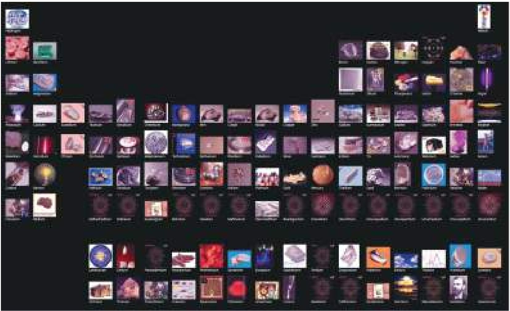
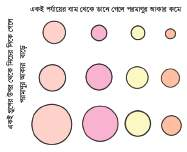
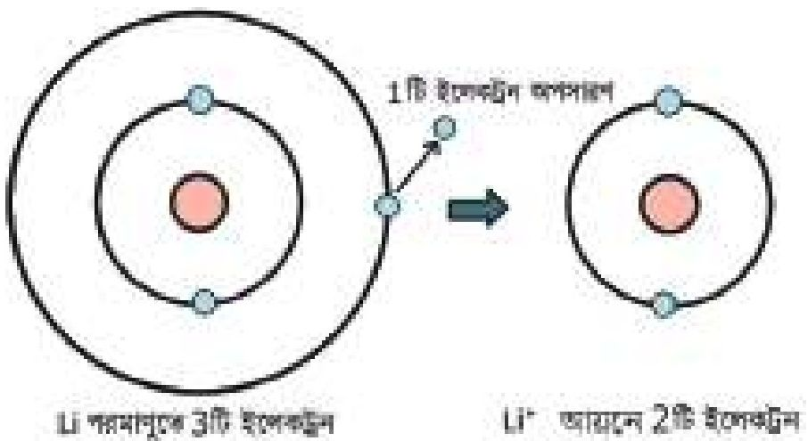
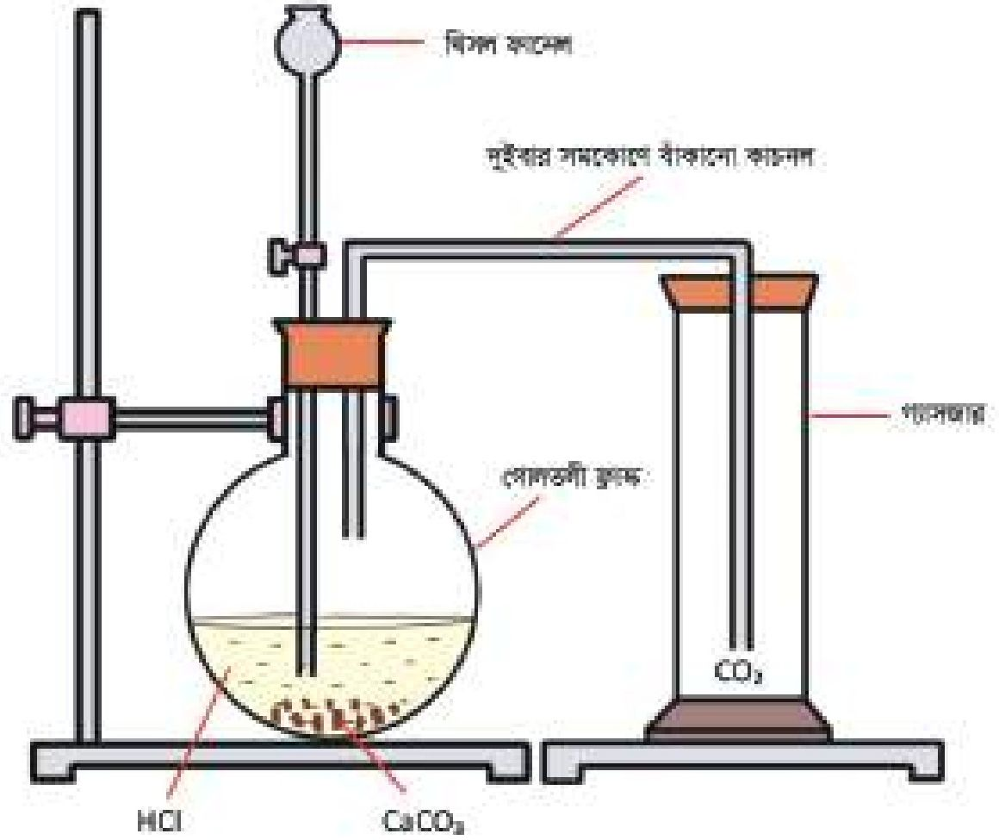

# 4. পর্যায় সারণি

Source: Chemistry Bangla Version, printed pp. 59-81

## 4.0 ভূমিকা ও শিখনফল

<!-- chemistry-9-10-bn-c04-t4.0-p001 · figure · p.59 -->

### একটি ভিন্ন ধরনের পর্যায় সারণি

<!-- chemistry-9-10-bn-c04-t4.0-p002 · text · p.59 · review: latin-junk -->
2016 সাল পর্যন্ত পৃথিবীতে মোট 118টি মৌলিক পদার্থ আবিষ্কৃত হয়েছে। রসায়ন অধ্যয়ন ও গবেষণার জন্য সব কয়টি মৌলের ভৌত ও রাসায়নিক ধর্ম সম্পর্কে ধারণা থাকা প্রয়োজন। মৌলিক পদার্থগুলোর মধ্যে কিছু মৌলিক পদার্থ একই রকম ধর্ম প্রদর্শন করে। যে সকল মৌলিক পদার্থ একই রকম ধর্ম প্রদর্শন করে তাদেরকে একই গ্রুপে রেখে সমগ্র মৌলিক পদার্থের জন্য একটি ছক তৈরি করার চেষ্টা দীর্ঘদিন থেকেই চলছিল। কয়েক শ বছর ধরে বিভিন্ন বিজ্ঞানীর প্রচেষ্টা, অনেক পরিবর্তন, পরিবর্তনের ফলে আমরা মৌলগুলো সাজানোর এই ছকটি পেয়েছি, যেটা পর্যায় সারণি বা Periodic table নামে পরিচিত। এ পর্যায় সারণি রসায়নের জগতে বিজ্ঞানীদের এক অসামান্য অবদান। এ পর্যায় সারণি এবং তার বৈশিষ্ট্য সম্পর্কে কারও ভালো ধারণা থাকলে শুধু এই 118টি মৌলের বিভিন্ন ধর্ম নয় বরং এ সকল মৌল দ্বারা গঠিত অসংখ্য যৌগের ধর্মাবলি সম্পর্কে সাধারণ ধারণা জন্মে। এই অধ্যায়ে পর্যায় সারণি এবং পর্যায় সারণিতে অবস্থিত মৌলসমূহের বিভিন্ন ধর্ম ও বৈশিষ্ট্য সম্পর্কে একটি সাধারণ ধারণা দেওয়ার চেষ্টা করা হয়েছে।

<!-- chemistry-9-10-bn-c04-t4.0-p003 · text · p.60 -->
* পর্যায় সারণি বিকাশের পটভূমি বর্ণনা করতে পারব।
* মৌলের সর্ববহিঃস্তর শক্তিস্তরের ইলেকট্রন বিন্যাসের সাথে পর্যায় সারণির প্রধান গ্রুপগুলোর সম্পর্ক নির্ণয় করতে পারব (প্রথম 30টি মৌল)।
* একটি মৌলের পর্যায় শনাক্ত করতে পারব।
* পর্যায় সারণিতে কোনো মৌলের অবস্থান জেনে এর ভৌত ও রাসায়নিক ধর্ম সম্পর্কে ধারণা করতে পারব।
* মৌলসমূহের বিশেষ নামকরণের কারণ বলতে পারব।
* পর্যায় সারণির গুরুত্ব ব্যাখ্যা করতে পারব।
* পর্যায় সারণির একই গ্রুপের মৌল দ্বারা গঠিত যৌগের একই ধরনের ধর্ম প্রদর্শন করতে পারব।
* পরীক্ষণের সময় কাচের যন্ত্রপাতির সঠিক ব্যবহার করতে পারব।
* পরীক্ষণ কাজে সতর্কতা অবলম্বন করতে পারব।
* পর্যায় সারণি অনুসরণ করে মৌলসমূহের ধর্ম অনুমানে আগ্রহ প্রদর্শন করতে পারব।

## 4.1 পর্যায় সারণির পটভূমি (Background of Periodic Table)

<!-- chemistry-9-10-bn-c04-t4.1-p001 · text · p.61 · review: known-confusable-corrected -->
মানুষ প্রাচীনকাল থেকে বিক্ষিপ্তভাবে পদার্থ এবং তাদের ধর্ম সম্পর্কে যে সকল ধারণা অর্জন করেছিল পর্যায় সারণি হচ্ছে তার একটি সম্মিলিত রূপ। পর্যায় সারণি একজন বিজ্ঞানীর একদিনের পরিশ্রমের ফলে তৈরি হয়নি। অনেক বিজ্ঞানীর অনেক দিনের অক্লান্ত পরিশ্রমের ফলে আজকের এই আধুনিক পর্যায় সারণি তৈরি হয়েছে।

<!-- chemistry-9-10-bn-c04-t4.1-p002 · text · p.61 -->
1789 সালে ল্যাভয়সিয়ে অক্সিজেন, নাইট্রোজেন, হাইড্রোজেন, ফসফরাস, মার্কারি, জিংক এবং সালফার ইত্যাদি মৌলিক পদার্থসমূহকে ধাতু ও অধাতু এই দুই ভাগে ভাগ করেন। ল্যাভয়সিয়ের সময় থেকেই মৌলগুলোকে বিভিন্ন ভাগে ভাগ করার চিন্তাভাবনা শুরু হয় যেন একই ধরনের মৌলিক পদার্থগুলো একটি নির্দিষ্ট ভাগে থাকে।

<!-- chemistry-9-10-bn-c04-t4.1-p003 · text · p.61 -->
1829 সালে বিজ্ঞানী ডোবেরাইনার লক্ষ্য করেন তিনটি করে মৌলিক পদার্থ একই রকমের ধর্ম প্রদর্শন করে। তিনি প্রথমে পারমাণবিক ভর অনুসারে তিনটি করে মৌল সাজান। এরপর তিনি লক্ষ্য করেন দ্বিতীয় মৌলের পারমাণবিক ভর প্রথম ও তৃতীয় মৌলের পারমাণবিক ভরের যোগফলের অর্ধেক বা তার কাছাকাছি, একে ডোবেরাইনারের ত্রয়ীসূত্র বলে। বিজ্ঞানী ডোবেরাইনার ক্লোরিন, ব্রোমিন ও আয়োডিনকে প্রথম ত্রয়ী মৌল হিসেবে চিহ্নিত করেন।

<!-- chemistry-9-10-bn-c04-t4.1-p004 · text · p.61 -->
1864 সাল পর্যন্ত আবিস্কৃত মৌলসমূহের জন্য নিউল্যান্ড অষ্টক সূত্র নামে একটি সূত্র প্রদান করেন। এই সূত্র অনুযায়ী মৌলসমূহকে যদি পারমাণবিক ভরের ছোট থেকে বড় অনুযায়ী সাজানো যায় তবে যেকোনো একটি মৌলের ধর্ম তার অষ্টম মৌলের ধর্মের সাথে মিলে যায়।

<!-- chemistry-9-10-bn-c04-t4.1-p005 · text · p.61 -->
1869 সালে রাশিয়ান বিজ্ঞানী মেন্ডেলিফ সকল মৌলের ধর্ম পর্দালোচনা করে একটি পর্দায় সূত্র প্রদান করেন। সূত্রটি হলো: “মৌলসমূহের ভৌত ও রাসায়নিক ধর্মাবলি তাদের পারমাণবিক ভর বৃদ্ধির সাথে পর্দায়ক্রমে আবর্তিত হয়।”

<!-- chemistry-9-10-bn-c04-t4.1-p006 · text · p.61 · review: known-confusable-corrected -->
এ সূত্র অনুসারে তিনি তখন পর্যন্ত আবিস্কৃত ৬৩টি মৌলকে 12টি আনুভূমিক সারি আর ৪টি খাড়া কলামের একটি ছকে পারমাণবিক ভর বৃদ্ধি অনুসারে সাজিয়ে দেখান যে, একই কলাম বরাবর সকল মৌলের ধর্ম একই রকমের এবং একটি সারির প্রথম মৌল থেকে শেষ মৌল পর্যন্ত মৌলগুলোর ধর্মের ক্রমায়নে পরিবর্তন ঘটে। এই ছকের নাম দেওয়া হয় পর্যায় সারণি (Periodic Table)।

<!-- chemistry-9-10-bn-c04-t4.1-p007 · text · p.61 · review: known-confusable-corrected -->
মেন্ডেলিফের পর্যায় সারণির আরেকটি সাফল্য হচ্ছে কিছু মৌলিক পদার্থের অস্তিত্ব সম্পর্কে সঠিক ভবিষ্যদ্বাণী। সে সময় মাত্র ৬৩টি মৌল আবিস্কৃত হওয়ার কারণে পর্যায় সারণির কিছু ঘর ফাঁকা থেকে যায়। মেন্ডেলিফ এই ফাঁকা ঘরগুলোর জন্য যে মৌলের ভবিষ্যদ্বাণী করেছিলেন পরবর্তীকালে সেগুলো সত্য প্রমাণিত হয়।

<!-- chemistry-9-10-bn-c04-t4.1-p008 · table · p.62 · review: verify-table -->
<table><tr><th>1</th><th>2</th><th>3</th><th>4</th><th>5</th><th>6</th><th>7</th><th>8</th><th>9</th></tr>
<tr><td>1 1 <strong>H</strong> Hydrogen হাইড্রোজেন</td><td>3 7 <strong>Li</strong> Lithium লিথিয়াম</td><td>4 9 <strong>Be</strong> Beryllium বেরিলিয়াম</td><td>11 23 <strong>Na</strong> Sodium সোডিয়াম</td><td>12 24 <strong>Mg</strong> Magnesium ম্যাগনেসিয়াম</td><td></td><td></td><td></td><td></td></tr>
<tr><td>19 39 <strong>K</strong> Potassium পটাশিয়াম</td><td>20 40 <strong>Ca</strong> Calcium ক্যালসিয়াম</td><td>21 45 <strong>Sc</strong> Scandium স্ক্যান্ডিয়াম</td><td>22 48 <strong>Ti</strong> Titanium টাইটানিয়াম</td><td>23 51 <strong>V</strong> Vanadium ভ্যানাডিয়াম</td><td>24 52 <strong>Cr</strong> Chromium ক্রোমিয়াম</td><td>25 55 <strong>Mn</strong> Manganese ম্যাঙ্গানিজ</td><td>26 56 <strong>Fe</strong> Iron আয়রন</td><td>27 58 <strong>Co</strong> Cobalt কোবাল্ট</td></tr>
<tr><td>37 85.5 <strong>Rb</strong> Rubidium রুবিডিয়াম</td><td>38 88 <strong>Sr</strong> Strontium স্ট্রোন্সিয়াম</td><td>39 89 <strong>Y</strong> Yttrium ইট্রিয়াম</td><td>40 91 <strong>Zr</strong> Zirconium জিরকোনিয়াম</td><td>41 93 <strong>Nb</strong> Niobium নিওবিয়াম</td><td>42 96 <strong>Mo</strong> Molybdenum মলিবডেনাম</td><td>43 98 <strong>Tc</strong> Technetium টেকনেসিয়াম</td><td>44 101 <strong>Ru</strong> Ruthenium রুথেনিয়াম</td><td>45 103 <strong>Rh</strong> Rhodium রোডিয়াম</td></tr>
<tr><td>55 133 <strong>Cs</strong> Caesium সিজিয়াম</td><td>56 137 <strong>Ba</strong> Barium বেরিয়াম</td><td>পারমাণবিক সংখ্যা 57 থেকে 71</td><td>72 178.5 <strong>Hf</strong> Hafnium হাফনিয়াম</td><td>73 181 <strong>Ta</strong> Tantalum ট্যান্টালাম</td><td>74 184 <strong>W</strong> Tungsten ট্যাংস্টেন</td><td>75 186 <strong>Re</strong> Rhenium রেনিয়াম</td><td>76 190 <strong>Os</strong> Osmium অসমিয়াম</td><td>77 192 <strong>Ir</strong> Iridium ইরিডিয়াম</td></tr>
<tr><td>87 223 <strong>Fr</strong> Francium ফ্রানসিয়াম</td><td>88 226 <strong>Ra</strong> Radium রেডিয়াম</td><td>পারমাণবিক সংখ্যা 89 থেকে 103</td><td>104 261 <strong>Rf</strong> Rutherfordium রাদারফোর্ডিয়াম</td><td>105 262 <strong>Db</strong> Dubnium ডুবনিয়াম</td><td>106 263 <strong>Sg</strong> Seaborgium সিয়াবর্গিয়াম</td><td>107 262 <strong>Bh</strong> Bohrium বোরিয়াম</td><td>108 265 <strong>Hs</strong> Hassium হাসিয়াম</td><td>109 266 <strong>Mt</strong> Metrenium মিট্রেনিয়াম</td></tr></table>

<!-- chemistry-9-10-bn-c04-t4.1-p009 · table · p.62 · review: verify-table -->
<table><tr><td>57 139 <strong>La</strong> Lanthanum ল্যান্থানাম</td><td>58 140 <strong>Ce</strong> Cerium সিরিয়াম</td><td>59 141 <strong>Pr</strong> Praseodymium প্রাসিওডিমিয়াম</td><td>60 144 <strong>Nd</strong> Neodymium নিওডিমিয়াম</td><td>61 145 <strong>Pm</strong> Promethium প্রোমেথিয়াম</td><td>62 150 <strong>Sm</strong> Samarium সামারিয়াম</td><td>63 152 <strong>Eu</strong> Europium ইউরোপিয়াম</td></tr>
<tr><td>89 227 <strong>Ac</strong> Actinium অ্যাকটিনিয়াম</td><td>90 232 <strong>Th</strong> Thorium থোরিয়াম</td><td>91 231 <strong>Pa</strong> Protactinium প্রোটেকটিনিয়াম</td><td>92 238 <strong>U</strong> Uranium ইউরেনিয়াম</td><td>93 237 <strong>Np</strong> Neptunium নেপচুনিয়াম</td><td>94 244 <strong>Pu</strong> Plutonium প্লুটোনিয়াম</td><td>95 243 <strong>Am</strong> Americium আমেরিসিয়াম</td></tr></table>

<!-- chemistry-9-10-bn-c04-t4.1-p010 · text · p.62 -->
**ল্যানথানাইড সারির মৌল**

<!-- chemistry-9-10-bn-c04-t4.1-p011 · text · p.62 -->
**অ্যাকটিনাইড সারির মৌল**

### আধুনিক পর্যায় সারণি

<!-- chemistry-9-10-bn-c04-t4.1-p012 · figure · p.63 · review: known-confusable-corrected -->
image: Periodic table of elements

<!-- chemistry-9-10-bn-c04-t4.1-p013 · table · p.63 · review: known-confusable-corrected,verify-table -->
<table><tr><td>2 4 <strong>He</strong> Helium হিলিয়াম</td></tr>
<tr><td>5 11 <strong>B</strong> Boron বোরন</td><td>6 12 <strong>C</strong> Carbon কার্বন</td><td>7 14 <strong>N</strong> Nitrogen নাইট্রোজেন</td><td>8 16 <strong>O</strong> Oxygen অক্সিজেন</td><td>9 19 <strong>F</strong> Fluorine ফ্লুরিন</td><td>10 20 <strong>Ne</strong> Neon নিয়ন</td></tr>
<tr><td>13 27 <strong>Al</strong> Aluminium আলুমিনিয়াম</td><td>14 28 <strong>Si</strong> Silicon সিলিকন</td><td>15 31 <strong>P</strong> Phosphorus ফসফরাস</td><td>16 32 <strong>S</strong> Sulfur সালফার</td><td>17 35.5 <strong>Cl</strong> Chlorine ক্লোরিন</td><td>18 40 <strong>Ar</strong> Argon আর্গন</td></tr>
<tr><td>28 59 <strong>Ni</strong> Nickel নিকেল</td><td>29 63.5 <strong>Cu</strong> Copper কপার</td><td>30 65 <strong>Zn</strong> Zinc জিংক</td><td>31 70 <strong>Ga</strong> Gallium গ্যালিয়াম</td><td>32 73 <strong>Ge</strong> Germanium জার্মেনিয়াম</td><td>33 75 <strong>As</strong> Arsenic আস্বেনিক</td><td>34 79 <strong>Se</strong> Selenium সেলেনিয়াম</td><td>35 80 <strong>Br</strong> Bromine ব্রোমিন</td><td>36 84 <strong>Kr</strong> Krypton ক্রিপটন</td></tr>
<tr><td>46 106 <strong>Pd</strong> Palladium প্যালাডিয়াম</td><td>47 108 <strong>Ag</strong> Silver সিলভার</td><td>48 112 <strong>Cd</strong> Cadmium ক্যাডমিয়াম</td><td>49 115 <strong>In</strong> Indium ইন্ডিয়াম</td><td>50 119 <strong>Sn</strong> Tin টিন</td><td>51 122 <strong>Sb</strong> Antimony এন্টিমনি</td><td>52 128 <strong>Te</strong> Tellurium টেলুরিয়াম</td><td>53 127 <strong>I</strong> Iodine আয়োডিন</td><td>54 131 <strong>Xe</strong> Xenon জেনন</td></tr>
<tr><td>78 195 <strong>Pt</strong> Platinum প্লাটিনাম</td><td>79 197 <strong>Au</strong> Gold গোল্ড</td><td>80 201 <strong>Hg</strong> Mercury মার্করি</td><td>81 204 <strong>Tl</strong> Thallium থালিয়াম</td><td>82 207 <strong>Pb</strong> Lead লেড</td><td>83 209 <strong>Bi</strong> Bismuth বিসমথ</td><td>84 209 <strong>Po</strong> Polonium পোলোনিয়াম</td><td>85 210 <strong>At</strong> Astatine অ্যাস্ট্যাটিন</td><td>86 222 <strong>Rn</strong> Radon রেডন</td></tr>
<tr><td>110 269 <strong>Ds</strong> Darmstadtium ডার্মস্টেডসিয়াম</td><td>111 272 <strong>Rg</strong> Roentgenium রনটজেনিয়াম</td><td>112 285 <strong>Cn</strong> Copernicium কোপার্নিসিয়াম</td><td>113 284 <strong>Nh</strong> Nihonium নিহোনিয়াম</td><td>114 285 <strong>Fl</strong> Flerovium ফ্লেরোভিয়াম</td><td>115 288 <strong>Mc</strong> Moscovium মসকোভিয়াম</td><td>116 293 <strong>Lv</strong> Livermorium লিভারমোরিয়াম</td><td>117 294 <strong>Ts</strong> Tennesine টেনেসিন</td><td>118 294 <strong>Og</strong> Oganesson ওগানেসন</td></tr></table>

<!-- chemistry-9-10-bn-c04-t4.1-p014 · table · p.63 · review: known-confusable-corrected,verify-table -->
<table><tr><td>64 157 <strong>Gd</strong> Gadolinium গ্যাডোলিনিয়াম</td><td>65 159 <strong>Tb</strong> Terbium টার্বিয়াম</td><td>66 163 <strong>Dy</strong> Dysprosium ডিসপ্রোসিয়াম</td><td>67 165 <strong>Ho</strong> Holmium হলমিয়াম</td><td>68 167 <strong>Er</strong> Erbium আর্বিয়াম</td><td>69 169 <strong>Tm</strong> Thulium থুলিয়াম</td><td>70 173 <strong>Yb</strong> Ytterbium ইটারবিয়াম</td><td>71 175 <strong>Lu</strong> Lutetium লুটেসিয়াম</td></tr>
<tr><td>96 247 <strong>Cm</strong> Curium কুরিয়াম</td><td>97 247 <strong>Bk</strong> Berkelium বাকেলিয়াম</td><td>98 251 <strong>Cf</strong> Californium ক্যালিফোর্নিয়াম</td><td>99 252 <strong>Es</strong> Einsteinium আইনস্টেিনিয়াম</td><td>100 257 <strong>Fm</strong> Fermium ফার্মিয়াম</td><td>101 258 <strong>Md</strong> Mendelevium মেন্ডেলভিয়াম</td><td>102 259 <strong>No</strong> Nobelium নোবেলিয়াম</td><td>103 262 <strong>Lr</strong> Lawrencium লরেনসিয়াম</td></tr></table>

<!-- chemistry-9-10-bn-c04-t4.1-p015 · text · p.64 · review: known-confusable-corrected -->
মেডেলিফের পর্যায় সারণির কিছু ত্রুটি পরিলক্ষিত হয়। মেডেলিফ তার পর্যায় সারণিতে যে নিয়মানুযায়ী মৌলগুলো বসিয়েছিলেন সেই নিয়মানুযায়ী যে পরমাণুর পারমাণবিক ভর কম থাকবে সেই পরমাণু পর্যায় সারণিতে আগে বসবে এবং যে পরমাণুর পারমাণবিক ভর বেশি থাকবে সেই পরমাণু পর্যায় সারণিতে পরে বসবে। কিন্তু দেখা যায় মেডেলিফের পর্যায় সারণিতে আর্গনের পারমাণবিক ভর 40 এবং পটাশিয়াম এর পারমাণবিক ভর 39 হওয়া সত্ত্বেও একই গ্রুপের মৌলসমূহের ধর্মের মিল করানোর জন্য আর্গনকে পটাশিয়ামের আগে বসানো হয়েছিল। এরকম আরও অনেক মৌলের ক্ষেত্রে দেখা যায় পারমাণবিক ভর বেশি হওয়া সত্ত্বেও তাদেরকে কোনো কোনো মৌলের আগে পর্যায় সারণিতে বসানো হয়েছিল। এটি ছিল পর্যায় সারণির ত্রুটি। এরকম আরও অনেক ত্রুটি মেডেলিফের পর্যায় সারণিতে লক্ষ্য করা যায়।

<!-- chemistry-9-10-bn-c04-t4.1-p016 · text · p.64 · review: known-confusable-corrected -->
1913 সালে মোসলে পারমাণবিক ভরের পরিবর্তে **পারমাণবিক সংখ্যা** অনুযায়ী মৌলগুলোকে পর্যায় সারণিতে সাজানোর প্রস্তাব দেন। মৌলসমূহের ভৌত ও রাসায়নিক ধর্মাবলি তাদের পারমাণবিক সংখ্যা বৃদ্ধির সাথে পর্যায়ক্রমে আবর্তিত হয়।

<!-- chemistry-9-10-bn-c04-t4.1-p017 · text · p.64 · review: known-confusable-corrected -->
পারমাণবিক সংখ্যা অনুসারে পর্যায় সারণিতে মৌলের স্থান দেওয়া হলে মেডেলিফের পর্যায় সারণিতে আর্গনের পারমাণবিক সংখ্যা 18 এবং পটাশিয়াম এর পারমাণবিক সংখ্যা 19। কাজেই আর্গন পটাশিয়ামের আগে বসবে। কাজেই পারমাণবিক সংখ্যা অনুসারে পর্যায় সারণিতে মৌলের স্থান দেওয়া হলে এ রকম ত্রুটিগুলো সংশোধিত হয়।

<!-- chemistry-9-10-bn-c04-t4.1-p018 · text · p.64 · review: latin-junk,known-confusable-corrected -->
আন্তর্জাতিক রসায়ন ও ফলিত রসায়ন সংস্থা (International Union of Pure and Applied Chemistry বা সংক্ষেপে IUPAC) এখন পর্যন্ত 118টি মৌলিক পদার্থকে শনাক্ত করেছে। IUPAC সংস্থাটি আন্তর্জাতিকভাবে রসায়ন ও ফলিত রসায়নের বিভিন্ন নিয়মকানুন, ক্রমবর্ধমান পরিবর্তনের কোনটি গ্রহণ করা যায় এবং কোনটি বর্জন করা উচিত এই বিষয়গুলো দেখাশোনা এবং নিয়ন্ত্রণ করে। 118টি মৌলের মধ্যে বেশির ভাগ মৌলই প্রকৃতিতে পাওয়া যায় এবং বাকি কিছু মৌল ল্যাবরেটরিতে তৈরি করা হয়েছে।

<!-- chemistry-9-10-bn-c04-t4.1-p019 · text · p.64 · review: known-confusable-corrected -->
ল্যাবরেসিয়ে মাত্র 33টি মৌল নিয়ে ছক তৈরির কাজ শুরু করেছিলেন। মেডেলিফ 63টি আবিষ্কৃত মৌল এবং 4টি আনাবিষ্কৃত মৌল নিয়ে পর্যায় সারণি নামে যে ছকটি তৈরি করেছিলেন, বর্তমানে সেটি 118টি মৌলের আধুনিক পর্যায় সারণি হিসেবে প্রতিষ্ঠিত হয়েছে।

## 4.2 পর্যায় সারণির বৈশিষ্ট্য (Characteristics of the Periodic Table)

<!-- chemistry-9-10-bn-c04-t4.2-p001 · text · p.64 · review: known-confusable-corrected -->
পর্যায় সারণি মূলত একটি ছক বা টেবিল। টেবিলে যেমন সারি (Row) এবং কলাম (Column) থাকে পর্যায় সারণিতেও তেমনি সারি ও কলাম আছে। পর্যায় সারণির বাম থেকে ডান পর্যন্ত বিস্তৃত সারিগুলোকে পর্দায় এবং খাড়া কলামগুলোকে গ্রুপ বা শ্রেণি বলে। আধুনিক পর্যায় সারণির বর্গাকার ঘরগুলোতে মোট 118টি মৌল আছে। পর্যায় সারণিটি এই অধ্যায়ের শুরুতে দেখানো হয়েছে।

<!-- chemistry-9-10-bn-c04-t4.2-p002 · text · p.65 · review: known-confusable-corrected -->
আধুনিক পর্যায় সারণির অনেক বৈশিষ্ট্য রয়েছে। পর্যায় সারণির দিকে লক্ষ্য রাখলে এই বৈশিষ্ট্যগুলো খুঁজে পাওয়া যাবে।

<!-- chemistry-9-10-bn-c04-t4.2-p003 · text · p.65 · review: known-confusable-corrected -->
(a) পর্যায় সারণিতে 7টি পর্দায় (Period) বা অনুভূমিক সারি এবং 18টি গ্রুপ বা খাড়া স্তম্ভ রয়েছে।

<!-- chemistry-9-10-bn-c04-t4.2-p004 · text · p.65 -->
(b) প্রতিটি পর্দায় বামদিকে গ্রুপ 1 থেকে শুরু করে ডানদিকে গ্রুপ 18 পর্যন্ত বিস্তৃত।

<!-- chemistry-9-10-bn-c04-t4.2-p005 · text · p.65 · review: known-confusable-corrected -->
(c) মূল পর্যায় সারণির নিচে আলাদাভাবে ল্যান্থানাইড ও অ্যাকটিনাইড সারির মৌল হিসেবে দেখানো হলেও এগুলো যথাক্রমে 6 এবং 7 পর্দায়ের অংশ।

<!-- chemistry-9-10-bn-c04-t4.2-p006 · text · p.65 -->
(d) (i) পর্দায় 1 এ শুধু 2টি মৌল রয়েছে।
    (ii) পর্দায় 2 এবং পর্দায় 3 এ 8টি করে মৌল রয়েছে।
    (iii) পর্দায় 4 এবং পর্দায় 5 এ 18টি করে মৌল রয়েছে।
    (iv) পর্দায় 6 এবং পর্দায় 7 এ 32টি করে মৌল রয়েছে।

<!-- chemistry-9-10-bn-c04-t4.2-p007 · text · p.65 -->
(e) (i) গ্রুপ 1 এ 7টি মৌল রয়েছে।
    (ii) গ্রুপ 2 এ 6টি মৌল রয়েছে।
    (iii) গ্রুপ 3 এ 32টি মৌল রয়েছে।
    (iv) গ্রুপ 4 থেকে গ্রুপ 12 পর্যন্ত প্রত্যেকটি গ্রুপে 4টি করে মৌল রয়েছে।
    (v) গ্রুপ 13 থেকে গ্রুপ 17 পর্যন্ত প্রত্যেকটিতে 6টি করে মৌল রয়েছে।
    (vi) গ্রুপ 18 এ 7টি মৌল রয়েছে।

<!-- chemistry-9-10-bn-c04-t4.2-p008 · text · p.65 · review: known-confusable-corrected -->
যে সকল মৌলের পারমাণবিক সংখ্যা 57 থেকে 71 পর্যন্ত এরকম 15টি মৌলকে ল্যান্থানাইড সারির মৌল বলা হয়। যে সকল মৌলের পারমাণবিক সংখ্যা 89 থেকে 103 পর্যন্ত এরকম 15টি মৌলকে অ্যাকটিনাইড সারির মৌল বলা হয়। ল্যান্থানাইড সারির মৌলগুলোর ধর্ম এত কাছাকাছি এবং অ্যাকটিনাইড সারির মৌলসমূহের ধর্ম এত কাছাকাছি যে তাদেরকে পর্যায় সারণির নিচে ল্যান্থানাইড সারির মৌল এবং অ্যাকটিনাইড সারির মৌল হিসেবে আলাদাভাবে রাখা হয়েছে।

<!-- chemistry-9-10-bn-c04-t4.2-p009 · text · p.65 -->
যদি মৌলগুলোর ধর্মের ভিত্তিতে বিবেচনা করা হয় তাহলে নিচের বৈশিষ্ট্যগুলো লক্ষ্য করা যায়:

<!-- chemistry-9-10-bn-c04-t4.2-p010 · text · p.65 -->
১. একই পর্দায়ের বাম থেকে ডানের দিকে গেলে মৌলসমূহের ধর্ম ক্রমাক্ষয়ে পরিবর্তিত হয়।
২. একই গ্রুপের মৌলগুলোর ভৌত এবং রাসায়নিক ধর্ম প্রায় একই রকমের হয়।

## 4.3 ইলেকট্রন বিন্যাস থেকে পর্যায় সারণিতে মৌলের অবস্থান নির্ণয়

### (Determination of the Position of Elements in the Periodic Table from Their Electronic Configuration)

<!-- chemistry-9-10-bn-c04-t4.3-p001 · text · p.66 -->
আমরা কোনো একটি মৌলের ইলেকট্রন বিন্যাস থেকে সহজেই মৌলটি কোন গ্রুপ এবং কোন পর্যায়ে রয়েছে সেটি বের করতে পারি। নিচে পর্যায় সারণিতে কোনো মৌলের অবস্থান নির্ণয়ের পদ্ধতি বর্ণনা করা হলো।

### পর্যায় নম্বর বের করার নিয়ম

<!-- chemistry-9-10-bn-c04-t4.3-p002 · text · p.66 -->
কোনো মৌলের ইলেকট্রন বিন্যাসের সবচেয়ে বাইরের প্রধান শক্তিস্তরের নম্বরই ঐ মৌলের পর্যায় নম্বর। যেমন— Li এর ইলেকট্রন বিন্যাস হলো: Li(3) → 1s22s1। যেহেতু লিথিয়ামের ইলেকট্রন বিন্যাসে সবচেয়ে বাইরের শক্তিস্তর 2, তাই লিথিয়াম 2 নম্বর পর্যায়ের মৌল।

<!-- chemistry-9-10-bn-c04-t4.3-p003 · text · p.66 -->
K এর ইলেকট্রন বিন্যাস হলো: K(19) → 1s22s22p63s23p64s1। যেহেতু পটাশিয়ামের ইলেকট্রন বিন্যাসে সবচেয়ে বাইরের শক্তিস্তর 4, তাই পটাশিয়াম 4 নম্বর পর্যায়ের মৌল।

### গ্রুপ নম্বর বের করার নিয়ম

<!-- chemistry-9-10-bn-c04-t4.3-p004 · text · p.66 -->
কোনো মৌলের গ্রুপ নম্বর বের করার কয়েকটি নিয়ম আছে।

<!-- chemistry-9-10-bn-c04-t4.3-p005 · text · p.66 -->
**নিয়ম 1:** কোনো মৌলের ইলেকট্রন বিন্যাসের বাইরের প্রধান শক্তিস্তরে যদি শুধু s অরবিটাল থাকে তবে ঐ s অরবিটালের মোট ইলেকট্রন সংখ্যাই ঐ মৌলের গ্রুপ নম্বর। যেমন- হাইড্রোজেন, H(1) মৌলের ইলেকট্রন বিন্যাস 1s1। এখানে s অরবিটালে 1টি ইলেকট্রন আছে। কাজেই হাইড্রোজেন এর গ্রুপ বা শ্রেণি নম্বর 1।

<!-- chemistry-9-10-bn-c04-t4.3-p006 · text · p.66 -->
**নিয়ম 2:** কোনো মৌলের ইলেকট্রন বিন্যাসের বাইরের প্রধান শক্তিস্তর যদি শুধু s ও p অরবিটাল থাকে তবে ঐ s ও p অরবিটালের মোট ইলেকট্রন সংখ্যার সাথে 10 যোগ করলে যে সংখ্যা পাওয়া যায় সেই সংখ্যাই ঐ মৌলের গ্রুপ নম্বর। যেমন: বোরন B(5) মৌলের ইলেকট্রন বিন্যাস 1s2 2s2 2p1। এখানে বোরনের বাইরের শেলে s অরবিটালে 2টি ইলেকট্রন ও p অরবিটালে 1টি ইলেকট্রন আছে। কাজেই বোরনের গ্রুপ নম্বর 2 + 1 + 10 = 13

<!-- chemistry-9-10-bn-c04-t4.3-p007 · text · p.66 · review: verify-formula -->
**নিয়ম 3:** কোনো মৌলের ইলেকট্রন বিন্যাসে সবচেয়ে বাইরের প্রধান শক্তিস্তরে যদি s অরবিটাল থাকে এবং আগের প্রধান শক্তিস্তরে যদি d অরবিটাল থাকে তবে s অরবিটাল ও d অরবিটালের ইলেকট্রন সংখ্যা যোগ করলেই গ্রুপ নম্বর পাওয়া যায়। যেমন: Fe(26) মৌলের ইলেকট্রন বিন্যাস 1s2 2s2 2p6 3s2 3p6 3d6 4s2। এখানে আয়রন এর বাইরের শক্তিস্তরে s অরবিটাল আছে এবং তার আগের শক্তিস্তরে d অরবিটাল আছে। এখানে d অরবিটালে ৬টি এবং s অরবিটালে ২টি ইলেকট্রন আছে। কাজেই আয়রনের গ্রুপ নম্বর $6 + 2 = 8$।

<!-- chemistry-9-10-bn-c04-t4.3-p008 · text · p.67 -->
বোঝার সুবিধার জন্য মৌলের সবচেয়ে বাইরের স্তরের ইলেকট্রন বিন্যাসকে লাল রং দিয়ে দেখানো হয়েছে।

<!-- chemistry-9-10-bn-c04-t4.3-p009 · table · p.67 · review: verify-table -->
**টেবিল ৪.০১: মৌলের ইলেকট্রন বিন্যাস ও গ্রুপ নম্বর**
<table><tr><th>মৌল</th><th>মৌলের ইলেকট্রন বিন্যাস</th><th>পার্যায় নম্বর</th><th>গ্রুপ বা শ্রেণি নম্বর</th></tr>
<tr><td>H(1)</td><td>1s1</td><td>1</td><td>1 (নিয়ম 1)</td></tr>
<tr><td>He(2)</td><td>1s2</td><td>1</td><td>18 (ব্যতিক্রম)</td></tr>
<tr><td>Li(3)</td><td></td><td></td><td></td></tr>
<tr><td>Be(4)</td><td></td><td></td><td></td></tr>
<tr><td>B(5)</td><td>1s2 2s2 2p1</td><td>2</td><td>2 + 1 + 10 = 13 (নিয়ম 2)</td></tr>
<tr><td>C(6)</td><td></td><td></td><td></td></tr>
<tr><td>N(7)</td><td>1s2 2s2 2p3</td><td>2</td><td>2 + 3 + 10 = 15 (নিয়ম 2)</td></tr>
<tr><td>O(8)</td><td>1s2 2s2 2p4</td><td>2</td><td>2 + 4 + 10 = 16 (নিয়ম 2)</td></tr>
<tr><td>F(9)</td><td>1s2 2s2 2p5</td><td>2</td><td>2 + 5 + 10 = 17 (নিয়ম 2)</td></tr>
<tr><td>Ne(10)</td><td>1s2 2s2 2p6</td><td>2</td><td>2 + 6 + 10 = 18 (নিয়ম 2)</td></tr>
<tr><td>Na(11)</td><td></td><td></td><td></td></tr>
<tr><td>Mg(12)</td><td>1s2 2s2 2p6 3s2</td><td>3</td><td>2 (নিয়ম 1)</td></tr>
<tr><td>Al(13)</td><td></td><td></td><td></td></tr>
<tr><td>Si(14)</td><td>1s2 2s2 2p6 3s2 3p2</td><td>3</td><td>2 + 2 + 10 = 14 (নিয়ম 2)</td></tr>
<tr><td>P(15)</td><td>1s2 2s2 2p6 3s2 3p3</td><td>3</td><td>2 + 3 + 10 = 15 (নিয়ম 2)</td></tr>
<tr><td>S(16)</td><td></td><td></td><td></td></tr>
<tr><td>Cl(17)</td><td>1s2 2s2 2p6 3s2 3p5</td><td>3</td><td>2 + 5 + 10 = 17 (নিয়ম 2)</td></tr>
<tr><td>Ar(18)</td><td>1s2 2s2 2p6 3s2 3p6</td><td>3</td><td>2 + 6 + 10 = 18 (নিয়ম 2)</td></tr>
<tr><td>K(19)</td><td>1s2 2s2 2p6 3s2 3p6 4s1</td><td>4</td><td>1 (নিয়ম 1)</td></tr>
<tr><td>Ca(20)</td><td>1s2 2s2 2p6 3s2 3p6 4s2</td><td>4</td><td>2 (নিয়ম 1)</td></tr>
<tr><td>Sc(21)</td><td></td><td></td><td></td></tr>
<tr><td>Ti(22)</td><td>1s2 2s2 2p6 3s2 3p6 3d2 4s2</td><td>4</td><td>2 + 2 = 4 (নিয়ম 3)</td></tr>
<tr><td>V(23)</td><td>1s2 2s2 2p6 3s2 3p6 3d3 4s2</td><td>4</td><td>2 + 3 = 5 (নিয়ম 3)</td></tr></table>

<!-- chemistry-9-10-bn-c04-t4.3-p010 · table · p.68 · review: verify-table -->
<table><tr><td>Cr(24)</td><td>1s2 2s2 2p6 3s2 3p6 3d5 4s1</td><td>4</td><td>1 + 5 = 6 (নিয়ম 3)</td></tr>
<tr><td>Mn(25)</td><td>1s2 2s2 2p6 3s2 3p6 3d5 4s2</td><td>4</td><td>2 + 5 = 7 (নিয়ম 3)</td></tr>
<tr><td>Fe(26)</td><td></td><td></td><td></td></tr>
<tr><td>Co(27)</td><td>1s2 2s2 2p6 3s2 3p6 3d7 4s2</td><td>4</td><td>2 + 7 = 9 (নিয়ম 3)</td></tr>
<tr><td>Ni(28)</td><td>1s2 2s2 2p6 3s2 3p6 3d8 4s2</td><td>4</td><td>2 + 8 = 10 (নিয়ম 3)</td></tr>
<tr><td>Cu(29)</td><td>1s2 2s2 2p6 3s2 3p6 3d10 4s1</td><td>4</td><td>1 + 10 = 11 (নিয়ম 3)</td></tr>
<tr><td>Zn(30)</td><td>1s2 2s2 2p6 3s2 3p6 3d10 4s2</td><td>4</td><td>2 + 10 = 12 (নিয়ম 3)</td></tr></table>

<!-- chemistry-9-10-bn-c04-t4.3-p011 · text · p.68 -->
**শিক্ষার্থীর কাজ:** উপরের ছকে পারমাণবিক সংখ্যা 3, 4, 6, 11, 13, 16, 21, 26 বিশিষ্ট মৌলের ইলেকট্রন বিন্যাস লেখো এবং ইলেকট্রন বিন্যাস থেকে পর্যায় সারণিতে সেগুলোর অবস্থান নির্ণয় করো।

## 4.4 ইলেকট্রন বিন্যাসই পর্যায় সারণির মূল ভিত্তি

### (Electronic Configurations of Elements are the Main Basis of the Periodic Table)

<!-- chemistry-9-10-bn-c04-t4.4-p001 · text · p.68 -->
ইলেকট্রন বিন্যাসের মাধ্যমে কোনো মৌল কত নম্বর পর্যায় এবং কত নম্বর গ্রুপে অবস্থান করে তা বের করা যায়। আবার, যে সকল মৌলের বাইরের প্রধান শক্তিস্তরের ইলেকট্রন বিন্যাস একই রকম সে সকল মৌল একই গ্রুপে অবস্থান করে। অপরদিকে যে সকল মৌলের বাইরের প্রধান শক্তিস্তরের ইলেকট্রন বিন্যাস ভিন্ন রকম সে সকল মৌল ভিন্ন গ্রুপে অবস্থান করে।

<!-- chemistry-9-10-bn-c04-t4.4-p002 · text · p.68 -->
**টেবিল ৪.০২: মৌল ও ইলেকট্রন বিন্যাস**

<!-- chemistry-9-10-bn-c04-t4.4-p003 · table · p.68 · review: verify-table -->
<table><tr><th>গ্রুপ-1</th><th></th></tr>
<tr><th>মৌল</th><th>ইলেকট্রন বিন্যাস</th></tr>
<tr><td>H(1)</td><td>1s1</td></tr>
<tr><td>Li(3)</td><td>1s22s1</td></tr>
<tr><td>Na(11)</td><td>1s22s22p63s1</td></tr>
<tr><td>K(19)</td><td>1s22s22p63s23p64s1</td></tr></table>

<!-- chemistry-9-10-bn-c04-t4.4-p004 · table · p.68 · review: verify-table -->
<table><tr><th>গ্রুপ-2</th><th></th></tr>
<tr><th>মৌল</th><th>ইলেকট্রন বিন্যাস</th></tr>
<tr><td>He(2)</td><td>1s2</td></tr>
<tr><td>Be(4)</td><td>1s22s2</td></tr>
<tr><td>Mg(12)</td><td>1s22s22p63s2</td></tr>
<tr><td>Ca(20)</td><td>1s22s22p63s23p64s2</td></tr></table>

<!-- chemistry-9-10-bn-c04-t4.4-p005 · text · p.69 -->
যে সকল মৌলের ইলেকট্রন বিন্যাসে বাইরের শক্তিস্তরে মোট ইলেকট্রন সংখ্যা 1টি সে সকল মৌল সাধারণত ইলেকট্রন দান করে ধনাত্মক আয়নে পরিণত হওয়ার প্রবণতা দেখায়। যেমন- সোডিয়ামের বাইরের শক্তিস্তরে 1টি ইলেকট্রন আছে। তাই সোডিয়াম ঐ 1টি ইলেকট্রন তাগ করে ধনাত্মক আয়নে পরিণত হয়।

<!-- chemistry-9-10-bn-c04-t4.4-p006 · formula · p.69 · review: verify-formula -->
$$Na  (1s^2 2s^2 2p^6 3s^1) \longrightarrow Na^+   (1s^2 2s^2 2p^6) + e^-$$

<!-- chemistry-9-10-bn-c04-t4.4-p007 · text · p.69 -->
আবার যে সকল মৌলের ইলেকট্রন বিন্যাসে বাইরের শক্তিস্তরে মোট ইলেকট্রন সংখ্যা 7টি সে সকল মৌল সাধারণত 1টি ইলেকট্রন গ্রহণ করে ঋণাত্মক আয়নে পরিণত হবার প্রবণতা দেখায়। যেমন- ক্লোরিনের বাইরের শক্তিস্তরে 7টি ইলেকট্রন আছে। তাই ক্লোরিন 1টি ইলেকট্রন গ্রহণ করে ঋণাত্মক আয়নে পরিণত হয়।

<!-- chemistry-9-10-bn-c04-t4.4-p008 · formula · p.69 · review: verify-formula -->
$$Cl  (1s^2 2s^2 2p^6 3s^2 3p^5) + e^- \longrightarrow Cl^-   (1s^2 2s^2 2p^6 3s^2 3p^6)$$

<!-- chemistry-9-10-bn-c04-t4.4-p009 · text · p.69 · review: known-confusable-corrected -->
অতএব ইলেকট্রন বিন্যাসের মাধ্যমে পর্যায় সারণিতে মৌলের অবস্থান নির্ণয় ও মৌলসমূহের অনেক ধর্ম ব্যাখ্যা করা যায়। এজন্য ইলেকট্রন বিন্যাসকেই পর্যায় সারণির মূল ভিত্তি হিসেবে বিবেচনা করা হয়।

## 4.5 পর্যায় সারণির কিছু ব্যতিক্রম

### (Some Exceptions in the Periodic Table)

<!-- chemistry-9-10-bn-c04-t4.5-p001 · text · p.69 · review: known-confusable-corrected -->
(a) **হাইড্রোজেনের অবস্থান:** হাইড্রোজেন একটি অধাতু। কিন্তু পর্যায় সারণিতে হাইড্রোজেনকে তীব্র তড়িৎ ধনাত্মক স্কার ধাতু Na, K, Rb, Cs, Fr এর সাথে গ্রুপ-1 এ স্থান দেওয়া হয়েছে। এর কারণ স্কার ধাতুর মতো H এর বাইরের প্রধান শক্তিস্তরে একটিমাত্র ইলেকট্রন রয়েছে। আবার, হাইড্রোজেনের অনেক ধর্ম স্কার ধাতুগুলোর ধর্মের সাথে মিলে যায়। অন্যদিকে, হ্যালোজেন মৌল (F, Cl, Br, I) এর একটি পরমাণু যেমন একটি ইলেকট্রন গ্রহণ করতে পারে, হাইড্রোজেনও তেমনি একটি ইলেকট্রন গ্রহণ করতে পারে অর্থাৎ H এর অনেক ধর্ম হ্যালোজেন মৌলের ধর্মের সাথেও মিলে যায়। তবে হাইড্রোজেনের বেশির ভাগ ধর্ম স্কার ধাতুসমূহের ধর্মের সাথে মিলে যাওয়ায় একে স্কার ধাতুর সাথে গ্রুপ 1 এ স্থান দেওয়া হয়েছে।

<!-- chemistry-9-10-bn-c04-t4.5-p002 · text · p.69 · review: known-confusable-corrected -->
(b) **হিলিয়ামের অবস্থান:** হিলিয়ামের ইলেকট্রন বিন্যাস He(2)→ 1s2। হিলিয়ামের ইলেকট্রন বিন্যাস অনুসারে একে গ্রুপ-2 এ স্থান দেওয়া উচিত ছিল। কিন্তু গ্রুপ-2 এর মৌলসমূহ তীব্র তড়িৎ ধনাত্মক। এদের মূল্যস্কার ধাতু বলে। অপরদিকে He একটি নিষ্ক্রিয় গ্যাস। এর ধর্ম অন্যান্য নিষ্ক্রিয় গ্যাস নিয়ন, আর্গন, ক্লিপটন, জেনন, রেডন ইত্যাদির সাথে মিলে যায়। He এর ধর্ম কখনই তীব্র তড়িৎ ধনাত্মক মূংস্কার ধাতুর মতো হয় না। তাই হিলিয়ামকে নিষ্ক্রিয় গ্যাসসমূহের সাথে গ্রুপ-18 তে স্থান দেওয়া হয়েছে।

<!-- chemistry-9-10-bn-c04-t4.5-p003 · text · p.70 -->
**(c) ল্যান্থানাইড সারির এবং অ্যাকটিনাইড সারির মৌলগুলোর অবস্থান:** পর্যায় সারণিতে ল্যান্থানাইড সারির মৌলগুলো ৬ নম্বর পর্যায় ও ৩ নম্বর গ্রুপে অবস্থিত এবং অ্যাকটিনাইড সারির মৌলগুলো ৭ নম্বর পর্যায় ও ৩ নম্বর গ্রুপে অবস্থিত। এই অবস্থানগুলোতে ল্যান্থানাইড সারির এবং অ্যাকটিনাইড সারির মৌলগুলোকে বসালে পর্যায় সারণির সৌন্দর্য নষ্ট হয়। কাজেই পর্যায় সারণিকে সুন্দরভাবে দেখানোর জন্য ল্যান্থানাইড সারির এবং অ্যাকটিনাইড সারির মৌলগুলোকে পর্যায় সারণির নিচে আলাদভাবে রাখা হয়েছে।

## 4.6 মৌলের পর্যায়বৃত্ত ধর্ম (Periodic Properties of Elements)

<!-- chemistry-9-10-bn-c04-t4.6-p001 · text · p.70 -->
পর্যায় সারণিতে অবস্থিত মৌলগুলোর কিছু ধর্ম আছে, যেমন-ধাতব ধর্ম, অধাতব ধর্ম, পরমাণুর আকার, আয়নিকরণ শক্তি, তড়িৎ ঋণাত্মকতা ইলেকট্রন আসক্তি ইত্যাদি। এসব ধর্মকে পর্যায়বৃত্ত ধর্ম বলে।

<!-- chemistry-9-10-bn-c04-t4.6-p002 · text · p.70 -->
**(a) ধাতব ধর্ম (Metallic Properties):** যে সকল মৌল চকচকে, আঘাত করলে ধাতব শব্দ করে এবং তাপ ও বিদ্যুৎ পরিবাহী তাদেরকে আমরা ধাতু বলে থাকি। আধুনিক সংজ্ঞা অনুযায়ী যে সকল মৌল এক বা একাধিক ইলেকট্রন ত্যাগ করে ধনাত্মক আয়নে পরিণত হয় তাদেরকে ধাতু বলে। ধাতুর ইলেকট্রন ত্যাগের এই ধর্মকে ধাতব ধর্ম বলে। যে মৌলের পরমাণু যত সহজে ইলেকট্রন ত্যাগ করতে পারে সেই মৌলের ধাতব ধর্ম তত বেশি।

<!-- chemistry-9-10-bn-c04-t4.6-p003 · text · p.70 -->
যেমন- লিথিয়াম (Li) একটি ধাতু কারণ Li একটি ইলেকট্রন ত্যাগ করে Li+ এ পরিণত হয়।

<!-- chemistry-9-10-bn-c04-t4.6-p004 · formula · p.70 · review: verify-formula -->
$$Li \rightarrow Li^+ + e^-$$

<!-- chemistry-9-10-bn-c04-t4.6-p005 · text · p.70 -->
পর্যায় সারণিতে যেকোনো পর্যায়ের বাম থেকে ডানে গেলে ধাতব ধর্ম হ্রাস পায়।

<!-- chemistry-9-10-bn-c04-t4.6-p006 · text · p.70 -->
**(b) অধাতব ধর্ম (Non-metallic Properties):** যে সকল মৌল চকচকে নয়, আঘাত করলে ধাতব শব্দ করে না এবং তাপ ও বিদ্যুৎ পরিবাহী নয় তাদেরকে আমরা অধাতু বলে থাকি। আধুনিক সংজ্ঞা অনুযায়ী যে সকল মৌল এক বা একাধিক ইলেকট্রন গ্রহণ করে ঋণাত্মক আয়নে পরিণত হয় তাদেরকে অধাতু বলে। অধাতুর ইলেকট্রন গ্রহণের এই ধর্মকে অধাতব ধর্ম বলে। যে মৌলের পরমাণু যত সহজে ইলেকট্রন গ্রহণ করতে পারে সেই মৌলের অধাতব ধর্ম তত বেশি।

<!-- chemistry-9-10-bn-c04-t4.6-p007 · text · p.70 -->
যেমন- ক্লোরিন (Cl) একটি অধাতু কারণ Cl একটি ইলেকট্রন গ্রহণ করে Cl- এ পরিণত হয়।

<!-- chemistry-9-10-bn-c04-t4.6-p008 · formula · p.71 · review: verify-formula -->
$$Cl + e^- \rightarrow Cl^-$$

<!-- chemistry-9-10-bn-c04-t4.6-p009 · text · p.71 · review: known-confusable-corrected -->
পর্যায় সারণিতে যেকোনো পর্দায়ের বাম থেকে ডানে গেলে অধাতব ধর্ম বৃদ্ধি পায়।

<!-- chemistry-9-10-bn-c04-t4.6-p010 · text · p.71 -->
যে সকল মৌল কোনো কোনো সময় ধাতুর মতো আচরণ করে এবং কোনো কোনো সময় অধাতুর মতো আচরণ করে তাদেরকে অর্ধধাতু বা অপধাতু বলা হয়। আবার আধুনিক সংজ্ঞা অনুযায়ী যে সকল মৌল কোনো কোনো সময় ইলেকট্রন ত্যাগ করে এবং কোনো কোনো সময় ইলেকট্রন গ্রহণ করে তাদেরকে অপধাতু বলে। যেমন- সিলিকন (Si) একটি অপধাতু।

<!-- chemistry-9-10-bn-c04-t4.6-p011 · text · p.71 · review: known-confusable-corrected -->
পর্যায় সারণির যেকোনো একটি পর্দায়ের দিকে লক্ষ্য করলে দেখা যাবে যে, বামদিকের মৌলগুলো সাধারণত ধাতু, মাঝের মৌলগুলো সাধারণত অর্ধধাতু বা অপধাতু এবং ডানদিকের মৌলগুলো সাধারণত অধাতু।

<!-- chemistry-9-10-bn-c04-t4.6-p012 · text · p.71 -->
**(c) পরমাণুর আকার/পারমাণবিক ব্যাসার্ধ (Size of Atom/Atomic Radius):** পরমাণুর আকার তথা পারমাণবিক ব্যাসার্ধ একটি পর্দায়বন্ত ধর্ম। যেকোনো একটি পর্দায়ের যতই বামদিক থেকে ডান দিকে যাওয়া যায় পরমাণুর আকার/পারমাণবিক ব্যাসার্ধ তত কমে তাকে এবং যেকোনো একটি গ্রুপের যতই উপর দিক থেকে নিচের দিকে যাওয়া যায় পরমাণুর আকার/পারমাণবিক ব্যাসার্ধ তত বাড়তে থাকে।

<!-- chemistry-9-10-bn-c04-t4.6-p013 · text · p.71 -->
একই পর্দায়ের বাম দিক থেকে যত ডান দিকে যাওয়া যায় পারমাণবিক সংখ্যা তত বাড়তে থাকে কিন্তু প্রধান শক্তিস্তরের সংখ্যা বাড়ো না। পারমাণবিক সংখ্যা বাড়লে নিউক্লিয়াসে প্রোটন সংখ্যা বৃদ্ধি পায় এবং ইলেকট্রন সংখ্যাও বৃদ্ধি পায়। নিউক্লিয়াসের অধিক প্রোটন সংখ্যা এবং নিউক্লিয়াসের বাইরের অধিক ইলেকট্রন সংখ্যার মধ্যে আকর্ষণ বেশি হয় ফলে ইলেকট্রনগুলোর শক্তিস্তর নিউক্লিয়াসের কাছে চলে আসে, ফলে পরমাণুর আকার ছোট হয়ে যায়।

<!-- chemistry-9-10-bn-c04-t4.6-p014 · text · p.71 -->
আবার, একই গ্রুপে যতই উপর থেকে নিচের দিকে যাওয়া যায় ততই বাইরের দিকে একটি করে নতুন শক্তিস্তর যুক্ত হয়। একটি করে নতুন শক্তিস্তর যুক্ত হলে পরমাণুর আকার বৃদ্ধি পায়।

<!-- chemistry-9-10-bn-c04-t4.6-p015 · text · p.71 -->
একই গ্রুপের উপর থেকে নিচের দিকে গেলে নিউক্লিয়াসের প্রোটন সংখ্যা এবং বাইরের কক্ষপথের ইলেকট্রন সংখ্যা বৃদ্ধির জন্য আকর্ষণ বৃদ্ধি হয়ে পরমাণুর আকার যতটুকু হ্রাস পায়, নতুন একটি শক্তিস্তর যোগ হওয়ার কারণে

<!-- chemistry-9-10-bn-c04-t4.6-p016 · figure · p.71 -->

<!-- chemistry-9-10-bn-c04-t4.6-p017 · figure · p.71 -->
**চিত্র ৪.০১: পরমাণুর আকারের পর্দায়বন্ত ধর্ম**

<!-- chemistry-9-10-bn-c04-t4.6-p018 · text · p.72 -->
পরমাণুর আকার তার চেয়ে বেশি বৃদ্ধি পায়। যে কারণে উপরের মৌলের চেয়ে নিচের মৌলের আকার বড় হয়।

### (d) আয়নিকরণ শক্তি (Ionization Energy): গ্যাসীয় অবস্থায় কোনো মৌলের এক মোল গ্যাসীয় পরমাণু থেকে এক মোল ইলেকট্রন অপসারণ করে এক মোল ধনাত্মক আয়নে পরিণত করতে যে শক্তির প্রয়োজন হয়, তাকে ঐ মৌলের আয়নিকরণ শক্তি বলে। আয়নিকরণ শক্তি একটি পর্যায়বৃত্ত ধর্ম। একই পর্যায়ের বামের মৌলের পারমাণবিক ব্যাসার্ধ বেশি এবং ডানের মৌলের পারমাণবিক ব্যাসার্ধ কম। পারমাণবিক ব্যাসার্ধ কমলে আয়নিকরণ শক্তির মান বাড়ে এবং পারমাণবিক ব্যাসার্ধ বাড়লে আয়নিকরণ শক্তির মান কমে।

<!-- chemistry-9-10-bn-c04-t4.6-p019 · figure · p.72 -->

<!-- chemistry-9-10-bn-c04-t4.6-p020 · figure · p.72 -->
**চিত্র ৪.০২: মৌলের আয়নিকরণ**

### উদাহরণ

<!-- chemistry-9-10-bn-c04-t4.6-p021 · example · p.72 -->
Na, Mg, Al, Si এর মধ্যে Si এর আয়নিকরণ শক্তির মান বেশি। কারণ এই মৌলগুলোর মধ্যে Si এর পারমাণবিক ব্যাসার্ধের মান সবচেয়ে কম। পক্ষান্তরে, এই মৌলগুলোর মধ্যে Na এর পারমাণবিক ব্যাসার্ধের মান বেশি বলে এদের মধ্যে সোডিয়ামের আয়নিকরণ শক্তির মান কম।

<!-- chemistry-9-10-bn-c04-t4.6-p022 · text · p.72 -->
গ্রুপ-1 এর Li, Na, K, Rb, Cs, Fr স্কার ধাতুগুলোর মধ্যে Li এর পারমাণবিক ব্যাসার্ধের মান সবচেয়ে কম এজন্য এদের মধ্যে Li এর আয়নিকরণ শক্তির মান সবচেয়ে বেশি।

<!-- chemistry-9-10-bn-c04-t4.6-p023 · text · p.72 -->
আবার, গ্রুপ-17 এর F, Cl, Br, I এবং At মৌলগুলোর মধ্যে F এর পারমাণবিক ব্যাসার্ধের মান সবচেয়ে কম, কাজেই এই মৌলগুলোর মধ্যে F এর আয়নিকরণ শক্তির মান সবচেয়ে বেশি।

### (e) ইলেকট্রন আসক্তি (Electron Affinities): গ্যাসীয় অবস্থায় কোনো মৌলের এক মোল গ্যাসীয় পরমাণুতে এক মোল ইলেকট্রন প্রবেশ করিয়ে এক মোল ঋণাত্মক আয়নে পরিণত করতে যে শক্তি নির্গত হয়, তাকে ঐ মৌলের ইলেকট্রন আসক্তি বলে।

<!-- chemistry-9-10-bn-c04-t4.6-p024 · text · p.72 -->
ইলেকট্রন আসক্তি একটি পর্যায়বৃত্ত ধর্ম। একই পর্যায়ের বামের মৌলের পারমাণবিক ব্যাসার্ধ বেশি এবং ডানের মৌলের পারমাণবিক ব্যাসার্ধ কম। পারমাণবিক ব্যাসার্ধ কমলে ইলেকট্রন আসক্তির মান বাড়ে এবং পারমাণবিক ব্যাসার্ধ বাড়লে ইলেকট্রন আসক্তির মান কমে।

### একক কাজ

<!-- chemistry-9-10-bn-c04-t4.6-p025 · activity · p.73 -->
**সমস্যা:** Be, Ca, Sr, Ba, Mg এবং Ra মৌলগুলোর মধ্যে কোনোটির ইলেকট্রন আসক্তি বেশি এবং কোনোটির ইলেকট্রন আসক্তি কম।

<!-- chemistry-9-10-bn-c04-t4.6-p026 · activity · p.73 · review: known-confusable-corrected -->
**সমাধান:** Be, Ca, Sr, Ba, Mg এবং Ra মৌলগুলো পর্যায় সারণির ২ নং গ্রুপ-এর মৌল। এই মৌলগুলোর মধ্যে Be এর পারমাণবিক ব্যাসার্ধের মান সবচেয়ে কম, এর জন্য Be এর ইলেকট্রন আসক্তির মান সবচেয়ে বেশি। আবার Ra এর পারমাণবিক ব্যাসার্ধের মান সবচেয়ে বেশি, এর জন্য Ra ইলেকট্রন আসক্তি সবচেয়ে কম।

<!-- chemistry-9-10-bn-c04-t4.6-p027 · activity · p.73 -->
**সমস্যা:** Na, Mg, Al, Si এর মধ্যে কার ইলেকট্রন আসক্তি বেশি বা কার ইলেকট্রন আসক্তির মান কম?

<!-- chemistry-9-10-bn-c04-t4.6-p028 · activity · p.73 · review: known-confusable-corrected -->
**সমাধান:** Na, Mg, Al, Si এর মৌলগুলো পর্যায় সারণির ৩ নং পর্যায়ের মৌল। এই মৌলগুলোর মধ্যে Na-এর পারমাণবিক ব্যাসার্ধের মান সবচেয়ে বেশি এজন্য সোডিয়াম এর ইলেকট্রন আসক্তির মান সবচেয়ে কম। আবার, Si এর পারমাণবিক ব্যাসার্ধের মান সবচেয়ে কম সেজন্য এর ইলেকট্রন আসক্তির মান সবচেয়ে বেশি।

<!-- chemistry-9-10-bn-c04-t4.6-p029 · activity · p.73 -->
**(f) তড়িৎ ঋণাত্মকতা (Electronegativity):** দুটি পরমাণু যখন সমযোজী বন্ধনে আবদ্ধ হয়ে অণুতে পরিণত হয় তখন অণুর পরমাণুগুলো বন্ধনের ইলেকট্রন দুটিকে নিজের দিকে আকর্ষণ করে। এই আকর্ষণকে তড়িৎ ঋণাত্মকতা বলা হয়। তড়িৎ ঋণাত্মকতা একটি পর্দায়বদ্ধ ধর্ম। একই পর্যায়ের বামের মৌলের পারমাণবিক ব্যাসার্ধ বেশি এবং ডানের মৌলের পারমাণবিক ব্যাসার্ধ কম। পারমাণবিক ব্যাসার্ধ কমলে তড়িৎ ঋণাত্মকতার মান বাড়ে এবং পারমাণবিক ব্যাসার্ধ বাড়লে তড়িৎ ঋণাত্মকতার মান কমে।

<!-- chemistry-9-10-bn-c04-t4.6-p030 · text · p.73 -->
যেমন- ৩ পর্যায়ে মৌলগুলোর মাঝে Na পরমাণুর তড়িৎ ঋণাত্মকতার মান সবচেয়ে কম এবং Cl এর তড়িৎ ঋণাত্মকতা সবচেয়ে বেশি। সাধারণত কোনো মৌলের পরমাণুর আকার ছোট হলে তড়িৎ ঋণাত্মকতার মান বেশি হয় এবং কোনো মৌলের পরমাণুর আকার বড় হলে তড়িৎ ঋণাত্মকতার মান কম হয়।

## 4.7 বিভিন্ন গ্রুপে উপস্থিত মৌলগুলোর বিশেষ নাম

### (The Special Names of Elements Present in Various Groups)

<!-- chemistry-9-10-bn-c04-t4.7-p001 · text · p.73 -->
মৌলসমূহের ভৌত ও রাসায়নিক ধর্মের উপর ভিত্তি করে বিভিন্ন সময়ে তাদের বিশেষ নাম দেওয়া হয়েছিল। আমরা ইতোমধ্যে ধাতু, অধাতু, অর্ধধাতু বা অপধাতুর কথা আলোচনা করেছি। এছাড়া রয়েছে:

<!-- chemistry-9-10-bn-c04-t4.7-p002 · text · p.73 -->
ফর্মা নং-১০, রসায়ন- ৯ম-১০ম শ্রেণি

<!-- chemistry-9-10-bn-c04-t4.7-p003 · text · p.74 · review: known-confusable-corrected -->
**ক্ষার ধাতু:** পর্যায় সারণির ১ নং গ্রুপে ৭টি মৌল আছে। এদের মধ্যে হাইড্রোজেন ছাড়া বাকি ৬টি মৌলকে (লিথিয়াম, সোডিয়াম, পটাশিয়াম, রুবিডিয়াম, সিজিয়াম এবং ফ্রানসিয়াম) ক্ষারধাতু বলে। এই ছয়টি মৌলের প্রত্যেকটি পানিতে দ্রবীভূত হয়ে হাইড্রোজেন গ্যাস এবং ক্ষার তৈরি করে বলে এদেরকে ক্ষারধাতু (Alkali Metals) বলা হয়।

<!-- chemistry-9-10-bn-c04-t4.7-p004 · text · p.74 · review: known-confusable-corrected -->
**মৃৎক্ষার ধাতু:** পর্যায় সারণির ২ নং গ্রুপে বেরিলিয়াম, ম্যাগনেসিয়াম, ক্যালসিয়াম, স্ট্রনসিয়াম, বেরিয়াম এবং রেডিয়াম এই ৬টি মৌল আছে। এই মৌলগুলোকে মৃৎক্ষার ধাতু বলে। এই ধাতুগুলোকে মাটিতে বিভিন্ন যোগ হিসেবে পাওয়া যায়। আবার, এরা ক্ষার তৈরি করে। এজন্য সামগ্রিকভাবে এদের মৃৎক্ষার ধাতু (Alkaline Earth Metals) বলা হয়।

<!-- chemistry-9-10-bn-c04-t4.7-p005 · text · p.74 -->
**মুদ্রা ধাতু:** গ্রুপ-১১ এর ৪টি মৌল হচ্ছে কপার, সিলভার, গোল্ড এবং রনটজেনিয়াম। এই চারটি মৌলের মধ্যে প্রথম ৩টি মৌলকে মুদ্রা ধাতু (Coin Metals) বলা হয়, কারণ এই গ্রুপের সবচেয়ে নিচের মৌল রনটজেনিয়াম (Rg) ছাড়া অন্য যে ৩টি মৌল আছে তা দিয়ে প্রাচীনকালে মুদ্রা তৈরি হতো এবং ব্যবসা-বাণিজ্য ও বিনিময়ের মাধ্যম হিসেবে ব্যবহার করা হতো।

<!-- chemistry-9-10-bn-c04-t4.7-p006 · text · p.74 -->
**হ্যালোজেন গ্রুপ:** গ্রুপ-১৭ এর ৬টি মৌলকে হ্যালোজেন (Halogen) বলা হয়। এই হ্যালোজেন গ্রুপের ৬টি মৌল হচ্ছে: ফ্লোরিন (F), ক্লোরিন (Cl), ব্রোমিন (Br), আয়োডিন (I), অ্যাস্টাটিন (At) এবং টেনোসিন (Ts)। এসব হ্যালোজেন মৌলকে X দ্বারা প্রকাশ করা হয়। হ্যালোজেন মানে লবণ উৎপাদনকারী এবং এর মূল উৎস সামুদ্রিক লবণ। হ্যালোজেন মৌলগুলোর সাথে ধাতু যুক্ত হয়ে লবণ গঠিত হয়। যেমন— F এর সাথে Na যুক্ত হয়ে সোডিয়াম ফ্লোরাইড লবণ কিংবা Cl এর সাথে Na যুক্ত হয়ে সোডিয়াম ফ্লোরাইড (NaCl) বা খাদ্যলবণ গঠিত হয়। এরা নিজেরাই নিজেদের মধ্যে ইলেকট্রন ভাগাভাগি করে দ্বিমৌল অণু তৈরি করে, যেমন— Cl2, I2 ইত্যাদি।

<!-- chemistry-9-10-bn-c04-t4.7-p007 · text · p.74 -->
**নিষ্ক্রিয় গ্যাস:** পর্যায় সারণির ১৮ নং গ্রুপের মৌলসমূহকে নিষ্ক্রিয় গ্যাস (Inert Gases) বলা হয়। মৌলগুলো হলো: হিলিয়াম (He), নিয়ন (Ne), আর্গন (Ar), ক্রিপ্টন (Kr), জেনন (Xe), রেডন (Rn) এবং ওগানেসন (Og)। এই মৌলগুলোর সবচেয়ে বাইরের শক্তিস্তরে প্রয়োজনীয় ইলেকট্রন দিয়ে পূর্ণ থাকে বলে এরা ইলেকট্রন বিনিময় বা ভাগাভাগি করে কোনো যোগ গঠন করতে চায় না। রাসায়নিক বন্ধন গঠন বা রাসায়নিক বিক্রিয়ায় এরা নিষ্ক্রিয় থাকে বলে এদেরকে নিষ্ক্রিয় মৌল বা নিষ্ক্রিয় গ্যাস বলে। নিষ্ক্রিয় গ্যাসগুলো সাধারণ তাপমাত্রায় গ্যাস হিসেবে থাকে।

<!-- chemistry-9-10-bn-c04-t4.7-p008 · text · p.74 -->
**অবস্ফুত্তর মৌল:** অবস্ফুত্তর মৌলসমূহকে অবস্ফুত্তর ধাতুও বলা হয়। কারণ এ মৌলগুলোর সবগুলোই ধাতু। অবস্ফুত্তর মৌলসমূহ d-রুক মৌলের অন্তর্ভুক্ত। তবে সকল d-রুক মৌল অবস্ফুত্তর মৌল নয়। যে সকল d-রুক মৌলের এক বা একাধিক অরবিটাল আংশিক ইলেকট্রনপূর্ণ তারাই কেবল অবস্ফুত্তর মৌল। যেমন- লোহা (Fe), নিকেল (Ni), ক্রোমিয়াম (Cr) ইত্যাদি। অবস্ফুত্তর মৌলসমূহের বিশেষ কিছু বৈশিষ্ট্য আছে। যেমন- এরা যোগে একাধিক যোগনী প্রদর্শন করে, এরা সাধারণত: রঙিন যোগ গঠন করে, শিল্পক্ষেত্রে এরা ভালো প্রভাবক হিসাবে কাজ করে। উচ্চ মাধ্যমিক শ্রেণিতে তোমরা এ সম্পর্কে আরো অনেক কিছু শিখতে পারবে।

### একক কাজ

<!-- chemistry-9-10-bn-c04-t4.7-p009 · activity · p.75 -->
**সমস্যা:** Ca কে মূংস্কার ধাতু বলা হয় কেন?

<!-- chemistry-9-10-bn-c04-t4.7-p010 · activity · p.75 -->
**সমাধান:** Ca ধাতুর বিভিন্ন যৌগ মাটিতে পাওয়া যায়। আবার Ca ধাতুর হাইড্রোক্সাইড যৌগ Ca(OH)2 একটি ক্ষার। অতএব Ca একটি মূংস্কার ধাতু।

<!-- chemistry-9-10-bn-c04-t4.7-p011 · activity · p.75 -->
**সমস্যা:** He কোন নিষ্ক্রিয় গ্যাস? ব্যাখ্যা করো।

<!-- chemistry-9-10-bn-c04-t4.7-p012 · activity · p.75 -->
**সমাধান:** He নিজেদের সাথে যুক্ত হয় না আবার অন্য মৌলের সাথেও যুক্ত হয় না। এজন্য হিলিয়াম নিষ্ক্রিয় মৌল। আবার হিলিয়াম মৌল গ্যাস হিসেবে অবস্থান করে। এজন্যই সামগ্রিকভাবে He কে নিষ্ক্রিয় গ্যাস বলা হয়।

## 4.8 পর্যায় সারণির সুবিধা (Advantages of the Periodic Table)

<!-- chemistry-9-10-bn-c04-t4.8-p001 · text · p.75 · review: known-confusable-corrected -->
পর্যায় সারণি বিভিন্ন রসায়নবিদে নিরলস প্রচেষ্টায় গড়া রসায়নের জগতে এক অসামান্য অবদান। রসায়ন অধ্যয়ন, নতুন মৌল সম্বর্কে ভবিষ্যদ্বাণী, গবেষণা ইত্যাদিতে পর্যায় সারণি বিরাট ভূমিকা পালন করে। নিচে তার কয়েকটি উদাহরণ তুলে ধরা হলো:

<!-- chemistry-9-10-bn-c04-t4.8-p002 · text · p.75 · review: known-confusable-corrected,verify-formula -->
**(a) রসায়ন পাঠ সহজীকরণ:** 2016 সাল পর্যন্ত পৃথিবীতে 118টি মৌল আবিষ্কার করা হয়েছে। আমরা যদি শুধু 4টি ভৌত ধর্ম, যেমন- গলনাঙ্ক, স্ফুটনাঙ্ক, ঘনত্ব ও কাঠিন/তরল/গ্যাসীয় অবস্থা এবং 4টি রাসায়নিক ধর্ম, যেমন- অক্সিজেন, পানি, এসিড ও ক্ষারের সাথে বিক্রিয়া বিবেচনা করি তাহলে 118টি মৌলের মোট $118 \times (4 + 4) = 944$টি ধর্ম বা বৈশিষ্ট্য লক্ষ্য করা যায়। এতগুলো ধর্ম মনে রাখা অসম্ভব ব্যাপার। কিন্তু পর্যায় সারণি সে কাজটিকে অনেক সহজ করে দিয়েছে। এ পর্যায় সারণিতে রয়েছে আঠারোটি গ্রুপ আর সাতটি পর্যায়। প্রতিটি গ্রুপের সাধারণ ধর্ম জানলে 118টি মৌলের ভৌত ও রাসায়নিক ধর্ম সম্বন্ধে একটি মোটামুটি ধারণা লাভ করা যায়। শুধু তাই নয়, পর্যায় সারণি সম্বর্কে ভালোভাবে ধারণা থাকলে বিভিন্ন মৌল দ্বারা গঠিত তাদের যৌগের ধর্ম সম্বর্কেও ধারণা লাভ করা যেতে পারে।

<!-- chemistry-9-10-bn-c04-t4.8-p003 · text · p.75 · review: known-confusable-corrected -->
**(b) নতুন মৌলের আবিষ্কার:** কিছু দিন আগেও সাতটি পর্দায় আর আঠারোটি গ্রুপ নিয়ে গঠিত পর্যায় সারণিতে বেশ কিছু ফাঁকা ঘর ছিল। এই মৌলগুলো আবিষ্কার হবার আগেই ঐ ফাঁকা ঘরে যে মৌলগুলো বসবে বা তাদের ধর্ম কেমন হবে তা পর্যায় সারণি থেকে ধারণা পাওয়া গিয়েছিল। তোমরা ইতোমধ্যে জেনে গেছ যে বিজ্ঞানী মেন্ডেলিফ তাঁর সময়ে আবিষ্কৃত ৬৩টি মৌলকে তার আবিষ্কৃত পর্যায় সারণিতে স্থান দিতে গিয়ে যে মৌলগুলো সম্পর্কে ভবিষ্যদ্বাণী করেছিলেন সেগুলো পরে আবিষ্কৃত হয়েছিল।

<!-- chemistry-9-10-bn-c04-t4.8-p004 · text · p.76 -->
**(c) গবেষণা ক্ষেত্রে:** গবেষণার ক্ষেত্রেও পর্যায় সারণির অসামান্য অবদান রয়েছে। মনে করো, কোনো একজন বিজ্ঞানী কোনো একটি বিশেষ প্রয়োজনের জন্য নতুন একটি পদার্থ আবিষ্কার করতে চাইছেন। তাহলে আগেই তাঁকে ধারণা করতে হবে যে, নতুন পদার্থটির ধর্ম কেমন হবে এবং সেই সকল ধর্মবিশিষ্ট পদার্থ তৈরি করতে কী ধরনের মৌল প্রয়োজন হবে। তার এ ধারণা পর্যায় সারণি থেকেই পাওয়া যাবে।

<!-- chemistry-9-10-bn-c04-t4.8-p005 · text · p.76 -->
এছাড়া পর্যায় সারণির আরও অনেক ধরনের ব্যবহার আছে যা তোমরা ধীরে ধীরে জানতে পারবে।

## 4.9 পর্যায় সারণির একই গ্রুপের মৌলগুলো একই রকম রাসায়নিক ধর্ম প্রদর্শন করে

### (Elements in the Same Group in the Periodic Table Show similar Chemical Properties)

<!-- chemistry-9-10-bn-c04-t4.9-p001 · text · p.76 -->
পর্যায় সারণির একই গ্রুপের মৌলগুলো যে একই রকম ধর্ম প্রদর্শন করে তা একটি পরীক্ষার মাধ্যমে তোমরা বুঝতে পারবে।

<!-- chemistry-9-10-bn-c04-t4.9-p002 · text · p.76 · review: latin-junk -->
যেমন- 17 নং গ্রুপের মৌল F2, Cl2, Br2, I2 ইত্যাদি গ্যাস হাইড্রোজেনের সাথে বিক্রিয়া করে যথাক্রমে HF(g), HCl(g), HBr(g) , HI(g) ইত্যাদি গ্যাস উৎপন্ন করে।

<!-- chemistry-9-10-bn-c04-t4.9-p003 · text · p.76 · review: verify-formula -->
$$H_2(g) + F_2(g) \longrightarrow 2HF(g)$$
$$H_2(g) + Cl_2(g) \longrightarrow 2HCl(g)$$
$$H_2(g) + Br_2(g) \longrightarrow 2HBr(g)$$
$$H_2(g) + I_2(g) \longrightarrow 2HI(g)$$

<!-- chemistry-9-10-bn-c04-t4.9-p004 · text · p.76 · review: latin-junk -->
আবার, এই উৎপন্ন গ্যাসগুলোকে যদি পানিতে দ্রবীভূত করা হয় তাহলে হাইড্রোহ্যালাইড এসিড যথা হাইড্রোফ্লোরিক এসিড [HF(aq)], হাইড্রোক্লোরিক এসিড [HCl(aq)], হাইড্রোব্রোমিক এসিড [HBr(aq)], হাইড্রোআয়োডিক এসিডে [HI(aq)] পরিণত হয়।

<!-- chemistry-9-10-bn-c04-t4.9-p005 · text · p.76 · review: verify-formula -->
$$HF(g) + H_2O(l) \longrightarrow HF(aq)$$
$$HCl(g) + H_2O(l) \longrightarrow HCl(aq)$$
$$HBr(g) + H_2O(l) \longrightarrow HBr(aq)$$
$$HI(g) + H_2O(l) \longrightarrow HI(aq)$$

<!-- chemistry-9-10-bn-c04-t4.9-p006 · text · p.76 -->
এই হাইড্রোহ্যালাইড এসিডসমূহ যেকোনো কার্বনেট লবণের সাথে বিক্রিয়া করে কার্বন ডাই-অক্সাইড গ্যাস উৎপন্ন করে। যেমন- ক্যালসিয়াম কার্বনেটের মধ্যে হাইড্রোফ্লোরিক এসিড যোগ করলেও কার্বন ডাই-অক্সাইড গ্যাস উৎপন্ন হয়।

<!-- chemistry-9-10-bn-c04-t4.9-p007 · formula · p.77 · review: verify-formula -->
$$CaCO_3 + 2HF(aq) \longrightarrow CaF_2 + H_2O + CO_2$$

<!-- chemistry-9-10-bn-c04-t4.9-p008 · text · p.77 -->
আবার, ক্যালসিয়াম কার্বনেটের মধ্যে হাইড্রোক্লোরিক এসিড যোগ করলেও কার্বন ডাই-অক্সাইড গ্যাস তৈরি হয়।

<!-- chemistry-9-10-bn-c04-t4.9-p009 · formula · p.77 · review: verify-formula -->
$$CaCO_3 + 2HCl(aq) \longrightarrow CaCl_2 + H_2O + CO_2$$

<!-- chemistry-9-10-bn-c04-t4.9-p010 · text · p.77 -->
উপরের বিক্রিয়াগুলো থেকে বোঝা যায় যে, 17 নং গ্রুপের মৌল, F2, Cl2, Br2, I2 একই রকমের ধর্ম ও বিক্রিয়া প্রদর্শন করে।

<!-- chemistry-9-10-bn-c04-t4.9-p011 · text · p.77 -->
আবার, 2 নং গ্রুপের মৌল Mg এবং Ca একই রকমের ধর্ম ও বিক্রিয়া প্রদর্শন করে।

<!-- chemistry-9-10-bn-c04-t4.9-p012 · text · p.77 -->
ম্যাগনেসিয়াম কার্বনেট (MgCO3) যেমন- লঘু হাইড্রোক্লোরিক এসিডের সাথে বিক্রিয়া করে ম্যাগনেসিয়াম ক্লোরাইড, পানি এবং কার্বন ডাই-অক্সাইড গ্যাস উৎপন্ন করে তেমনি ক্যালসিয়াম কার্বনেট লঘু হাইড্রোক্লোরিক এসিডের সাথে বিক্রিয়া করে ক্যালসিয়াম ক্লোরাইড, পানি এবং কার্বন ডাইঅক্সাইড গ্যাস উৎপন্ন করে।

<!-- chemistry-9-10-bn-c04-t4.9-p013 · text · p.77 · review: verify-formula -->
$$MgCO_3 + 2HCl \longrightarrow MgCl_2 + H_2O + CO_2$$
$$CaCO_3 + 2HCl \longrightarrow CaCl_2 + H_2O + CO_2$$

### পরীক্ষণ

<!-- chemistry-9-10-bn-c04-t4.9-p014 · text · p.77 -->
**পরীক্ষণের নাম:** ক্যালসিয়াম কার্বনেটের সাথে লঘু হাইড্রোক্লোরিক এসিডের বিক্রিয়ায় উৎপন্ন কার্বন ডাই-অক্সাইড গ্যাস শনাক্তকরণ।

<!-- chemistry-9-10-bn-c04-t4.9-p015 · text · p.77 -->
**মূলনীতি:** ক্যালসিয়াম কার্বনেট লঘু হাইড্রোক্লোরিক এসিডের সাথে বিক্রিয়া করে ক্যালসিয়াম ক্লোরাইড, পানি এবং কার্বন ডাইঅক্সাইড গ্যাস উৎপন্ন করে।

<!-- chemistry-9-10-bn-c04-t4.9-p016 · formula · p.77 · review: verify-formula -->
$$CaCO_3 + 2HCl \longrightarrow CaCl_2 + H_2O + CO_2$$

<!-- chemistry-9-10-bn-c04-t4.9-p017 · text · p.77 -->
**প্রয়োজনীয় উপকরণ**

<!-- chemistry-9-10-bn-c04-t4.9-p018 · text · p.77 -->
**যন্ত্রপাতি:** 1. একটি গোলতলী ফ্লাস্ক 2. একটি হিসল ফানেল 3. দুইবার সমকোণে বাঁকানো একটি কাচের নির্গম নল 4. কয়েকটি গ্যাসজার 5. ছিদ্রযুক্ত ছিপি।

<!-- chemistry-9-10-bn-c04-t4.9-p019 · text · p.77 -->
**রাসায়নিক দ্রব্যাদি:** 1. ক্যালসিয়াম কার্বনেট 2. লঘু হাইড্রোক্লোরিক এসিড 3. পানি।

### কায়পদ্ধতি:

<!-- chemistry-9-10-bn-c04-t4.9-p020 · text · p.78 -->
1. একটি গোলতলী ফ্লাস্কে ক্যালসিয়াম কার্বনেটের কিছু ছোট টুকরো নেওয়া হলো।

<!-- chemistry-9-10-bn-c04-t4.9-p021 · text · p.78 -->
2. ছিপির সাহায্যে ফ্লাস্কের এক মুখ দিয়ে একটি হিসল ফানেল এবং অপর মুখ দিয়ে দুইবার সমকোণে বাঁকানো নির্গম নলের এক প্রান্ত প্রবেশ করানো হলো।

<!-- chemistry-9-10-bn-c04-t4.9-p022 · figure · p.78 -->

<!-- chemistry-9-10-bn-c04-t4.9-p023 · figure · p.78 -->
**চিত্র ৪.০৩ : কার্বন ডাই-অক্সাইড প্রস্তুতকরণ**

<!-- chemistry-9-10-bn-c04-t4.9-p024 · text · p.78 -->
3. হিসল ফানেলের মধ্য দিয়ে কিছু পরিমাণ পানি গোলতলী ফ্লাস্কে নেওয়া হলো যেন ক্যালসিয়াম কার্বনেট এবং হিসল ফানেলের নিম্নপ্রান্ত পানিতে ডুবে থাকে।

<!-- chemistry-9-10-bn-c04-t4.9-p025 · text · p.78 -->
4. নির্গম নলের অন্য প্রান্ত একটি গ্যাসজারে প্রবেশ করানো হলো।

<!-- chemistry-9-10-bn-c04-t4.9-p026 · text · p.78 -->
5. এরপর হিসল ফানেলের ভিতর দিয়ে ধীরে ধীরে হাইড্রোক্লোরিক এসিড যোগ করা হলো। দেখা গেল ক্যালসিয়াম কার্বনেট এবং হাইড্রোক্লোরিক এসিড বিক্রিয়া করে যে কার্বন ডাই-অক্সাইড গ্যাস তৈরি করছে তা বৃদ্ধুদ্বু আকারে নির্গম নল দিয়ে বের হয়ে আসছে।

<!-- chemistry-9-10-bn-c04-t4.9-p027 · text · p.79 -->
৬. নির্গম নল দিয়ে বের হয়ে আসা গ্যাসকে গ্যাসজারে সংরক্ষণ করা হলো। যেহেতু কার্বন ডাই-অক্সাইড বাতাসের অন্যান্য গ্যাস অপেক্ষা তুলনামূলক ভারী, সেহেতু কার্বন ডাইঅক্সাইড সিলিন্ডারের নিচে দিকে জমা হবে।

<!-- chemistry-9-10-bn-c04-t4.9-p028 · text · p.79 -->
**কার্বন ডাই-অক্সাইড গ্যাসের ধর্ম পরীক্ষা:** 1. উৎপন্ন কার্বন ডাই-অক্সাইড গ্যাসের বর্ণ লক্ষ্য করা হলো। কার্বন ডাই-অক্সাইডের কোনো বর্ণ দেখা গেল না।

<!-- chemistry-9-10-bn-c04-t4.9-p029 · text · p.79 -->
2. গ্যাসজারের মুখে একটি জুলন্ত কাঠি ধরা হলো। কাঠিটির আগুন নিতে গেল। সিদ্ধান্ত নেওয়া হলো কার্বন ডাই-অক্সাইড গ্যাস আগুন নিভাতে সাহায্য করে।

<!-- chemistry-9-10-bn-c04-t4.9-p030 · text · p.79 -->
3. একটি টেস্টটিউব বা পরীক্ষানলে চূনের পানি বা ক্যালসিয়াম হাইড্রোক্লোরাইড নিয়ে তার মধ্যে উৎপন্ন কার্বন ডাই-অক্সাইড গ্যাস প্রবেশ করানো হলো। প্রথমে সামান্য গ্যাস প্রবেশ করে ক্যালসিয়াম হাইড্রোক্লোরাইডের সাথে বিক্রিয়া করে ক্যালসিয়াম কার্বনেটের সাদা বর্ণের অধঃক্ষেপ তৈরি হলো। ফলে চূনের পানি ঘোলা হলো। এরপর আরও অধিক গ্যাস এই ঘোলা পানির মধ্যে প্রবেশ করানো হলো ফলে ক্যালসিয়াম কার্বনেট, পানি এবং কার্বন ডাই-অক্সাইড বিক্রিয়া করে ক্যালসিয়াম বাইকার্বনেট তৈরি করল। এতে চূনের ঘোলা পানি আবার পরিষ্কার হয়ে গেল।

<!-- chemistry-9-10-bn-c04-t4.9-p031 · text · p.79 -->
**সতর্কতা:** 1. থিসল ফানেলের শেষ প্রান্ত পানির নিচে যাতে সব সময় ডুবে থাকে সেই ব্যবস্থা নেওয়া হয়েছিল।

<!-- chemistry-9-10-bn-c04-t4.9-p032 · text · p.79 -->
2. গোলতলী ফ্লাস্ককে একটি স্ট্যান্ডের সাথে আটকিয়ে রাখা হয়েছিল।

<!-- chemistry-9-10-bn-c04-t4.9-p033 · text · p.79 -->
এই পরীক্ষণের জন্য ক্যালসিয়াম কার্বনেটের পরিবর্তে শামুক, ঝিনুক, ডিমের খোসা এবং হাইড্রোক্লোরিক এসিডের পরিবর্তে ভিনেগার ব্যবহার করা যায়।

## 4.ex নমুনা প্রশ্ন

### বহুনির্বাচনি প্রশ্ন

<!-- chemistry-9-10-bn-c04-t4.ex-p001 · exercise · p.80 -->
১. আধুনিক পর্যায় সারণির মূল ভিত্তি কী?

<!-- chemistry-9-10-bn-c04-t4.ex-p002 · exercise · p.80 -->
(ক) পারমাণবিক সংখ্যা                      (খ) পারমাণবিক ভর
(গ) আপেক্ষিক পারমাণবিক ভর          (ঘ) ইলেকট্রন বিন্যাস

<!-- chemistry-9-10-bn-c04-t4.ex-p003 · exercise · p.80 · review: verify-formula -->
২. A $\rightarrow$ $1s^2$ $2s^2$ $2p^6$ $3s^2$ $3p^6$ $3d^3$ $4s^2$ মৌলটি পর্যায় সারণির কোন গ্রুপে অবস্থিত?

<!-- chemistry-9-10-bn-c04-t4.ex-p004 · exercise · p.80 -->
(ক) Group-2                      (খ) Group-5
(গ) Group-11                      (ঘ) Group-13

<!-- chemistry-9-10-bn-c04-t4.ex-p005 · exercise · p.80 -->
নিচের উদ্দীপকের আলোকে ৩ ও ৪ নং প্রশ্নের উত্তর দাও :

<!-- chemistry-9-10-bn-c04-t4.ex-p006 · exercise · p.80 -->
পর্যায় সারণির কোনো একটি গ্রুপের খণ্ডিত অংশ। (এখানে X, Y প্রতীকী অর্থে, প্রচলিত কোনো মৌলের প্রতীক নয়)

<!-- chemistry-9-10-bn-c04-t4.ex-p007 · table · p.80 · review: verify-table -->
<table><tr><td>19K</td></tr>
<tr><td>37X</td></tr>
<tr><td>55Y</td></tr></table>

<!-- chemistry-9-10-bn-c04-t4.ex-p008 · exercise · p.80 -->
৩. ‘X’ মৌলটি পর্যায় সারণির কোন পর্যায়ের?

<!-- chemistry-9-10-bn-c04-t4.ex-p009 · exercise · p.80 -->
(ক) ৩য়                      (খ) ৪র্থ
(গ) ৫ম                      (ঘ) ৬ষ্ঠ

<!-- chemistry-9-10-bn-c04-t4.ex-p010 · exercise · p.80 -->
৪. উদ্দীপকের মৌলগুলোর—

<!-- chemistry-9-10-bn-c04-t4.ex-p011 · exercise · p.80 -->
(i) সর্বশেষ স্তরে 1টি ইলেকট্রন আছে
(ii) Y মৌলটি X মৌল অপেক্ষা বেশি সক্রিয়
(iii) পারমাণবিক আকার উপর থেকে নিচে ক্রমাব্যে হ্রাস পায়

<!-- chemistry-9-10-bn-c04-t4.ex-p012 · exercise · p.80 -->
নিচের কোনটি সঠিক?

<!-- chemistry-9-10-bn-c04-t4.ex-p013 · exercise · p.80 · review: latin-junk -->
(ক) i ও ii                      (খ) ii ও iii
(গ) i ও iii                      (ঘ) i, ii ও iii

### সৃজনশীল প্রশ্ন

<!-- chemistry-9-10-bn-c04-t4.ex-p014 · exercise · p.81 · review: known-confusable-corrected -->
**১. নিচের উদ্দীপকের আলোকে প্রশ্নের উত্তর দাও :**

<!-- chemistry-9-10-bn-c04-t4.ex-p015 · table · p.81 · review: known-confusable-corrected,verify-table -->
<table><tr><th>মৌল</th><th>পারমাণবিক সংখ্যা</th></tr>
<tr><td>X</td><td>12</td></tr>
<tr><td>Y</td><td>20</td></tr>
<tr><td>Z</td><td>24</td></tr></table>

<!-- chemistry-9-10-bn-c04-t4.ex-p016 · exercise · p.81 · review: known-confusable-corrected -->
(ক) মুদ্রা ধাতু কাকে বলে?
(খ) বেরিয়ামকে মৃৎক্ষার ধাতু বলা হয় কেন? ব্যাখ্যা করো ।
(গ) পর্যায় সারণিতে Z মৌলের অবস্থান নির্ণয় করো ।
(ঘ) X ও Y মৌলদ্বয় একই রকম রাসায়নিক ধর্ম প্রদর্শন করে বিশ্লেষণ করো ।

<!-- chemistry-9-10-bn-c04-t4.ex-p017 · exercise · p.81 · review: known-confusable-corrected -->
**২. নিচের উদ্দীপকের আলোকে প্রশ্নের উত্তর দাও :**

<!-- chemistry-9-10-bn-c04-t4.ex-p018 · table · p.81 · review: known-confusable-corrected,verify-table -->
<table><tr><th></th><th>গ্রুপ ১</th><th>গ্রুপ ২</th><th>গ্রুপ ১৭</th></tr>
<tr><td>পর্দায় ২</td><td></td><td></td><td>X</td></tr>
<tr><td>পর্দায় ৩</td><td></td><td></td><td>Y</td></tr>
<tr><td>পর্দায় ৪</td><td>A</td><td>D</td><td>E</td></tr></table>

<!-- chemistry-9-10-bn-c04-t4.ex-p019 · exercise · p.81 · review: known-confusable-corrected -->
(ক) আধুনিক পর্দায় সূত্রটি লেখো ।
(খ) সিলিকনকে অপধাতু বলা হয় কেন? ব্যাখ্যা করো ।
(গ) উদ্দীপকের কোন মৌলটির ইলেকট্রন আসক্তি বেশি? ব্যাখ্যা করো ।
(ঘ) A থেকে E এর দিকে যেতে আয়নিকরণ শক্তির পরিবর্তন বিশ্লেষণ করো ।

### সংক্ষিপ্ত-উত্তর প্রশ্ন

<!-- chemistry-9-10-bn-c04-t4.ex-p020 · exercise · p.81 · review: known-confusable-corrected -->
**১. সোডিয়ামকে ক্ষার ধাতু বলা হয় কেন? ব্যাখ্যা করো ।**

<!-- chemistry-9-10-bn-c04-t4.ex-p021 · exercise · p.81 · review: known-confusable-corrected -->
**২. হিলিয়ামকে পর্যায় সারণির গ্রুপ-২ তে স্থান দেওয়া হয়নি কেন? ব্যাখ্যা করো ।**

<!-- chemistry-9-10-bn-c04-t4.ex-p022 · exercise · p.81 -->
**৩. Ca ও Mg এর মধ্যে কোনটির আয়নিকরণ শক্তি বেশি? ব্যাখ্যা করো ।**
