# 5. রাসায়নিক বন্ধন

Source: Chemistry Bangla Version, printed pp. 82-108

## 5.0 ভূমিকা ও শিখনফল

<!-- chemistry-9-10-bn-c05-t5.0-p001 · figure · p.82 -->
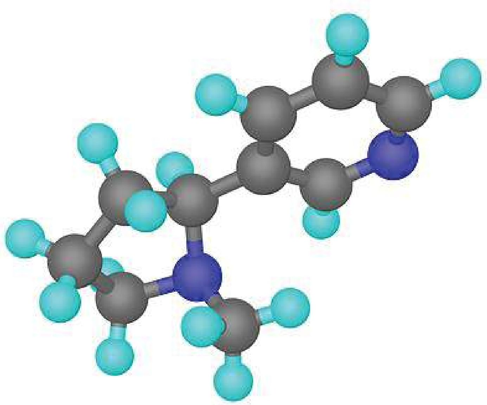

<!-- chemistry-9-10-bn-c05-t5.0-p002 · text · p.82 -->
আমরা জানি, সকল পদার্থই অণু এবং পরমাণু দিয়ে গঠিত। এ পর্যন্ত আবিস্কৃত 118টি মৌলের 118টি ভিন্ন ভিন্ন পরমাণু রয়েছে। এদের মধ্যে থেকে এক বা একাধিক মৌলের পরমাণু দিয়েই সকল পদার্থের অণু গঠিত হয়। পদার্থের অণুতে পরমাণুসমূহ এলোমেলো বা বিক্ষিপ্তভাবে থাকে না। পরমাণুসমূহ সুবিন্যস্তভাবে থাকে। যে আকর্ষণ শক্তির মাধ্যমে অণুতে দুটি পরমাণু পরস্পর যুক্ত থাকে তাকে রাসায়নিক বন্ধন বলে। এই বন্ধন বিভিন্ন প্রকার হতে পারে। যেমন—আয়নিক বন্ধন, সমযোজী বন্ধন কিংবা ধাতব বন্ধন। এ অধ্যায়ে আয়নিক, সমযোজী বা ধাতব বন্ধন বিশিষ্ট যৌগের বন্ধন গঠন প্রক্রিয়া ও তাদের ধর্ম নিয়ে আলোচনা করা হবে।

### এ অধ্যায় পাঠ শেষে আমরা

<!-- chemistry-9-10-bn-c05-t5.0-p003 · text · p.83 -->
* যোজ্যতা ইলেকট্রনের ধারণা ব্যাখ্যা করতে পারব।
* মৌলের প্রতীক, যৌগমূলকের সংকেত ও এগুলোর যোজনী ব্যবহার করে যৌগের সংকেত লিখতে পারব।
* নিষ্ক্রিয় গ্যাসের স্থিতিশীলতা ব্যাখ্যা করতে পারব।
* অষ্টক ও দুইয়ের নিয়মের ধারণা ব্যাখ্যা করতে পারব।
* রাসায়নিক বন্ধন এবং তা গঠনের কারণ ব্যাখ্যা করতে পারব।
* আয়ন কীভাবে এবং কেন সৃষ্টি হয় তা ব্যাখ্যা করতে পারব।
* আয়নিক বন্ধন গঠনের প্রক্রিয়া বর্ণনা করতে পারব।
* সমযোজী বন্ধন গঠনের প্রক্রিয়া বর্ণনা করতে পারব।
* আয়নিক ও সমযোজী বন্ধনের সাথে গলনাঙ্ক, স্ফুটনাঙ্ক, দ্রাব্যতা, বিদ্যুৎ পরিবাহিতা এবং কোলাস গঠনের ধর্ম ব্যাখ্যা করতে পারব।
* ধাতব বন্ধনের ধারণা ব্যাখ্যা করতে পারব।
* ধাতব বন্ধনের সাহায্যে ধাতুর বিদ্যুৎ পরিবাহিতা ব্যাখ্যা করতে পারব।
* স্থানীয়ভাবে সহজপ্রাপ্য দ্রবের মধ্যে আয়নিক ও সমযোজী যৌগ শনাক্ত করতে পারব।

## 5.1 যোজ্যতা ইলেকট্রন (Valence Electrons)

<!-- chemistry-9-10-bn-c05-t5.1-p001 · text · p.84 -->
কোনো মৌলের ইলেকট্রন বিন্যাসে সর্বশেষ কক্ষপথে যে ইলেকট্রন বা ইলেকট্রনসমূহ থাকে তার সংখ্যাকে যোজ্যতা ইলেকট্রন সংখ্যা বলা হয়। যেমন- পটাশিয়াম ও অক্সিজেনের ইলেকট্রন বিন্যাসে সর্বশেষ কক্ষপথে যথাক্রমে ১টি ও ৬টি করে ইলেকট্রন বিদ্যমান।

<!-- chemistry-9-10-bn-c05-t5.1-p002 · figure · p.84 -->
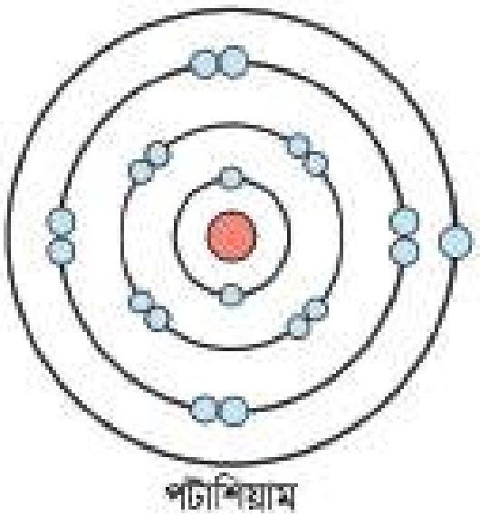

<!-- chemistry-9-10-bn-c05-t5.1-p003 · figure · p.84 -->
**চিত্র ৫.০১: (a) পটাশিয়ামের যোজ্যতা ইলেকট্রন (b) অক্সিজেনের যোজ্যতা ইলেকট্রন**

<!-- chemistry-9-10-bn-c05-t5.1-p004 · text · p.84 -->
সুতরাং পটাশিয়ামের যোজ্যতা ইলেকট্রন ১টি এবং অক্সিজেনের যোজ্যতা ইলেকট্রন ৬টি। নিচের তালিকায় কিছু মৌলের ইলেকট্রন বিন্যাস হতে যোজ্যতা ইলেকট্রনের সংখ্যা দেখানো হলো:

<!-- chemistry-9-10-bn-c05-t5.1-p005 · text · p.84 -->
**টেবিল ৫.০১: মৌলের যোজ্যতা ইলেকট্রন**

<!-- chemistry-9-10-bn-c05-t5.1-p006 · table · p.84 · review: verify-table -->
<table><tr><th rowspan="2">মৌল</th><th colspan="4">ইলেকট্রন বিন্যাস</th><th rowspan="2">যোজ্যতা<br />ইলেকট্রন</th></tr>
<tr><th>K কক্ষপথ</th><th>L কক্ষপথ</th><th>M কক্ষপথ</th><th>N কক্ষপথ</th></tr>
<tr><td>N(7)</td><td>2</td><td>5</td><td></td><td></td><td>5</td></tr>
<tr><td>F(9)</td><td>2</td><td>7</td><td></td><td></td><td>7</td></tr>
<tr><td>P(15)</td><td>2</td><td>8</td><td>5</td><td></td><td>5</td></tr>
<tr><td>Cl(17)</td><td>2</td><td>8</td><td>7</td><td></td><td>7</td></tr>
<tr><td>Ca(20)</td><td>2</td><td>8</td><td>8</td><td>2</td><td>2</td></tr></table>

<!-- chemistry-9-10-bn-c05-t5.1-p007 · text · p.84 -->
এখানে নাইট্রোজেন (N) এর K কক্ষপথে ২টি এবং L কক্ষপথে ৫টি ইলেকট্রন আছে। নাইট্রোজেনের ক্ষেত্রে L কক্ষপথই হলো সর্বশেষ কক্ষপথ। যেহেতু সর্বশেষ কক্ষপথে ৫টি ইলেকট্রন আছে। সুতরাং নাইট্রোজেনের যোজ্যতা ইলেকট্রন আছে ৫টি।

### একক কাজ

<!-- chemistry-9-10-bn-c05-t5.1-p008 · activity · p.85 -->
**শিক্ষার্থীর কাজ :** F, P, Cl এবং Ca এর যোজ্যতা ইলেকট্রনের সংখ্যা বের করো।

## 5.2 যোজনী বা যোজ্যতা (Valency)

<!-- chemistry-9-10-bn-c05-t5.2-p001 · text · p.85 -->
পূর্বেই উল্লেখ করা হয়েছে যে, বিভিন্ন মৌলের পরমাণুসমূহ একে অপরের সাথে সর্বশেষ কক্ষপথের ইলেকট্রন বর্জন, গ্রহণ অথবা ভাগভাগির মাধ্যমে অণু গঠন করে। অণু গঠনকালে কোনো মৌলের একটি পরমাণুর সাথে অপর একটি মৌলের পরমাণু যুক্ত হওয়ার ক্ষমতাকে যোজনী বা যোজ্যতা বলা হয়।

<!-- chemistry-9-10-bn-c05-t5.2-p002 · text · p.85 -->
সাধারণত সব সময় হাইড্রোজেনের যোজনী এক (1) ধরা হয়। কোনো মৌলের একটি পরমাণু যতগুলো H পরমাণু বা Cl পরমাণুর সাথে যুক্ত হতে পারে সেই সংখ্যাই হলো ঐ মৌলের যোজনী বা যোজ্যতা।

<!-- chemistry-9-10-bn-c05-t5.2-p003 · text · p.85 -->
হাইড্রোজেনের একটি পরমাণু ক্লোরিনের একটি পরমাণুর সাথে যুক্ত হয়ে HCl অণু গঠিত হয়, তাই ক্লোরিনের যোজনীও 1 (এক)। আবার অক্সিজেনের একটি পরমাণু হাইড্রোজেনের দুটি পরমাণুর সাথে যুক্ত হয়ে H<sub>2</sub>O তৈরি করে, এজন্য অক্সিজেনের যোজনী 2 (দুই)। একটি Na পরমাণু একটি Cl পরমাণুর সাথে যুক্ত হয়ে NaCl গঠিত হয়। সুতরাং Na এর যোজনী 1 (এক)।

<!-- chemistry-9-10-bn-c05-t5.2-p004 · text · p.85 -->
একটি পরমাণুর সাথে যতটি অক্সিজেন পরমাণু যুক্ত হয় তার সেই সংখ্যার দ্বিগুণ করলে ঐ পরমাণুর যোজনী বা যোজ্যতা হয়। যেমন- ক্যালসিয়াম (Ca) এর একটি পরমাণু একটি অক্সিজেন (O) পরমাণুর সাথে যুক্ত হয়ে ক্যালসিয়াম অক্সাইড (CaO) তৈরি করে। এখানে অক্সিজেন পরমাণুর সংখ্যা 1 এই সংখ্যাকে 2 দ্বারা গুণ করলে হয় 2। কাজেই ক্যালসিয়ামের যোজনী 2।

<!-- chemistry-9-10-bn-c05-t5.2-p005 · text · p.85 -->
কিছু কিছু মৌলের একাধিক যোজনী থাকে। কোনো মৌলের একাধিক যোজনী থাকলে সেই মৌলের যোজনীকে পরিবর্তনশীল যোজনী বলা হয়। যেমন- Fe এর পরিবর্তনশীল যোজনী 2 এবং 3।

<!-- chemistry-9-10-bn-c05-t5.2-p006 · text · p.85 -->
কোনো মৌলের সর্বোচ্চ যোজনী এবং সক্রিয় যোজনার পার্থক্যকে ঐ মৌলের সুপ্ত যোজনী বলা হয়। যেমন: FeCl<sub>2</sub> যোগে Fe এর সক্রিয় যোজনী 2 কিন্তু Fe এর সর্বোচ্চ যোজনী 3। অতএব FeCl<sub>2</sub> যোগে Fe এর সুপ্ত যোজনী 3 - 2 = 1। আবার FeCl<sub>3</sub> যোগে Fe এর সক্রিয় যোজনী 3 কিন্তু Fe এর সর্বোচ্চ যোজনী 3, অতএব FeCl<sub>3</sub> যোগে Fe এর সুপ্ত যোজনী 3 - 3 = 0।

<!-- chemistry-9-10-bn-c05-t5.2-p007 · table · p.86 · review: verify-table -->
**টেবিল ৫.০২: বিভিন্ন মৌলের যোজনী**
<table><tr><th>মৌল</th><th>যোজনী</th></tr>
<tr><td>H</td><td>1</td></tr>
<tr><td>F</td><td>1</td></tr>
<tr><td>Cl</td><td>1</td></tr>
<tr><td>Br</td><td>1</td></tr>
<tr><td>I</td><td>1</td></tr></table>

<!-- chemistry-9-10-bn-c05-t5.2-p008 · table · p.86 · review: verify-table -->
<table><tr><th>মৌল</th><th>যোজনী</th></tr>
<tr><td>Na</td><td>1</td></tr>
<tr><td>K</td><td>1</td></tr>
<tr><td>C</td><td>2, 4</td></tr>
<tr><td>Mg</td><td>2</td></tr>
<tr><td>Al</td><td>3</td></tr></table>

<!-- chemistry-9-10-bn-c05-t5.2-p009 · table · p.86 · review: verify-table -->
<table><tr><th>মৌল</th><th>যোজনী</th></tr>
<tr><td>Fe</td><td>2, 3</td></tr>
<tr><td>Cu</td><td>1, 2</td></tr>
<tr><td>Zn</td><td>2</td></tr></table>

<!-- chemistry-9-10-bn-c05-t5.2-p010 · table · p.86 · review: verify-table -->
**টেবিল ৫.০৩: বিভিন্ন পরমাণুর যোজনী এবং যৌগ**
<table><tr><th>ধাতব ও<br />অধাতব পরমাণু</th><th>প্রতীক</th><th>যোজনী</th><th>যৌগ</th></tr>
<tr><td>হাইড্রোজেন</td><td>H</td><td>1</td><td>HCl</td></tr>
<tr><td>লিথিয়াম</td><td>Li</td><td>1</td><td>LiCl</td></tr>
<tr><td>সোডিয়াম</td><td>Na</td><td>1</td><td>NaCl</td></tr>
<tr><td>পটাশিয়াম</td><td>K</td><td>1</td><td>KCl</td></tr>
<tr><td>ম্যাগনেসিয়াম</td><td>Mg</td><td>2</td><td>MgCl<sub>2</sub></td></tr>
<tr><td>ক্যালসিয়াম</td><td>Ca</td><td>2</td><td>CaCl<sub>2</sub></td></tr>
<tr><td>অ্যালুমিনিয়াম</td><td>Al</td><td>3</td><td>AlCl<sub>3</sub></td></tr>
<tr><td>আয়রন</td><td>Fe</td><td>2<br />3</td><td>FeCl<sub>2</sub><br />FeCl<sub>3</sub></td></tr>
<tr><td>জিংক</td><td>Zn</td><td>2</td><td>ZnCl<sub>2</sub></td></tr>
<tr><td>লেড</td><td>Pb</td><td>2<br />4</td><td>PbCl<sub>2</sub><br />PbCl<sub>4</sub></td></tr>
<tr><td>নাইট্রোজেন</td><td>N</td><td>3<br />5</td><td>NH<sub>3</sub><br />N<sub>2</sub>O<sub>5</sub></td></tr></table>

<!-- chemistry-9-10-bn-c05-t5.2-p011 · table · p.86 · review: verify-table -->
<table><tr><th>ধাতব ও<br />অধাতব পরমাণু</th><th>প্রতীক</th><th>যোজনী</th><th>যৌগ</th></tr>
<tr><td>সিলভার</td><td>Ag</td><td>1</td><td>AgCl</td></tr>
<tr><td>ফ্লোরিন</td><td>F</td><td>1</td><td>NaF</td></tr>
<tr><td>ক্লোরিন</td><td>Cl</td><td>1</td><td>NaCl</td></tr>
<tr><td>ব্রোমিন</td><td>Br</td><td>1</td><td>NaBr</td></tr>
<tr><td>আয়োডিন</td><td>I</td><td>1</td><td>NaI</td></tr>
<tr><td>বোরন</td><td>B</td><td>3</td><td>BCl<sub>3</sub></td></tr>
<tr><td>ফসফরাস</td><td>P</td><td>3<br />5</td><td>PCl<sub>3</sub><br />PCl<sub>5</sub></td></tr>
<tr><td>কপার</td><td>Cu</td><td>1<br />2</td><td>CuCl<br />CuCl<sub>2</sub></td></tr>
<tr><td>অক্সিজেন</td><td>O</td><td>2</td><td>H<sub>2</sub>O</td></tr>
<tr><td>কার্বন</td><td>C</td><td>2<br />4</td><td>CO<br />CH<sub>4</sub></td></tr>
<tr><td>সালফার</td><td>S</td><td>2<br />4<br />6</td><td>H<sub>2</sub>S<br />SO<sub>2</sub><br />SO<sub>3</sub></td></tr></table>

## 5.3 যৌগমূলক ও তাদের যোজনী (Radicals and Their Valencies)

<!-- chemistry-9-10-bn-c05-t5.3-p001 · text · p.87 -->
একাধিক মৌলের কতিপয় পরমাণু বা আয়ন পরস্পরের সাথে মিলিত হয়ে ধনাত্মক বা ঋণাত্মক আধানবিশিষ্ট একটি পরমাণুগুচ্ছ তৈরি করে এবং এটি একটি মৌলের আয়নের ন্যায় আচরণ করে। এ ধরনের পরমাণুগুচ্ছকে যৌগমূলক বলা হয়।

<!-- chemistry-9-10-bn-c05-t5.3-p002 · text · p.87 -->
যৌগমূলক ধনাত্মক কিংবা ঋণাত্মক আধানবিশিষ্ট হতে পারে। এদের আধান সংখ্যাই মূলত এদের যোজনী নির্দেশ করে। যেমন- একটি N পরমাণুর সাথে তিনটি H পরমাণু ও একটি H<sup>+</sup> যুক্ত হয়ে অ্যামোনিয়াম (NH<sub>4</sub><sup>+</sup>) আয়ন নামক যৌগমূলকের সৃষ্টি করে। এর আধান সংখ্যা হলো +1 (এক)। সুতরাং এর যোজনীও ১ (এক)। আধান বা চার্জ ধনাত্মক বা ঋণাত্মক হতে পারে কিন্তু যোজনী শুধু একটি সংখ্যা এর কোনো ধনাত্মক চিহ্ন বা ঋণাত্মক চিহ্ন নেই।

<!-- chemistry-9-10-bn-c05-t5.3-p003 · table · p.87 · review: verify-table -->
**টেবিল ৫.০৪: বিভিন্ন যৌগমূলকের নাম, সংকেত, আধান ও যোজনী**
<table><tr><th>যৌগমূলকের নাম</th><th>সংকেত</th><th>আধান</th><th>যোজনী</th></tr>
<tr><td>অ্যামোনিয়াম</td><td>NH<sub>4</sub><sup>+</sup></td><td>+1</td><td>1</td></tr>
<tr><td>কার্বনেট</td><td>CO<sub>3</sub><sup>2-</sup></td><td>-2</td><td>2</td></tr>
<tr><td>হাইড্রোজেন কার্বনেট</td><td>HCO<sub>3</sub><sup>-</sup></td><td>-1</td><td>1</td></tr>
<tr><td>সালফেট</td><td>SO<sub>4</sub><sup>2-</sup></td><td>-2</td><td>2</td></tr>
<tr><td>হাইড্রোজেন সালফেট</td><td>HSO<sub>4</sub><sup>-</sup></td><td>-1</td><td>1</td></tr>
<tr><td>সালফাইট</td><td>SO<sub>3</sub><sup>2-</sup></td><td>-2</td><td>2</td></tr>
<tr><td>নাইট্রেট</td><td>NO<sub>3</sub><sup>-</sup></td><td>-1</td><td>1</td></tr>
<tr><td>নাইট্রাইট</td><td>NO<sub>2</sub><sup>-</sup></td><td>-1</td><td>1</td></tr>
<tr><td>ফসফেট</td><td>PO<sub>4</sub><sup>3-</sup></td><td>-3</td><td>3</td></tr>
<tr><td>হাইড্রোক্সাইড</td><td>OH<sup>-</sup></td><td>-1</td><td>1</td></tr>
<tr><td>ফসফোনিয়াম</td><td>PH<sub>4</sub><sup>+</sup></td><td>+1</td><td>1</td></tr></table>

## 5.4 যৌগের রাসায়নিক সংকেত

### (Chemical Formula of Compounds)

<!-- chemistry-9-10-bn-c05-t5.4-p001 · text · p.87 -->
যৌগের একটি অণুতে যেসব পরমাণু থাকে তাদের প্রতীক ও সংখ্যার মাধ্যমে অণুটিকে প্রকাশ করা হয়। যেমন- দুটি হাইড্রোজেন (H) পরমাণু ও একটি অক্সিজেন (O) পরমাণু মিলে পানির (H<sub>2</sub>O) একটি অণু গঠিত হয়। এখানে, H<sub>2</sub>O হলো পানির অণুর রাসায়নিক সংকেত। সুতরাং মৌল বা যৌগমূলকের প্রতীক বা সংকেত ও তাদের সংখ্যার মাধ্যমে কোনো যৌগ অণুকে প্রকাশ করাই হলো উক্ত যৌগের রাসায়নিক সংকেত (Chemical Formula)। এক্ষেত্রে অণুর মধ্যে অবস্থিত মৌলের বা যৌগমূলকের সংখ্যাকে সংকেতের নিচে ডান পাশে ছোট করে (Subscript) লেখা হয়।

### রাসায়নিক সংকেত লেখার নিয়ম

<!-- chemistry-9-10-bn-c05-t5.4-p002 · text · p.88 -->
(a) কোনো মৌলের একটি অণুতে যতগুলো পরমাণু থাকে তার সংখ্যাটি ইংরেজি হরফে মৌলটির প্রতীকের ডান পাশে নিচে ছোট করে লিখতে হবে। যেমন: নাইট্রোজেন অণুতে দুটি পরমাণু থাকে তাই নাইট্রোজেন অণুর সংকেত N<sub>2</sub>। ওজোন এর একটি অণুতে তিনটি অক্সিজেন পরমাণু থাকে—তাই ওজোন অণুর সংকেত O<sub>3</sub>। কিছু মৌল অণু গঠন করে না তাই তাদেরকে শুধু প্রতীক দিয়ে বোঝানো হয়। যেমন: সকল ধাতু। কাজেই আয়রনকে বোঝাতে শুধু Fe লিখতে হবে। আবার, নিক্সিয় গ্যাসগুলোও অণু গঠন করে না, তাই হিলিয়ামকে বোঝাতেও শুধু He লিখতে হবে।

<!-- chemistry-9-10-bn-c05-t5.4-p003 · text · p.88 -->
(b) কখনো কখনো কোনো যৌগের অণু দুটি ভিন্ন মৌলের পরমাণু দিয়ে গঠিত হয়। তাদের যোজনী যদি কোনো সাধারণ সংখ্যা দ্বারা বিভাজ্য না হয় তাহলে দুটি মৌলের প্রতীক পাশাপাশি লিখে একটি মৌলের প্রতীকের পাশে অন্যটির যোজনী লিখতে হয়। যেমন: অ্যালুমিনিয়ামের যোজনী ৩ এবং অক্সিজেন এর যোজনী ২। যোজনী দুটি কোনো সাধারণ সংখ্যা দ্বারা বিভাজ্য নয়। যদি অ্যালুমিনিয়াম এবং অক্সিজেন দ্বারা গঠিত কোনো যৌগের সংকেত লিখতে হয় তবে অ্যালুমিনিয়ামের প্রতীক Al এর নিচের দিকে ডান পাশে অক্সিজেনের যোজনী ছোট করে লিখতে হবে এবং অক্সিজেনের প্রতীক O এর নিচের দিকে ডান পাশে অ্যালুমিনিয়ামের যোজনী ছোট করে লিখতে হবে অর্থাৎ এর সংকেত হবে Al<sub>2</sub>O<sub>3</sub>। অনুরূপভাবে ক্যালসিয়ামের যোজনী ২ এবং ক্লোরিনের যোজনী ১। সুতরাং ক্যালসিয়াম ক্লোরাইডের সংকেত Ca<sub>1</sub>Cl<sub>2</sub> হওয়ার কথা, ১টি লিখতে হয় না বলে আমরা লিখি CaCl<sub>2</sub>। আবার, ম্যাগনেসিয়ামের যোজনী ২ এবং ফসফেটের যোজনী ৩। সুতরাং ম্যাগনেসিয়াম ফসফেটের সংকেত Mg<sub>3</sub>(PO<sub>4</sub>)<sub>2</sub>। উল্লেখ্য যে, কোনো যৌগমূলক একাধিক সংখ্যক থাকলে যৌগমূলকটিকে প্রথম বন্ধনীর মধ্যে রেখে তারপর সংখ্যা লিখতে হয়। যেমন: অ্যামোনিয়াম ফসফেট (NH<sub>4</sub>)<sub>3</sub>(PO<sub>4</sub>)<sub>1</sub> বা (NH<sub>4</sub>)<sub>3</sub>PO<sub>4</sub>, অ্যালুমিনিয়াম সালফেট Al<sub>2</sub>(SO<sub>4</sub>)<sub>3</sub> ইত্যাদি।

<!-- chemistry-9-10-bn-c05-t5.4-p004 · text · p.88 · review: latin-junk -->
(c) যদি দুটি মৌলের যোজনী কোনো সাধারণ সংখ্যা দিয়ে বিভাজ্য হয় তাহলে যোজনীগুলো সেই সাধারণ সংখ্যা দিয়ে ভাগ দিয়ে মৌলের পাশে পূর্বে নিয়মে ভাগফলটি লিখতে হয় যেমন: কার্বন ও অক্সিজেন দিয়ে গঠিত যৌগ কার্বন ডাই-অক্সাইড। কার্বনের যোজনী ৪ এবং অক্সিজেনের যোজনী ২। কার্বনের যোজনীকে ২ দিয়ে ভাগ করলে ২ পাওয়া যায় আবার অক্সিজেনের যোজনীকে ২ দিয়ে ভাগ করলে ১ পাওয়া যায়। এখন নিয়ম অনুযায়ী কার্বনের সংকেত C এর নিচে ডান পাশে ১ এবং অক্সিজেনের নিচে ২ লিখতে হবে। কিন্তু সংকেত লেখার সময় যেহেতু ১ সংখ্যাটি লেখার প্রয়োজন নেই তাই কার্বন ডাই-অক্সাইডের সংকেত হবে CO<sub>2</sub>। ফেরাস সালফেট যৌগে আয়রনের যোজনী ২ সালফেট আয়নের (SO<sub>4</sub><sup>2-</sup>) যোজনী ২। এই সংখ্যাদুটিকে ২ দিয়ে ভাগ করে ১ ও ১ পাওয়া যায়। সুতরাং ফেরাস সালফেটের সংকেত FeSO<sub>4</sub>। বোরন ও নাইট্রোজেনের যোজনী ৩। এদের ৩ দিয়ে ভাগ করলে ১ ও ১ পাওয়া যায় সুতরাং বোরন নাইট্রাইডের সংকেত B<sub>1</sub>N<sub>1</sub> = BN।

## 5.5 আণবিক সংকেত ও গাঠনিক সংকেত

### (Molecular Formula and Structural Formula)

<!-- chemistry-9-10-bn-c05-t5.5-p001 · text · p.89 -->
একটি মৌল বা যৌগের অণুতে যে যে ধরনের মৌলের পরমাণু থাকে তাদের প্রতীক এবং যে মৌলের পরমাণু যতটি থাকে সেই সকল সংখ্যা দিয়ে প্রকাশিত সংকেতকে আণবিক সংকেত বা রাসায়নিক সংকেত বলে। এ সম্পর্কে তোমরা ইতোমধ্যে জেনেছ। আবার একটি অণুতে মৌলের পরমাণুগুলো যেভাবে সাজানো থাকে প্রতীক এবং বন্ধনের মাধ্যমে তা প্রকাশ করাকে গাঠনিক সংকেত বলে। যেমন তিনটি কার্বন (C) পরমাণু আটটি হাইড্রোজেন (H) পরমাণুর সাথে যুক্ত হয়ে প্রোপেন (C<sub>3</sub>H<sub>8</sub>) অণু গঠিত হয়। প্রোপেনের C<sub>3</sub>H<sub>8</sub> এই সংকেতটিকে আণবিক সংকেত বা রাসায়নিক সংকেত বলে।

<!-- chemistry-9-10-bn-c05-t5.5-p002 · text · p.89 -->
আবার উক্ত যৌগে কার্বন পরমাণু তিনটি একে অপরের সাথে শিকল আকারে যুক্ত হয় এবং অবশিষ্ট যোজনীগুলো হাইড্রোজেন দ্বারা পূর্ণ হয়ে প্রতিটি কার্বনের যোজনী ৪ হয়। নিচে প্রোপেনের গাঠনিক সংকেত দেখানো হলো:

<!-- chemistry-9-10-bn-c05-t5.5-p003 · text · p.89 -->
```text
    H H H
    | | |
H—C—C—C—H
    | | |
    H H H
```

<!-- chemistry-9-10-bn-c05-t5.5-p004 · text · p.89 -->
আবার পানির আণবিক সংকেত H<sub>2</sub>O, অতএব এর গাঠনিক সংকেত হবে

<!-- chemistry-9-10-bn-c05-t5.5-p005 · text · p.89 -->
```text
    O
   / \
  H   H
```

<!-- chemistry-9-10-bn-c05-t5.5-p006 · text · p.89 -->
মিথেনের আণবিক সংকেত CH<sub>4</sub>, অতএব মিথেনের গাঠনিক সংকেত হবে

<!-- chemistry-9-10-bn-c05-t5.5-p007 · text · p.89 -->
```text
    H
    |
H—C—H
    |
    H
``` কার্বন-কার্বন ও কার্বন-হাইড্রোজেনের মধ্যে অবস্থিত প্রতিটি রেখা হলো একেকটি বন্ধন। এগুলো সমযোজী বন্ধন। সমযোজী বন্ধন সম্পর্কে এ অধ্যায়েই জানতে পারবে। গাঠনিক সংকেতের মাধ্যমে যৌগের অণুতে কোন পরমাণু কতটি করে আছে এবং তারা একে অপরের সাথে কীভাবে যুক্ত আছে তা জানা যায়।

## 5.6 অষ্টক ও দুই-এর নিয়ম (Octet and Duet Rules)

<!-- chemistry-9-10-bn-c05-t5.6-p001 · text · p.90 -->
প্রতিটি মৌলই তার সর্বশেষ শক্তিস্তরে নিষ্ক্রিয় গ্যাসের ইলেকট্রন বিন্যাসের প্রবণতা দেখায়। হিলিয়াম ছাড়া সকল নিষ্ক্রিয় গ্যাসের ইলেকট্রন বিন্যাসে সর্বশেষ শক্তিস্তরে ৪টি করে ইলেকট্রন বিদ্যমান। অণু গঠনকালে কোনো মৌল ইলেকট্রন গ্রহণ, বর্জন অথবা ভাগাভাগির মাধ্যমে তার সর্বশেষ শক্তিস্তরে ৪টি করে ইলেকট্রন ধারণের মাধ্যমে নিষ্ক্রিয় গ্যাসের ইলেকট্রন বিন্যাস লাভ করে। একেই ‘অষ্টক’ নিয়ম বলা হয়। যেমন- CH<sub>4</sub> অণুতে কেন্দ্রীয় পরমাণু কার্বনের সর্বশেষ শক্তিস্তরে ৪টি ইলেকট্রন বিদ্যমান। যেখানে ৪টি ইলেকট্রন কার্বনের নিজস্ব আর বাকি ৪টি ইলেকট্রন চারটি হাইড্রোজেন পরমাণু থেকে আসে। পাশের চিত্রে তা দেখানো হলো। এভাবে পরমাণুসমূহ তার সর্বশেষ শক্তিস্তরে ৪টি ইলেকট্রন ধারণ করে নিষ্ক্রিয় গ্যাসের ইলেকট্রন বিন্যাস লাভের মাধ্যমে যৌগ গঠনের পদ্ধতিকে ‘অষ্টক’ নিয়ম বলে।

<!-- chemistry-9-10-bn-c05-t5.6-p002 · figure · p.90 -->
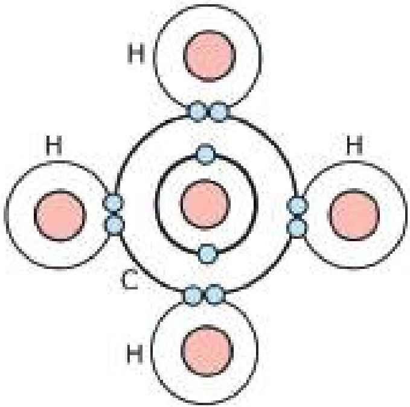

<!-- chemistry-9-10-bn-c05-t5.6-p003 · figure · p.90 -->
**চিত্র ৫.০২: মিথেন অণুতে অষ্টক নিয়ম**

<!-- chemistry-9-10-bn-c05-t5.6-p004 · text · p.90 -->
‘অষ্টক’ নিয়মের কিছু সীমাবদ্ধতার কারণে বিজ্ঞানীরা নতুন একটি নিয়মের উপস্থাপন করেন। যাকে ‘দুই’-এর নিয়ম বলা হয়। ‘দুই’-এর নিয়মটি অষ্টক নিয়ম থেকে অধিকতর উপযোগী এবং আধুনিক। নিষ্ক্রিয় গ্যাসগুলোর সর্বশেষ শক্তিস্তরে যেমন ২টি বা ৪টি ইলেকট্রন বিদ্যমান, তেমনি অণু গঠনে কোনো পরমাণুর সর্বশেষ শক্তিস্তরে এক বা একাধিক জোড়া ইলেকট্রন বিদ্যমান থাকবে, এটিই হচ্ছে ‘দুই’ এর নিয়ম। অর্থাৎ অণুতে যেকোনো পরমাণুর সর্বশেষ শক্তিস্তরে এক বা একাধিক জোড়া ইলেকট্রন অবস্থান করবে।

<!-- chemistry-9-10-bn-c05-t5.6-p005 · text · p.90 -->
যেমন- BeCl<sub>2</sub> অণুর কেন্দ্রীয় পরমাণু Be এর সর্বশেষ শক্তিস্তরে ২ জোড়া অর্থাৎ ৪টি ইলেকট্রন বিদ্যমান। BF<sub>3</sub> অণুর কেন্দ্রীয় পরমাণু B এর সর্বশেষ শক্তিস্তরে ৩ জোড়া অর্থাৎ ৬টি ইলেকট্রন বিদ্যমান। CH<sub>4</sub>, অণুর কেন্দ্রীয় পরমাণু C এর সর্বশেষ শক্তিস্তরে ৪ জোড়া অর্থাৎ ৪টি ইলেকট্রন বিদ্যমান। শুধু তাই নয় কেন্ড্রীয় পরমাণু ছাড়াও অন্য পরমাণুগুলো অর্থাৎ Cl এর সর্বশেষ শক্তিস্তরে ৪ জোড়া অর্থাৎ ৪টি ইলেকট্রন বিদ্যমান।

<!-- chemistry-9-10-bn-c05-t5.6-p006 · text · p.91 -->
F সর্বশেষ শক্তিস্তরে ৪ জোড়া অর্থাৎ ৪টি ইলেকট্রন বিদ্যমান এবং H এর সর্বশেষ শক্তিস্তরে ১ জোড়া অর্থাৎ ২টি ইলেকট্রন বিদ্যমান। এক্ষেত্রে সকল পরমাণু ‘দুই’ এর নিয়ম অনুসরণ করেছে। উল্লেখ্য, পর্যায় সারণির 1-20 পর্যন্ত মৌলসমূহ মূলত ‘অষ্টক’ ও ‘দুই’ এর নিয়ম ভাণ্ডোভাবে অনুসরণ করে।

## 5.7 নিষ্ক্রিয় গ্যাস এবং এর স্থিতিশীলতা

### (Inert Gases and their Stability)

<!-- chemistry-9-10-bn-c05-t5.7-p001 · text · p.91 -->
পর্যায় সারণি অধ্যায়ে তোমরা নিষ্ক্রিয় গ্যাস তথা 18 নং গ্রুপের মৌল সম্বর্কে বিস্তারিত জেনেছ। এদের ইলেকট্রন বিন্যাস সম্বর্কেও জ্ঞান লাভ করেছো। তারপরও এখানে এদের ইলেকট্রন বিন্যাস দেখানো হলো:

<!-- chemistry-9-10-bn-c05-t5.7-p002 · text · p.91 · review: verify-formula -->
$$He(2) \rightarrow 1s^2$$
$$Ne(10) \rightarrow 1s^2 2s^2 2p^6$$
$$Ar(18) \rightarrow 1s^2 2s^2 2p^6 3s^2 3p^6$$
$$Kr(36) \rightarrow 1s^2 2s^2 2p^6 3s^2 3p^6 3d^{10} 4s^2 4p^6$$
$$Xe(54) \rightarrow 1s^2 2s^2 2p^6 3s^2 3p^6 3d^{10} 4s^2 4p^6 4d^{10} 5s^2 5p^6$$
$$Rn(86) \rightarrow 1s^2 2s^2 2p^6 3s^2 3p^6 3d^{10} 4s^2 4p^6 4d^{10} 4f^{14} 5s^2 5p^6 5d^{10} 6s^2 6p^6$$

<!-- chemistry-9-10-bn-c05-t5.7-p003 · text · p.91 -->
নিষ্ক্রিয় গ্যাসসমূহের ইলেকট্রন বিন্যাসে দেখা যায় যে, হিলিয়ামের সর্বশেষ শক্তিস্তরে ২টি ইলেকট্রন রয়েছে। হিলিয়ামের বোঝায় তার সর্বশেষ শক্তিস্তর পূর্ণ করতে ২টি ইলেকট্রনই প্রয়োজন, কাজেই এই ইলেকট্রন বিন্যাস স্থিতিশীল। অন্যান্য নিষ্ক্রিয় গ্যাসের বোঝায় তাদের সর্বশেষ শক্তিস্তরে ৪টি (ns<sup>2</sup>np<sup>6</sup>) করে ইলেকট্রন বিদ্যমান। কোনো মৌলের সর্বশেষ শক্তিস্তরে ৪টি করে ইলেকট্রন থাকলে তারা সর্বাধিক স্থিতিশীলতা অর্জন করে। সর্বশেষ শক্তিস্তরে ২টি থাকলে তাকে দ্বিত্ব বলে আর ৪টি ইলেকট্রন থাকলে তাকে অষ্টক বলে। সর্বশেষ শক্তিস্তরে দ্বিত্ব ও অষ্টক পূর্ণ থাকার কারণে নিষ্ক্রিয় গ্যাসগুলো অধিকতর স্থিতিশীল হয়। অধিকতর স্থিতিশীলতার কারণে নিষ্ক্রিয় গ্যাসগুলো অন্য কোনো মৌলকে ইলেকট্রন প্রদান করে না। এমনকি অপর কোনো মৌলের কাছ থেকে কোনো ইলেকট্রন গ্রহণও করে না। এরা রাসায়নিকভাবে আসক্তিহীন হয়ে পড়ে বা এরা নিষ্ক্রিয় হয়ে পড়ে। নিষ্ক্রিয় গ্যাস ছাড়া বাকি কোনো মৌলেরই সর্বশেষ শক্তিস্তরে এরূপ দ্বিত্ব বা অষ্টক পূর্ণ থাকে না। ফলে তারা স্থিতিশীল হয় না। অন্যান্য মৌল স্থিতিশীলতা অর্জনের জন্য সর্বশেষ শক্তিস্তরে দ্বিত্ব বা অষ্টক পূর্ণ করতে চায়। এজন্য তারা সর্বশেষ শক্তিস্তরে ইলেকট্রন গ্রহণ, প্রদান অথবা ভাগাভাগি করে পরস্পরের সাথে বন্ধন গঠন করে।

## 5.8 রাসায়নিক বন্ধন ও রাসায়নিক বন্ধন গঠনের কারণ

### (Chemical Bonds and the Causes of Their Formation)

<!-- chemistry-9-10-bn-c05-t5.8-p001 · text · p.92 -->
দুটি হাইড্রোজেন পরমাণু পরস্পরের সাথে যুক্ত হয়ে হাইড্রোজেন অণু (H<sub>2</sub>) গঠন করে। অনুরূপভাবে, হাইড্রোজেন ও ক্লোরিন পরমাণু পরস্পরের সাথে যুক্ত হয়ে হাইড্রোজেন ক্লোরাইড অণু (H-Cl) গঠন করে। প্রথম ক্ষেত্রে হাইড্রোজেন অণুতে দুটি হাইড্রোজেন পরমাণুর মধ্যে এক ধরনের আকর্ষণ বল কাজ করে। আবার, দ্বিতীয় ক্ষেত্রে হাইড্রোজেন ক্লোরাইড অণুতে হাইড্রোজেন ও ক্লোরিন পরমাণুর মধ্যে এক ধরনের আকর্ষণ বল কাজ করে। এ ধরনের আকর্ষণ বলই মূলত রাসায়নিক বন্ধন। অর্থাৎ অণুতে পরমাণুসমূহ যে আকর্ষণের মাধ্যমে একে অপরের সাথে যুক্ত থাকে তাকেই রাসায়নিক বন্ধন বলে। এখন প্রশ্ন হলো পরমাণুসমূহ কেন আলাদাভাবে থাকেনি? কেন তারা পরস্পরের সাথে যুক্ত হয়ে অণু তৈরি করল?

<!-- chemistry-9-10-bn-c05-t5.8-p002 · text · p.92 -->
তোমরা এর মাঝে জেনে গেছ যে, প্রত্যেক মৌলই তার সর্বশেষ শক্তিস্তরে নিষ্ক্রিয় গ্যাসের স্থিতিশীল ইলেকট্রন বিন্যাস অর্জনের চেষ্টা করে। একই মৌলের বা ভিন্ন মৌলের দুটি পরমাণু যখন কাছাকাছি অবস্থান করে তখন তারা তাদের সর্বশেষ শক্তিস্তরে ইলেকট্রন গ্রহণ, বর্জন বা ভাগাভাগির মাধ্যমে নিষ্ক্রিয় গ্যাসের ইলেকট্রন বিন্যাস অর্জন করে। এর মাধ্যমে তাদের মধ্যে এক ধরনের আকর্ষণের সৃষ্টি হয়, যে আকর্ষণকে আমরা রাসায়নিক বন্ধন বলি। কাজেই বলা যেতে পারে রাসায়নিক বন্ধন গঠনের মূল কারণ হলো পরমাণুগুলোর সর্বশেষ শক্তিস্তরের ইলেকট্রনগুলো নিষ্ক্রিয় গ্যাসের স্থিতিশীল ইলেকট্রন বিন্যাস (দ্বিত্ব বা অষ্টক) লাভের প্রবণতা।

## 5.9 ক্যাটায়ন ও অ্যানায়ন (Cations and Anions)

<!-- chemistry-9-10-bn-c05-t5.9-p001 · text · p.92 -->
আমরা জানি, সাধারণ অবস্থায় পরমাণুর নিউক্লিয়াসে যতটি ধনাত্মক আধান বা পজিটিভ চার্জবিশিষ্ট প্রোটন থাকে এবং নিউক্লিয়াসের বাইরে বিভিন্ন শক্তিস্তরে ঠিক ততটি ঋণাত্মক আধান বা নেগেটিভ চার্জবিশিষ্ট ইলেকট্রন থাকে। এর ফলে পরমাণুটি সামগ্রিকভাবে আধান বা চার্জ নিরপেক্ষ হয়। এরকম একটি আধান নিরপেক্ষ পরমাণুর বাইরের শক্তিস্তর থেকে এক বা একাধিক ইলেকট্রনকে সরিয়ে নিলে পরমাণুটি আর আধান নিরপেক্ষ থাকবে না। এটি সামগ্রিকভাবে ধনাত্মক আধানবিশিষ্ট আয়নে পরিণত হবে। ধনাত্মক আধান বা পজিটিভ চার্জ বিশিষ্ট এরূপ আয়নকে ক্যাটায়ন বলে। সাধারণত পর্যায় সারণির বামের মৌল বা ধাতুগুলো তাদের সর্বশেষ শক্তিস্তরের এক বা একাধিক ইলেকট্রন ত্যাগ করে নিষ্ক্রিয় গ্যাসের ইলেকট্রন বিন্যাস লাভের মাধ্যমে ক্যাটায়নের সৃষ্টি করে। যেমন- লিথিয়াম পরমাণু তার সর্বশেষ শক্তিস্তরের একটি ইলেকট্রন ছেড়ে দিয়ে নিষ্ক্রিয় গ্যাস হিলিয়ামের ইলেকট্রন বিন্যাস অর্জনের মাধ্যমে লিথিয়াম ক্যাটায়ন (Li<sup>+</sup>) তৈরি করে। 5.03 চিত্রে তা দেখানো হলো।

<!-- chemistry-9-10-bn-c05-t5.9-p002 · text · p.93 -->
অনুরূপে, Na পরমাণু তার সর্বশেষ শক্তিস্তরের একটি ইলেকট্রন ত্যাগ করে নিষ্ক্রিয় গ্যাস Ne এর ইলেকট্রন বিন্যাস লাভের মাধ্যমে সোডিয়াম ক্যাটায়ন (Na<sup>+</sup>) তৈরি করে।

<!-- chemistry-9-10-bn-c05-t5.9-p003 · text · p.93 -->
বলতে পারবে কি, ধাতুসমূহ কেন তাদের সর্বশেষ শক্তিস্তরের ইলেকট্রন ছেড়ে দিয়ে ক্যাটায়ন তৈরি করে?

<!-- chemistry-9-10-bn-c05-t5.9-p004 · figure · p.93 -->
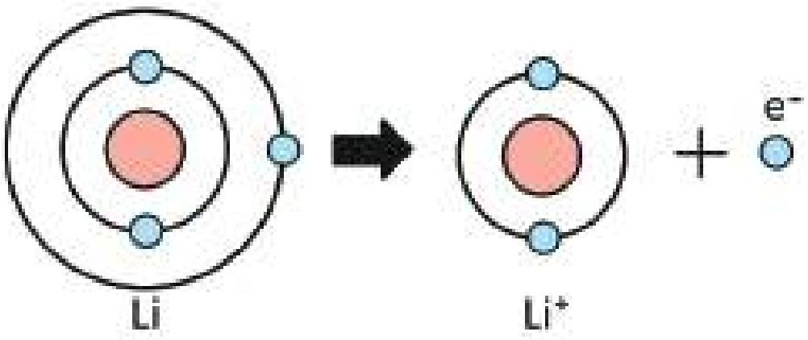

<!-- chemistry-9-10-bn-c05-t5.9-p005 · figure · p.93 -->
**চিত্র ৫.০৩: লিথিয়াম ক্যাটায়ন (Li<sup>+</sup>) গঠন**

<!-- chemistry-9-10-bn-c05-t5.9-p006 · text · p.93 -->
আমরা জানি, পর্যায় সারণির যেকোনো একটি পর্যায়ের বাম থেকে ডানে গেলে মৌলসমূহের ধাতব ধর্ম ধীরে ধীরে হ্রাস পায় এবং অধাতব ধর্ম বৃদ্ধি পায়। অর্থাৎ যেকোনো পর্যায়ের বামের মৌলসমূহ হলো ধাতু এবং ডানের মৌলসমূহ হলো অধাতু। আবার একই পর্যায়ের বাম থেকে ডানে গেলে মৌলসমূহ আকারও ধীরে ধীরে হ্রাস পায়। এই কারণে একই পর্যায়ের অবস্থিত অন্য মৌলসমূহের চেয়ে ধাতুগুলোর আকার বড় হয়ে থাকে। আবার ধাতুগুলোর সর্বশেষ শক্তিস্তরে সাধারণত 1, 2 বা 3টি ইলেকট্রন থাকে। আকার বড় হওয়ার কারণে ধাতুগুলোর সর্বশেষ শক্তিস্তরের ইলেকট্রনগুলোর নিউক্লিয়াস থেকে দূরে থাকে এবং নিউক্লিয়াসের সাথে আকর্ষণ কম হয় অর্থাৎ দুর্বলভাবে আবদ্ধ থাকে। ফলে এদের আয়নিকরণ শক্তির মান অনেক কম হয়। অর্থাৎ সামান্য পরিমাণ শক্তি প্রয়োগ করলেই ধাতুগুলো তার সর্বশেষ শক্তিস্তরের এক বা একাধিক ইলেকট্রন ত্যাগ করে কাছাকাছি নিষ্ক্রিয় গ্যাসের ইলেকট্রন বিন্যাস অর্জন করে ক্যাটায়নে পরিণত হতে পারে। এই কারণেই ধাতুগুলোই মূলত ক্যাটায়নে পরিণত হয়।

<!-- chemistry-9-10-bn-c05-t5.9-p007 · figure · p.93 -->
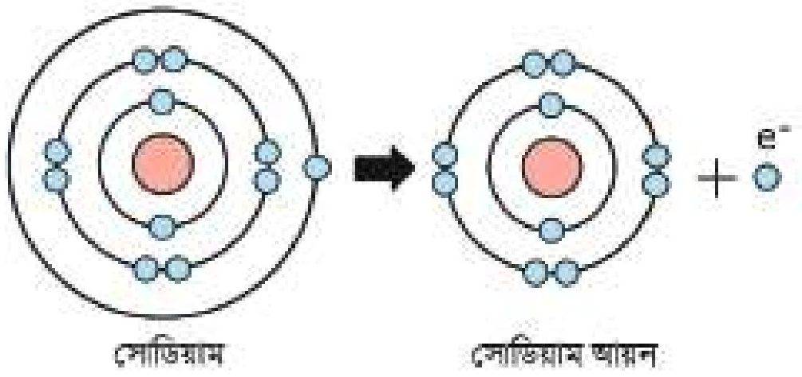

<!-- chemistry-9-10-bn-c05-t5.9-p008 · figure · p.93 -->
**চিত্র ৫.০৪: সোডিয়াম ক্যাটায়ন (Na<sup>+</sup>) গঠন**

<!-- chemistry-9-10-bn-c05-t5.9-p009 · text · p.93 -->
অন্যদিকে অধাতুগুলো ক্যাটায়ন তৈরি করে না। এর কারণও তোমরা এখন নিশ্চয়ই অনুমান করতে পারছো। অধাতুগুলো পর্যায় সারণির ডানে অবস্থান করে। এদের সর্বশেষ শক্তিস্তরে সাধারণত 5, 6 বা 7টি ইলেকট্রন বিদ্যমান থাকে। এদের আকার একই পর্যায়ের ধাতুসমূহের চেয়ে অনেক ছোট হয়। ছোট আকারের কারণে সর্বশেষ শক্তিস্তর নিউক্লিয়াসের কাছাকাছি থাকে এবং এদের সর্বশেষ শক্তিস্তরের ইলেকট্রনের প্রতি নিউক্লিয়াসের আকর্ষণ অনেক বেশি হয়, অর্থাৎ এদের আয়নিকরণ শক্তির মান অনেক বেশি হয়। এরূপ কোনো মৌলের সর্বশেষ শক্তিস্তরের এক বা একাধিক ইলেকট্রনকে সরিয়ে নিতে অনেক বেশি শক্তির প্রয়োজন হয়, যা সাধারণ অবস্থায় কোনো রাসায়নিক বিক্রিয়া থেকে সহজে পাওয়া যায় না। এ কারণে অধাতুগুলো সাধারণত ধনাত্মক আধান তথা ক্যাটায়ন তৈরি করে না।

<!-- chemistry-9-10-bn-c05-t5.9-p010 · text · p.94 -->
তাহলে কি অধাতুগুলো তার সর্বশেষ শক্তিস্তরে ইলেকট্রনের কোনো পরিবর্তন ঘটায় না? অবশ্যই ঘটায়। যেহেতু এদের সর্বশেষ শক্তিস্তরে অষ্টক অপেক্ষা সাধারণত 1, 2 কিংবা 3টি ইলেকট্রন কম থাকে সেহেতু এরা সেই সংখ্যক ইলেকট্রন গ্রহণ করে সহজেই নিষ্ক্রিয় গ্যাসের স্থিতিশীল ইলেকট্রন বিন্যাস লাভ করে। অন্যভাবে বলা যায়, এদের ইলেকট্রন আসক্তির মান বেশি। ইলেকট্রন গ্রহণের ফলে এদের নিউক্লিয়াসে অবস্থিত ধনাত্মক প্রোটন সংখ্যার চেয়ে ঋণাত্মক আধানবিশিষ্ট ইলেকট্রনের সংখ্যা বেশি হয়। ফলে সামগ্রিকভাবে অধাতব পরমাণুসমূহ ঋণাত্মক আধানবিশিষ্ট হয়। এভাবে ঋণাত্মক আধানবিশিষ্ট অধাতব পরমাণুকে অ্যানায়ন বলে। যেমন ক্লোরিন (Cl) পরমাণু একটি ইলেকট্রন গ্রহণ করে নিষ্ক্রিয় গ্যাস আর্গনের (Ar) ইলেকট্রন বিন্যাস লাভের মাধ্যমে ক্লোরাইড (Cl<sup>-</sup>) আয়ন তৈরি করে।

<!-- chemistry-9-10-bn-c05-t5.9-p011 · figure · p.94 -->
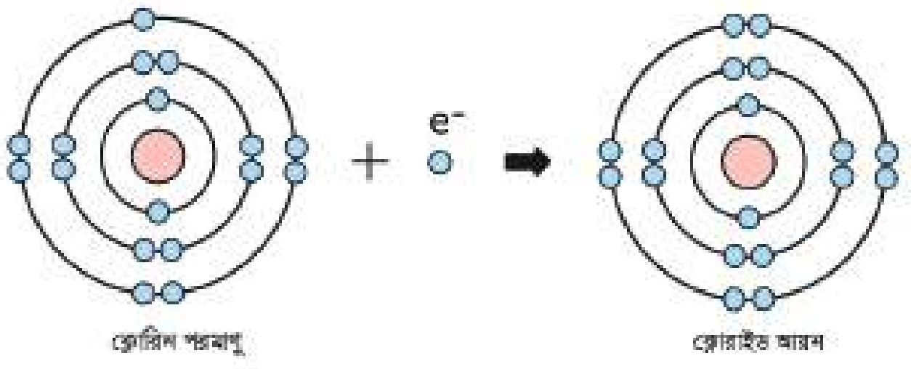

<!-- chemistry-9-10-bn-c05-t5.9-p012 · figure · p.94 -->
**চিত্র ৫.০৫: ঋণাত্মক Cl<sup>-</sup> আয়ন গঠন**

## 5.10 আয়নিক বন্ধন বা তড়িৎযোজী বন্ধন

### (Ionic Bond or Electrovalent Bond)

<!-- chemistry-9-10-bn-c05-t5.10-p001 · text · p.94 · review: known-confusable-corrected -->
আমরা ইতঃপূর্বে জেনেছি, ধাতুগুলোর আয়নিকরণ শক্তির মান অনেক কম হওয়ায় এরা অতি সহজেই সর্বশেষ শক্তিস্তরের এক বা একাধিক ইলেকট্রন ত্যাগ করে ধনাত্মক আধানবিশিষ্ট আয়ন বা ক্যাটায়নে পরিণত হয়। আবার অধাতুগুলোর ইলেকট্রন আসক্তির মান বেশি হওয়ায় এরা সহজেই সর্বশেষ শক্তিস্তরে এক বা একাধিক ইলেকট্রন গ্রহণ করে ঋণাত্মক আধানবিশিষ্ট আয়ন বা অ্যানায়নে পরিণত হয়। এভাবে সৃষ্ট বিপরীত আধানের ক্যাটায়ন ও অ্যানায়নের মধ্যে স্থির বৈদ্যুতিক আকর্ষণ বল বা ইলেকট্রোস্ট্যাটিক বল কাজ করে। এই ইলেকট্রোস্ট্যাটিক বল বা কুলম্ব আকর্ষণ বলের ফলে তারা একে অপরের সাথে যুক্ত থাকে। যে আকর্ষণের ফলে ক্যাটায়ন ও অ্যানায়ন পরস্পরের সাথে যুক্ত থাকে সেটিই আয়নিক বা তড়িৎযোজী বন্ধন। যেমন- Na পরমাণু তার সর্বশেষ শক্তিস্তরের একটি ইলেকট্রন ত্যাগ করে নিষ্ক্রিয় গ্যাসের মতো ইলেকট্রন বিন্যাস অর্জন করে অর্থাৎ সর্বশেষ শক্তিস্তরে ৪টি ইলেকট্রন গঠন করে Na<sup>+</sup> ক্যাটায়নে পরিণত হয়। অপরদিকে Cl পরমাণু তার সর্বশেষ শক্তিস্তরে Na এর ত্যাগকৃত ইলেকট্রনটিকে গ্রহণ করে নিষ্ক্রিয় গ্যাসের মতো ইলেকট্রন বিন্যাস অর্জন করে অর্থাৎ সর্বশেষ শক্তিস্তরে ৪টি ইলেকট্রন গঠন করে Cl<sup>-</sup> অ্যানায়নে পরিণত হয়। এভাবে সূক্ষ্ম ধনাত্মক আধান Na<sup>+</sup> ও ঋণাত্মক আধান Cl<sup>-</sup> পরস্পরের সাথে স্থির বৈদ্যুতিক আকর্ষণে আবদ্ধ হয়। এ আকর্ষণ বলই আয়নিক বন্ধন। অর্থাৎ ধাতব ও অধাতব পরমাণুর রাসায়নিক সংযোগের সময় ধাতব পরমাণু তার সর্বশেষ শক্তিস্তরের এক বা একাধিক ইলেকট্রনকে অধাতব পরমাণুর সর্বশেষ শক্তিস্তরে স্থানান্তর করে ধনাত্মক ঋণাত্মক আয়ন সৃষ্টির মাধ্যমে যে বন্ধন গঠিত হয় তাকে আয়নিক বা তড়িৎযোজী বন্ধন বলে। যে যৌগে আয়নিক বন্ধন থাকে তাকে আয়নিক যৌগ বলে।

<!-- chemistry-9-10-bn-c05-t5.10-p002 · text · p.95 · review: verify-formula -->
$$Na \longrightarrow Na^+ + e^-$$
$$Cl + e^- \longrightarrow Cl^-$$
$$Na + Cl \longrightarrow Na^+ + Cl^- = NaCl$$

<!-- chemistry-9-10-bn-c05-t5.10-p003 · figure · p.95 -->
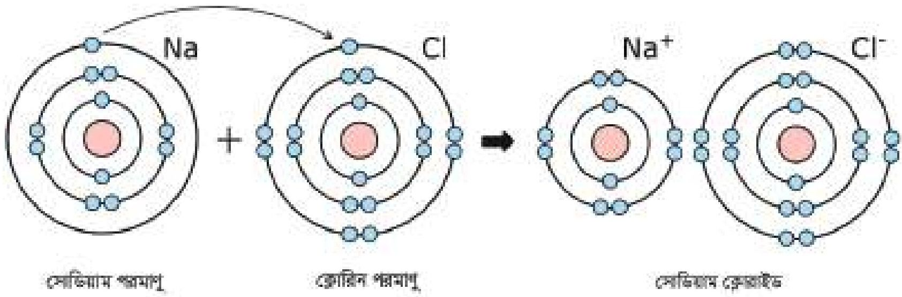

<!-- chemistry-9-10-bn-c05-t5.10-p004 · text · p.95 -->
**সোডিয়াম পরমাণু**      **ক্লোরিন পরমাণু**      **সোডিয়াম ক্লোরাইড**

<!-- chemistry-9-10-bn-c05-t5.10-p005 · figure · p.95 -->
**চিত্র ৫.০৬: সোডিয়াম ক্লোরাইড গঠন**

<!-- chemistry-9-10-bn-c05-t5.10-p006 · text · p.95 -->
MgO অণুতে Mg ২টি ইলেকট্রন ত্যাগ করে নিষ্ক্রিয় গ্যাস Ne এর মতো ইলেকট্রন বিন্যাস অর্জন করে অর্থাৎ সর্বশেষ শক্তিস্তরে ৪টি ইলেকট্রন গঠন করে Mg<sup>2+</sup> এ পরিণত হয়।

<!-- chemistry-9-10-bn-c05-t5.10-p007 · formula · p.95 · review: verify-formula -->
$$Mg \longrightarrow Mg^{2+} + 2e^-$$

<!-- chemistry-9-10-bn-c05-t5.10-p008 · text · p.95 -->
আবার O পরমাণু ঐ ২টি ইলেকট্রন গ্রহণ করে নিষ্ক্রিয় গ্যাস Ne এর মতো ইলেকট্রন বিন্যাস অর্জন করে অর্থাৎ সর্বশেষ শক্তিস্তরে ৪টি ইলেকট্রন গঠন করে O<sup>2-</sup> এ পরিণত হয়।

<!-- chemistry-9-10-bn-c05-t5.10-p009 · formula · p.96 · review: verify-formula -->
$$O + 2e^- \longrightarrow O^{2-}$$

<!-- chemistry-9-10-bn-c05-t5.10-p010 · text · p.96 -->
এবার Mg<sup>2+</sup> এবং O<sup>2-</sup> কাছাকাছি এসে আয়নিক বন্ধন তৈরি করে। যে যৌগে আয়নিক বন্ধন বিদ্যমান সেই যৌগকে আয়নিক যৌগ বলে। যেমন- MgO একটি আয়নিক যৌগ।

<!-- chemistry-9-10-bn-c05-t5.10-p011 · figure · p.96 -->
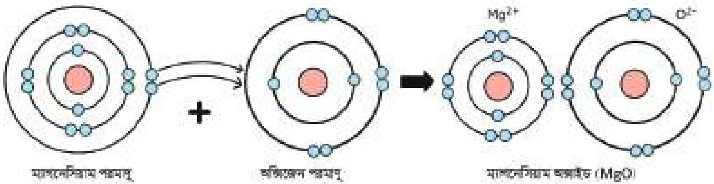

<!-- chemistry-9-10-bn-c05-t5.10-p012 · figure · p.96 -->
**চিত্র ৫.০৭: ম্যাগনেসিয়াম অক্সাইড গঠন**

<!-- chemistry-9-10-bn-c05-t5.10-p013 · text · p.96 -->
NaH অণুতে Na পরমাণু ইলেকট্রন দান করে নিষ্ক্রিয় গ্যাসের মতো ইলেকট্রন বিন্যাস অর্জন করে অর্থাৎ সর্বশেষ শক্তিস্তরে ৪টি ইলেকট্রন গঠন করে Na<sup>+</sup> এ পরিণত হয় এবং H পরমাণু ঐ ইলেকট্রন গ্রহণ করে নিষ্ক্রিয় গ্যাসের মতো ইলেকট্রন বিন্যাস অর্জন করে অর্থাৎ সর্বশেষ শক্তিস্তরে ২টি ইলেকট্রন গঠন করে H<sup>-</sup> এ পরিণত হয়। অতঃপর এদের মধ্যে আয়নিক বন্ধন গঠিত হয়।

<!-- chemistry-9-10-bn-c05-t5.10-p014 · text · p.96 · review: verify-formula -->
$$Na \longrightarrow Na^+ + e^-$$
$$H + e^- \longrightarrow H^-$$

<!-- chemistry-9-10-bn-c05-t5.10-p015 · text · p.96 -->
CaO অণুতে Ca পরমাণু ২টি ইলেকট্রন ত্যাগ করে নিষ্ক্রিয় গ্যাসের মতো ইলেকট্রন বিন্যাস অর্জন করে অর্থাৎ সর্বশেষ শক্তিস্তরে ৪টি ইলেকট্রন গঠন করে Ca<sup>2+</sup> তে পরিণত হয়।

<!-- chemistry-9-10-bn-c05-t5.10-p016 · formula · p.96 · review: verify-formula -->
$$Ca \longrightarrow Ca^{2+} + 2e^-$$

<!-- chemistry-9-10-bn-c05-t5.10-p017 · text · p.96 -->
O পরমাণু সেই ২টি ইলেকট্রন গ্রহণ করে নিষ্ক্রিয় গ্যাসের মতো ইলেকট্রন বিন্যাস অর্জন করে অর্থাৎ সর্বশেষ শক্তিস্তরে ৪টি ইলেকট্রন গঠন করে O<sup>2-</sup> এ পরিণত হয়

<!-- chemistry-9-10-bn-c05-t5.10-p018 · formula · p.96 · review: verify-formula -->
$$O + 2e^- \longrightarrow O^{2-}$$

<!-- chemistry-9-10-bn-c05-t5.10-p019 · text · p.96 -->
অতএব Ca<sup>2+</sup> এবং O<sup>2-</sup> এর মধ্যে আয়নিক বন্ধন গঠিত হয়।

<!-- chemistry-9-10-bn-c05-t5.10-p020 · text · p.96 -->
উপরের উদাহরণগুলো পর্য্যালোচনা করলে দেখা যায় যে, ধাতুগুলো ইলেকট্রন বর্জন এবং অধাতুগুলো ধাতু কর্তৃক বর্জন করা ইলেকট্রন গ্রহণ করে যথাক্রমে ক্যাটায়ন ও অ্যানায়নে পরিণত হয়। এই ক্যাটায়ন ও অ্যানায়ন পরস্পরের কাছাকাছি আবদ্ধ হয়ে আয়নিক বন্ধন তৈরি করে। উল্লেখ্য, পর্যায় সারণির ১ ও ২ নম্বর গ্রুপের ধাতব মৌলসমূহ এবং ১৬ ও ১৭ নম্বর গ্রুপের অধাতব মৌলসমূহ সাধারণত আয়নিক বন্ধন তৈরি করে। প্রত্যেকটি নিয়মের কিছু না কিছু ব্যতিক্রম থাকে। যেমন- এখানে 13 নম্বর গ্রুপের Al মৌলটি 1 ও 2 নম্বর গ্রুপের মৌল না হওয়া সত্ত্বেও আয়নিক বন্ধন তৈরি করে। অন্য মৌলসমূহ তাদের সর্বশেষ শক্তিস্তরে অনেক বেশি ইলেকট্রন ধারণ করার কারণে তারা ইলেকট্রন বর্জন বা গ্রহণ করার প্রবণতা দেখায় না। ফলে তারা আয়নিক বন্ধনও তৈরি করে না। আয়নিক বন্ধন স্থির বৈদ্যুতিক আকর্ষণের মাধ্যমে ঘটে বলে এ বন্ধন খুবই শক্তিশালী হয়।

## 5.11 সমযোজী বন্ধন (Covalent Bond)

<!-- chemistry-9-10-bn-c05-t5.11-p001 · text · p.97 -->
তোমরা ইতঃপূর্বে জেনেছ যে, একটি ধাতব পরমাণু ও একটি অধাতব পরমাণু রাসায়নিক সংযোগের সময় ধাতু তার সর্বশেষ শক্তিস্তরের ইলেকট্রন অধাতব পরমাণুর সর্বশেষ শক্তিস্তরে স্থানান্তর করে ক্যাটায়ন ও অ্যানায়ন তৈরির মাধ্যমে আয়নিক বন্ধনের সৃষ্টি করে। কিন্তু তুমি যদি দুটি অধাতব পরমাণুর মধ্যে রাসায়নিক সংযোগ করাতে চাও তাহলে সেটি কীভাবে ঘটেবে? অধাতুর বেলায় পরমাণুর শেষ শক্তিস্তরের ইলেকট্রন ত্যাগ বা গ্রহণ করা সহজ নয় বলে তাদের ভেতর বন্ধন তৈরি করা কঠিন মনে হতে পারে। কিন্তু বাস্তবে দুটি অধাতব পরমাণু বন্ধন গঠন করে। যেমন- দুটি ক্লোরিন (অধাতু) পরমাণুকে যখন কাছাকাছি রাখা হয় তখন তাদের মধ্যে এক ধরনের রাসায়নিক বন্ধন গঠিত হয়ে ক্লোরিন অণুতে পরিণত হয়। প্রশ্ন হলো কীভাবে দুটি অধাতব ক্লোরিন পরমাণু একে অপরের সাথে বন্ধন তৈরি করে? এদের তো সর্বশেষ শক্তিস্তরে সাতটি করে ইলেকট্রন আছে।

<!-- chemistry-9-10-bn-c05-t5.11-p002 · text · p.97 · review: verify-formula -->
ক্লোরিনের ইলেকট্রন বিন্যাস হলো: Cl (17) $\rightarrow$ 1s<sup>2</sup> 2s<sup>2</sup> 2p<sup>6</sup> 3s<sup>2</sup> 3p<sup>5</sup>

<!-- chemistry-9-10-bn-c05-t5.11-p003 · text · p.97 -->
Cl এর সর্বশেষ শক্তিস্তরে সাতটি ইলেকট্রন থাকায় ক্লোরিন পরমাণু সর্বশেষ শক্তিস্তরের ইলেকট্রন প্রদান করতে চাইবে না বরং গ্রহণের প্রবণতা দেখাবে। কিন্তু দাতা পরমাণু না থাকায় গ্রহণ প্রক্রিয়াও ঘটেবে না। তাই দুটি ক্লোরিন পরমাণু কাছাকাছি এলে প্রত্যেকটি পরমাণুর সর্বশেষ শক্তিস্তর থেকে 1টি করে ইলেকট্রন এসে জোড়বদ্ধ হয় এবং ঐ ইলেকট্রন জোড় উভয় পরমাণুর নিউক্লিয়াসের মাঝামাঝি অবস্থান করে। একে ইলেকট্রনের ভাগাভাগি বা ইলেকট্রনের শেয়ারিং বলে। এর ফলে উভয় পরমাণু তাদের সর্বশেষ শক্তিস্তরে আটটি করে ইলেকট্রন লাভ করে অর্থাৎ নিস্ক্রিয় গ্যাস এর ইলেকট্রন বিন্যাস লাভ করে। ফলস্বরূপ দুটি ক্লোরিন পরমাণুর নিউক্লিয়াসগুলো একে অপরের কাছ থেকে দূরে সরে যেতে পারে না অর্থাৎ এরা এক ধরনের বন্ধনে আবদ্ধ হয়। এ ধরনের বন্ধনকে সমযোজী বন্ধন বলে। অর্থাৎ দুটি অধাতব পরমাণুর রাসায়নিক সংযোগের সময় অধাতব পরমাণুদ্বয় তাদের সর্বশেষ শক্তিস্তরের (এক বা একাধিক) একটি ইলেকট্রনকে সরবরাহ করে এক জোড়া ইলেকট্রন তৈরি করে। এরপর এই এক জোড়া ইলেকট্রন উভয় পরমাণু শেয়ারের মাধ্যমে যে বন্ধন গঠিত হয় তাকে সমযোজী বন্ধন বলে। যে যোগে সমযোজী বন্ধন থাকে তাকে সমযোজী যোগ বলে। প্রতিটি সমযোজী বন্ধনে দুটি ইলেকট্রন অংশগ্রহণ করে। সমযোজী বন্ধনকে একটি রেখার (—) মাধ্যমে প্রকাশ করা হয় এবং ইলেকট্রনসমূহকে ডট (.) চিহ্ন বা ক্রস (×) চিহ্ন দ্বারা প্রকাশ করা হয়।

<!-- chemistry-9-10-bn-c05-t5.11-p004 · text · p.98 -->
ক্লোরিন অণুতে দুটি ক্লোরিন পরমাণু বিদ্যমান। ক্লোরিন অণুর সংকেত হলো Cl<sub>2</sub>। অনেক অধাতু অণু আকারে থাকে। যেমন- হাইড্রোজেন (H<sub>2</sub>), অক্সিজেন (O<sub>2</sub>), নাইট্রোজেন (N<sub>2</sub>), সালফার (S<sub>8</sub>), ফসফরাস (P<sub>4</sub>), ব্রোমিন (Br<sub>2</sub>), আয়োডিন (I<sub>2</sub>), ফ্লোরিন (F<sub>2</sub>) ইত্যাদি।

<!-- chemistry-9-10-bn-c05-t5.11-p005 · text · p.98 -->
**H<sub>2</sub> অণুতে সমযোজী বন্ধন:** হাইড্রোজেন পরমাণুর ইলেকট্রন বিন্যাস হলো, H(1) → 1s<sup>1</sup>। দুটি হাইড্রোজেন পরমাণু যখন কাছাকাছি আসে তখন উভয় পরমাণুই একটি করে ইলেকট্রন শেয়ার করে নিষ্ক্রিয় গ্যাসের মতো ইলেকট্রন বিন্যাস অর্জন করে অর্থাৎ সর্বশেষ শক্তিস্তরে 2টি ইলেকট্রন গঠন করে। এর ফলে (H — H) সমযোজী বন্ধনের সৃষ্টি হয়।

<!-- chemistry-9-10-bn-c05-t5.11-p006 · formula · p.98 · review: verify-formula -->
$$H\cdot + \cdot H \longrightarrow H\cdot\cdot H$$

<!-- chemistry-9-10-bn-c05-t5.11-p007 · figure · p.98 -->
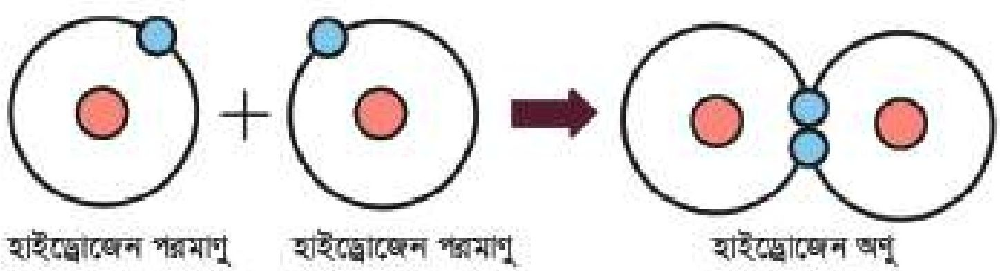

<!-- chemistry-9-10-bn-c05-t5.11-p008 · figure · p.98 -->
**চিত্র ৫.০৮: হাইড্রোজেন অণুতে সমযোজী বন্ধন গঠন**

<!-- chemistry-9-10-bn-c05-t5.11-p009 · text · p.98 -->
**O<sub>2</sub> অণুতে সমযোজী বন্ধন:** অক্সিজেন পরমাণুর ইলেকট্রন বিন্যাস হলো, O(8) → 1s<sup>2</sup>2s<sup>2</sup>2p<sup>4</sup>। অক্সিজেন পরমাণুর সর্বশেষ শক্তিস্তরে নিষ্ক্রিয় গ্যাসের ইলেকট্রন বিন্যাস (অষ্টক) অপেক্ষা দুটি ইলেকট্রন

<!-- chemistry-9-10-bn-c05-t5.11-p010 · figure · p.98 -->
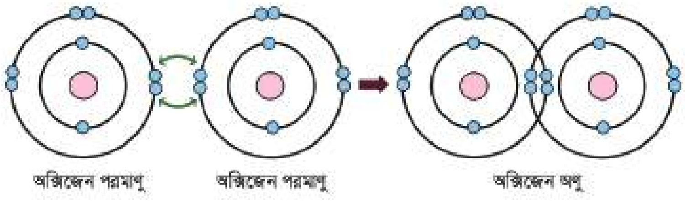

<!-- chemistry-9-10-bn-c05-t5.11-p011 · figure · p.98 -->
**চিত্র ৫.০৯: অক্সিজেন অণুতে সমযোজী বন্ধন গঠন**

<!-- chemistry-9-10-bn-c05-t5.11-p012 · text · p.98 -->
কম আছে। এরূপ দুটি অক্সিজেন পরমাণু কাছাকাছি এলে তাদের উভয় পরমাণুই নিষ্ক্রিয় গ্যাসের মতো ইলেকট্রন বিন্যাস অর্জন করে অর্থাৎ সর্বশেষ শক্তিস্তরে 4টি ইলেকট্রন গঠন করে। ফলে তাদের মধ্যে (O=O) সমযোজী বন্ধন গঠিত হয়। এক্ষেত্রে উভয় পরমাণু দুটি করে মোট চারটি ইলেকট্রন শেয়ার করায় সমযোজী বন্ধনের সংখ্যা হয় ২ (দুই)। যেমন:

<!-- chemistry-9-10-bn-c05-t5.11-p013 · text · p.99 · review: verify-formula -->
সাধারণভাবে, $O + O \longrightarrow O = O$ বা $O_2$

<!-- chemistry-9-10-bn-c05-t5.11-p014 · text · p.99 -->
এতক্ষণ আমরা একই অধাতব পরমাণু দ্বারা গঠিত অণু তথা মৌলিক অণুসমূহের মধ্যে সমযোজী বন্ধন দেখলাম। মৌলিক অণু ছাড়াও একাধিক ভিন্ন অধাতব পরমাণু দ্বারা গঠিত যৌগিক অণুতেও সমযোজী বন্ধন দেখতে পাওয়া যায়। যেমন- পানির অণুতে অক্সিজেন পরমাণু তার সর্বশেষ শক্তিস্তরের একটি করে ইলেকট্রন প্রত্যেক হাইড্রোজেন পরমাণুর একটি করে ইলেকট্রনের সাথে শেয়ার করে। এভাবে দুটি (O–H) সমযোজী বন্ধন গঠনের মাধ্যমে পানির অণু গঠিত হয়।

<!-- chemistry-9-10-bn-c05-t5.11-p015 · figure · p.99 -->
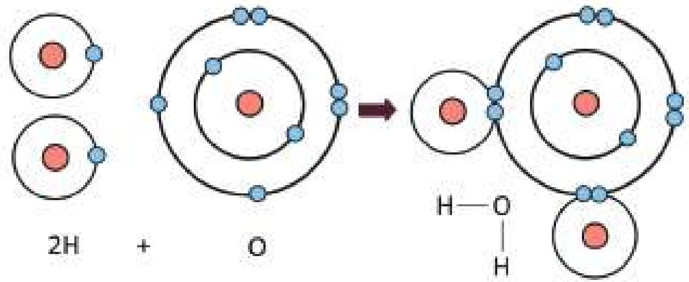

<!-- chemistry-9-10-bn-c05-t5.11-p016 · figure · p.99 -->
**চিত্র ৫.১০: দুটি (O-H) সমযোজী বন্ধনের মাধ্যমে পানির অণুতে সমযোজী বন্ধন গঠন**

<!-- chemistry-9-10-bn-c05-t5.11-p017 · text · p.99 -->
H<sub>2</sub>O অণুতে O পরমাণুর ২ জোড়া ইলেকট্রন অর্থাৎ ৪টি ইলেকট্রন এখানে কোনো বন্ধন গঠন করেনি। কিন্তু প্রয়োজন হলে এই চারটি ইলেকট্রন বন্ধন গঠন করতে পারে। এই বিষয়গুলো তোমরা উচ্চতর শ্রেণিতে জানতে পারবে।

<!-- chemistry-9-10-bn-c05-t5.11-p018 · text · p.99 -->
O পরমাণু সমযোজী এবং আয়নিক উভয় প্রকার যৌগ গঠন করলেও Na পরমাণু কখনোই সমযোজী যৌগ গঠন করে না। Na পরমাণু সব সময় আয়নিক যৌগ গঠন করে। কারণ হিসেবে বলা যায়, O পরমাণু কোনো মৌল থেকে ২টি ইলেকট্রন গ্রহণ করেও ঐ মৌলের সাথে আয়নিক বন্ধন তৈরি করে আবার কোনো মৌলের সাথে ২টি ইলেকট্রন শেয়ার করেও ঐ মৌলের সাথে সমযোজী বন্ধন তৈরি করতে পারে। Na পরমাণু সব সময় ইলেকট্রন ত্যাগ করে কোনো মৌলের সাথে আয়নিক বন্ধন তৈরি করে। কিন্তু Na পরমাণু কোনো মৌলের সাথেই ইলেকট্রন শেয়ার করে সমযোজী বন্ধন তৈরি করে না।

<!-- chemistry-9-10-bn-c05-t5.11-p019 · text · p.99 -->
সমযোজী বন্ধনবিশিষ্ট মৌলিক পদার্থের অণুকে (যেমন: N<sub>2</sub>, O<sub>2</sub>, Cl<sub>2</sub>, Br<sub>2</sub>, I<sub>2</sub>) সমযোজী অণু এবং সমযোজী বন্ধনবিশিষ্ট যৌগকে সমযোজী যৌগ অণু বলা হয় (যেমন: CH<sub>4</sub>, CO<sub>2</sub>, HCl, NH<sub>3</sub> ইত্যাদি)।

<!-- chemistry-9-10-bn-c05-t5.11-p020 · text · p.100 -->
অনেক সমযোজী অণু স্বাভাবিক তাপমাত্রা ও চাপে গ্যাসীয় অবস্থায় থাকে। যেমন: CO<sub>2</sub>, NH<sub>3</sub>, O<sub>2</sub>, N<sub>2</sub>, Cl<sub>2</sub> ইত্যাদি। আবার কিছু সমযোজী অণু স্বাভাবিক তাপমাত্রা ও চাপে তরল অবস্থায় বিরাজ করে। যেমন: H<sub>2</sub>O (পানি), C<sub>2</sub>H<sub>5</sub>OH (ইথানল) ইত্যাদি এবং কিছু কার্ঠন অবস্থায় থাকে, যেমন- ন্যাপথালিন (C<sub>10</sub>H<sub>8</sub>), সালফার (S<sub>8</sub>), আয়োডিন (I<sub>2</sub>) ইত্যাদি। দুটি সমযোজী অণু যখন খুবই নিকটবর্তী হয় তখন তাদের মধ্যে এক ধরনের দুর্বল আকর্ষণ বল কাজ করে, এই আকর্ষণ বলকেই ভ্যান্ডারওয়ালস আকর্ষণ বল বলে। সমযোজী অণুগুলো পরস্পরের সাথে এই দুর্বল ভ্যান্ডারওয়ালস আকর্ষণের মাধ্যমে যুক্ত থাকে। তাই এদেরকে বিচ্ছিন্ন করতে সামান্য শক্তির প্রয়োজন হয়। ফলে এদের গলনাঙ্ক ও স্ফুটনাঙ্ক অনেক কম হয়। আবার গ্যাসীয় সমযোজী অণুর মধ্যে (যেমন: CO<sub>2</sub>, NH<sub>3</sub>, O<sub>2</sub> ইত্যাদি) ভ্যান্ডারওয়ালস আকর্ষণ বল নেই বললেই চলে, যার কারণে এরা একক অণু হিসেবে গ্যাসীয় অবস্থায় থাকে।

## 5.12 আয়নিক ও সমযোজী যৌগের বৈশিষ্ট্য

### (a) গলনাঙ্ক ও স্ফুটনাঙ্ক (Melting Point and Boiling Point)

<!-- chemistry-9-10-bn-c05-t5.12-p001 · text · p.100 -->
যে যৌগে আয়নিক বন্ধন থাকে সেই যৌগকে আয়নিক যৌগ বলা হয় এবং যে যৌগে সমযোজী বন্ধন থাকে সেই যৌগকে সমযোজী যৌগ বলা হয়। আয়নিক যৌগের গলনাঙ্ক ও স্ফুটনাঙ্ক অনেক বেশি হয় কিন্তু সমযোজী যৌগের গলনাঙ্ক ও স্ফুটনাঙ্ক আয়নিক যৌগ অপেক্ষা কম হয়। কিন্তু কেন? এটি আসলেই সত্যি আয়নিক যৌগে ধনাত্মক ও ঋণাত্মক আধান থাকে। এ আধানদ্বয় পরস্পরের সাথে দৃঢ়ভাবে আবদ্ধ থাকে। আয়নিক যৌগে এরূপ অসংখ্য ধনাত্মক ও ঋণাত্মক আধান পরস্পরের কাছাকাছি থেকে ত্রিমাত্রিকভাবে সুবিন্যস্ত হয়ে একটি স্ফটিক তৈরি করে। এতে তাদের আন্তঃআণবিক আকর্ষণ বল অনেক বেশি হয়। ফলে এদেরকে একে অপরের কাছ থেকে দূরে সরিয়ে নিতে বা গলিয়ে ফেলতে অনেক বেশি তাপশক্তির প্রয়োজন হয়। কাজেই এদের গলনাঙ্ক ও স্ফুটনাঙ্ক অনেক বেশি হয়। অপর দিকে সমযোজী অণুসমূহের মধ্যে আন্তঃআণবিক আকর্ষণ মূলত দুর্বল ভ্যান্ডারওয়ালস বলের কারণে হয়ে থাকে। কাজেই সমযোজী যৌগে আন্তঃআণবিক আকর্ষণ বল অনেক কম হয়। এজন্য এদেরকে সামান্য তাপ প্রদান করলে এরা পরস্পরের কাছ থেকে দূরে সরে যায়। অর্থাৎ এদের গলনাঙ্ক ও স্ফুটনাঙ্ক কম হয়। একইভাবে তোমরা আয়নিক যৌগ NaCl এর পরিবর্তে CuSO<sub>4</sub>, NaNO<sub>3</sub>, KCl, CaCl<sub>2</sub> ইত্যাদি ব্যবহার করলেও একই বিষয় দেখবে। অন্যদিকে সমযোজী যৌগ হিসেবে গ্লুকোজ, চিনি ইত্যাদি ব্যবহার করে পরীক্ষাগুলো সম্পন্ন করতে পারো। স্ফুটনাঙ্কের ক্ষেত্রে সমযোজী যৌগ হিসেবে আমাদের অতি পরিচিত পানি ব্যবহার করা যায়। সব পরীক্ষাতেই দেখতে পাবে আয়নিক যৌগের গলনাঙ্ক ও স্ফুটনাঙ্ক সমযোজী যৌগ থেকে অনেক বেশি।

### (b) দ্রাব্যতা/ দ্রবণীয়তা (Solubility)

<!-- chemistry-9-10-bn-c05-t5.12-p002 · text · p.101 -->
তোমরা একটি বিকার বা কাচের একটি পাত্রে নির্দিষ্ট পরিমাণ পানি নাও। এরপর এতে আয়নিক যৌগ হিসেবে খাদ্য লবণ (NaCl) যোগ করে নাড়তে থাকো। দেখবে সমস্ত খাদ্যলবণ পানিতে দ্রবীভূত হয়েছে। এরপর কাপড় কাচা সোডা (Na<sub>2</sub>CO<sub>3</sub>.10H<sub>2</sub>O), তুঁতে (CuSO<sub>4</sub>.5H<sub>2</sub>O) বা অন্য বেশ কয়েকটি আয়নিক যৌগ নিয়ে একইভাবে পরীক্ষা সম্পন্ন করো, দেখতে পাবে প্রতি ক্ষেত্রে আয়নিক যৌগ পানিতে দ্রবীভূত হচ্ছে। অর্থাৎ তোমরা বলতে পারো যে, সকল আয়নিক যৌগ পানিতে দ্রবীভূত হয় কিন্তু কিছু কিছু আয়নিক যৌগ আছে, যেমন- সিলভার ক্লোরাইড পানিতে দ্রবীভূত হয় না। অপরদিকে, সমযোজী যৌগ, যেমন- ন্যাপথালিন, সরিষার তেল, কেরোসিন এগুলো নিয়ে একইভাবে পরীক্ষা সম্পন্ন করলে দেখতে পাবে এদের কেউই পানিতে দ্রবীভূত হয়নি। সমযোজী যৌগ সাধারণত পানিতে দ্রবীভূত হয় না তবে কিছু কিছু সমযোজী যৌগ আছে যেমন- চিনি, গ্লুকোজ, অ্যালকোহল এগুলো পানিতে দ্রবীভূত হয়। সুতরাং সামগ্রিকভাবে বলা যায় কিছু ব্যতিক্রম ছাড়া প্রায় সকল আয়নিক যৌগ পানিতে দ্রবীভূত হয় এবং কিছু ব্যতিক্রম ছাড়া প্রায় সকল সমযোজী যৌগ পানিতে দ্রবীভূত হয় না।

<!-- chemistry-9-10-bn-c05-t5.12-p003 · text · p.101 · review: verify-formula -->
অধিকাংশ সমযোজী যৌগ পানিতে দ্রবীভূত হয় না—তবে কিছু কিছু সমযোজী যৌগ পানিতে দ্রবীভূত হয়, এর কারণ কী? এর কারণ জানতে হলে প্রথমে পানির বন্ধন গঠন সম্পর্কে জানতে হবে। তোমরা জানো, পানি একটি সমযোজী যৌগ অর্থাৎ পানির অণুতে একটি অক্সিজেন পরমাণুর সাথে দুটি হাইড্রোজেন পরমাণু ইলেকট্রন শেয়ারের মাধ্যমে সমযোজী বন্ধনে আবদ্ধ থাকে। কিন্তু অক্সিজেন পরমাণু হাইড্রোজেন পরমাণু থেকে অধিক তড়িৎ ঋণাত্মক হওয়ায় পানির অণুর সমযোজী বন্ধনীতে ব্যবহৃত ইলেকট্রন দুটি অক্সিজেনের দিকে সামান্য পরিমাণ সরে যায়। যে কারণে অক্সিজেন পরমাণু আংশিক ঋণাত্মক আধান ও হাইড্রোজেন পরমাণু আংশিক ধনাত্মক আধান প্রাপ্ত হয়। অর্থাৎ পানির অণুতে আংশিক ধনাত্মক এবং আংশিক ঋণাত্মক প্রান্তের সৃষ্টি হয়। এরকম ধনাত্মক ও ঋণাত্মক আধানপ্রাপ্ত সমযোজী যৌগকে পোলার সমযোজী যৌগ বলে। সুতরাং পানি একটি পোলার সমযোজী যৌগ এবং দ্রাবক হিসেবে পানি একটি পোলার দ্রাবক। মনে রাখবে, সমযোজী বন্ধনীস্থ ইলেকট্রন যুগলকে কোনো পরমাণু কৃত্রিম নিজের দিকে আকর্ষণ করার ক্ষমতাকে উক্ত পরমাণুর তড়িৎ ঋণাত্মকতা বলা হয়। $\delta^+$ (ডেল্টা প্লাস) ও $\delta^-$ (ডেল্টা মাইনাস) দিয়ে যথাক্রমে আংশিক ধনাত্মক আধান এবং আংশিক ঋণাত্মক আধানকে বোঝানো হচ্ছে।

<!-- chemistry-9-10-bn-c05-t5.12-p004 · figure · p.101 -->
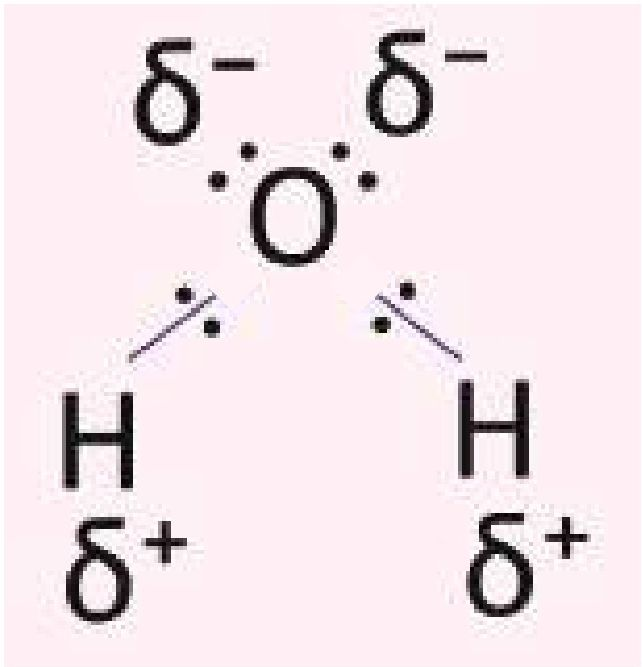

<!-- chemistry-9-10-bn-c05-t5.12-p005 · figure · p.101 · review: verify-formula -->
**চিত্র ৫.১১: $\delta^+$ ও $\delta^-$ দিয়ে আংশিক ধনাত্মক আধান এবং আংশিক ঋণাত্মক আধানকে বোঝানো হচ্ছে**

<!-- chemistry-9-10-bn-c05-t5.12-p006 · text · p.102 -->
পোলার দ্রাবক পানিতে আয়নিক যৌগ যোগ করলে পানির অণুগুলোর ধনাত্মক প্রান্ত আয়নিক যৌগের ঋণাত্মক প্রান্ত বা অ্যানায়নকে আকর্ষণ করে। একইভাবে পানির অণুর ঋণাত্মক প্রান্ত আয়নিক যৌগের ধনাত্মক প্রান্ত বা ক্যাটায়নকে আকর্ষণ করে। এই আকর্ষণ বলের মান যখন আয়নিক যৌগের অ্যানায়ন ও ক্যাটায়নের মধ্যকার আকর্ষণ বল থেকে বেশি হয় তখন অ্যানায়ন ও ক্যাটায়ন পরস্পর থেকে বিচ্ছিন্ন হয়ে পানির অণু দিয়ে পরিবেষ্টিত হয়। এভাবে আয়নিক যৌগ পানিতে দ্রবীভূত হয়।

<!-- chemistry-9-10-bn-c05-t5.12-p007 · text · p.102 -->
NaCl আয়নিক যৌগ তাই NaCl পোলার দ্রাবক H<sub>2</sub>O তে দ্রবীভূত হয়। মিথানল (CH<sub>3</sub>OH) পোলার যৌগ তাই CH<sub>3</sub>OH পোলার দ্রাবক H<sub>2</sub>O তে দ্রবীভূত হয়। মিথেন (CH<sub>4</sub>) আয়নিক যৌগও নয় আবার CH<sub>4</sub> পোলার যৌগও নয়, কাজেই CH<sub>4</sub> পানিতে দ্রবণীয় হয় না।

<!-- chemistry-9-10-bn-c05-t5.12-p008 · text · p.102 -->
অপরদিকে, সমযোজী যৌগে সাধারণত আয়নিক যৌগের মতো ধনাত্মক ও ঋণাত্মক প্রান্ত থাকে না। তাই পানির অণুর ধনাত্মক ও ঋণাত্মক প্রান্তের সাথে সমযোজী যৌগের কোনো আকর্ষণ বা বিকর্ষণ ঘটে না। ফলস্বরূপ সমযোজী যৌগটি পানিতে আয়ন আকারে ভেঙ্গে যায় না অর্থাৎ সমযোজী যৌগটি পানিতে দ্রবীভূত হয় না।

<!-- chemistry-9-10-bn-c05-t5.12-p009 · text · p.102 -->
তবে কিছু কিছু সমযোজী যৌগ আছে যাদের মধ্যে আংশিক ধনাত্মক এবং আংশিক ঋণাত্মক প্রান্ত দেখা যায় অর্থাৎ পোলারিটি দেখা যায়। যেমন- ইথানল (C<sub>2</sub>H<sub>5</sub>OH) পোলার যৌগ তাই ইথানল পানিতে দ্রবীভূত হয়।

### (c) বিদ্যুৎ পরিবাহিতা (Electrical Conductivity):

<!-- chemistry-9-10-bn-c05-t5.12-p010 · text · p.102 -->
একটি বিকারে খাদ্য লবণের (NaCl) জলীয় দ্রবণ এবং অন্য একটি বিকারে চিনির জলীয় দ্রবণ নাও। এবার উভয় দ্রবণে ইলেকট্রোড হিসেবে দুটি গ্রাফাইট দণ্ড কিংবা যেকোনো ধাতব দণ্ড ভুবিয়ে দণ্ডদ্বয়ের সাথে ছবিতে দেখানো উপায়ে ব্যটারি এবং বাল্ব যুক্ত করে বর্তনী পূর্ণ করো। এরপর পর্যবেক্ষণ করো। কী দেখলে? দেখবে যে খাদ্য লবণের দ্রবণযুক্ত বর্তনীতে বাল্ব জ্বলছে কিন্তু চিনির জলীয় দ্রবণযুক্ত বর্তনীতে বাল্ব জ্বলছে না। অর্থাৎ খাদ্য লবণ বা NaCl-এর জলীয় দ্রবণ বিদ্যুৎ পরিবহণ করে কিন্তু চিনির জলীয় দ্রবণ বিদ্যুৎ পরিবহণ করে না। এ থেকে তোমরা মনতব্য করতে পারবে যে, আয়নিক যৌগ জলীয় দ্রবণে বিদ্যুৎ পরিবহণ করে কিন্তু সমযোজী যৌগ জলীয় দ্রবণে বিদ্যুৎ পরিবহন করে না। কিন্তু এর কারণ কী?

<!-- chemistry-9-10-bn-c05-t5.12-p011 · figure · p.102 -->
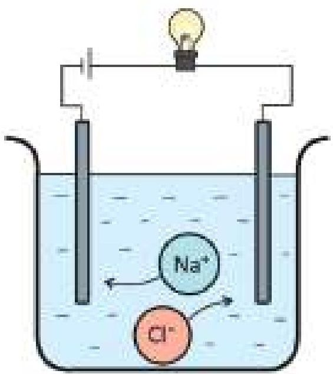

<!-- chemistry-9-10-bn-c05-t5.12-p012 · figure · p.102 -->
**চিত্র ৫.১২: খাদ্য লবণ (NaCl) এর জলীয় দ্রবণে বিদ্যুৎ পরিবহণ**

<!-- chemistry-9-10-bn-c05-t5.12-p013 · text · p.103 -->
এর কারণ তোমরা নিশ্চয়ই অনুমান করতে পারছো। বিদ্যুৎ পরিবহণের জন্য প্রয়োজন বিচ্ছিন্ন ধনাত্মক বা ঋণাত্মক আয়ন। খাদ্য লবণের (NaCl) জলীয় দ্রবণে ধনাত্মক আয়ন হিসেবে Na<sup>+</sup> ও ঋণাত্মক আয়ন হিসেবে Cl<sup>-</sup> বিদ্যুৎ পরিবহণ করে।

<!-- chemistry-9-10-bn-c05-t5.12-p014 · text · p.103 -->
যেহেতু জলীয় দ্রবণে আয়নিক যৌগসমূহ বিচ্ছিন্ন ধনাত্মক ও ঋণাত্মক আয়ন হিসেবে অবস্থান করে কাজেই সকল আয়নিক যৌগ জলীয় দ্রবণে বিদ্যুৎ পরিবহণ করে।

<!-- chemistry-9-10-bn-c05-t5.12-p015 · text · p.103 -->
অপরদিকে জলীয় দ্রবণে সমযোজী যৌগ বিদ্যুৎ পরিবহণ করে না। কারণ সমযোজী যৌগ কোনো বিচ্ছিন্ন আয়ন তৈরি করে না। আর দ্রবণে আয়ন না থাকলে তা কখনোই বিদ্যুৎ পরিবহণ করতে পারবে না।

<!-- chemistry-9-10-bn-c05-t5.12-p016 · text · p.103 -->
CaCl<sub>2</sub> দ্রবণে Ca<sup>2+</sup> ও Cl<sup>-</sup> থাকে। HCl দ্রবণে H<sup>+</sup> ও Cl<sup>-</sup> থাকে। কাজেই এরা দ্রবণে বিদ্যুৎ পরিবহণ করে। গ্লুকোজ (C<sub>6</sub>H<sub>12</sub>O<sub>6</sub>) দ্রবণে আয়ন আকারে বিভক্ত হয় না, কাজেই গ্লুকোজ দ্রবণে বিদ্যুৎ পরিবহণ করে না।

### দলীয় কাজ

<!-- chemistry-9-10-bn-c05-t5.12-p017 · figure · p.103 -->
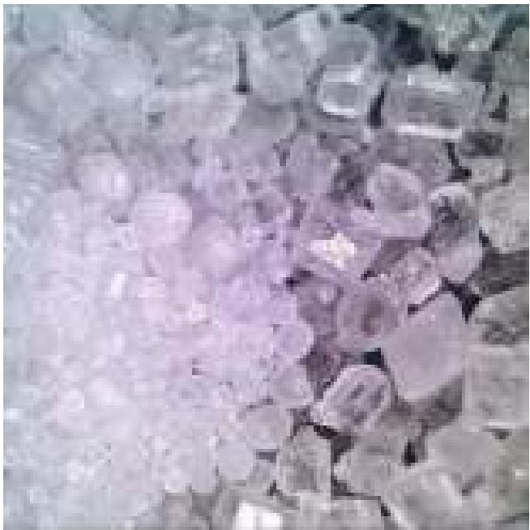

<!-- chemistry-9-10-bn-c05-t5.12-p018 · figure · p.103 -->
**চিত্র ৫.১৩: লবণ ও চিনির কেলাস**

### কেলাস গঠন (Formation of Crystals)

<!-- chemistry-9-10-bn-c05-t5.12-p019 · text · p.103 -->
প্রতিটি দল দুটি করে বিকার নাও। একটি বিকারে খাদ্য লবণ (NaCl) ও অপর বিকারে খানিকটা চিনি (C<sub>12</sub>H<sub>22</sub>O<sub>11</sub>) নাও। এই বিকার দুটির মধ্যে পানি যোগ করো। অল্প তাপ দিয়ে যতটুকু সম্ভব লবণ এবং চিনি পানিতে দ্রবীভূত করো। এবার প্রত্যেকটি দ্রবণের মাঝখানে একটা করে সুতা ঝুলিয়ে কয়েক দিনের জন্য রেখে দাও। তারপর সুতাগুলো তুলে দেখো তার উপর লবণ এবং চিনির ক্রিস্টাল বা কেলাস জমা হয়েছে। সাধারণত সকল আয়নিক যৌগ কেলাস আকারে থাকে। অপরদিকে, কিছু কিছু সমযোজী যৌগ যেমন চিনি কেলাস তৈরি করে তবে, বেশির ভাগ সমযোজী যৌগ কেলাস তৈরি করে না।

## 5.13 ধাতব বন্ধন (Metallic Bond)

<!-- chemistry-9-10-bn-c05-t5.13-p001 · text · p.104 -->
ইতঃপূর্বে তোমরা আয়নিক বন্ধন ও সমযোজী বন্ধন সম্পর্কে বিস্তারিত জেনেছ। তোমরা দেখেছ যে একটি ধাতু অপর একটি অধাতুর মধ্যে আয়নিক বন্ধন এবং দুটি অধাতব পরমাণুর মধ্যে সমযোজী বন্ধন গঠিত হয়। কিন্তু দুটি ধাতব পরমাণু কাছাকাছি এলে তাদের মধ্যে যে বন্ধন গঠিত হয় সেটাকে ধাতব বন্ধন বলে। অর্থাৎ এক খণ্ড ধাতুর মধ্যে পরমাণুসমূহ যে আকর্ষণের মাধ্যমে যুক্ত থাকে তাকেই ধাতব বন্ধন বলে। তোমরা তামার (কপার) তার, লোহার (আয়রন) তৈরি ছুরি, কাঁচি, দা কিংবা জানালার গ্রিল, অ্যালুমিনিয়ামের তৈরি জানালা, সোনার অলংকার ইত্যাদি দেখেছ। এসবের মধ্যে একই ধাতুর অসংখ্য পরমাণু পরস্পরের সাথে ধাতব বন্ধনের মাধ্যমে আবদ্ধ থাকে।

<!-- chemistry-9-10-bn-c05-t5.13-p002 · figure · p.104 -->
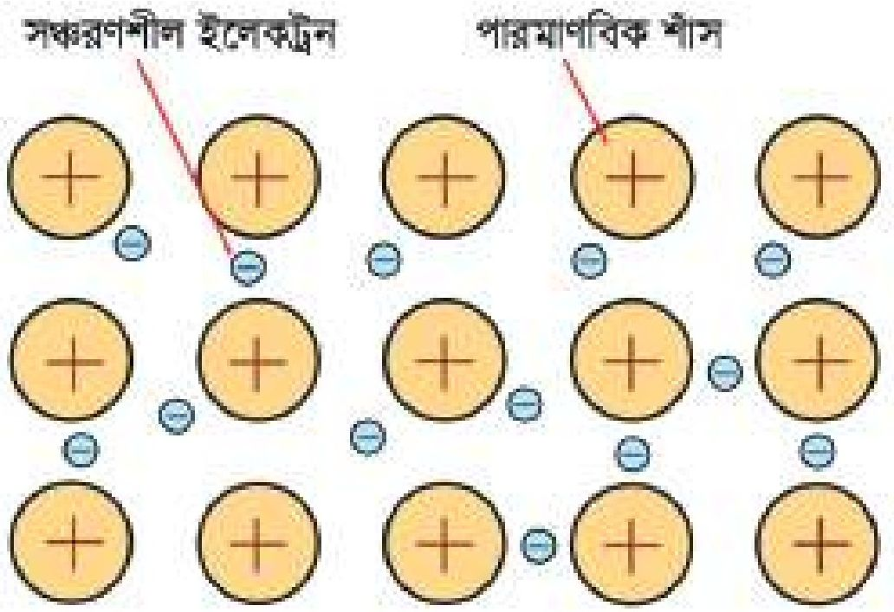

<!-- chemistry-9-10-bn-c05-t5.13-p003 · figure · p.104 -->
**চিত্র ৫.১৪: ধাতব বন্ধন**

<!-- chemistry-9-10-bn-c05-t5.13-p004 · text · p.104 -->
প্রশ্ন হলো ধাতব বন্ধন কীভাবে তৈরি হয়? প্রত্যেক ধাতব পরমাণুর ইলেকট্রন বিন্যাসে সর্বশেষ শক্তিস্তরে সাধারণত ১টি, ২টি কিংবা ৩টি ইলেকট্রন থাকে এবং এদের আকার একই পর্যায়ের অধাতব পরমাণুর চেয়ে বড় হওয়ায় ধাতব পরমাণুর সর্বশেষ শক্তিস্তরের ইলেকট্রনের প্রতি নিউক্লিয়াসের আকর্ষণ অনেক কম হয়। ফলে ধাতুতে পরমাণুসমূহ তার সর্বশেষ শক্তিস্তরের এক বা একাধিক ইলেকট্রনকে ত্যাগ করে ধনাত্মক আয়নে পরিণত হয়। এই ধনাত্মক আয়নকে পারমাণবিক শ্যাস (Atomic core) বলা হয়।

<!-- chemistry-9-10-bn-c05-t5.13-p005 · text · p.104 -->
ধাতব স্ফটিকে পারমাণবিক শ্যাসগুলো সুনির্দিষ্ট ত্রিমাত্রিকভাবে বিন্যস্ত থাকে। আর ধাতব পরমাণু কৃত্রিম ত্যাগকৃত ইলেকট্রনগুলো উক্ত পারমাণবিক শ্যাসের মধ্যবর্তী স্থানে মুক্তভাবে ঘোরাফেরা করে। এই ধরনের ইলেকট্রনকে সন্ধোরণশীল ইলেকট্রন (Delocalized Electron) বলে। এই ইলেকট্রনগুলো কোনো নির্দিষ্ট পরমাণুর অধীনে থাকে না পুরো ধাতব খণ্ডের সবগুলো ধাতব আয়নের ইলেকট্রন হয়ে যায়।

<!-- chemistry-9-10-bn-c05-t5.13-p006 · text · p.105 -->
বলা যেতে পারে ইলেকট্রনের সাগরে পারমাণবিক ধাতব আয়নগুলো স্ফটিকের আকারে সুবিন্যস্তভাবে সজ্জিত থাকে। ধাতব স্ফটিকে দুটো ধাতব আয়নের মধ্যবর্তী স্থানে যখন একটি সধ্বরণশীল ইলেকট্রন অবস্থান করে তখন ইলেকট্রনের প্রতি উভয় ধাতব আয়নই স্থির বৈদ্যুতিক আকর্ষণে আকর্ষিত হয়। এ কারণে ধাতব আয়ন দুটি পরস্পর থেকে বিচ্ছিন্ন হতে পারে না। এটিই মূলত ধাতব বন্ধনের মূল কারণ। ধাতুর মধ্যে সধ্বরণশীল এই ইলেকট্রনগুলোই তাপ এবং বিদ্যুৎ পরিবহনের জন্য দায়ী। অনুরূপে ধাতুর নমনীয়তা, ঘাতসহতা, ধাতব ঔজ্জ্বল্য ইত্যাদি ধর্ম সধ্বরণশীল এই ইলেকট্রনের কারণেই ঘটে থাকে।

### ধাতুর বিদ্যুৎ পরিবাহিতা

<!-- chemistry-9-10-bn-c05-t5.13-p007 · text · p.105 -->
সকল ধাতুই বিদ্যুৎ সুপরিবাহী। ধাতুর স্ফটিকে মুক্তভাবে বিচরণশীল ইলেকট্রনগুলো বিদ্যুৎ পরিবহনের কাজটি করে থাকে। একটি ধাতব খণ্ডের দুই প্রান্তের সাথে ব্যটারির ধনাত্মক (+) ও ঋণাত্মক (-) প্রান্ত সংযুক্ত করলে ইলেকট্রনগুলো ঋণাত্মক প্রান্ত থেকে ধনাত্মক প্রান্তের দিকে প্রবাহিত হবে। অর্থাৎ ধনাত্মক প্রান্ত থেকে ঋণাত্মক প্রান্তের সধ্বরণশীল ইলেকট্রনের প্রবাহই বিদ্যুৎ প্রবাহ সৃষ্টি করে। সধ্বরণশীল ইলেকট্রন না থাকলে ধাতুর মধ্যে বিদ্যুৎ প্রবাহিত হতো না।

<!-- chemistry-9-10-bn-c05-t5.13-p008 · figure · p.105 -->
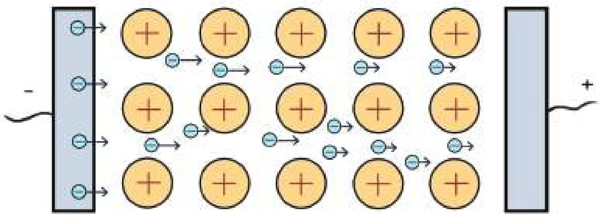

<!-- chemistry-9-10-bn-c05-t5.13-p009 · figure · p.105 -->
**চিত্র ৫.১৫: ধাতুর বিদ্যুৎ পরিবহনের কোশল**

### ধাতুর তাপ পরিবাহিতা

<!-- chemistry-9-10-bn-c05-t5.13-p010 · text · p.105 -->
এক খণ্ড ধাতব পাতের এক প্রান্তকে আগুনের উপর রেখে উত্তপ্ত করলে দেখতে পাবে অপর প্রান্তটি বেশ তাড়াতাড়ি গরম হতে শুরু করেছে। এর অর্থ ধাতুগুলো তাপ পরিবাহিতাও প্রদর্শন করে। এর কারণও সধ্বরণশীল ইলেকট্রন। তাপ প্রদানের সাথে সাথে সাথে সধ্বরণশীল ইলেকট্রনগুলো শক্তি গ্রহণ করে, তাদের গতিবেগ বেড়ে যায় এবং ইলেকট্রনগুলো অধিক তাপমাত্রার প্রান্ত থেকে কম তাপমাত্রার প্রান্তের দিকে স্থানান্তরিত হয়। এর ফলে ধাতুতে এক প্রান্ত থেকে অপর প্রান্তে তাপের পরিবহণ ঘটে।

### স্থানীয়ভাবে সহজপ্রাপ্য দ্রবের মধ্যে আয়নিক ও সমযোজী যৌগ শনাক্তকরণ

<!-- chemistry-9-10-bn-c05-t5.13-p011 · text · p.106 -->
খাদ্য লবণ, কপূর, ন্যাপথলিন, কাপড়কাচা সোডা এগুলোকে আলাদাভাবে ভিন্ন ভিন্ন বিকারে রক্ষিত পানির মধ্যে নিয়ে কাচ দন্ড দিয়ে ভালোভাবে মিশাও। যেগুলো পানিতে দ্রবীভূত হলো সেগুলো আয়নিক যৌগ আর যেগুলো পানিতে দ্রবীভূত হলো না সেগুলো সমযোজী যৌগ। এভাবে অন্য যৌগগুলোকেও পানিতে তাদের দ্রবণীয়তার উপর ভিত্তি করে আয়নিক ও সমযোজী এ দুইভাগে ভাগ করা যায়।

## 5.ex নমুনা প্রশ্ন

### বহুনির্বাচনি প্রশ্ন

<!-- chemistry-9-10-bn-c05-t5.ex-p001 · exercise · p.106 -->
১. কোন যৌগের অণুমূহের মধ্যে ভ্যান্ডারওয়ালস আকর্ষণ বলা বিদ্যমান?

<!-- chemistry-9-10-bn-c05-t5.ex-p002 · exercise · p.106 -->
(ক) NaCl                      (খ) CH<sub>4</sub>
(গ) MgO                      (ঘ) Na<sub>2</sub>CO<sub>3</sub>

<!-- chemistry-9-10-bn-c05-t5.ex-p003 · exercise · p.106 -->
২. নিচের কোন যৌগটি গঠনকালে প্রতিটি পরমাণুই নিয়নের ইলেকট্রন বিন্যাস অর্জন করে?

<!-- chemistry-9-10-bn-c05-t5.ex-p004 · exercise · p.106 -->
(ক) KF                      (খ) CaS
(গ) MgO                      (ঘ) NaCl

<!-- chemistry-9-10-bn-c05-t5.ex-p005 · exercise · p.107 -->
নিচের মৌলগুলোর ইলেকট্রনিক কাঠামোর আলোকে ৩ ও ৪ নং প্রশ্নের উত্তর দাও:

<!-- chemistry-9-10-bn-c05-t5.ex-p006 · figure · p.107 -->
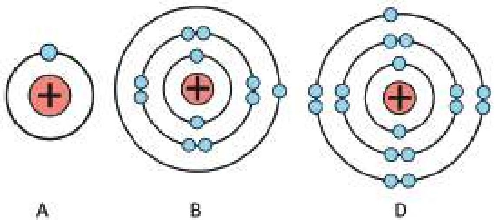

<!-- chemistry-9-10-bn-c05-t5.ex-p007 · exercise · p.107 -->
৩. D চিত্রিত মৌলের যোজ্যতা ইলেক্ট্রনের সংখ্যা কতটি?

<!-- chemistry-9-10-bn-c05-t5.ex-p008 · exercise · p.107 -->
(ক) 1                      (খ) 3
(গ) 5                      (ঘ) 7

<!-- chemistry-9-10-bn-c05-t5.ex-p009 · exercise · p.107 -->
৪. B মৌলটি—

<!-- chemistry-9-10-bn-c05-t5.ex-p010 · exercise · p.107 -->
(i) দুই ধরনের বন্ধন গঠন করে
(ii) A কে ইলেকট্রন দান করে
(iii) D -এর সাথে যুক্ত হয়ে পানিতে দ্রবীভূত হয়

<!-- chemistry-9-10-bn-c05-t5.ex-p011 · exercise · p.107 -->
নিচের কোনটি সঠিক?

<!-- chemistry-9-10-bn-c05-t5.ex-p012 · exercise · p.107 · review: latin-junk -->
(ক) i ও ii                      (খ) ii ও iii
(গ) i ও iii                      (ঘ) i, ii ও iii

<!-- chemistry-9-10-bn-c05-t5.ex-p013 · exercise · p.107 -->
৫. নিচের কোন যৌগটি পানিতে দ্রবণীয়?

<!-- chemistry-9-10-bn-c05-t5.ex-p014 · exercise · p.107 -->
(ক) মিথেন                      (খ) ন্যাপথালিন
(গ) ক্যালসিয়াম ক্লোরাইড      (ঘ) কার্বন ডাইক্লোরাইড

<!-- chemistry-9-10-bn-c05-t5.ex-p015 · exercise · p.107 -->
৬. কোন যৌগটি জলীয় দ্রবণে বিদুৎ পরিবহণ করে না?

<!-- chemistry-9-10-bn-c05-t5.ex-p016 · exercise · p.107 -->
(ক) NaCl      (খ) CaCl<sub>2</sub>
(গ) HCl      (ঘ) C<sub>6</sub>H<sub>12</sub>O<sub>6</sub> (গ্লুকোজ)

### সৃজনশীল প্রশ্ন

<!-- chemistry-9-10-bn-c05-t5.ex-p017 · exercise · p.108 · review: known-confusable-corrected -->
১.

<!-- chemistry-9-10-bn-c05-t5.ex-p018 · figure · p.108 · review: known-confusable-corrected -->
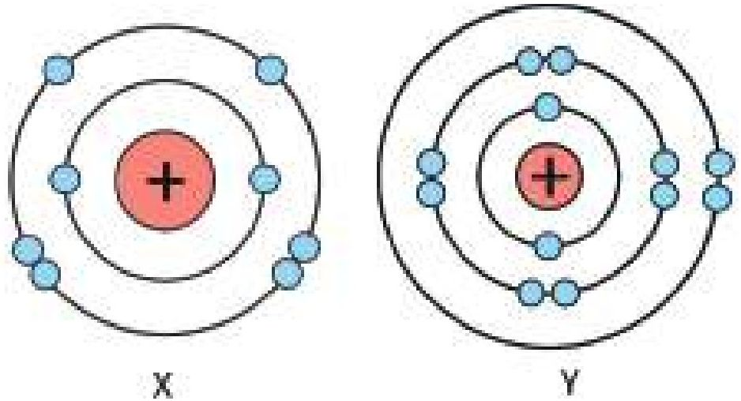

<!-- chemistry-9-10-bn-c05-t5.ex-p019 · exercise · p.108 · review: known-confusable-corrected -->
[এখানে X ও Y প্রতীকী অর্থ; কোনো মৌলের প্রতীক নয়]

<!-- chemistry-9-10-bn-c05-t5.ex-p020 · exercise · p.108 · review: known-confusable-corrected -->
(ক) সমযোজী বন্ধন কাকে বলে?

<!-- chemistry-9-10-bn-c05-t5.ex-p021 · exercise · p.108 · review: known-confusable-corrected -->
(খ) F এর যোজ্যতা ইলেক্ট্রন ও যোজনী সমান নয় কেন? ব্যাখ্যা করো।

<!-- chemistry-9-10-bn-c05-t5.ex-p022 · exercise · p.108 · review: latin-junk,known-confusable-corrected -->
(গ) উদ্দীপকের YX যৌগে কোন ধরনের বন্ধন বিদ্যমান? ব্যাখ্যা করো।

<!-- chemistry-9-10-bn-c05-t5.ex-p023 · exercise · p.108 · review: known-confusable-corrected -->
(ঘ) X আয়নিক ও সমযোজী উভয় ধরনের যৌগ গঠন করলেও Y কখনো সমযোজী বন্ধন গঠন করে না- যুক্তিসহ ব্যাখ্যা করো।

<!-- chemistry-9-10-bn-c05-t5.ex-p024 · exercise · p.108 · review: known-confusable-corrected -->
২. নিচের উদ্দীপকটি পড়ো এবং প্রশ্নগুলোর উত্তর দাও।

<!-- chemistry-9-10-bn-c05-t5.ex-p025 · table · p.108 · review: known-confusable-corrected,verify-table -->
<table><tr><th>মৌল</th><th>যোজ্যতাস্বরের ইলেক্ট্রন বিন্যাস</th><th>পর্যায়</th></tr>
<tr><td>X</td><td>ns<sup>2</sup>np<sup>2</sup></td><td>2</td></tr>
<tr><td>Y</td><td>ns<sup>2</sup>np<sup>5</sup></td><td>3</td></tr>
<tr><td>Z</td><td>ns<sup>2</sup></td><td>4</td></tr></table>

<!-- chemistry-9-10-bn-c05-t5.ex-p026 · exercise · p.108 · review: known-confusable-corrected -->
(ক) ধাতব বন্ধন কাকে বলে?

<!-- chemistry-9-10-bn-c05-t5.ex-p027 · exercise · p.108 · review: known-confusable-corrected -->
(খ) পানি পোলার যৌগ কেন? ব্যাখ্যা করো।

<!-- chemistry-9-10-bn-c05-t5.ex-p028 · exercise · p.108 · review: known-confusable-corrected,verify-formula -->
(গ) $ZY_2$ যৌগটি কোন অবস্থায় বিদ্যুৎ পরিবহন করে? ব্যাখ্যা করো।

<!-- chemistry-9-10-bn-c05-t5.ex-p029 · exercise · p.108 · review: known-confusable-corrected,verify-formula -->
(ঘ) $ZY_2$ যৌগটি পানিতে দ্রবীভূত হলেও $XY_4$ যৌগটি দ্রবণীয় নয় কেন? বিশ্লেষণ করো।

### সংক্ষিপ্ত-উত্তর প্রশ্ন

<!-- chemistry-9-10-bn-c05-t5.ex-p030 · exercise · p.108 -->
১. মিথেন পানিতে দ্রবীভূত হয় না কেন? ব্যাখ্যা করো।

<!-- chemistry-9-10-bn-c05-t5.ex-p031 · exercise · p.108 · review: verify-formula -->
২. $CCl_4$ অণু গঠনকালে দুই এর নিয়ম মেনে চলে- ব্যাখ্যা করো।

<!-- chemistry-9-10-bn-c05-t5.ex-p032 · exercise · p.108 -->
৩. গলিত NaCl বিদ্যুৎ পরিবাহী কেন? ব্যাখ্যা করো।
