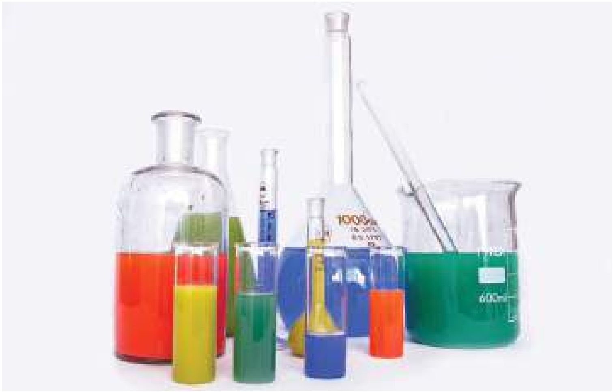
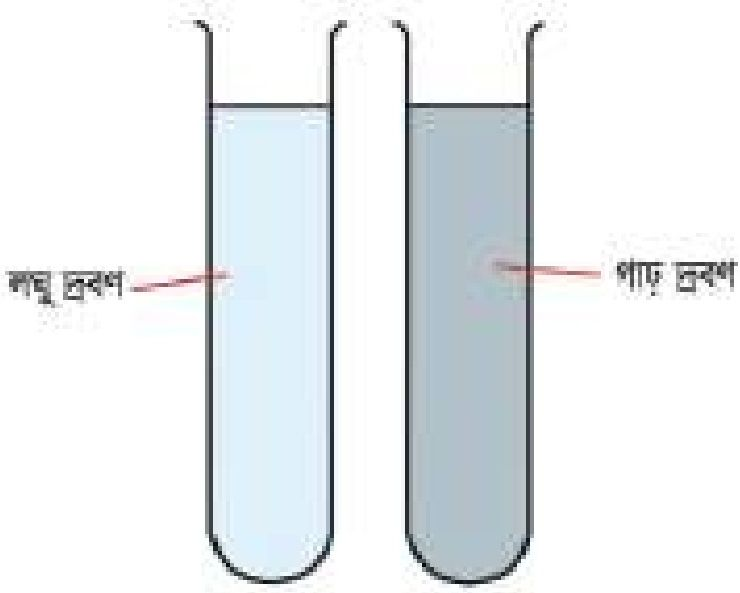
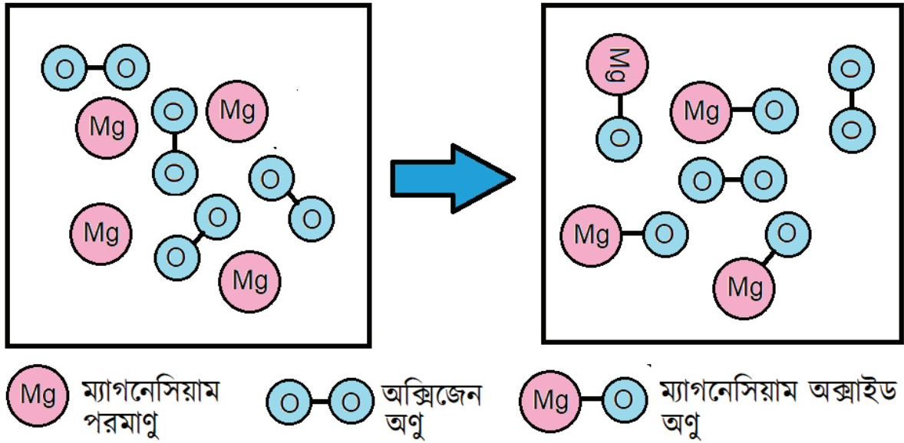
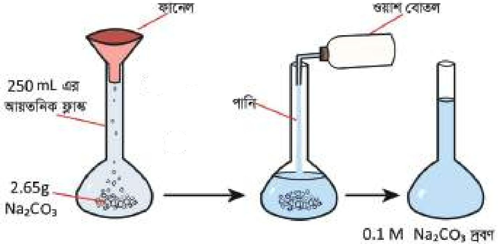
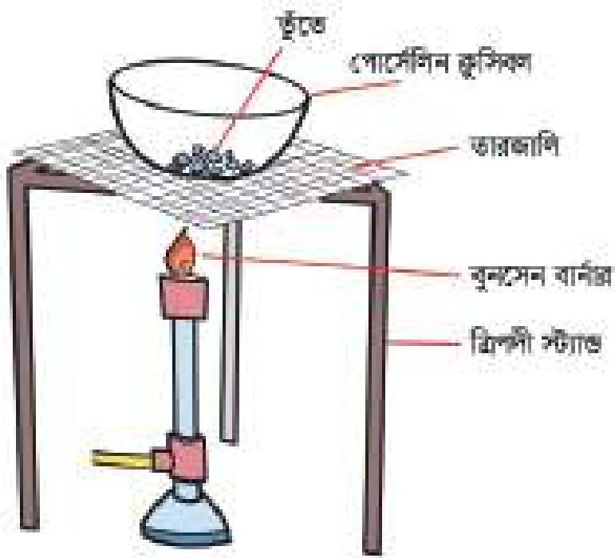

# 6. মোলের ধারণা ও রাসায়নিক গণনা

Source: Chemistry Bangla Version, printed pp. 109-141

## 6.0 ভূমিকা ও শিখনফল

<!-- chemistry-9-10-bn-c06-t6.0-p001 · figure · p.109 -->

<!-- chemistry-9-10-bn-c06-t6.0-p002 · text · p.109 -->
রসায়নে মূলত দুই ধরনের বিশ্লেষণ পদ্ধতি নিয়ে আলোচনা করা হয়, যা গুণগত বিশ্লেষণ এবং পরিমাণগত বিশ্লেষণ। কোনো পদার্থকে এবং তার বিভিন্ন ধর্মকে শনাক্ত করার পদ্ধতির নাম গুণগত বিশ্লেষণ এবং কোনো পদার্থের পরিমাণ নির্ণয়ের পদ্ধতির নাম পরিমাণগত বিশ্লেষণ। পরিমাণগত বিশ্লেষণ পদ্ধতিতে বিভিন্ন হিসাব-নিকাশ প্রয়োজন হয়। এসব হিসাব-নিকাশকে একত্রে রাসায়নিক গণনা বলা হয়। রাসায়নিক গণনায় কোনো পদার্থের পরিমাণ অনেক সময়েই মোল এককে প্রকাশ করা হয়। এই অধ্যায়ে তোমরা মোল কী, মোল দিয়ে হিসাব-নিকাশ কীভাবে করা হয়, মোলের হিসাব-নিকাশ থেকে কীভাবে ঘনমাত্রার হিসাব করা হয়। এই বিষয়গুলো জানতে পারবে।

### এ অধ্যায় পাঠ শেষে আমরা

<!-- chemistry-9-10-bn-c06-t6.0-p003 · text · p.110 -->
* মোলের ধারণা ব্যবহার করে সরল গাণিতিক হিসাব করতে পারব।
* নির্দিষ্ট ঘনমাত্রার দ্রবণ প্রস্তুত করতে পারব।
* প্রদত্ত তথ্য ও উপাত্ত ব্যবহার করে যোগে উপস্থিত মৌলের শতকরা সংযুতি নির্ণয় করতে পারব।
* শতকরা সংযুতি ব্যবহার করে স্থূল সংকেত ও আণবিক সংকেত নির্ণয় করতে পারব।
* মৌল ও যোগমূলকের প্রতীক, সংকেত ও যোজনী ব্যবহার করে রাসায়নিক সমীকরণ লিখতে এবং সমতা বিধান করতে পারব।
* রাসায়নিক সমীকরণের মাত্রিক তাৎপর্য থেকে বৈদ্যুতিক ও উৎপাদের ভরভিত্তিক গাণিতিক সমস্যা সমাধান করতে পারব।
* তুঁতের কেলাস পানির শতকরা পরিমাণ নির্ণয় করতে পারব।
* নিষ্কি ব্যবহার করে রাসায়নিক দ্রব্য পরিমাণ করতে সক্ষম হব।

## 6.1 মোল (Mole)

<!-- chemistry-9-10-bn-c06-t6.1-p001 · text · p.111 -->
মোল হলো রাসায়নিক পদার্থ পরিমাপের একক। মনে করো,

<!-- chemistry-9-10-bn-c06-t6.1-p002 · text · p.111 · review: verify-formula -->
$$12 টি  O_2 = 1  ডজন  O_2$$
$$100 টি  O_2 = 1  শতক  O_2$$
$$1000 টি  O_2 = 1  হাজার  O_2$$

<!-- chemistry-9-10-bn-c06-t6.1-p003 · text · p.111 · review: verify-formula -->
তেমনি $6.023 \times 10^{23}$ টি $O_2 = 1$ মোল $O_2$

<!-- chemistry-9-10-bn-c06-t6.1-p004 · text · p.111 · review: verify-formula -->
1 মোল পরমাণুতে $6.023 \times 10^{23}$ টি পরমাণু থাকে।
1 মোল অণুতে $6.023 \times 10^{23}$ টি অণু থাকে।
1 মোল আয়নে $6.023 \times 10^{23}$ টি আয়ন থাকে।

<!-- chemistry-9-10-bn-c06-t6.1-p005 · text · p.111 · review: verify-formula -->
অতএব, $6.023 \times 10^{23}$ সংখ্যাটি পরমাণু, অণু, আয়ন ইত্যাদি সকল ক্ষেত্রেই ব্যবহার করা হয়। এই সংখ্যাটিকে অ্যাভোগাদ্রোর সংখ্যা বলা হয়।

<!-- chemistry-9-10-bn-c06-t6.1-p006 · text · p.111 · review: verify-formula -->
কোনো পদার্থের যে পরিমাণের মধ্যে $6.023 \times 10^{23}$ টি পরমাণু, অণু বা আয়ন থাকে সেই পরিমাণকে ঐ পদার্থের মোল বলা হয়। যেমন: 12 গ্রাম C এর মধ্যে $6.023 \times 10^{23}$ টি C পরমাণু থাকে।

<!-- chemistry-9-10-bn-c06-t6.1-p007 · text · p.111 -->
রাসায়নিক পদার্থের (পরমাণুর ক্ষেত্রে) পারমাণবিক ভর অথবা (অণুর ক্ষেত্রে) আণবিক ভরকে গ্রাম এককে প্রকাশ করলে যে পরিমাণ পাওয়া যায় তাকে ঐ পদার্থের এক মোল বলা হয়।

<!-- chemistry-9-10-bn-c06-t6.1-p008 · text · p.111 · review: verify-formula -->
অতএব 12 গ্রাম C = 1 মোল C পরমাণু।
আবার, 18 গ্রাম H2O এর মধ্যে $6.023 \times 10^{23}$ টি H2O অণু থাকে।
অতএব 18 গ্রাম H2O = 1 মোল H2O

### অণুর আণবিক ভর বের করার পদ্ধতি

<!-- chemistry-9-10-bn-c06-t6.1-p009 · text · p.111 -->
কোনো অণুতে বিদ্যমান সকল পরমাণুর পারমাণবিক ভর যোগ করলে ঐ অণুর আণবিক ভর পাওয়া যায়।

<!-- chemistry-9-10-bn-c06-t6.1-p010 · text · p.111 · review: verify-formula -->
যেমন: Cl2 অণুতে Cl পরমাণু আছে 2টি।
অতএব, Cl2 এর আণবিক ভর = $2 \times$ Cl এর পারমাণবিক ভর = $2 \times 35.5 = 71$
এক মোল Cl2 = 71g Cl2

<!-- chemistry-9-10-bn-c06-t6.1-p011 · text · p.111 · review: verify-formula -->
NaCl অণুতে Na পরমাণু আছে 1টি এবং Cl পরমাণু আছে 1টি অতএব, NaCl এর আণবিক ভর = Na এর পারমাণবিক ভর + Cl এর পারমাণবিক ভর
$$= 23 + 35.5 = 58.5$$
এক মোল NaCl = 58.5g NaCl

<!-- chemistry-9-10-bn-c06-t6.1-p012 · text · p.112 -->
CuSO4.5H2O তে Cu আছে 1টি, S আছে 1টি, O আছে 9টি এবং H আছে 10টি

<!-- chemistry-9-10-bn-c06-t6.1-p013 · text · p.112 · review: verify-formula -->
অতএব, CuSO4.5H2O এর আণবিক ভর = 1 × Cu এর পারমাণবিক ভর + 1 × S এর পারমাণবিক ভর + 9× O এর পারমাণবিক ভর + 10 × H এর পারমাণবিক ভর
$$= 1 \times 63.5 + 1 \times 32 + 9 \times 16 + 10 \times 1$$
$$= 249.5$$
এক মোল CuSO4.5H2O = 249.5 g CuSO4.5H2O

### উদাহরণ

<!-- chemistry-9-10-bn-c06-t6.1-p014 · example · p.112 -->
**১. সমস্যা:** 1টি H2O অণুর ভর কত?

<!-- chemistry-9-10-bn-c06-t6.1-p015 · example · p.112 · review: verify-formula -->
**সমাধান:** আমরা জানি, 1 মোল H2O = 18g H2O = 6.023 × 1023 টি H2O অণু
এখানে 6.02 × 1023 টি H2O অণুর ভর = 18g
অতএব, 1টি H2O অণুর ভর = $\frac{18}{6.023 \times 10^{23}}$ g = 2.99 × 10-23 g

<!-- chemistry-9-10-bn-c06-t6.1-p016 · text · p.112 -->
**২. সমস্যা:** 1g H2SO4 এ কতগুলো H2SO4 অণু আছে?

<!-- chemistry-9-10-bn-c06-t6.1-p017 · text · p.112 · review: verify-formula -->
**সমাধান:** আমরা জানি, 1 মোল H2SO4 = 98g H2SO4 = 6.023 × 1023 টি H2SO4 অণু
এখানে, 98g H2SO4 = 6.023 × 1023 টি H2SO4 অণু
1g H2SO4 = $\frac{6.023 \times 10^{23}}{98}$ টি H2SO4 অণু = 6.14 × 1021 টি H2SO4 অণু

<!-- chemistry-9-10-bn-c06-t6.1-p018 · text · p.112 -->
**৩. সমস্যা:** 5 g H2O এ কত মোল H2O বিদ্যমান?

<!-- chemistry-9-10-bn-c06-t6.1-p019 · text · p.112 · review: verify-formula -->
**সমাধান:** আমরা জানি, 1 মোল H2O = 18 g H2O
এখানে, 18 g H2O = 1 মোল H2O
1 g H2O = $\frac{1}{18}$ মোল H2O
5 g H2O = $\frac{1 \times 5}{18}$ মোল H2O = 0.277 মোল H2O

<!-- chemistry-9-10-bn-c06-t6.1-p020 · text · p.112 -->
**নিজে করো:** 1 g H2SO4 এ কতগুলো H, S এবং O পরমাণু আছে?

### ৬.১.১ গ্যাসের মোলার আয়তন

<!-- chemistry-9-10-bn-c06-t6.1-p021 · text · p.113 -->
১ মোল গ্যাসীয় পদার্থ যে আয়তন দখল করে তাকে ঐ গ্যাসের মোলার আয়তন বলে। ০° সেন্টিগ্রেড তাপমাত্রা এবং ১ বায়ুমণ্ডল চাপকে একত্রে প্রমাণ তাপমাত্রা ও চাপ বা আদর্শ তাপমাত্রা ও চাপ বা সংক্ষিপে আদর্শ বা প্রমাণ অবস্থায় বলা হয়। প্রমাণ অবস্থায় ১ মোল গ্যাসের আয়তন হয় ২২.৪ লিটার।

<!-- chemistry-9-10-bn-c06-t6.1-p022 · text · p.113 -->
যদি n = মোল সংখ্যা,
w = গ্রাম এককে ভর,
V = লিটার এককে আয়তন,
N = অণুর সংখ্যা এবং
M = আণবিক ভর হয় তাহলে আমরা লিখতে পারি:

<!-- chemistry-9-10-bn-c06-t6.1-p023 · formula · p.113 · review: verify-formula -->
$$n = \frac{w}{M}$$

<!-- chemistry-9-10-bn-c06-t6.1-p024 · text · p.113 -->
কিংবা

<!-- chemistry-9-10-bn-c06-t6.1-p025 · formula · p.113 · review: verify-formula -->
$$n = \frac{V}{22.4}$$

<!-- chemistry-9-10-bn-c06-t6.1-p026 · text · p.113 -->
কিংবা

<!-- chemistry-9-10-bn-c06-t6.1-p027 · formula · p.113 · review: verify-formula -->
$$n = \frac{N}{6.023 \times 10^{23}}$$

### উদাহরণ

<!-- chemistry-9-10-bn-c06-t6.1-p028 · example · p.113 -->
**১. সমস্যা:** আদর্শ তাপমাত্রা ও চাপে ১ লিটার CO2 গ্যাসে কতটি অণু থাকে?

<!-- chemistry-9-10-bn-c06-t6.1-p029 · example · p.113 · review: verify-formula -->
**সমাধান:** আমরা জানি, ১ মোল CO2 = 44g CO2 = 6.023 × 1023 টি CO2 অণু = আদর্শ তাপমাত্রা ও চাপে ২২.৪ লিটার আয়তনের CO2 গ্যাস
আদর্শ তাপমাত্রা ও চাপে, ২২.৪ লিটার CO2 গ্যাসে থাকে = 6.023 × 1023 টি অণু
অতএব, ১ লিটার CO2 গ্যাসে থাকে = $\frac{6.023 \times 10^{23}}{22.4}$ টি অণু = 2.69 × 1022 টি অণু

<!-- chemistry-9-10-bn-c06-t6.1-p030 · text · p.113 -->
> **নিজে করো:** প্রমাণ অবস্থায় ৫ লিটার CH4 গ্যাসে কয়টি H পরমাণু আছে?

<!-- chemistry-9-10-bn-c06-t6.1-p031 · text · p.113 -->
**২. সমস্যা:** ৫ মোল CO2 গ্যাসের প্রমাণ অবস্থায় আয়তন কত?

<!-- chemistry-9-10-bn-c06-t6.1-p032 · text · p.113 · review: verify-formula -->
**সমাধান:** এখানে দেওয়া আছে, মোল n = 5 বের করতে হবে প্রমাণ অবস্থায় আয়তন $V = ?$

<!-- chemistry-9-10-bn-c06-t6.1-p033 · text · p.114 · review: verify-formula -->
আমরা জানি $n = \frac{V}{22.4}$

<!-- chemistry-9-10-bn-c06-t6.1-p034 · text · p.114 · review: verify-formula -->
বা, $5 = \frac{V}{22.4}$

<!-- chemistry-9-10-bn-c06-t6.1-p035 · text · p.114 · review: verify-formula -->
কাজেই $V = 5 \times 22.4$ লিটার $= 112$ লিটার

<!-- chemistry-9-10-bn-c06-t6.1-p036 · text · p.114 -->
> **নিজে করো: প্রমাণ অবস্থায় 5টি CO2 অণুর আয়তন কত?**

<!-- chemistry-9-10-bn-c06-t6.1-p037 · text · p.114 -->
**৩. সমস্যা:** প্রমাণ অবস্থায় 10 গ্রাম হাইড্রোজেন গ্যাসের আয়তন কত?

<!-- chemistry-9-10-bn-c06-t6.1-p038 · text · p.114 · review: verify-formula -->
**সমাধান:** এখানে দেওয়া আছে, ভর $w = 10$ গ্রাম, H2 এর আণবিক ভর $M = 2$

<!-- chemistry-9-10-bn-c06-t6.1-p039 · text · p.114 · review: verify-formula -->
আয়তন, $V = ?$

<!-- chemistry-9-10-bn-c06-t6.1-p040 · text · p.114 -->
আমরা জানি,

<!-- chemistry-9-10-bn-c06-t6.1-p041 · formula · p.114 · review: verify-formula -->
$$n = \frac{w}{M} = \frac{V}{22.4}$$

<!-- chemistry-9-10-bn-c06-t6.1-p042 · formula · p.114 · review: verify-formula -->
$$\frac{10}{2} = \frac{V}{22.4}$$

<!-- chemistry-9-10-bn-c06-t6.1-p043 · text · p.114 · review: verify-formula -->
বা, $V = 22.4 \times 5$ লিটার $= 112$ লিটার

### ৬.১.২ মোল এবং আণবিক সংকেত

<!-- chemistry-9-10-bn-c06-t6.1-p044 · text · p.114 -->
মোল এবং আণবিক সংকেতের মধ্যে একটি সম্পর্ক রয়েছে। কোনো পদার্থের আণবিক সংকেত থেকে প্রাপ্ত আণবিক ভরকে গ্রামে প্রকাশিত করলে যে পরিমাণ পাওয়া যায় সেই পরিমাণকে ঐ পদার্থের 1 মোল বলা হয়। যেমন- পানির আণবিক সংকেত H2O। পানির আণবিক ভর 18। অতএব, 18 গ্রামকে 1 গ্রাম আণবিক ভর পানি বা 1 মোল পানি বলা হয়। এখানে দেখা যাচ্ছে, মোলকে গ্রাম আণবিক ভরও বলা হয়।

<!-- chemistry-9-10-bn-c06-t6.1-p045 · text · p.114 -->
আণবিক সংকেত থেকে আরও অনেক তথ্য পাওয়া যায়।

<!-- chemistry-9-10-bn-c06-t6.1-p046 · text · p.114 -->
H2O আণবিক সংকেত থেকে যে যে তথ্য পাওয়া যায় তা নিচে উল্লেখ করা হলো।

<!-- chemistry-9-10-bn-c06-t6.1-p047 · text · p.114 -->
1. H2O এর নাম পানি
2. 1 অণু পানি এর সংকেত H2O
3. 1 মোল পানি এর সংকেত H2O
4. 1 অণু H2O এ 2টি হাইড্রোজেন পরমাণু এবং 1টি অক্সিজেন পরমাণু আছে।
5. 1 মোল H2O অণুতে 2 মোল H পরমাণু আছে ও 1 মোল O পরমাণু আছে।

<!-- chemistry-9-10-bn-c06-t6.1-p048 · text · p.115 · review: verify-formula -->
৬. ১ মোল H2O অর্থাতে H পরমাণুর ভর $1 \times 2 = 2g$ এবং O পরমাণুর ভর $16 \times 1 = 16g$। অতএব,
    ১ মোল H2O অণুর ভর $(2 + 16)g = 18g$

<!-- chemistry-9-10-bn-c06-t6.1-p049 · text · p.115 · review: verify-formula -->
৭. ১ মোল H2O অর্থাতে H পরমাণুর সংখ্যা $6.023 \times 10^{23} \times 2$ টি $= 1.20 \times 10^{24}$ টি, O পরমাণুর সংখ্যা $6.023 \times 10^{23} \times 1$ টি $= 6.023 \times 10^{23}$ টি, এবং H2O অণুর সংখ্যা $= 6.023 \times 10^{23}$ টি।

### ৬.১.৩ মোলার দ্রবণ

<!-- chemistry-9-10-bn-c06-t6.1-p050 · text · p.115 -->
ধরা যাক কোনো দ্রাবকে একটি দ্রব দ্রবীভূত আছে। একটি নির্দিষ্ট তাপমাত্রায় ১ লিটার দ্রবণের মধ্যে যদি এক মোল দ্রব দ্রবীভূত থাকে তবে ঐ দ্রবণকে মোলার দ্রবণ বলে বা এক মোলার দ্রবণ বলা হয়। ১ লিটার দ্রবণে যদি ২ মোল দ্রব দ্রবীভূত থাকে তবে ঐ দ্রবণকে ২ মোলার দ্রবণ বলা হয়।

<!-- chemistry-9-10-bn-c06-t6.1-p051 · text · p.115 -->
দ্রাবক, দ্রব ও দ্রবণ বলতে কী বোঝায় সেটি বোঝানোর জন্য একটি উদাহরণ দেওয়া যাক। একটি গ্লাসে প্রায় অর্ধেক পানি নাও। সেই পানিতে সামান্য পরিমাণ খাবার লবণ নিয়ে তা একটি চামচ দিয়ে মেশাও। দেখা গেল পানিতে লবণ মিশে গেছে বা পানিতে আর লবণ দেখা যাচ্ছে না। এই লবণ-পানির মিশ্রণ একটি দ্রবণ। এই মিশ্রণে পানিকে বলা হয় দ্রাবক এবং লবণকে বলা হয় দ্রব। দ্রবণ প্রস্তুত করার সময় পানি, এসিড, অ্যালকোহল ইত্যাদি নানা রকম তরল ব্যবহার করা যায়। এই অধ্যায়ে আমরা মূলত পানিকে দ্রাবক হিসেবে ব্যবহার করব। পানিকে দ্রাবক হিসাবে ব্যবহার করলে যে দ্রবণ তৈরি হয় তাকে জলীয় দ্রবণ বলে।

<!-- chemistry-9-10-bn-c06-t6.1-p052 · formula · p.115 · review: verify-formula -->
$$দ্রবণ = দ্রব + দ্রাবক$$

<!-- chemistry-9-10-bn-c06-t6.1-p053 · figure · p.115 -->

<!-- chemistry-9-10-bn-c06-t6.1-p054 · figure · p.115 -->
**চিত্র ৬.০১: লঘু দ্রবণ এবং গাঢ় দ্রবণ**

<!-- chemistry-9-10-bn-c06-t6.1-p055 · text · p.115 -->
তোমরা মাঝে মাঝেই লঘু দ্রবণ এবং গাঢ় দ্রবণ কথাগুলো শুনবে। তুমি যদি একটি গ্লাসে ২৫০ মিলিলিটার পানির মধ্যে ১০ গ্রাম খাবার লবণ মিশাও তাহলে একটি দ্রবণ তৈরি হবে। তুমি যদি আরেকটি গ্লাসে ২৫০ মিলিলিটার পানির মধ্যে ১৫ গ্রাম খাবার লবণ মিশাও তাহলেও একটি দ্রবণ তৈরি হবে। এই দুটি দ্রবণের মধ্যে একটি লঘু দ্রবণ এবং অন্যটি গাঢ় দ্রবণ। যে দ্রবণে খাবার লবণ কম সেই দ্রবণটি লঘু দ্রবণ আর যে দ্রবণে খাবার লবণ বেশি সেই দ্রবণটি গাঢ় দ্রবণ। আবার একটি গ্লাসে ২৫০ mL পানি এবং অপর একটি গ্লাসে ২০০ mL পানি নেওয়া হলো। এবারে দুটি গ্লাসেই ১০g লবণ মেশানো হয়েছে। এখন বলতে পারবে কোন পাত্রের দ্রবণটি লঘু এবং কোন পাত্রের দ্রবণ গাঢ়? যে পাত্রে পানির পরিমাণ বেশি সেটি লঘু দ্রবণ আর যে পাত্রে পানির পরিমাণ কম সেটি গাঢ় দ্রবণ। ল্যাবরেটরিতে একটি নির্দিষ্ট পরিমাণ দ্রাবকের মধ্যে কম পরিমাণ দ্রব মিশ্রিত করলে তাকে লঘু দ্রবণ বলে এবং একটি নির্দিষ্ট পরিমাণ দ্রাবকের মধ্যে বেশি পরিমাণ দ্রব মিশ্রিত করলে তাকে গাঢ় দ্রবণ বলে। আসলে দ্রাবকের মধ্যে কতটুকু পদার্থ যোগ করলে সেই দ্রবণ লঘু হবে আর কতটুকু পদার্থ যোগ করলে দ্রবণ গাঢ় হবে তার কোনো নিয়ম নেই। অর্থাৎ দ্রাবকের মধ্যে তুলনামূলক কম পরিমাণ দ্রব থাকলে তাহলে সেটা লঘু দ্রবণ এবং দ্রাবকের মধ্যে তুলনামূলকভাবে বেশি পরিমাণে দ্রব থাকলে সেটা গাঢ় দ্রবণ।

<!-- chemistry-9-10-bn-c06-t6.1-p056 · text · p.116 -->
একটি নির্দিষ্ট তাপমাত্রায় ১ লিটার দ্রবণের মধ্যে যত মোল দ্রব দ্রবীভূত থাকে তাকে ঐ দ্রবণের মোলারিটি বলা হয়। একটি নির্দিষ্ট তাপমাত্রায় ১ লিটার দ্রবণের মধ্যে যদি দুই মোল দ্রব দ্রবীভূত থাকে তবে ঐ দ্রবণের মোলারিটি দুই। যদি ১ লিটার দ্রবণের মধ্যে 0.5 মোল দ্রব দ্রবীভূত থাকে তাহলে ঐ দ্রবণকে সেমিমোলার দ্রবণ বলে এবং ঐ ১ লিটার দ্রবণের মধ্যে যদি 0.1 মোল দ্রব দ্রবীভূত থাকে তবে ঐ দ্রবণকে ডেসিমোলার দ্রবণ বলে এবং ডেসিমোলার দ্রবণের মোলারিটি = 0.1। সেমিমোলার দ্রবণের মোলারিটি হবে 0.5।

### বিভিন্ন মোলারিটির দ্রবণ প্রস্তুতকরণ

<!-- chemistry-9-10-bn-c06-t6.1-p057 · text · p.116 -->
ল্যাবরেটরিতে মোলার দ্রবণ, ডেসিমোলার দ্রবণ, সেমিমোলার দ্রবণ ইত্যাদি প্রস্তুত করার প্রয়োজন হয়। বিভিন্ন মোলারিটির দ্রবণ প্রস্তুত করা অত্যন্ত সহজ। এক্ষেত্রে তোমাকে কতগুলো কাজ ধাপে ধাপে করতে হবে। প্রথমত, তোমাকে একটি নির্দিষ্ট আয়তনের আয়তনিক ফ্লাস্ক বাছাই করতে হবে। দ্বিতীয়ত, যে পদার্থের দ্রবণ তৈরি করতে হবে সেই পদার্থের নির্দিষ্ট পরিমাণ ওজন করে নিয়ে আয়তনিক ফ্লাস্কে ঢেলে নিতে হবে। তৃতীয়ত, আয়তনিক ফ্লাস্কের মধ্যে খানিকটা পানি যোগ করে ঝাঁকিয়ে পদার্থটির দ্রবণ তৈরি করতে হবে। তারপর সাবধানে আয়তনিক ফ্লাস্কের নির্দিষ্ট দাগ পর্যন্ত পানি দ্বারা পূর্ণ করতে হবে। দ্রবণের মোলারিটি, দ্রবণের আয়তন, দ্রবের ভর এবং দ্রবের আণবিক ভরের মধ্যে একটি সম্পর্ক আছে।

<!-- chemistry-9-10-bn-c06-t6.1-p058 · formula · p.116 · review: latin-junk,verify-formula -->
$$গ্রাম এককে দ্রবের ভর = \frac{দ্রবণের মোলারিটি \times মিলিলিটার এককে দ্রবণের আয়তন \times দ্রবের আণবিক ভর}{1000}$$

<!-- chemistry-9-10-bn-c06-t6.1-p059 · text · p.116 · review: verify-formula -->
এখানে গ্রাম এককে দ্রবের ভর = $w$
দ্রবণের মোলারিটি = $S$
মিলিলিটার এককে দ্রবণের আয়তন = $V$
এবং দ্রবের আণবিক ভর = $M$ ধরে নিলে

<!-- chemistry-9-10-bn-c06-t6.1-p060 · formula · p.116 · review: verify-formula -->
$$w = \frac{SVM}{1000}$$

<!-- chemistry-9-10-bn-c06-t6.1-p061 · text · p.116 -->
মোলারিটি বা ঘনমাত্রা সংক্রান্ত সমস্যা সমাধানের জন্য এই সূত্রটি ব্যবহার করা যেতে পারে।

### উদাহরণ

<!-- chemistry-9-10-bn-c06-t6.1-p062 · example · p.117 -->
**১. সমস্যা:** 250 মিলিলিটার আয়তনিক ফ্লাস্কে 0.2 মোলার NaCl দ্রবণ কীভাবে প্রস্তুত করবে?

<!-- chemistry-9-10-bn-c06-t6.1-p063 · example · p.117 · review: verify-formula -->
**সমাধান:** দেওয়া আছে, দ্রবণের আয়তন, $V = 250mL$, দ্রবণের মোলারিটি, $S = 0.2$ মোলার, NaCl এর আণবিক ভর $23 + 35.5 = 58.5$

<!-- chemistry-9-10-bn-c06-t6.1-p064 · text · p.117 -->
কাজেই 1 মোল NaCl = 58.5 g

<!-- chemistry-9-10-bn-c06-t6.1-p065 · text · p.117 · review: verify-formula -->
1000 মিলি বা 1 লিটার দ্রবণে 0.2 মোলারিটির জন্য প্রয়োজন $58.5 \times 0.2 = 11.7 g$

<!-- chemistry-9-10-bn-c06-t6.1-p066 · text · p.117 · review: verify-formula -->
250 mL দ্রবণে প্রয়োজন $= \frac{11.7 \times 250}{1000} = 2.925 g$

<!-- chemistry-9-10-bn-c06-t6.1-p067 · text · p.117 -->
একটি 250 মিলিলিটার আয়তনিক ফ্লাস্ক নিয়ে তার মধ্যে 2.925 গ্রাম NaCl যোগ করো। এবার পানি যোগ করে আয়তনিক ফ্লাস্কে দ্রবণের আয়তন 250 মিলিলিটার করো। তাহলেই 0.2 মোলার দ্রবণ প্রস্তুত হয়ে যাবে।

<!-- chemistry-9-10-bn-c06-t6.1-p068 · text · p.117 -->
**বিকল্প সমাধান:**

<!-- chemistry-9-10-bn-c06-t6.1-p069 · text · p.117 · review: verify-formula -->
আমরা জানি, $w = \frac{SVM}{1000}$

<!-- chemistry-9-10-bn-c06-t6.1-p070 · text · p.117 · review: verify-formula -->
কাজেই $w = \frac{0.2 \times 250 \times 58.5}{1000} g = 2.925 g$

<!-- chemistry-9-10-bn-c06-t6.1-p071 · text · p.117 -->
এবারে আগের মতো আয়তনিক ফ্লাস্কে 2.925 গ্রাম NaCl নিয়ে পানি যোগ করে দ্রবণের আয়তন 250 মিলিলিটার করো। তাহলেই 0.2 মোলার দ্রবণ প্রস্তুত হয়ে যাবে।

<!-- chemistry-9-10-bn-c06-t6.1-p072 · text · p.117 -->
**২. সমস্যা:** 2 লিটার 0.1 মোলার Na2CO3 দ্রবণের মধ্যে কী পরিমাণ Na2CO3 আছে?

<!-- chemistry-9-10-bn-c06-t6.1-p073 · text · p.117 · review: verify-formula -->
**সমাধান:** Na2CO3 এর আণবিক ভর $= 23 \times 2 + 12 + 16 \times 3 = 106$

<!-- chemistry-9-10-bn-c06-t6.1-p074 · text · p.117 -->
কাজেই 1 লিটার 1 মোলার দ্রবণে Na2CO3 এর পরিমাণ 106 g

<!-- chemistry-9-10-bn-c06-t6.1-p075 · text · p.117 -->
1 লিটার 0.1 মোলার দ্রবণে Na2CO3 এর পরিমাণ 10.6 g

<!-- chemistry-9-10-bn-c06-t6.1-p076 · text · p.117 · review: verify-formula -->
2 লিটার 0.1 মোলার দ্রবণে Na2CO3 এর পরিমাণ $10.6 \times 2 = 21.2 g$

<!-- chemistry-9-10-bn-c06-t6.1-p077 · text · p.117 -->
**বিকল্প সমাধান:**

<!-- chemistry-9-10-bn-c06-t6.1-p078 · formula · p.117 · review: verify-formula -->
$$w = \frac{SVM}{1000}$$

<!-- chemistry-9-10-bn-c06-t6.1-p079 · formula · p.117 · review: verify-formula -->
$$w = \frac{0.1 \times 2000 \times 106 g}{1000}$$

<!-- chemistry-9-10-bn-c06-t6.1-p080 · text · p.118 -->
w = 21.2 g

<!-- chemistry-9-10-bn-c06-t6.1-p081 · text · p.118 -->
**৩. সমস্যা:** 250 mL দ্রবণে 20g Na2CO3 থাকলে Na2CO3 দ্রবণের মোলারিটি কত?

<!-- chemistry-9-10-bn-c06-t6.1-p082 · text · p.118 -->
**সমাধান:** Na2CO3 এর আণবিক ভর 23×2 + 12 + 16×3 = 106

<!-- chemistry-9-10-bn-c06-t6.1-p083 · text · p.118 -->
1 লিটারে 1 মোলারিটির জন্য প্রয়োজন 106 g

<!-- chemistry-9-10-bn-c06-t6.1-p084 · text · p.118 · review: verify-formula -->
250 mL দ্রবণে 1 মোলারিটির জন্য প্রয়োজন $\frac{106 \times 250}{1000}$ g = 26.5 g

<!-- chemistry-9-10-bn-c06-t6.1-p085 · text · p.118 -->
250 mL দ্রবণে 26.5 g Na2CO3 থাকলে মোলারিটি হয় 1 মোলার

<!-- chemistry-9-10-bn-c06-t6.1-p086 · text · p.118 · review: verify-formula -->
250 mL দ্রবণে 1 g Na2CO3 থাকলে মোলারিটি হয় $\frac{1}{26.5}$ মোলার

<!-- chemistry-9-10-bn-c06-t6.1-p087 · text · p.118 · review: verify-formula -->
250 mL দ্রবণে 20 g Na2CO3 থাকলে মোলারিটি হয় $\frac{1 \times 20}{26.5} = 0.75$ মোলার

<!-- chemistry-9-10-bn-c06-t6.1-p088 · text · p.118 -->
**বিকল্প সমাধান:**

<!-- chemistry-9-10-bn-c06-t6.1-p089 · formula · p.118 · review: verify-formula -->
$$w = \frac{SVM}{1000}$$

<!-- chemistry-9-10-bn-c06-t6.1-p090 · formula · p.118 · review: verify-formula -->
$$20 = \frac{S \times 250 \times 106}{1000}$$

<!-- chemistry-9-10-bn-c06-t6.1-p091 · formula · p.118 · review: verify-formula -->
$$S = 0.75  মোলার$$

<!-- chemistry-9-10-bn-c06-t6.1-p092 · text · p.118 -->
**৪. সমস্যা:** 0.75 মোলার Na2CO3 দ্রবণের মধ্যে 20 গ্রাম Na2CO3 দ্রবীভূত থাকলে ঐ দ্রবণের আয়তন কত মিলিলিটার?

<!-- chemistry-9-10-bn-c06-t6.1-p093 · text · p.118 -->
**সমাধান:** দেওয়া আছে, S = 0.75 Molar, w = 20 g, M = 23×2 + 12 + 16×3 = 106, V=?

<!-- chemistry-9-10-bn-c06-t6.1-p094 · text · p.118 -->
আমরা জানি,

<!-- chemistry-9-10-bn-c06-t6.1-p095 · formula · p.118 · review: verify-formula -->
$$W = \frac{SVM}{1000}$$

<!-- chemistry-9-10-bn-c06-t6.1-p096 · formula · p.118 · review: verify-formula -->
$$20 = \frac{0.75 \times V \times 106}{1000}$$

<!-- chemistry-9-10-bn-c06-t6.1-p097 · formula · p.118 · review: verify-formula -->
$$V = \frac{1000 \times 20}{0.75 \times 106}  mL = 250  mL$$

<!-- chemistry-9-10-bn-c06-t6.1-p098 · text · p.118 -->
**৫. সমস্যা:** একটি 250 mL দ্রবণের মধ্যে 20 g পদার্থ দ্রবীভূত থাকলে এবং ঐ দ্রবণের মোলারিটি 0.75 মোলার হবে। ঐ দ্রবণে দ্রবের আণবিক ভর কত?

<!-- chemistry-9-10-bn-c06-t6.1-p099 · text · p.118 -->
**সমাধান:** দেওয়া আছে, w = 20g, V = 250 mL, S = 0.7 Molar, M = ?

<!-- chemistry-9-10-bn-c06-t6.1-p100 · text · p.118 -->
আমরা জানি,

<!-- chemistry-9-10-bn-c06-t6.1-p101 · formula · p.119 · review: verify-formula -->
$$W = \frac{SVM}{1000}$$

<!-- chemistry-9-10-bn-c06-t6.1-p102 · formula · p.119 · review: verify-formula -->
$$20 = \frac{0.75 \times 250 \times M}{1000}$$

<!-- chemistry-9-10-bn-c06-t6.1-p103 · formula · p.119 · review: verify-formula -->
$$M = \frac{1000 \times 20}{0.75 \times 250} = 106$$

<!-- chemistry-9-10-bn-c06-t6.1-p104 · text · p.119 -->
**৬. সমস্যা:** তুমি কীভাবে 200 মিলিলিটার সেমিমোলার Na2CO3 দ্রবণ তৈরি করবে?

<!-- chemistry-9-10-bn-c06-t6.1-p105 · text · p.119 -->
**সমাধান:** V= 200 mL, S = 0.5 Molar, M = 23×2 + 12 + 16×3 = 106

<!-- chemistry-9-10-bn-c06-t6.1-p106 · text · p.119 · review: verify-formula -->
আমরা জানি, $w = \frac{SVM}{1000} = \frac{0.5 \times 200 \times 106}{1000}  g = 10.6  g$

<!-- chemistry-9-10-bn-c06-t6.1-p107 · text · p.119 -->
এবারে একটি 200 mL পাত্রে 10.6g Na2CO3 নিয়ে তাতে পানি যোগ করে দ্রবণের আয়তন 200 mL করলেই সেমি মোলার Na2CO3 দ্রবণ তৈরি হবে।

<!-- chemistry-9-10-bn-c06-t6.1-p108 · text · p.119 -->
**কাজ:** 100 মিলিলিটার দ্রবণে 4 গ্রাম NaOH থাকলে দ্রবণের মোলারিটি কত বের করো।
**কাজ:** 100 মিলিলিটার দ্রবণে 4 গ্রাম HCl থাকলে দ্রবণের মোলারিটি কত বের করো।

## 6.2 যৌগে মোলের শতকরা সংযুতি

### (The Percentage Composition of Elements in Compounds)

<!-- chemistry-9-10-bn-c06-t6.2-p001 · text · p.119 -->
কোনো যৌগের 100 গ্রামের মধ্যে কোনো মৌল যত গ্রাম থাকে তাকে ঐ মৌলের শতকরা সংযুতি বলে। যৌগের আণবিক সংকেত থেকে ঐ যৌগে বিদ্যমান মৌলসমূহের শতকরা সংযুতি বের করা যায়। অর্থাৎ,

<!-- chemistry-9-10-bn-c06-t6.2-p002 · text · p.119 · review: verify-formula -->
কোনো যৌগে একটি মৌলের শতকরা সংযুতি = $\frac{মৌলের পারমাণবিক ভর \times পরমাণুর সংখ্যা \times 100}{যৌগের আণবিক ভর} \%$

<!-- chemistry-9-10-bn-c06-t6.2-p003 · text · p.119 · review: verify-formula -->
**উদাহরণ:** HCl যৌগে H ও Cl এর শতকরা সংযুতি হিসাব দেখানো হলো
HCl এর আণবিক ভর = 1 + 35.5 = 36.5 এখানে 36.5 গ্রাম HCl এর মধ্যে H আছে = 1 গ্রাম
অতএব, 1 গ্রাম HCl এর মধ্যে H আছে = $\frac{1}{36.5}$ গ্রাম
অতএব, 100 গ্রাম HCl এর মধ্যে H আছে = $\frac{1 \times 100}{36.5}$ গ্রাম = 2.74 গ্রাম
অতএব, H এর শতকরা সংযুতি = 2.74%

<!-- chemistry-9-10-bn-c06-t6.2-p004 · text · p.120 · review: verify-formula -->
আবার, 36.5 গ্রাম HCl এর মধ্যে Cl আছে = 35.5 গ্রাম
অতএব, 1 গ্রাম HCl এর মধ্যে Cl আছে = $\frac{35.5}{36.5}$ গ্রাম
অতএব, 100 গ্রাম HCl এর মধ্যে Cl আছে = $\frac{35.5 \times 100}{36.5}$ গ্রাম = 97.26 গ্রাম
অতএব, Cl এর শতকরা সংযুতি = 97.26%

<!-- chemistry-9-10-bn-c06-t6.2-p005 · text · p.120 -->
কিংবা অন্যভাবে বের করতে পারি: Cl এর শতকরা সংযুতি = (100 - 2.74)% = 97.26%

### উদাহরণ

<!-- chemistry-9-10-bn-c06-t6.2-p006 · example · p.120 -->
**১. সমস্যা:** H2O-এর H ও O এর শতকরা সংযুতি হিসাব করো।

<!-- chemistry-9-10-bn-c06-t6.2-p007 · example · p.120 · review: verify-formula -->
**সমাধান:** 1 মোল H2O এর ভর = 2 + 16 = 18 গ্রাম
18 গ্রাম H2O এর মধ্যে H আছে = 2 গ্রাম
1 গ্রাম H2O এর মধ্যে H আছে = $\frac{2}{18}$ গ্রাম
100 গ্রাম H2O এর মধ্যে H আছে = $\frac{2 \times 100}{18}$ গ্রাম = 11.11 গ্রাম
কাজেই H এর শতকরা সংযুতি = 11.11%
O এর শতকরা সংযুতি = (100 - 11.11)% = 88.89%

<!-- chemistry-9-10-bn-c06-t6.2-p008 · text · p.120 -->
আমরা ইচ্ছা করলে শতকরা সংযুতির সূত্রটিতে মান বসিয়ে শতকরা সংযুতির মান বের করতে পারি।

<!-- chemistry-9-10-bn-c06-t6.2-p009 · formula · p.120 · review: latin-junk,verify-formula -->
$$মৌলের শতকরা সংযুতি = \frac{মৌলের পারমাণবিক ভর \times পরমাণুর সংখ্যা \times 100}{যৌগের আণবিক ভর} \%$$

<!-- chemistry-9-10-bn-c06-t6.2-p010 · text · p.120 -->
**যেমন:** H2SO4 যৌগে H, S এবং O এর শতকরা সংযুতি হচ্ছে:

<!-- chemistry-9-10-bn-c06-t6.2-p011 · text · p.120 -->
H2SO4 এর আণবিক ভর = (1×2 + 32×1 + 16×4) = 98

<!-- chemistry-9-10-bn-c06-t6.2-p012 · text · p.120 · review: verify-formula -->
এখানে, H এর পারমাণবিক ভর 1, পরমাণুর সংখ্যা 2
কাজেই H এর শতকরা সংযুতি = $\frac{1 \times 2 \times 100}{98} \% = 2.04\%$

<!-- chemistry-9-10-bn-c06-t6.2-p013 · text · p.120 · review: verify-formula -->
S এর পারমাণবিক ভর 32, পরমাণুর সংখ্যা 1,
কাজেই S এর শতকরা সংযুতি = $\frac{32 \times 1 \times 100}{98} \% = 32.65\%$ O এর পারমাণবিক ভর 16, পরমাণুর সংখ্যা 4

<!-- chemistry-9-10-bn-c06-t6.2-p014 · text · p.121 · review: verify-formula -->
কাজেই O এর শতকরা সংযুতি $= \frac{16 \times 4 \times 100}{98} \% = 65.30\%$

<!-- chemistry-9-10-bn-c06-t6.2-p015 · text · p.121 -->
**২. সমস্যা:** Al2(SO4)3 যোগে অ্যালুমিনিয়াম, সালফার এবং অক্সিজেনের শতকরা সংযুতি বের করো।

<!-- chemistry-9-10-bn-c06-t6.2-p016 · text · p.121 · review: verify-formula -->
**সমাধান:** এখানে Al2(SO4)3 এর আণবিক ভর $= 27 \times 2 + (32 \times 1 + 16 \times 4) \times 3 = 342$

<!-- chemistry-9-10-bn-c06-t6.2-p017 · text · p.121 · review: verify-formula -->
আলুমিনিয়ামের (Al) এর শতকরা সংযুতি $= \frac{27 \times 2 \times 100}{342} \% = 15.78\%$

<!-- chemistry-9-10-bn-c06-t6.2-p018 · text · p.121 · review: verify-formula -->
সালফার (S) এর শতকরা সংযুতি $= \frac{32 \times 3 \times 100}{342} \% = 28.07\%$

<!-- chemistry-9-10-bn-c06-t6.2-p019 · text · p.121 · review: verify-formula -->
অক্সিজেন (O) এর শতকরা সংযুতি $= \frac{16 \times 12 \times 100}{342} \% = 56.14\%$

<!-- chemistry-9-10-bn-c06-t6.2-p020 · text · p.121 -->
**কাজ:** NaCl যোগে Na এবং Cl এর শতকরা সংযুতি বের করো।

### ৬.২.১ শতকরা সংযুতি এবং স্থূল সংকেত

<!-- chemistry-9-10-bn-c06-t6.2-p021 · text · p.121 · review: latin-junk -->
আমরা আণবিক সংকেতের ধারণাটির সাথে ভালোভাবে পরিচিত হয়েছি, অনেকবার ব্যবহার করেছি এবং আমরা জানি আণবিক সংকেত দেখে আমরা একটি অণুতে কোন পরমাণু কতগুলো আছে বের করতে পারি। একটি অণুতে বিভিন্ন পরমাণুর সংখ্যার অনুপাত বোঝানোর জন্য ‘স্থূল সংকেত’ এর ধারণাটি প্রবর্তন করা হয়েছে। যেমন হাইড্রোজেন পার অক্সাইডের অণুতে (H2O2) দুটি হাইড্রোজেন এবং দুটি অক্সিজেন পরমাণু রয়েছে। তোমরা দেখতে পাচ্ছ H2O2 এ হাইড্রোজেন ও অক্সিজেনের পরমাণুর সংখ্যা যথাক্রমে 2 এবং 2, কাজেই তাদের অনুপাত 1:1 অর্থাৎ H2O2 এর স্থূল সংকেত HO। অর্থাৎ যে সংকেত দিয়ে অণুতে বিদ্যমান পরমাণুগুলোর অনুপাত প্রকাশ করে তাকে স্থূল সংকেত বলে।

<!-- chemistry-9-10-bn-c06-t6.2-p022 · text · p.121 -->
কাজেই তোমরা বুঝতে পারছো আমরা যদি কোনো যৌগের ভেতরকার মৌলগুলোর শতকরা সংযুতি এবং আপেক্ষিক পারমাণবিক ভর বা পারমাণবিক ভর জানি তাহলে খুব সহজেই যৌগটির স্থূল সংকেত বের করতে পারব।

### শতকরা সংযুতি থেকে স্থূল সংকেত নির্ণয়

<!-- chemistry-9-10-bn-c06-t6.2-p023 · text · p.121 -->
শতকরা সংযুতি থেকে স্থূল সংকেত বের করার কতকগুলো ধাপ রয়েছে যা নিমে দেওয়া হলো-

<!-- chemistry-9-10-bn-c06-t6.2-p024 · text · p.121 -->
* **ধাপ 1:** মৌলসমূহের শতকরা সংযুতিকে এর পারমাণবিক ভর দ্বারা ভাগ করতে হবে।

<!-- chemistry-9-10-bn-c06-t6.2-p025 · text · p.122 · review: known-confusable-corrected -->
* **ধাপ ২:** ভাগফলগুলোর মধ্য থেকে যে সংখ্যাটি ক্ষুদ্রতম সেই সংখ্যা দিয়ে ভাগফলগুলোকে ভাগ করতে হবে এবং ভাগফলগুলোকে নিকটতম পূর্ণসংখ্যায় পরিণত করার জন্য প্রয়োজনে যেকোনো সংখ্যা দিয়ে সবগুলোকে গুণ করতে হবে।

<!-- chemistry-9-10-bn-c06-t6.2-p026 · text · p.122 -->
* **ধাপ ৩:** মৌলসমূহের প্রতীকের নিচে ডান পাশে ঐ পূর্ণসংখ্যাগুলো বসিয়ে দিলেই সঠিক সংকেত তৈরি হয়ে যাবে।

<!-- chemistry-9-10-bn-c06-t6.2-p027 · text · p.122 -->
* **ধাপ ৪:** মৌলগুলোর প্রতীকের নিচে ডান পাশে ১ থাকলে সেটি লেখার প্রয়োজন নেই।

<!-- chemistry-9-10-bn-c06-t6.2-p028 · text · p.122 -->
ধরা যাক কোনো যৌগ কার্বনের সংযুতি ৯২.৩১% এবং হাইড্রোজেনের সংযুতি ৭.৬৯%, যৌগটির সঠিক সংকেত বের করতে হবে।

<!-- chemistry-9-10-bn-c06-t6.2-p029 · text · p.122 -->
প্রথমে মৌলগুলোর শতকরা সংযুতিকে তার পারমাণবিক ভর দিয়ে ভাগ করি

<!-- chemistry-9-10-bn-c06-t6.2-p030 · formula · p.122 · review: verify-formula -->
$$C = \frac{92.31}{12} = 7.69$$

<!-- chemistry-9-10-bn-c06-t6.2-p031 · formula · p.122 · review: verify-formula -->
$$H = \frac{7.69}{1} = 7.69$$

<!-- chemistry-9-10-bn-c06-t6.2-p032 · text · p.122 · review: known-confusable-corrected -->
ভাগফলগুলোর মধ্য থেকে যে সংখ্যাটি ক্ষুদ্রতম সেই সংখ্যা দিয়ে ভাগফলগুলোকে ভাগ করি

<!-- chemistry-9-10-bn-c06-t6.2-p033 · formula · p.122 · review: verify-formula -->
$$C = \frac{7.69}{7.69} = 1$$

<!-- chemistry-9-10-bn-c06-t6.2-p034 · formula · p.122 · review: verify-formula -->
$$H = \frac{7.69}{7.69} = 1$$

<!-- chemistry-9-10-bn-c06-t6.2-p035 · text · p.122 · review: verify-formula -->
এই মানগুলো এবং মৌলের প্রতীক দিয়ে সংকেত আকারে লিখলেই সঠিক সংকেত পাওয়া যাবে।
অতএব, যৌগটির সঠিক সংকেত: $C_1H_1 = CH$

### উদাহরণ

<!-- chemistry-9-10-bn-c06-t6.2-p036 · example · p.122 -->
**১. সমস্যা:** কোনো যৌগের মৌলগুলোর শতকরা সংযুতি H = 2.04%, S = 32.65%, O = 65.30% দেওয়া আছে। এর সঠিক সংকেত বের করো।

<!-- chemistry-9-10-bn-c06-t6.2-p037 · example · p.122 -->
**সমাধান:** প্রথমে শতকরা সংযুতিকে নিজ নিজ পারমাণবিক ভর দ্বারা ভাগ করি

<!-- chemistry-9-10-bn-c06-t6.2-p038 · formula · p.122 · review: verify-formula -->
$$H = \frac{2.04}{1} = 2.04$$

<!-- chemistry-9-10-bn-c06-t6.2-p039 · formula · p.122 · review: verify-formula -->
$$S = \frac{32.65}{32} = 1.02$$

<!-- chemistry-9-10-bn-c06-t6.2-p040 · formula · p.122 · review: verify-formula -->
$$O = \frac{65.30}{16} = 4.08$$

<!-- chemistry-9-10-bn-c06-t6.2-p041 · text · p.123 · review: known-confusable-corrected -->
ভাগফলগুলোর মধ্য থেকে যে সংখ্যাটি ক্ষুদ্রতম সেই সংখ্যা দিয়ে ভাগফলগুলোকে ভাগ করি

<!-- chemistry-9-10-bn-c06-t6.2-p042 · formula · p.123 · review: verify-formula -->
$$H = \frac{2.04}{1.02} = 2$$

<!-- chemistry-9-10-bn-c06-t6.2-p043 · formula · p.123 · review: verify-formula -->
$$S = \frac{1.02}{1.02} = 1$$

<!-- chemistry-9-10-bn-c06-t6.2-p044 · formula · p.123 · review: verify-formula -->
$$O = \frac{4.08}{1.02} = 4$$

<!-- chemistry-9-10-bn-c06-t6.2-p045 · text · p.123 -->
এই মানগুলো এবং মৌলের প্রতীক দিয়ে সংকেত আকারে লিখলেই স্কুল সংকেত পাওয়া যাবে।
সুতরাং স্কুল সংকেত: H2S1O4 = H2SO4

<!-- chemistry-9-10-bn-c06-t6.2-p046 · text · p.123 -->
**২. সমস্যা:** একটি যৌগে হাইড্রোজেন ও অক্সিজেন আছে। হাইড্রোজেন ও অক্সিজেনের শতকরা সংযুতি যথাক্রমে ১১.১১% ও ৮৮.৮৯%। এর স্কুল সংকেত কত?

<!-- chemistry-9-10-bn-c06-t6.2-p047 · text · p.123 -->
**সমাধান:** প্রথমে শতকরা সংযুতিকে নিজ নিজ পারমাণবিক ভর দিয়ে ভাগ করি

<!-- chemistry-9-10-bn-c06-t6.2-p048 · formula · p.123 · review: verify-formula -->
$$H = \frac{11.11}{1} = 11.11$$

<!-- chemistry-9-10-bn-c06-t6.2-p049 · formula · p.123 · review: verify-formula -->
$$O = \frac{88.89}{16} = 5.55$$

<!-- chemistry-9-10-bn-c06-t6.2-p050 · text · p.123 · review: known-confusable-corrected -->
ভাগফলগুলোর মধ্য থেকে যে সংখ্যাটি ক্ষুদ্রতম সেই সংখ্যা দ্বারা ভাগফলগুলোকে ভাগ করি

<!-- chemistry-9-10-bn-c06-t6.2-p051 · formula · p.123 · review: verify-formula -->
$$H = \frac{11.11}{5.55} = 2$$

<!-- chemistry-9-10-bn-c06-t6.2-p052 · formula · p.123 · review: verify-formula -->
$$O = \frac{5.55}{5.55} = 1$$

<!-- chemistry-9-10-bn-c06-t6.2-p053 · text · p.123 -->
এই মানগুলো এবং মৌলের প্রতীক দিয়ে সংকেত আকারে লিখলেই স্কুল সংকেত পাওয়া যাবে।
সুতরাং যৌগটির স্কুল সংকেত H2O1 = H2O

<!-- chemistry-9-10-bn-c06-t6.2-p054 · text · p.123 -->
**কাজ:** একটি পরীক্ষার মাধ্যমে দেখা গেল ৩ গ্রাম কার্বন পরমাণু এবং ৪ গ্রাম অক্সিজেন পরমাণুর সাথে যুক্ত হয়ে যৌগ গঠন করেছে। সেই যৌগের স্কুল সংকেত বের করো।

### ৬.২.২ শতকরা সংযুতি থেকে যৌগের আণবিক সংকেত নির্ণয়

<!-- chemistry-9-10-bn-c06-t6.2-p055 · text · p.124 -->
কোনো যৌগের আণবিক সংকেত বের করার জন্য যৌগের শতকরা সংযুতি থেকে প্রথমে স্থূল সংকেত বের করতে হবে। কোনো যৌগের স্থূল সংকেতের ভর যদি ঐ যৌগের আণবিক ভরের সমান হয় তাহলে যৌগের স্থূল সংকেতই যৌগের আণবিক সংকেত হবে। কিন্তু যদি কোনো যৌগের স্থূল সংকেতের ভর ঐ যৌগের আণবিক ভরের সমান না হয় তাহলে স্থূল সংকেতের ভর থেকে আণবিক ভর কত গুণ বেশি সেটি বের করতে হবে।

<!-- chemistry-9-10-bn-c06-t6.2-p056 · text · p.124 · review: verify-formula -->
যদি স্থূল সংকেতের ভর থেকে আণবিক ভর $n$ গুণ বেশি হয় তাহলে

<!-- chemistry-9-10-bn-c06-t6.2-p057 · formula · p.124 · review: verify-formula -->
$$আণবিক সংকেত = (স্থূল সংকেত)_n$$

<!-- chemistry-9-10-bn-c06-t6.2-p058 · text · p.124 · review: verify-formula -->
এখানে, $n = \frac{যৌগের আণবিক ভর}{স্থূল সংকেতের ভর}$

<!-- chemistry-9-10-bn-c06-t6.2-p059 · text · p.124 -->
ধরা যাক, কোনো যৌগের C = 92.31%, H = 7.69% দেওয়া আছে। ঐ যৌগের আণবিক ভর = 78 যৌগটির আণবিক সংকেত বের করতে হবে।

<!-- chemistry-9-10-bn-c06-t6.2-p060 · text · p.124 -->
মৌলগুলোর শতকরা সংযুতিকে তাদের পারমাণবিক ভর দিয়ে ভাগ করি

<!-- chemistry-9-10-bn-c06-t6.2-p061 · formula · p.124 · review: verify-formula -->
$$C = \frac{92.31}{12} = 7.69$$

<!-- chemistry-9-10-bn-c06-t6.2-p062 · formula · p.124 · review: verify-formula -->
$$H = \frac{7.69}{1} = 7.69$$

<!-- chemistry-9-10-bn-c06-t6.2-p063 · text · p.124 -->
ভাগফলগুলোর মধ্য থেকে যে সংখ্যাটি স্কুড্রতম সেই সংখ্যা দিয়ে ভাগফলগুলোকে ভাগ করি

<!-- chemistry-9-10-bn-c06-t6.2-p064 · formula · p.124 · review: verify-formula -->
$$C = \frac{7.69}{7.69} = 1$$

<!-- chemistry-9-10-bn-c06-t6.2-p065 · formula · p.124 · review: verify-formula -->
$$H = \frac{7.69}{7.69} = 1$$

<!-- chemistry-9-10-bn-c06-t6.2-p066 · text · p.124 -->
এই মানগুলো এবং মৌলের প্রতীক দিয়ে সংকেত আকারে লিখলেই স্থূল সংকেত পাওয়া যাবে।

<!-- chemistry-9-10-bn-c06-t6.2-p067 · text · p.124 · review: verify-formula -->
অতএব, যৌগটির স্থূল সংকেত = $C_1H_1 = CH$

<!-- chemistry-9-10-bn-c06-t6.2-p068 · text · p.124 · review: latin-junk,verify-formula -->
যৌগের স্থূল সংকেত CH হলে এর আণবিক সংকেত হবে: $(CH)_n = C_nH_n$

<!-- chemistry-9-10-bn-c06-t6.2-p069 · text · p.124 · review: latin-junk,verify-formula -->
স্থূল সংকেত CH এর ভর = $12 \times 1 + 1 \times 1 = 13$ এবং আণবিক ভর = 78

<!-- chemistry-9-10-bn-c06-t6.2-p070 · formula · p.124 · review: latin-junk,verify-formula -->
$$অতএব,  n = \frac{যৌগের আণবিক ভর}{স্থূল সংকেতের ভর} = \frac{78}{(12+1)} = 6$$

<!-- chemistry-9-10-bn-c06-t6.2-p071 · text · p.124 · review: verify-formula -->
কাজেই যৌগটির আণবিক সংকেত = $C_6H_6$

### আণবিক সংকেত থেকে স্থূল সংকেত নির্ণয়

<!-- chemistry-9-10-bn-c06-t6.2-p072 · text · p.125 -->
কোনো যৌগের আণবিক সংকেত থেকে স্থূল সংকেত নির্ণয় করা যায়। ধরা যাক গ্লুকোজ (C6H12O6) এর স্থূল সংকেত বের করতে হবে।

<!-- chemistry-9-10-bn-c06-t6.2-p073 · text · p.125 -->
গ্লুকোজ (C6H12O6) এর একটি অণুতে 6টি C পরমাণু, 12টি H পরমাণু এবং 6টি O পরমাণু আছে।

<!-- chemistry-9-10-bn-c06-t6.2-p074 · text · p.125 -->
অতএব, পরমাণুসমূহের অনুপাত C:H:O = 6:12:6 = 1:2:1

<!-- chemistry-9-10-bn-c06-t6.2-p075 · text · p.125 -->
সুতরাং স্থূল সংকেত C1H2O1 = CH2O

<!-- chemistry-9-10-bn-c06-t6.2-p076 · text · p.125 -->
কখনো কখনো স্থূল সংকেত এবং আণবিক সংকেত একই হয়।

<!-- chemistry-9-10-bn-c06-t6.2-p077 · text · p.125 -->
যেমন পানির আণবিক সংকেত H2O এর স্থূল সংকেত H2O। সালফিউরিক এসিড এর আণবিক সংকেত H2SO4 এবং এর স্থূল সংকেত H2SO4।

<!-- chemistry-9-10-bn-c06-t6.2-p078 · text · p.125 · review: latin-junk -->
কিন্তু যে সকল যৌগের সকল পরমাণুর সংখ্যাকে কোনো নির্দিষ্ট সংখ্যা দিয়ে ভাগ করা যায় তাদের স্থূল সংকেত এবং আণবিক সংকেত ভিন্ন হবে। বেনজিনের আণবিক সংকেত C6H6। বেনজিনের কার্বন এবং হাইড্রোজেনের পরমাণু সংখ্যাকে 6 দ্বারা ভাগ করা যায় অতএব, এর স্থূল সংকেত C1H1 বা CH।

<!-- chemistry-9-10-bn-c06-t6.2-p079 · text · p.125 -->
একইভাবে ইথিনের আণবিক সংকেত C2H4। অতএব, এর স্থূল সংকেত C1H2 বা CH2।

## 6.3 রাসায়নিক বিক্রিয়া ও রাসায়নিক সমীকরণ

### রাসায়নিক বিক্রিয়া

<!-- chemistry-9-10-bn-c06-t6.3-p001 · text · p.125 -->
যদি কোনো পরিবর্তনের ফলে কোনো পদার্থ তার নিজের ধর্ম ও বৈশিষ্ট্য হারিয়ে নতুন ধর্ম লাভ করে সেই পরিবর্তনকে রাসায়নিক পরিবর্তন বলে। যে প্রক্রিয়ায় রাসায়নিক পরিবর্তন ঘটে সেই প্রক্রিয়াকে রাসায়নিক বিক্রিয়া বলে। রাসায়নিক বিক্রিয়াকে সংক্ষেপে উপস্থাপন করার জন্য যে সমীকরণ ব্যবহার করা হয় সেই সমীকরণকে রাসায়নিক সমীকরণ বলা হয়।

<!-- chemistry-9-10-bn-c06-t6.3-p002 · text · p.125 -->
রাসায়নিক সমীকরণকে প্রকাশ করার জন্য প্রতীক, সংকেত এবং নানা রকম চিহ্ন ব্যবহার করা হয়।

<!-- chemistry-9-10-bn-c06-t6.3-p003 · text · p.125 -->
যে সকল পদার্থ নিয়ে রাসায়নিক বিক্রিয়া শুরু করা হয় সেই সকল পদার্থকে বলা হয় বিক্রিয়ক। বিক্রিয়ার ফলে নতুন ধর্মবিশিষ্ট যে সকল পদার্থ উৎপন্ন হয় সেই সকল পদার্থকে উৎপাদ বলা হয়।

<!-- chemistry-9-10-bn-c06-t6.3-p004 · text · p.125 -->
রাসায়নিক বিক্রিয়াকে রাসায়নিক সমীকরণ আকারে লেখার জন্য কতগুলো নিয়ম মানা হয় সেগুলো হচ্ছে:

<!-- chemistry-9-10-bn-c06-t6.3-p005 · text · p.126 -->
১. গণিতে যেমন সমীকরণের মাঝে একটি সমান চিহ্ন (=) ব্যবহার করা হয় তেমনি কোনো বিক্রিয়ার বিক্রিয়ক বাম পাশে এবং উৎপাদ ডান পাশে লিখে তাদের মাঝে একটি সমান চিহ্ন (=) বা তির চিহ্ন (→) বসাতে হয়।

<!-- chemistry-9-10-bn-c06-t6.3-p006 · text · p.126 -->
২. বিক্রিয়কসমূহ এবং উৎপাদসমূহকে রাসায়নিক প্রতীক বা সংকেতের মাধ্যমে লেখা হয়। বিক্রিয়ায় একাধিক বিক্রিয়ক থাকলে বিক্রিয়কসমূহের মাঝে যোগ চিহ্ন দিতে হয়। এবং একাধিক উৎপাদ থাকলে উৎপাদসমূহের মাঝে যোগ চিহ্ন দিতে হয়।

<!-- chemistry-9-10-bn-c06-t6.3-p007 · text · p.126 -->
৩. যে প্রক্রিয়ায় সমীকরণের বাম পাশের বিভিন্ন মৌলের পরমাণুর সংখ্যা এবং ডান পাশের ঐ একই মৌলের পরমাণুর সংখ্যা সমান করা হয়। সেই প্রক্রিয়াকে রাসায়নিক সমীকরণের সমতা বলা হয়।

<!-- chemistry-9-10-bn-c06-t6.3-p008 · text · p.126 · review: verify-formula -->
$$2H_2 + O_2 \rightarrow 2H_2O$$
$$2H_2 + O_2 = 2H_2O$$

<!-- chemistry-9-10-bn-c06-t6.3-p009 · text · p.126 -->
৪. কখনো কখনো বিক্রিয়ার সমতা না করেও বিক্রিয়া দেখানো হয়, তখন সমান চিহ্ন (=) না দিয়ে তির চিহ্ন (→) ব্যবহার করতে হয়।

<!-- chemistry-9-10-bn-c06-t6.3-p010 · formula · p.126 · review: verify-formula -->
$$H_2 + O_2 \longrightarrow H_2O$$

<!-- chemistry-9-10-bn-c06-t6.3-p011 · text · p.126 -->
৫. অনেক সময় বিক্রিয়ক এবং উৎপাদের ভৌত অবস্থা উল্লেখ করেও রাসায়নিক সমীকরণ লেখা হয়। বিক্রিয়ক এবং উৎপাদের ভৌত অবস্থা পদার্থের ডান পাশে প্রথম বন্ধনীীর মধ্যে প্রকাশ করা হয়। এক্ষেত্রে কোনো পদার্থ কঠিন হলে তার ইংরেজি নাম (Solid) এর প্রথম বর্ণ (s) লিখতে হয়, কোনো পদার্থ তরল (liquid) হলে তার ইংরেজি নামের প্রথম বর্ণ (l) লিখতে হয়, কোনো পদার্থ গ্যাসীয় তার ইংরেজি নাম (gas) এর প্রথম বর্ণ (g) লিখতে হয়। কোনো পদার্থ পানিতে দ্রবীভূত হলে সেই দ্রবণকে বলা হয় জলীয় দ্রবণ। জলীয় দ্রবণের ইংরেজি নাম (aqueous solution) এর প্রথম ২টি বর্ণ (aq) লিখতে হয়। উপরের বিক্রিয়ায় হাইড্রোজেন ও অক্সিজেন গ্যাস এবং উৎপন্ন পদার্থ পানি তরল তাই তাকে লিখতে হবে।

<!-- chemistry-9-10-bn-c06-t6.3-p012 · formula · p.126 · review: verify-formula -->
$$2H_2(g) + O_2(g) \longrightarrow 2H_2O(l)$$

<!-- chemistry-9-10-bn-c06-t6.3-p013 · text · p.126 -->
রাসায়নিক সমীকরণ এর উদ্দেশ্য হচ্ছে কোন কোন পদার্থ বিক্রিয়া করে কোন কোন পদার্থ হয়েছে সেটি দেখানো। অনেক সময় সমতা না করেও সেটি দেখানো যেতে পারে।

<!-- chemistry-9-10-bn-c06-t6.3-p014 · text · p.126 -->
৬. তবে যদি কোনো বিক্রিয়ায় কতটুকু তাপ উৎপন্ন হয় বা কতটুকু তাপ শোষিত হয় তা সমীকরণে দেখাতে হয় তবে সেক্ষেত্রে রাসায়নিক বিক্রিয়ার সমতা করতে হবে এবং বিক্রিয়ক ও উৎপাদের ভৌত অবস্থা (যেমন- কঠিন, তরল, গ্যাসীয় অবস্থা, জলীয় অবস্থা ইত্যাদি) লিখতে হবে।

<!-- chemistry-9-10-bn-c06-t6.3-p015 · text · p.127 -->
কঠিন কার্বন অক্সিজেনের সাথে বিক্রিয়া করে কার্বন ডাইঅক্সাইড গ্যাস উৎপন্ন করে। এক্ষেত্রে রাসায়নিক সমীকরণকে নিম্নরূপে লেখা যায়।

<!-- chemistry-9-10-bn-c06-t6.3-p016 · text · p.127 · review: verify-formula -->
$$C(s) + O_2(g) \longrightarrow CO_2(g)$$
কার্বন অক্সিজেন কার্বন ডাইঅক্সাইড

<!-- chemistry-9-10-bn-c06-t6.3-p017 · text · p.127 -->
কঠিন ক্যালসিয়াম কার্বনেট হাইড্রোক্লোরিক এসিডের জলীয় দ্রবণের সাথে বিক্রিয়া করে ক্যালসিয়াম ক্লোরাইড, গ্যাসীয় কার্বন ডাইঅক্সাইড এবং তরল পানি উৎপন্ন হয়।

<!-- chemistry-9-10-bn-c06-t6.3-p018 · text · p.127 · review: verify-formula -->
$$CaCO_3(s) + HCl(aq) \longrightarrow CaCl_2(aq) + CO_2(g) + H_2O(l)$$
ক্যালসিয়াম কার্বনেট হাইড্রোক্লোরিক এসিড ক্যালসিয়াম ক্লোরাইড কার্বন ডাইঅক্সাইড পানি

<!-- chemistry-9-10-bn-c06-t6.3-p019 · text · p.127 · review: verify-formula -->
কোনো কোনো রাসায়নিক বিক্রিয়ায় তাপ প্রয়োগে সংঘটিত হয় সেক্ষেত্রে তীরের উপর একটি ডেল্টা চিহ্ন ($\Delta$) দিতে হবে। যেমন কঠিন ম্যাগনেসিয়াম নাইট্রেটকে তাপ প্রয়োগ করলে ম্যাগনেসিয়াম অক্সাইড, নাইট্রোজেন ডাইঅক্সাইড গ্যাস এবং অক্সিজেন গ্যাস তৈরি হয়।

<!-- chemistry-9-10-bn-c06-t6.3-p020 · formula · p.127 · review: verify-formula -->
$$2Mg(NO_3)_2(s) \xrightarrow{\Delta} 2MgO(s) + 4NO_2(g) + O_2(g)$$

### ৬.৩.১ রাসায়নিক সমীকরণের সমতাকরণ

<!-- chemistry-9-10-bn-c06-t6.3-p021 · text · p.127 -->
রাসায়নিক বিক্রিয়াকে সংক্ষিপ্তরূপে রাসায়নিক সমীকরণের সাহায্যে প্রকাশ করা হয়। যেহেতু রাসায়নিক বিক্রিয়াতে বিক্রিয়ক এবং উৎপাদ ভরের সংরক্ষণসূত্র মেনে চলে তাই বিক্রিয়ার সমীকরণে বিক্রিয়ক পদার্থের বিভিন্ন মৌলের পরমাণুর সংখ্যা উৎপাদ পদার্থের বিভিন্ন মৌলের পরমাণুর সংখ্যার সমান থাকে। রাসায়নিক সমীকরণের তির চিহ্ন বা সমান চিহ্নের বাম পাশে কোনো মৌলের যে কয়টি পরমাণু থাকে তির চিহ্ন বা সমান চিহ্নের ডান পাশে মৌলের সেই কয়টি পরমাণু থাকলে আমরা ঐ রাসায়নিক সমীকরণ সমতাকরণ হয়েছে বলে বুঝে থাকি।

<!-- chemistry-9-10-bn-c06-t6.3-p022 · text · p.127 -->
নিচের উদাহরণটি লক্ষ্য করো:

<!-- chemistry-9-10-bn-c06-t6.3-p023 · formula · p.127 · review: verify-formula -->
$$Mg + HCl \longrightarrow MgCl_2 + H_2$$

<!-- chemistry-9-10-bn-c06-t6.3-p024 · text · p.127 -->
ম্যাগনেসিয়াম ও হাইড্রোক্লোরিক এসিডকে বিক্রিয়ক হিসেবে ব্যবহার করলে আমরা ম্যাগনেসিয়াম ক্লোরাইড ও হাইড্রোজেন পাই এটি সত্যি, কাজেই বিক্রিয়াটি সঠিক। কিন্তু দুইপাশে হাইড্রোজেন ও ক্লোরিন পরমাণুর সংখ্যা সমান নয়, তাই এই সমীকরণটির সমতাকরণ হয়নি।

### বিক্রিয়া সমতাকরণের পদ্ধতি

<!-- chemistry-9-10-bn-c06-t6.3-p025 · text · p.128 -->
বিভিন্ন মৌলের পরমাণুর সংখ্যা সমান করার জন্য বিক্রিয়ক এবং উৎপাদের সংকেতের সামনে প্রয়োজনীয় সংখ্যা (1, 2, 3, 4 ...) দিয়ে গুণ করতে হয় এবং পরমাণুর সংখ্যা সমান করার জন্য চেষ্টা করে যেতে হয়। সমীকরণের সমতা করার জন্য কোনো সুনির্দিষ্ট নিয়ম নেই কিন্তু কিছু কৌশল অবলম্বন করা হয়। সেগুলো এরকম:

<!-- chemistry-9-10-bn-c06-t6.3-p026 · text · p.128 -->
1. প্রথমে বিক্রিয়ক এবং উৎপাদের সঠিক সংকেত লিখে বিক্রিয়ার সমীকরণ লেখা হয়।

<!-- chemistry-9-10-bn-c06-t6.3-p027 · text · p.128 -->
2. সমীকরণে সমতা না থাকলে বিভিন্ন বিক্রিয়ক এবং উৎপাদকে বিভিন্ন সংখ্যা দিয়ে গুণ করে তির চিহ্ন বা সমান চিহ্নের দুই পাশে মৌলের পরমাণুর সংখ্যা সমান করার চেষ্টা করা হয়।

<!-- chemistry-9-10-bn-c06-t6.3-p028 · text · p.128 -->
3. প্রথমে যৌগিক অণুতে বিদ্যমান মৌলের পরমাণু সংখ্যার সমান করা হয় পরে মৌলিক অণুতে বিদ্যমান মৌলের পরমাণু সংখ্যার সমান করা হয়।

<!-- chemistry-9-10-bn-c06-t6.3-p029 · text · p.128 -->
4. সমীকরণের উভয় পাশে প্রত্যেকটি মৌলের পরমাণু সংখ্যা সমান বা সমতা হলেই ঐ সমীকরণের সমতা হয়েছে বলে বিবেচিত হবে।

<!-- chemistry-9-10-bn-c06-t6.3-p030 · text · p.128 -->
আমরা কয়েকটি উদাহরণ দিয়ে সমতাকরণের প্রক্রিয়াটি বুঝানোর চেষ্টা করি।

### উদাহরণ ১:

<!-- chemistry-9-10-bn-c06-t6.3-p031 · formula · p.128 · review: verify-formula -->
$$Mg + HCl \longrightarrow MgCl_2 + H_2$$

<!-- chemistry-9-10-bn-c06-t6.3-p032 · text · p.128 -->
উপরের বিক্রিয়ায় যৌগিক অণু HCl এর মধ্যে Cl পরমাণু আছে 1টি কিন্তু ডান পাশে যৌগিক অণু MgCl2 এর মধ্যে Cl পরমাণু আছে 2টি। কাজেই উভয় পাশে Cl পরমাণুর সংখ্যা সমান হয় না। আবার উপরের বিক্রিয়ায় বাম পাশে H পরমাণু আছে 1টি কিন্তু ডান পাশে H পরমাণু আছে 2টি। কাজেই উভয় পাশে H পরমাণুর সংখ্যা সমান হয়নি।

<!-- chemistry-9-10-bn-c06-t6.3-p033 · text · p.128 -->
আবার উপরের বিক্রিয়ায় বাম পাশে Mg পরমাণু আছে 1টি কিন্তু ডান পাশে Mg পরমাণু আছে 1টি কাজেই উভয় পাশে Mg পরমাণুর সংখ্যা সমান হয়েছে।

<!-- chemistry-9-10-bn-c06-t6.3-p034 · text · p.128 -->
প্রথমে সমীকরণের উভয় পাশে Cl পরমাণুর সংখ্যা সমান করার চেষ্টা করি এক্ষেত্রে বাম পাশের HCl কে 2 দিয়ে গুণ করি

<!-- chemistry-9-10-bn-c06-t6.3-p035 · formula · p.129 · review: verify-formula -->
$$Mg + 2HCl \longrightarrow MgCl_2 + H_2$$

<!-- chemistry-9-10-bn-c06-t6.3-p036 · text · p.129 -->
উপরের বিক্রিয়ার বাম দিকের প্রতিটি পরমাণুর সংখ্যা এবং ডান দিকের প্রতিটি পরমাণুর সংখ্যা সমান হয়েছে। অতএব, রাসায়নিক বিক্রিয়ার বা রাসায়নিক সমীকরণের সমতা হয়েছে।

<!-- chemistry-9-10-bn-c06-t6.3-p037 · text · p.129 -->
সমীকরণের সমতা হয়ে গেলে তাকে সমান চিহ্ন দ্বারাও লেখা যায়।

<!-- chemistry-9-10-bn-c06-t6.3-p038 · formula · p.129 · review: verify-formula -->
$$Mg + 2HCl = MgCl_2 + H_2$$

### উদাহরণ ২:

<!-- chemistry-9-10-bn-c06-t6.3-p039 · formula · p.129 · review: verify-formula -->
$$Na_2CO_3 + HCl \longrightarrow NaCl + H_2O + CO_2$$

<!-- chemistry-9-10-bn-c06-t6.3-p040 · example · p.129 -->
এই সমীকরণে সমতা নেই। কারণ বাম পাশে Na দুটি ডান পাশে Na একটি অতএব, ডান পাশে NaCl কে ২ দ্বারা গুণ করি

<!-- chemistry-9-10-bn-c06-t6.3-p041 · formula · p.129 · review: verify-formula -->
$$Na_2CO_3 + HCl \longrightarrow 2NaCl + H_2O + CO_2$$

<!-- chemistry-9-10-bn-c06-t6.3-p042 · example · p.129 -->
এখনো সমতা হয়নি। ডান পাশে Cl দুটি বাম পাশে Cl একটি। বাম পাশের HCl কে ২ দ্বারা গুণ করি

<!-- chemistry-9-10-bn-c06-t6.3-p043 · formula · p.129 · review: verify-formula -->
$$Na_2CO_3 + 2HCl \longrightarrow 2NaCl + H_2O + CO_2$$

<!-- chemistry-9-10-bn-c06-t6.3-p044 · text · p.129 -->
এখন উপরের বিক্রিয়ার বাম দিকের প্রতিটি পরমাণুর সংখ্যা এবং ডান দিকের প্রতিটি পরমাণুর সংখ্যা সমান হয়েছে। অতএব, রাসায়নিক বিক্রিয়ার বা রাসায়নিক সমীকরণের সমতা হয়েছে। সমীকরণের সমতা হয়ে গেলে তাকে সমান চিহ্ন দ্বারাও লেখা যায়।

<!-- chemistry-9-10-bn-c06-t6.3-p045 · formula · p.129 · review: verify-formula -->
$$Na_2CO_3 + 2HCl = 2NaCl + H_2O + CO_2$$

### উদাহরণ ৩:

<!-- chemistry-9-10-bn-c06-t6.3-p046 · example · p.129 -->
অ্যালুমিনিয়াম অক্সাইড হাইড্রোক্লোরিক এসিডের সাথে বিক্রিয়া করে অ্যালুমিনিয়াম ক্লোরাইড ও পানি উৎপন্ন হয়।

<!-- chemistry-9-10-bn-c06-t6.3-p047 · formula · p.129 · review: verify-formula -->
$$Al_2O_3 + HCl \longrightarrow AlCl_3 + H_2O$$

<!-- chemistry-9-10-bn-c06-t6.3-p048 · example · p.129 -->
এই সমীকরণে সমতা নেই। Al কে সমান করার জন্য ডান পাশে AlCl3 কে ২ দিয়ে গুণ করো।

<!-- chemistry-9-10-bn-c06-t6.3-p049 · formula · p.129 · review: verify-formula -->
$$Al_2O_3 + HCl \longrightarrow 2AlCl_3 + H_2O$$

<!-- chemistry-9-10-bn-c06-t6.3-p050 · example · p.129 -->
এখনো সমতা হয়নি। Cl এর সমতাকরণের জন্য বাম পাশে HCl কে ৬ দিয়ে গুণ দাও।

<!-- chemistry-9-10-bn-c06-t6.3-p051 · formula · p.129 · review: verify-formula -->
$$Al_2O_3 + 6HCl \longrightarrow 2AlCl_3 + H_2O$$

<!-- chemistry-9-10-bn-c06-t6.3-p052 · text · p.130 -->
এখনো সমতা হয়নি। বাম পাশে অক্সিজেন (O) আছে তিনটি। ডান পাশে অক্সিজেন (O) আছে ১টি। বাম পাশে H আছে ছয়টি। ডান পাশে H আছে দুটি। সমতাকরণের জন্য ডান পাশের H2O কে ৩ দিয়ে গুণ দাও।

<!-- chemistry-9-10-bn-c06-t6.3-p053 · formula · p.130 · review: verify-formula -->
$$Al_2O_3 + 6HCl \longrightarrow 2AlCl_3 + 3H_2O$$

<!-- chemistry-9-10-bn-c06-t6.3-p054 · text · p.130 -->
এবারে সমতা হয়ে গেছে।

<!-- chemistry-9-10-bn-c06-t6.3-p055 · formula · p.130 · review: verify-formula -->
$$Al_2O_3 + 6HCl = 2AlCl_3 + 3H_2O$$

### ৬.৩.২ মোল এবং রাসায়নিক সমীকরণ

<!-- chemistry-9-10-bn-c06-t6.3-p056 · text · p.130 -->
নির্দিষ্ট পরিমাণ একটি বিক্রিয়ক অপর একটি বিক্রিয়কের নির্দিষ্ট পরিমাণের সাথে বিক্রিয়া করে নির্দিষ্ট পরিমাণ উৎপাদ উৎপন্ন করে। রসায়নের যে শাখায় বিক্রিয়কের পরিমাণ থেকে উৎপাদের পরিমাণ এবং উৎপাদের পরিমাণ থেকে বিক্রিয়কের পরিমাণের হিসাব করা হয় তাকে স্টয়িকিওমিতি (Stoichiometry) বলে। রাসায়নিক সমীকরণ থেকে মোলের হিসাব সংক্রান্ত যে তথ্যসমূহ লেখা যায় তা ঐ বিক্রিয়ার স্টয়িকিওমিতি।

<!-- chemistry-9-10-bn-c06-t6.3-p057 · text · p.130 -->
বিক্রিয়ার স্টয়িকিওমিতি অনুযায়ী আমরা হিসাব করে বলতে পারি কতটি বিক্রিয়ক বিক্রিয়া করে কতটি উৎপাদ উৎপন্ন করেছে, কত মোল বিক্রিয়ক বিক্রিয়া করে কত মোল উৎপাদ উৎপন্ন করেছে, কতো গ্রাম বিক্রিয়ক বিক্রিয়া করে কত গ্রাম উৎপাদ উৎপন্ন করেছে।

<!-- chemistry-9-10-bn-c06-t6.3-p058 · text · p.130 · review: verify-formula -->
$$2Mg(s) + O_2(g) \longrightarrow 2MgO(s)$$
ম্যাগনেসিয়াম অক্সিজেন ম্যাগনেসিয়াম অক্সাইড

<!-- chemistry-9-10-bn-c06-t6.3-p059 · text · p.130 -->
স্টয়িকিওমিতি অনুযায়ী উপরের বিক্রিয়ার বিভিন্ন পদার্থের নিচে নিচে আমরা নিম্নরূপ লিখতে পারি।

<!-- chemistry-9-10-bn-c06-t6.3-p060 · text · p.130 · review: verify-formula -->
$$2Mg(s) + O_2(g) \longrightarrow 2MgO(s)$$
ম্যাগনেসিয়াম অক্সিজেন ম্যাগনেসিয়াম অক্সাইড

<!-- chemistry-9-10-bn-c06-t6.3-p061 · table · p.130 · review: verify-table -->
<table><tr><td>2 মোল Mg পরমাণু</td><td>1 মোল O2 অণু</td><td>2 মোল MgO অণু</td></tr>
<tr><td>2×6.023×1023 টি Mg পরমাণু</td><td>6.023×1023 টি O2 অণু</td><td>2×6.023×1023 টি MgO অণু</td></tr>
<tr><td>2 × 24 = 48 গ্রাম</td><td>1×32 = 32 গ্রাম</td><td>2 × 40 = 80 গ্রাম</td></tr></table>

<!-- chemistry-9-10-bn-c06-t6.3-p062 · text · p.131 -->
রাসায়নিক বিক্রিয়ার সমতায়ুক্ত সমীকরণ এর নিচে প্রদত্ত এই সব হিসাব-নিকাশকেই বিক্রিয়ার স্টয়কিওমিতি বলা হয়। যদি বিক্রিয়ক এবং উৎপাদ উভয়েই গ্যাসীয় হয় তবে স্টয়কিওমিতিতে প্রমাণ অবস্থায় ১ মোল গ্যাসীয় পদার্থের আয়তন হয় 22.4 লিটার।

### উদাহরণ

<!-- chemistry-9-10-bn-c06-t6.3-p063 · example · p.131 -->
**১. সমস্যা:** 5 গ্রাম ম্যাগনেসিয়াম ধাতু কত গ্রাম অক্সিজেনের সাথে বিক্রিয়া করে সম্পূর্ণরূপে ম্যাগনেসিয়াম অক্সাইড তৈরি করে।

<!-- chemistry-9-10-bn-c06-t6.3-p064 · example · p.131 -->
**সমাধান:** ম্যাগনেসিয়াম অক্সিজেনের সাথে বিক্রিয়া করে ম্যাগনেসিয়াম অক্সাইড তৈরি করে। এই বিক্রিয়ার সমতায়ুক্ত সমীকরণ এবং স্টয়কিওমিতি পূর্বে পৃষ্ঠায় দেখানো হয়েছে। বিক্রিয়ার এই স্টয়কিওমিতি অনুযায়ী লেখা যায়:

<!-- chemistry-9-10-bn-c06-t6.3-p065 · text · p.131 -->
48 গ্রাম ম্যাগনেসিয়াম ধাতু বিক্রিয়া করে 32 গ্রাম অক্সিজেনের সাথে

<!-- chemistry-9-10-bn-c06-t6.3-p066 · text · p.131 · review: verify-formula -->
কাজেই 1 গ্রাম ম্যাগনেসিয়াম ধাতু বিক্রিয়া করে $\frac{1 \times 32}{48}$ গ্রাম অক্সিজেনের সাথে

<!-- chemistry-9-10-bn-c06-t6.3-p067 · text · p.131 · review: verify-formula -->
5 গ্রাম ম্যাগনেসিয়াম ধাতু বিক্রিয়া করে $\frac{1 \times 32 \times 5}{48} = 3.33$ গ্রাম অক্সিজেনের সাথে

<!-- chemistry-9-10-bn-c06-t6.3-p068 · text · p.131 -->
**২. সমস্যা:** 2 গ্রাম ম্যাগনেসিয়াম ধাতুর সাথে প্রয়োজনীয় পরিমাণ অক্সিজেন সরবরাহ করলে কত গ্রাম ম্যাগনেসিয়াম অক্সাইড উৎপন্ন হয়।

<!-- chemistry-9-10-bn-c06-t6.3-p069 · text · p.131 -->
**সমাধান:** বিক্রিয়ার স্টয়কিওমিতি অনুযায়ী লেখা যায়:

<!-- chemistry-9-10-bn-c06-t6.3-p070 · text · p.131 -->
48 গ্রাম Mg ধাতু থেকে উৎপন্ন হয় 80 গ্রাম ম্যাগনেসিয়াম অক্সাইড

<!-- chemistry-9-10-bn-c06-t6.3-p071 · text · p.131 · review: verify-formula -->
1 গ্রাম Mg ধাতু থেকে উৎপন্ন হয় $\frac{80}{48}$ গ্রাম ম্যাগনেসিয়াম অক্সাইড

<!-- chemistry-9-10-bn-c06-t6.3-p072 · text · p.131 · review: verify-formula -->
2 গ্রাম Mg ধাতু থেকে উৎপন্ন হয় $\frac{2 \times 80}{48}$ গ্রাম = 3.33 গ্রাম MgO

<!-- chemistry-9-10-bn-c06-t6.3-p073 · text · p.131 -->
**৩. সমস্যা:** প্রয়োজনীয় পরিমাণ ম্যাগনেসিয়াম সরবরাহ করলে 10 গ্রাম ম্যাগনেসিয়াম অক্সাইড উৎপন্ন করতে কত গ্রাম অক্সিজেন প্রয়োজন?

<!-- chemistry-9-10-bn-c06-t6.3-p074 · text · p.131 -->
**সমাধান:** বিক্রিয়ার স্টয়কিওমিতি অনুযায়ী লেখা যায়:

<!-- chemistry-9-10-bn-c06-t6.3-p075 · text · p.131 -->
80 গ্রাম ম্যাগনেসিয়াম অক্সাইড উৎপন্ন হয় 32 গ্রাম অক্সিজেন থেকে

<!-- chemistry-9-10-bn-c06-t6.3-p076 · text · p.131 · review: verify-formula -->
1 গ্রাম ম্যাগনেসিয়াম অক্সাইড উৎপন্ন হয় $\frac{32}{80}$ গ্রাম অক্সিজেন থেকে ১০ গ্রাম ম্যাগনেসিয়াম অক্সাইড উৎপন্ন হয় $\frac{32 \times 10}{80} = 4$ গ্রাম অক্সিজেন থেকে

<!-- chemistry-9-10-bn-c06-t6.3-p077 · text · p.132 -->
**৪. সমস্যা:** ৫টি N2 অণু থেকে কতটি NH3 অণু উৎপন্ন হবে?

<!-- chemistry-9-10-bn-c06-t6.3-p078 · text · p.132 -->
**সমাধান:**

<!-- chemistry-9-10-bn-c06-t6.3-p079 · formula · p.132 · review: latin-junk,verify-formula -->
$$\begin{matrix}
N_2(g) & + & 3H_2(g) & \xrightarrow{} & 2NH_3(g) \\
6.023 \times 10^{23}  টি অণু & & 3 \times 6.023 \times 10^{23}  টি অণু & & 2 \times 6.023 \times 10^{23}  টি অণু
\end{matrix}$$

<!-- chemistry-9-10-bn-c06-t6.3-p080 · text · p.132 -->
বিক্রিয়ার সমীকরণ থেকে লিখতে পারি

<!-- chemistry-9-10-bn-c06-t6.3-p081 · text · p.132 · review: verify-formula -->
$6.023 \times 10^{23}$ টি N2 অণু থেকে উৎপন্ন হয় $2 \times 6.023 \times 10^{23}$ টি NH3 অণু

<!-- chemistry-9-10-bn-c06-t6.3-p082 · text · p.132 · review: verify-formula -->
অতএব, 1 টি N2 অণু থেকে উৎপন্ন হয় $\frac{2 \times 6.023 \times 10^{23}}{6.023 \times 10^{23}} = 2$টি NH3 অণু

<!-- chemistry-9-10-bn-c06-t6.3-p083 · text · p.132 · review: verify-formula -->
অতএব, 5 টি N2 থেকে উৎপন্ন $2 \times 5 = 10$ টি NH3 অণু

<!-- chemistry-9-10-bn-c06-t6.3-p084 · text · p.132 -->
**কাজ:** ৬ মোল পানি উৎপন্ন করতে কত মোল O2 প্রয়োজন হয়?

<!-- chemistry-9-10-bn-c06-t6.3-p085 · text · p.132 -->
**কাজ:** প্রমাণ তাপমাত্রা ও চাপে ৪ লিটার N2 থেকে কত লিটার NH3 পাওয়া যাবে? এখানে বিক্রিয়ক ও উৎপাদ সকল পদার্থ গ্যাসীয়।

## 6.4 লিমিটিং বিক্রিয়ক (Limiting Reactant)

<!-- chemistry-9-10-bn-c06-t6.4-p001 · text · p.132 -->
রাসায়নিক বিক্রিয়ায় যে সকল পদার্থ অংশগ্রহণ করে তাদেরকে বিক্রিয়ক বলে এবং যে সকল পদার্থ উৎপন্ন হয় তাদেরকে উৎপাদ বলে। একাধিক বিক্রিয়কের মধ্যে যে বিক্রিয়কটির পরিমাণ স্টয়কিওমিতি পরিমাণ থেকে কম থাকে তাকে লিমিটিং বিক্রিয়ক বলে। কোন বিক্রিয়ক কতটুকু বিক্রিয়া করবে, কতটুকু অবশিষ্ট থাকবে এবং কোন উৎপাদ কতটুকু উৎপন্ন হবে ইত্যাদি বিষয় লিমিটিং বিক্রিয়কের পরিমাণ থেকে হিসাব করে বের করা হয়।

<!-- chemistry-9-10-bn-c06-t6.4-p002 · figure · p.133 -->

<!-- chemistry-9-10-bn-c06-t6.4-p003 · text · p.133 -->
**Mg** ম্যাগনেসিয়াম পরমাণু
**O-O** অক্সিজেন অণু
**Mg-O** ম্যাগনেসিয়াম অক্সাইড অণু

<!-- chemistry-9-10-bn-c06-t6.4-p004 · figure · p.133 -->
**চিত্র ৬.০২: এখানে ম্যাগনেসিয়াম ধাতু লিমিটিং বিক্রিয়ক**

### উদাহরণ

<!-- chemistry-9-10-bn-c06-t6.4-p005 · example · p.133 -->
**১. সমস্যা:** ৪টি ম্যাগনেসিয়াম ধাতব পরমাণুর মধ্যে ৪টি অক্সিজেন অণু মিশ্রিত করা হলো। এখানে কোন বিক্রিয়কটি লিমিটিং বিক্রিয়ক?

<!-- chemistry-9-10-bn-c06-t6.4-p006 · formula · p.133 · review: verify-formula -->
$$2Mg + O_2 \longrightarrow 2MgO$$

<!-- chemistry-9-10-bn-c06-t6.4-p007 · formula · p.133 · review: latin-junk,verify-formula -->
$$2 \times 6.023 \times 10^{23}  টি পরমাণু \quad 6.023 \times 10^{23}  টি অণু \quad 2 \times 6.023 \times 10^{23}  টি অণু$$

### সমাধান:

<!-- chemistry-9-10-bn-c06-t6.4-p008 · text · p.133 -->
উপরের সমীকরণ থেকে আমরা দেখতে পাচ্ছি যে প্রতি ২টি Mg ধাতব পরমাণুর সাথে বিক্রিয়া করার জন্য প্রয়োজন ১টি O2 অণু। কাজেই ৪টি Mg ধাতব পরমাণুর সাথে বিক্রিয়া করার জন্য প্রয়োজন ২টি O2 অণু। বিক্রিয়ার জন্য দেওয়া আছে ৪টি O2, কিন্তু বিক্রিয়া করেছে ২টি O2। এখানো বিক্রিয়া পাত্রে উদ্ভূত থেকে গেছে (৪ - ২) = ২টি O2 অণু। রাসায়নিক বিক্রিয়ায় যে বিক্রিয়ক বিক্রিয়া করে শেষ হয়ে যায় সেই বিক্রিয়কটি লিমিটিং বিক্রিয়ক হবে। এখানে ম্যাগনেসিয়াম বিক্রিয়া করে শেষ হয়ে গেছে কাজেই ম্যাগনেসিয়াম লিমিটিং বিক্রিয়ক।

<!-- chemistry-9-10-bn-c06-t6.4-p009 · text · p.133 -->
যদি ৭০টি ম্যাগনেসিয়াম ধাতব পরমাণুর মধ্যে ৩০টি অক্সিজেন অণু মিশ্রিত করা হতো, তাহলে কোন বিক্রিয়কটি লিমিটিং বিক্রিয়ক হবে?

<!-- chemistry-9-10-bn-c06-t6.4-p010 · text · p.133 -->
যেহেতু প্রতি ২টি Mg ধাতব পরমাণুর সাথে বিক্রিয়া করার জন্য প্রয়োজন ১টি O2 অণু তাই ৭০টি ম্যাগনেসিয়াম ধাতব পরমাণুর সাথে বিক্রিয়া করার জন্য প্রয়োজন ৩৫টি O2 অণু। কিন্তু বিক্রিয়ার জন্য দেওয়া আছে 30টি O2 অণু অর্থাৎ অক্সিজেন অণুর পরিমাণ কম দেওয়া আছে। কাজেই এক্ষেত্রে অক্সিজেন লিমিটিং বিক্রিয়ক।

<!-- chemistry-9-10-bn-c06-t6.4-p011 · text · p.134 -->
**২. সমস্যা:** 5 গ্রাম হাইড্রোজেন গ্যাসের মধ্যে 75 গ্রাম ক্লোরিন গ্যাস মিশ্রিত করা হলো, এখানে কোন বিক্রিয়কটি লিমিটিং বিক্রিয়ক? এবং বিক্রিয়া শেষে কোন বিক্রিয়ক কতটুকু উদ্ভূত থাকবে বা অবশিষ্ট থাকবে?

<!-- chemistry-9-10-bn-c06-t6.4-p012 · formula · p.134 · review: latin-junk,verify-formula -->
$$\begin{array}{ccc}
H_2 & & Cl_2 & \xrightarrow{} & 2HCl \\
2  গ্রাম & & 2 \times 35.5  গ্রাম = 71  গ্রাম & & 2 \times 36.5  গ্রাম = 73  গ্রাম
\end{array}$$

<!-- chemistry-9-10-bn-c06-t6.4-p013 · text · p.134 -->
**সমাধান:**

<!-- chemistry-9-10-bn-c06-t6.4-p014 · text · p.134 -->
উপরের বিক্রিয়ার সমীকরণ থেকে লেখা যায়,

<!-- chemistry-9-10-bn-c06-t6.4-p015 · text · p.134 -->
2 গ্রাম H2 গ্যাসের সাথে বিক্রিয়া করার জন্য প্রয়োজন 71 গ্রাম Cl2

<!-- chemistry-9-10-bn-c06-t6.4-p016 · text · p.134 · review: verify-formula -->
অতএব, 5 গ্রাম H2 গ্যাসের সাথে বিক্রিয়া করার জন্য প্রয়োজন $\frac{71 \times 5}{2} = 177.5$ গ্রাম Cl2

<!-- chemistry-9-10-bn-c06-t6.4-p017 · text · p.134 -->
কিন্তু বিক্রিয়ার জন্য দেওয়া আছে 75 গ্রাম Cl2 কাজেই Cl2 এর পরিমাণ কম দেওয়া আছে। এক্ষেত্রে Cl2 লিমিটিং বিক্রিয়ক।

<!-- chemistry-9-10-bn-c06-t6.4-p018 · text · p.134 -->
> উপরের উদাহরণে কতটুকু H2 অবশিষ্ট থাকবে বের করো।

## 6.5 উৎপাদের শতকরা পরিমাণ হিসাব

### (Calculation of the Percentage of Yield)

<!-- chemistry-9-10-bn-c06-t6.5-p001 · text · p.134 -->
রাসায়নিক বিক্রিয়ায় ব্যবহৃত বিক্রিয়কগুলো সব সময় 100% বিশুদ্ধ হয় না। যে বিক্রিয়ক সবচেয়ে বেশি বিশুদ্ধ তাকে অ্যানালার বা অ্যানালার গ্রেড পদার্থ বলে।

<!-- chemistry-9-10-bn-c06-t6.5-p002 · text · p.134 -->
যদি কোনো পদার্থকে 99% বিশুদ্ধ করা যায় এবং এর চেয়ে আর বেশি বিশুদ্ধ করা সম্ভব না হয় তখন এই 99% বিশুদ্ধ পদার্থকেই অ্যানালার বলে। কোনো অবিশুদ্ধ পদার্থকে বিশুদ্ধ করার জন্য কেলসন, পাতন, আংশিক পাতন, ক্রোমাটোগ্রাফি ইত্যাদি ব্যবহার করা হয়। এই বিশুদ্ধকরণ পদ্ধতি তোমরা পরবর্তী শ্রেণিতে শিখতে পারবে।

<!-- chemistry-9-10-bn-c06-t6.5-p003 · text · p.135 -->
এক বা একাধিক বিশুদ্ধকরণ পদ্ধতি প্রয়োগ করেও অনেক পদার্থকে 100% বিশুদ্ধ করা যায় না। বিক্রিয়ক 100% বিশুদ্ধ না হলে লিমিটিং বিক্রিয়ক থেকে হিসাব করে যে পরিমাণ উৎপাদ হবার কথা রাসায়নিক বিক্রিয়ায় তার চেয়ে কম পরিমাণে উৎপাদ তৈরি হয়।

<!-- chemistry-9-10-bn-c06-t6.5-p004 · text · p.135 -->
কোনো বিক্রিয়ায় উৎপাদের শতকরা পরিমাণকে নিচের সমীকরণের সাহায্যে বের করা যায়

<!-- chemistry-9-10-bn-c06-t6.5-p005 · formula · p.135 · review: latin-junk,verify-formula -->
$$উৎপাদের শতকরা পরিমাণ = \frac{বিক্রিয়া হওয়ার পরে প্রাপ্ত প্রকৃত উৎপাদের পরিমাণ \times 100}{রাসায়নিক বিক্রিয়ায় সমীকরণ থেকে হিসাবকৃত উৎপাদের পরিমাণ}$$

<!-- chemistry-9-10-bn-c06-t6.5-p006 · text · p.135 -->
**১. সমস্যা:** ২ গ্রাম ম্যাগনেসিয়াম ধাতু প্রয়োজনীয় পরিমাণ অক্সিজেনের সাথে বিক্রিয়া করে 3.25 গ্রাম ম্যাগনেসিয়াম অক্সাইড উৎপন্ন হয়। উৎপাদের শতকরা পরিমাণ কতো?

<!-- chemistry-9-10-bn-c06-t6.5-p007 · text · p.135 · review: latin-junk,verify-formula -->
$$2Mg(s) + O_2(g) \xrightarrow{} 2MgO(s)$$
$$2 \times 24 = 48  গ্রাম \quad 1 \times 32 = 32  গ্রাম \quad 2 \times 40 = 80  গ্রাম$$

<!-- chemistry-9-10-bn-c06-t6.5-p008 · text · p.135 · review: verify-formula -->
**সমাধান:**
**সমীকরণ অনুযায়ী:**
48 গ্রাম Mg থেকে উৎপন্ন হয় 80 গ্রাম MgO
কাজেই 2 গ্রাম Mg থেকে উৎপন্ন হয় $= \frac{2 \times 80}{48} = 3.33$ গ্রাম MgO
বিক্রিয়া হওয়ার পরে ম্যাগনেসিয়াম অক্সাইড প্রকৃত উৎপন্ন হয়েছে 3.25 গ্রাম

<!-- chemistry-9-10-bn-c06-t6.5-p009 · text · p.135 · review: latin-junk,verify-formula -->
$$অতএব, উৎপাদের শতকরা পরিমাণ = \frac{বিক্রিয়া হওয়ার পরে প্রাপ্ত প্রকৃত উৎপাদের পরিমাণ \times 100}{রাসায়নিক বিক্রিয়ায় সমীকরণ থেকে হিসাবকৃত উৎপাদের পরিমাণ}$$
$$= \frac{3.25 \times 100}{3.33} = 97.6$$

<!-- chemistry-9-10-bn-c06-t6.5-p010 · text · p.135 -->
80 গ্রাম CaCO3 কে তাপ দিয়ে 39 গ্রাম CaO পাওয়া যায়। উৎপাদের শতকরা পরিমাণ বের করো। Ca এর পারমাণবিক ভর 40, C এর পারমাণবিক ভর 12, O এর পারমাণবিক ভর 16।

### পরীক্ষণ

<!-- chemistry-9-10-bn-c06-t6.5-p011 · text · p.136 -->
**250 মিলিলিটার (মিলি) আয়তনিক ফ্লাস্কে 0.1 মোলার সোডিয়াম কার্বনেট দ্রবণ প্রস্তুতি**

<!-- chemistry-9-10-bn-c06-t6.5-p012 · text · p.136 -->
**মূলনীতি:** সোডিয়াম কার্বনেট (Na2CO3) একটি প্রাইমারি স্ট্যান্ডার্ড পদার্থ। কারণ সোডিয়াম কার্বনেটকে বিশুদ্ধ অবস্থায় পাওয়া যায়, শুদ্ধ অবস্থায় পাওয়া যায়, রাসায়নিক নিক্তিতে সরাসরি ওজন করা যায়, সোডিয়াম কার্বনেট দ্রবণের ঘনমাত্রা তৈরি করে রাখলে ঐ ঘনমাত্রা দীর্ঘদিন কোনো পরিবর্তন হয় না। একটি 250 মিলি আয়তনিক ফ্লাস্কে 0.1 মোলার সোডিয়াম কার্বনেটের দ্রবণ তৈরি করার জন্য নিচের হিসাব প্রয়োজন।

<!-- chemistry-9-10-bn-c06-t6.5-p013 · text · p.136 -->
এখানে, V = 250 মিলিলিটার, S = 0.1 মোলার, M = 23×2 + 12 + 16×3 = 106, w = ?

<!-- chemistry-9-10-bn-c06-t6.5-p014 · formula · p.136 · review: verify-formula -->
$$W = \frac{SVM}{1000}$$

<!-- chemistry-9-10-bn-c06-t6.5-p015 · formula · p.136 · review: latin-junk,verify-formula -->
$$W = \frac{0.1 \times 250 \times 106}{1000}  গ্রাম$$

<!-- chemistry-9-10-bn-c06-t6.5-p016 · formula · p.136 · review: verify-formula -->
$$W = 2.65  গ্রাম$$

<!-- chemistry-9-10-bn-c06-t6.5-p017 · text · p.136 -->
একটি আয়তনিক ফ্লাস্কে 2.65 গ্রাম সোডিয়াম কার্বনেট মেপে নিয়ে তার মধ্যে পানি যোগ করে দ্রবণের আয়তন 250 মিলিলিটার করলে 0.1 মোলার সোডিয়াম কার্বনেট দ্রবণ প্রস্তুত হয়ে যাবে। কিন্তু এই নির্দিষ্ট ঘনমাত্রার (মোলারিটির) দ্রবণ তৈরি করা অত্যন্ত কষ্টসাধ্য। কারণ সঠিকভাবে 2.65 গ্রাম সোডিয়াম কার্বনেট মেপে নেওয়া অত্যন্ত কঠিন। অতএব, 0.1 মোলার ঘনমাত্রার কাছাকাছি কোনো ঘনমাত্রার দ্রবণ তৈরি করা হয়।

<!-- chemistry-9-10-bn-c06-t6.5-p018 · text · p.136 -->
**প্রয়োজনীয় যন্ত্রপাতি:** 250 মিলিলিটার আয়তনিক ফ্লাস্ক, ফানেল, ওজন বোতল, রাসায়নিক নিক্তি, ওয়াশ বোতল।

<!-- chemistry-9-10-bn-c06-t6.5-p019 · text · p.136 -->
**রাসায়নিক দ্রব্যাদি:** বিশুদ্ধ সোডিয়াম কার্বনেট, পানি।

### কার্যপদ্ধতি

<!-- chemistry-9-10-bn-c06-t6.5-p020 · text · p.136 -->
1. একটি পরিক্ষার 250 মিলিলিটার আয়তনিক ফ্লাস্কের মুখে একটি পরিক্ষার ফানেল রাখা হলো।
2. শুদ্ধ ওজন বোতলে কিছু পরিমাণ (2.65 গ্রামের বেশি) সোডিয়াম কার্বনেট নেওয়া হলো এবং রাসায়নিক নিক্তির সাহায্যে এর ওজন নেওয়া হলো।

<!-- chemistry-9-10-bn-c06-t6.5-p021 · text · p.137 -->
৩. ওজন বোতলের সোডিয়াম কার্বনেট ফানেলের মধ্যে দিয়ে আয়তনিক ফ্লাস্কে এমনভাবে ঢালা হলো যেন সোডিয়াম কার্বনেটসহ ওজন বোতলের ওজন পূর্বে ওজন অপেক্ষা 2.65 গ্রাম কম হয়।

<!-- chemistry-9-10-bn-c06-t6.5-p022 · text · p.137 -->
৪. ওয়াশ বোতল থেকে পাতিত পানি ফানেলের মাধ্যমে আয়তনিক ফ্লাস্কে আন্তে আন্তে যোগ করা হলো। অর্ধেক পানি ঢালার পর আয়তনিক ফ্লাস্কের মুখের ছিপি আটকিয়ে আয়তনিক ফ্লাস্ক ঝাঁকিয়ে সোডিয়াম কার্বনেটকে সম্পূর্ণভাবে দ্রবীভূত করা হলো। এরপর আরো পানি যোগ করে আয়তনিক ফ্লাস্কের 250 mL দাগ পর্যন্ত পানি দ্বারা পূর্ণ করা হলো।

<!-- chemistry-9-10-bn-c06-t6.5-p023 · figure · p.137 -->

<!-- chemistry-9-10-bn-c06-t6.5-p024 · figure · p.137 -->
**চিত্র ৬.০৩: ০.১ মোলার সোডিয়াম কার্বনেট দ্রবণ প্রস্তুতি**

### সতর্কতা

<!-- chemistry-9-10-bn-c06-t6.5-p025 · text · p.137 -->
১. শুষ্ক ও বিশুদ্ধ সোডিয়াম কার্বনেট নেওয়া।
২. শুষ্ক ওজন বোতল নেওয়া।
৩. বিশুদ্ধ পানি অর্থাৎ পাতিত পানি আয়তনিক ফ্লাস্কে যোগ করা।

<!-- chemistry-9-10-bn-c06-t6.5-p026 · text · p.137 -->
**শিক্ষার্থীর কাজ:** উপরের ব্যবহারিক কার্যের ধারা অনুসারে তোমাদের ডাটা বা উপাত্তগুলো ব্যবহার করে তোমরা 250 মিলি আয়তনিক ফ্লাস্কে 0.1 মোলার সোডিয়াম কার্বনেট দ্রবণ প্রস্তুত করো।

### তুঁতের কেলাস পানির শতকরা পরিমাণ নির্ণয়

<!-- chemistry-9-10-bn-c06-t6.5-p027 · text · p.138 -->
**মূলনীতি:** তুঁতের রাসায়নিক নাম ব্লু ভিট্রিয়ল (Blue Vitriol) বা কপার সালফেট পেন্টাহাইড্রেট। এর সংকেত CuSO4.5H2O। কপার সালফেট ও ৫ অণু পানির সম্বন্ধে তুঁতে গঠিত। এটি খাবার লবণ সোডিয়াম ক্লোরাইডের মতো কেলাস আকৃতির দানাদার পদার্থ। খাবার লবণের বর্ণ সাদা, তুঁতের বর্ণ নীল। তুঁতের মধ্যে ৫ অণু পানি থাকে। তুঁতকে উত্তপ্ত করলে ঐ ৫ অণু পানি বাষ্প হয়ে উড়ে যায়। তখন তুঁতের মধ্যে কোনো পানি থাকে না এবং তুঁতের বর্ণ সাদা হয়ে যায়। এই ৫ অণু পানিকে কেলাস পানি বলে।

<!-- chemistry-9-10-bn-c06-t6.5-p028 · text · p.138 · review: verify-formula -->
$$CuSO_4 \cdot 5H_2O \xrightarrow{heat} CuSO_4 + 5H_2O$$
নীল বর্ণ $\qquad\qquad\qquad\qquad\qquad\qquad$ সাদা বর্ণ

<!-- chemistry-9-10-bn-c06-t6.5-p029 · text · p.138 -->
**প্রয়োজনীয় উপকরণ:** তুঁতে (ব্লু ভিট্রিয়ল), ডেসিকেটর, নিক্তি, তুঁতে, সিরামিক বাটি, ত্রিপদী স্ট্যান্ড, তারজালি, বুনসেন বার্নার বা স্পিরিট ল্যাম্প।

### কার্যপদ্ধতি

<!-- chemistry-9-10-bn-c06-t6.5-p030 · figure · p.138 -->

<!-- chemistry-9-10-bn-c06-t6.5-p031 · figure · p.138 -->
**চিত্র ৬.০৪: তুঁতের কেলাস পানির পরিমাণ নির্ণয়**

<!-- chemistry-9-10-bn-c06-t6.5-p032 · text · p.138 · review: verify-formula -->
1. নিক্তি দিয়ে একটি পোরেসলিন কুসিবল মেপে নেওয়া হলো। ধরা যাক কুসিবল এর ওজন $a$ গ্রাম। এবার এই পোরেসলিন কুসিবলের মধ্যে কিছু তুঁতে নেওয়া হলো এবং তুঁতসহ কুসিবলের ওজন পাওয়া গেল $b$ গ্রাম। কাজেই তুঁতের ওজন $(b - a)$ গ্রাম।

<!-- chemistry-9-10-bn-c06-t6.5-p033 · text · p.138 -->
2. একটি ত্রিপদী স্ট্যান্ডের উপর তারজালি স্থাপন করে তারজালির উপরে তুঁতসহ কুসিবলকে বুনসেন বার্নার বা স্পিরিট ল্যাম্প দিয়ে তাপ দেওয়া হলো।

<!-- chemistry-9-10-bn-c06-t6.5-p034 · text · p.139 -->
3. তাপ প্রদান করার ফলে যে তুঁতের বর্ণ নীল ছিল সেই তুঁতের বর্ণ আস্তে আস্তে সাদা হয়ে যাবে। তাপ প্রয়োগের ফলে তুঁতে থেকে পানি অপসারিত হওয়ার কারণে তুঁতের বর্ণ সাদা হয়ে যাবে।

<!-- chemistry-9-10-bn-c06-t6.5-p035 · text · p.139 -->
4. তুঁতের বর্ণ একেবারে সাদা হয়ে যাওয়ার পর বুনসেন বার্নার বা স্পিরিট ল্যাম্প বন্ধ করে তাপ দেওয়া বন্ধ করা হলো।

<!-- chemistry-9-10-bn-c06-t6.5-p036 · text · p.139 · review: verify-formula -->
5. এবার পোর্সেলিন কুসিবলকে দুত ডেসিকেটে নিয়ে যাওয়া হলো এবং দুত শীতল করে পোর্সেলিন কুসিবলের ওজন নেওয়া হলো। এটি দুত করতে হবে, তা না হলে তুঁতে আবার পানি শোষণ করে নীল বর্ণ ধারণ করবে। ধরা যাক এই ওজন $c$ গ্রাম।

<!-- chemistry-9-10-bn-c06-t6.5-p037 · text · p.139 · review: verify-formula -->
তাহলে পানি অপসারিত হবার পর তুঁতের ওজন $(c - a)$ গ্রাম
তুঁতে থেকে অপসারিত পানির পরিমাণ $(b - a) - (c - a)$ গ্রাম
$= (b - c)$ গ্রাম

### হিসাব

<!-- chemistry-9-10-bn-c06-t6.5-p038 · text · p.139 · review: verify-formula -->
$(b - a)$ গ্রাম তুঁতে থেকে অপসারিত পানির পরিমাণ $(b - c)$ গ্রাম

<!-- chemistry-9-10-bn-c06-t6.5-p039 · text · p.139 · review: verify-formula -->
কাজেই 100 গ্রাম তুঁতে থেকে অপসারিত পানির পরিমাণ $\frac{(b-c)}{(b - a)} \times 100$ গ্রাম

<!-- chemistry-9-10-bn-c06-t6.5-p040 · text · p.139 · review: verify-formula -->
তুঁতেতে কেলস পানির শতকরা পরিমাণ $\frac{(b-c)}{(b - a)} \times 100\%$

### সতর্কতা

<!-- chemistry-9-10-bn-c06-t6.5-p041 · text · p.139 -->
পোর্সেলিন বাটিতে তুঁতে উত্তপ্ত করার সময় ধীরে ধীরে এবং সমানভাবে তাপ দিতে হবে। তাপ দিয়ে পানি বাষ্পীভূত করার পর দুত পোর্সেলিনসহ তুঁতের ওজন নিতে হবে।

<!-- chemistry-9-10-bn-c06-t6.5-p042 · text · p.139 -->
**শিক্ষার্থীর কাজ:** তুঁতের কেলস পানির শতকরা পরিমাণ নির্ণয়ের জন্য এইরূপ একটি পরীক্ষাকার্য সম্পাদন করো।

## 6.ex নমুনা প্রশ্ন

### বহুনির্বাচনি প্রশ্ন

<!-- chemistry-9-10-bn-c06-t6.ex-p001 · exercise · p.140 -->
১. প্রমাণ অবস্থায় ২ গ্রাম হাইড্রোজেন গ্যাসের আয়তন কত লিটার?

<!-- chemistry-9-10-bn-c06-t6.ex-p002 · exercise · p.140 -->
(ক) 2.24                      (খ) 11.2
(গ) 22.4                      (ঘ) 44.8

<!-- chemistry-9-10-bn-c06-t6.ex-p003 · exercise · p.140 -->
২. নিচের কোনটি ক্যালসিয়াম ফসফেটের সংকেত?

<!-- chemistry-9-10-bn-c06-t6.ex-p004 · exercise · p.140 -->
(ক) CaPO4                      (খ) Ca(PO4)2
(গ) Ca2(PO4)3          (ঘ) Ca3(PO4)2

<!-- chemistry-9-10-bn-c06-t6.ex-p005 · exercise · p.140 -->
নিচের উদ্দীপকের আলোকে ৩ ও ৪ নং প্রশ্নের উত্তর দাও:

<!-- chemistry-9-10-bn-c06-t6.ex-p006 · exercise · p.140 -->
5 গ্রাম হাইড্রোজেন গ্যাসকে 75 গ্রাম ক্লোরিন গ্যাসের মধ্যে চালনা করা হলো।

<!-- chemistry-9-10-bn-c06-t6.ex-p007 · exercise · p.140 -->
৩. উদ্দীপকে ব্যবহৃত ক্লোরিন পরমাণুর সংখ্যা কতটি?

<!-- chemistry-9-10-bn-c06-t6.ex-p008 · exercise · p.140 · review: verify-formula -->
(ক) $1.27 \times 10^{24}$          (খ) $2.54 \times 10^{24}$
(গ) $6.02 \times 10^{23}$        (ঘ) $6.36 \times 10^{23}$

<!-- chemistry-9-10-bn-c06-t6.ex-p009 · exercise · p.140 -->
৪. উদ্দীপকের বিক্রিয়ায় অবশিষ্ট থাকে-

<!-- chemistry-9-10-bn-c06-t6.ex-p010 · exercise · p.140 -->
(ক) 1.44 মোল H2      (খ) 1.44 মোল Cl2
(গ) 2.89 মোল H2      (ঘ) 2.89 মোল Cl2

<!-- chemistry-9-10-bn-c06-t6.ex-p011 · exercise · p.140 · review: verify-formula -->
৫. CO2 এর $2 \times 10^{23}$ টি অণুর ভর কত?

<!-- chemistry-9-10-bn-c06-t6.ex-p012 · exercise · p.140 -->
(ক) 44g                      (খ) 22g
(গ) 14.6g                   (ঘ) 12g

<!-- chemistry-9-10-bn-c06-t6.ex-p013 · exercise · p.140 -->
৬. 10g CaCO3 এ কয়টি অণু আছে?

<!-- chemistry-9-10-bn-c06-t6.ex-p014 · exercise · p.140 · review: verify-formula -->
(ক) $6.02 \times 10^{23}$ টি      (খ) $6.02 \times 10^{22}$ টি
(গ) $6.02 \times 10^{21}$ টি      (ঘ) $2.58 \times 10^{22}$ টি

### সৃজনশীল প্রশ্ন

<!-- chemistry-9-10-bn-c06-t6.ex-p015 · exercise · p.141 · review: known-confusable-corrected -->
১.
(ক) মোল কাকে বলে?
(খ) সূচল সংকেত ও আণবিক সংকেত উদাহরণসহ লেখো।
(গ) উদ্দীপকের দ্রবণদ্বয়কে একত্রে মিশ্রিত করলে যে লবণ পাওয়া যায় তার সংযুক্তি নির্ণয় করে দেখাও।
(ঘ) উদ্দীপকের দ্রবণ দুটির মোলারিটি সমান হবে কিনা তার গাণিতিক যুক্তি দাও।

<!-- chemistry-9-10-bn-c06-t6.ex-p016 · exercise · p.141 · review: known-confusable-corrected -->
২. ১০ গ্রাম CaCO3 প্রস্তুত করার লক্ষ্যে ৪.৪ গ্রাম কার্বন ডাইঅক্সাইড ও ৫ গ্রাম ক্যালসিয়াম অক্সাইড মিশ্রিত করা হলো। বিক্রিয়ায় প্রত্যাশিত উৎপাদ পাওয়া গেল না।
(ক) রাসায়নিক সমীকরণ কাকে বলে?
(খ) কার্বন ডাইঅক্সাইড এর মোলার আয়তন ব্যাখ্যা করো।
(গ) বিক্রিয়ায় কত মোল কার্বন ডাইঅক্সাইড ব্যবহার করা হয়েছিল তা নিরূপণ করে দেখাও।
(ঘ) উদ্দীপকের বিক্রিয়ায় প্রত্যাশিত উৎপাদের পরিমাণ কম হওয়ার যৌক্তিক ব্যাখ্যা দাও।

### সংক্ষিপ্ত-উত্তর প্রশ্ন

<!-- chemistry-9-10-bn-c06-t6.ex-p017 · exercise · p.141 -->
১. Na2CO3 এর সেমিমোলের দ্রবণ ব্যাখ্যা করো।
২. দ্রবণের মোলারিটি দ্রবের মোল সংখ্যার সাথে সম্পর্কিত ব্যাখ্যা করো।
৩. H2SO4 এর ১০০ মিলিলিটার ডেসিমোলের দ্রবণ কীভাবে তৈরি করা যায়? বর্ণনা করো।
