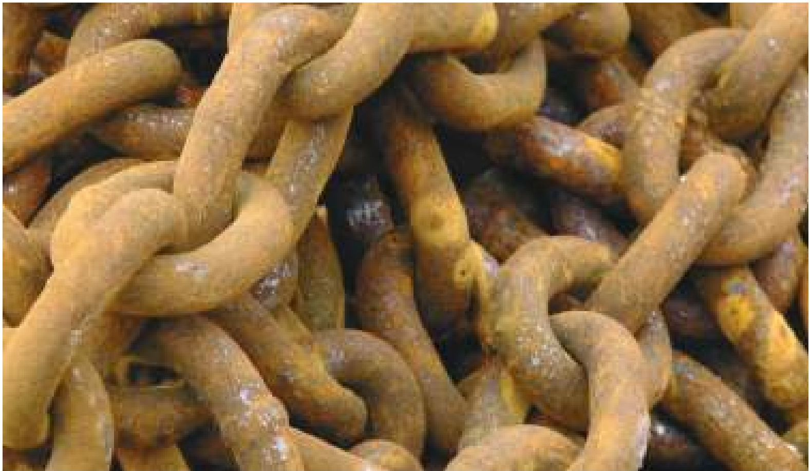
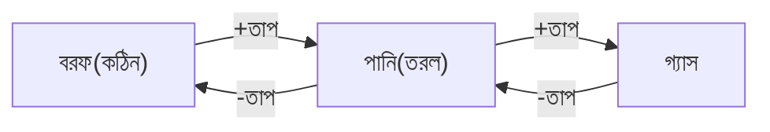
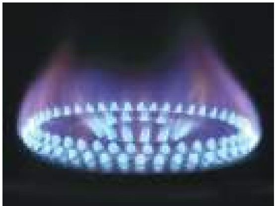
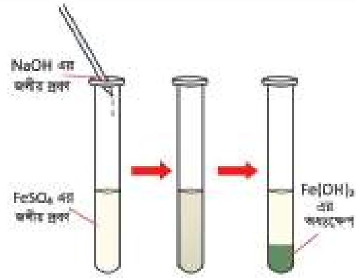
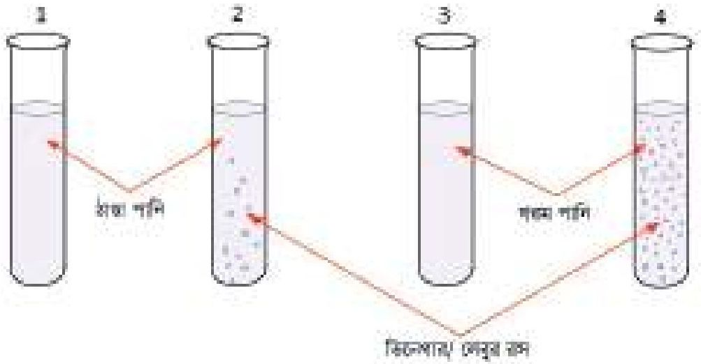
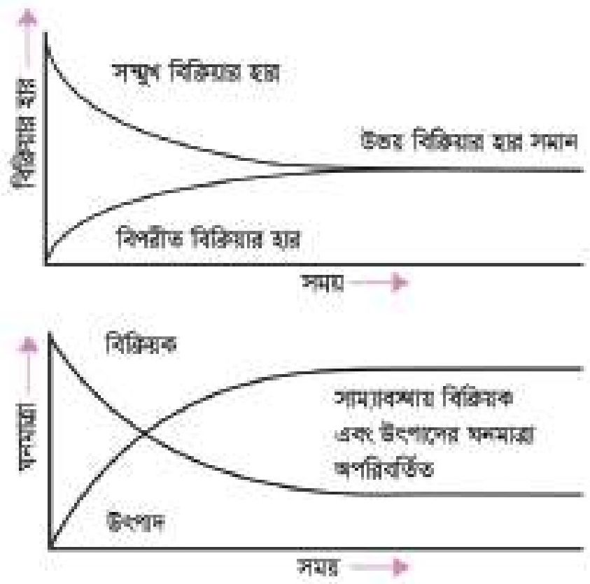

# 7. রাসায়নিক বিক্রিয়া

Source: Chemistry Bangla Version, printed pp. 142-167

## 7.0 ভূমিকা ও শিখনফল

<!-- chemistry-9-10-bn-c07-t7.0-p001 · figure · p.142 -->

<!-- chemistry-9-10-bn-c07-t7.0-p002 · text · p.142 -->
আমরা জানি, পদার্থের প্রকৃতি, ধর্ম এবং তাদের পরিবর্তন রসায়ন পাঠের মূল বিষয়। আমাদের চারপাশে বিভিন্ন পদার্থ প্রতিনিয়ত পরিবর্তিত হচ্ছে। ভিন্ন অবস্থায় পরিণত হওয়াকে ভৌত পরিবর্তন এবং সম্পূর্ণ ভিন্নধর্মী নতুন পদার্থে পরিণত হওয়াকে রাসায়নিক পরিবর্তন বলে। এই পরিবর্তনগুলো ঘটে নানা ধরনের ভৌত পরিবর্তন ও রাসায়নিক বিক্রিয়ার কারণে। এই অধ্যায়ে রাসায়নিক বিক্রিয়ার প্রকারভেদ, রাসায়নিক বিক্রিয়ার হার ইত্যাদি বিষয়ে বিস্তারিত আলোচনা করা হয়েছে।

### এ অধ্যায় পাঠ শেষে আমরা

<!-- chemistry-9-10-bn-c07-t7.0-p003 · text · p.143 -->
* ভৌত পরিবর্তন ও রাসায়নিক বিক্রিয়ার পার্থক্য করতে পারব।
* পদার্থের পরিবর্তনকে বিশ্লেষণ করে রাসায়নিক বিক্রিয়া শনাক্ত করতে পারব।
* রাসায়নিক বিক্রিয়ার শ্রেণিবিভাগ, রেডক্স/নন-রেডক্স, একমুখী, উভমুখী, তাপ উৎপাদী, তাপহারাী বিক্রিয়ার সংজ্ঞা দিতে পারব এবং বিক্রিয়ার বিভিন্ন প্রকার শনাক্ত করতে পারব।
* রাসায়নিক বিক্রিয়ায় উৎপন্ন পদার্থের পরিমাণকে লা-শাতেলিয়ারের নীতির আলোকে ব্যাখ্যা করতে পারব।
* পরিবর্তন বিশ্লেষণ করে জারণ-বিজারণ বিক্রিয়ার প্রকার শনাক্ত করতে পারব।
* বাস্তবে বিভিন্ন ক্ষেত্রে সংঘটিত বিক্রিয়া ব্যাখ্যা করতে পারব।
* বাস্তব ক্ষেত্রে সংঘটিত স্কটিকর বিক্রিয়াসমূহ নিয়ন্ত্রণ বা রোধের উপায় নির্ধারণ করতে পারব। (লোহার তৈরি জিনিসের মরিচা পড়া রোধের যথাযথ উপায় নির্ধারণ করতে পারব।)
* রাসায়নিক বিক্রিয়ার হার ব্যাখ্যা ও সংশ্লিষ্ট হারের তুলনা করতে পারব।
* বিভিন্ন পদার্থ ব্যবহার করে বিক্রিয়ার গতিবেগ বা হার পরীক্ষা ও তুলনা করতে পারব।
* দৈনন্দিন কাজে ধাতব বস্তু ব্যবহারে সচেতনতা প্রদর্শন করতে পারব।
* পরীক্ষার সাহায্যে বিক্রিয়ার হারের ভিন্নতা প্রদর্শন করতে পারব।
* অম্ল-ক্ষার প্রশমন বিক্রিয়া এবং অধঃক্ষেপণ বিক্রিয়া প্রদর্শন করতে পারব।

## 7.1 পদার্থের পরিবর্তন (Changes of Matter)

<!-- chemistry-9-10-bn-c07-t7.1-p001 · text · p.144 -->
আমরা সব সময় আমাদের চারপাশের নানা পদার্থ তাপ, চাপ কিংবা একে অন্যের সংস্পর্শে এসে পরিবর্তিত হতে দেখি। পদার্থের দুই ধরনের পরিবর্তন হয়—কখনো হয় ভৌত পরিবর্তন, কখনো বা রাসায়নিক পরিবর্তন।

### ৭.১.১ ভৌত পরিবর্তন

<!-- chemistry-9-10-bn-c07-t7.1-p002 · text · p.144 -->
প্রতিটি রাসায়নিক পদার্থ এক বা একাধিক মৌল দিয়ে গঠিত। যদি কোনো পদার্থের অভ্যন্তরীণ রাসায়নিক গঠনের কোনো পরিবর্তন না ঘটে শুধু বাহ্যিক অবস্থার পরিবর্তন ঘটে তাকে ভৌত পরিবর্তন (Physical Change) বলে। যেমন—এক খণ্ড কঠিন বরফকে কক্ষ তাপমাত্রায় রেখে দিলে তা পরিবেশ থেকে তাপ গ্রহণ করে আস্তে আস্তে গলে তরল পানিতে পরিণত হয়। আবার, তরল পানিকে তাপ প্রদান করে ১০০°C এ উল্লীত করলে সেটি জলীয় বাষ্পে পরিণত হয়। এখানে কঠিন বরফ, পানি এবং জলীয় বাষ্প এ তিনটি পদার্থের আণবিক সংকেত H2O। অর্থাৎ তরল পানি, কঠিন বরফ এবং গ্যাসীয় জলীয় বাষ্প তিনটিরই প্রতিটি অণুতে দুটি করে হাইড্রোজেন ও একটি করে অক্সিজেন পরমাণু থাকে। কাজেই তিনটি পদার্থ একই। শুধু এদের ভৌত অবস্থার পরিবর্তন ঘটেছে—বরফ কঠিন, পানি তরল এবং জলীয় বাষ্প গ্যাসীয়। এ ধরনের পরিবর্তনকে আমরা ভৌত পরিবর্তন বলব।

<!-- chemistry-9-10-bn-c07-t7.1-p003 · text · p.144 -->

### ৭.১.২ রাসায়নিক পরিবর্তন

<!-- chemistry-9-10-bn-c07-t7.1-p004 · text · p.144 -->
কখনো কখনো দেখা যায় যেকোনো পদার্থের বাহ্যিক তাপমাত্রা ও চাপের পরিবর্তন করলে কিংবা অন্য পদার্থের সংস্পর্শে আনলে তা পরিবর্তিত হয়ে সম্পূর্ণ ভিন্নধর্মী নতুন পদার্থে পরিণত হয়। এ ধরনের পরিবর্তনকে রাসায়নিক পরিবর্তন (Chemical Change) বলে। অর্থাৎ যে পরিবর্তনের ফলে সম্পূর্ণ ভিন্ন ধর্মবিশিষ্ট নতুন পদার্থে পরিণত হয় তাকে রাসায়নিক পরিবর্তন বলে। রাসায়নিক পরিবর্তনে নতুন যে পদার্থ উৎপন্ন হয় তার অণুতে অবস্থিত মৌলগুলো পূর্বের পদার্থ থেকেই আসে। পূর্বের অণুর মধ্যে বন্ধনসমূহের ভাঙনের মাধ্যমে বিচ্ছিন্ন আয়ন বা পরমাণুর সৃষ্টি হয়। পরবর্তীকালে আয়ন বা পরমাণুগুলোর মধ্যে নতুন বন্ধন গঠিত হয়ে নতুন অণুর সৃষ্টি হয়। অর্থাৎ এক কথায় পুরোনো বন্ধনের ভাঙন এবং নতুন বন্ধনের গঠনই মূলত রাসায়নিক বিক্রিয়া বা রাসায়নিক পরিবর্তন। রান্নার কাজে আমরা যে প্রাকৃতিক গ্যাস ব্যবহার করি সে গ্যাসের প্রধান উপাদান হলো মিথেন (CH4)। মিথেন গ্যাসকে অক্সিজেনে পোড়ালে কার্বন ডাই-অক্সাইড গ্যাস, জলীয় বাষ্প এবং তাপ শক্তি উৎপন্ন হয়। এ ধরনের পরিবর্তনই রাসায়নিক পরিবর্তন।

<!-- chemistry-9-10-bn-c07-t7.1-p005 · formula · p.145 · review: verify-formula -->
$$CH_4(g) + O_2(g) \longrightarrow CO_2(g) + H_2O(l)$$

<!-- chemistry-9-10-bn-c07-t7.1-p006 · text · p.145 -->
একইভাবে, ক্যালসিয়াম কার্বনেট হাইড্রোক্লোরিক এসিডের সাথে বিক্রিয়া করে ক্যালসিয়াম ক্লোরাইড, কার্বন ডাই-অক্সাইড ও পানি উৎপন্ন করে। এটিও রাসায়নিক পরিবর্তন।

<!-- chemistry-9-10-bn-c07-t7.1-p007 · formula · p.145 · review: verify-formula -->
$$CaCO_3 (s) + 2HCl (aq) \longrightarrow CaCl_2 (aq) + CO_2 (g) + H_2O (l)$$

## 7.2 রাসায়নিক বিক্রিয়ার শ্রেণিবিভাগ

### (Classification of Chemical Reactions)

<!-- chemistry-9-10-bn-c07-t7.2-p001 · text · p.145 -->
রাসায়নিক বিক্রিয়াকে নিম্নলিখিত বিষয়গুলোর উপর ভিত্তি করে শ্রেণিবিভাগ করা যায়:

### ৭.২.১ রাসায়নিক বিক্রিয়ার দিক

<!-- chemistry-9-10-bn-c07-t7.2-p002 · text · p.145 -->
বিক্রিয়ার দিকের উপর ভিত্তি করে রাসায়নিক বিক্রিয়াকে দুই ভাগে ভাগ করা যায়। একমুখী বিক্রিয়া ও উভমুখী বিক্রিয়া।

### একমুখী বিক্রিয়া (Irreversible Reactions)

<!-- chemistry-9-10-bn-c07-t7.2-p003 · text · p.145 -->
যে রাসায়নিক বিক্রিয়ায় বিক্রয়ক পদার্থগুলো উৎপাদে পরিণত হয়, কিন্তু উৎপাদ পদার্থগুলো পুনরায় বিক্রিয়কে পরিণত হয় না তাকে একমুখী বিক্রিয়া বলা হয়। যেমন: তুমি যদি ক্যালসিয়াম কার্বনেটকে একটি খোলা পাত্রে নিয়ে তাপ দাও তাহলে দেখবে ক্যালসিয়াম কার্বনেট ভেঙে গিয়ে কঠিন চুন ও গ্যাসীয় কার্বন ডাই-অক্সাইডে পরিণত হবে। গ্যাসীয় কার্বন ডাই-অক্সাইড বিক্রিয়া পাত্র থেকে অপসারিত হয় এ অবস্থায় কঠিন চুন পুনরায় ক্যালসিয়াম কার্বনেটে পরিণত হয় না। সুতরাং এটি একটি একমুখী বিক্রিয়া। একমুখী বিক্রিয়ার সমীকরণে বিক্রয়ক ও উৎপাদের মধ্যে একটি ডানমুখী তির চিহ্ন (→) ব্যবহার করা হয়।

<!-- chemistry-9-10-bn-c07-t7.2-p004 · formula · p.145 · review: latin-junk,verify-formula -->
$$CaCO_3 (s) \xrightarrow{তাপ} CaO (s) + CO_2(g)$$

### উভমুখী বিক্রিয়া (Reversible Reactions)

<!-- chemistry-9-10-bn-c07-t7.2-p005 · text · p.145 · review: verify-formula -->
যে রাসায়নিক বিক্রিয়ায় বিক্রয়ক পদার্থ বিক্রিয়া করে উৎপাদে পরিণত হয় আবার উৎপাদ পদার্থগুলো বিক্রিয়া করে পুনরায় বিক্রয়ক পদার্থে পরিণত হয়। এই ধরনের রাসায়নিক বিক্রিয়াকে উভমুখী বিক্রিয়া বলে। উভমুখী বিক্রিয়ায় বিক্রয়ক হতে উৎপাদ হওয়ার বিক্রিয়াকে সম্মুখমুখী বিক্রিয়া এবং উৎপাদ হতে বিক্রিয়কে পরিণত হওয়ার বিক্রিয়াকে পশ্চাৎমুখী বা বিপরীতমুখী বিক্রিয়া বলা হয়। উভমুখী বিক্রিয়ায় বিক্রয়ক ও উৎপাদের মধ্যে বিপরীতমুখী দুটি অর্থ তির চিহ্ন ($\rightleftharpoons$) ব্যবহার করে সমীকরণ উপস্থাপন করা হয়। যেমন: হাইড্রোক্লোরিক এসিডের উপস্থিতিতে ইথানল ও ইথানয়িক এসিড পরস্পরের সাথে বিক্রিয়া করে ইথাইল ইথানয়েট এস্টার ও পানি উৎপন্ন করে। অপরদিকে, উৎপন্ন ইথাইল ইথানয়েট এস্টার ও পানি পরস্পরের সাথে বিক্রিয়া করে ইথানল ও ইথানয়িক এসিড উৎপন্ন করে। একে নিম্নরূপে দেখানো যায়:

<!-- chemistry-9-10-bn-c07-t7.2-p006 · text · p.146 · review: verify-formula -->
$$C_2H_5OH + CH_3COOH \xrightleftharpoons[HCl]{} CH_3COOC_2H_5 + H_2O$$
ইথানল ইথানয়িক এসিড ইথাইল ইথানয়েট এস্টার পানি

<!-- chemistry-9-10-bn-c07-t7.2-p007 · text · p.146 -->
হাইড্রোজেন এবং আয়োডিন বিক্রিয়া করে হাইড্রোজেন আয়োডাইড উৎপাদ উৎপন্ন করে। আবার, উৎপাদ হাইড্রোজেন আয়োডাইড ভেঙে পুনরায় হাইড্রোজেন ও আয়োডিনে পরিণত হয়। কাজেই এ বিক্রিয়াটিও উভমুখী:

<!-- chemistry-9-10-bn-c07-t7.2-p008 · formula · p.146 · review: verify-formula -->
$$H_2 + I_2 \xrightleftharpoons{} 2HI$$

<!-- chemistry-9-10-bn-c07-t7.2-p009 · text · p.146 -->
আসলে উপর্যুক্ত শর্তে সব বিক্রিয়াই উভমুখী, তবে কিছু বিক্রিয়ার বেলায় সম্মুখমুখী বিক্রিয়ার তুলনায় বিপরীতমুখী বিক্রিয়ার পরিমাণ এত কম থাকে যে বিক্রিয়াকে একমুখী মনে হয়।

### ৭.২.২ রাসায়নিক বিক্রিয়ায় তাপের পরিবর্তন

<!-- chemistry-9-10-bn-c07-t7.2-p010 · text · p.146 -->
ইতঃপূর্বে তোমরা জেনেছ যে, তাপীয় পরিবর্তনের মাধ্যমে রাসায়নিক বিক্রিয়া সংঘটিত হয়। তাপের শোষণ এবং তাপ উৎপন্ন হওয়ার উপর ভিত্তি করে রাসায়নিক বিক্রিয়াকে দুইভাগে ভাগ করা যায় যথা: তাপোৎপাদী বিক্রিয়া এবং তাপহারাী বিক্রিয়া।

### তাপোৎপাদী বিক্রিয়া (Exothermic Reactions)

<!-- chemistry-9-10-bn-c07-t7.2-p011 · text · p.146 -->
যে রাসায়নিক বিক্রিয়ায় তাপ উৎপন্ন হয় তাকে তাপোৎপাদী বিক্রিয়া বলে। যেমন: হেবার প্রণালিতে ১ মোল নাইট্রোজেন ও ৩ মোল হাইড্রোজেন হতে ২ মোল অ্যামোনিয়া উৎপাদনের সময় ৯২ কিলোজুল তাপ উৎপন্ন হয়। বিক্রিয়াটি নিম্নরূপ:

<!-- chemistry-9-10-bn-c07-t7.2-p012 · text · p.146 · review: verify-formula -->
$$N_2  (g) + 3H_2  (g) \xrightleftharpoons[\substack{200-250  atm \\ 450^\circC-550^\circC}]{Fe} 2NH_3  (g) + 92  kJ$$
নাইট্রোজেন হাইড্রোজেন অ্যামোনিয়া তাপ এখানে Fe চূর্ণ প্রভাবক হিসেবে কাজ করে। সমতাকৃত সমীকরণ অনুযায়ী একটি রাসায়নিক বিক্রিয়া সংঘটিত হতে তাপের যে পরিবর্তন হয় তাকে বিক্রিয়া তাপ বলে। বিক্রিয়ার তাপকে $\Delta H$ দ্বারা প্রকাশ করা হয়। বিক্রিয়ায় তাপ উৎপাদন হলে $\Delta H$ এর মান ঋণাত্মক হয়। কাজেই আমরা আগের বিক্রিয়াকে এভাবে লিখতে পারি:

<!-- chemistry-9-10-bn-c07-t7.2-p013 · formula · p.147 · review: verify-formula -->
$$N_2(g) + 3H_2(g) \xrightleftharpoons[Fe]{200-250  atm} 2NH_3(g) \quad ; \quad \Delta H = -92  kJ$$

<!-- chemistry-9-10-bn-c07-t7.2-p014 · text · p.147 -->
নাইট্রোজেন হাইড্রোজেন 450°C-550°C অ্যামোনিয়া তাপ

### তাপহারী বিক্রিয়া বা তাপশোষী বিক্রিয়া (Endothermic Reactions)

<!-- chemistry-9-10-bn-c07-t7.2-p015 · text · p.147 -->
যে রাসায়নিক বিক্রিয়ায় তাপশক্তির শোষণ ঘটে সেই রাসায়নিক বিক্রিয়াকে তাপহারি বা তাপশোষী বিক্রিয়া বলে। যেমন- 1 মোল নাইট্রোজেন ও 1 মোল অক্সিজেন পরস্পরের সাথে বিক্রিয়া করে 2 মোল নাইট্রিক অক্সাইড উৎপন্ন হওয়ার সময় 180 kJ তাপ শোষিত হয়। এটি তাপশোষী বিক্রিয়া।

<!-- chemistry-9-10-bn-c07-t7.2-p016 · formula · p.147 · review: verify-formula -->
$$N_2(g) + O_2(g) + 180  kJ \xrightleftharpoons[ ]{} 2NO(g)$$

<!-- chemistry-9-10-bn-c07-t7.2-p017 · text · p.147 · review: verify-formula -->
আমরা বিক্রিয়া তাপ $\Delta H$ ব্যবহার করেও লিখতে পারি। তাপশোষী বিক্রিয়ায় $\Delta H$ এর মান ধনাত্মক।

<!-- chemistry-9-10-bn-c07-t7.2-p018 · formula · p.147 · review: verify-formula -->
$$N_2(g) + O_2(g) \xrightleftharpoons[ ]{} 2NO(g) \quad ; \quad \Delta H = + 180  kJ$$

### ৭.২.৩ ইলেকট্রন স্থানান্তর

<!-- chemistry-9-10-bn-c07-t7.2-p019 · text · p.147 -->
ইলেকট্রন স্থানান্তরের উপর ভিত্তি করে রাসায়নিক বিক্রিয়াকে দুইভাগে ভাগ করা যায়। যথা: রেডক্স বিক্রিয়া এবং নন-রেডক্স বিক্রিয়া।

### রেডক্স (Redox) বিক্রিয়া

<!-- chemistry-9-10-bn-c07-t7.2-p020 · text · p.147 · review: latin-junk -->
Reduction (বিজারণ) শব্দের এর প্রথমার্শ Red এবং Oxidation (জারণ) শব্দের প্রথমার্শ ox এর সমষ্টিয়ে গঠিত শব্দ হলো Redox অর্থাৎ এর নাম থেকেই বোঝা যাচ্ছে যে রেডক্স (Redox) অর্থ জারণ-বিজারণ। জারণ-বিজারণ বিক্রিয়ায় বিক্রিয়কসমূহের মধ্যে ইলেকট্রনের আদানপ্রদান ঘটে। একটি বিক্রিয়ক ইলেকট্রন ত্যাগ করে এবং অপর বিক্রিয়কটি সেই ইলেকট্রনকে গ্রহণ করে। সুতরাং জারণ-বিজারণ বিক্রিয়া দুটি অর্ধাংশে বিভক্ত। এক অর্ধাংশে বিক্রিয়ক ইলেকট্রন ত্যাগ করে যাকে জারণ অর্ধবিক্রিয়া বলে। অপর অর্ধাংশে অন্য একটি বিক্রিয়ক ইলেকট্রন গ্রহণ করে যাকে বিজারণ অর্ধবিক্রিয়া বলে। উল্লেখ্য যে, জারণ-বিজারণ বিক্রিয়ায় যে বিক্রিয়কটি ইলেকট্রন ত্যাগ করে তাকে বিজারক পদার্থ বলা হয় এবং যে বিক্রিয়কটি ইলেকট্রন গ্রহণ করে তাকে জারক পদার্থ বলা হয়।

<!-- chemistry-9-10-bn-c07-t7.2-p021 · formula · p.148 · review: verify-formula -->
$$Na + \frac{1}{2} Cl_2 \longrightarrow NaCl$$

<!-- chemistry-9-10-bn-c07-t7.2-p022 · text · p.148 -->
এই বিক্রিয়ায় Na ইলেকট্রন ত্যাগ করেছে, সুতরাং Na বিজারক পদার্থ। অপরদিকে, Cl ইলেকট্রন গ্রহণ করেছে তাই Cl জারক পদার্থ।

<!-- chemistry-9-10-bn-c07-t7.2-p023 · text · p.148 -->
যে বিক্রিয়ায় কোনো পরমাণুর ইলেকট্রনের দান ঘটে অর্থাৎ ঐ পরমাণুর ধনাত্মক চার্জের সংখ্যা বৃদ্ধি পায় বা ঋণাত্মক চার্জের সংখ্যা হ্রাস পায় সেই বিক্রিয়াকে জারণ বিক্রিয়া বলে। যেমন-

<!-- chemistry-9-10-bn-c07-t7.2-p024 · text · p.148 · review: latin-junk,verify-formula -->
$$Fe^{2+} \rightarrow Fe^{3+} + e^-  [জারণ বিক্রিয়া]$$
$$Na^0 \rightarrow Na^{1+} + e^-  [জারণ বিক্রিয়া]$$

<!-- chemistry-9-10-bn-c07-t7.2-p025 · text · p.148 -->
যে বিক্রিয়ায় কোনো পরমাণুর ইলেকট্রনের গ্রহণ ঘটে অর্থাৎ ঐ পরমাণুর ধনাত্মক চার্জের সংখ্যা হ্রাস পায় বা ঋণাত্মক চার্জের সংখ্যা বৃদ্ধি পায় সেই বিক্রিয়াকে বিজারণ বিক্রিয়া বলে। যেমন-

<!-- chemistry-9-10-bn-c07-t7.2-p026 · text · p.148 · review: latin-junk,verify-formula -->
$$Cl^0 + e^- \rightarrow Cl^{1-}  [বিজারণ বিক্রিয়া]$$
$$Cu^{2+} + e^- \rightarrow Cu^{1+}  [বিজারণ বিক্রিয়া]$$

<!-- chemistry-9-10-bn-c07-t7.2-p027 · text · p.148 -->
**জারণ সংখ্যা:** কোনো অণু বা যৌগমূলকের মধ্যে অবস্থিত পরমাণুগুলোর কোনোটি ইলেকট্রন ছেড়ে দেওয়ার আবার কোনোটি ইলেকট্রন গ্রহণ করার প্রবণতা দেখায়। অণু বা যৌগমূলকের মধ্যে অবস্থিত কোনো পরমাণুর ইলেকট্রন ছাড়ার প্রবণতাকে ধনাত্মক চিহ্নযুক্ত একটি সংখ্যা দিয়ে আর কোনো পরমাণুর ইলেকট্রন গ্রহণ করার প্রবণতাকে ঋণাত্মক চিহ্নযুক্ত সংখ্যা দিয়ে প্রকাশ করা হয়। অণু বা যৌগমূলকের মধ্যে অবস্থিত কোনো পরমাণুর এই ধনাত্মক বা ঋণাত্মক চিহ্নযুক্ত সংখ্যাকেই তার জারণ সংখ্যা (Oxidation Number) বলে।

<!-- chemistry-9-10-bn-c07-t7.2-p028 · text · p.148 -->
একক পরমাণু যেমন: Na, Mg, Fe ইত্যাদিতে সংশ্লিষ্ট পরমাণুসমূহের জারণ সংখ্যা শূন্য ধরা হয়। আবার, একই পরমাণু দিয়ে গঠিত অণু যেমন: H2, O2, N2, Cl2, Br2 ইত্যাদিতে সংশ্লিষ্ট পরমাণুসমূহের জারণ সংখ্যা শূন্য (0)।

<!-- chemistry-9-10-bn-c07-t7.2-p029 · text · p.148 -->
FeSO4 অণুতে Fe এর জারণ সংখ্যা +2 আবার Fe ধাতুতে Fe এর জারণ সংখ্যা শূন্য। HCl এ Cl এর জারণ সংখ্যা -1 আবার Cl2 অণুতে এর জারণ সংখ্যা শূন্য (0)।

<!-- chemistry-9-10-bn-c07-t7.2-p030 · text · p.148 -->
**জারণ সংখ্যা নির্ণয়:** একটি যৌগে কোনো একটি মৌলের জারণ সংখ্যা যৌগের অন্যান্য মৌলের জারণ সংখ্যার উপর নির্ভর করে। যৌগে কোনো একটি মৌলের জারণ সংখ্যা বের করার জন্য যৌগের অন্যান্য মৌলের জারণ সংখ্যা জানতে হয়।

<!-- chemistry-9-10-bn-c07-t7.2-p031 · table · p.149 · review: known-confusable-corrected,verify-table -->
**টেবিল ৭.০১: বিভিন্ন যৌগে পরমাণুর জারণ সংখ্যা**
<table><tr><th>জারণ সংখ্যার নিয়ম</th><th>যৌগের সংকেত</th><th>মৌল ও জারণ সংখ্যা</th></tr>
<tr><td>ধাতুসমূহের জারণ সংখ্যা ধনাত্মক এবং অধাতুসমূহের জারণ সংখ্যা ঋণাত্মক হয়।</td><td>NaCl</td><td>Na = +1 Cl = -1</td></tr>
<tr><td>নিরপেক্ষ পরমাণু বা মুক্ত মৌলের জারণ সংখ্যা শূন্য হয়।</td><td>Fe, H2</td><td>Fe = 0 H = 0</td></tr>
<tr><td>নিরপেক্ষ যৌগে পরমাণুসমূহের মোট জারণ সংখ্যা শূন্য হয়।</td><td>H2O</td><td>H = +1 O = -2 মোট = 0</td></tr>
<tr><td>আধানবিশিষ্ট আয়নে পরমাণুসমূহের মোট জারণ সংখ্যা আধান সংখ্যার সমান হয়।</td><td>SO4-2, NH4+</td><td>SO42- = -2 NH4+ = +1</td></tr>
<tr><td>যৌগে ক্ষার ধাতুসমূহের জারণ সংখ্যা +1 হয়।</td><td>KCl, K2CO3</td><td>K = +1</td></tr>
<tr><td>যৌগে মুংস্কার ধাতুসমূহের জারণ সংখ্যা +2 হয়।</td><td>CaO, MgSO4</td><td>Ca = +2 Mg = +2</td></tr>
<tr><td>ধাতব হাইডাইড হ্যালোজেনের জারণ সংখ্যা -1 হয়।</td><td>MgCl2, LiCl</td><td>Cl = -1</td></tr>
<tr><td>অধিকায়শ যৌগে হাইড্রোজেনের জারণ সংখ্যা +1 কিন্তু ধাতব হাইডাইডে হাইড্রোজেনের জারণ সংখ্যা -1 হয়।</td><td>NH3, LiAlH4</td><td>H = +1 H = -1</td></tr>
<tr><td>অধিকায়শ যৌগে (অক্সাইডে) অক্সিজেনের জারণ সংখ্যা -2 কিন্তু পার-অক্সাইডে অক্সিজেনের জারণ সংখ্যা -1 হয় এবং সুপার-অক্সাইডে অক্সিজেনের জারণ সংখ্যা -1/2।</td><td>K2O, CaO K2O2, H2O2 NaO2, KO2</td><td>O = -2 O = -1 O = -1/2</td></tr></table>

<!-- chemistry-9-10-bn-c07-t7.2-p032 · text · p.149 -->
কোনো অণু বা আয়নে সংশ্লিষ্ট পরমাণুর জারণ সংখ্যা নিচের পদ্ধতিতে নির্ণয় করা যায়:

<!-- chemistry-9-10-bn-c07-t7.2-p033 · text · p.149 -->
1. যৌগ বা আয়নে অবস্থিত যে পরমাণুটির জারণ সংখ্যা বের করতে হবে ধরে নেই তার জারণ সংখ্যা x।

<!-- chemistry-9-10-bn-c07-t7.2-p034 · text · p.149 -->
2. যৌগ বা আয়নের সকল মৌলের জারণ সংখ্যাকে তাদের নিজ নিজ নিজ পরমাণু সংখ্যা দ্বারা গুণ করে তাদের সমষ্টি বের করতে হবে।

<!-- chemistry-9-10-bn-c07-t7.2-p035 · text · p.149 -->
3. জারণ সংখ্যার সমষ্টি হবে অণুর ক্ষেত্রে শূন্য (0) এবং আয়নের ক্ষেত্রে তার চিহ্নসহ চার্জ সংখ্যার সমান। এখান থেকে পরমাণুর জারণ সংখ্যা x বের করা যাবে। যেমন: ধরা যাক KMnO4 অণুতে কেন্দ্রীয় পরমাণু Mn এর জারণ মান বের করতে হবে। ধরা যাক, Mn এর জারণ মান ধরো x, K এর জারণ মান +1 এবং O এর জারণ মান -2 নিয়ে সকল মৌলের জারণ সংখাকে তাদের পরমাণু সংখ্যা দ্বারা গুণ করে যোগ করো। উক্ত যোগফল হবে KMnO4 এর জারণ সংখ্যার সমান। KMnO4 একটি আধান নিরপেক্ষ অণু, সুতরাং এর আধান শূন্য, কাজেই

<!-- chemistry-9-10-bn-c07-t7.2-p036 · text · p.150 · review: verify-formula -->
$$(+1) \times 1 + x \times 1 + (-2) \times 4 = 0$$
বা $x = 7$

<!-- chemistry-9-10-bn-c07-t7.2-p037 · text · p.150 -->
অর্থাৎ Mn এর জারণ সংখ্যা +7

<!-- chemistry-9-10-bn-c07-t7.2-p038 · text · p.150 · review: verify-formula -->
4. সাধারণত ধাতব হাইড্রাইড (যেমন: LiH, LiAlH4) ব্যতীত সকল ক্ষেত্রে H এর জারণ সংখ্যা +1। হাইড্রোজেন পার-অক্সাইড (H2O2), সোডিয়াম পার-অক্সাইড (Na2O2) এ অক্সিজেনের জারণ সংখ্যা -1, সুপার-অক্সাইড যেমন: সোডিয়াম সুপার-অক্সাইড (NaO2), পটাশিয়াম সুপার-অক্সাইড (KO2) এ অক্সিজেনের জারণ সংখ্যা $-\frac{1}{2}$ হয়। এছাড়া সকল ক্ষেত্রে অক্সিজেনের জারণ সংখ্যা -2।

<!-- chemistry-9-10-bn-c07-t7.2-p039 · text · p.150 -->
**H2SO4 এ S এর জারণ সংখ্যা নির্ণয়:**

<!-- chemistry-9-10-bn-c07-t7.2-p040 · text · p.150 · review: verify-formula -->
ধরি, H2SO4 এ S এর জারণ সংখ্যা = x
অতএব, $(+1) \times 2 + x + (-2) \times 4 = 0$
$x = 6$

<!-- chemistry-9-10-bn-c07-t7.2-p041 · text · p.150 -->
অতএব, H2SO4 এ S এর জারণ সংখ্যা = +6।

<!-- chemistry-9-10-bn-c07-t7.2-p042 · text · p.150 -->
নিম্নলিখিত যৌগে লাল বর্ণে লেখা মৌলের জারণ সংখ্যা নির্ণয় করো: CuS2O4, HNO3, H3PO4, MnO2, K2Cr2O7, Na2S2O3 এবং CuI

<!-- chemistry-9-10-bn-c07-t7.2-p043 · text · p.150 -->
দেওয়া আছে, Cu এর জারণ মান = +2, O এর জারণ মান = -2, H এর জারণ মান = +1, K এর জারণ মান = +1, Na এর জারণ মান = +1, I এর জারণ মান = -1

<!-- chemistry-9-10-bn-c07-t7.2-p044 · text · p.150 -->
জারণ সংখ্যা এবং যোজনী একই বিষয় নয়, জারণ সংখ্যা হলো পরমাণু বা আয়নে উপস্থিত চার্জ সংখ্যা (চিহ্নসহ)। এটি ধনাত্মক বা ঋণাত্মক, পূর্ণসংখ্যা, শূন্য এমনকি ভগ্নাংশও হতে পারে। শুধু তাই নয়, একই মৌলের জারণ সংখ্যা বিভিন্ন যৌগে বিভিন্ন হতে দেখা যায়। অন্যদিকে যোজনী হলো একটি মৌল অন্য মৌলের সাথে যুক্ত হওয়ার সমর্থ্য। যোজনী ধনাত্মক বা ঋণাত্মক হয় না, এটি সর্বদাই পূর্ণসংখ্যা হয়। শুধু নিস্ক্রিয় গ্যাসের যোজনী শূন্য হয়।

### জারণ-বিজারণ একটি যুগপৎক্রিয়া

<!-- chemistry-9-10-bn-c07-t7.2-p045 · text · p.151 -->
তোমরা জানো, যে রাসায়নিক বিক্রিয়ায় ইলেকট্রনের দান ঘটে তাকে জারণ বিক্রিয়া এবং যে রাসায়নিক বিক্রিয়ায় ইলেকট্রনের গ্রহণ ঘটে তাকে বিজারণ বিক্রিয়া বলা হয়। আবার, যে পদার্থ ইলেকট্রন ত্যাগ করে তাদেরকে বিজারক এবং যে পদার্থ ইলেকট্রন গ্রহণ করে তাদেরকে জারক পদার্থ বলে। জারণ-বিজারণ বিক্রিয়া একই সাথে সংঘটিত হয়।

<!-- chemistry-9-10-bn-c07-t7.2-p046 · text · p.151 -->
আমরা নিচের বিক্রিয়াটি বিবেচনা করতে পারি:

<!-- chemistry-9-10-bn-c07-t7.2-p047 · formula · p.151 · review: verify-formula -->
$$Na + \frac{1}{2} Cl_2 \longrightarrow NaCl$$

<!-- chemistry-9-10-bn-c07-t7.2-p048 · text · p.151 -->
এখানে বিজারক পদার্থ Na তার বাইরের শেলের 1টি ইলেকট্রন ত্যাগ করে জারণ অর্ধবিক্রিয়া সম্পন্ন করেছে। অপরদিকে বিজারক Na যে ইলেকট্রন ত্যাগ করেছে, জারক পদার্থ Cl সেই ইলেকট্রনকে গ্রহণ করে বিজারণ অর্ধবিক্রিয়া সম্পন্ন করেছে।

<!-- chemistry-9-10-bn-c07-t7.2-p049 · text · p.151 · review: verify-formula -->
জারণ অর্ধবিক্রিয়া $Na^0 \rightarrow Na^+ + e^-$
বিজারণ অর্ধবিক্রিয়া $Cl^0 + e^- \rightarrow Cl^-$

<!-- chemistry-9-10-bn-c07-t7.2-p050 · text · p.151 -->
এই দুই অর্ধ-বিক্রিয়াকে যোগ করলে জারণ-বিজারণ বিক্রিয়া পাওয়া যায়:

<!-- chemistry-9-10-bn-c07-t7.2-p051 · text · p.151 · review: verify-formula -->
জারণ-বিজারণ বিক্রিয়া: $Na^0 + Cl^0 \rightarrow Na^+ + Cl^- \equiv NaCl$

<!-- chemistry-9-10-bn-c07-t7.2-p052 · text · p.151 -->
এখানে স্পষ্টত জারণে বিজারক পদার্থ ইলেকট্রন ত্যাগ করেছে, অপরদিকে বিজারণে জারক পদার্থ ঐ ইলেকট্রন গ্রহণ করেছে। যদি জারক পদার্থ Cl ইলেকট্রন গ্রহণ না করতো তাহলে বিজারক পদার্থ Na ইলেকট্রন দান করতে পারত না। কাজেই বলা যায় জারণ যখনই ঘটেবে সাথে সাথে সেখানে বিজারণও ঘটেবে। অর্থাৎ জারণ-বিজারণ একটি যুগপৎ প্রক্রিয়া (Simultaneous Process)।

<!-- chemistry-9-10-bn-c07-t7.2-p053 · text · p.151 -->
যেহেতু বিজারক ইলেকট্রন দান করে এবং জারক উক্ত ইলেকট্রন গ্রহণ করে কাজেই বলা যায় জারণ-বিজারণ বিক্রিয়া মানেই ইলেকট্রন স্থানান্তর প্রক্রিয়া।

<!-- chemistry-9-10-bn-c07-t7.2-p054 · text · p.151 -->
বেশ কিছু বিক্রিয়া আছে যেখানে জারণ-বিজারণ বিক্রিয়া ঘটে। সেগুলো হচ্ছে:

<!-- chemistry-9-10-bn-c07-t7.2-p055 · text · p.151 -->
1. সংয়োজন বিক্রিয়া
2. বিয়োজন বিক্রিয়া
3. প্রতিস্থাপন বিক্রিয়া
4. দহন বিক্রিয়া

<!-- chemistry-9-10-bn-c07-t7.2-p056 · text · p.152 -->
**1. সংযোজন বিক্রিয়া (Addition Reaction):** যে জারণ-বিজারণ বিক্রিয়ায় দুই বা ততোধিক রাসায়নিক পদার্থ পরস্পরের সাথে যুক্ত হয়ে একটিমাত্র উৎপাদ উৎপন্ন করে তাকে সংযোজন বিক্রিয়া বলে। যেমন: ফেরাস ক্লোরাইডের সাথে ক্লোরিন যুক্ত হয়ে ফেরিক ক্লোরাইড উৎপন্ন করে।

<!-- chemistry-9-10-bn-c07-t7.2-p057 · formula · p.152 · review: verify-formula -->
$$2FeCl_2(aq) + Cl_2(g) \longrightarrow FeCl_3(aq)$$

<!-- chemistry-9-10-bn-c07-t7.2-p058 · text · p.152 -->
আবার, হাইড্রোজেন গ্যাস নাইট্রোজেন গ্যাসের সাথে যুক্ত হয়ে অ্যামোনিয়া গ্যাস উৎপন্ন করে। এটিও সংযোজন বিক্রিয়ার উদাহরণ।

<!-- chemistry-9-10-bn-c07-t7.2-p059 · formula · p.152 · review: verify-formula -->
$$N_2 + 3H_2 \longrightarrow 2NH_3$$

<!-- chemistry-9-10-bn-c07-t7.2-p060 · text · p.152 -->
তবে যেসব সংযোজন বিক্রিয়ায় শুধু মৌলিক পদার্থ যুক্ত হয়ে যৌগ গঠন করে, তাদেরকে সংশ্লেষণ বিক্রিয়াও বলে। সুতরাং অ্যামোনিয়া গ্যাস উৎপন্ন করার বিক্রিয়াটি একাধারে সংযোজন বা সংশ্লেষণ বিক্রিয়া হিসেবে বিবেচিত।

<!-- chemistry-9-10-bn-c07-t7.2-p061 · text · p.152 -->
**2. বিয়োজন বিক্রিয়া (Decomposition Reaction):** যে বিক্রিয়ায় একটি যৌগ ভেঙে একাধিক যৌগ বা মৌল উৎপন্ন হয় তাকে বিয়োজন বিক্রিয়া বলা হয়। যেমন: ফসফরাস পেন্টাক্লোরাইডকে তাপ দিলে তা বিয়োজিত হয়ে ফসফরাস ট্রাইক্লোরাইড ও ক্লোরিন উৎপন্ন করে। এটি বিয়োজন বিক্রিয়া।

<!-- chemistry-9-10-bn-c07-t7.2-p062 · formula · p.152 · review: latin-junk,verify-formula -->
$$\begin{array}{c} তাপ \\ \downarrow \\ PCl_5 \xrightarrow{তাপ} PCl_3 + Cl_2 \\ ফসফরাস পেন্টাক্লোরাইড \quad ফসফরাস ট্রাইক্লোরাইড \quad ক্লোরিন \end{array}$$

<!-- chemistry-9-10-bn-c07-t7.2-p063 · text · p.152 -->
আবার, পানিকে তাড়িৎবিশ্লেষণ করলে একটি অণু ভেঙে দুটি অণুতে পরিণত হয়। অ্যানোডে অক্সিজেন গ্যাস ও ক্যাথোডে হাইড্রোজেন গ্যাস উৎপন্ন হয়। এটিও বিয়োজন বিক্রিয়ার উদাহরণ:

<!-- chemistry-9-10-bn-c07-t7.2-p064 · formula · p.152 · review: latin-junk,verify-formula -->
$$\begin{array}{c} তড়িৎবিশ্লেষণ \\ \downarrow \\ 2H_2O(l) \longrightarrow 2H_2(g) + O_2(g) \\ পানি \quad \quad \quad হাইড্রোজেন \quad অক্সিজেন \end{array}$$

<!-- chemistry-9-10-bn-c07-t7.2-p065 · text · p.152 -->
**3. প্রতিস্থাপন বিক্রিয়া (Substitution or Displacement Reaction):** কোনো অধিক সক্রিয় মৌল বা যৌগমূলক অপর কোনো কম সক্রিয় মৌল বা যৌগমূলককে প্রতিস্থাপন করে নতুন যৌগ উৎপন্ন করার প্রক্রিয়াকে প্রতিস্থাপন বিক্রিয়া বলে। যেমন: জিংক ধাতু সালফিউরিক এসিডের হাইড্রোজেনকে প্রতিস্থাপিত করে জিংক সালফেট ও হাইড্রোজেন গ্যাস উৎপন্ন করে। এটি প্রতিস্থাপন বিক্রিয়ার উদাহরণ:

<!-- chemistry-9-10-bn-c07-t7.2-p066 · text · p.152 · review: verify-formula -->
$$Zn(s) + H_2SO_4(l) \longrightarrow ZnSO_4(aq) + H_2(g)$$
জিংক সালফেট

### ৪. দহন বিক্রিয়া (Combustion Reaction): কোনো মৌল বা যৌগকে বাতাসের অক্সিজেনের উপস্থিতিতে পুড়িয়ে তার উপাদান মৌলের অক্সাইডে পরিণত করার প্রক্রিয়াকে দহন বিক্রিয়া বলে। দহন বিক্রিয়ায় সব সময় তাপ উৎপন্ন হয়। এই প্রক্রিয়ায় ইলেকট্রন এর আদান-প্রদান ঘটে। যেমন- প্রাকৃতিক গ্যাস বা মিথেন বাতাসের অক্সিজেনের সাথে বিক্রিয়ায় করে কার্বন ডাই-অক্সাইড ও পানি উৎপন্ন করে। এটি দহন বিক্রিয়ার উদাহরণ:

<!-- chemistry-9-10-bn-c07-t7.2-p067 · figure · p.153 -->

<!-- chemistry-9-10-bn-c07-t7.2-p068 · figure · p.153 -->
**চিত্র ৭.০১: জ্বালানির দহন**

<!-- chemistry-9-10-bn-c07-t7.2-p069 · formula · p.153 · review: latin-junk,verify-formula -->
$$CH_4(g) + 2O_2(g) \longrightarrow CO_2(g) + 2H_2O(g) + তাপ$$

<!-- chemistry-9-10-bn-c07-t7.2-p070 · text · p.153 -->
একইভাবে S, C, Mg ও H2 কে দহন করলে তাদের অক্সাইড উৎপন্ন হয় এবং তাপ উৎপন্ন হয়।

<!-- chemistry-9-10-bn-c07-t7.2-p071 · text · p.153 · review: latin-junk,verify-formula -->
$$S(s) + O_2(g) \longrightarrow SO_2(g) + তাপ$$
$$C(s) + O_2(g) \longrightarrow CO_2(g) + তাপ$$
$$2Mg(s) + O_2(g) \longrightarrow 2MgO(g) + তাপ$$
$$2H_2(g) + O_2(g) \longrightarrow 2H_2O(g) + তাপ$$

<!-- chemistry-9-10-bn-c07-t7.2-p072 · text · p.153 -->
দহন বিক্রিয়ার প্রতিক্ষেত্রেই অক্সিজেন ইলেকট্রন গ্রহণ করে অপর যৌগ বা মৌল ইলেকট্রন ত্যাগ করে। সুতরাং দহন বিক্রিয়া জারণ-বিজারণ বিক্রিয়ার অন্তর্ভুক্ত।

### নন-রেডক্স (Non Redox) বিক্রিয়া

<!-- chemistry-9-10-bn-c07-t7.2-p073 · text · p.153 -->
এমন অনেক রাসায়নিক বিক্রিয়া দেখা যায় যেখানে ইলেকট্রনের আদান-প্রদান ঘটে না। এ ধরনের রাসায়নিক বিক্রিয়াকে নন-রেডক্স বিক্রিয়া বলে। এ ধরনের বিক্রিয়ায় যেহেতু ইলেকট্রনের আদান-প্রদান ঘটে না সুতরাং বিক্রিয়ায় কোনো পরমাণুর জারণ সংখ্যার হ্রাস বা বৃদ্ধি ঘটে না। নিমে বিভিন্ন প্রকার নন-রেডক্স বিক্রিয়া দেখানো হলো যেমন: (1) প্রশমন বিক্রিয়া (2) অধঃক্ষেপণ বিক্রিয়া ইত্যাদি।

### ১. প্রশমন বিক্রিয়া (Neutralization Reaction): একটি এসিড ও একটি ক্ষার পরস্পরের সাথে বিক্রিয়া করে প্রশমিত হয়ে লবণ ও পানি উৎপন্ন করে। এই বিক্রিয়াকে প্রশমন বিক্রিয়া বলা হয়। এ ধরনের বিক্রিয়াকে এসিড-ক্ষার বিক্রিয়াও বলা হয়। যেমন- HCl ও NaOH পরস্পরের সাথে বিক্রিয়া করে NaCl লবণ ও পানি উৎপন্ন করে। এটি একটি প্রশমন বিক্রিয়া। একে এভাবে দেখানো যায়:

<!-- chemistry-9-10-bn-c07-t7.2-p074 · formula · p.153 · review: verify-formula -->
$$HCl(aq) + NaOH(aq) \longrightarrow NaCl(aq) + H_2O(l)$$

<!-- chemistry-9-10-bn-c07-t7.2-p075 · text · p.154 · review: verify-formula -->
প্রশমন বিক্রিয়ায় সর্বদাই তাপ উৎপন্ন হয়। অর্থাৎ প্রশমন বিক্রিয়া তাপোৎপাদী বিক্রিয়া এবং এসিড ও ক্ষার উভয়ই তীব্র হলে এই তাপের মান হয় $\Delta H = -57.34 kJ$। প্রশমন বিক্রিয়ায় এসিড হাইড্রোজেন আয়ন ($H^+$) সরবরাহ করে এবং ক্ষার হাইড্রোক্সাইড আয়ন ($OH^-$) সরবরাহ করে। এরপর উক্ত আয়ন দুটি পরস্পরের সাথে বিক্রিয়া করে পানি উৎপন্ন করে। NaCl জলীয় দ্রবণে $Na^+$ এবং $Cl^-$ আয়ন হিসেবে থাকে।

<!-- chemistry-9-10-bn-c07-t7.2-p076 · formula · p.154 · review: verify-formula -->
$$H^+ + Cl^- + Na^+ + OH^- \longrightarrow Na^+ + Cl^- + H_2O$$

<!-- chemistry-9-10-bn-c07-t7.2-p077 · text · p.154 · review: verify-formula -->
এই দ্রবণে উপস্থিত $Na^+$ ও $Cl^-$ আয়নদ্বয় বিক্রিয়ায় অংশগ্রহণ করে না। এদেরকে দর্শক আয়ন বলে। প্রশমন বিক্রিয়ার প্রকৃত সমীকরণ হলো:

<!-- chemistry-9-10-bn-c07-t7.2-p078 · formula · p.154 · review: verify-formula -->
$$H^+ + OH^- \longrightarrow H_2O + 57.34 kJ$$

<!-- chemistry-9-10-bn-c07-t7.2-p079 · text · p.154 · review: verify-formula -->
সুতরাং প্রশমন বিক্রিয়া বলতে আমরা $H^+$ আয়ন ও $OH^-$ আয়নের সহযোগে পানি উৎপন্ন করার বিক্রিয়াকে বুঝে থাকি।

<!-- chemistry-9-10-bn-c07-t7.2-p080 · text · p.154 · review: verify-formula -->
আবার, এসিড হিসেবে আমরা যেকোনো তীব্র এসিড নিই না কেন প্রতি ক্ষেত্রে সে হাইড্রোজেন আয়ন $H^+$ সরবরাহ করবে এবং ক্ষার হিসেবে যেকোনো তীব্র ক্ষার নিলে সেটি হাইড্রোক্সাইড $OH^-$ সরবরাহ করবে। অতঃপর এরা পরস্পরের সাথে যুক্ত হয়ে পানি উৎপন্ন করবে। ১ মোল পানি উৎপন্ন করতে যে পরিমাণ তাপ উৎপন্ন হয় তাকে প্রশমন তাপ বলে। হিসাব করে দেখা গেছে ১ মোল পানি উৎপন্ন করার জন্য 57.34 kJ তাপ উৎপন্ন হয়।

### পরীক্ষণের মাধ্যমে প্রশমন বিক্রিয়া প্রদর্শন।

<!-- chemistry-9-10-bn-c07-t7.2-p081 · text · p.154 -->
এসিড ও ক্ষার বিক্রিয়া করে লবণ ও পানি উৎপন্ন করে, এই বিক্রিয়াকে প্রশমন বিক্রিয়া বলা হয়। একটি কাচপাত্র বা বিকারে 10 mL NaOH দ্রবণ নাও। অপর একটি বিকারের মধ্যে HCl দ্রবণ নাও। বিকারের দ্রবণের মধ্যে একটি নীল লিটমাস পেপার নিমজ্জিত করো। এবার ডুপার ব্যবহার করে বাম হাত দিয়ে HCl দ্রবণকে ধীরে ধীরে NaOH দ্রবণের মধ্যে ঢালতে থাকো। একই সাথে ডান হাত দিয়ে একটি কাচদণ্ড দিয়ে নেড়ে নেড়ে HCl দ্রবণকে NaOH দ্রবণের মধ্যে মিশ্রিত করো। যে মুহূর্তে লিটমাস পেপারের রং লাল হয়ে যাবে, সেই মুহূর্তে মনে করতে হবে বিকারের NaOH দ্রবণ HCl দ্রবণ দ্বারা প্রশমিত হয়ে গেছে।

<!-- chemistry-9-10-bn-c07-t7.2-p082 · formula · p.154 · review: verify-formula -->
$$HCl(aq) + NaOH(aq) \longrightarrow NaCl(aq) + H_2O(l)$$

<!-- chemistry-9-10-bn-c07-t7.2-p083 · text · p.155 -->
**২. অধঃক্ষেপণ বিক্রিয়া (Precipitation Reaction):** একই দ্রাবকে দুটি যৌগ মিশ্রিত করলে তারা পরস্পরের সাথে বিক্রিয়া করে যে উৎপাদগুলো উৎপন্ন করে তাদের মধ্যে কোনোটি যদি ঐ দ্রাবকে অদ্রবণীয় বা খুবই কম পরিমাণে দ্রবণীয় হয় তবে তা বিক্রিয়া পাত্রের তলায় কঠিন অবস্থায় তলানি হিসেবে জমা হয়। এ তলানিকে অধঃক্ষেপ (precipitate) বলে। যে বিক্রিয়ায় দ্রবণীয় বিক্রিয়ক পদার্থ বিক্রিয়া করে অদ্রবণীয় কঠিন উৎপাদে পরিণত হয় তাকে অধঃক্ষেপণ বিক্রিয়া বলে।

<!-- chemistry-9-10-bn-c07-t7.2-p084 · text · p.155 -->
যেমন: সোডিয়াম ক্লোরাইডের (NaCl) জলীয় দ্রবণের মধ্যে সিলভার নাইট্রেট (AgNO3) জলীয় দ্রবণ যোগ করলে তাদের মধ্যে বিক্রিয়া ঘটে, ফলে সিলভার ক্লোরাইড (AgCl) এবং সোডিয়াম নাইট্রেট (NaNO3) উৎপন্ন হয়। পানিতে NaNO3 এর দ্রবণীয়তা বেশি। তাই NaNO3 পানিতে দ্রবীভূত অবস্থায় থাকে। কিন্তু পানিতে AgCl এর দ্রবণীয়তা অত্যন্ত কম বলে তা বিক্রিয়ার পর পাত্রের তলায় অধঃক্ষেপ হিসেবে জমা হয়।

<!-- chemistry-9-10-bn-c07-t7.2-p085 · formula · p.155 · review: verify-formula -->
$$NaCl(aq) + AgNO_3(aq) \longrightarrow AgCl(s)\downarrow + NaNO_3(aq)$$

<!-- chemistry-9-10-bn-c07-t7.2-p086 · text · p.155 -->
সোডিয়াম সালফেট (Na2SO4) দ্রবণে বেরিয়াম ক্লোরাইড দ্রবণ যোগ করলে বেরিয়াম সালফেট (BaSO4) ও সোডিয়াম ক্লোরাইড উৎপন্ন করে। বেরিয়াম সালফেট অধঃক্ষিপ্ত হয়।

<!-- chemistry-9-10-bn-c07-t7.2-p087 · formula · p.155 · review: verify-formula -->
$$Na_2SO_4(aq) + BaCl_2(aq) \longrightarrow BaSO_4(s)\downarrow + 2NaCl(aq)$$

<!-- chemistry-9-10-bn-c07-t7.2-p088 · text · p.155 -->
তবে কিছু অধঃক্ষেপণ বিক্রিয়া রয়েছে যেখানে ইলেকট্রনের স্থানান্তর ঘটে। এ সম্পর্কে পরবর্তী শ্রেণিতে জানতে পারবে।

<!-- chemistry-9-10-bn-c07-t7.2-p089 · figure · p.155 -->

<!-- chemistry-9-10-bn-c07-t7.2-p090 · figure · p.155 -->
**চিত্র ৯.০২: অধঃক্ষেপণ বিক্রিয়া**

<!-- chemistry-9-10-bn-c07-t7.2-p091 · text · p.155 -->
**পরীক্ষণের মাধ্যমে অধঃক্ষেপণ বিক্রিয়া প্রদর্শন।**

<!-- chemistry-9-10-bn-c07-t7.2-p092 · text · p.155 -->
একটি পরীক্ষা নলে ২-৩ মিলি ফেরাস সালফেট দ্রবণে ফোঁটায় ফোঁটায় NaOH দ্রবণ যোগ করো। দেখবে দ্রবণে ধীরে ধীরে সবুজ বর্ণের অধঃক্ষেপ তৈরি হচ্ছে এবং তা নিচে জমা পড়েছে। তরল FeSO4 দ্রবণ তরল NaOH দ্রবণের সাথে বিক্রিয়া করে কঠিন Fe(OH)2 এর অধঃক্ষেপ তৈরি করছে।

<!-- chemistry-9-10-bn-c07-t7.2-p093 · formula · p.155 · review: verify-formula -->
$$FeSO_4 + NaOH \longrightarrow Fe(OH)_2 \downarrow + Na_2SO_4$$

<!-- chemistry-9-10-bn-c07-t7.2-p094 · text · p.156 · review: verify-formula -->
যে যৌগের অধঃক্ষেপ উৎপন্ন হয় বিক্রিয়ায় সেই যৌগের ডানপাশে নিচের দিকে তির চিহ্ন ($\downarrow$) দ্বারা বোঝানো হয়।

## 7.3 বিশেষ ধরনের রাসায়নিক বিক্রিয়া

### (Special Types of Chemical Reactions)

<!-- chemistry-9-10-bn-c07-t7.3-p001 · text · p.156 -->
কিছু কিছু রাসায়নিক বিক্রিয়া দেখতে পাওয়া যায় যেগুলো Redox এবং Non-Redox শ্রেণিবিভাগের মধ্যে পড়ে না। নিচে কিছু বিশেষ ধরনের রাসায়নিক বিক্রিয়া আলোচনা করা হলো।

### আর্দ্র বিক্ষোষণ বিক্রিয়া বা পানি বিক্ষোষণ (Hydrolysis) বিক্রিয়া

<!-- chemistry-9-10-bn-c07-t7.3-p002 · text · p.156 -->
কোনো রাসায়নিক ব্রিকিয়ায় ব্রিকিয়ক হিসেবে পানি অন্য কোনো যৌগের সাথে বিক্রিয়া করে উৎপাদ উৎপন্ন করলে তাকে আর্দ্র বিক্ষোষণ বিক্রিয়া বলে। যেমন:

<!-- chemistry-9-10-bn-c07-t7.3-p003 · formula · p.156 · review: verify-formula -->
$$SiCl_4 + H_2O \longrightarrow Si(OH)_4 + 4HCl$$

<!-- chemistry-9-10-bn-c07-t7.3-p004 · text · p.156 · review: verify-formula -->
এখানে $SiCl_4$ এবং $H_2O$ বিক্রিয়া করছে। অতএব, এটি আর্দ্র বিক্ষোষণ বিক্রিয়া। আর্দ্র বিক্ষোষণ বিক্রিয়ায় অনেক সময় অস্বচ্ছ দ্রবণীয় যৌগ উৎপন্ন করে। সেক্ষেত্রে বিক্রিয়াটি অধঃক্ষেপণ হিসেবেও বিবেচিত হতে পারে। নিম্নের বিক্রিয়াকে আর্দ্র বিক্ষোষণ বিক্রিয়াও বলা যায় আবার অধঃক্ষেপণ বিক্রিয়াও বলা যায়। যেমন:

<!-- chemistry-9-10-bn-c07-t7.3-p005 · formula · p.156 · review: verify-formula -->
$$AlCl_3(s) + 3H_2O(l) \longrightarrow Al(OH)_3(s) + 3HCl(aq)$$

<!-- chemistry-9-10-bn-c07-t7.3-p006 · text · p.156 · review: verify-formula -->
এখানে, $Al(OH)_3$ পানিতে অদ্রবণীয়।

### পানিযোজন (Hydration) বিক্রিয়া

<!-- chemistry-9-10-bn-c07-t7.3-p007 · text · p.156 · review: verify-formula -->
অনেক সময় দেখা যায়, আয়নিক যৌগগুলো কেলাস বা স্ফটিক গঠনের জন্য এক বা একাধিক পানির অণুর সাথে যুক্ত হয়। এ ধরনের বিক্রিয়াকে পানিযোজন বিক্রিয়া বলে। যৌগগুলোর সাথে যে কয়টি পানির অণু যুক্ত হয় তাদেরকে কেলাস পানি বলে। যেমন: কপার সালফেট ($CuSO_4$) এর সাথে 5 অণু পানি ($5H_2O$) যুক্ত হয়ে পেন্টা হাইড্রেট কপার সালফেট ($CuSO_4.5H_2O$) উৎপন্ন হয়।

<!-- chemistry-9-10-bn-c07-t7.3-p008 · text · p.156 · review: verify-formula -->
$$CuSO_4 + 5H_2O \longrightarrow CuSO_4.5H_2O$$
(পেন্টা হাইড্রেট কপার সালফেট)

<!-- chemistry-9-10-bn-c07-t7.3-p009 · text · p.156 -->
এরকম আরও অনেক উদাহরণ রয়েছে:

<!-- chemistry-9-10-bn-c07-t7.3-p010 · text · p.157 · review: verify-formula -->
$$ZnSO_4 + 7H_2O \longrightarrow ZnSO_4 \cdot 7H_2O$$
(হেপ্টা হাইড্রেট জিংক সালফেট)

<!-- chemistry-9-10-bn-c07-t7.3-p011 · text · p.157 · review: verify-formula -->
$$FeSO_4 + 7H_2O \longrightarrow FeSO_4 \cdot 7H_2O$$
(হেপ্টা হাইড্রেট ফেরাস সালফেট)

<!-- chemistry-9-10-bn-c07-t7.3-p012 · text · p.157 · review: verify-formula -->
$$CaCl_2 + 6H_2O \longrightarrow CaCl_2 \cdot 6H_2O$$
(হেক্সা হাইড্রেট ক্যালসিয়াম ক্লোরাইড)

<!-- chemistry-9-10-bn-c07-t7.3-p013 · text · p.157 · review: verify-formula -->
$$MgCl_2 + 7H_2O \longrightarrow MgCl_2 \cdot 7H_2O$$
(হেপ্টা হাইড্রেট ম্যাগনেসিয়াম ক্লোরাইড)

<!-- chemistry-9-10-bn-c07-t7.3-p014 · text · p.157 -->
পানিযোজন বিক্রিয়া মূলত সংযোজন বিক্রিয়ার মতো। তবে সংযোজন বিক্রিয়ায় ইলেকট্রনের আদান-প্রদান ঘটে কিন্তু পানিযোজনে ইলেকট্রনের আদানপ্রদান ঘটে না।

### সমানুকরণ (Isomerisation) বিক্রিয়া

<!-- chemistry-9-10-bn-c07-t7.3-p015 · text · p.157 · review: verify-formula -->
যদি দুটি যৌগের আণবিক সংকেত একই থাকে কিন্তু গাঠনিক সংকেত ভিন্ন হয় তবে তাদেরকে পরস্পরের সমানু বলা হয়। একটি সমানু থেকে অপর একটি সমানু তৈরির প্রক্রিয়াকে সমানুকরণ বিক্রিয়া বলে। যেমন, $H_4N_2CO$ আণবিক সংকেত দ্বারা ভিন্ন গাঠনিক সংকেত বিশিষ্ট দুটি যৌগকে প্রকাশ করা হয়। যৌগ দুটি হলো: $NH_4CNO$ (অ্যামোনিয়াম সায়ানেট) ও ইউরিয়া ($H_2N-CO-NH_2$)। এরা পরস্পরের সমানু। অ্যামোনিয়াম সায়ানেটকে তাপ দিলে তা ইউরিয়াতে পরিণত হয়।

<!-- chemistry-9-10-bn-c07-t7.3-p016 · formula · p.157 · review: latin-junk,verify-formula -->
$$NH_4CNO \xrightarrow{তাপ} H_2N-CO-NH_2$$

### পলিমারকরণ (Polymerization) বিক্রিয়া

<!-- chemistry-9-10-bn-c07-t7.3-p017 · text · p.157 · review: latin-junk,verify-formula -->
প্রভাবক, উচ্চ চাপ ও তাপের প্রভাবে যখন এক বা একাধিক যৌগের অসংখ্য স্কুড স্কুড অণু পরস্পরের সাথে যুক্ত হয়ে একটি বৃহদাকার অণু তৈরি করে তখন তাকে পলিমারকরণ বিক্রিয়া বলে। এক্ষেত্রে বৃহদাকার অণুটিকে পলিমার অণু এবং স্কুড অণুটিকে মনোমার অণু বলা হয়। যে বিক্রিয়ায় অসংখ্য মনোমার থেকে পলিমার উৎপন্ন হয় তাকে পলিমারকরণ বিক্রিয়া বলে। 1000 atm চাপে 200 $^\circC$ তাপমাত্রায় ও $O_2$ প্রভাবকের উপস্থিতিতে ইথিলিনের অসংখ্য স্কুড স্কুড অণু যুক্ত হয়ে বৃহৎ পলিমার অণু পলিথিন উৎপন্ন করে। এ বিক্রিয়া হচ্ছে ইথিলিনের পলিমারকরণ বিক্রিয়া। এখানে ইথিলিন মনোমার এবং পলিথিন পলিমার অণু হিসেবে বিবেচিত। এখানে $n$ দ্বারা ইথিলিনের অসংখ্য অণুর সংখ্যা বোঝায়।

<!-- chemistry-9-10-bn-c07-t7.3-p018 · text · p.157 · review: verify-formula -->
$$n(CH_2=CH_2) \xrightarrow[200^\circC, 1000 atm]{O_2} (-CH_2-CH_2-)_{n}$$
ইথিলিন $\qquad\qquad\qquad\qquad\qquad\qquad\qquad\qquad\qquad\qquad\qquad\qquad\qquad\qquad$ পলিথিন

## 7.4 বাস্তব ক্ষেত্রে সংঘটিত কয়েকটি রাসায়নিক বিক্রিয়ার উদাহরণ

### ৭.৪.১ বাস্তব ক্ষেত্রে সংঘটিত রাসায়নিক বিক্রিয়া

<!-- chemistry-9-10-bn-c07-t7.4-p001 · text · p.158 -->
আমরা প্রতিদিন অনেক ঘটনা পর্যবেক্ষণ করি যেগুলো বিভিন্ন রাসায়নিক বিক্রিয়ার কারণে ঘটে থাকে। যেমন:

### ১. লোহায় মরিচা পড়া

<!-- chemistry-9-10-bn-c07-t7.4-p002 · text · p.158 -->
আমরা লোহার (আয়রন বা Fe) তৈরি বিভিন্ন যন্ত্রপাতি যেমন: ছুরি, কাঁচি, বাঁটি, দা ইত্যাদি ব্যবহার করি। এসব যন্ত্রপাতি বাতাসে মুক্ত অবস্থায় রেখে দিলে এদের পৃষ্ঠে মরিচা পড়ে। এখানে আয়রন বাতাসের অক্সিজেন ও জলীয় বাষ্পের সাথে বিক্রিয়া করে আর্দ্র ফেরিক অক্সাইড বা মরিচা তৈরি করে। এতে ধাতুর পৃষ্ঠতল ক্ষয় হয়। মরিচা বাঁঝারা জাতীয় পদার্থ হওয়ায় এর ভিতর দিয়ে বাতাসের অক্সিজেন এবং জলীয় বাষ্প ঢুকে লোহার পৃষ্ঠকে ক্রমাগত ক্ষয় করতে থাকে। এভাবে লোহার তৈরি পুরো জিনিসটিই এক সময় নষ্ট হয়ে যায়।

<!-- chemistry-9-10-bn-c07-t7.4-p003 · text · p.158 · review: verify-formula -->
$$2Fe + 1.5O_2 + 3H_2O \longrightarrow 2Fe(OH)_3$$
$$2Fe(OH)_3 \longrightarrow Fe_2O_3 \cdot nH_2O$$
মরিচা

<!-- chemistry-9-10-bn-c07-t7.4-p004 · text · p.158 · review: verify-formula -->
মরিচায় পানির অণুর সংখ্যা নির্দিষ্ট নয়। সুতরাং মরিচার রাসায়নিক সংকেত $Fe_2O_3 \cdot nH_2O$। $n$ এর মান 1, 2, 3 ইত্যাদি যেকোনো পূর্ণ সংখ্যা হতে পারে।

### ২. তামা (Cu) ও অ্যালুমিনিয়াম (Al) এর ক্ষয়রোধ

<!-- chemistry-9-10-bn-c07-t7.4-p005 · text · p.158 · review: verify-formula -->
লোহার তৈরি দ্রব্যাদি ছাড়াও আমরা দৈনন্দিন প্রয়োজনে কপার-আলুমিনিয়াম এর দ্রব্যাদি ব্যবহার করে থাকি। Cu ও Al এর দ্রব্যাদি বাতাসের অক্সিজেনের সংস্পর্শে এলে প্রথমে তাদের উপর CuO ও $Al_2O_3$ এর একটি আস্তরণ পড়ে। পরবর্তীতে বাতাসের অক্সিজেন উক্ত আস্তরণ ভেদ করে আর Cu বা Al সংস্পর্শে আসতে পারে না। ফলে আর বিক্রিয়া সাধিত হয় না। সুতরাং Cu বা Al এর ক্ষয় সাধিত হয় না। এরূপে CuO ও $Al_2O_3$ যথাক্রমে Cu ও Al কে রক্ষা করে।

### ৩. পিঁপড়া বা মৌমাছির কামড়ের জ্বালা নিরাময়

<!-- chemistry-9-10-bn-c07-t7.4-p006 · text · p.158 -->
পিঁপড়া বা মৌমাছি কামড়ালে ক্ষতস্থানে জ্বালা যন্ত্রণা করে। এ যন্ত্রণা থেকে রেহাই পাওয়ার জন্য আমরা ক্ষতস্থানে চুন লাগাই। এর কারণ কী? পিঁপড়ার মুখ বা মৌমাছির হুলে এক ধরনের এসিড থাকে যেটি জ্বালা-যন্ত্রণার সৃষ্টি করে। ক্ষতস্থানে চুন (ক্ষারক) যোগ করার ফলে এসিডের সাথে বিক্রিয়া করে সেটি প্রশমিত হয়। ফলে জ্বালা-যন্ত্রণা বন্ধ হয়ে যায়।

### ৪. শ্বসন প্রক্রিয়ার মাধ্যমে শক্তি উৎপাদন

<!-- chemistry-9-10-bn-c07-t7.4-p007 · text · p.159 -->
আমাদের শরীরের প্রতিটি কোষে শ্বসন প্রক্রিয়া সাধিত হয়। শ্বসনে মূলত গ্লুকোজ (C6H12O6) অণু অক্সিজেন দ্বারা জারিত হয়ে (O2 এর সাথে বিক্রিয়া করে)

<!-- chemistry-9-10-bn-c07-t7.4-p008 · text · p.159 -->
কার্বন ডাই-অক্সাইড (CO2), পানি (H2O) ও শক্তি উৎপন্ন করে।

<!-- chemistry-9-10-bn-c07-t7.4-p009 · formula · p.159 · review: latin-junk,verify-formula -->
$$C_6H_{12}O_6 + 6O_2 \longrightarrow 6CO_2 + 6H_2O + শক্তি$$

<!-- chemistry-9-10-bn-c07-t7.4-p010 · text · p.159 · review: known-confusable-corrected -->
মানুষের শরীরের বিপাক ক্রিয়ায় অনেকের পাকস্থলীতে অতিরিক্ত HCl তৈরি হয়। অতিরিক্ত HCl কে প্রশমিত করার জন্য রোগীকে ডাক্তার এনটাসিড জাতীয় ওষুধ খেতে বলেন। এনটাসিড হলো Mg(OH)2 ও Al(OH)3 এর মিশ্রণ। এই ক্ষারক দুটি অতিরিক্ত HCl কে প্রশমিত করে এবং রোগী এসিডিটি থেকে মুক্তি পায়। এনটাসিডের বিক্রিয়া এরকম:

<!-- chemistry-9-10-bn-c07-t7.4-p011 · formula · p.159 · review: verify-formula -->
$$2HCl + Mg(OH)_2 \longrightarrow MgCl_2 + 2H_2O$$

<!-- chemistry-9-10-bn-c07-t7.4-p012 · formula · p.159 · review: verify-formula -->
$$3HCl + Al(OH)_3 \longrightarrow AlCl_3 + 3H_2O$$

### ৫. জ্বালানি হিসেবে প্রাকৃতিক গ্যাস

<!-- chemistry-9-10-bn-c07-t7.4-p013 · text · p.159 · review: latin-junk -->
প্রাকৃতিক গ্যাস জ্বালানি হিসেবে ব্যবহার করা হয়। প্রাকৃতিক গ্যাসে বেশির ভাগই মিথেন থাকে। মিথেন গ্যাসকে অক্সিজেনে পোড়ালে CO2 এবং জলীয় বাষ্প ও তাপশক্তি উৎপন্ন হয়। CNG, ডিজেল, পেট্রল, কেরোসিন, অকটেন ইত্যাদি জ্বালানিকে পোড়ালেও একইভাবে CO2 এবং জলীয়বাষ্প ও তাপশক্তি উৎপন্ন হয়।

<!-- chemistry-9-10-bn-c07-t7.4-p014 · formula · p.159 · review: latin-junk,verify-formula -->
$$CH_4 + 2O_2 \longrightarrow CO_2 + 2H_2O + শক্তি$$

### ৭.৪.২ বাস্তব ক্ষেত্রে সংযুক্তি কতিপয় স্কৃতিকর বিক্রিয়া রোধ করার উপায়

<!-- chemistry-9-10-bn-c07-t7.4-p015 · text · p.159 -->
আমাদের চারপাশের অনেক কিছুই প্রতিনিয়ত রাসায়নিক বিক্রিয়া করে স্ফয়প্রাপ্ত হচ্ছে কিংবা নষ্ট হচ্ছে। আমরা আমাদের রসায়নের জ্ঞান ব্যবহার করে অনেক ক্ষেত্রেই অনেক কিছু রক্ষা করতে পারি। যেমন:

<!-- chemistry-9-10-bn-c07-t7.4-p016 · text · p.159 -->
(i) মরিচার স্ফয় থেকে আয়রনকে রক্ষার জন্য লোহার তৈরি দ্রব্যাদির উপর রং দিলে সেটি আর বাতাসের সংস্পর্শে আসতে পারে না, ফলে মরিচা পড়তে পারে না।

<!-- chemistry-9-10-bn-c07-t7.4-p017 · text · p.159 -->
তড়িৎ বিক্ষোষণের মাধ্যমে লোহার তৈরি দ্রব্যের উপর লোহা অপেক্ষা কম সক্রিয় অপর একটি ধাতুর প্রলেপ দিয়ে ইলেকট্রোপ্লেনিং করে লোহার তৈরি দ্রব্যাদিকে মরিচার হাত হতে রক্ষা করা যায়। কোনো ধাতুর উপর জিংকের প্রলেপ দেওয়াকে গ্যালভানাইজিং এবং টিনের প্রলেপ দেওয়াকে টিন প্লেনিং বলে।

<!-- chemistry-9-10-bn-c07-t7.4-p018 · text · p.160 -->
তড়িৎ বিশ্লেষণের মাধ্যমে একটি ধাতুর উপর অন্য একটি ধাতুর প্রলেপ দেওয়ার প্রক্রিয়াগুলোকে ইলেকট্রোপ্লটিং বলে। এভাবে ধাতব পৃষ্ঠকে রক্ষা করা যায়।

<!-- chemistry-9-10-bn-c07-t7.4-p019 · text · p.160 -->
(ii) বর্ষাকালে ছাদ বা বাড়ির আঙিনা পিচ্ছিল হয়। তখন আমরা বালি ফেলে দিয়ে পিচ্ছিলতা কমানোর চেষ্টা করি। ছাদ বা আঙিনাকে পিচ্ছিল করে স্কার জাতীয় পদার্থ। সুতরাং এ স্কারকে প্রশমিত করার জন্য এসিড জাতীয় পদার্থ যোগ করতে হবে। বালু (SiO2) অম্লধর্মী। তাই বালু যোগ করার ফলে অম্ল-স্কার প্রশমন বিক্রিয়ার মাধ্যমে পিচ্ছিলতা দূর হয়।

<!-- chemistry-9-10-bn-c07-t7.4-p020 · text · p.160 -->
(iii) সেলাই করার সুচকে নারিকেল তেলের ভিতর ডুবিয়ে রাখা হয়। কারণ সুচ যাতে বাতাসের অক্সিজেন ও জলীয় বাষ্পের সাথে রাসায়নিক বিক্রিয়া করে ক্ষয় না হয়। এভাবে লোহার তৈরি সুচে মরিচা পড়া রোধ করা যায়।

## 7.5 বিক্রিয়ার গতিবেগ বা বিক্রিয়ার হার (Rate of Reaction)

<!-- chemistry-9-10-bn-c07-t7.5-p001 · text · p.160 -->
আমরা জানি, সকল রাসায়নিক বিক্রিয়ায় বিক্রিয়ক পদার্থ উৎপাদে পরিণত হয়। কোনো কোনো রাসায়নিক বিক্রিয়ায় বিক্রিয়ক উৎপাদে পরিণত হতে ১ সেকেন্ডের কম সময় লাগে। আবার, কোনো কোনো রাসায়নিক বিক্রিয়ায় বিক্রিয়ক উৎপাদে পরিণত হতে অনেক বেশি সময় লাগে।

<!-- chemistry-9-10-bn-c07-t7.5-p002 · text · p.160 -->
> একক সময়ে যে পরিমাণ বিক্রিয়ক উৎপাদে পরিণত হয় তাকে বিক্রিয়ার হার বলে।

<!-- chemistry-9-10-bn-c07-t7.5-p003 · figure · p.160 -->

<!-- chemistry-9-10-bn-c07-t7.5-p004 · figure · p.160 -->
**চিত্র ৭.০৩: বিভিন্ন গতিসক্ষম বিক্রিয়া: লোহার মরিচা, মোমবাতির প্রজ্বালন, বোমা বিস্ফোরণ**

<!-- chemistry-9-10-bn-c07-t7.5-p005 · text · p.160 -->
যেমন: NaCl দ্রবণে AgNO3 যোগ করার পর ১ সেকেন্ডের কম সময়ে AgCl এর সাদা অধঃক্ষেপ উৎপন্ন করে। আবার, লোহার তৈরি একটি ব্রিজে মরিচা পড়তে অনেক দিন সময় লাগে।

<!-- chemistry-9-10-bn-c07-t7.5-p006 · text · p.161 -->
বিভিন্ন রাসায়নিক বিক্রিয়া সম্পন্ন হতে বিভিন্ন সময় নেয়। যে বিক্রিয়া অল্প সময়ে সংঘটিত হয় সে বিক্রিয়ার গতিবেগ বা হার বেশি, আবার যে বিক্রিয়ায় অনেক বেশি সময়ে সংঘটিত হয় সে বিক্রিয়ার গতিবেগ বা হার কম।

### বিক্রিয়ার হার পরীক্ষা

<!-- chemistry-9-10-bn-c07-t7.5-p007 · text · p.161 -->
চারটি টেস্টটিউব বা চারটি স্বচ্ছ কাচের গ্লাস নাও এবং তাদেরকে 1, 2, 3 ও 4 নম্বর দিয়ে চিহ্নিত করো। প্রতিটি টেস্টটিউবে আনুমানিক 0.5 মি.গ্রা. সোডিয়াম কার্বনেট (Na2CO3) অথবা কাপড় কাচা সোডা নাও। এখন 1 ও 2 নম্বর টেস্টটিউবে স্বাভাবিক পানি এবং 3 ও 4 নম্বর টেস্টটিউবে গরম পানি ঢেলে নাও। 2 ও 4 নম্বর টেস্টটিউবে 1 মিলি লেবুর রস (Citric acid) অথবা ভিনেগার (4-10% Acetic acid) যুক্ত করে নিম্নলিখিত পরিবর্তনগুলো লক্ষ্য করো।

<!-- chemistry-9-10-bn-c07-t7.5-p008 · figure · p.161 -->

<!-- chemistry-9-10-bn-c07-t7.5-p009 · figure · p.161 -->
**চিত্র ৭.০৪: সোডিয়াম কার্বনেট দ্রবণের সাথে ভিনেগার বা এসিটিক এসিডের বিক্রিয়া**

<!-- chemistry-9-10-bn-c07-t7.5-p010 · text · p.161 -->
1. কোন কোন টেস্টটিউবে গ্যাসের বৃদ্ধুদ উৎপন্ন হয়?
2. কোন কোন টেস্টটিউবে গ্যাসের বৃদ্ধুদ উৎপন্ন হয় না?
3. কোন টেস্টটিউবে সবচেয়ে বেশি পরিমাণে গ্যাসের বৃদ্ধুদ উৎপন্ন হয়?
4. কোন টেস্টটিউবে সবচেয়ে কম পরিমাণে গ্যাসের বৃদ্ধুদ উৎপন্ন হয়?

<!-- chemistry-9-10-bn-c07-t7.5-p011 · text · p.161 -->
**চিন্তা করো: 2 ও 4 নম্বর টেস্টটিউবের একটিতে বেশি পরিমাণে গ্যাস নির্গত হয় কেন?** উপরের পরীক্ষা থেকে তুমি বুঝতে পারবে যে, একটি নির্দিষ্ট সময়ে সকল টেস্টটিউবে সমান পরিমাণ গ্যাস নির্গত হয় না। অর্থাৎ একটি নির্দিষ্ট সময়ে সকল টেস্টটিউবে সমপরিমাণ উৎপাদ উৎপন্ন হয় না অথবা সমপরিমাণ বৈদ্যুতিক বৈক্রিয়ায় অংশগ্রহণ করে না।

### ৭.৫.১ লা-শাটেলিয়ার নীতি (Le Chatelier’s Principle)

<!-- chemistry-9-10-bn-c07-t7.5-p012 · text · p.162 -->
আমরা জানি, উভমুখী বৈক্রিয়ায় বৈদ্যুতিক পদার্থগুলো পরস্পরের সাথে বৈক্রিয়া করে উৎপাদে পরিণত হয়, এই বৈক্রিয়াকে সম্মুখবর্তী বৈক্রিয়া বলে। আবার, উৎপাদ পদার্থগুলো পরস্পরের সাথে বৈক্রিয়া করে বৈদ্যুতিকে পরিণত হয়, এই বৈক্রিয়াকে পশ্চাৎমুখী বৈক্রিয়া বলে। বৈক্রিয়ার শুরুতে সম্মুখবর্তী বৈক্রিয়ার হার অনেক বেশি থাকে। যতই সময় যেতে থাকে সম্মুখবর্তী বৈক্রিয়ার হার ততই কমতে থাকে।

<!-- chemistry-9-10-bn-c07-t7.5-p013 · figure · p.162 -->

<!-- chemistry-9-10-bn-c07-t7.5-p014 · figure · p.162 -->
**চিত্র ৭.০৫: বৈক্রিয়ায় সাম্যাবস্থা**

<!-- chemistry-9-10-bn-c07-t7.5-p015 · text · p.162 -->
আবার, বৈক্রিয়ার শুরুতে পশ্চাৎমুখী বৈক্রিয়ার হার কম থাকে। যতই সময় পার হয় পশ্চাৎমুখী বৈক্রিয়ার হার ততই বাড়তে থাকে। এক সময় সম্মুখবর্তী বৈক্রিয়ায় হার এবং পশ্চাৎমুখী বৈক্রিয়ায় হার সমান হয়ে যায়। এ অবস্থাকে উভমুখী বৈক্রিয়ার সাম্যাবস্থা বলা হয়। একই ভাবে সময়ের সাথে সাথে বৈদ্যুতিকের ঘনমাত্রা কমতে থাকে এবং উৎপাদের ঘনমাত্রা বৃদ্ধি পায়। একসময় উভয়ের ঘনমাত্রা স্থিতিশীল হয় এবং সময়ের সাথে অপরিরূপিত থাকে।

<!-- chemistry-9-10-bn-c07-t7.5-p016 · text · p.162 -->
সাম্যাবস্থায় সম্মুখবর্তী বৈক্রিয়া এবং পশ্চাৎমুখী বৈক্রিয়া চলতে থাকে, যে পরিমাণ বৈদ্যুতিক সম্মুখবর্তী বৈক্রিয়ায় উৎপাদে পরিণত হয়েছে, পশ্চাৎমুখী বৈক্রিয়ায় উৎপাদ থেকে ঠিক সেই পরিমাণ বৈদ্যুতিক উৎপন্ন হয়েছে (চিত্র ৭.০৫)। কাজেই সাম্যাবস্থায় বাহ্যিকভাবে মনে হয় বিক্রিয়াটি বৃদ্ধি থেমে গেছে, কিন্তু বাস্তবে সেটি থেমে নেই। তবে সাম্যাবস্থায় বিক্রিয়ার নিয়ামক তাপ, চাপ, ঘনমাত্রা এগুলো পরিবর্তন করলে সাম্যাবস্থাও পরিবর্তিত হয়ে যায়। উভমুখী বিক্রিয়ায় সাম্যাবস্থায় উৎপাদের পরিমাণ বৃদ্ধি বা হ্রাস লা-শাতেলিয়ার নীতি দিয়ে নিয়ন্ত্রিত হয়। লা-শাতেলিয়ার নীতিটি হচ্ছে:

<!-- chemistry-9-10-bn-c07-t7.5-p017 · text · p.163 -->
> যদি কোনো রাসায়নিক বিক্রিয়া সাম্যাবস্থায় থাকে এবং সেই অবস্থায় কোনো বাহ্যিক পরিবর্তন যেমন চাপ, তাপমাত্রা বা পদার্থের ঘনমাত্রার পরিবর্তন ঘটে, তখন বিক্রিয়াটির বিদ্যমান সাম্যাবস্থা পরিবর্তিত হয়ে নতুন সাম্যাবস্থা তৈরি হয় যা বাহ্যিক পরিবর্তনের প্রভাবকে প্রশমিত করে।

### লা-শাতেলিয়ার নীতির ব্যাখ্যা

<!-- chemistry-9-10-bn-c07-t7.5-p018 · text · p.163 -->
তাপ, চাপ কিংবা ঘনমাত্রার প্রভাবে সাম্যাবস্থার কী ধরনের পরিবর্তন হয় লা-শাতেলিয়ার নীতির মাধ্যমে সেটি খুব সহজে ব্যাখ্যা করা যায়।

### সাম্যাবস্থার উপর তাপের প্রভাব

<!-- chemistry-9-10-bn-c07-t7.5-p019 · text · p.163 -->
একটি উভমুখী বিক্রিয়া বিবেচনা করা যাক:

<!-- chemistry-9-10-bn-c07-t7.5-p020 · formula · p.163 · review: verify-formula -->
$$N_2 + 3H_2 \rightleftharpoons 2NH_3 + 92  kJ$$

<!-- chemistry-9-10-bn-c07-t7.5-p021 · text · p.163 · review: verify-formula -->
এই বিক্রিয়ার সম্মুখমুখী অংশটি তাপ উৎপাদী, অর্থাৎ যখন $N_2$ এবং $H_2$ বিক্রিয়ক তখন উৎপাদ $NH_3$ উৎপন্ন হওয়ার সময় বিক্রিয়াটি তাপ উৎপাদন করে। এই বিক্রিয়ার বিপরীতমুখী অংশটি তাপহারাী, অর্থাৎ $NH_3$ কে ভেঙে $N_2$ এবং $H_2$ উৎপন্ন করার সময় তাপ শোষিত হয়, কাজেই এর জন্য তাপ প্রয়োগ করতে হয়। আমরা এখন লা-শাতেলিয়ার নীতির ভিত্তিতে দেখতে চাই এই উভমুখী বিক্রিয়ায় তাপ প্রয়োগ করা হলে কী ঘটবে। লা-শাতেলিয়ার নীতি অনুযায়ী তাপ প্রয়োগ করা হলে তাপ বৃদ্ধিজনিত ফলাফল প্রশমিত হতে হবে। তাপ প্রয়োগ করা হলে যদি সম্মুখমুখী তাপ উৎপাদী বিক্রিয়াটি বৃদ্ধি পায় তা হলে আরও বেশি তাপ উৎপাদিত হবে এবং ফলাফল প্রশমিত না হয়ে আরও বৃদ্ধি পাবে। যদি বিপরীতমুখী তাপহারাী বিক্রিয়াটি বৃদ্ধি পায় তাহলে সেটি তাপ শোষণ করে তাপ বৃদ্ধিজনিত ফলাফল প্রশমিত করবে। কাজেই লা-শাতেলিয়ার নীতি অনুযায়ী আমরা বলতে পারি তাপমাত্রা বৃদ্ধি করা হলে বিপরীতমুখী তাপহারাী বিক্রিয়াটি বৃদ্ধি পাবে। অন্যভাবে বলা যায়, তাপোৎপাদী বিক্রিয়ায় তাপ প্রয়োগ করলে সাম্য ডানদিক থেকে বামদিকে সরে যায় অর্থাৎ $NH_3$ ভেঙে $N_2$ ও $H_2$ উৎপন্ন করে।

<!-- chemistry-9-10-bn-c07-t7.5-p022 · text · p.164 -->
একই যুক্তিতে আমরা বলতে পারি, বিক্রিয়ার সাম্যাবস্থায় তাপমাত্রা হ্রাস করা হলে সম্মুখমুখী তাপ উৎপাদী বিক্রিয়াটি বৃদ্ধি পাবে এবং তাপ হ্রাসজনিত ফলাফল প্রশমিত করবে। অর্থাৎ সাম্য বাম দিক থেকে ডানদিকে সরে যাবে। যে সকল বিক্রিয়ায় তাপের পরিবর্তন হয় না সে সকল বিক্রিয়ায় সাম্যাবস্থার উপর তাপমাত্রার কোনো প্রভাব নেই।

<!-- chemistry-9-10-bn-c07-t7.5-p023 · text · p.164 -->
এবারে আরেকটি বিক্রিয়া বিবেচনা করা যাক। এই বিক্রিয়ার সম্মুখমুখী অংশটি তাপহারী এবং বিপরীতমুখী অংশটি তাপ উৎপাদী।

<!-- chemistry-9-10-bn-c07-t7.5-p024 · formula · p.164 · review: verify-formula -->
$$N_2 + O_2 + 180\ kJ \rightleftharpoons 2NO$$

<!-- chemistry-9-10-bn-c07-t7.5-p025 · text · p.164 · review: verify-formula -->
এই বিক্রিয়ায় তাপ প্রয়োগ করা হলে সম্মুখমুখী তাপহারী বিক্রিয়া বৃদ্ধি পাবে, কিন্তু সাম্য বামদিক থেকে ডানদিকে সরে যাবে অর্থাৎ $N_2$ ও $O_2$ বিক্রিয়া করে $NO$ উৎপন্ন হবে। আবার, সাম্যাবস্থায় তাপমাত্রা হ্রাস করা হলে বিপরীতমুখী তাপ উৎপাদী বিক্রিয়া বৃদ্ধি পাবে অর্থাৎ সাম্য ডানদিক থেকে বামদিকে সরে যাবে অর্থাৎ $NO$ ভেঙে $N_2$ এবং $O_2$ উৎপন্ন হবে।

### সাম্যাবস্থার উপর চাপের প্রভাব

<!-- chemistry-9-10-bn-c07-t7.5-p026 · text · p.164 -->
যে সকল বিক্রিয়ায় বিক্রিয়ক ও উৎপাদের মধ্যে যেকোনো একটি গ্যাসীয় বা সবই গ্যাসীয় অবস্থায় থাকে সেসব বিক্রিয়ায় সাম্যাবস্থার উপর চাপের প্রভাব থাকে। সাম্যাবস্থায় বিক্রিয়কের মোট মোল সংখ্যা এবং উৎপাদের মোট মোল সংখ্যার পরিবর্তন হলে সাম্যাবস্থার উপর চাপের প্রভাব থাকবে। যেমন:

<!-- chemistry-9-10-bn-c07-t7.5-p027 · formula · p.164 · review: verify-formula -->
$$N_2(g) + 3H_2(g) \rightleftharpoons 2NH_3(g)$$

<!-- chemistry-9-10-bn-c07-t7.5-p028 · text · p.164 · review: verify-formula -->
লা-শাতেলিয়ার নীতি অনুসারে সাম্যাবস্থায় চাপ প্রয়োগ করা হলে চাপ বৃদ্ধিজনিত ফলাফল প্রশমিত হতে হবে। একই আয়তনে গ্যাসের মোল সংখ্যা বেশি হলে চাপ বেশি হয় এবং মোল সংখ্যা কম হলে চাপ কম হয়। উপরের উভমুখী বিক্রিয়ায় বাম দিকে গ্যাসীয় উৎপাদে মোল সংখ্যা বেশি (1+3 = 4) এবং ডান দিকে কম (2)। কাজেই চাপ বৃদ্ধিজনিত ফলাফল প্রশমিত করার জন্য বিক্রিয়াটির গ্যাসীয় উপাদান বেশি মোল থেকে কম মোলের দিকে যেতে হবে। অর্থাৎ বিক্রিয়ার সম্মুখমুখী অংশটি বৃদ্ধি পেয়ে $N_2$ ও $H_2$ বিক্রিয়া করে $NH_3$ উৎপন্ন করবে। অন্যভাবে বলতে পারি, বেশি মোল থেকে কম মোলের দিকে সাম্য সরে যাবে। কাজেই সাম্যাবস্থায় চাপ কমিয়ে দিলে লা-শাতেলিয়ার নীতি অনুসারে চাপ হ্রাসজনিত ফলাফল প্রশমিত করার জন্য বা চাপ বাড়ানোর জন্য কম মোল থেকে বেশি মোলের দিকে সাম্য সরে যাবে।

<!-- chemistry-9-10-bn-c07-t7.5-p029 · text · p.164 -->
আমরা আরও একটি উভমুখী বিক্রিয়া বিবেচনা করতে পারি:

<!-- chemistry-9-10-bn-c07-t7.5-p030 · formula · p.164 · review: verify-formula -->
$$N_2(g) + O_2(g) \rightleftharpoons 2NO(g)$$

<!-- chemistry-9-10-bn-c07-t7.5-p031 · text · p.165 · review: verify-formula -->
এই বিক্রিয়ায় বিক্রিয়কের মোট মোল সংখ্যা $1 + 1 = 2$ এবং উৎপাদের মোল সংখ্যাও 2, অর্থাৎ এই বিক্রিয়ায় মোলের পরিবর্তন হয় না, কাজেই চাপেরও পরিবর্তন হয় না। অন্যভাবে বলতে পারি, এই বিক্রিয়ার সাম্যাবস্থায় চাপের কোনো প্রভাব নেই।

### সাম্যাবস্থার উপর ঘনমাত্রার প্রভাব

<!-- chemistry-9-10-bn-c07-t7.5-p032 · text · p.165 -->
সকল বিক্রিয়ার সাম্যাবস্থার উপর বিক্রিয়কের ঘনমাত্রার প্রভাব রয়েছে। বিক্রিয়ার সাম্যাবস্থায় যে কোনো একটি বিক্রিয়কের ঘনমাত্রা বাড়ালে লা-শাতেলিয়ার নীতি অনুসারে বিক্রিয়কের ঘনমাত্রা কমিয়ে পরিবর্তনের ফলাফলকে প্রশমিত করার জন্য উৎপাদের পরিমাণ বৃদ্ধি হতে হবে। আমরা বলতে পারি, এখানে বিক্রিয়ার সাম্যাবস্থা ডানদিকে অগ্রসর হয়। একইভাবে বিক্রিয়ার সাম্যাবস্থায় যে কোনো একটি উৎপাদের ঘনমাত্রা বাড়ানো হলে উৎপাদের পরিমাণ কমানোর জন্য বিক্রিয়াটি বিপরীত দিকে ঘটতে থাকে এবং বিক্রিয়কের ঘনমাত্রা বৃদ্ধি হতে থাকে। অন্যভাবে বলতে পারি, সাম্যাবস্থা বামদিকে অগ্রসর হয়।

<!-- chemistry-9-10-bn-c07-t7.5-p033 · text · p.165 -->
১. ভিনেগারে কোন এসিডটি উপস্থিত থাকে?
(ক) সাইট্রিক এসিড
(খ) এসিটিক এসিড
(গ) টারটারিক এসিড
(ঘ) এসকরবিক এসিড

<!-- chemistry-9-10-bn-c07-t7.5-p034 · text · p.165 -->
২. মৌমাছি কামড় দিলে ক্ষতস্থানে কোনটি ব্যবহার করা যেতে পারে?
(ক) কালিচুন
(খ) ভিনেগার
(গ) খাবার লবণ
(ঘ) পানি

<!-- chemistry-9-10-bn-c07-t7.5-p035 · text · p.165 -->
৩. এন্টাসিড জাতীয় ওষুধ সেবনে কোন ধরনের বিক্রিয়া সম্ভাবন হয়?
(ক) প্রশমন
(খ) দহন
(গ) সংযোজন
(ঘ) প্রতিস্থাপন

<!-- chemistry-9-10-bn-c07-t7.5-p036 · text · p.166 · review: verify-formula -->
8. $H_2SO_4 + MgO \longrightarrow$ লবণ + পানি; বিক্রিয়াটিতে-

<!-- chemistry-9-10-bn-c07-t7.5-p037 · text · p.166 -->
(i) তাপ উৎপন্ন হয়
(ii) ইলেকট্রন স্থানান্তর ঘটে
(iii) অধঃক্ষেপ পড়ে

<!-- chemistry-9-10-bn-c07-t7.5-p038 · text · p.166 -->
নিচের কোনটি সঠিক?

<!-- chemistry-9-10-bn-c07-t7.5-p039 · text · p.166 · review: latin-junk -->
(ক) i (খ) ii ও iii
(গ) i ও iii (ঘ) i, ii ও iii

<!-- chemistry-9-10-bn-c07-t7.5-p040 · text · p.166 -->
**নিচের উদ্দীপকের আলোকে ৫ ও ৬ নং প্রশ্নের উত্তর দাও :**

<!-- chemistry-9-10-bn-c07-t7.5-p041 · text · p.166 -->
রসায়ন পরীক্ষাগারে নিচের বিক্রিয়ার মাধ্যমে ফেরিক ক্লোরাইড প্রস্তুত করা হলো:

<!-- chemistry-9-10-bn-c07-t7.5-p042 · formula · p.166 · review: verify-formula -->
$$2FeCl_2 + Cl_2 = 2FeCl_3$$

<!-- chemistry-9-10-bn-c07-t7.5-p043 · text · p.166 -->
৫. উদ্দীপকে কোন ধরনের বিক্রিয়াটি সংঘটিত হয়েছে?

<!-- chemistry-9-10-bn-c07-t7.5-p044 · text · p.166 -->
(ক) সংযোজন বিক্রিয়া (খ) প্রতিস্থাপন বিক্রিয়া
(গ) বিয়োজন বিক্রিয়া (ঘ) দহন বিক্রিয়া

<!-- chemistry-9-10-bn-c07-t7.5-p045 · text · p.166 -->
৬. উদ্দীপকের বিক্রিয়াটিতে-

<!-- chemistry-9-10-bn-c07-t7.5-p046 · text · p.166 · review: latin-junk,verify-formula -->
i. $FeCl_2$ জারিত হয়
ii. $Cl_2$ জারক হিসেবে কাজ করে
iii. $FeCl_3$ অধঃক্ষিপ্ত হয়

<!-- chemistry-9-10-bn-c07-t7.5-p047 · text · p.166 -->
নিচের কোনটি সঠিক?

<!-- chemistry-9-10-bn-c07-t7.5-p048 · text · p.166 · review: latin-junk -->
(ক) i ও ii (খ) i ও iii
(গ) ii ও iii (ঘ) i, ii ও iii

<!-- chemistry-9-10-bn-c07-t7.5-p049 · text · p.166 -->
১. অপু ও সেতু উভয়ের বাসায় রান্নার কাজে প্রাকৃতিক গ্যাস ব্যবহার করা হয়। অপুর বাসার পাত্রের নিচে কালো দাগ পড়লেও সেতুর বাসার পাত্রের নিচে কোনো দাগ নেই।

<!-- chemistry-9-10-bn-c07-t7.5-p050 · text · p.166 -->
(ক) একমুখী বিক্রিয়া কাকে বলে?
(খ) রাসায়নিক সাম্যাবস্থা বলতে কী বোঝায়?
(গ) রান্নার সময় তাদের বাসায় সম্পন্ন বিক্রিয়াটি কোন ধরনের? ব্যাখ্যা করো।
(ঘ) উদ্দীপকের কোন বাসায় রান্নার কাজে গ্যাসের অপচয় হয় বলে তুমি মনে করো? তোমার উত্তরের পক্ষে যুক্তি দাও।

<!-- chemistry-9-10-bn-c07-t7.5-p051 · text · p.167 · review: verify-formula -->
২.
$$Na + \frac{1}{2} Cl_2 \longrightarrow NaCl$$
$$Zn + H_2SO_4 \longrightarrow ZnSO_4 + H_2$$

<!-- chemistry-9-10-bn-c07-t7.5-p052 · text · p.167 -->
(ক) সমাণুকরণ বিক্রিয়া কাকে বলে?
(খ) উভমুখী বিক্রিয়া উদাহরণসহ লেখো।
(গ) দ্বিতীয় বিক্রিয়াটির উৎপাদ যোগটিতে সালফারের জারণ সংখ্যা নির্ণয় করো।
(ঘ) উদ্দীপকে প্রথম বিক্রিয়াটিতে জারণ-বিজারণ যুগপৎ ঘটে-বিশ্লেষণ করো।

## 7.ex সংক্ষিপ্ত-উত্তর প্রশ্ন

<!-- chemistry-9-10-bn-c07-t7.ex-p001 · exercise · p.167 -->
১. CaCO3 এর বিয়োজন বিক্রিয়া খোলাপাত্রে একমুখী কিম্বা আবদ্ধ পাত্রে উভমুখী ব্যাখ্যা করো।

<!-- chemistry-9-10-bn-c07-t7.ex-p002 · exercise · p.167 -->
২. তীব্র অম্ল এবং তীব্র ক্ষারের বিক্রিয়ায় প্রশমন তাপের মান ধ্রুব কেন? ব্যাখ্যা করো।

<!-- chemistry-9-10-bn-c07-t7.ex-p003 · exercise · p.167 -->
৩. মৌমাছির ছুল ফোটানোর স্থানে চুন প্রয়োগ করা হয় কেন? ব্যাখ্যা করো।
