# 8. রসায়ন ও শক্তি

Source: Chemistry Bangla Version, printed pp. 168-205

## 8.0 ভূমিকা ও শিখনফল

<!-- chemistry-9-10-bn-c08-t8.0-p001 · figure · p.168 -->

<!-- chemistry-9-10-bn-c08-t8.0-p002 · text · p.168 · review: known-confusable-corrected -->
সপ্তম অধ্যায়ে আমরা দেখেছি বেশির ভাগ বিক্রিয়া সংঘটিত হওয়ার সময় তাপ নির্গত হয়। যেমন- কাঠ, কয়লা, প্রকৃতিক গ্যাস পুড়িয়ে আমরা রান্না করি, গাড়ি চলাই। অর্থাৎ এখানেই তাপ নির্গত হয়। প্রশ্ন হলো, এই তাপের উৎস কোথায়। প্রত্যেকটি রাসায়নিক বস্তু এক ধরনের শক্তি ধারণ করে যা বিক্রিয়ার মাধ্যমে তাপশক্তিতে রূপান্তরিত হয়। পদার্থের এই অন্তর্নিহিত শক্তিকে রাসায়নিক শক্তি বলে। পদার্থের মধ্যে এ রাসায়নিক শক্তি কীভাবে থাকে? আবার কীভাবেই বা এ শক্তি আমাদের কাজে লাগে? টর্চের ব্যাটারি দ্বারা আমরা বিদ্যুৎ উৎপন্ন করে আলো জ্বালাই। খনিজ তেল পুড়িয়ে তা থেকে তাপশক্তি উৎপন্ন হয়। এ শক্তি থেকে বিদ্যুৎ উৎপন্ন হয়। এসব কীভাবে ঘটে? এ নিয়ে অবশ্যই তোমাদের মনে প্রশ্ন জাগে। বিভিন্ন দেশে পারমাণবিক শক্তি ব্যবহার করে বিদ্যুৎ উৎপাদন করা হচ্ছে। এ সবগুলোর সাথেই রসায়ন তথা রাসায়নিক বিক্রিয়া অথবা নিউক্লিয়ার বিক্রিয়া জড়িত। আবার, এ বিক্রিয়াগুলোর কিছু বিরূপ প্রভাব আছে পরিবেশ ও আমাদের শরীরের উপর। এ সমস্ত বিষয়ই এ অধ্যায়ে আলোচ্য বিষয়।

### এ অধ্যায় পাঠ শেষে আমরা

<!-- chemistry-9-10-bn-c08-t8.0-p003 · text · p.169 -->
* রাসায়নিক বিক্রিয়ার সাথে শক্তি উৎপাদনের সম্পর্ক ব্যাখ্যা করতে পারব।
* শক্তি উৎপাদনে জ্বালানির বিশুদ্ধতার গুরুত্ব অনুধাবন, পরিবেশ সুরক্ষায় এগুলোর ব্যবহার সীমিত রাখতে ও উপযুক্ত জ্বালানি নির্বাচনে সচেতনতার পরিচয় দিতে পারব।
* নিরাপত্তার বিষয়টি বিবেচনায় রেখে রাসায়নিক বিক্রিয়া-সংশ্লিষ্ট সমস্যা চিহ্নিত করে তা অনুসন্ধানের পরিকল্পনা, বাস্তবায়ন এবং এর কার্যকারিতা মূল্যায়ন করতে পারব।
* রাসায়নিক বিক্রিয়ার সংঘটনে এবং শক্তি উৎপাদনে স্বতঃস্ফূর্তভাবে ও আত্মাবিশ্বাসের সাথে দায়িত্বশীল সিদ্ধান্ত গ্রহণে সক্ষম হব।
* জারণ-বিজারণ বিক্রিয়ার ইলেকট্রনীয় মতবাদ ব্যবহার করে চলাবিদ্যুতের ধারণা ব্যাখ্যা করতে পারব।
* রাসায়নিক বিক্রিয়ার মাধ্যমে বিদ্যুৎ উৎপাদন প্রক্রিয়া ব্যাখ্যা করতে পারব।
* বিদ্যুৎ ব্যবহার করে বিক্রিয়া সংঘটন করতে পারব।
* বিভিন্ন পদার্থের তড়িৎ বিশ্লেষণে উৎপাদিত পদার্থ এবং এর বাণিজ্যিক ব্যবহার সম্পর্কে মতামত দিতে পারব।
* গ্যালভানিক কোষের তড়িৎদ্বার গঠন করতে পারব।
* তড়িৎ বিশ্লেষ্য কোষ ও গ্যালভানিক কোষের মধ্যে পার্থক্য ব্যাখ্যা করতে পারব।
* তড়িৎ রাসায়নিক কোষের প্রয়োগ ব্যাখ্যা করতে পারব।
* তুলনামূলক বিশ্লেষণ করে পারমাণবিক বিদ্যুৎ উৎপাদন সম্পর্কে মতামত দিতে পারব।
* তাপহারী ও তাপ উৎপাদী বিক্রিয়ার পরীক্ষা করতে পারব।
* রাসায়নিক দ্রবের ক্ষতিকর দিকসমূহ সম্পর্কে সচেতনতা সৃষ্টি করতে পারব।
* বিশুদ্ধ জ্বালানি ব্যবহারে আগ্রহ সৃষ্টি করতে পারব।
* দ্রবণ ও রাসায়নিক বিক্রিয়ায় তাপের পরিবর্তন পরীক্ষার সাহায্যে দেখাতে পারব।

## 8.1 রাসায়নিক শক্তি (Chemical Energy)

### ৮.১.১ রাসায়নিক শক্তির উৎস

<!-- chemistry-9-10-bn-c08-t8.1-p001 · text · p.170 -->
আমরা ইতোমধ্যে জেনেছি যে, পদার্থের মধ্যে অণু ও পরমাণু থাকে। একটি বস্তুরে এ অণু বা পরমাণুগুলো পরস্পরের সাথে যে শক্তির সাহায্যে যুক্ত থাকে তাদেরকে রাসায়নিক শক্তি বলে।

<!-- chemistry-9-10-bn-c08-t8.1-p002 · text · p.170 -->
তোমরা এই অধ্যায়ে এসব রাসায়নিক শক্তি সম্পর্কে জানবে।

### বন্ধন শক্তি (Bond Energy)

<!-- chemistry-9-10-bn-c08-t8.1-p003 · text · p.170 -->
বস্তু বা যৌগে বন্ধনে আবদ্ধ একটি পরমাণুর সাথে আরেকটি পরমাণু যে আকর্ষণ শক্তির মাধ্যমে যুক্ত থাকে তাকে বন্ধন শক্তি বলে।

<!-- chemistry-9-10-bn-c08-t8.1-p004 · text · p.170 -->
সোডিয়াম ক্লোরাইডে সোডিয়াম আয়ন ও ক্লোরাইড আয়নের মধ্যে আয়নিক বন্ধন বিদ্যমান। কার্বন ডাই-অক্সাইড অণুতে কার্বন ও অক্সিজেনের মধ্যে সমযোজী বন্ধন বিদ্যমান। আবার, একটি লোহার টুকরায় আয়রন পরমাণুসমূহের মধ্যে ধাতব বন্ধন বিদ্যমান। এসব বন্ধনে একটি পরমাণুর সাথে আরেকটি পরমাণু যে আকর্ষণ শক্তির মাধ্যমে যুক্ত থাকে তাকেই বন্ধন শক্তি বলে।

### আন্তঃআণবিক শক্তি

<!-- chemistry-9-10-bn-c08-t8.1-p005 · text · p.170 -->
সমযোজী যৌগের অণুসমূহ একে অপরের সাথে যে আকর্ষণ শক্তির মাধ্যমে যুক্ত থাকে তাকে আন্তঃআণবিক শক্তি (Intermolecular Energy) বলা হয়। যেমন- পানি একটি সমযোজী যৌগ। একটি পানির অণুর সাথে আশপাশের অন্যান্য পানির অণুসমূহ আন্তঃআণবিক আকর্ষণ শক্তির মাধ্যমে যুক্ত থাকে।

<!-- chemistry-9-10-bn-c08-t8.1-p006 · text · p.170 -->
অন্যদিকে, সোডিয়াম ক্লোরাইডের আয়নিক যৌগে একটি সোডিয়াম আয়নের চারদিকে ৬টি ক্লোরাইড আয়ন অবস্থান করে। এখানে একটি সোডিয়াম ও ৬টি ক্লোরাইড আয়নের মধ্যে আকর্ষণ বিদ্যমান থাকে। আবার প্রত্যেকটি ক্লোরাইড আয়নের চারদিকে ৬টি সোডিয়াম আয়ন অবস্থান করে। এখানে প্রত্যেকটি ক্লোরাইড আয়ন ও ৬টি সোডিয়াম আয়নের মধ্যে আকর্ষণ বিদ্যমান থাকে।

<!-- chemistry-9-10-bn-c08-t8.1-p007 · text · p.170 -->
আয়নিক যৌগে আয়নসমূহের মধ্যে যে আকর্ষণ শক্তি থাকে ঐ আকর্ষণ শক্তি সমযোজী যৌগের আন্তঃআণবিক শক্তির চেয়ে বেশি। এজন্য আয়নিক পদার্থের গলনাঙ্ক ও স্ফুটনাঙ্ক সমযোজী পদার্থের গলনাঙ্ক ও স্ফুটনাঙ্ক অপেক্ষা বেশি।

<!-- chemistry-9-10-bn-c08-t8.1-p008 · text · p.171 -->
এজন্য আয়নিক যৌগসমূহ সাধারণত কক্ষ তাপমাত্রায় কঠিন অবস্থায় থাকে আর সমযোজী যৌগসমূহ সাধারণত কক্ষ তাপমাত্রায় তরল বা বায়বীয় অবস্থায় থাকে। তবে অনেক সমযোজী যৌগ আছে যেগুলো কক্ষ তাপমাত্রায় কঠিন অবস্থায় থাকে। যেমন: ন্যাপথলিন।

<!-- chemistry-9-10-bn-c08-t8.1-p009 · text · p.171 -->
একই মৌলের পরমাণু থেকে উৎপন্ন সমযোজী অণুসমূহের (যেমন– H2) আন্তঃআণবিক শক্তির চেয়ে দুইটি ভিন্ন মৌলের পরমাণু দিয়ে গঠিত অণুর (যেমন HCl) আন্তঃআণবিক শক্তি বেশি হয়।

### রাসায়নিক বিক্রিয়ায় শক্তির রূপান্তর

<!-- chemistry-9-10-bn-c08-t8.1-p010 · text · p.171 -->
প্রত্যেক পদার্থের মধ্যে কিছু না কিছু শক্তি বিদ্যমান থাকে। সপ্তম অধ্যায়ে বিক্রিয়ায় আমরা দেখেছি কোনো কোনো রাসায়নিক বিক্রিয়ায় শক্তি নির্গত হয় আবার কোনো কোনো রাসায়নিক বিক্রিয়ায় শক্তি শোষিত হয়। অর্থাৎ রাসায়নিক বিক্রিয়ায় শক্তির রূপান্তর ঘটে। একটি বিক্রিয়ায় শক্তির রূপান্তর বিভিন্ন রূপে হতে পারে। যেমন– তাপশক্তি, আলোক শক্তি, বিদ্যুৎ শক্তি, শব্দ শক্তি ইত্যাদিতে রূপান্তরিত হতে পারে।

### শক্তি পরিমাপের একক

<!-- chemistry-9-10-bn-c08-t8.1-p011 · text · p.171 -->
পূর্বে শক্তি মাপার জন্য ক্যালরি (Calorie) বা কিলো ক্যালরি (kilo Calorie) একক ব্যবহার করা হতো। ১ গ্রাম পানির তাপমাত্রা ১°C বাড়াতে যে পরিমাণ তাপশক্তি প্রদান করতে হয় তাকে এক ক্যালরি (সংক্ষেপে Cal) বলে। ১ হাজার ক্যালরিকে ১ কিলো ক্যালরি বলে। কিলো ক্যালরিকে সংক্ষেপে kCal দিয়ে প্রকাশ করা হয়।

<!-- chemistry-9-10-bn-c08-t8.1-p012 · text · p.171 -->
বর্তমানে সকল ধরনের শক্তির একক হিসেবে জুল (Joule) কে আন্তর্জাতিকভাবে গ্রহণ করা হয়েছে। কোনো বস্তুর উপর ১ নিউটন বল প্রয়োগ করলে যদি বলের দিকে ১ মিটার সরণ ঘটে তবে তার জন্য প্রয়োজনীয় কাজকে ১ জুল বলে। একে সংক্ষেপে J দিয়ে প্রকাশ করা হয়। ১ হাজার জুলকে ১ কিলোজুল (kJ) বলে।

<!-- chemistry-9-10-bn-c08-t8.1-p013 · text · p.171 -->
জুল ও ক্যালোরির সম্পর্ক হচ্ছে: 1 Cal = 4.18 J

### ৮.১.২ তাপের পরিবর্তনের ভিত্তিতে রাসায়নিক বিক্রিয়ার শ্রেণিবিভাগ

<!-- chemistry-9-10-bn-c08-t8.1-p014 · text · p.171 · review: verify-formula -->
কিছু কিছু বিক্রিয়া স্বঃতস্ফূর্তভাবে ঘটে আবার কিছু কিছু বিক্রিয়া শক্তি প্রয়োগ করে ঘটেতে হয়। যে সকল বিক্রিয়া স্বঃতস্ফূর্তভাবে ঘটে সেসব বিক্রিয়ায় বিক্রিয়ক উৎপাদে পরিণত হবার সময়ে তাপ উৎপন্ন হয়। তাপের পরিবর্তনের ভিত্তিতে রাসায়নিক বিক্রিয়া দুই ধরনের- (i) তাপোৎপাদী বিক্রিয়া (ii) তাপহারী বিক্রিয়া। তাপোৎপাদী বিক্রিয়ার ক্ষেত্রে $\Delta H$ এর মান ঋণাত্মক (negative) এবং তাপহারী বিক্রিয়ার ক্ষেত্রে $\Delta H$ এর মান ধনাত্মক (positive) হয়।

<!-- chemistry-9-10-bn-c08-t8.1-p015 · text · p.172 · review: latin-junk -->
এখানে H হলো heat content বা বস্তুর ধারণকৃত তাপ।

<!-- chemistry-9-10-bn-c08-t8.1-p016 · text · p.172 · review: verify-formula -->
একটি পদার্থ একটি নির্দিষ্ট তাপমাত্রায় নির্দিষ্ট পরিমাণ শক্তি ধারণ করে। এই শক্তিকে অভ্যন্তরীণ শক্তিও (Internal Energy) বলে। একটি বিক্রিয়ায় বিক্রিয়কসমূহের মোট অভ্যন্তরীণ শক্তিকে $H_1$ দ্বারা এবং উৎপাদসমূহের মোট অভ্যন্তরীণ শক্তিকে $H_2$ দ্বারা চিহ্নিত করা হলে ঐ বিক্রিয়ার তাপ শক্তির পরিবর্তন-

<!-- chemistry-9-10-bn-c08-t8.1-p017 · formula · p.172 · review: verify-formula -->
$$\Delta H = উৎপাদসমূহের মোট অভ্যন্তরীণ শক্তি (H_2) - বিক্রিয়কসমূহের মোট অভ্যন্তরীণ শক্তি (H_1)$$

<!-- chemistry-9-10-bn-c08-t8.1-p018 · text · p.172 · review: verify-formula -->
তাপোৎপাদী বিক্রিয়ার ক্ষেত্রে বিক্রিয়কসমূহের মোট অভ্যন্তরীণ শক্তি $H_1$ উৎপাদসমূহের মোট অভ্যন্তরীণ শক্তি $H_2$ থেকে বেশি। কাজেই এ বিক্রিয়াতে বিক্রিয়া তাপ বা শক্তির পরিবর্তন $\Delta H = H_2 - H_1$ এর মান ঋণাত্মক। এইসব বিক্রিয়ায় তাপ নির্গত হয়।

<!-- chemistry-9-10-bn-c08-t8.1-p019 · text · p.172 · review: verify-formula -->
যেমন- কোনো বিক্রিয়ায় বিক্রিয়কসমূহের মোট অভ্যন্তরীণ শক্তি 50 kJ/mol এবং উৎপাদসমূহের মোট অভ্যন্তরীণ শক্তি 20 kJ/mol হলে $\Delta H = (20 - 50)$ kJ/mol = -30 kJ/mol অর্থাৎ 30kJ/mol তাপ নির্গত হয়।

<!-- chemistry-9-10-bn-c08-t8.1-p020 · figure · p.172 -->
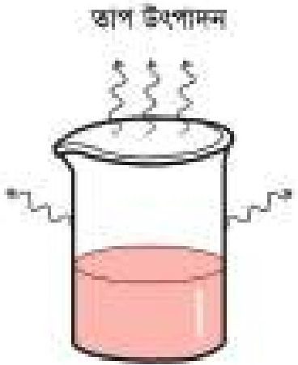

<!-- chemistry-9-10-bn-c08-t8.1-p021 · figure · p.172 -->
**চিত্র ৮.০১: তাপ উৎপাদন ও তাপ শোষণ**

<!-- chemistry-9-10-bn-c08-t8.1-p022 · text · p.172 · review: verify-formula -->
আবার, তাপহারা বিক্রিয়ায় ক্ষেত্রে বিক্রিয়কসমূহের মোট অভ্যন্তরীণ শক্তি $H_1$ উৎপাদসমূহের মোট অভ্যন্তরীণ শক্তি $H_2$ থেকে কম। কাজেই এ বিক্রিয়াতে তাপ শক্তির পরিবর্তন $\Delta H = H_2 - H_1$ এর মান ধনাত্মক। এ ধরনের বিক্রিয়ায় শক্তি প্রয়োগ করা না হলে বিক্রিয়া ঘটে না।

<!-- chemistry-9-10-bn-c08-t8.1-p023 · text · p.172 · review: latin-junk,known-confusable-corrected,verify-formula -->
**যেমন:** কোনো বিক্রিয়ায় বিক্রিয়কসমূহের মোট অভ্যন্তরীণ শক্তি 70 kJ/mol এবং উৎপাদসমূহের মোট অভ্যন্তরীণ শক্তি 80 kJ/mol হলে $\Delta H = (80 - 70)$ kJ/mol = +10 kJ/mol। অর্থাৎ এ ক্ষেত্রে কমপক্ষে 10 kj শক্তি প্রয়োগ করতে হবে। তা না হলে বিক্রিয়া ঘটবে না।

### তাপোৎপাদী বিক্রিয়া (Exothermic Reactions)

<!-- chemistry-9-10-bn-c08-t8.1-p024 · text · p.172 · review: verify-formula -->
যে বিক্রিয়ায় তাপ উৎপন্ন হয় তাকে তাপোৎপাদী বিক্রিয়া বলা হয়। তাপোৎপাদী বিক্রিয়ার সমীকরণ লেখার সময় বিক্রিয়ার ডানপাশে উৎপাদের সাথে + চিহ্ন দিয়ে তাপ লেখা যেতে পারে কিংবা $\Delta H$ দিয়ে বিক্রিয়ায় উৎপাদিত তাপ প্রকাশ করা যেতে পারে, এ ক্ষেত্রে $\Delta H$ এর মান ঋণাত্মক হবে। তোমরা দেখেছ, কোনো কিছু রান্না করতে চুলাতে জ্বালানি হিসেবে যে গ্যাস ব্যবহার করি তা পোড়ালে তাপ উৎপন্ন হয়। আবার শুকনা চুন পানিতে যোগ করলে তা গরম হয়ে ওঠে। রান্নার গ্যাসের প্রধান উপাদান হলো মিথেন (CH4)। এ গ্যাস পোড়ালে প্রতি 1 মোল মিথেন গ্যাস বাতাসের অক্সিজেনের সাথে বিক্রিয়া করে কার্বন ডাই-অক্সাইড আর পানি উৎপন্ন হয়। সেই সাথে 890 kJ তাপও উৎপন্ন হয়।

<!-- chemistry-9-10-bn-c08-t8.1-p025 · text · p.173 · review: verify-formula -->
$$CH_4(g) + 2O_2(g) \longrightarrow CO_2(g) + 2H_2O(g) + 890\ kJ/mol$$
মিথেন অক্সিজেন কার্বন ডাই-অক্সাইড জলীয় বাষ্প

<!-- chemistry-9-10-bn-c08-t8.1-p026 · text · p.173 -->
বা

<!-- chemistry-9-10-bn-c08-t8.1-p027 · text · p.173 · review: verify-formula -->
$$CH_4(g) + 2O_2(g) \longrightarrow CO_2(g) + 2H_2O(g) \ ;\ \Delta H = -890\ kJ/mol$$
মিথেন অক্সিজেন কার্বন ডাই-অক্সাইড জলীয় বাষ্প

<!-- chemistry-9-10-bn-c08-t8.1-p028 · text · p.173 -->
আবার, শুকনা চুন হলো ক্যালসিয়াম অক্সাইড (CaO)। ক্যালসিয়াম অক্সাইডে পানি যোগ করলে ক্যালসিয়াম হাইড্রোক্সাইড Ca(OH)2 উৎপন্ন হয়। সেই সাথে 63.95 kJ/mol তাপ উৎপন্ন হয়। সেজন্যই এ মিশ্রণ গরম হয়ে ওঠে।

<!-- chemistry-9-10-bn-c08-t8.1-p029 · text · p.173 · review: verify-formula -->
$$CaO(s) + 2H_2O(l) \longrightarrow Ca(OH)_2(aq) + 63.95\ kJ/mol$$
ক্যালসিয়াম অক্সাইড পানি ক্যালসিয়াম হাইড্রোক্সাইড

<!-- chemistry-9-10-bn-c08-t8.1-p030 · text · p.173 -->
বা

<!-- chemistry-9-10-bn-c08-t8.1-p031 · text · p.173 · review: verify-formula -->
$$CaO(s) + 2H_2O(l) \longrightarrow Ca(OH)_2(aq) \ ;\ \Delta H = -63.95\ kJ/mol$$
ক্যালসিয়াম অক্সাইড পানি ক্যালসিয়াম হাইড্রোক্সাইড

<!-- chemistry-9-10-bn-c08-t8.1-p032 · text · p.173 -->
উপরের দুটি উদাহরণেই বিক্রিয়কের অভ্যন্তরীণ শক্তি উৎপাদের অভ্যন্তরীণ শক্তি থেকে বেশি। তাই বিক্রিয়ক যখন উৎপাদে পরিণত হয় তখন অতিরিক্ত শক্তিটুকু তাপশক্তি আকারে নির্গত হয়।

### তাপহারী বিক্রিয়া (Endothermic Reactions)

<!-- chemistry-9-10-bn-c08-t8.1-p033 · figure · p.173 · review: latin-junk -->

<!-- chemistry-9-10-bn-c08-t8.1-p034 · text · p.173 · review: known-confusable-corrected -->
চিত্র ৮.০২: বিনুকের খোলস থেকে চুন তৈরি

<!-- chemistry-9-10-bn-c08-t8.1-p035 · text · p.173 · review: verify-formula -->
তাপ প্রদান করে যে বিক্রিয়া ঘটেনো হয় সেই বিক্রিয়াকে তাপহারী বিক্রিয়া বলা হয়। তাপহারী বিক্রিয়াকে তাপশোষী বিক্রিয়াও বলা হয়। তাপহারী বিক্রিয়ার সমীকরণ লেখার সময় বিক্রিয়ার বামপাশে বিক্রিয়কের সাথে + চিহ্ন দিয়ে তাপ লেখা যেতে পারে। কিন্তু $\Delta H$ দিয়ে লিখলে $\Delta H$ এর মান ধনাত্মক হবে। গ্রামে শামুক বা বিনুকের খোলস থেকে চুন তৈরি করা হয়। অনেকগুলো শামুক বা বিনুকের খোলস একসাথে জড়ো করে আগুন জ্বালিয়ে সেগুলোকে উত্তপ্ত করা হয়। এতে খোলসগুলো থেকে চুন তৈরি হয়। আসলে বিনুক বা শামুকের খোলসগুলোতে প্রায় ৯৪% ক্যালসিয়াম কার্বনেট (CaCO3) থাকে। আগুনের তাপে এ ক্যালসিয়াম কার্বনেট ভেঙে গিয়ে ক্যালসিয়াম অক্সাইড এবং কার্বন ডাই-অক্সাইড তৈরি হয়। ক্যালসিয়াম অক্সাইড হচ্ছে চুন, সেটি পড়ে থাকে আর কার্বন ডাই-অক্সাইড বাতাসের সাথে মিশে যায়।

<!-- chemistry-9-10-bn-c08-t8.1-p036 · formula · p.174 · review: verify-formula -->
$$CaCO_3(s) + 176.8  kJ/mole \longrightarrow CaO(s) + CO_2(g)$$

<!-- chemistry-9-10-bn-c08-t8.1-p037 · text · p.174 -->
ক্যালসিয়াম কার্বনেট                      ক্যালসিয়াম অক্সাইড      কার্বন ডাই-অক্সাইড

<!-- chemistry-9-10-bn-c08-t8.1-p038 · text · p.174 -->
বা

<!-- chemistry-9-10-bn-c08-t8.1-p039 · formula · p.174 · review: verify-formula -->
$$CaCO_3(s) \longrightarrow CaO(s) + CO_2(g) \quad ; \quad \Delta H = 176.8  kJ/mole$$

<!-- chemistry-9-10-bn-c08-t8.1-p040 · text · p.174 -->
ক্যালসিয়াম কার্বনেট                      ক্যালসিয়াম অক্সাইড      কার্বন ডাই-অক্সাইড

### ৮.১.৩ বন্ধন শক্তি হিসাব করে রাসায়নিক বিক্রিয়ায় তাপের পরিবর্তনের হিসাব

<!-- chemistry-9-10-bn-c08-t8.1-p041 · text · p.174 · review: verify-formula -->
রাসায়নিক বিক্রিয়ায় তাপের পরিবর্তন বা $\Delta H$ এর মান দুইভাবে হিসাব করা হয়। (১) অভ্যন্তরীণ শক্তি ব্যবহার করে এবং (২) বন্ধন শক্তি ব্যবহার করে।

<!-- chemistry-9-10-bn-c08-t8.1-p042 · text · p.174 · review: verify-formula -->
যদি অভ্যন্তরীণ শক্তি ব্যবহার করা হয় তাহলে উৎপাদসমূহের মোট অভ্যন্তরীণ শক্তি থেকে বিক্রিয়কসমূহের মোট অভ্যন্তরীণ শক্তি বাদ দিয়ে $\Delta H$ এর মান হিসাব করা হয়। আর যদি বন্ধন শক্তি ব্যবহার করা হয় তাহলে বিক্রিয়কসমূহের মোট বন্ধন শক্তি থেকে উৎপাদসমূহের মোট বন্ধন শক্তি বাদ দিয়ে $\Delta H$ এর মান হিসাব করা হয়। যেভাবে হিসাব করা হউক না কেন, বিক্রিয়ার $\Delta H$ এর মান একই থাকে।

<!-- chemistry-9-10-bn-c08-t8.1-p043 · text · p.174 -->
একটি যৌগের যেকোনো দুইটি পরমাণুর মধ্যকার বন্ধন ভেঙে পরমাণু দুটিকে আলাদা করতে যে শক্তি দিতে হয় তাকে বন্ধন শক্তি বলে। আবার কোনো যৌগের যেকোনো দুইটি পরমাণুর মধ্যে বন্ধন তৈরি হলে যে শক্তি নির্গত হয় তাকেও বন্ধন শক্তি বলে।

<!-- chemistry-9-10-bn-c08-t8.1-p044 · text · p.174 -->
রাসায়নিক বিক্রিয়া সম্পন্ন হওয়ার সময় বিক্রিয়কগুলোর মধ্যে যে বন্ধনগুলো আছে সেই বন্ধনগুলো ভেঙে যায় এবং উৎপাদগুলোর মধ্যে নতুন নতুন বন্ধন তৈরি হয়। বিক্রিয়কগুলোর বন্ধন ভাঙার জন্য শক্তি দিতে হয় এবং উৎপাদগুলোর বন্ধন তৈরি হলে শক্তি নির্গত হয়।

<!-- chemistry-9-10-bn-c08-t8.1-p045 · text · p.174 · review: verify-formula -->
যেকোনো বিক্রিয়ায় বিক্রিয়কগুলোর মোট বন্ধন শক্তিকে $B_1$ দিয়ে এবং উৎপাদসমূহের মোট বন্ধন শক্তিকে $B_2$ দিয়ে চিহ্নিত করা হলে ঐ বিক্রিয়ার তাপ শক্তির পরিবর্তন:

<!-- chemistry-9-10-bn-c08-t8.1-p046 · formula · p.174 · review: verify-formula -->
$$\begin{aligned}
\Delta H &= বিক্রিয়কগুলোর মোট বন্ধন শক্তি  B_1 - উৎপাদগুলোর মোট বন্ধন শক্তি  B_2 \\
&= (বিক্রিয়কগুলোর বন্ধন ভাঙার জন্য দেওয়া মোট শক্তি  B_1) \\
&- (উৎপাদনগুলোর বন্ধন তৈরি হওয়ার জন্য নির্গত হওয়া মোট শক্তি  B_2)
\end{aligned}$$

<!-- chemistry-9-10-bn-c08-t8.1-p047 · text · p.175 · review: verify-formula -->
তাপ উৎপাদী বিক্রিয়ার ক্ষেত্রে $B_1$ এর মান $B_2$ থেকে কম। এজন্য তাপ উৎপাদী বিক্রিয়ার ক্ষেত্রে $\Delta H$ এর মান ঋণাত্মক। অন্যদিকে তাপহারা বিক্রিয়ার ক্ষেত্রে $B_1$ এর মান $B_2$ থেকে বেশি। এজন্য তাপহারা বিক্রিয়ার ক্ষেত্রে $\Delta H$ এর মান ধনাত্মক। নিচের তালিকায় কিছু বন্ধনের বন্ধন শক্তি উপস্থাপন করা হলো।

<!-- chemistry-9-10-bn-c08-t8.1-p048 · table · p.175 · review: verify-table -->
**টেবিল ৮.০১: বন্ধন এবং বন্ধন শক্তি**
<table><tr><th>বন্ধন</th><th>বন্ধন শক্তি (কিলোজুল/মোল)</th></tr>
<tr><td>C-H</td><td>414</td></tr>
<tr><td>C-Cl</td><td>326</td></tr>
<tr><td>C-C</td><td>344</td></tr>
<tr><td>C=C</td><td>615</td></tr>
<tr><td>N≡N</td><td>946</td></tr>
<tr><td>Br-Br</td><td>193</td></tr>
<tr><td>O-O</td><td>143</td></tr>
<tr><td>H-Cl</td><td>431</td></tr>
<tr><td>H-I</td><td>299</td></tr>
<tr><td>C=O</td><td>724</td></tr></table>

<!-- chemistry-9-10-bn-c08-t8.1-p049 · table · p.175 · review: verify-table -->
<table><tr><th>বন্ধন</th><th>বন্ধন শক্তি (কিলোজুল/মোল)</th></tr>
<tr><td>N-H</td><td>391</td></tr>
<tr><td>O-H</td><td>464</td></tr>
<tr><td>O=O</td><td>498</td></tr>
<tr><td>C≡C</td><td>812</td></tr>
<tr><td>Cl-Cl</td><td>244</td></tr>
<tr><td>I-I</td><td>151</td></tr>
<tr><td>H-H</td><td>436</td></tr>
<tr><td>H-Br</td><td>366</td></tr>
<tr><td>H-F</td><td>563</td></tr>
<tr><td>C-O</td><td>350</td></tr></table>

<!-- chemistry-9-10-bn-c08-t8.1-p050 · text · p.175 -->
8.01 তালিকা থেকে দেখা যায়, O=O এর বন্ধন শক্তি 498 কিলোজুল/মোল। এ তথ্য থেকে বোঝা যায় 1 মোল O=O বন্ধনকে ভাঙতে 498 কিলোজুল তাপ দিতে হয়। অথবা অন্যভাবে বলা যায় 1 মোল O=O বন্ধন তৈরি হতে 498 কিলোজুল তাপ নির্গত হয়।

### উদাহরণ

<!-- chemistry-9-10-bn-c08-t8.1-p051 · example · p.175 · review: verify-formula -->
**সমস্যা:** $CH_4 + Cl_2 \rightarrow CH_3Cl + HCl$ বিক্রিয়ার বিক্রিয়া তাপের পরিবর্তন ($\Delta H$) হিসাব করো।

<!-- chemistry-9-10-bn-c08-t8.1-p052 · text · p.175 -->
দেওয়া আছে, C-H বন্ধন শক্তি 414 কিলোজুল/মোল, C-Cl বন্ধন শক্তি 326 কিলোজুল/মোল, Cl-Cl বন্ধন শক্তি 244 কিলোজুল/মোল, H-Cl বন্ধন শক্তি 431 কিলোজুল/মোল।

<!-- chemistry-9-10-bn-c08-t8.1-p053 · text · p.175 · review: verify-formula -->
**সমাধান:** $CH_4 + Cl_2 \rightarrow CH_3Cl + HCl$ এই বিক্রিয়ায় বিক্রিয়কগুলোর এক মোল C-H বন্ধন ও এক মোল Cl-Cl বন্ধন ভেঙেছে এবং উৎপাদসমূহের এক মোল C-Cl বন্ধন ও এক মোল H-Cl বন্ধন তৈরি হয়েছে।

<!-- chemistry-9-10-bn-c08-t8.1-p054 · text · p.176 · review: verify-formula -->
কাজেই, বিক্রিয়কগুলোর বন্ধন ভাঙার জন্য প্রদত্ত মোট শক্তি = (414 + 244) kJ = 658 kJ
উৎপাদগুলোর বন্ধন তৈরি হতে নির্গত মোট শক্তি = (326 + 431) kJ = 757 kJ
কাজেই বিক্রিয়া তাপের পরিবর্তন, $\Delta H = (658 - 757)  kJ = -99  kJ$

<!-- chemistry-9-10-bn-c08-t8.1-p055 · text · p.176 · review: verify-formula -->
যেহেতু $\Delta H$ এর মান ঋণাত্মক সেহেতু এটি তাপ উৎপাদী বিক্রিয়া। এই বিক্রিয়ায় 99 কিলোজুল/মোল তাপ উৎপন্ন হয়।

## 8.2 রাসায়নিক শক্তির ব্যবহার (Uses of Chemical Energy)

<!-- chemistry-9-10-bn-c08-t8.2-p001 · text · p.176 -->
রাসায়নিক শক্তিকে বিভিন্ন শক্তিতে রূপান্তরিত করে আমরা বিভিন্নভাবে ব্যবহার করতে পারি।

### ৮.২.১ রাসায়নিক শক্তিকে অন্য প্রকারের শক্তিতে রূপান্তর

<!-- chemistry-9-10-bn-c08-t8.2-p002 · text · p.176 -->
রাসায়নিক শক্তি তাপ, আলো, বিদ্যুৎ, শব্দ বা যান্ত্রিক ইত্যাদি যেকোনো শক্তিতে রূপান্তর হতে পারে। নিচে কিছু উদাহরণ দেওয়া হলো।

### জ্বালানি পোড়ানো

<!-- chemistry-9-10-bn-c08-t8.2-p003 · text · p.176 · review: known-confusable-corrected -->
কয়লা, প্রাকৃতিক গ্যাস, কাঠ ইত্যাদি পোড়ালে আমরা তাপ ও আলো পাই। তাপ ও আলো মূলত এ পদার্থগুলোর মধ্যে বিদ্যমান রাসায়নিক শক্তি থেকে পাওয়া যায়। দহন বা পোড়ানো হলো কোনো পদার্থকে বায়ুর অক্সিজেনের সাথে বিক্রিয়া করানো। প্রাকৃতিক গ্যাসের প্রধান উপাদান হলো মিথেন (CH4)। মিথেনে যখন দহন ঘটে অর্থাৎ মিথেনকে যখন অক্সিজেনের সাথে বিক্রিয়া ঘটানো হয় তখন কার্বন ডাই-অক্সাইড, জলীয় বাষ্প, তাপ এবং আলো সৃষ্টি হয়।

### আতশ-বাজি

<!-- chemistry-9-10-bn-c08-t8.2-p004 · text · p.176 -->
তোমরা বড় কোনো অনুষ্ঠানের রাতে আকাশে যে আতশবাজি দেখো সেখান থেকে আলো ও শব্দ পাওয়া যায়। আতশবাজির ভিতরে যে রাসায়নিক পদার্থগুলো থাকে তাদের মধ্যে রাসায়নিক বিক্রিয়া ঘটে। ফলে রাসায়নিক শক্তি আলো ও শব্দ এ দুই শক্তিতে রূপান্তরিত হয়।

### ড্রাই সেল

<!-- chemistry-9-10-bn-c08-t8.2-p005 · text · p.176 · review: known-confusable-corrected -->
তোমরা সবাই ব্যাটারি দেখেছ। টর্চলাইট, দেওয়াল ঘড়ি, কম্পিউটারের মাউস বা টেলিভিশনের রিমোট ইত্যাদিতে যে পেনসিল ব্যাটারি ব্যবহার করা হয়, সেগুলো আসলে ড্রাই সেল (ব্যাটারি বা ড্রাই সেল সম্বন্ধে এ অধ্যায়ে পরবর্তী অংশে আমরা আরও জানতে পারব)। ড্রাই সেলের মধ্যে যে সকল রাসায়নিক পদার্থ থাকে তাদের মধ্যে রাসায়নিক বিক্রিয়া ঘটে। আর এই রাসায়নিক বিক্রিয়ার ফলে রাসায়নিক শক্তি বিদ্যুৎ শক্তিতে রূপান্তরিত হয়।

### ডেনিয়েল সেল

<!-- chemistry-9-10-bn-c08-t8.2-p006 · text · p.177 -->
জিংক সালফেট লবণের দ্রবণের মধ্যে জিংক ধাতুর দণ্ড এবং কপার সালফেট লবণের দ্রবণের মধ্যে কপার ধাতুর দণ্ড ব্যবহার করে ডেনিয়েল সেল তৈরি করা হয়। এতে নিচের বিক্রিয়া ঘটে:

<!-- chemistry-9-10-bn-c08-t8.2-p007 · formula · p.177 · review: verify-formula -->
$$Zn(s) + CuSO_4(aq) \longrightarrow ZnSO_4 (aq) + Cu(s)$$

<!-- chemistry-9-10-bn-c08-t8.2-p008 · text · p.177 -->
এ বিক্রিয়ার মাধ্যমে রাসায়নিক শক্তি বিদ্যুৎ শক্তিতে রূপান্তরিত হয়।

### ৮.২.২ রাসায়নিক শক্তি থেকে রূপান্তরিত বিভিন্ন শক্তির ব্যবহার

<!-- chemistry-9-10-bn-c08-t8.2-p009 · text · p.177 -->
ইতোমধ্যে আমরা জেনেছি, পদার্থের মধ্যে রাসায়নিক শক্তি সঞ্চিত থাকে। এ শক্তিকে পরবর্তীকালে বিভিন্ন শক্তিতে রূপান্তর করে আমরা বিভিন্ন কাজে লাগাই। পৃথিবীতে সকল প্রকার শক্তির মাঝে রাসায়নিক শক্তি সবচেয়ে বেশি ব্যবহৃত হয়।

<!-- chemistry-9-10-bn-c08-t8.2-p010 · text · p.177 · review: known-confusable-corrected -->
রান্নার কাজে আমরা জ্বালানি হিসেবে কাঠ বা প্রাকৃতিক গ্যাস ব্যবহার করি। কাঠ বা প্রাকৃতিক গ্যাস পোড়ালে এদের ভিতরের রাসায়নিক শক্তি তাপশক্তিতে রূপান্তরিত হয়। কাঠ পোড়ালে যে তাপ পাওয়া যায় সে তাপ ব্যবহার করে রান্না করা হয়, ইটের ভাটায় ইটসহ মাটির বিভিন্ন পাত্র তৈরি করা হয়। লোহা, ইস্পাত বা সিরামিকস প্রভৃতি কারখানায় প্রচুর তাপের প্রয়োজন হয়। এক্ষেত্রে কয়লা, পেট্রোলিয়াম ও প্রাকৃতিক গ্যাস ইত্যাদি খনিজ জ্বালানি তাপ ইঞ্জিনে ব্যবহার করা হয়। এ জ্বালানি ইঞ্জিনের দহন চেষ্টারে পুড়িয়ে যে তাপশক্তি উৎপন্ন হয় তাকে যান্ত্রিক শক্তিতে রূপান্তরিত করে মোটর গাড়ি, জাহাজ, বিমান, রেলগাড়ি ইত্যাদি চালানো হয়।

<!-- chemistry-9-10-bn-c08-t8.2-p011 · text · p.177 -->
রাসায়নিক শক্তির কথা বলতে গেলে প্রথমেই সালোকসংশ্লেষণ এর উল্লেখ করতে হয়। উদ্ভিদের সবুজ অংশে ক্লোরোফিল থাকে, এই ক্লোরোফিলের সহায়তায় সূর্যের আলো উদ্ভিদে মাটি থেকে মূল দিয়ে শোষিত পানি ও বায়ু থেকে শোষিত কার্বন ডাই-অক্সাইডের মধ্যে বিক্রিয়া ঘটিয়ে গ্লুকোজ (C6H12O6) নামক শর্করা তৈরি করে, সেই সাথে অক্সিজেনও উৎপন্ন হয়। এ অক্সিজেন উদ্ভিদ থেকে বের হয়ে বাতাসে মিশে যায়। এ বিক্রিয়াটিকেই আমরা সালোকসংশ্লেষণ বলি। তবে সালোকসংশ্লেষণ ঘটাতে উদ্ভিদ যে সূর্যালোক ব্যবহার করে তা রাসায়নিক শক্তি হিসেবে শর্করার মধ্যে সঞ্চিত হয়।

<!-- chemistry-9-10-bn-c08-t8.2-p012 · figure · p.177 -->
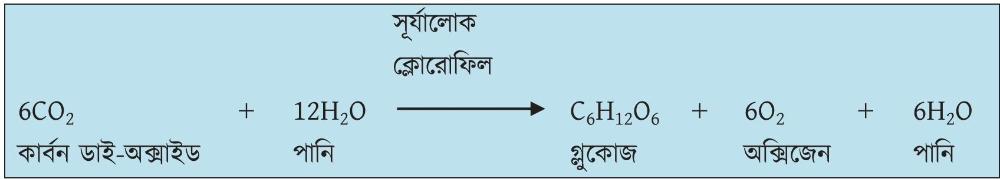

<!-- chemistry-9-10-bn-c08-t8.2-p013 · figure · p.177 -->
**চিত্র ৮.০৩: সালোকসংশ্লেষণ প্রক্রিয়া**

<!-- chemistry-9-10-bn-c08-t8.2-p014 · text · p.178 -->
এছাড়া উদ্ভিদ ও প্রাণীদেহে প্রোটিন ও চর্বি জাতীয় পদার্থ তৈরি হয়। এগুলোতেও রাসায়নিক শক্তি মজুদ থাকে। মানুষ ও অন্যান্য প্রাণিকুল এগুলো খাদ্য হিসেবে গ্রহণ করে। উদ্ভিদ ও প্রাণীদেহকে রাসায়নিক যন্ত্র বলা যেতে পারে যেখানে উদ্ভিদ এ শর্করা, প্রোটিন ও চর্বি জাতীয় খাদ্য থেকে রাসায়নিক শক্তি উৎপন্ন হয়। এ শক্তি তাপশক্তি বা অন্যান্য প্রকার শক্তিতে রূপান্তরিত হয়। এ শক্তি ব্যবহার করে উদ্ভিদ ও প্রাণিকুল বিভিন্ন জৈবিক কার্যকলাপ করে। কাজেই বুঝতেই পারছো রাসায়নিক শক্তি ছাড়া প্রাণের অস্তিত্ব অসম্ভব।

### ৮.২.৩ রাসায়নিক শক্তির যথাযথ ব্যবহার

<!-- chemistry-9-10-bn-c08-t8.2-p015 · text · p.178 -->
পেট্রোলিয়াম, কয়লা, প্রাকৃতিক গ্যাস এগুলোকে জীবাশ্ম জ্বালানি বলে। এসব জ্বালানির মাঝে রাসায়নিক শক্তি জমা থাকে। এসব জ্বালানির দহন ঘটিয়ে বা জ্বালানিকে অক্সিজেনে পুড়িয়ে জ্বালানির মধ্যে বিদ্যমান রাসায়নিক শক্তি থেকে আমরা তাপশক্তি পাই। এই তাপশক্তি ব্যবহার করে আমরা রান্না, গাড়ি চালানো, বিদ্যুৎ উৎপাদনসহ নানা ধরনের কাজ করি।

<!-- chemistry-9-10-bn-c08-t8.2-p016 · text · p.178 -->
এসব জীবাশ্ম জ্বালানি পোড়ালে একদিকে যেমন আমরা তাপশক্তি পাই, অন্যদিকে এই জীবাশ্ম জ্বালানি থেকে প্রচুর পরিমাণে কার্বন মনো-অক্সাইড ও কার্বন ডাই-অক্সাইড গ্যাস উৎপন্ন করে। এই গ্যাসগুলো পরিবেশের স্ক্রতি করে। প্রতিবছর জীবাশ্ম জ্বালানি পোড়ানোর ফলে 21.3 বিলিয়ন টন কার্বন ডাই-অক্সাইড উৎপন্ন হচ্ছে। কার্বন ডাই-অক্সাইড গ্রিনহাউজ গ্যাস অর্থাৎ এটি তাপ ধারণ করে যার ফলে বিশ্ব ধীরে ধীরে উষ্ণ হয়ে উঠছে। আবার কার্বন ডাই-অক্সাইড গ্যাস বৃষ্টির পানির সাথে বিক্রিয়া করে কার্বনিক এসিড (H2CO3) তৈরি করছে, যা বৃষ্টির পানির সাথে মেশিতে পড়ছে। একে আমরা এসিড বৃষ্টি বলা। এসিড বৃষ্টি পরিবেশের অনেক স্ক্রতি করে। জীবাশ্ম জ্বালানির ব্যবহারের ফলে সূক্ষ্ট এ সকল কারণে এক সময় পৃথিবীতে জীবের অস্তিত্ব হুমকির মুখে পড়বে। তাই জীবাশ্ম জ্বালানির পরিমিত ব্যবহার করা উচিত। কোনোভাবেই প্রয়োজনের অতিরিক্ত জীবাশ্ম জ্বালানি ব্যবহার করা উচিত নয়। পৃথিবীতে যে পরিমাণ জীবাশ্ম জ্বালানি আছে তার চেয়ে বেশি জীবাশ্ম জ্বালানি তৈরি হবে না। জীবাশ্ম জ্বালানি অতিরিক্ত ব্যবহার করলে এক সময় জীবাশ্ম জ্বালানি শেষ হয়ে যাবে। জীবাশ্ম জ্বালানির পরিমিত ব্যবহার নিশ্চিত করতে পারলে অর্থাৎ প্রয়োজনের অতিরিক্ত জীবাশ্ম জ্বালানি ব্যবহার না করলে পৃথিবীতে জীবাশ্ম জ্বালানির ব্যবহারের উপর চাপ কমবে এবং পরিবেশের জন্যও কল্যাণকর হবে।

### ৮.২.৪ জ্বালানির বিশুদ্ধতার গুরুত্ব

<!-- chemistry-9-10-bn-c08-t8.2-p017 · text · p.179 · review: known-confusable-corrected -->
রাসায়নিক শক্তির আধার হিসেবে আমরা নানা ধরনের জ্বালানি ব্যবহার করি। বিশেষ করে কাঠ, প্রাকৃতিক গ্যাস, পেট্রোলিয়াম প্রভৃতি আমরা প্রতিনিয়ত ব্যবহার করে যাচ্ছি। এ সমস্ত জ্বালানি বিশুদ্ধ হওয়া একান্ত জরুরি। সর্বপায়্যায় উপস্থিতিতে এসব জ্বালানি পোড়ালে কার্বন ডাই-অক্সাইডের সাথে কার্বন মনোক্সাইড উৎপন্ন হয়, যেটি বিষাক্ত একটি গ্যাস। এ গ্যাস আমাদের শরীরের জন্য অত্যন্ত ক্ষতিকর। প্রকৃতিতে যে জ্বালানি পাওয়া যায়, সেগুলো মূলত অবিশুদ্ধ থাকে। এর সাথে নাইট্রোজেন, সালফার, ফসফরাস প্রভৃতি মৌলের বিভিন্ন যৌগ মিশ্রিত থাকে। সেজন্য বাজারে এসব জ্বালানি ছাড়া আগে যথেষ্ট পরিমাণে বিশুদ্ধ করে নেওয়া দরকার। বিশুদ্ধ না করে এসব জ্বালানি পোড়ালে কার্বন ডাই-অক্সাইড গ্যাসের সাথে এসব মৌলের অক্সাইডও বাতাসে চলে আসে। এসব অক্সাইড বৃষ্টির পানির সাথে মিশে এসিড তৈরি করে। ফলে তখন যে বৃষ্টি হয় তার সাথে এ এসিডগুলো যথেষ্ট পরিমাণে মিশ্রিত থাকে। এ বৃষ্টিকে এসিড বৃষ্টি বলে। এসিড বৃষ্টি সৃষ্টিতে সংশ্লিষ্ট রাসায়নিক বিক্রিয়াসমূহ:

<!-- chemistry-9-10-bn-c08-t8.2-p018 · text · p.179 · review: verify-formula -->
$$CO_2 + H_2O \longrightarrow H_2CO_3$$
কার্বন ডাই-অক্সাইড + পানি $\rightarrow$ কার্বনিক এসিড

<!-- chemistry-9-10-bn-c08-t8.2-p019 · text · p.179 · review: verify-formula -->
$$2SO_2 + O_2 \longrightarrow 2SO_3$$
সালফার ডাই-অক্সাইড + অক্সিজেন $\rightarrow$ সালফার ট্রাইঅক্সাইড

<!-- chemistry-9-10-bn-c08-t8.2-p020 · text · p.179 · review: verify-formula -->
$$2SO_3 + 2H_2O \longrightarrow 2H_2SO_4$$
সালফার ট্রাই-অক্সাইড + পানি $\rightarrow$ সালফিউরিক এসিড

<!-- chemistry-9-10-bn-c08-t8.2-p021 · text · p.179 · review: verify-formula -->
$$4NO_2 + 2H_2O + O_2 \longrightarrow 4HNO_3$$
নাইট্রোজেন ডাই-অক্সাইড + পানি + অক্সিজেন $\rightarrow$ নাইট্রিক এসিড

<!-- chemistry-9-10-bn-c08-t8.2-p022 · text · p.179 -->
এসিড বৃষ্টি পরিবেশের জন্য খুবই ক্ষতিকর। গাছপালা মরে যায়। জলাশয়ের পানি অম্লযুক্ত হয়ে যায়। ফলে মাছ ও অন্যান্য জলজ প্রাণীর টিকে থাকা কঠিন হয়ে পড়ে। এছাড়া যানবাহন থেকে নির্গত ধোঁয়ায় কার্বন মনোক্সাইড, নাইট্রাস অক্সাইড ও অব্যবহৃত জ্বালানি (যেমন-মিথেন) ইত্যাদি থাকে। সূর্যের আলোর উপস্থিতিতে এগুলো নানা রাসায়নিক বিক্রিয়ার মাধ্যমে বিভিন্ন বিষাক্ত গ্যাসের ধোঁয়া সৃষ্টি করে। এদেরকে ‘ফটোকেমিক্যাল ধোঁয়া’ (photochemical smog) বলে যা স্বাস্থ্যের জন্য ক্ষতিকর।

### ৮.২.৫ রাসায়নিক শক্তি ব্যবহারের নেতিবাচক প্রভাব

<!-- chemistry-9-10-bn-c08-t8.2-p023 · text · p.180 -->
আমরা শক্তি পাবার জন্য জ্বালানি পোড়াচ্ছি। মূলত আমরা জ্বালানি পোড়ানোর মাধ্যমে রাসায়নিক শক্তিকে ব্যবহার করছি। যদিও বর্তমান বিশ্বে সৌরশক্তি, নিউক্লিয়ার শক্তি, বায়ু শক্তি, স্রোতের শক্তিকেও কাজে লাগানো হচ্ছে, তবু জীবাশ্ম জ্বালানিই আমাদের প্রয়োজনীয় শক্তির সিংহভাগ জোগান দেয়। আমরা আগেই বলেছি, প্রতিবছর জীবাশ্ম জ্বালানি পোড়ানোর ফলে 21.3 বিলিয়ন টন কার্বন ডাই-অক্সাইড উৎপন্ন হচ্ছে। গাছ সালোকসংশ্লেষণ প্রক্রিয়ায় কার্বন ডাই-অক্সাইড গ্রহণ করে। এছাড়া আরও কিছু প্রাকৃতিক প্রক্রিয়ায় এর অনেকটা ব্যবহার হয়। বাকিটুকু পৃথিবীতে থেকে যায়। কার্বন ডাই-অক্সাইড ভারী গ্যাস বলে তা বায়ুমণ্ডলের নিচের অংশেই থাকে। কার্বন ডাই-অক্সাইড বায়ুর অন্যান্য উপাদানের সাথে বিক্রিয়াও করে না। কার্বন ডাই-অক্সাইড প্রচুর পরিমাণে তাপশক্তি ধারণ করতে পারে। ফলে পৃথিবীর তাপমাত্রা দিনে দিনে বেড়ে যাচ্ছে। একে বৈশ্বিক উষ্ণায়ন (global warming) বলে। বৈশ্বিক উষ্ণায়নে পৃথিবীর তাপমাত্রা বেড়ে যাবার কারণে মেরু অঞ্চলের বরফ গলে সেটি সমুদ্রের পানির উচ্চতা বাড়িয়ে দিচ্ছে। যে কারণে বাংলাদেশসহ পৃথিবীর অনেক দেশের বিশাল অংশ পানির নিচে ডুবে যাবে। কার্বন ডাই-অক্সাইড ছাড়াও আরও কিছু গ্যাস আছে যেগুলো পৃথিবীর তাপমাত্রা বৃদ্ধি করছে। তাপমাত্রা বৃদ্ধির এ ঘটনাকে ‘গ্রিনহাউস প্রভাব’ বলে (greenhouse effect)। আর এ সকল গ্যাসকে গ্রিনহাউস গ্যাস বলে। কার্বন ডাইঅক্সাইডের ভূমিকা এক্ষেত্রে অন্যান্য গ্যাসের চেয়ে অনেক বেশি। তোমরা ইতোমধ্যে জেনেছ, জ্বালানি পোড়ানোর ফলে সূষ্ট গ্যাসগুলো এসিড বৃষ্টি সৃষ্টি করে। এছাড়া তোমরা জেনেছ যে জ্বালানি পোড়ানোর ফলে সূষ্ট গ্যাসগুলো ফটোকেমিক্যাল ধোঁয়াও সৃষ্টি করছে।

### ৮.২.৬ ইথানলকে জ্বালানি হিসেবে ব্যবহার

<!-- chemistry-9-10-bn-c08-t8.2-p024 · text · p.180 · review: latin-junk -->
ইথানলের অপর নাম ইথাইল অ্যালকোহল। এর রাসায়নিক সংকেত CH3-CH2-OH। জীবাশ্ম জ্বালানি যেমন কেরোসিন, ডিজেল, পেট্রল প্রভৃতির মতো ইথানলকে পোড়ালেও তাপ উৎপন্ন হয়। তাই জীবাশ্ম জ্বালানির মতো ইথানলকেও তাপ ইঞ্জিনে ব্যবহার করে কলকারখানা, গাড়ি, বিমান, জাহাজ প্রভৃতি চালানো যেতে পারে। উত্তর আমেরিকাসহ অনেক দেশে জীবাশ্ম জ্বালানির সাথে ইথানলকে মিশিয়ে তাপ ইঞ্জিনে ব্যবহার করা হচ্ছে। যুক্তরাষ্ট্রের সব গাড়িতে পেট্রলের সাথে শতকরা 10 ভাগ ইথানল মিশিয়ে জ্বালানি হিসেবে ব্যবহার করা হয়। তাই আমরা যত ইথানলকে জ্বালানি হিসেবে ব্যবহার করব ততই জীবাশ্ম জ্বালানির উপর চাপ কমবে।

## 8.3 তড়িৎ-রাসায়নিক প্রক্রিয়া

### ৮.৩.১ তড়িৎ রাসায়নিক কোষ (Electrochemical cell)

<!-- chemistry-9-10-bn-c08-t8.3-p001 · text · p.181 -->
জ্বালানি পুড়িয়ে যেমন রাসায়নিক শক্তিকে তাপশক্তিতে রূপান্তরিত করা হয় তেমনি এই তাপশক্তিকে আবার বিদ্যুৎ শক্তিতে পরিণত করা যায়। এবার আমরা জানব কীভাবে রাসায়নিক শক্তিকে সরাসরি বিদ্যুৎ শক্তিতে এবং বিদ্যুৎ শক্তিকে ব্যবহার করে রাসায়নিক বিক্রিয়া ঘটানো যায়। যে যন্ত্রের সাহায্যে রাসায়নিক বিক্রিয়া ঘটিয়ে রাসায়নিক শক্তিকে সরাসরি বিদ্যুৎ শক্তিতে অথবা বিদ্যুৎ শক্তি ব্যবহার করে রাসায়নিক বিক্রিয়া ঘটানো হয় তাকে তড়িৎ রাসায়নিক কোষ বলে। তড়িৎ রাসায়নিক কোষে একই বা দুইটি ভিন্ন তড়িৎ বিশ্লেষের দ্রবণে দুইটি ধাতব দণ্ড বা একটি ধাতব দণ্ড ও একটি গ্রাফাইট দণ্ড আংশিক ডুবানো থাকে। অতঃপর দণ্ড দুটিকে একটি ধাতব তার দিয়ে সরাসরি বা ব্যাটারির মাধ্যমে সংযোগ দেওয়া হয়। কোষে ব্যবহৃত ধাতব দণ্ড বা গ্রাফাইট দণ্ডকে তড়িৎদ্বার বা ইলেকট্রোড (Electrode) বলা হয়।

<!-- chemistry-9-10-bn-c08-t8.3-p002 · text · p.181 -->
তড়িৎ রাসায়নিক কোষ দুই প্রকার। যথা-

<!-- chemistry-9-10-bn-c08-t8.3-p003 · text · p.181 -->
(i) **তড়িৎ বিশ্লেষ্য কোষ (Electrolytic Cell):** যে কোষে বাইরের কোনো উৎস থেকে তড়িৎ প্রবাহিত করে কোষের মধ্যে রাসায়নিক বিক্রিয়া ঘটানো যায় সেই কোষকে তড়িৎ বিশ্লেষ্য কোষ বলে।

<!-- chemistry-9-10-bn-c08-t8.3-p004 · text · p.181 -->
(ii) **গ্যালভানিক কোষ (Gavlanic Cell):** যে কোষে রাসায়নিক পদার্থসমূহ বিক্রিয়া করে বিদ্যুৎ শক্তি উৎপাদন করে সেই কোষকে গ্যালভানিক কোষ বলা হয়।

### বিদ্যুৎ পরিবাহী (Conductor)

<!-- chemistry-9-10-bn-c08-t8.3-p005 · text · p.181 -->
যে সকল পদার্থ বিদ্যুৎ পরিবহণ করতে পারে তাদেরকে বিদ্যুৎ পরিবাহী পদার্থ বলে। যেমন- ধাতু, গ্রাফাইট, গলিত লবণ, লবণের দ্রবণ, এসিড ও ক্ষারের দ্রবণ প্রভৃতি বিদ্যুৎ পরিবাহীর উদাহরণ।

<!-- chemistry-9-10-bn-c08-t8.3-p006 · text · p.181 -->
বিদ্যুৎ পরিবহণের কোশলের উপর নির্ভর করে বিদ্যুৎ পরিবাহী দুই প্রকার হতে পারে। যথা: (i) ইলেকট্রনীয় বিদ্যুৎ পরিবাহী এবং (ii) তড়িৎ বিশ্লেষ্য বিদ্যুৎ পরিবাহী।

### ইলেকট্রনীয় বিদ্যুৎ পরিবাহী (Electronic Conductor)

<!-- chemistry-9-10-bn-c08-t8.3-p007 · text · p.181 -->
যেসব পদার্থে ইলেকট্রনের মাধ্যমে বিদ্যুৎ পরিবাহিত হয় সেসব পরিবাহীকে ইলেকট্রনীয় বিদ্যুৎ পরিবাহী বলে। তোমরা জানো ধাতুর মধ্যে ধাতব বন্ধন বিদ্যমান। এখানে প্রচুর পরিমাণে মুক্ত ইলেকট্রন থাকে। গ্রাফাইটেও মুক্ত ইলেকট্রন থাকে। এসব পদার্থে ইলেকট্রনের মাধ্যমে বিদ্যুৎ পরিবাহিত হয়। তাই এসব পরিবাহীকে ইলেকট্রনীয় বিদ্যুৎ পরিবাহী বলে। যেমন- লোহা (Fe), কপার (Cu), নিকেল (Ni), গ্রাফাইট ইত্যাদি ইলেকট্রনীয় বিদ্যুৎ পরিবাহী।

### তড়িৎ বিশ্লেষ্য (Electrolyte)

<!-- chemistry-9-10-bn-c08-t8.3-p008 · text · p.182 -->
যেসব পদার্থ কঠিন অবস্থায় বিদ্যুৎ পরিবহণ করে না কিন্তু গলিত বা দ্রবীভূত অবস্থায় বিদ্যুৎ পরিবহণ করে এবং বিদ্যুৎ পরিবহণের সাথে সাথে ঐ পদার্থের রাসায়নিক পরিবর্তন ঘটেয় তাদেরকে তড়িৎ বিশ্লেষ্য পদার্থ বলে। তড়িৎ বিশ্লেষ্য পদার্থ গলিত বা দ্রবীভূত অবস্থায় আয়নিত হয় থাকে। এই আয়নের মাধ্যমে তড়িৎ বিশ্লেষ্য পদার্থ বিদ্যুৎ পরিবহণ করে। আয়নিক যৌগ এবং কিছু পোলার সমযোজী যৌগ গলিত বা দ্রবীভূত অবস্থায় তড়িৎ বিশ্লেষ্য পরিবাহী হয়। উদাহরণ হিসেবে বলা যায়, সোডিয়াম ক্লোরাইড (NaCl), কপার সালফেট (CuSO4), সালফিউরিক এসিড (H2SO4), ইথানয়িক এসিড (CH3COOH) ইত্যাদি গলিত বা দ্রবীভূত অবস্থায় বিদ্যুৎ পরিবহণ করে।

<!-- chemistry-9-10-bn-c08-t8.3-p009 · text · p.182 -->
তড়িৎ বিশ্লেষ্য আবার দুই প্রকার। যথা:

<!-- chemistry-9-10-bn-c08-t8.3-p010 · text · p.182 -->
**(i) তীব্র তড়িৎ বিশ্লেষ্য (Strong Electrolyte):** যে সকল তড়িৎ বিশ্লেষ্য দ্রবণে বা গলিত অবস্থায় সম্পূর্ণরূপে আয়নিত হয় তাদেরকে তীব্র তড়িৎ বিশ্লেষ্য বলে। যেমন-সোডিয়াম ক্লোরাইড (NaCl), কপার সালফেট (CuSO4), সালফিউরিক এসিড (H2SO4) ইত্যাদি।

<!-- chemistry-9-10-bn-c08-t8.3-p011 · text · p.182 · review: known-confusable-corrected -->
**(ii) মৃদু তড়িৎ বিশ্লেষ্য (Weak Electrolyte):** যে সকল তড়িৎ বিশ্লেষ্য দ্রবণে খুব অল্প পরিমাণে আয়নিত হয় থাকে তাদেরকে মৃদু তড়িৎ বিশ্লেষ্য বলে। যেমন- অ্যামোনিয়াম হাইড্রোক্সাইড, ইথানয়িক এসিড (CH3COOH) ইত্যাদি।

### তড়িৎদ্বার (Electrode)

<!-- chemistry-9-10-bn-c08-t8.3-p012 · text · p.182 -->
তড়িৎ রাসায়নিক কোষে বিগলিত বা দ্রবীভূত তড়িৎ বিশ্লেষ্যের মধ্যে যে দুটি ইলেকট্রনীয় পরিবাহী অর্থাৎ ধাতব দণ্ড বা গ্রাফাইট দণ্ড অর্ধেক ভুবানো থাকে তাদেরকে তড়িৎদ্বার বলা হয়। তড়িৎ রাসায়নিক কোষে একটি তড়িৎদ্বারে পরমাণু বা ঋণাত্মক আয়ন ইলেকট্রন ত্যাগ করে। অর্থাৎ এ তড়িৎদ্বারে জারণ বিক্রিয়া সংঘটিত হয়। অপর তড়িৎ দ্বারে ধনাত্মক আয়ন ইলেকট্রন গ্রহণ করে। অর্থাৎ এ তড়িৎদ্বারে বিজারণ বিক্রিয়া সংঘটিত হয় এবং সম্পূর্ণ কোষের মধ্যে জারণ-বিজারণ বিক্রিয়া সংঘটিত হয়। যে তড়িৎদ্বারে জারণ বিক্রিয়া ঘটে তাকে অ্যানোড তড়িৎদ্বার আর যে তড়িৎদ্বারে বিজারণ বিক্রিয়া ঘটে তাকে ক্যাথোড তড়িৎদ্বার বলে।

### ৮.৩.২ তড়িৎ বিশ্লেষ্য কোষ, তড়িৎ বিশ্লেষণ ও তড়িৎ বিশ্লেষণের কৌশল

<!-- chemistry-9-10-bn-c08-t8.3-p013 · text · p.182 -->
তড়িৎ বিশ্লেষ্য কোষে (Electrolytic cell) বিদ্যুৎ শক্তি ব্যবহার করে রাসায়নিক বিক্রিয়া ঘটানো হয়। গলিত বা দ্রবীভূত অবস্থায় তড়িৎ বিশ্লেষ্যের মধ্য দিয়ে বিদ্যুৎ পরিবহণের সময় উক্ত তড়িৎ বিশ্লেষ্যের যে রাসায়নিক পরিবর্তন ঘটে তাকে তড়িৎ বিশ্লেষণ (Electrolysis) বলা হয়।

<!-- chemistry-9-10-bn-c08-t8.3-p014 · text · p.183 -->
যেমন—গলিত সোডিয়াম ক্লোরাইডের মধ্যে দিয়ে বিদ্যুৎ চালনা করলে অ্যানোডে ক্লোরিন গ্যাস আর ক্যাথোডে সোডিয়াম ধাতু উৎপন্ন হয়। একে সোডিয়াম ক্লোরাইডের তড়িৎ বিশ্লেষণ প্রক্রিয়া বলে।

<!-- chemistry-9-10-bn-c08-t8.3-p015 · formula · p.183 · review: verify-formula -->
$$2NaCl(l) \xrightarrow{electricity} 2Na(s) + Cl_2(g)$$

### গলিত সোডিয়াম ক্লোরাইডের তড়িৎ বিশ্লেষণের কোশল

<!-- chemistry-9-10-bn-c08-t8.3-p016 · text · p.183 · review: verify-formula -->
একটি কাচ বা চিনামাটির পাত্রে গলিত সোডিয়াম ক্লোরাইড নেওয়া হয়। গলিত সোডিয়াম ক্লোরাইডের মধ্যে সোডিয়াম আয়ন ($Na^+$) ও ক্লোরাইড ($Cl^-$) আয়ন থাকে। তরল পদার্থের অন্যান্য কণার মতো সোডিয়াম আয়ন ও ক্লোরাইড আয়ন চলাচল (migrate) করতে পারে। গলিত সোডিয়াম ক্লোরাইডের মধ্যে দুটি ধাতব দণ্ড বা গ্রাফাইট দণ্ড অর্ধেক ভুবানো হয়। এ দণ্ড দুটির একটিকে ব্যাটারির ধনাত্মক প্রান্তে এবং অপরিটিকে ব্যাটারির ঋণাত্মক প্রান্তের সাথে যুক্ত করলে ব্যাটারির ধনাত্মক প্রান্তের সাথে যুক্ত ধনাত্মক তড়িৎদ্বার বা অ্যানোড ঋণাত্মক আধান যুক্ত $Cl^-$ আয়নকে আকর্ষণ করবে, অন্যদিকে ব্যাটারির ঋণাত্মক প্রান্তের সাথে যুক্ত ঋণাত্মক তড়িৎদ্বার বা ক্যাথোড ধনাত্মক আধানযুক্ত $Na^+$ আয়নকে আকর্ষণ করবে। $Cl^-$ আয়ন অ্যানোডে ইলেকট্রন ত্যাগ করে ক্লোরিন গ্যাসে পরিণত হয়।

<!-- chemistry-9-10-bn-c08-t8.3-p017 · figure · p.183 -->
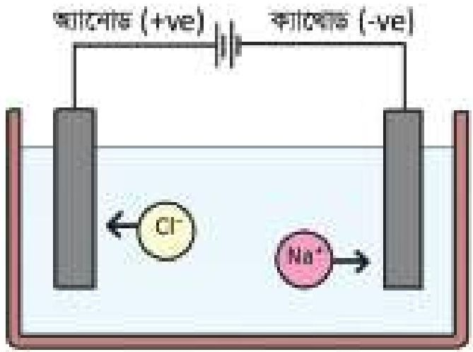

<!-- chemistry-9-10-bn-c08-t8.3-p018 · figure · p.183 -->
**চিত্র ৮.০৪: তড়িৎ বিশ্লেষ্য কোষে সোডিয়াম ক্লোরাইডের তড়িৎ বিশ্লেষণ**

<!-- chemistry-9-10-bn-c08-t8.3-p019 · text · p.183 · review: verify-formula -->
অ্যানোডে জারণ বিক্রিয়া:
$$Cl^- \longrightarrow \frac{1}{2} Cl_2 + e^-$$

<!-- chemistry-9-10-bn-c08-t8.3-p020 · text · p.183 · review: verify-formula -->
অন্যদিকে $Na^+$ ক্যাথোড থেকে ইলেকট্রন গ্রহণ করে ধাতব সোডিয়ামে পরিণত হয়।

<!-- chemistry-9-10-bn-c08-t8.3-p021 · text · p.183 · review: verify-formula -->
ক্যাথোডে বিজারণ বিক্রিয়া:
$$Na^+ + e^- \longrightarrow Na$$

<!-- chemistry-9-10-bn-c08-t8.3-p022 · text · p.183 -->
ক্যাথোড কর্তৃক যে আয়ন আকর্ষিত হয় তাকে ক্যাটায়ন বলে এবং অ্যানোড কর্তৃক যে আয়ন আকর্ষিত হয় তাকে অ্যানায়ন বলে।

### লিটমাস পেপারের সাহায্যে অ্যানোডের ক্লোরিন গ্যাস শনাক্তকরণ

<!-- chemistry-9-10-bn-c08-t8.3-p023 · text · p.183 · review: verify-formula -->
গলিত $NaCl$ এর তড়িৎ বিশ্লেষণের সময় অ্যানোডে উৎপন্ন গ্যাস একটি টেস্টটিউবে সংগ্রহ করে তার মুখে ভিজা নীল লিটমাস পেপার ধরলে লিটমাস পেপারের বর্ণ লাল বর্ণে পরিণত হবে এবং ক্লোরিন গ্যাসের উপস্থিতি প্রমাণ করবে।

<!-- chemistry-9-10-bn-c08-t8.3-p024 · text · p.184 · review: verify-formula -->
$$Cl_2 + H_2O \longrightarrow HCl + HOCl$$
ক্লোরিন পানি হাইড্রোক্লোরিক এসিড হাইপোক্লোরাস এসিড

<!-- chemistry-9-10-bn-c08-t8.3-p025 · text · p.184 -->
যেহেতু ক্লোরিন পানির সাথে বিক্রিয়া করে হাইড্রোক্লোরিক এসিড এবং হাইপোক্লোরাস এসিড উৎপন্ন করে তাই নীল লিটমাস লাল লিটমাসে পরিণত হয়।

### গ্যাড NaCl দ্রবণের তড়িৎ বিশ্লেষণ

<!-- chemistry-9-10-bn-c08-t8.3-p026 · text · p.184 -->
গ্যাড সোডিয়াম ক্লোরাইডের দ্রবণে NaCl আয়নিত হয়ে Na+ ও Cl- আয়ন উৎপন্ন করে।

<!-- chemistry-9-10-bn-c08-t8.3-p027 · text · p.184 · review: verify-formula -->
$$NaCl \longrightarrow Na^+ + Cl^-$$
সোডিয়াম ক্লোরাইড সোডিয়াম আয়ন ক্লোরাইড আয়ন

<!-- chemistry-9-10-bn-c08-t8.3-p028 · text · p.184 -->
গলিত সোডিয়াম ক্লোরাইডের মতো এখানে শুধু এ দুটি আয়নই থাকে না। এখানে পানির অণুও সামান্য পরিমাণে আয়নিত হয়ে H+ এবং OH- তৈরি করে।

<!-- chemistry-9-10-bn-c08-t8.3-p029 · text · p.184 · review: verify-formula -->
$$H_2O \longrightarrow H^+ + OH^-$$
পানি হাইড্রোজেন আয়ন হাইড্রোক্সাইড আয়ন

<!-- chemistry-9-10-bn-c08-t8.3-p030 · text · p.184 -->
তড়িৎ বিশ্লেষ্য কোষে সোডিয়াম ক্লোরাইডের তড়িৎ বিশ্লেষণের সময় বিদ্যুৎ প্রবাহকালে Na+ ও H+ একই সাথে ক্যাথোডের দিকে যাবে। আমরা জানি, Na+ আয়নের চেয়ে H+ আয়নের ইলেকট্রন গ্রহণ করার প্রবণতা বেশি তাই ক্যাথোডে H+ একটি ইলেকট্রন গ্রহণ করে H পরমাণুতে পরিণত হয়। দুটি হাইড্রোজেন পরমাণু পরস্পর যুক্ত হয়ে H2 অণু উৎপন্ন করে।

### ক্যাথোড তড়িৎদ্বারে বিক্রিয়া

<!-- chemistry-9-10-bn-c08-t8.3-p031 · text · p.184 · review: verify-formula -->
$$H^+ + e^- \longrightarrow H  (বিজারণ ক্রিয়া)$$
$$H + H \longrightarrow H_2$$

<!-- chemistry-9-10-bn-c08-t8.3-p032 · text · p.184 -->
অ্যানোডে একই সাথে Cl- ও OH- যায়। আমরা জানি OH- এর ইলেকট্রন দানের প্রবণতা Cl- আয়নের চেয়ে বেশি থাকলেও দ্রবণে Cl- আয়নের ঘনমাত্রা OH- আয়নের ঘনমাত্রার চেয়ে অনেক বেশি বলে OH- এর চেয়ে Cl- আয়ন আগে অ্যানোডে ইলেকট্রন ত্যাগ করে। একটি Cl- আয়ন অ্যানোড তড়িৎদ্বারে একটি ইলেকট্রন ত্যাগ করে একটি Cl পরমাণুতে পরিণত হয়। দুটি ক্লোরিন পরমাণু একসাথে যুক্ত হয়ে Cl2 অণু উৎপন্ন করে।

### অ্যানোড তড়িৎদ্বারে বিক্রিয়া

<!-- chemistry-9-10-bn-c08-t8.3-p033 · text · p.184 · review: latin-junk,known-confusable-corrected,verify-formula -->
$$Cl^- \longrightarrow Cl + e^-  (জারণ ক্রিয়া)$$
$$Cl + Cl \longrightarrow Cl_2$$ পাত্রে Na+ ও OH- থেকে যায়। ফলে Na+ ও OH-একত্র হয়ে NaOH ক্ষার উৎপন্ন করে।

<!-- chemistry-9-10-bn-c08-t8.3-p034 · figure · p.185 -->
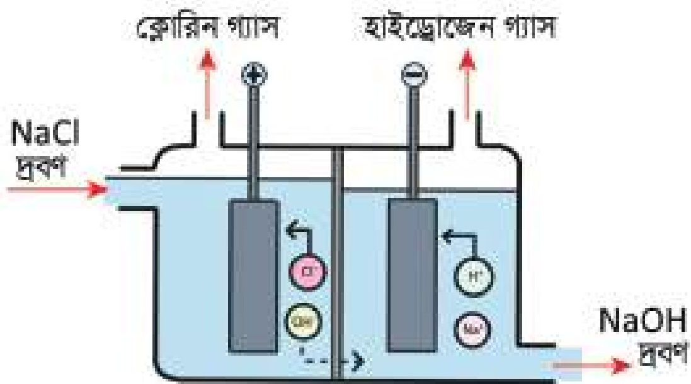

<!-- chemistry-9-10-bn-c08-t8.3-p035 · figure · p.185 -->
**চিত্র ৮.০৫: সোডিয়াম ক্লোরাইড দ্রবণের তড়িৎ বিশ্লেষণ**

<!-- chemistry-9-10-bn-c08-t8.3-p036 · text · p.185 · review: known-confusable-corrected -->
এভাবে কোনো দ্রবণে একের অধিক প্রকারের ক্যাটায়ন ও অ্যানায়ন উপস্থিত থাকলে ক্যাথোডে কোন ক্যাটায়ন আগে গিয়ে চার্জমুক্ত হবে বা অ্যানোডে কোন অ্যানায়ন আগে গিয়ে চার্জমুক্ত হবে তা তিনটি বিষয়ের উপর নির্ভর করে। যেমন-

### (i) ক্যাটায়ন বা অ্যানায়নের চার্জমুক্ত হওয়ার প্রবণতা

<!-- chemistry-9-10-bn-c08-t8.3-p037 · text · p.185 · review: known-confusable-corrected -->
তড়িৎ বিশ্লেষণের সময় দ্রবণে একের অধিক প্রকার ক্যাটায়ন থাকলে ক্যাটায়নসমূহের মধ্যে কোনটি আগে ক্যাথোডে গিয়ে ইলেকট্রন গ্রহণ করে চার্জমুক্ত হবে, কোনটি পরে ইলেকট্রন গ্রহণ করে চার্জমুক্ত হবে তার উপর ভিত্তি করে ক্যাটায়নসমূহকে একটি সারণিতে সাজানো হয়েছে। এই সারণিকে ধাতুর সক্রিয়তা সিরিজ বা ধাতুর তড়িৎ রাসায়নিক সারি বলা হয়। এই সারির যেকোনো দুটি মৌলের মধ্যে যে ধাতুটি উপরে অবস্থিত সেই ধাতুটি অধিক সক্রিয় অর্থাৎ সেই ধাতুটি দ্বত বিক্রিয়া করে। আবার, এই সারির যেকোনো দুটি মৌলের আয়নের মধ্যে যে আয়নটির অবস্থান নিচে অবস্থিত সেটি আগে ইলেকট্রন গ্রহণ করে আগে চার্জমুক্ত হবে অর্থাৎ আগে বিজারিত হবে। যেমন—Na+ এবং H+ এর মধ্যে H+ এর অবস্থান সারির নিচে অবস্থিত কাজেই H+ আগে ইলেকট্রন গ্রহণ করে চার্জমুক্ত হবে অর্থাৎ আগে বিজারিত হবে। আবার, Zn2+ এবং Fe2+ এর মধ্যে তড়িৎ রাসায়নিক সারিতে Fe2+ এর অবস্থান নিচে কাজেই Fe2+ আগে ইলেকট্রন গ্রহণ করে চার্জমুক্ত হবে অর্থাৎ আগে বিজারিত হবে।

<!-- chemistry-9-10-bn-c08-t8.3-p038 · table · p.185 · review: verify-table -->
**টেবিল ৮.০২: তড়িৎ রাসায়নিক সারণি**
<table><tr><th>ক্যাটায়ন</th><th>অ্যানায়ন</th></tr>
<tr><td>Li+</td><td>NO3-</td></tr>
<tr><td>K+</td><td>SO42-</td></tr>
<tr><td>Na+</td><td>Cl-</td></tr>
<tr><td>Mg2+</td><td>Br-</td></tr>
<tr><td>Al3+</td><td>I-</td></tr>
<tr><td>Zn2+</td><td>OH-</td></tr>
<tr><td>Fe2+</td><td></td></tr>
<tr><td>Sn2+</td><td></td></tr>
<tr><td>Pb2+</td><td></td></tr>
<tr><td>H+</td><td></td></tr>
<tr><td>Cu2+</td><td></td></tr>
<tr><td>Ag+</td><td></td></tr>
<tr><td>Au3+</td><td></td></tr></table>

<!-- chemistry-9-10-bn-c08-t8.3-p039 · text · p.185 · review: known-confusable-corrected -->
অনুরূপভাবে তড়িৎ বিশ্লেষণের সময় একের অধিক অ্যানায়ন থাকলে অ্যানোডের অ্যানায়নসমূহের মধ্যে কোনটি আগে ইলেকট্রন ত্যাগ করে চার্জমুক্ত হবে, কোনটি পরে ইলেকট্রন ত্যাগ করে চার্জমুক্ত হবে তার উপর ভিত্তি করে অ্যানায়নসমূহকেও আরও একটি সারণিতে সাজানো হয়েছে। এই সারণিকে অ্যানায়নের তড়িৎ রাসায়নিক সারি বলা হয়। এই সারিতে যেকোনো দুটি আয়নের মধ্যে যে আয়নটি নিচে অবস্থিত সেটি আগে ইলেকট্রন ত্যাগ করে চার্জমুক্ত হবে অর্থাৎ আগে জারিত হবে। যেমন: SO42- এবং Cl- এর মধ্যে Cl- সারির নিচে অবস্থিত। কাজেই Cl- আগে ইলেকট্রন ত্যাগ করে চার্জমুক্ত হবে অর্থাৎ আগে জারিত হবে। আবার, Cl- এবং OH- এর মধ্যে OH- তড়িৎ রাসায়নিক সারির নিচে অবস্থিত। কাজেই OH- আগে ইলেকট্রন ত্যাগ করে চার্জমুক্ত হবে অর্থাৎ আগে জারিত হবে।

### (ii) ক্যাটায়ন ও অ্যানায়নের ঘনমাত্রার প্রভাব

<!-- chemistry-9-10-bn-c08-t8.3-p040 · text · p.186 -->
দ্রবণে একের অধিক ক্যাটায়ন বা অ্যানায়ন থাকলে চার্জমুক্ত হওয়ার প্রবণতার চেয়ে ঘনমাত্রার প্রভাব অনেক বেশি কার্যকর হয়। যেমন— কক্ষ তাপমাত্রায় 0.1 মোলার NaCl এর জলীয় দ্রবণে অ্যানায়ন Cl- এর ঘনমাত্রা হবে 0.1 মোলার। অন্যদিকে, পানির বিয়োজনে উৎপন্ন OH- আয়নের ঘনমাত্রা হবে 10-7 মোলার। অর্থাৎ Cl- আয়নের ঘনমাত্রা OH- আয়নের ঘনমাত্রার চেয়ে 106 গুণ বেশি। চার্জমুক্ত হবার প্রবণতার সারিতে OH- আয়নের অবস্থান Cl- আয়নের নিচে হওয়ায় OH- আয়নের আগে চার্জমুক্ত হবার প্রবণতা বেশি। কিন্তু Cl- আয়নের ঘনমাত্রা বেশি হওয়ায় Cl- আয়ন আগে চার্জমুক্ত হয়।

### (iii) তড়িৎবিশ্লেষণের প্রকৃতি

<!-- chemistry-9-10-bn-c08-t8.3-p041 · text · p.186 -->
তড়িৎবিশ্লেষ্য কোষে তড়িৎবিশ্লেষণের প্রকৃতি অনেক সময় চার্জমুক্ত হওয়ার জন্য উপরের দুইটি নিয়মের ব্যতিক্রম ঘটায়। তোমরা দেখেছ NaCl এর জলীয় দ্রবণে দুই ধরনের ক্যাটায়ন থাকে। একটি Na+ আয়ন, অপরটি H+ আয়ন। যদি প্লাটিনাম তড়িৎবিশ্লেষ্য ব্যবহার করা হয় তবে চার্জমুক্ত হবার প্রবণতা অনুযায়ী ক্যাথোডে H+ আয়ন আগে চার্জমুক্ত হয়ে H2 গ্যাস উৎপন্ন হয়। আর যদি পারদকে ক্যাথোডরূপে ব্যবহার করা হয় তবে Na+ আয়ন আগে চার্জমুক্ত হয়।

### বিশুদ্ধ পানির তড়িৎ বিশ্লেষণ

<!-- chemistry-9-10-bn-c08-t8.3-p042 · text · p.186 -->
বিশুদ্ধ পানিকে তড়িৎ বিশ্লেষণ করতে তড়িৎ বিশ্লেষণ কোষে নিষ্কর্য ধাতুর অ্যানোড ও ক্যাথোড ব্যবহার করা হয়। এক্ষেত্রে প্লাটিনাম ধাতুর পাত অ্যানোড ও ক্যাথোড হিসেবে ব্যবহার করা হয়। পানি সাধারণ পরিমাণে নিম্নরূপে আয়নিত অবস্থায় থাকে:

<!-- chemistry-9-10-bn-c08-t8.3-p043 · formula · p.186 · review: verify-formula -->
$$4H_2O \rightleftharpoons 4H^+ + 4OH^-$$

<!-- chemistry-9-10-bn-c08-t8.3-p044 · text · p.186 -->
পানির বিয়োজন মাত্রা বৃদ্ধি করার জন্য পানিতে কয়েক ফোঁটা সালফিউরিক এসিড যোগ করা হয়।

<!-- chemistry-9-10-bn-c08-t8.3-p045 · text · p.187 -->
এখন ব্যাটারির মাধ্যমে বিদ্যুৎ প্রবাহিত করলে অ্যানোড হাইড্রোক্সাইল আয়ন (OH-) কে আকর্ষণ করে আর ক্যাথোড হাইড্রোজেন আয়নকে (H+) আকর্ষণ করে। তড়িৎদ্বার দুইটিতে নিম্নরূপ বিক্রিয়া ঘটে।

<!-- chemistry-9-10-bn-c08-t8.3-p046 · text · p.187 -->
ক্যাথোড তড়িৎদ্বারে বিক্রিয়া: 4H+ + 4e- → 2H2 (বিজারণ ক্রিয়া)
অ্যানোড তড়িৎদ্বারে বিক্রিয়া: 4OH- → O2 + 2H2O + 4e- (জারণ ক্রিয়া)

<!-- chemistry-9-10-bn-c08-t8.3-p047 · text · p.187 -->
অর্থাৎ ক্যাথোডে হাইড্রোজেন গ্যাস আর অ্যানোডে অক্সিজেন গ্যাস উৎপন্ন হয়।

<!-- chemistry-9-10-bn-c08-t8.3-p048 · figure · p.187 -->
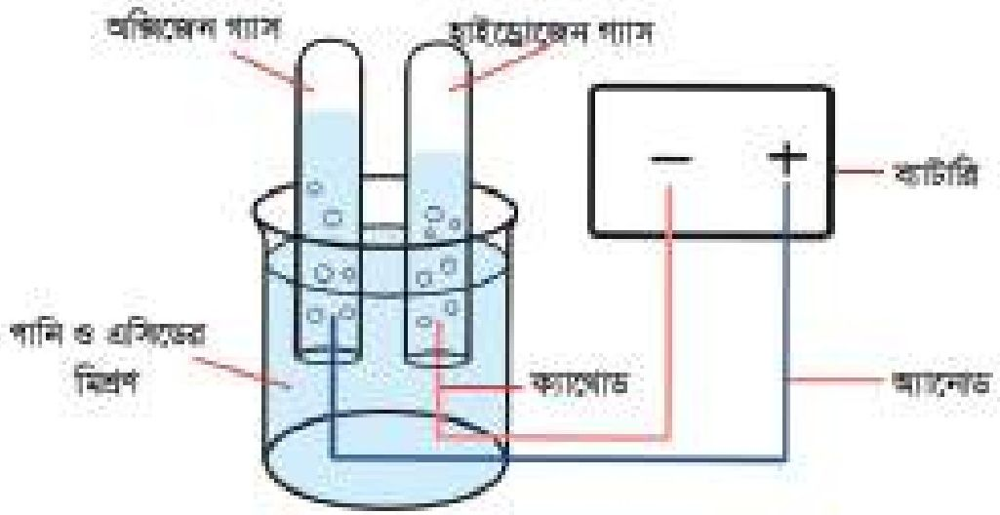

<!-- chemistry-9-10-bn-c08-t8.3-p049 · figure · p.187 -->
**চিত্র ৮.০৬: পানির তড়িৎ বিশ্লেষণ**

<!-- chemistry-9-10-bn-c08-t8.3-p050 · text · p.187 -->
তোমরা হয়তো ভাবছ এখানে কয়েক ফোঁটা সালফিউরিক এসিড কেন ব্যবহার করা হলো? তোমরা জানো একটি পূর্ণ বর্তনী তৈরি না হলে বিদ্যুৎ প্রবাহিত হয় না। অ্যানোড, ক্যাথোড বা ব্যাটারির মধ্যে ইলেকট্রনের মাধ্যমে বিদ্যুৎ প্রবাহিত হয়। কিন্তু তরলের মধ্যে আয়নের মাধ্যমে বিদ্যুৎ প্রবাহিত হয়। পানি খুবই অল্প পরিমাণে আয়নিত হয়। তাই বিশুদ্ধ পানি বিদ্যুৎ অপরিবাহীর মতো আচরণ করে। বিদ্যুৎ পরিবাহিতা বাড়াতে তাই সামান্য পরিমাণ সালফিউরিক এসিড ব্যবহার করা হয়।

### ৮.৩.৩ তড়িৎ বিশ্লেষণের ব্যবহার

<!-- chemistry-9-10-bn-c08-t8.3-p051 · text · p.187 · review: known-confusable-corrected -->
বর্তমানে সমস্ত পৃথিবীতে শিল্পকারখানার ব্যাপক প্রসার ঘটেছে। আর শিল্পজগতে তড়িৎ বিশ্লেষণের ভূমিকা বলে শেষ করা যাবে না। অনেক মূল্যবান যৌগের উৎপাদনে, আকরিক থেকে ধাতু নিষ্কাশনে, অবিশুদ্ধ ধাতুকে বিশুদ্ধ ধাতুতে পরিণত করতে, যে সকল ধাতু সহজে ক্ষয়প্রাপ্ত হয় তাদের ক্ষয় থেকে রক্ষা করতে, লোহার উপর মরিচা পড়া ঠেকাতে, এক ধাতুর উপর অন্য ধাতুর প্রলেপ দিতে তড়িৎ বিশ্লেষণ পদ্ধতি ব্যবহার করা হয় আর তড়িৎ বিশ্লেষণ করতে তড়িৎ বিশ্লেষ্য কোষ ব্যবহার করা হয়। নিচে তড়িৎ বিশ্লেষণের কিছু ব্যবহার দেখানো হলো।

<!-- chemistry-9-10-bn-c08-t8.3-p052 · text · p.187 · review: known-confusable-corrected -->
**ধাতু নিষ্কাশন:** ক্ষার ধাতু, মৃৎক্ষার ধাতু, অ্যালুমিনিয়াম ধাতু প্রভৃতি সক্রিয় ধাতুসমূহ তড়িৎ বিশ্লেষণ পদ্ধতিতে নিষ্কাশন করা হয়। সাধারণত এ সকল ধাতুর যৌগের তরলে অথবা দ্রবণে তড়িৎদ্বার ব্যবহার করে বিদ্যুৎ প্রবাহ চালনা করলে ক্যাথোডে ধাতু নিষ্কাশিত হয়। যেমন— গলিত সোডিয়াম ক্লোরাইডের তড়িৎ বিশ্লেষণের সময় ক্যাথোডে সোডিয়াম ধাতু এবং অ্যানোডে ক্লোরিন গ্যাস (Cl2) পাওয়া যায়।

<!-- chemistry-9-10-bn-c08-t8.3-p053 · text · p.188 -->
গলিত বিশুদ্ধ অ্যালুমিনিয়াম অক্সাইড বা অ্যালুমিনা (Al2O3) এর তড়িৎ বিশ্লেষণ করলে ক্যাথোডে অ্যালুমিনিয়াম ধাতু ও অ্যানোডে অক্সিজেন গ্যাস উৎপন্ন হয়।

<!-- chemistry-9-10-bn-c08-t8.3-p054 · formula · p.188 · review: verify-formula -->
$$Al_2O_3 \rightleftharpoons 2Al^{3+} + 3O^{2-}$$

<!-- chemistry-9-10-bn-c08-t8.3-p055 · text · p.188 · review: verify-formula -->
অ্যানোডে বিক্রিয়া: $3O^{2-} \rightarrow \frac{3}{2} O_2 + 6e^-$
ক্যাথোডে বিক্রিয়া: $2Al^{3+} + 6e^- \rightarrow 2Al$

<!-- chemistry-9-10-bn-c08-t8.3-p056 · text · p.188 -->
**ধাতু বিশুদ্ধকরণ:** আকরিক থেকে ধাতু নিক্ষাশনের পর প্রাপ্ত ধাতুতে যথেষ্ট পরিমাণে ভেজাল দ্বারা মিশ্রিত থাকে। এ সকল ধাতুকে বিশুদ্ধ করতে তড়িৎ বিশ্লেষণ পদ্ধতি অত্যন্ত কার্যকর। কপার, জিংক, লেড, অ্যালুমিনিয়াম প্রভৃতি ধাতুকে বিশুদ্ধকরণের জন্য তড়িৎ বিশ্লেষণ পদ্ধতি ব্যবহার করা হয়। যে ভেজাল মিশ্রিত ধাতু থেকে ভেজাল অপসারণ করে আমরা বিশুদ্ধ ধাতু তৈরি করতে চাই সেই ভেজাল মিশ্রিত ধাতুর দণ্ডকে ব্যাটারির ধনাত্মক প্রান্তের সাথে যুক্ত করা হয়। যে ধাতুকে বিশুদ্ধ করতে চাই ঐ ধাতুর একটি বিশুদ্ধ দণ্ড ব্যাটারির ঋণাত্মক প্রান্তের সাথে যুক্ত করা হয়। এরপর তড়িৎ বিশ্লেষণ পদ্ধতি প্রয়োগ করলে ভেজাল মিশ্রিত অবিশুদ্ধ ধাতুর দণ্ড থেকে ধাতব আয়ন দ্রবণে চলে যায় এবং দ্রবণ থেকে ঐ ধাতব আয়ন বিশুদ্ধ ধাতব দণ্ডে জমা পড়ে, ফলে ব্যাটারির ঋণাত্মক প্রান্তের সাথে যুক্ত বিশুদ্ধ ধাতব দণ্ড মোটা হতে থাকে। তড়িৎ বিশ্লেষণ চলাকালে একদিকে ভেজাল মিশ্রিত অবিশুদ্ধ ধাতব দণ্ড ক্ষয় হতে থাকে, অন্যদিকে বিশুদ্ধ ধাতব দণ্ড মোটা হতে থাকে।

<!-- chemistry-9-10-bn-c08-t8.3-p057 · text · p.188 -->
**ইলেকট্রোপ্লেটিং বা তড়িৎ প্রলেপন:** তড়িৎ বিশ্লেষণের মাধ্যমে একটি ধাতুর উপর অন্য একটি ধাতুর প্রলেপ দেওয়ারকে ইলেকট্রোপ্লেটিং বলে। ধাতুর উজ্জ্বলতা সৃষ্টির জন্য অথবা ধাতুর ক্ষয়রোধ করতে ইলেকট্রোপ্লেটিং পদ্ধতি ব্যবহার করা হয়। কোনো ধাতুর উজ্জ্বলতা সৃষ্টির জন্য অন্য একটি উজ্জ্বল ধাতুর প্রলেপ দেওয়া হয়। কারণ কম সক্রিয় ধাতু বাতাসের অক্সিজেনের সাথে বিক্রিয়া করে না। কোনো ধাতুর ক্ষয়রোধ করতে ঐ ধাতুর উপর অপেক্ষাকৃত কম সক্রিয় অন্য ধাতুর প্রলেপ দেওয়া হয়। ইলেকট্রোপ্লেটিংয়ের জন্য সাধারণত নিকেল, ক্রোমিয়াম ইত্যাদি ধাতু ব্যবহার করা হয়। লোহা জলীয় বাষ্প এবং বায়ুর সংস্পর্শে এলে মরিচা ধরে এবং ক্ষয়প্রাপ্ত হয়। লোহার উপর নিকেল, ক্রোমিয়াম ও সিলভার ধাতুর প্রলেপ দেওয়া হয়। ফলে লোহা বাতাস ও জলীয় বাষ্পের সংস্পর্শে আসতে পারে না ফলে এতে মরিচাও পড়ে না। লোহার তৈরি কোনো জিনিসের উপর প্রলেপ দেওয়ার কৌশল নিচে আলোচনা করা হলো।

<!-- chemistry-9-10-bn-c08-t8.3-p058 · figure · p.189 -->
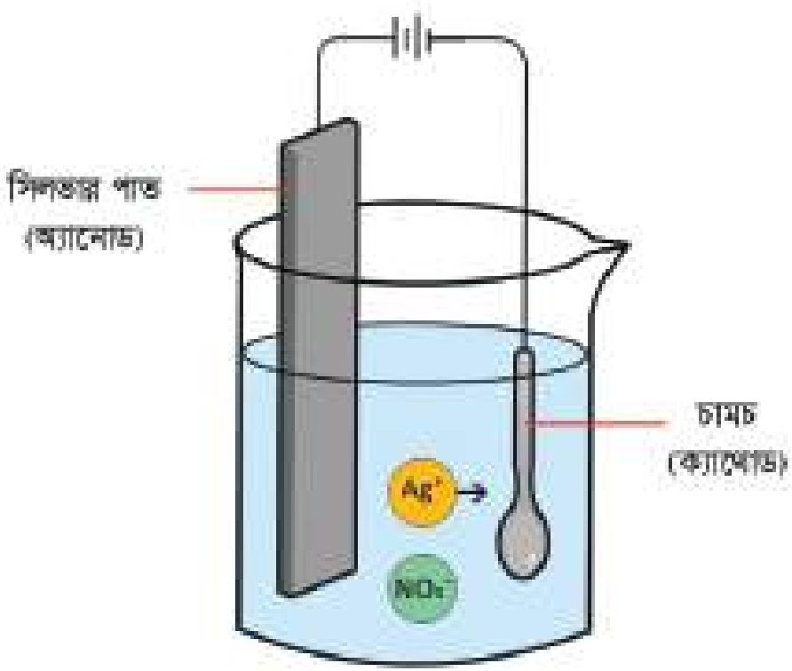

<!-- chemistry-9-10-bn-c08-t8.3-p059 · figure · p.189 · review: known-confusable-corrected -->
**চিত্র ৮.০৭: চামচের উপর সিলভারের ইলেকট্রোপ্লেটিং**

<!-- chemistry-9-10-bn-c08-t8.3-p060 · text · p.189 -->
লোহার তৈরি কোনো জিনিস যেমন, চামচের উপর সিলভারের প্রলেপ দিতে AgNO3 দ্রবণ একটি বিকারে নেওয়া হয়। যে জিনিসের উপর প্রলেপ দিতে হবে তাকে ব্যাটারির ঋণাত্মক প্রান্তের সাথে যুক্ত করে ক্যাথোড তড়িৎদ্বার হিসেবে ব্যবহার করা হয়। সিলভার ধাতুর পাত অ্যানোড হিসেবে ব্যবহার করা হয়। ব্যাটারি দ্বারা দ্রবণে বিদ্যুৎ প্রবাহিত করলে অ্যানোড হিসেবে যে সিলভারের পাত ব্যবহার করা হয় সেই সিলভার পাত থেকে ধাতব Ag পরমাণু একটি ইলেকট্রন ত্যাগ করে Ag+ আয়নে পরিণত হয়ে দ্রবণে চলে যায় এবং দ্রবণের Ag+ আয়ন ক্যাথোড তড়িৎদ্বার থেকে ইলেকট্রন গ্রহণ করে ধাতব সিলভারে পরিণত হয়ে ক্যাথোডে জমা হয়। এতে লোহার তৈরি জিনিসের উপর সিলভারের প্রলেপ পড়ে।

<!-- chemistry-9-10-bn-c08-t8.3-p061 · figure · p.189 · review: known-confusable-corrected -->
**চিত্র ৮.০৭: চামচের উপর সিলভারের ইলেকট্রোপ্লেটিং**

<!-- chemistry-9-10-bn-c08-t8.3-p062 · figure · p.189 -->
drawing: electroplating setup diagram

<!-- chemistry-9-10-bn-c08-t8.3-p063 · figure · p.189 · review: known-confusable-corrected -->
**চিত্র ৮.০৭: চামচের উপর সিলভারের ইলেকট্রোপ্লেটিং**

<!-- chemistry-9-10-bn-c08-t8.3-p064 · text · p.189 · review: verify-formula -->
দ্রবণে AgNO3 এর বিয়োজন: AgNO3 $\rightarrow$ Ag+ + NO3-
অ্যানোডে জারণ বিক্রিয়া: Ag $\rightarrow$ Ag+ + e-
ক্যাথোডে বিজারণ বিক্রিয়া: Ag+ + e+ $\rightarrow$ Ag

### তড়িৎ বিশ্লেষণে উৎপাদিত পদার্থের বাণিজ্যিক ব্যবহার

<!-- chemistry-9-10-bn-c08-t8.3-p065 · text · p.189 -->
তড়িৎ বিশ্লেষণের মাধ্যমে আমরা অনেক কিছু করতে পারি। বিভিন্ন সক্রিয় ধাতুর নিষ্কাশন থেকে শুরু করে অনেক মূল্যবান যৌগ ও মৌলের উৎপাদন, এক ধাতুর উপর অন্য ধাতুর প্রলেপ দিয়ে তার স্ফয় রোধ করা, উজ্জ্বলতা বৃদ্ধি করাসহ আরও অনেক কিছু।

<!-- chemistry-9-10-bn-c08-t8.3-p066 · text · p.189 -->
তড়িৎ বিশ্লেষণের মাধ্যমে আকরিক থেকে বিভিন্ন ধাতু যেমন- সোডিয়াম, অ্যালুমিনিয়াম, দস্তা, ক্যালসিয়াম, ম্যাগনেসিয়াম প্রভৃতি নিষ্কাশন করা হয়। এছাড়া তামা, সোনা, রূপা এর বিশুদ্ধ করতে এ পদ্ধতি ব্যবহার করা হয়। আধুনিক বিশ্বে এসব ধাতুর ব্যবহার অপরিহার্য।

<!-- chemistry-9-10-bn-c08-t8.3-p067 · text · p.189 -->
আমরা জানি, রূপা ও তামার বৈদ্যুতিক রোধ সবচেয়ে কম। কিন্তু রূপার দাম অনেক বেশি। তাই বৈদ্যুতিক তার তৈরিতে তামা ব্যবহার করা হয়। তোমরা কি চিন্তা করতে পারো সারা বিশ্বে কত বৈদ্যুতিক তার ব্যবহার করা হচ্ছে? অ্যালুমিনিয়াম অতি প্রয়োজনীয় ধাতু। এ ধাতু দিয়ে বিভিন্ন থালাবাসন তৈরি করা হয়ে থাকে। তাছাড়া অ্যালুমিনিয়াম হালকা ধাতু বলে বিমান তৈরিতে ব্যবহার করা হয়। লোহার উপর মরিচা পড়া ঠেকাতে লোহার উপর দস্তার প্রলেপ দেওয়া হয়।

<!-- chemistry-9-10-bn-c08-t8.3-p068 · text · p.190 -->
এতে লোহার স্থায়িত্বও বৃদ্ধি পায়। অল্প দামি ধাতুর গয়নার উপর উজ্জ্বল ধাতু যেমন- ক্রোমিয়াম, নিকেল, সোনা, রুপা প্রভৃতি ধাতুর প্রলেপ দেওয়া হয়। এতে গয়না অনেক উজ্জ্বল ও মসৃণ হয়।

<!-- chemistry-9-10-bn-c08-t8.3-p069 · text · p.190 · review: known-confusable-corrected -->
সমুদ্রের পানির তড়িৎ বিশ্লেষণে উৎপন্ন ক্লোরিন জীবাগুনাশক হিসেবে এবং সোডিয়াম হাইড্রোক্সাইড ক্ষার বিভিন্ন শিল্পে কাঁচামাল হিসেবে ব্যবহৃত হয়।

## 8.4 রাসায়নিক বিক্রিয়ার মাধ্যমে বিদ্যুৎ উৎপাদন

### গ্যালভানিক কোষ বা ভোল্টায়িক কোষ (Galvanic Cell or Voltaic Cell)

<!-- chemistry-9-10-bn-c08-t8.4-p001 · text · p.190 · review: known-confusable-corrected -->
গ্যালভানিক বা ভোল্টায়িক কোষ হলো সেই সকল কোষ, যেখানে কোষের ভিতরের পদার্থসমূহের রাসায়নিক বিক্রিয়া ঘটিয়ে বিদ্যুৎ শক্তি উৎপাদন করা হয়। গ্যালভানিক কোষে সাধারণত ভিন্ন মৌল দিয়ে তৈরি দুটো ইলেকট্রোডকে দুটি ভিন্ন পাত্রের তড়িৎ বিশ্লেষ্যের দ্রবণের মধ্যে আংশিকভাবে ডুবানো থাকে। তড়িৎদ্বার দুইটির মধ্যে অধিক সক্রিয় ধাতুর ইলেকট্রোড অ্যানোড আর কম সক্রিয় ধাতুর ইলেকট্রোড ক্যাথোড হিসেবে কাজ করে।

<!-- chemistry-9-10-bn-c08-t8.4-p002 · text · p.190 -->
গ্যালভানিক বা ভোল্টায়িক কোষে একটি তড়িৎদ্বার যে ধাতু দিয়ে তৈরি তড়িৎদ্বারটিকে সেই ধাতুর কোনো লবণের দ্রবণে (তড়িৎ বিশ্লেষ্যে) রাখতে হয়। যাতে তড়িৎ বিশ্লেষ্যে ঐ ধাতুর আয়ন থাকে। যেমন- কপার ধাতুর দণ্ড দিয়ে যদি তড়িৎদ্বার তৈরি করা হয় তবে ঐ দণ্ডকে CuSO4 তড়িৎ বিশ্লেষ্যের দ্রবণে রাখা হয়। আবার, জিংক ধাতুর দণ্ড দিয়ে যদি তড়িৎদ্বার তৈরি করা হয় তবে ঐ দণ্ডকে ZnSO4 তড়িৎ বিশ্লেষ্যের দ্রবণে রাখা হয়। তড়িৎদ্বার দুটিকে বাইরে থেকে ধাতব তার দিয়ে সংযোগ করলে এক তড়িৎদ্বার থেকে অপর তড়িৎদ্বারে ইলেকট্রন প্রবাহিত হয় অর্থাৎ বিদ্যুৎ প্রবাহের সৃষ্টি হয়। দুইটি তড়িৎ বিশ্লেষ্যের দ্রবণের মধ্যে U আকৃতির লবণ সেতু স্থাপন করা হয়। U আকৃতির একটি কাচনালে KCl লবণের দ্রবণ থাকে। গ্যালভানিক কোষের অ্যানোড, ক্যাথোড, তড়িৎদ্বারে বিক্রিয়া, লবণ সেতুর ভূমিকা এগুলো ভালোভাবে বুঝানোর জন্য এখানে ডেনিয়েল কোষের গঠন আলোচনা করা হলো।

### ডেনিয়েল কোষ (Daniell cell)

<!-- chemistry-9-10-bn-c08-t8.4-p003 · text · p.190 -->
জন ফ্রেডরিক ডেনিয়েল 1836 সালে এ কোষটি প্রথম আবিষ্কার করেন। তাঁর সম্মানে এ কোষকে ডেনিয়েল কোষ বলে। দুইটি কাচ বা চিনামাটির পাত্রের একটিতে জিংক সালফেট দ্রবণ এবং অপরটিতে কপার সালফেট দ্রবণ নেওয়া হয়। জিংক সালফেট দ্রবণে জিংক দণ্ড আর কপার সালফেট দ্রবণে কপারের দণ্ড আংশিক ডুবানো হয়। পাত্র দুইটির দ্রবণের মধ্যে সংযোগ স্থাপনের জন্য 8.08 নং চিত্রের মতো U আকৃতির লবণ সেতু উপৃড় করে দুইটি দ্রবণের মধ্যে রাখা হয়। এবার একটি ধাতব তার দিয়ে তড়িৎদ্বার দুইটি সংযোগ ঘটানো হয়। তারের মাঝে একটি বাল্ব সংযোগ থাকলে এবং তারের মধ্য দিয়ে বিদ্যুৎ প্রবাহ শুরু হলে বাল্বটি জ্বলে উঠে। এখানে জিংক তড়িৎদ্বারে জিংকের একটি পরমাণু দুইটি ইলেকট্রন ত্যাগ করে জিংক আয়নে (Zn2+) পরিণত হয়। এই জিংক আয়ন তড়িৎদ্বার ছেড়ে দ্রবণে প্রবেশ করে। ইলেকট্রন দুইটি জিংক তড়িৎদ্বার গ্রহণ করে। ফলে এ তড়িৎদ্বার ঋণাত্মক চার্জযুক্ত হয়। এই ইলেকট্রন দুইটি তড়িৎদ্বার দুইটিকে যে তার দিয়ে সংযোগ দেওয়া হয়েছে, তার মধ্য দিয়ে প্রবাহিত হয়। যেহেতু জিংকের তড়িৎদ্বারে ধাতব Zn থেকে Zn2+ পরিণত হয়, সেহেতু বলা যায় এ তড়িৎদ্বারে জারণ বিক্রিয়া ঘটে। তাই এ তড়িৎদ্বার হলো অ্যানোড।

<!-- chemistry-9-10-bn-c08-t8.4-p004 · text · p.191 · review: verify-formula -->
অ্যানোডে জারণ বিক্রিয়া: Zn $\rightarrow$ Zn2+ + 2 e-

<!-- chemistry-9-10-bn-c08-t8.4-p005 · text · p.191 -->
এবার জিংক অ্যানোড থেকে আসা ২টি ইলেকট্রন কপার তড়িৎদ্বারে প্রবেশ করে এবং এ তড়িৎদ্বার থেকে CuSO4 দ্রবণের Cu2+ আয়ন দুইটি ইলেকট্রন গ্রহণ করে ধাতব কপারে (Cu) পরিণত হয় ফলে কপার তড়িৎদ্বারে বিজারণ ঘটে। এজন্য এস্ক্রে কপার তড়িৎদ্বার হলো ক্যাথোড।

<!-- chemistry-9-10-bn-c08-t8.4-p006 · text · p.191 · review: verify-formula -->
ক্যাথোডে বিজারণ বিক্রিয়া: Cu2+ + 2 e- $\rightarrow$ Cu
সামগ্রিক কোষ বিক্রিয়া: Zn + Cu2+ $\rightarrow$ Zn2+ + Cu

<!-- chemistry-9-10-bn-c08-t8.4-p007 · text · p.191 -->
এখানে দেখা যাচ্ছে, অ্যানোডে জিংক ইলেকট্রন দান করে বলে অ্যানোডে জারণ বিক্রিয়া ঘটেছে। কিন্তু শুধু ইলেকট্রন দান করলে বিক্রিয়া সম্পন্ন হয় না। এ ইলেকট্রন অন্য কাউকে গ্রহণও করতে হবে। ক্যাথোড তড়িৎদ্বারে জিংকের দান করা ইলেকট্রন কপার আয়ন গ্রহণ করে বিজারণ বিক্রিয়া সম্পন্ন করেছে। অর্থাৎ অ্যানোডে অর্ধেক বিক্রিয়া আর ক্যাথোডে অপর অর্ধেক বিক্রিয়া ঘটেছে।

<!-- chemistry-9-10-bn-c08-t8.4-p008 · figure · p.191 -->
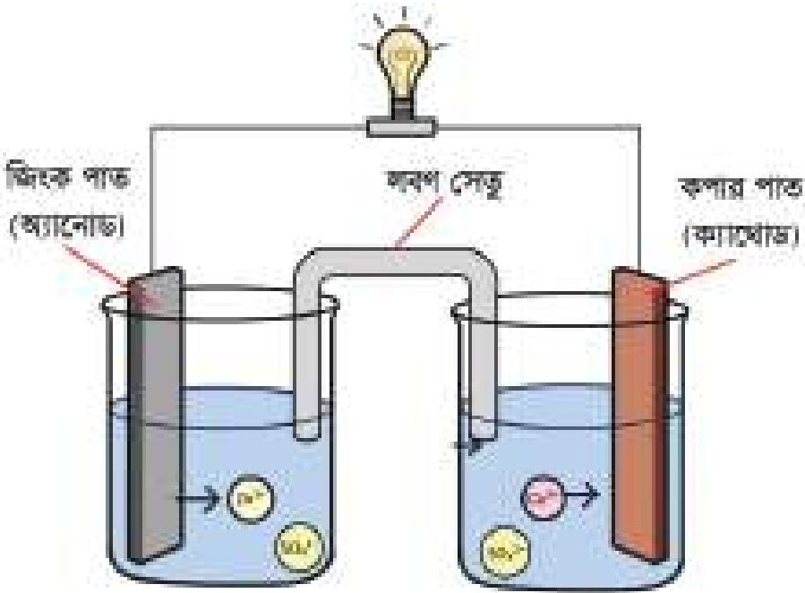

<!-- chemistry-9-10-bn-c08-t8.4-p009 · figure · p.191 -->
**চিত্র ৮.০৮: গ্যালভানিক (ডেনিয়েল) কোষ**

<!-- chemistry-9-10-bn-c08-t8.4-p010 · text · p.191 -->
তাই অ্যানোডের বিক্রিয়াকে জারণ অর্ধবিক্রিয়া আর ক্যাথোডের বিক্রিয়াকে বিজারণ অর্ধবিক্রিয়া বলা হয়। কোষ বিক্রিয়া যেহেতু ক্যাথোডের বিক্রিয়া আর অ্যানোডের বিক্রিয়ার যোগফল, তাই কোষ বিক্রিয়া হলো জারণ-বিজারণ বিক্রিয়া।

<!-- chemistry-9-10-bn-c08-t8.4-p011 · text · p.191 -->
অ্যানোড থেকে ইলেকট্রন তারের মধ্য দিয়ে ক্যাথোডে প্রবেশ করে অর্থাৎ তারের মধ্য দিয়ে ইলেকট্রন বা বিদ্যুৎ প্রবাহিত হয় অর্থাৎ এক্ষেত্রে বিদ্যুৎ শক্তি উৎপন্ন হয়েছে। অর্থাৎ গ্যালভানিক কোষে রাসায়নিক শক্তি বিদ্যুৎ শক্তিতে রূপান্তরিত হয়।

<!-- chemistry-9-10-bn-c08-t8.4-p012 · table · p.192 · review: known-confusable-corrected,verify-table -->
**টেবিল ৮.০৩: তড়িৎ বিশ্লেষ্য কোষ ও গ্যালভানিক কোষের পার্থক্য**
<table><tr><th>তড়িৎ বিশ্লেষ্য কোষ</th><th>গ্যালভানিক কোষ</th></tr>
<tr><td>যে কোষে তড়িৎ শক্তি ব্যবহার করে রাসায়নিক বিক্রিয়া ঘটেনো হয় তাকে তড়িৎ বিশ্লেষ্য কোষ বলে।</td><td>যে কোষে রাসায়নিক বিক্রিয়া ঘটিয়ে তড়িৎ শক্তি উৎপন্ন করা হয় তাকে গ্যালভানিক কোষ বলে।</td></tr>
<tr><td>তড়িৎ বিশ্লেষ্য কোষে অ্যানোড ধনাত্মক চার্জযুক্ত এবং ক্যাথোড ঋণাত্মক চার্জযুক্ত।</td><td>গ্যালভানিক কোষে অ্যানোড ঋণাত্মক চার্জযুক্ত কিন্তু ক্যাথোড ধনাত্মক চার্জযুক্ত।</td></tr>
<tr><td>কোনো মৌল বা যৌগ উৎপাদন, ইলেকট্রোপ্লেটিং, ধাতু বিশোধন প্রভৃতি কাজে তড়িৎ বিশ্লেষ্য কোষ ব্যবহার করা হয়।</td><td>তড়িৎ শক্তি উৎপাদন করার যন্ত্র যেমন— ব্যাটারি তৈরিতে গ্যালভানিক কোষ ব্যবহৃত হয়।</td></tr></table>

<!-- chemistry-9-10-bn-c08-t8.4-p013 · text · p.192 -->
**গ্যালভানিক কোষের তড়িৎদ্বার:** গ্যালভানিক কোষে নানা ধরনের তড়িৎদ্বার ব্যবহার করা হয়। এদের মধ্যে সবচেয়ে সহজে তৈরি করা যায় ধাতু-ধাতুর আয়ন তড়িৎদ্বার। এ ধরনের তড়িৎদ্বারগুলোকে তৈরি করতে কোনো ধাতুর দণ্ড বা পাতকে সেই ধাতুর আয়নবিশিষ্ট দ্রবণে অর্ধেক বা অর্ধেকের বেশি পরিমাণে নিমজ্জিত করে তৈরি করা হয়। এ তড়িৎদ্বারকে লিখে প্রকাশ করতে হলে প্রথমে ধাতু তারপর ধাতুর আয়নকে পাশাপাশি লিখে দুটির মাঝখানে খাড়া দাগ দিতে হয়। যেমন— জিংক ধাতুর দণ্ডকে ZnSO4 এর দ্রবণের মধ্যে রাখলে জিংক ধাতুর তড়িৎদ্বার তৈরি হয়ে গেল। একে Zn|Zn2+ দিয়ে প্রকাশ করা হয়। এ তড়িৎদ্বারে নিম্নরূপ বিক্রিয়া ঘটে।

<!-- chemistry-9-10-bn-c08-t8.4-p014 · formula · p.192 · review: verify-formula -->
$$Zn \rightleftharpoons Zn^{2+} + 2e^-$$

<!-- chemistry-9-10-bn-c08-t8.4-p015 · text · p.192 -->
এ ধরনের আরও কিছু তড়িৎদ্বার ও তাদের বিক্রিয়া ৮.০৪ টেবিলে দেখানো হলো।

<!-- chemistry-9-10-bn-c08-t8.4-p016 · text · p.192 -->
অধিক সক্রিয় ধাতু যেমন—সোডিয়াম, পটাশিয়াম, ক্যালসিয়াম প্রভৃতি ধাতুর তড়িৎদ্বার এভাবে তৈরি হয় না। এসব ক্ষেত্রে সাধারণত অ্যামালগাম ব্যবহার করা হয়। অ্যামালগাম হলো, পারদ ও সক্রিয় ধাতুর মিশ্রণ।

### গ্যালভানিক কোষে অ্যানোড এবং ক্যাথোড শনাক্তকরণ

<!-- chemistry-9-10-bn-c08-t8.4-p017 · text · p.193 -->
দুইটি তড়িৎঘর দিয়ে কোনো গ্যালভানিক কোষ তৈরি করলে কোনটি অ্যানোড এবং কোনটি ক্যাথোড হবে তা নির্ভর করে সেগুলো কোন মৌল দিয়ে তৈরি তার উপর। তড়িৎ রাসায়নিক সারির উপরের দিকে অবস্থিত অধিক সক্রিয় মৌলের তড়িৎঘর অ্যানোড এবং তড়িৎ রাসায়নিক সারির নিচের দিকে অবস্থিত অপেক্ষাকৃত কম সক্রিয় মৌলের তৈরি ইলেকট্রোড ক্যাথোড হিসেবে কাজ করে।

<!-- chemistry-9-10-bn-c08-t8.4-p018 · table · p.193 · review: verify-table -->
**টেবিল ৮.০৪: তড়িৎঘর ও তাদের বিক্রিয়া**
<table><tr><th>তড়িৎঘর</th><th>বিক্রিয়া</th></tr>
<tr><td>Zn|Zn2+</td><td>Zn(s) <strong>⇌</strong> Zn2+(aq) + 2e-</td></tr>
<tr><td>Cu|Cu2+</td><td>Cu(s) <strong>⇌</strong> Cu2+(aq) + 2e-</td></tr>
<tr><td>Fe|Fe2+</td><td>Fe(s) <strong>⇌</strong> Fe2+(aq) + 2e-</td></tr>
<tr><td>Ag|Ag+</td><td>Ag(s) <strong>⇌</strong> Ag+(aq) + e-</td></tr></table>

<!-- chemistry-9-10-bn-c08-t8.4-p019 · text · p.193 -->
যেমন- কপার ধাতু ও সিলভার ধাতুর তড়িৎঘর দিয়ে গ্যালভানিক কোষ তৈরি করা হলে এক্ষেত্রে কপার ধাতুর তড়িৎঘরটি অ্যানোড আর সিলভার ধাতুর তড়িৎঘরটি ক্যাথোড হিসেবে কাজ করবে। কারণ তড়িৎ রাসায়নিক সারিতে কপার ধাতুর অবস্থান উপরে আর সিলভার ধাতুর অবস্থান নিচে।

<!-- chemistry-9-10-bn-c08-t8.4-p020 · text · p.193 -->
এই কোষে কপার পরমাণু ইলেকট্রন ত্যাগ করে কপার আয়নে পরিণত হয়।

### অ্যানোডে জারণ অর্ধবিক্রিয়া:

<!-- chemistry-9-10-bn-c08-t8.4-p021 · formula · p.193 · review: verify-formula -->
$$Cu \rightarrow Cu^{2+} + 2e^-$$

<!-- chemistry-9-10-bn-c08-t8.4-p022 · text · p.193 -->
এই কোষে সিলভার আয়ন ইলেকট্রন গ্রহণ করে ধাতব সিলভার পরমাণুতে পরিণত হয়।

### ক্যাথোডে বিজারণ অর্ধবিক্রিয়া:

<!-- chemistry-9-10-bn-c08-t8.4-p023 · formula · p.193 · review: verify-formula -->
$$2Ag^+ + 2e^- \rightarrow 2Ag$$

<!-- chemistry-9-10-bn-c08-t8.4-p024 · text · p.193 -->
এখন অর্ধবিক্রিয়া দুইটি যোগ করলে কোষ বিক্রিয়া পাওয়া যাবে।

<!-- chemistry-9-10-bn-c08-t8.4-p025 · text · p.193 -->
তড়িৎঘর

<!-- chemistry-9-10-bn-c08-t8.4-p026 · table · p.193 · review: verify-table -->
**টেবিল ৮.০৫:**
<table><tr><th>তড়িৎঘর</th></tr>
<tr><td><strong>Li|Li+</strong></td></tr>
<tr><td><strong>K|K+</strong></td></tr>
<tr><td><strong>Na|Na+</strong></td></tr>
<tr><td><strong>Mg|Mg2+</strong></td></tr>
<tr><td><strong>Al|Al3+</strong></td></tr>
<tr><td><strong>Zn|Zn2+</strong></td></tr>
<tr><td><strong>Fe|Fe2+</strong></td></tr>
<tr><td><strong>Ni|Ni2+</strong></td></tr>
<tr><td><strong>Sn|Sn2+</strong></td></tr>
<tr><td><strong>Pb|Pb2+</strong></td></tr>
<tr><td><strong>H2|H+</strong></td></tr>
<tr><td><strong>Cu|Cu2+</strong></td></tr>
<tr><td><strong>Ag|Ag+</strong></td></tr>
<tr><td><strong>Au|Au3+</strong></td></tr></table>

### কোষ বিক্রিয়া:

<!-- chemistry-9-10-bn-c08-t8.4-p027 · formula · p.194 · review: verify-formula -->
$$Cu + 2Ag^+ \rightarrow Cu^{2+} + 2Ag$$

### লবণ সেতু ও তার ব্যবহার

<!-- chemistry-9-10-bn-c08-t8.4-p028 · text · p.194 -->
তোমরা ডেনিয়েল কোষে দেখেছো অ্যানোডে ধাতব জিংক দুইটি ইলেকট্রন ত্যাগ করে জিংক আয়নে পরিণত হয়। এ ইলেকট্রন বাইরের তার দিয়ে ক্যাথোডে যায়। ফলে অ্যানোডের দ্রবণে ধনাত্মক আয়ন বেশি হয়ে যায়।

<!-- chemistry-9-10-bn-c08-t8.4-p029 · text · p.194 -->
অ্যানোডে জারণ অর্ধবিক্রিয়া:

<!-- chemistry-9-10-bn-c08-t8.4-p030 · formula · p.194 · review: verify-formula -->
$$Zn \rightarrow Zn^{2+} + 2e^-$$

<!-- chemistry-9-10-bn-c08-t8.4-p031 · text · p.194 -->
আবার, ক্যাথোডে থাকা CuSO4 এর দ্রবণ থেকে Cu2+ আয়ন দুইটি ইলেকট্রন গ্রহণ করে আধান নিরপেক্ষ Cu পরমাণুতে পরিণত হয় কিন্তু SO42- আয়নের কোনো পরিবর্তন হয় না। ফলে দ্রবণ ঋণাত্মক আধান প্রাপ্ত হয়। অর্থাৎ দুইটি দ্রবণের আধান নিরপেক্ষতা নষ্ট হয়। ফলে কিছুক্ষণের মধ্যে বিক্রিয়া বন্ধ হয়ে বিদ্যুৎ প্রবাহ বন্ধ হয়ে যায়। এই বিক্রিয়া চালু রাখার জন্য লবণ সেতু ব্যবহার করা হয়। একটি U আকৃতির কাচের নলের মধ্যে আগার-আগার নামের একটি রাসায়নিক পদার্থের সাথে KCl লবণের দ্রবণ মেশানো হয়। ফলে জেলির মতো মিশ্রণ তৈরি হয়। একে লবণ সেতু বলে। এই লবণ সেতুতে বিদ্যমান K+ আয়ন ও Cl- আয়ন এর গতি সমান। KCl দ্রবণ দিয়ে তৈরি লবণ সেতুর দুই মুখে তুলা দিয়ে 8.09 নং চিত্রের মতো পরোক্ষভাবে দুইটি তড়িৎ বিক্লেষ্যের দ্রবণকে সংযোগ দেওয়া হয়।

<!-- chemistry-9-10-bn-c08-t8.4-p032 · text · p.194 -->
এখন অ্যানোডের দ্রবণে যতগুলো ধনাত্মক চার্জ বেশি হয় লবণ সেতু থেকে ততগুলো Cl- আয়ন অ্যানোড দ্রবণে চলে আসে। আবার ক্যাথোডের দ্রবণে যতগুলো ঋণাত্মক চার্জ কমে যায় লবণ সেতু থেকে ততগুলো K+ আয়ন ক্যাথোড দ্রবণে চলে আসে। ফলে অ্যানোড ও ক্যাথোড উভয় দ্রবণের তড়িৎ নিরপেক্ষতা বজায় থাকে। ফলে কোষের তড়িৎ প্রবাহ নির্বিয়ে চলতে থাকে।

<!-- chemistry-9-10-bn-c08-t8.4-p033 · figure · p.194 · review: latin-junk -->

<!-- chemistry-9-10-bn-c08-t8.4-p034 · figure · p.194 -->
**চিত্র ৮.০৯: কোষে ব্যবহৃত লবণ সেতু**

### ড্রাই সেল

<!-- chemistry-9-10-bn-c08-t8.4-p035 · text · p.195 -->
ড্রাই সেল (কোষ) এক ধরনের গ্যালভানিক কোষ। ড্রাই সেলের মাধ্যমে রাসায়নিক শক্তিকে বিদ্যুৎ শক্তিতে রূপান্তরিত করা হয়। আমরা সাধারণত টর্চলাইট জ্বালাতে, রেডিও বাজাতে, টিভির রিমোট চালাতে, খেলনা চালাতে ড্রাই সেল ব্যবহার করি। ড্রাই সেলও অ্যানোড এবং ক্যাথোড দ্বারা গঠিত।

### ড্রাই সেলের গঠন, রাসায়নিক বিক্রিয়া ও বিদ্যুৎ উৎপন্ন হওয়ার কৌশল

<!-- chemistry-9-10-bn-c08-t8.4-p036 · text · p.195 -->
ড্রাই সেলে অ্যানোড হিসেবে সাধারণত ধাতব জিংকের তৈরি ছোট কোটা ব্যবহার করা হয়। ম্যাঙ্গানিজ ডাই-অক্সাইড (MnO2), অ্যামোনিয়াম ক্লোরাইড (NH4Cl), জিংক ক্লোরাইড (ZnCl2) ও পাতিত পানি মিশ্রিত করে প্রস্তুতকৃত কাই (paste) দ্বারা জিংকের তৈরি ছোট কোটা পূর্ণ করা হয়। এরপর জিংকের কোটাটির মাঝখানে একটি কার্বন (গ্রাফাইট) দণ্ড প্রবেশ করানো হয়। কার্বন দণ্ড ক্যাথোড হিসেবে কাজ করে।

<!-- chemistry-9-10-bn-c08-t8.4-p037 · figure · p.195 -->
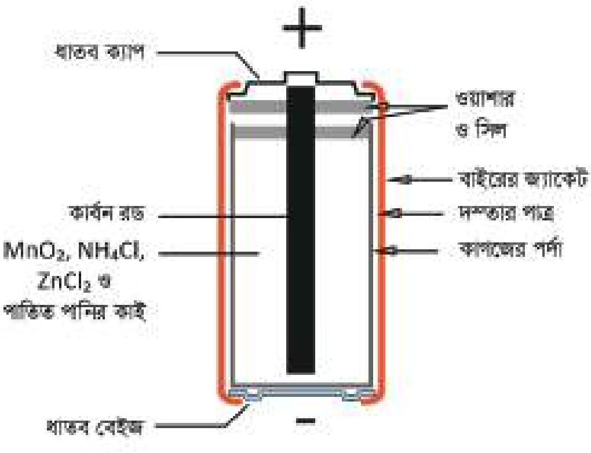

<!-- chemistry-9-10-bn-c08-t8.4-p038 · figure · p.195 -->
**চিত্র ৮.১০: ড্রাই সেল**

<!-- chemistry-9-10-bn-c08-t8.4-p039 · text · p.195 -->
যখন কোনো বাল্ব বা অন্য কোনো ইলেকট্রনিক যন্ত্রের দুইটি প্রান্ত (ধনাত্মক প্রান্ত এবং ঋণাত্মক প্রান্ত) এর সাথে দুইটি তার যুক্ত করে একটি তার জিংক কোটার সাথে এবং অন্য তার কার্বন দড়ির সাথে যুক্ত করা হয় তখন নিম্নরূপ বিক্রিয়া সংঘটিত হয়।

<!-- chemistry-9-10-bn-c08-t8.4-p040 · text · p.195 -->
ড্রাই সেলের অ্যানোডের জিংক 2টি ইলেকট্রন ত্যাগ করে Zn2+ এ পরিণত হয়।

<!-- chemistry-9-10-bn-c08-t8.4-p041 · text · p.195 -->
অ্যানোডে বিক্রিয়া:

<!-- chemistry-9-10-bn-c08-t8.4-p042 · formula · p.195 · review: verify-formula -->
$$Zn \longrightarrow Zn^{2+} + 2 e^-$$

<!-- chemistry-9-10-bn-c08-t8.4-p043 · text · p.195 -->
অ্যানোডে উৎপন্ন 2টি ইলেকট্রন তারের মধ্য দিয়ে কার্বন দণ্ডে চলে আসে এবং কার্বন দড়ির 2টি ইলেকট্রন অ্যামোনিয়াম ক্লোরাইড থেকে প্রাপ্ত অ্যামোনিয়াম আয়ন (NH4+) এবং ম্যাঙ্গানিজ ডাই-অক্সাইড (MnO2) গ্রহণ করে অ্যামোনিয়া গ্যাস (NH3) ও ডাই ম্যাঙ্গানিজ ট্রাই-অক্সাইড উৎপন্ন করে।

<!-- chemistry-9-10-bn-c08-t8.4-p044 · text · p.196 -->
ক্যাথোডে বিক্রিয়া:

<!-- chemistry-9-10-bn-c08-t8.4-p045 · formula · p.196 · review: verify-formula -->
$$2NH_4^+ + 2MnO_2 + 2e^- \longrightarrow 2NH_3 + Mn_2O_3 + H_2O$$

<!-- chemistry-9-10-bn-c08-t8.4-p046 · text · p.196 -->
সামগ্রিক কোষ বিক্রিয়া:

<!-- chemistry-9-10-bn-c08-t8.4-p047 · formula · p.196 · review: verify-formula -->
$$Zn + 2NH_4^+ + 2MnO_2 \longrightarrow Zn^{2+} + 2NH_3 + Mn_2O_3 + H_2O$$

<!-- chemistry-9-10-bn-c08-t8.4-p048 · text · p.196 -->
ড্রাই সেলের অ্যানোড ও ক্যাথোড প্রান্তকে যদি বাল্ন বা কোনো ইলেকট্রনিক যন্ত্রের দুই প্রান্তে যুক্ত করা হয় তখন ইলেকট্রনের প্রবাহ সৃষ্টি হয় অর্থাৎ বিদ্যুৎ উৎপাদন হয়। তাহলে যেখানে বিদ্যুৎ প্রয়োজন সেখানে ড্রাই সেল সংযুক্ত করলেই উল্লিখিত বিক্রিয়াসমূহ সংঘটিত হবে এবং আমরা বিদ্যুৎ শক্তি পাব।

### তড়িৎ রাসায়নিক কোষের প্রয়োগ

<!-- chemistry-9-10-bn-c08-t8.4-p049 · text · p.196 · review: known-confusable-corrected -->
প্রাচীনকাল থেকেই তড়িৎ বিশ্লেষণ কৌশল ব্যবহার করে এক ধাতুর উপর অন্য ধাতুর প্রলেপ ব্যবহার করা হয়। তবে এখন তড়িৎ বিশ্লেষণ কৌশলের ব্যবহার আরও ব্যাপক। তড়িৎ বিশ্লেষণের সাহায্যে

<!-- chemistry-9-10-bn-c08-t8.4-p050 · figure · p.196 -->

<!-- chemistry-9-10-bn-c08-t8.4-p051 · figure · p.196 -->
**চিত্র ৮.১১: রক্তে গ্লুকোজের পরিমাণ নির্ণয়ের যন্ত্র**

<!-- chemistry-9-10-bn-c08-t8.4-p052 · text · p.196 -->
আকরিক থেকে ধাতু নিষ্কাশন, মূল্যবান রাসায়নিক পদার্থের উৎপাদন, বিদ্যুৎ শক্তির উৎপাদন, পদার্থের বিশুদ্ধকরণ ইত্যাদি করা হয়। হাইড্রোজেন ফুয়েল সেলের সাহায্যে বিদ্যুৎ উৎপাদন করা হয়। এতে অ্যানোডে হাইড্রোজেন অণু জারিত হয় আর ক্যাথোডে অক্সিজেন অণু বিজারিত হয়ে পানি উৎপাদন করে। ফলে কোষে ইলেকট্রন অ্যানোড হতে ক্যাথোডে প্রবাহিত হয়। এই বিদ্যুতের সাহায্যে গাড়ি পর্যন্ত চলতে পারে। সারা পৃথিবীতে কত মোবাইল ফোন, কত কম্পিউটার, কত ক্যালকুলেটর ব্যবহৃত হচ্ছে চিন্তা করতে পারছো, সব ক্ষেত্রে ব্যাটারি ব্যবহৃত হয়।

<!-- chemistry-9-10-bn-c08-t8.4-p053 · text · p.196 · review: known-confusable-corrected -->
ডায়বেটিক রোগীর রক্তের গ্লুকোজের পরিমাণ নির্ণয় করার জন্য তড়িৎ বিশ্লেষণ কৌশলনির্ভর সেসর ব্যবহার করা হয়। ৮.১১ নং চিত্রে তড়িৎ বিশ্লেষণ কৌশল ব্যবহার করে মানবদেহের রক্তের গ্লুকোজের পরিমাণ নির্ণয় দেখানো হলো। বাম হাতের আঙুলে লাগানো ছোট অংশটিতে পাতলা ও চিকন অ্যানোড ও ক্যাথোড লাগানো আছে। অ্যানোড ও ক্যাথোডের মাঝখানে একটা ছোট ফার্কা নালি (channel) থাকে। যদি অ্যানোড ও ক্যাথোডের মাঝখানে ফার্কা নালিতে রক্ত দেওয়া হয়, তাহলে একটি পূর্ণ তড়িৎ কোষ গঠিত হবে। আসলে, ফার্কা নালিতে রক্ত দিলে কোষে সংযুক্ত উৎস হতে বিদ্যুৎ প্রবাহের ফলে রক্তে অবস্থিত গ্লুকোজ অণু অ্যানোডে জারিত হয়। অন্যদিকে, হিসাব-নিকাশ করার যন্ত্রের সাহায্যে গ্লুকোজের জারণের ফলে উদ্ভূত ইলেকট্রনের সংখ্যা নির্ণয় করে যন্ত্রটি তার পর্দায় (screen) রক্তে অবস্থিত গ্লুকোজের পরিমাণ মিনিটে ডিজিটের (digit) সাহায্যে প্রকাশ করে। মজার ব্যাপার হলো এ প্রযুক্তি ব্যবহার করে রক্তে গ্লুকোজের পরিমাণ নির্ণয় করতে এক মিনিট বা তার চেয়ে কম সময় লাগে।

### স্বাস্থ্য ও পরিবেশের উপর ব্যাটারির বিরূপ প্রভাব

<!-- chemistry-9-10-bn-c08-t8.4-p054 · text · p.197 · review: known-confusable-corrected -->
আমরা বিভিন্ন কাজে ব্যাটারি ব্যবহার করি। ড্রাই সেল (dry cell) টর্চলাইট জ্বালানোর কাজে, লেড-স্টোরেজ ব্যাটারি (lead storage battery) বাস, ট্রাক ইত্যাদি স্টার্ট দেয়ার কাজে ব্যবহার করা হয়। এসব ব্যাটারিতে বিভিন্ন ধাতু এবং ধাতব আয়ন ব্যবহার করা হয়। যা আমাদের শরীরের জন্য মারাত্মক ক্ষতিকর। ড্রাই সেলে দস্তা (Zn) ও ম্যাঙ্গানিজ ডাই-অক্সাইড (MnO2) থাকে, লেড-স্টোরেজ ব্যাটারিতে সিসা (Pb) ও সিসার অক্সাইড (PbO2) ইত্যাদি থাকে। রাসায়নিক ধর্মের বিবেচনায় এগুলো বিষাক্ত (toxic) ও ক্যানসার সৃষ্টিকারী (carcinogenic)। এগুলো ব্যবহারের পর আমরা যেখানে সেখানে ফেলে দেই। ফলে এ সকল বিষাক্ত পদার্থ মাটি ও পানির সাথে মিশে মাটি ও পানিকে দূষিত করে তোলে।

<!-- chemistry-9-10-bn-c08-t8.4-p055 · figure · p.197 · review: known-confusable-corrected -->

<!-- chemistry-9-10-bn-c08-t8.4-p056 · figure · p.197 · review: known-confusable-corrected -->
**চিত্র ৮.১২: মোবাইল ফোনে ব্যবহৃত ব্যাটারি**

## 8.5 নিউক্লিয়ার বিক্রিয়া ও বিদ্যুৎ শক্তি উৎপাদন

### নিউক্লিয়ার বিক্রিয়া

<!-- chemistry-9-10-bn-c08-t8.5-p001 · text · p.197 -->
যে বিক্রিয়ায় কোনো মৌলের নিউক্লিয়াসের পরিবর্তন ঘটে তাকে নিউক্লিয়ার বিক্রিয়া বলে। রাসায়নিক বিক্রিয়ায় পরমাণুর বা আয়নের সর্ববহিঃস্থ শক্তিস্তর থেকে ইলেকট্রনের আদান-প্রদান ঘটে। নিউক্লিয়াসের কোনো পরিবর্তন হয় না। কিন্তু নিউক্লিয়ার বিক্রিয়ায় পরমাণুর নিউক্লিয়াসের পরিবর্তন ঘটে। এখানে ইলেকট্রনের কোনো ভূমিকা নেই। এ বিক্রিয়ার ফলে নতুন মৌলের পরমাণুর নিউক্লিয়াসের সূক্ষ্ম হয়। যে বিক্রিয়ার ফলে ছোট ছোট মৌলের নিউক্লিয়াস একত্র হয়ে বড় মৌলের নিউক্লিয়াস অথবা কোনো বড় মৌলের নিউক্লিয়াস ভেঙে একাধিক ছোট মৌলের নিউক্লিয়াস তৈরি হয় সেই বিক্রিয়াকে নিউক্লিয়ার বিক্রিয়া বলে। নিউক্লিয়ার বিক্রিয়ায় প্রচুর পরিমাণে শক্তি উৎপন্ন হয়।

<!-- chemistry-9-10-bn-c08-t8.5-p002 · text · p.198 -->
বিভিন্ন রকমের নিউক্লিয়ার বিক্রিয়া আছে; তবে এদের মধ্যে নিউক্লিয়ার ফিশন বিক্রিয়া ও নিউক্লিয়ার ফিউশন বিক্রিয়া অন্যতম।

### নিউক্লিয়ার ফিশন বিক্রিয়া

<!-- chemistry-9-10-bn-c08-t8.5-p003 · text · p.198 -->
যে নিউক্লিয়ার প্রক্রিয়ায় কোনো বড় এবং ভারী মৌলের নিউক্লিয়াস ভেঙে ছোট ছোট মৌলের নিউক্লিয়াসে পরিণত হয় তাকে নিউক্লিয়ার ফিশন বিক্রিয়া বলে। এর সাথে নিউট্রন আর প্রচুর (Fission) পরিমাণে শক্তি উৎপন্ন হয়।

<!-- chemistry-9-10-bn-c08-t8.5-p004 · text · p.198 -->
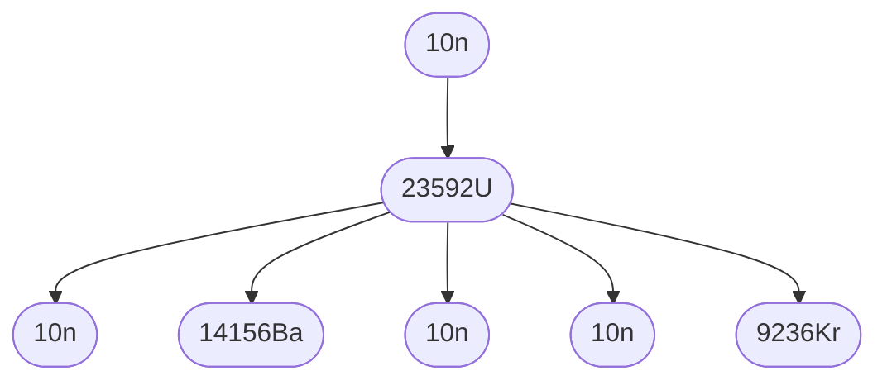

<!-- chemistry-9-10-bn-c08-t8.5-p005 · figure · p.198 -->
**চিত্র ৮.১৩: নিউক্লিয়ার ফিশন বিক্রিয়া**

<!-- chemistry-9-10-bn-c08-t8.5-p006 · text · p.198 · review: verify-formula -->
স্বল্পগতির নিউট্রন দিয়ে $^{235}_{92}U$ কে আঘাত করলে নিউক্লিয়াসটি প্রায় দুইটি সমান অংশে বিভক্ত হয়ে $^{141}_{56}Ba$ ও $^{92}_{36}Kr$ এর নিউক্লিয়াস ও তিনটি নিউট্রন ($^{1}_{0}n$) ও তার সাথে প্রচুর পরিমাণে শক্তি উৎপন্ন হয়। এটি একটি নিউক্লিয়ার ফিশন বিক্রিয়া।

<!-- chemistry-9-10-bn-c08-t8.5-p007 · formula · p.198 · review: latin-junk,verify-formula -->
$$^{235}_{92}U + ^{1}_{0}n \longrightarrow ^{141}_{56}Ba + ^{92}_{36}Kr + 3\ ^^{1}_{0}n + প্রচুর শক্তি$$

### নিউক্লিয়ার ফিউশন বিক্রিয়া

<!-- chemistry-9-10-bn-c08-t8.5-p008 · text · p.198 -->
যে নিউক্লিয়ার বিক্রিয়ায় ছোট ছোট নিউক্লিয়াসসমূহ একত্র হয়ে বড় নিউক্লিয়াস গঠন করে তাকে নিউক্লিয় ফিউশন (Fusion) বিক্রিয়া বলে। নিচে নিউক্লিয়ার ফিউশন বিক্রিয়ার উদাহরণ দেওয়া হলো।

<!-- chemistry-9-10-bn-c08-t8.5-p009 · formula · p.198 · review: latin-junk,verify-formula -->
$$^{2}_{1}H + ^{3}_{1}H \longrightarrow ^{4}_{2}He + ^{1}_{0}n + প্রচুর শক্তি$$

<!-- chemistry-9-10-bn-c08-t8.5-p010 · text · p.198 -->
নিউক্লিয়ার ফিউশন বিক্রিয়ার সাহায্যে হাইড্রোজেন বোমা তৈরি করা হয়।

### নিউক্লিয়ার চেইন বিক্রিয়া

<!-- chemistry-9-10-bn-c08-t8.5-p011 · text · p.198 -->
নিউক্লিয়ার ফিশন বিক্রিয়াগুলোই মূলত নিউক্লিয়ার চেইন বিক্রিয়া (Chain Reaction)। যে বিক্রিয়া একবার শুরু হলে তাকে চালু রাখার জন্য অতিরিক্ত কোনো শক্তির প্রয়োজন হয় না তাকে নিউক্লিয়ার চেইন বিক্রিয়া বলে। তোমরা দেখেছো একটি 23592U আইসোটোপকে একটি নিউট্রন দিয়ে আঘাত করা হলে 23592U আইসোটোপটি ভেঙে একটি 14156Ba নিউক্লিয়াস, একটি 9236Kr নিউক্লিয়াস, ৩টি নিউট্রন (10n) এবং প্রচুর পরিমাণে শক্তি উৎপন্ন হয়। এই ৩টি নিউট্রনের গতি কমানো সম্ভব হলে সেগুলোর একটি অংশ আবার অন্য 23592U আইসোটোপকে আঘাত করে। এভাবে আরো নিউট্রন উৎপন্ন হয়। সেই নিউট্রনগুলোর গতিবেগ কমানো হলে তাদের একটি অংশ আবার অন্য 23592U কে আঘাত করে ফলে আবার নিউট্রন উৎপন্ন হয়। এভাবে চলমান বিক্রিয়াকে নিউক্লিয়ার চেইন বিক্রিয়া বলে। নিউক্লিয়ার চেইন বিক্রিয়াকে নিয়ন্ত্রণ করা যথেষ্ট জটিল এবং এই বিক্রিয়াকে নিয়ন্ত্রণ করে পারমাণবিক চুল্লিতে বিদ্যুৎ উৎপাদন করা হয়।

<!-- chemistry-9-10-bn-c08-t8.5-p012 · figure · p.199 -->
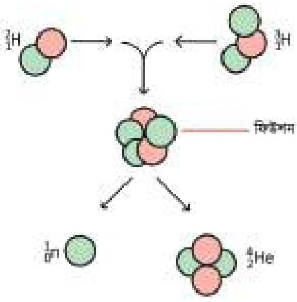

<!-- chemistry-9-10-bn-c08-t8.5-p013 · figure · p.199 -->
**চিত্র ৮.১৪: নিউক্লিয়ার ফিউশন বিক্রিয়া**

### বিদ্যুৎ উৎপাদন

<!-- chemistry-9-10-bn-c08-t8.5-p014 · text · p.199 · review: known-confusable-corrected -->
বিদ্যুৎ উৎপাদন করতে পারমাণবিক চুল্লি ব্যবহার করা হয়। নিউক্লিয় ফিশন বিক্রিয়ার সময় যে চেইন বিক্রিয়া হয়, সেই চেইন বিক্রিয়াকে যে যন্ত্রের সাহায্যে নিয়ন্ত্রণ করা হয় তাকে পারমাণবিক চুল্লি বলে। পারমাণবিক চুল্লির সাহায্যে প্রচুর শক্তি উৎপাদন করা যায়। পারমাণবিক চুল্লির ভিতরে ফিশন বিক্রিয়ার ফলে যে সকল ক্ষুদ্র মৌল তৈরি হয় সেগুলো উচ্চ গতিসম্পন্ন হয়। এই উচ্চ গতিসম্পন্ন ক্ষুদ্র মৌলগুলো চুল্লির ভিতরে একে অন্যের সাথে এবং দেয়ালে প্রচণ্ড জোরে আঘাত করে ও প্রচুর তাপশক্তি উৎপন্ন করে। এই তাপ চুল্লি থেকে বের করে নিয়ে এসে সেই তাপ বাষ্প উৎপাদন প্রকোষ্ঠে চালনা করা হয় এবং এই তাপ দিয়ে বাষ্প উৎপাদন করা হয়। এবার ঐ বাষ্পের সাহায্যে বিদ্যুৎ উৎপাদনের জন্য টারবাইন চালনা করা হয়। ফলে বিদ্যুৎ উৎপন্ন হয়। কোনো কোনো ক্ষেত্রে পারমাণবিক চুল্লির ভেতরেই বাষ্প উৎপাদনের ব্যবস্থা থাকে। পৃথিবীর অনেক দেশে পারমাণবিক চুল্লির সাহায্যে বিদ্যুৎ উৎপাদন করা

<!-- chemistry-9-10-bn-c08-t8.5-p015 · figure · p.199 -->

<!-- chemistry-9-10-bn-c08-t8.5-p016 · figure · p.199 -->
**চিত্র ৮.১৫: নিউক্লিয়ার বিদ্যুৎ কেন্দ্র**

<!-- chemistry-9-10-bn-c08-t8.5-p017 · text · p.200 -->
হচ্ছে। বাংলাদেশ সরকার পাবনা জেলার রূপপুরে পারমাণবিক বিদ্যুৎ উৎপাদনের জন্য সকল প্রস্তুতি গ্রহণ করেছে। প্রকল্পটি সম্পন্ন হলে বাংলাদেশ বিদ্যুৎ উৎপাদনে স্বয়ংসম্পূর্ণ হয়ে যাবে। অদূর ভবিষ্যতে বাংলাদেশের সব এলাকায় বিদ্যুৎ সরবরাহ করা সম্ভব হবে।

### গ্যালভানিক কোষ তৈরি করে বিদ্যুৎ উৎপাদন

<!-- chemistry-9-10-bn-c08-t8.5-p018 · text · p.200 -->
**মূলনীতি:** যে তড়িৎ রাসায়নিক কোষে রাসায়নিক বিক্রিয়া ঘটিয়ে বিদ্যুৎ উৎপাদন করা হয় তাকে গ্যালভানিক কোষ বলে। একটি জিংক (Zn) দণ্ডকে জিংক সালফেট (ZnSO4) দ্রবণে আংশিক ডুবিয়ে এবং কপার সালফেট (CuSO4) দ্রবণে কপার (Cu) দণ্ডকে আংশিক ডুবিয়ে দণ্ড দুটিকে একটি তামার তার দিয়ে সংযোগ ঘটালে গ্যালভানিক কোষ তৈরি হয়। এখানে জিংক দণ্ড থেকে জিংক

<!-- chemistry-9-10-bn-c08-t8.5-p019 · figure · p.200 -->
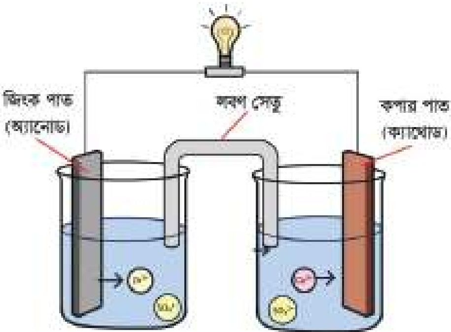

<!-- chemistry-9-10-bn-c08-t8.5-p020 · figure · p.200 -->
**চিত্র ৮.১৬: গ্যালভানিক কোষের সাহায্যে বিদ্যুৎ শক্তি উৎপাদন**

<!-- chemistry-9-10-bn-c08-t8.5-p021 · text · p.200 -->
পরমাণু দুইটি ইলেকট্রন ত্যাগ করে জিংক আয়ন (Zn2+) হিসেবে দ্রবণে চলে যায়। ইলেকট্রন দুটি কপার তারের ভিতর দিয়ে কপার দণ্ডে পৌঁছে। কপার সালফেট দ্রবণের কপার আয়ন (Cu2+) ইলেকট্রন দুইটি গ্রহণ করে ধাতব কপারে পরিণত হয়। কপার তারের মধ্য দিয়ে ইলেকট্রন প্রবাহের ফলে বিদ্যুৎ প্রবাহ সৃষ্টি হয়। এ ক্ষেত্রে জিংক দণ্ড অ্যানোড আর কপার দণ্ড ক্যাথোড হিসেবে কাজ করে।

<!-- chemistry-9-10-bn-c08-t8.5-p022 · formula · p.200 · review: verify-formula -->
$$Zn \longrightarrow Zn^{2+} + 2e^- \quad (অ্যানোডে বিক্রিয়া)$$

<!-- chemistry-9-10-bn-c08-t8.5-p023 · formula · p.200 · review: verify-formula -->
$$Cu^{2+} + 2e^- \longrightarrow Cu \quad (ক্যাথোডে বিক্রিয়া)$$

<!-- chemistry-9-10-bn-c08-t8.5-p024 · formula · p.200 · review: verify-formula -->
$$Zn + Cu^{2+} \longrightarrow Zn^{2+} + Cu \quad (কোষ বিক্রিয়া)$$

<!-- chemistry-9-10-bn-c08-t8.5-p025 · text · p.201 -->
**প্রয়োজনীয় যন্ত্রপাতি ও রাসায়নিক দ্রব্য:** দুইটি বিকার, জিংক সালফেট (ZnSO4) দ্রবণ, কপার সালফেট (CuSO4) দ্রবণ, জিংক দন্ড, কপার দন্ড, একটি LED, পানিতে ভেজানো এক টুকরো লম্বা কাগজ অথবা লবণ সেতু, কপার তার ইত্যাদি।

<!-- chemistry-9-10-bn-c08-t8.5-p026 · text · p.201 -->
**কার্যপ্রণালি:** ৮.১৬ চিএরের মতো করে একটি বিকারে জিংক সালফেট দ্রবণ নিয়ে তাতে জিংক দন্ড এবং অপর একটি বিকারে কপার সালফেট দ্রবণ নিয়ে তাতে কপার দন্ড আংশিক প্রবেশ করাও। বিকার দুটির দ্রবণে চিএরের মতো করে একটি লবণ সেতু স্থাপন কর। এবারে জিংক ও কপার দন্ড দুটিকে তামার তার যুক্ত কর। এবার LED এর পজিটিভ প্রান্ত কপার প্রান্তের তামার তারের সাথে এবং নেগেটিভ প্রান্ত জিংক দন্ডের তামার তারের সাথে যুক্ত করলে LEDটি জ্বলে উঠবে। এই সময় জিংক দন্ড ক্ষয়প্রাপ্ত হয়ে জিংক আয়ন দ্রবণে চলে যেতে থাকে এবং দ্রবণ থেকে কপার আয়ন কপার দন্ডে গিয়ে জমা হতে থাকে।

<!-- chemistry-9-10-bn-c08-t8.5-p027 · text · p.201 -->
এক্ষেত্রে উপরে দেখানো কোষ বিক্রিয়াটি সংঘটিত হয়। ফলে রাসায়নিক শক্তি বিদ্যুৎ শক্তিতে রূপান্তরিত হয়।

### সতর্কতা

<!-- chemistry-9-10-bn-c08-t8.5-p028 · text · p.201 -->
1. দুইটি দ্রবণের উচ্চতা সমান রাখতে হবে।
2. লবণ সেতু বা এক টুকরো ভেজা কাগজ দিয়ে উভয় দ্রবণের মধ্যে সংযোগ ভালোমতো করতে হবে।

<!-- chemistry-9-10-bn-c08-t8.5-p029 · text · p.201 -->
**পানিতে অ্যামোনিয়াম ক্লোরাইড (NH4Cl) দ্রবীভূত করে তাপমাত্রার পরিবর্তন পর্যবেক্ষণ।**

<!-- chemistry-9-10-bn-c08-t8.5-p030 · text · p.201 -->
**মূলনীতি:** অ্যামোনিয়াম ক্লোরাইডকে পানিতে দ্রবীভূত করলে তা নিম্নরূপে আয়নিত হয়।

<!-- chemistry-9-10-bn-c08-t8.5-p031 · formula · p.201 · review: verify-formula -->
$$NH_4Cl \longrightarrow NH_4^+ + Cl^-$$

<!-- chemistry-9-10-bn-c08-t8.5-p032 · text · p.201 -->
অ্যামোনিয়াম ক্লোরাইডের কেলাস ভাঙতে ও অ্যামোনিয়াম ক্লোরাইডের অণু আয়নিত হতে শক্তির প্রয়োজন হয়। এ শক্তি পানি হতে আসে। ফলে পানির তাপমাত্রা কমে যায়। তাই অ্যামোনিয়াম ক্লোরাইড পানিতে দ্রবীভূত হওয়া একটি তাপহারী প্রক্রিয়া।

### প্রয়োজনীয় যন্ত্রপাতি ও রাসায়নিক দ্রব্য:

<!-- chemistry-9-10-bn-c08-t8.5-p033 · text · p.202 -->
বিকার, অ্যামোনিয়াম ক্লোরাইড (NH4Cl), পাতিত পানি, কাচ দণ্ড, থার্মোমিটার।

<!-- chemistry-9-10-bn-c08-t8.5-p034 · figure · p.202 -->
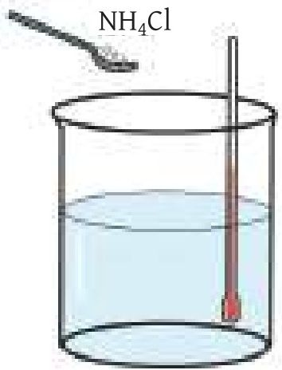

### কার্যপ্রণালী

<!-- chemistry-9-10-bn-c08-t8.5-p035 · text · p.202 -->
বিকারে 50 গ্রাম পাতিত পানি নাও।
থার্মোমিটারের সাহায্যে পানির তাপমাত্রা নির্ণয় করো।
10 গ্রাম অ্যামোনিয়াম ক্লোরাইড বিকারের পানিতে যোগ করো।

<!-- chemistry-9-10-bn-c08-t8.5-p036 · figure · p.202 -->
**চিত্র ৮.১৭: বিকারে NH4Cl এর দ্রবণ**

<!-- chemistry-9-10-bn-c08-t8.5-p037 · text · p.202 -->
কাচ দণ্ড দিয়ে নাড়াচড়া করে সম্পূর্ণ অ্যামোনিয়াম ক্লোরাইডকে দ্রবীভূত করো।
যত তাড়াতাড়ি সম্ভব দ্রবীভূত হওয়ার সাথে সাথে সাথে দ্রবণের তাপমাত্রা থার্মোমিটার দিয়ে নির্ণয় করো।

<!-- chemistry-9-10-bn-c08-t8.5-p038 · text · p.202 · review: known-confusable-corrected -->
**ফলাফল:** পর্যবেক্ষণকৃত ডাটা থেকে দেখা যাবে অ্যামোনিয়াম ক্লোরাইড পানিতে দ্রবীভূত হলে পানির তাপমাত্রা হ্রাস পাবে, অর্থাৎ এটি একটি তাপহারী প্রক্রিয়া।

### পানিতে চুন যোগ করে তাপমাত্রা পরিবর্তন পর্যবেক্ষণ

<!-- chemistry-9-10-bn-c08-t8.5-p039 · text · p.202 -->
**মূলনীতি:** চুন বা ক্যালসিয়াম অক্সাইড পানিতে যোগ করলে তা পানির সাথে নিম্নরূপে বিক্রিয়া করে।

<!-- chemistry-9-10-bn-c08-t8.5-p040 · text · p.202 · review: latin-junk,verify-formula -->
$$CaO + H_2O \longrightarrow Ca(OH)_2 + তাপ$$
ক্যালসিয়াম অক্সাইড পানি ক্যালসিয়াম হাইড্রোক্সাইড

<!-- chemistry-9-10-bn-c08-t8.5-p041 · text · p.202 -->
এই বিক্রিয়াটি তাপোৎপাদী বিক্রিয়া। তাই ক্যালসিয়াম হাইড্রোক্সাইডসহ পানির তাপমাত্রা বৃদ্ধি পায়।

<!-- chemistry-9-10-bn-c08-t8.5-p042 · text · p.202 -->
**প্রয়োজনীয় যন্ত্রপাতি ও রাসায়নিক দ্রব্য:** বিকার, চুন বা ক্যালসিয়াম অক্সাইড (CaO), পাতিত পানি, কাচ দণ্ড, থার্মোমিটার।

### কর্মপ্রণালি

<!-- chemistry-9-10-bn-c08-t8.5-p043 · text · p.203 -->
1. বিকারের অর্ধেক পরিমাণ পাতিত পানি নাও।

<!-- chemistry-9-10-bn-c08-t8.5-p044 · text · p.203 -->
2. থার্মোমিটারের সাহায্যে পানির তাপমাত্রা নির্ণয় করো।

<!-- chemistry-9-10-bn-c08-t8.5-p045 · text · p.203 -->
3. চুন বা ক্যালসিয়াম অক্সাইড বিকারের পানিতে যোগ করো।

<!-- chemistry-9-10-bn-c08-t8.5-p046 · text · p.203 -->
4. বিক্রিয়া শুরু হলে কাচ দড়ি দিয়ে বিকারের দ্রবণকে নাড়াচড়া করো।

<!-- chemistry-9-10-bn-c08-t8.5-p047 · text · p.203 -->
5. যত তাড়াতাড়ি সম্ভব বিকারের দ্রবণের তাপমাত্রা থার্মোমিটার দিয়ে নির্ণয় করো। দেখা যাবে দ্রবণের তাপমাত্রা বেড়ে গেছে।

<!-- chemistry-9-10-bn-c08-t8.5-p048 · figure · p.203 -->
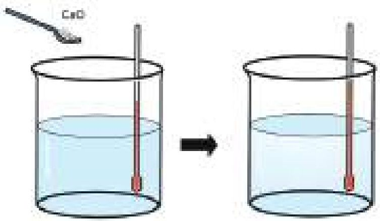

<!-- chemistry-9-10-bn-c08-t8.5-p049 · figure · p.203 -->
**চিত্র ৮.১৮: বিকারে পানি ও চুনের দ্রবণ**

<!-- chemistry-9-10-bn-c08-t8.5-p050 · text · p.203 -->
**ফলাফল:** পানিতে চুন যোগ করলে তাপমাত্রা বৃদ্ধি পায়। এটি একটি তাপোৎপাদী প্রক্রিয়া।

## 8.ex নমুনা প্রশ্ন

### বহুনির্বাচনি প্রশ্ন

<!-- chemistry-9-10-bn-c08-t8.ex-p001 · exercise · p.203 -->
**১. বিদ্যুৎ পরিবহনের কৌশলের উপর ভিত্তি করে পরিবাহী কত প্রকার?**

<!-- chemistry-9-10-bn-c08-t8.ex-p002 · exercise · p.203 -->
(ক) এক                      (খ) দুই
(গ) তিন                      (ঘ) চার

<!-- chemistry-9-10-bn-c08-t8.ex-p003 · exercise · p.203 -->
**৩ নং প্রশ্নের সাথে প্রদত্ত চিত্রের আলোকে ২ ও ৩ নং প্রশ্নের উত্তর দাও:**

<!-- chemistry-9-10-bn-c08-t8.ex-p004 · exercise · p.203 -->
**২. উদ্দীপকের প্রক্রিয়া লোহার-**

<!-- chemistry-9-10-bn-c08-t8.ex-p005 · exercise · p.203 -->
(ক) পরিমাণ বৃদ্ধি করে                      (খ) ক্ষয়রোধ করে
(গ) দৃঢ়তা বৃদ্ধি করে                      (ঘ) বিশুদ্ধতা বৃদ্ধি করে

### ৩. পাস্কের চিহ্ন-

<!-- chemistry-9-10-bn-c08-t8.ex-p006 · exercise · p.204 -->
(i) Ni ক্ষয়প্রাপ্ত হয়
(ii) Fe অ্যানোড হিসেবে কাজ করে
(iii) ইলেকট্রনের আদান-প্রদান ঘটে

<!-- chemistry-9-10-bn-c08-t8.ex-p007 · exercise · p.204 -->
নিচের কোনটি সঠিক?

<!-- chemistry-9-10-bn-c08-t8.ex-p008 · exercise · p.204 · review: latin-junk -->
(ক) i ও ii                      (খ) ii ও iii
(গ) i ও iii                      (ঘ) i, ii ও iii

<!-- chemistry-9-10-bn-c08-t8.ex-p009 · figure · p.204 -->
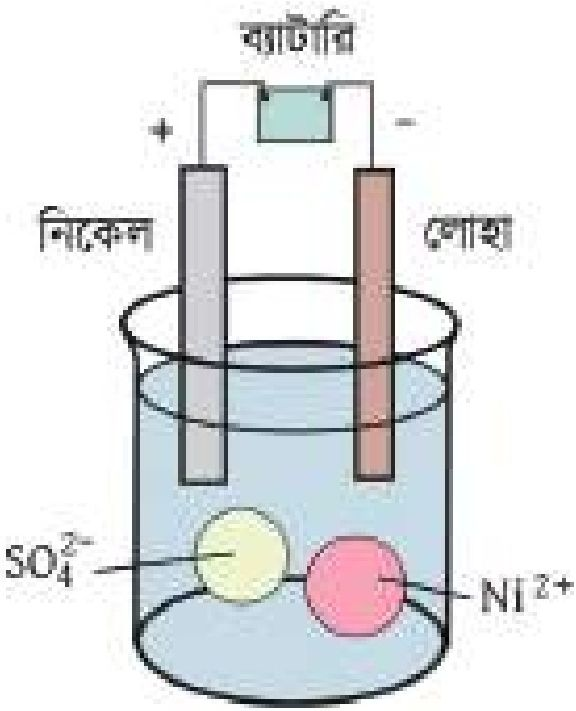

### ৪. ড্রাই সেলে নিচের কোনটি জারক হিসেবে কাজ করে?

<!-- chemistry-9-10-bn-c08-t8.ex-p010 · exercise · p.204 -->
(ক) Zn দণ্ড                      (খ) MnO2
(গ) কার্বন দণ্ড                  (ঘ) NH4+

### ৫. তড়িৎ বিশ্লেষণের মাধ্যমে কোনো ধাতুর উপর অন্য ধাতুর প্রলেপ দেওয়াকে কী বলে?

<!-- chemistry-9-10-bn-c08-t8.ex-p011 · exercise · p.204 -->
(ক) ভলকানাইজিং                      (খ) ধাতু বিশোধন
(গ) গ্যালভানাইজিং                  (ঘ) ইলেকট্রোপ্লটিং

### ৬. নিউক্লিয় বিক্রিয়ার সময় নিউক্লিয়াসকে আঘাত করা হয় সাধারণত কোনটি দ্বারা?

<!-- chemistry-9-10-bn-c08-t8.ex-p012 · exercise · p.204 -->
(ক) প্রোটন                      (খ) ইলেকট্রন
(গ) পজিট্রন                      (ঘ) নিউট্রন

### ৭. প্লাটিনাম তড়িৎদ্বার ব্যবহার করে NaCl জলীয় দ্রবণের তড়িৎ বিশ্লেষণের সময় উৎপন্ন হয়-

<!-- chemistry-9-10-bn-c08-t8.ex-p013 · exercise · p.204 · review: known-confusable-corrected -->
(i) হাইড্রোজেন গ্যাস
(ii) ক্লোরিন গ্যাস
(iii) সোডিয়াম হাইড্রোক্সাইড দ্রবণ

<!-- chemistry-9-10-bn-c08-t8.ex-p014 · exercise · p.204 -->
নিচের কোনটি সঠিক?

<!-- chemistry-9-10-bn-c08-t8.ex-p015 · exercise · p.204 · review: latin-junk -->
(ক) i ও ii                      (খ) ii ও iii
(গ) i ও iii                      (ঘ) i, ii, ও iii

### সৃজনশীল প্রশ্ন

<!-- chemistry-9-10-bn-c08-t8.ex-p016 · exercise · p.205 · review: known-confusable-corrected,verify-formula -->
১. (i) পেট্রোলিয়াম + O2 $\longrightarrow$ CO2 + H2O + শক্তি

<!-- chemistry-9-10-bn-c08-t8.ex-p017 · exercise · p.205 · review: known-confusable-corrected,verify-formula -->
(ii) $^{238}_{92}U + ^{1}_{0}n^{1}$ $\longrightarrow$ $^{56}_{56}Ba + ^{36}_{36}Kr + 3^{1}_{0}n^{1} + শক্তি$

<!-- chemistry-9-10-bn-c08-t8.ex-p018 · exercise · p.205 · review: known-confusable-corrected,verify-formula -->
(iii) Zn + CuCl2 $\longrightarrow$ ZnCl2 + Cu + শক্তি

<!-- chemistry-9-10-bn-c08-t8.ex-p019 · exercise · p.205 · review: known-confusable-corrected -->
(ক) ইলেকট্রোপ্ল্যাটিং কী?

<!-- chemistry-9-10-bn-c08-t8.ex-p020 · exercise · p.205 · review: known-confusable-corrected -->
(খ) তড়িৎ রাসায়নিক কোষে লবণ সেতু ব্যবহার করা হয় কেন?

<!-- chemistry-9-10-bn-c08-t8.ex-p021 · exercise · p.205 · review: known-confusable-corrected -->
(গ) উদ্দীপকের দ্বিতীয় বিক্রিয়াটি রাসায়নিক বিক্রিয়া নয়—ব্যাখ্যা করো।

<!-- chemistry-9-10-bn-c08-t8.ex-p022 · exercise · p.205 · review: known-confusable-corrected -->
(ঘ) শক্তি উৎপাদনে (i) ও (iii) এর বিক্রিয়া তুলনা করো।

<!-- chemistry-9-10-bn-c08-t8.ex-p023 · exercise · p.205 · review: known-confusable-corrected -->
২. (ক) ধাতব পরিবাহী কী?

<!-- chemistry-9-10-bn-c08-t8.ex-p024 · exercise · p.205 · review: known-confusable-corrected -->
(খ) এসিড মিশ্রিত পানিকে তড়িৎ বিশ্লেষণ পরিবাহী বলা হয় কেন? ব্যাখ্যা করো।

<!-- chemistry-9-10-bn-c08-t8.ex-p025 · exercise · p.205 · review: known-confusable-corrected -->
(গ) পাশের কোষে অ্যানোড সংঘটিত বিক্রিয়াটি ব্যাখ্যা করো।

<!-- chemistry-9-10-bn-c08-t8.ex-p026 · exercise · p.205 · review: known-confusable-corrected -->
(ঘ) উদ্দীপকে সংঘটিত বিক্রিয়ায় তড়িৎ প্রবাহের প্রয়োজনীয়তার যৌক্তিক ব্যাখ্যা দাও।

<!-- chemistry-9-10-bn-c08-t8.ex-p027 · figure · p.205 · review: known-confusable-corrected -->
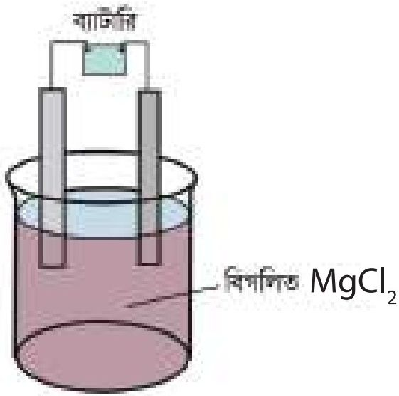

<!-- chemistry-9-10-bn-c08-t8.ex-p028 · exercise · p.205 · review: known-confusable-corrected -->
৩. (i) তড়িৎ বিশ্লেষণ কোষ (ii) গ্যালভানিক কোষ

<!-- chemistry-9-10-bn-c08-t8.ex-p029 · exercise · p.205 · review: known-confusable-corrected -->
(ক) তাপোৎপাদী বিক্রিয়া কাকে বলে?

<!-- chemistry-9-10-bn-c08-t8.ex-p030 · exercise · p.205 · review: known-confusable-corrected -->
(খ) পানির তড়িৎ বিশ্লেষণের সময় সামান্য পরিমাণে সালফিউরিক এসিড যোগ করা হয় কেন?

<!-- chemistry-9-10-bn-c08-t8.ex-p031 · exercise · p.205 · review: known-confusable-corrected -->
(গ) (i) নং কোষের গঠন ব্যাখ্যা করো।

<!-- chemistry-9-10-bn-c08-t8.ex-p032 · exercise · p.205 · review: known-confusable-corrected -->
(ঘ) (ii) নং কোষের সাহায্যে বিদ্যুৎ উৎপাদনের সন্বাবনা বিশ্লেষণ করো।

### সংক্ষিপ্ত-উত্তর প্রশ্ন

<!-- chemistry-9-10-bn-c08-t8.ex-p033 · exercise · p.205 -->
১. এসিড মিশ্রিত পানিকে তড়িৎ বিশ্লেষণ পরিবাহী বলা হয় কেন? ব্যাখ্যা করো।

<!-- chemistry-9-10-bn-c08-t8.ex-p034 · exercise · p.205 -->
২. কপার সালফেট তীব্র তড়িৎ বিশ্লেষ্য পদার্থ কেন? ব্যাখ্যা করো।

<!-- chemistry-9-10-bn-c08-t8.ex-p035 · exercise · p.205 -->
৩. তড়িৎ রাসায়নিক কোষে লবণ সেতু ব্যবহার করা হয় কেন? ব্যাখ্যা করো।
