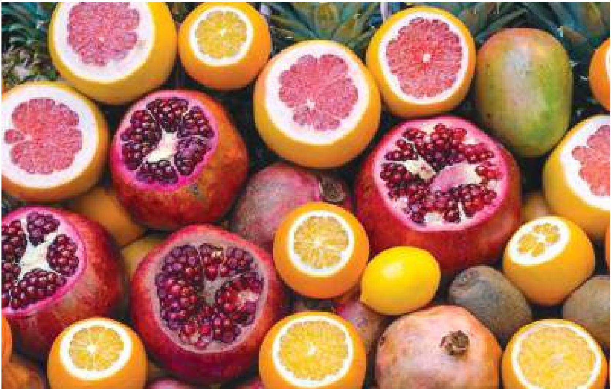
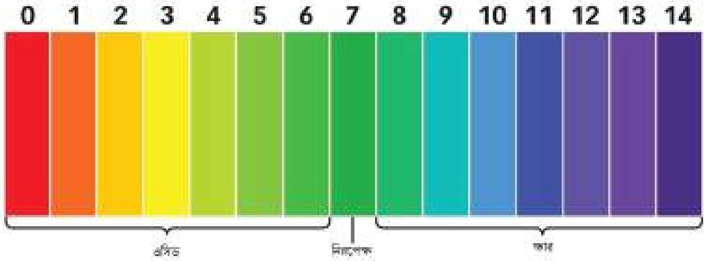
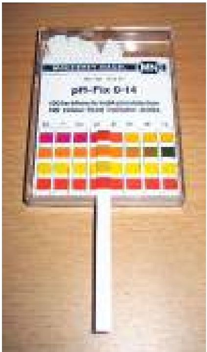
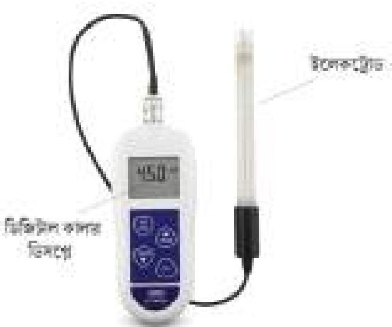
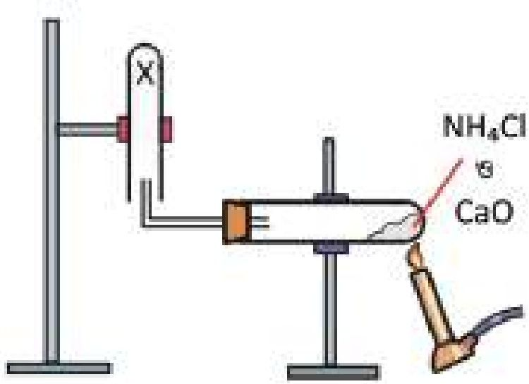

# 9. এসিড-ক্ষারক সমতা

Source: Chemistry Bangla Version, printed pp. 206-232

## 9.0 ভূমিকা ও শিখনফল

<!-- chemistry-9-10-bn-c09-t9.0-p001 · figure · p.206 -->

### অনেক ফলই খানিকটা এসিডধর্মী

<!-- chemistry-9-10-bn-c09-t9.0-p002 · text · p.206 · review: known-confusable-corrected -->
রসায়ন গবেষণাগারে আমরা নানা ধরনের যৌগ ব্যবহার করে থাকি। তাদের মধ্যে এসিড, ক্ষারক আর লবণ অন্তর্ম। রসায়নের শিক্ষার্থী হিসেবে তোমাদেরকেও এসিড, ক্ষারক এবং লবণ সম্পর্কে জানতে হবে। ল্যাবরেটরিতে আমরা পরীক্ষা-নিরীক্ষা করার জন্য গাঢ় এসিড বা গাঢ় ক্ষারের পরিবর্তে লঘু এসিড বা লঘু ক্ষারই বেশি ব্যবহার করে থাকি। খাদ্যের মাধ্যমে আমরা এসিড, ক্ষারক ও লবণ পেয়ে থাকি, যা আমাদের শরীরের জন্য আবশ্যক। এসিডকে ক্ষারক দ্বারা প্রশমিত করে লবণ তৈরি করা হয় অথবা ক্ষারককে এসিড দ্বারা প্রশমিত করে লবণ তৈরি করা হয়। কোনো দ্রবণ এসিডধর্মী না ক্ষারধর্মী তা আমরা ল্যাবরেটরিতে বিভিন্ন পরীক্ষার মাধ্যমে জানতে পারি। এদের মধ্যে লিটমাস পরীক্ষা, pH মান পরীক্ষা সবচেয়ে বেশি ব্যবহৃত হয়। প্রয়োজনীয় এসব এসিড, ক্ষারক এবং লবণ আমাদের পরিবেশকে আবার বিভিন্নভাবে দূষিতও করছে। এসব বিষয়ই এই অধ্যায়ে আলোচনা করা হবে।

### এ অধ্যায় পাঠ শেষে আমরা

<!-- chemistry-9-10-bn-c09-t9.0-p003 · text · p.207 · review: known-confusable-corrected -->
* অম্ল, ক্ষার ও লবণের বৈশিষ্ট্য ব্যাখ্যা করতে পারব।
* পরিচিত পরিবেশের পদার্থগুলোর মধ্যে থেকে অম্ল, ক্ষার ও লবণকে শনাক্ত করতে পারব।
* ক্ষারক ও ক্ষার জাতীয় পদার্থের পার্থক্য করতে পারব।
* ব্যবহার্য পদার্থের ওপর অম্ল ও ক্ষারের প্রভাব বর্ণনা করতে পারব।
* গৃহস্থালি পদার্থের ওপর অম্ল ও ক্ষার জাতীয় দ্রব্যের প্রভাবের আর্থিক গুরুত্ব মূল্যায়ন করতে পারব।
* pH এর ধারণা ব্যাখ্যা করতে পারব।
* pH পরিমাপের গুরুত্ব ব্যাখ্যা করতে পারব।
* পরিবেশের ভারসাম্য রক্ষায় অম্ল-ক্ষার সমতার গুরুত্ব অনুধাবন করতে পারব।
* এসিড বৃষ্টির কারণ, ক্ষতিকর দিকসমূহ এবং তা থেকে রক্ষার উপায় ব্যাখ্যা করতে পারব।
* পানিচক্র ব্যাখ্যা করতে পারব।
* পানির খরতা ব্যাখ্যা করতে পারব।
* খর পানি ব্যবহারের সুবিধাসমূহ উল্লেখ করতে পারব।
* খর পানি ব্যবহারের আর্থিক ক্ষতি ব্যাখ্যা করতে পারব।
* পানি দূষণের কারণ ও পরিশোধনের উপায়সমূহ বর্ণনা করতে পারব।
* আসেনিকযুক্ত পানি পানের ক্ষতিকর দিক উল্লেখ করতে পারব।
* pH পরিমাপের মাধ্যমে গৃহের/ল্যাবের/লবণাক্ত পানির প্রকৃতি নির্ণয় করতে পারব।
* যৌগসমূহের দ্রবণের pH মান নির্ণয় করে বা লিটমাস বা ইউনিভার্সাল ইনডিকেটর ব্যবহার করে যৌগের প্রকৃতি তুলনা (এসিড, ক্ষার) করতে পারব।
* দূষণযুক্ত পানি ব্যবহারে আগ্রহ প্রদর্শন করতে পারব।
* এসিড সন্ধ্যাসের ভয়াবহ দিক সম্পর্কে সচেতনতার পরিচয় দিতে পারব এবং অন্যদের সচেতন করতে করতে পারব।
* ব্যবহার্য পদার্থের ওপর অম্ল ও ক্ষারের প্রভাব পরীক্ষার মাধ্যমে দেখাতে পারব।
* অম্ল ও ক্ষার জাতীয় পদার্থ ব্যবহারের ক্ষেত্রে যথাযথ ব্যবহারের পূর্ব সতর্কতামূলক ব্যবস্থা গ্রহণ করতে পারব।

## 9.1 এসিড (Acid)

<!-- chemistry-9-10-bn-c09-t9.1-p001 · text · p.208 -->
রাসায়নিক দ্রব্যাদির মধ্যে এসিড খুবই গুরুত্বপূর্ণ। এসিড এক ধরনের গুরুত্বপূর্ণ রাসায়নিক দ্রব্য যা পানিতে দ্রবীভূত করলে এসিডের অণু বিয়োজিত হয়ে (ভেঙে) হাইড্রোজেন আয়ন বা প্রোটন (H+) দান করে। যেমন— হাইড্রোক্লোরিক এসিড (HCl), সালফিউরিক এসিড (H2SO4) এবং তীব্র এসিড অতএব, এরা জলীয় দ্রবণে নিম্নরূপে বিয়োজিত হয়:

<!-- chemistry-9-10-bn-c09-t9.1-p002 · formula · p.208 · review: verify-formula -->
$$HCl(aq) \longrightarrow H^+(aq) + Cl^-(aq)$$

<!-- chemistry-9-10-bn-c09-t9.1-p003 · formula · p.208 · review: verify-formula -->
$$H_2SO_4(aq) \longrightarrow 2H^+(aq) + SO_4^{2-}(aq)$$

<!-- chemistry-9-10-bn-c09-t9.1-p004 · text · p.208 -->
কার্বনিক এসিড (H2CO3), এসিটিক এসিড (CH3COOH) এবং মৃদু এসিড। এরা জলীয় দ্রবণে নিম্নরূপে বিয়োজিত হয়।

<!-- chemistry-9-10-bn-c09-t9.1-p005 · formula · p.208 · review: verify-formula -->
$$H_2CO_3(aq) \rightleftharpoons 2H^+(aq) + CO_3^{2-}(aq)$$

<!-- chemistry-9-10-bn-c09-t9.1-p006 · formula · p.208 · review: verify-formula -->
$$CH_3COOH(aq) \rightleftharpoons H^+(aq) + CH_3COO^-(aq)$$

<!-- chemistry-9-10-bn-c09-t9.1-p007 · text · p.208 · review: verify-formula -->
HCl ও H2SO4 এর ক্ষেত্রে বিয়োজন বোঝাতে একটিমাত্র তির চিহ্ন ব্যবহার করা হয়েছে। এর অর্থ হলো HCl ও H2SO4 পানিতে সম্পূর্ণ (100%) বিয়োজিত হয়। তাই এ ধরনের এসিডকে তীব্র এসিড বা সবল এসিড বলে। অন্য দুইটি এসিড CH3COOH ও H2CO3 এর বিয়োজন বোঝাতে উভমুখী তির চিহ্ন ($\rightleftharpoons$) ব্যবহার করা হয়েছে। অর্থাৎ এরা পানিতে আংশিক বিয়োজিত হয়। তাই এ ধরনের এসিডকে মৃদু এসিড বা দুর্বল এসিড বলে। উদাহরণ হিসেবে বলা যায়, 25°C তাপমাত্রায় 1000টি CH3COOH অণুর মধ্যে পানিতে মাত্র ৪টি অণু বিয়োজিত হয়। বাকি ৯৯৬টি অণু অবিয়োজিত অবস্থায়ই পানিতে থেকে যায়। এসিড ও পানির দ্রবণে এসিডের পরিমাণ যদি বেশি থাকে তবে তাকে গাঢ় এসিড বলে। আবার, এসিডের জলীয় দ্রবণে পানির পরিমাণ যদি এসিডের তুলনায় অনেক বেশি হয় তবে তাকে লঘু এসিড বলে। এসিড টক স্বাদযুক্ত। তোমরা নিশ্চয় তেঁতুল খেয়েছ, যা খুব টক। তেঁতুলের ভিতরে টারটারিক এসিড থাকে। তাই তেঁতুল এত টক। এসিড দ্রবণ নীল রঙের লিটমাস পেপারকে লাল রঙের লিটমাস পেপারে রূপান্তরিত করে।

<!-- chemistry-9-10-bn-c09-t9.1-p008 · text · p.208 -->
এসিড ধাতব অক্সাইডের সাথে বিক্রিয়া করে লবণ ও পানি উৎপন্ন করে।

<!-- chemistry-9-10-bn-c09-t9.1-p009 · formula · p.208 · review: verify-formula -->
$$CaO + 2HCl \longrightarrow CaCl_2 + H_2O$$

<!-- chemistry-9-10-bn-c09-t9.1-p010 · text · p.208 -->
ক্যালসিয়াম অক্সাইড হাইড্রোক্লোরিক এসিড ক্যালসিয়াম ক্লোরাইড পানি
(ধাতব অক্সাইড) (এসিড) (লবণ)

<!-- chemistry-9-10-bn-c09-t9.1-p011 · text · p.209 -->
এসিড সক্রিয় ধাতুর সাথে বিক্রিয়া করে লবণ ও হাইড্রোজেন গ্যাস তৈরি করে

<!-- chemistry-9-10-bn-c09-t9.1-p012 · formula · p.209 · review: verify-formula -->
$$2Na + 2HCl \longrightarrow 2NaCl + H_2$$

<!-- chemistry-9-10-bn-c09-t9.1-p013 · text · p.209 -->
সোডিয়াম হাইড্রোক্লোরিক এসিড সোডিয়াম ক্লোরাইড হাইড্রোজেন গ্যাস
(ধাতু) (এসিড) (লবণ)

<!-- chemistry-9-10-bn-c09-t9.1-p014 · text · p.209 -->
আমরা প্রতিদিন অনেক খাবার গ্রহণ করি যেগুলোর মাঝে বিভিন্ন ধরনের এসিড থাকে। যেমন—দুধের মধ্যে ল্যাকটিক এসিড, সফট ড্রিংকসে কার্বনিক এসিড, কমলালেবু বা লেবুতে সাইট্রিক এসিড, তৈঁতুলে টারটারিক এসিড, ভিনেগারে ইথানয়িক এসিড, চায়ে ট্যানিক এসিড ইত্যাদি। এই খাদ্যগুলো যখন আমরা খাই তখন খাদ্যের মাধ্যমে সংশ্লিষ্ট এসিডগুলো আমাদের শরীরে প্রবেশ করে। এসিডগুলো আমাদের খাদ্য পরিপাকে সাহায্য করে এবং শরীরের রোগ প্রতিরোধ করে। আবার, আচারজাতীয় অনেক এসিডযুক্ত খাদ্য আছে যেগুলো আমাদের খাওয়ার বৃতি বৃদ্ধি করে। এসব এসিড খুবই দুর্বল প্রকৃতির হওয়ায় এগুলো আমাদের শরীরের ক্ষতি করে না। আবার, এগুলো খেতে টক স্বাদযুক্ত। আমাদের পাকস্থলীর দেয়াল থেকে হাইড্রোক্লোরিক এসিড উৎপন্ন হয়। এটি অত্যন্ত শক্তিশালী এসিড। এটি পাকস্থলীতে খাদ্যকে ভাঙতে ব্যবহৃত হয়। কিন্তু অনেক সময় দেখা যায় পাকস্থলীর দেয়াল থেকে অতিরিক্ত হাইড্রোক্লোরিক এসিড (HCl) নিঃসরিত হয়ে তা পাকস্থলীর দেয়ালের কোষগুলোকে ভাঙতে শুরু করে। আবার, খাদ্য গ্রহণ না করে স্ফুর্তার অবস্থায় থাকলে অর্থাৎ পাকস্থলী খালি রাখলে নিঃসরিত হাইড্রোক্লোরিক এসিড (HCl) পাকস্থলীর দেয়ালের কোষগুলোকে ভেঙে সেখানে ক্ষতের সৃষ্টি করে। ফলে পেটে ব্যথা শুরু হয়। এ অবস্থাকে আমরা পেপটিক আলসার বলা। কাজেই যেসব খাদ্য খেলে অতিরিক্ত এসিড নিঃসরিত হয় সেগুলো পরিহার করতে হবে। আবার, বেশি সময় ধরে পেট খালি রাখাও পরিহার করতে হবে। এ অধ্যায়ে এসিডের আরও ধর্ম এবং তাদের ব্যবহার সম্পর্কে জানতে পারবে।

### ৯.১.১ লঘু এসিডের ধর্মসমূহ ও এদের পরীক্ষামূলক প্রমাণ

<!-- chemistry-9-10-bn-c09-t9.1-p015 · text · p.209 -->
**(i) স্বাদ:** সকল লঘু এসিড টক স্বাদযুক্ত। আমরা ইতঃপূর্বে দেখেছি এসিডযুক্ত খাবারগুলো টক। তবে সাবধান ল্যাবরেটরিতে কোনো এসিডের স্বাদ মুখে নেওয়া যাবে না। কেননা এগুলো জিহ্বায় লাগলে সজ্জা সজ্জো জিহ্বায় ক্ষত সৃষ্টি করে ফেলবে। তবে তৈঁতুলের মধ্যে টারটারিক এসিড থাকে। যদি তৈঁতুল মুখে নাও তবে তৈঁতুল টক স্বাদযুক্ত পাবে।

<!-- chemistry-9-10-bn-c09-t9.1-p016 · text · p.209 -->
**(ii) স্ফয়কারী:** এসিডগুলো স্ফয়কারী পদার্থ হিসেবে পরিচিত। যেমন—এসিডের মধ্যে এক খণ্ড লোহার পাত রাখলে লোহার পাতটির পৃষ্ঠতল ক্ষয়ে ঝাঁজরা হয়ে যায়।

<!-- chemistry-9-10-bn-c09-t9.1-p017 · text · p.209 -->
**(iii) লিটমাস পরীক্ষা:** এসিড নীল বর্ণের লিটমাসকে লাল বর্ণে পরিণত করে। একটি পরীক্ষা নলে 2-3 মিলি হাইড্রোক্লোরিক এসিড নিয়ে এতে এক টুকরা নীল লিটমাস কাগজ যোগ করো। দেখবে নীল রঙের লিটমাস কাগজটি লাল বর্ণে পরিণত হয়েছে। একইভাবে, H2SO4, HNO3 বা অন্য যেকোনো এসিড নিয়ে এই পরীক্ষা করতে পারো। এমনকি তেঁতুল বা আচারের মধ্যেও পানিতে ভেজা নীল লিটমাস যোগ করলে নীল লিটমাস কাগজ লাল বর্ণে পরিণত হবে।

<!-- chemistry-9-10-bn-c09-t9.1-p018 · text · p.210 -->
**(iv) সক্রিয় ধাতুর সাথে এসিডের বিক্রিয়া:** এসিড সক্রিয় ধাতুর (যেমন– K, Na, Mg ইত্যাদি) সাথে বিক্রিয়া করে সংশ্লিষ্ট ধাতুটির লবণ এবং হাইড্রোজেন গ্যাস উৎপন্ন করে। যেমন– Mg ধাতু, সালফিউরিক এসিডের সাথে বিক্রিয়া করে MgSO4 এবং H2 গ্যাস উৎপন্ন করে। বিক্রিয়াটি হচ্ছে:

<!-- chemistry-9-10-bn-c09-t9.1-p019 · formula · p.210 · review: verify-formula -->
$$Mg + H_2SO_4 \longrightarrow MgSO_4 + H_2 \uparrow$$

<!-- chemistry-9-10-bn-c09-t9.1-p020 · text · p.210 -->
**(v) ধাতব কার্বনেটের সাথে লঘু এসিডের বিক্রিয়া:** লঘু এসিড ধাতব কার্বনেটের সাথে বিক্রিয়া করে লবণ, পানি ও কার্বন ডাই-অক্সাইড উৎপন্ন করে। যেমন– ক্যালসিয়াম কার্বনেটের সাথে লঘু HCl বিক্রিয়া করে ক্যালসিয়াম ক্লোরাইড লবণ, পানি আর কার্বন ডাই-অক্সাইড গ্যাস উৎপন্ন করে। এখানে CO2 গ্যাস বুদ্ধবুদ্ধ আকারে বেরিয়ে আসে।

<!-- chemistry-9-10-bn-c09-t9.1-p021 · formula · p.210 · review: verify-formula -->
$$CaCO_3 + 2HCl \longrightarrow CaCl_2 + H_2O + CO_2 \uparrow$$

<!-- chemistry-9-10-bn-c09-t9.1-p022 · text · p.210 -->
উৎপন্ন কার্বন ডাই-অক্সাইড (CO2) কে চূনের পানির মধ্যে চালনা করলে চূনের পানি প্রথমে ঘোলা হয়। সংশ্লিষ্ট বিক্রিয়াটি হচ্ছে:

<!-- chemistry-9-10-bn-c09-t9.1-p023 · formula · p.210 · review: verify-formula -->
$$Ca(OH)_2 + CO_2 \longrightarrow CaCO_3 + H_2O$$

<!-- chemistry-9-10-bn-c09-t9.1-p024 · text · p.210 -->
এখানে অদ্রবণীয় CaCO3 উৎপন্ন হওয়ার জন্য চূনের পানিকে ঘোলা দেখায়। এই ঘোলা চূনের পানিতে অতিরিক্ত CO2 গ্যাসকে চালনা করলে সেটি আবার স্বচ্ছ হয়ে যায়। এক্ষেত্রে অদ্রবণীয় CaCO3 এর সাথে CO2 এবং H2O বিক্রিয়া করে দ্রবণীয় ক্যালসিয়াম বাইকার্বনেট [Ca(HCO3)2] উৎপন্ন করার কারণে ঘোলা চূনের পানিকে স্বচ্ছ দেখায়।

<!-- chemistry-9-10-bn-c09-t9.1-p025 · formula · p.210 · review: verify-formula -->
$$CaCO_3 + CO_2 + H_2O \longrightarrow Ca(HCO_3)_2$$

<!-- chemistry-9-10-bn-c09-t9.1-p026 · text · p.210 -->
একইভাবে ধাতব কার্বনেটগুলো লঘু সালফিউরিক এসিড কিংবা লঘু নাইট্রিক এসিডের সাথে একই ধরনের বিক্রিয়া করে সালফেট লবণ বা নাইট্রেট লবণ উৎপন্ন করে।

<!-- chemistry-9-10-bn-c09-t9.1-p027 · text · p.210 · review: verify-formula -->
$$Na_2CO_3 + H_2SO_4 \longrightarrow Na_2SO_4 + H_2O + CO_2$$
$$CaCO_3 + 2HNO_3 \longrightarrow Ca(NO_3)_2 + H_2O + CO_2$$

<!-- chemistry-9-10-bn-c09-t9.1-p028 · text · p.211 -->
**(vi) ধাতব বাইকার্বনেটের সাথে লঘু এসিডের বিক্রিয়া:** ধাতব হাইড্রোজেন কার্বনেট বা ধাতব বাইকার্বনেটগুলোও লঘু এসিডের সাথে বিক্রিয়া করে লবণ, পানি এবং কার্বন ডাই-অক্সাইড উৎপন্ন করে। যেমন:

<!-- chemistry-9-10-bn-c09-t9.1-p029 · formula · p.211 · review: verify-formula -->
$$Ca(HCO_3)_2 + 2HCl \longrightarrow CaCl_2 + 2H_2O + 2CO_2$$

<!-- chemistry-9-10-bn-c09-t9.1-p030 · formula · p.211 · review: verify-formula -->
$$2NaHCO_3 + H_2SO_4 \longrightarrow Na_2SO_4 + 2H_2O + 2CO_2$$

<!-- chemistry-9-10-bn-c09-t9.1-p031 · formula · p.211 · review: verify-formula -->
$$NaHCO_3 + HNO_3 \longrightarrow NaNO_3 + H_2O + CO_2$$

<!-- chemistry-9-10-bn-c09-t9.1-p032 · text · p.211 -->
**(vii) ধাতুর হাইড্রোক্সাইডের (ক্ষারের) সাথে এসিডের বিক্রিয়া:** ধাতুর হাইড্রোক্সাইড তথা ক্ষারের সাথে এসিড বিক্রিয়া করে লবণ এবং পানি উৎপন্ন করে। এটি একটি প্রশমন বিক্রিয়া। যেমন— লঘু NaOH দ্রবণে ধীরে ধীরে লঘু HCl দ্রবণ যোগ করলে NaCl (লবণ) এবং পানি উৎপন্ন হয়।

<!-- chemistry-9-10-bn-c09-t9.1-p033 · formula · p.211 · review: verify-formula -->
$$NaOH + HCl \longrightarrow NaCl + H_2O$$

<!-- chemistry-9-10-bn-c09-t9.1-p034 · text · p.211 -->
**(viii) ধাতুর অক্সাইডের সাথে এসিডের বিক্রিয়া:** ধাতুর অক্সাইডের সাথে এসিড বিক্রিয়া করে লবণ এবং পানি উৎপন্ন করে। ধাতুর অক্সাইডগুলো সাধারণত ক্ষারীয় প্রকৃতির হয়। তাই এ ক্ষেত্রেও বিক্রিয়াটি প্রশমন প্রকৃতির হয়।

<!-- chemistry-9-10-bn-c09-t9.1-p035 · formula · p.211 · review: verify-formula -->
$$CaO + 2HCl \longrightarrow CaCl_2 + H_2O$$

<!-- chemistry-9-10-bn-c09-t9.1-p036 · text · p.211 -->
একইভাবে লঘু সালফিউরিক এসিডের সাথে কপার অক্সাইড বিক্রিয়ায় কপার সালফেট ও পানি উৎপন্ন হয়।

<!-- chemistry-9-10-bn-c09-t9.1-p037 · formula · p.211 · review: verify-formula -->
$$H_2SO_4 + CuO \longrightarrow CuSO_4 + H_2O$$

<!-- chemistry-9-10-bn-c09-t9.1-p038 · text · p.211 -->
কিংবা লঘু নাইট্রিক এসিডের সাথে ক্যালসিয়াম অক্সাইড বিক্রিয়া করে ক্যালসিয়াম নাইট্রেট এবং পানি উৎপন্ন করে।

<!-- chemistry-9-10-bn-c09-t9.1-p039 · formula · p.211 · review: verify-formula -->
$$2HNO_3 + CaO \longrightarrow Ca(NO_3)_2 + H_2O$$

### ৯.১.২ এসিডের রাসায়নিক ধর্মে পানির ভূমিকা

<!-- chemistry-9-10-bn-c09-t9.1-p040 · text · p.211 -->
এতক্ষণ যে আলোচনা করা হয়েছে তার প্রতি ক্ষেত্রেই আমরা ‘লঘু এসিড দ্রবণ’ কথাটি উল্লেখ করেছি। লঘু এসিড দ্রবণ অর্থ পানির মধ্যে এসিড যোগ করে এসিডের দ্রবণ তৈরি করা হয়েছে। প্রশ্ন হলো এসিডের সাথে পানি যুক্ত থাকলে এসিডের ধর্মে কি কোনো পরিবর্তন ঘটে? ধরা যাক, তুমি কিছু দানাদার অক্সালিক এসিডের উপর শুষ্ক নীল লিটমাস পেপার স্পর্শ করিয়েছ, তুমি দেখবে লিটমাস পেপারের রং পরিবর্তিত হয়নি। পরিবর্তন না হওয়ার কারণ অনার্ড অক্সালিক এসিডের দানাতে কোনো হাইড্রোজেন আয়ন নেই। অনার্ড অক্সালিক এসিডকে পানিতে দ্রবীভূত করলে এটি পানিতে বিয়োজিত হয়ে H+ আয়ন প্রদান করবে, যা নীল লিটমাস পেপারকে লাল বর্ণে পরিণত করবে। অর্থাৎ জলীয় দ্রবণে উপস্থিত হাইড্রোজেন আয়ন অম্ল ধর্ম প্রদর্শন করে।

<!-- chemistry-9-10-bn-c09-t9.1-p041 · text · p.212 -->
জলীয় দ্রবণে সাইট্রিক এসিড আংশিক বিয়োজিত হয়। ইথানয়িক এসিড, কার্বনিক এসিডও জলীয় দ্রবণে আংশিক বিয়োজিত হয়।

<!-- chemistry-9-10-bn-c09-t9.1-p042 · text · p.212 -->
আংশিক বিয়োজিত হবার অর্থ হলো যতটি অণু দ্রবণে যোগ করা হলো তার মধ্যে অল্প কিছু অণু ভেঙে যায় বা বিয়োজিত হয় এবং বাকি অণুগুলো বিয়োজিত হয় না।

<!-- chemistry-9-10-bn-c09-t9.1-p043 · text · p.212 · review: latin-junk,verify-formula -->
$$সাইট্রিক এসিড দানা + পানি \longrightarrow সাইট্রিক এসিড (aq)$$
$$সাইট্রিক এসিড (aq) \longrightarrow H^+(aq) + সাইট্রেট আয়ন$$

<!-- chemistry-9-10-bn-c09-t9.1-p044 · text · p.212 -->
জলীয় দ্রবণে হাইড্রোজেন ক্লোরাইড সম্পূর্ণরূপে আয়নিত হয় এবং হাইড্রোজেন আয়ন উৎপন্ন করে:

<!-- chemistry-9-10-bn-c09-t9.1-p045 · text · p.212 · review: latin-junk,verify-formula -->
$$হাইড্রোজেন ক্লোরাইড + পানি \longrightarrow HCl(aq)$$
$$HCl(aq) \longrightarrow H^+(aq) + Cl^-(aq)$$

<!-- chemistry-9-10-bn-c09-t9.1-p046 · text · p.212 -->
বিশুদ্ধ সালফিউরিক এসিড এবং নাইট্রিক এসিড বর্গহীন তরল পদার্থ। এতে যোগ দুটি আণবিক অবস্থায় থাকে। আয়নিত নয় বলে অর্থাৎ হাইড্রোজেন আয়ন উপস্থিত নয় বলে বিশুদ্ধ সালফিউরিক এসিড এবং নাইট্রিক এসিড এসিডের ধর্ম প্রদর্শন করবে না, তেমনি বিদ্যুৎ পরিবহণও করবে না। এই এসিডগুলোকে শুধু পানিতে দ্রবীভূত করলেই হাইড্রোজেন আয়ন উৎপন্ন করে, এসিডের ধর্ম প্রদর্শন করে এবং বিদ্যুৎ পরিবহণ করে। অর্থাৎ আমরা লিখতে পারি:

<!-- chemistry-9-10-bn-c09-t9.1-p047 · text · p.212 · review: latin-junk,verify-formula -->
$$H_2SO_4(l) + পানি \longrightarrow H_2SO_4(aq)$$
$$H_2SO_4(aq) \longrightarrow 2H^+ (aq) + SO_4^{2-}(aq)$$

<!-- chemistry-9-10-bn-c09-t9.1-p048 · text · p.212 -->
একইভাবে:

<!-- chemistry-9-10-bn-c09-t9.1-p049 · text · p.212 · review: latin-junk,verify-formula -->
$$HNO_3 (l) + পানি \longrightarrow HNO_3(aq)$$
$$HNO_3(aq) \longrightarrow H^+ (aq) + NO_3^-(aq)$$

<!-- chemistry-9-10-bn-c09-t9.1-p050 · text · p.212 -->
যে সকল এসিড জলীয় দ্রবণে আংশিক আয়নিত হয় তারা দুর্বল এসিড। শক্তিশালী এসিড জলীয় দ্রবণে সম্পূর্ণ আয়নিত হয়। অর্থাৎ দুর্বল এসিডের দ্রবণে হাইড্রোজেন আয়নের পরিমাণ কম থাকে। কিন্তু শক্তিশালী এসিডের দ্রবণে H+ আয়নের পরিমাণ তুলনামূলক বেশি থাকে।

### ৯.১.৩ গাঢ় এসিড

<!-- chemistry-9-10-bn-c09-t9.1-p051 · text · p.212 -->
যে এসিডে পানির পরিমাণ তুলনামূলকভাবে কম থাকে সেই এসিডকে গাঢ় এসিড বলে। ল্যাবরেটরিতে বিভিন্ন সময়ে বিভিন্ন ধরনের গাঢ় এসিড ব্যবহৃত হয়। যেমন— গাঢ় হাইড্রোক্লোরিক এসিড (HCl), গাঢ় সালফিউরিক এসিড (H2SO4), গাঢ় নাইট্রিক এসিড (HNO3) ইত্যাদি। এই এসিডগুলো হাতে, মুখে, চোখে বা শরীরে পড়লে ক্ষতের সৃষ্টি হয়। এজন্য হাতে হ্যান্ড গ্লোভস, চোখে গগলস, মুখে মাস্ক, শরীরে অ্যাপ্রোন ইত্যাদি পরিধান করে সতর্কতার সাথে কাজ করতে হবে।

<!-- chemistry-9-10-bn-c09-t9.1-p052 · text · p.213 · review: known-confusable-corrected -->
**গাঢ় হাইড্রোক্লোরিক এসিড:** হাইড্রোজেন ক্লোরাইড গ্যাস পানিতে দ্রবীভূত হয়ে যে দ্রবণ উৎপন্ন করে তাকে হাইড্রোক্লোরিক এসিড বলে। তুলনামূলক কম পরিমাণ পানিতে অধিক পরিমাণে হাইড্রোজেন ক্লোরাইড গ্যাস দ্রবীভূত করে গাঢ় হাইড্রোক্লোরিক এসিড (HCl) তৈরি করা হয়। গাঢ় HCl দ্রবণ যে বোতলে রাখা হয় সেই বোতলের মুখ খুললেই হালকা কুয়াশার মতো সৃষ্টি হয় এবং তীব্র ঝাঁজালো গন্ধ পাওয়া যায়। এজন্য গাঢ় HCl এসিডের মুখ খোলার আগে নাকে, মুখে মাস্ক এবং চোখে নিরাপদ চশমা পরে নিতে হয়।

<!-- chemistry-9-10-bn-c09-t9.1-p053 · formula · p.213 · review: verify-formula -->
$$HCl(g) + H_2O(l) \longrightarrow HCl(aq)$$

<!-- chemistry-9-10-bn-c09-t9.1-p054 · text · p.213 · review: known-confusable-corrected -->
**গাঢ় নাইট্রিক এসিড:** নাইট্রোজেন ডাইঅক্সাইড- গ্যাসকে পানিতে দ্রবীভূত করে নাইট্রিক এসিড তৈরি করা হয়। কম পরিমাণ পানিতে অধিক পরিমাণে NO2 গ্যাস দ্রবীভূত করে গাঢ় নাইট্রিক এসিড HNO3 তৈরি করা হয়।

<!-- chemistry-9-10-bn-c09-t9.1-p055 · formula · p.213 · review: verify-formula -->
$$3NO_2 + H_2O \longrightarrow 2HNO_3 + NO$$

<!-- chemistry-9-10-bn-c09-t9.1-p056 · text · p.213 -->
গাঢ় নাইট্রিক এসিডের বোতলের মুখ খুললে হালকা কুয়াশার মতো গ্যাস বের হয় এবং তীব্র ঝাঁজালো গন্ধ পাওয়া যায়। নাইট্রিক এসিড যে কাচের বোতলে রাখা হয় সেই বোতলের বর্ণ বাদামি হয়। নাইট্রিক এসিড যে কাচের বোতলে রাখা হয় সেই কাচের বোতলের মধ্যে যদি আলো প্রবেশ করে তবে বোতলের মধ্যের HNO3 আলোর উপস্থিতিতে ভেঙে যায়। HNO3 যাতে আলোর উপস্থিতিতে বোতলের মধ্যে ভেঙে না যায় সেজন্য HNO3 কে বাদামি বোতলের মধ্যে রাখা হয়। কারণ বাদামি বোতলের মধ্যে আলো প্রবেশ করতে পারে না।

<!-- chemistry-9-10-bn-c09-t9.1-p057 · text · p.213 · review: known-confusable-corrected -->
**গাঢ় সালফিউরিক এসিড:** সালফার ট্রাই-অক্সাইড (SO3) গ্যাস পানিতে দ্রবীভূত হয়ে সালফিউরিক এসিড উৎপন্ন হয়। যদি কম পরিমাণ পানিতে অধিক পরিমাণ SO3 গ্যাস দ্রবীভূত করা হয় তবে গাঢ় সালফিউরিক এসিড (H2SO4) তৈরি হয়।

<!-- chemistry-9-10-bn-c09-t9.1-p058 · formula · p.213 · review: verify-formula -->
$$SO_3 + H_2O \longrightarrow H_2SO_4$$

## 9.2 ক্ষারক এবং ক্ষার (Base and Alkali)

<!-- chemistry-9-10-bn-c09-t9.2-p001 · text · p.213 · review: known-confusable-corrected -->
**ক্ষারক (Base):** সাধারণত ধাতু বা ধাতুর মতো ক্রিয়াশীল যৌগমূলকের অক্সাইড এবং হাইড্রোঅক্সাইড যা এসিডের সাথে বিক্রিয়া করে লবণ ও পানি উৎপন্ন করে তাকে ক্ষারক বলে।

### যেমন:

<!-- chemistry-9-10-bn-c09-t9.2-p002 · formula · p.214 · review: verify-formula -->
$$CaO + 2HCl \longrightarrow CaCl_2 + H_2O$$

<!-- chemistry-9-10-bn-c09-t9.2-p003 · formula · p.214 · review: verify-formula -->
$$2KOH + H_2SO_4 \longrightarrow K_2SO_4 + 2H_2O$$

<!-- chemistry-9-10-bn-c09-t9.2-p004 · formula · p.214 · review: verify-formula -->
$$NH_4OH + HCl \longrightarrow NH_4Cl + H_2O$$

<!-- chemistry-9-10-bn-c09-t9.2-p005 · text · p.214 · review: latin-junk,known-confusable-corrected -->
CaO এবং KOH ছাড়াও ক্ষারকের উদাহরণ হচ্ছে: সোডিয়াম অক্সাইড (Na2O), কপার অক্সাইড (CuO), ফেরাস অক্সাইড (FeO), সোডিয়াম হাইড্রোক্সাইড (NaOH), ক্যালসিয়াম হাইড্রোক্সাইড Ca(OH)2, ফেরাস হাইড্রোক্সাইড Fe(OH)2, অ্যামোনিয়াম হাইড্রোক্সাইড (NH4OH) ইত্যাদি।

<!-- chemistry-9-10-bn-c09-t9.2-p006 · text · p.214 · review: known-confusable-corrected -->
অ্যামোনিয়াম আয়ন (NH4+), ফসফোনিয়াম আয়ন (PH4+) এগুলো ধাতুর মতো ক্রিয়াশীল মূলক। কেননা ধাতব আয়ন, যেমন Na+, K+ ইত্যাদি অধাতব আয়ন Cl-, SO42- ইত্যাদির সাথে যুক্ত হয়ে আয়নিক যৌগ NaCl, KCl, Na2SO4, K2SO4, উৎপন্ন করে তেমনই NH4+, PH4+ আয়ন Cl-, SO42- ইত্যাদির সাথে যুক্ত হয়ে আয়নিক যৌগ NH4Cl, PH4Cl, (NH4)2SO4, (PH4)2SO4, ইত্যাদি উৎপন্ন করে। এসিডের সাথে ক্ষারের বিক্রিয়ায় লবণ ও পানি উৎপন্ন হওয়ার বিক্রিয়াকে এসিড-ক্ষারক প্রশমন বিক্রিয়া বলে। তাই বলা হয় এসিড ক্ষারককে আর ক্ষারক এসিডকে প্রশমিত করে।

<!-- chemistry-9-10-bn-c09-t9.2-p007 · text · p.214 · review: known-confusable-corrected -->
**ক্ষার (Alkali):** ধাতু বা ধাতুর মতো ক্রিয়াশীল যৌগমূলকের হাইড্রোক্সাইড যৌগ যা পানিতে দ্রবণীয় তাদেরকে ক্ষার বলে। কোনো যৌগের ক্ষার হবার জন্য ২টি শর্ত রয়েছে: (i) যৌগটিতে হাইড্রোক্সাইড (OH-) যৌগমূলক থাকতে হবে এবং (ii) ঐ যৌগ পানিতে দ্রবীভূত হতে হবে। NaOH ক্ষার, কারণ সোডিয়াম হাইড্রোক্সাইড যৌগে OH- মূলক আছে এবং এটি পানিতে দ্রবণীয়। Fe(OH)2 কে ক্ষার বলা যায় না। কারণ এটিতে OH- গ্রুপ আছে কিন্তু এটি পানিতে দ্রবণীয় নয়, এটি শুধু ক্ষারক। CaO ক্ষারক, ক্ষার নয় কারণ CaO এ OH- মূলক নাই। অর্থাৎ তোমরা বুঝতে পারলে হাইড্রোক্সাইড মূলকধারী পানিতে দ্রবণীয় ক্ষারকগুলোই হলো ক্ষার। তাই বলা যায় সব ক্ষারকই ক্ষার নয় কিন্তু সব ক্ষারই ক্ষারক।

<!-- chemistry-9-10-bn-c09-t9.2-p008 · text · p.214 · review: known-confusable-corrected -->
বাসাবাড়িতে ক্ষার জাতীয় অনেক পদার্থ ব্যবহার করা হয়। যেমন- টয়লেট পরিষ্কার করার জন্য যে টয়লেট ক্লিনার ব্যবহার করা হয় তার মধ্যে সোডিয়াম হাইড্রোক্সাইড ক্ষার থাকে। কাচ পরিষ্কার করার জন্য যে গ্লাস ক্লিনার ব্যবহার করা হয় তার মধ্যে অ্যামোনিয়াম হাইড্রোক্সাইড ক্ষার (NH4OH) থাকে।

### ৯.২.১ লঘু ক্ষারের ধর্মসমূহ

<!-- chemistry-9-10-bn-c09-t9.2-p009 · text · p.214 · review: known-confusable-corrected -->
বেশি পানির মধ্যে কম পরিমাণ ক্ষার যোগ করে যে দ্রবণ তৈরি করা হয় সেই দ্রবণকে লঘু ক্ষার দ্রবণ বলা হয়।

<!-- chemistry-9-10-bn-c09-t9.2-p010 · text · p.215 · review: known-confusable-corrected -->
**লিটমাস পরীক্ষা:** একটি টেস্টটিউবে সামান্য পরিমাণ লঘু সোডিয়াম হাইড্রোক্সাইড দ্রবণ নাও। লাল লিটমাস কাগজের এক টুকরা টেস্টটিউবের দ্রবণের মধ্যে যোগ করো। দেখবে লাল লিটমাস কাগজ নীল বর্ণ ধারণ করেছে। আবার, আরেকটি টেস্টটিউবের মধ্যে সামান্য পরিমাণ NaOH দ্রবণ নাও। এবার এই টেস্টটিউবের মধ্যে নীল লিটমাস কাগজ প্রবেশ করাও, দেখবে নীল লিটমাস কাগজ নীলই রয়ে গেছে। এই পরীক্ষা থেকে বোঝা যায়, ক্ষার দ্রবণ শুধু লাল লিটমাস পেপারকে নীল করে।

<!-- chemistry-9-10-bn-c09-t9.2-p011 · text · p.215 · review: known-confusable-corrected -->
**অনুভব:** লঘু NaOH দ্রবণ হাত দিয়ে স্পর্শ করলে এক প্রকার পিছিল অনুভূতি সৃষ্টি হয়। ক্ষার দ্রবণ পিছিল জাতীয় পদার্থ। ক্ষার দ্রবণের কিছু ধর্ম এখানে আলোচনা করা হলো। তবে ক্ষারকে স্পর্শ করা হলে সেটি ত্বকের ক্ষতি করে।

### ৯.২.২ ধাতব লবণের সাথে লঘু ক্ষারের বিক্রিয়া

<!-- chemistry-9-10-bn-c09-t9.2-p012 · text · p.215 · review: known-confusable-corrected -->
অ্যালুমিনিয়াম নাইট্রেট [Al(NO3)3], ফেরাস নাইট্রেট [Fe(NO3)2], ফেরিক নাইট্রেট [Fe(NO3)3], জিংক নাইট্রেট [Zn(NO3)2] ইত্যাদি ধাতব লবণের সাথে লঘু ক্ষার বিক্রিয়া করে সংশ্লিষ্ট ধাতব হাইড্রোক্সাইড উৎপন্ন করে। উল্লেখ্য, এখানে শুধু ধাতব নাইট্রেট লবণ ব্যবহার করা হয়েছে। ধাতব নাইট্রেট লবণ ব্যতীত ধাতব ক্লোরাইড, ধাতব সালফেট, ধাতব কার্বনেট ইত্যাদি লবণ ব্যবহার করলেও সংশ্লিষ্ট ধাতব হাইড্রোক্সাইড উৎপন্ন হবে। নিচে ধাতব নাইট্রেট লবণের সাথে লঘু ক্ষারের বিক্রিয়া দেখানো হলো। যেমন-

### Al(NO3)3 এর সাথে লঘু NaOH এর বিক্রিয়া

<!-- chemistry-9-10-bn-c09-t9.2-p013 · text · p.215 -->
একটি টেস্টটিউবে Al(NO3)3 এর দ্রবণ নিয়ে এর মধ্যে কয়েক ফোঁটা লঘু NaOH দ্রবণ যোগ করলে অ্যালুমিনিয়াম হাইড্রোক্সাইড [Al(OH)3] এবং NaNO3 উৎপন্ন হয়। Al(OH)3 সাদা বর্ণের অধঃক্ষেপ হিসেবে টেস্টটিউবের নিচে জমা হয় এবং সোডিয়াম নাইট্রেট NaNO3 পানিতে দ্রবীভূত অবস্থায় থাকে। এটি পানিতে কোনো বর্ণ প্রদান করে না। সংশ্লিষ্ট বিক্রিয়া:

<!-- chemistry-9-10-bn-c09-t9.2-p014 · text · p.215 · review: verify-formula -->
$$Al(NO_3)_3 + 3NaOH \longrightarrow Al(OH)_3 \downarrow + 3NaNO_3$$
অধঃক্ষেপ

### ফেরাস নাইট্রেট Fe (NO3)2 এর সাথে লঘু NaOH এর বিক্রিয়া

<!-- chemistry-9-10-bn-c09-t9.2-p015 · text · p.215 -->
একটি টেস্টটিউবে Fe (NO3)2 এর দ্রবণ নিয়ে এর মধ্যে কয়েক ফোঁটা লঘু NaOH দ্রবণ যোগ করলে ফেরাস হাইড্রোক্সাইড [Fe(OH)2] এর সবুজ বর্ণের অধঃক্ষেপ উৎপন্ন হয় এবং NaNO3 পানিতে দ্রবীভূত অবস্থায় থাকে। সংশ্লিষ্ট বিক্রিয়া:

<!-- chemistry-9-10-bn-c09-t9.2-p016 · text · p.215 · review: verify-formula -->
$$Fe(NO_3)_2 + 2NaOH \longrightarrow Fe(OH)_2 \downarrow + 2NaNO_3$$
অধঃক্ষেপ

### ফেরিক নাইট্রেট Fe(NO3)3 এর সাথে NaOH এর বিক্রিয়া

<!-- chemistry-9-10-bn-c09-t9.2-p017 · text · p.216 -->
একটি টেস্টটিউবে Fe(NO3)3 এর দ্রবণ নিয়ে এর মধ্যে কয়েক ফোঁটা লঘু NaOH দ্রবণ যোগ করলে Fe(OH)3 এর লালচে বাদামী বর্ণের অধঃক্ষেপ উৎপন্ন হয় এবং সোডিয়াম নাইট্রেট NaNO3 পানিতে দ্রবীভূত অবস্থায় থাকে।

<!-- chemistry-9-10-bn-c09-t9.2-p018 · text · p.216 -->
সংশ্লিষ্ট বিক্রিয়া:

<!-- chemistry-9-10-bn-c09-t9.2-p019 · text · p.216 · review: verify-formula -->
$$Fe(NO_3)_3 + 3NaOH \longrightarrow Fe(OH)_3 \downarrow + 3NaNO_3$$
অধঃক্ষেপ

### Cu(NO3)2 এর সাথে লঘু NaOH এর বিক্রিয়া

<!-- chemistry-9-10-bn-c09-t9.2-p020 · text · p.216 -->
একটি টেস্টটিউবে Cu(NO3)2 এর দ্রবণ নিয়ে এর মধ্যে কয়েক ফোঁটা লঘু NaOH দ্রবণ যোগ করলে কপার হাইড্রোক্সাইড [Cu(OH)2] এর হালকা নীল বর্ণের অধঃক্ষেপ উৎপন্ন হয় এবং সোডিয়াম নাইট্রেট NaNO3 পানিতে দ্রবীভূত অবস্থায় থাকে। সংশ্লিষ্ট বিক্রিয়া:

<!-- chemistry-9-10-bn-c09-t9.2-p021 · text · p.216 · review: verify-formula -->
$$Cu(NO_3)_2 + 2NaOH \longrightarrow Cu(OH)_2 \downarrow + 2NaNO_3$$
অধঃক্ষেপ

### Zn(NO3)2 এর সাথে লঘু NaOH এর বিক্রিয়া

<!-- chemistry-9-10-bn-c09-t9.2-p022 · text · p.216 -->
একটি টেস্টটিউবে Zn(NO3)2 এর দ্রবণ নিয়ে এর মধ্যে কয়েক ফোঁটা লঘু NaOH দ্রবণ যোগ করলে জিংক হাইড্রোক্সাইড [Zn(OH)2] এর সাদা বর্ণের অধঃক্ষেপ উৎপন্ন হয় এবং সোডিয়াম নাইট্রেট NaNO3 পানিতে দ্রবীভূত অবস্থায় থাকে। সংশ্লিষ্ট বিক্রিয়া:

<!-- chemistry-9-10-bn-c09-t9.2-p023 · text · p.216 · review: verify-formula -->
$$Zn(NO_3)_2 + 2NaOH \longrightarrow Zn(OH)_2 \downarrow + 2NaNO_3$$
অধঃক্ষেপ

<!-- chemistry-9-10-bn-c09-t9.2-p024 · text · p.216 · review: known-confusable-corrected -->
উপরের বিক্রিয়াগুলোতে দেখা যায়, ধাতব নাইট্রেট যৌগের সাথে ক্ষার দ্রবণ বিক্রিয়া করলে ঐ ধাতুর হাইড্রোক্সাইডের অধঃক্ষেপ উৎপন্ন হয়।

### অ্যামোনিয়াম লবণের সাথে ক্ষারের বিক্রিয়া

<!-- chemistry-9-10-bn-c09-t9.2-p025 · text · p.216 · review: known-confusable-corrected -->
একটি পাত্রে অ্যামোনিয়াম ক্লোরাইড (NH4Cl) নিয়ে এর মধ্যে ক্ষার (NaOH) যোগ করলে অ্যামোনিয়া গ্যাস (NH3), সোডিয়াম ক্লোরাইড (NaCl) লবণ এবং পানি (H2O) উৎপন্ন হয়।

<!-- chemistry-9-10-bn-c09-t9.2-p026 · formula · p.216 · review: known-confusable-corrected,verify-formula -->
$$NH_4Cl + NaOH \longrightarrow NH_3 \uparrow + NaCl + H_2O$$

<!-- chemistry-9-10-bn-c09-t9.2-p027 · text · p.216 · review: known-confusable-corrected -->
অ্যামোনিয়াম লবণের সাথে ক্ষারের একটি বৈশিষ্ট্যপূর্ণ বিক্রিয়া আছে। যেকোনো অ্যামোনিয়াম লবণের সাথে ক্ষার বিক্রিয়া করে NH3 গ্যাস উৎপন্ন করে। যেমন-

<!-- chemistry-9-10-bn-c09-t9.2-p028 · formula · p.217 · review: known-confusable-corrected,verify-formula -->
$$NH_4Cl + KOH \longrightarrow NH_3 + KCl + H_2O$$

<!-- chemistry-9-10-bn-c09-t9.2-p029 · formula · p.217 · review: known-confusable-corrected,verify-formula -->
$$2NH_4Cl + Ca(OH)_2 \longrightarrow 2NH_3 + CaCl_2 + 2H_2O$$

<!-- chemistry-9-10-bn-c09-t9.2-p030 · formula · p.217 · review: known-confusable-corrected,verify-formula -->
$$2NH_4Cl + CaO \longrightarrow 2NH_3 + CaCl_2 + H_2O$$

### ৯.২.৩ ক্ষারের রাসায়নিক ধর্মে পানির ভূমিকা

<!-- chemistry-9-10-bn-c09-t9.2-p031 · text · p.217 -->
পটাশিয়াম হাইড্রোক্লোরাইড এবং সোডিয়াম হাইড্রোক্লোরাইড এই দুইটি যৌগেই আয়ন থাকে, তবে কঠিন অবস্থায় এই আয়ন মুক্ত থাকে না। এগুলোকে দ্রবীভূত করার সাথে সাথে সম্পূর্ণরূপে আয়নিত হয়ে মুক্ত হাইড্রোক্লোরাইড আয়ন উৎপন্ন করে। দ্রবণে কেবল হাইড্রোক্লোরাইড আয়নই ঋণাত্মক আধান বা চার্জ বহন করে।

<!-- chemistry-9-10-bn-c09-t9.2-p032 · formula · p.217 · review: latin-junk,verify-formula -->
$$KOH(s) + পানি \longrightarrow K^+(aq) + OH^-(aq)$$

<!-- chemistry-9-10-bn-c09-t9.2-p033 · formula · p.217 · review: latin-junk,verify-formula -->
$$NaOH(s) + পানি \longrightarrow Na^+(aq) + OH^-(aq)$$

<!-- chemistry-9-10-bn-c09-t9.2-p034 · text · p.217 -->
অ্যামোনিয়া গ্যাস হচ্ছে অ্যামোনিয়া অণুর সমষ্টি। অ্যামোনিয়াকে পানিতে দ্রবীভূত করা হলে অ্যামোনিয়া গ্যাস ও পানির বিক্রিয়ায় অ্যামোনিয়াম আয়ন আর হাইড্রোক্লোরাইড আয়ন উৎপন্ন হয়। তবে পানিতে অ্যামোনিয়ার সামান্য অংশই দ্রবীভূত হয় এবং খুব অল্প সংখ্যক হাইড্রোক্লোরাইড আয়ন উৎপন্ন হয়।

<!-- chemistry-9-10-bn-c09-t9.2-p035 · text · p.217 -->
সুতরাং, অ্যামোনিয়া দ্রবণে অ্যামোনিয়া অণু, পানির অণু এবং অল্পসংখ্যক অ্যামোনিয়াম আয়ন ও হাইড্রোক্লোরাইড আয়ন উপস্থিত থাকে। প্রামাণ্য হাইড্রোক্লোরাইড আয়নের উপস্থিতির উপর ক্ষার দ্রবণের বৈশিষ্ট্য নির্ভর করে। যে সকল ক্ষার জলীয় দ্রবণে আংশিক আয়নিত হয় তারা দুর্বল ক্ষার। সবল ক্ষার জলীয় দ্রবণে সম্পূর্ণ আয়নিত হয়। অর্থাৎ দুর্বল ক্ষারের দ্রবণে হাইড্রোক্লোরাইড আয়নের পরিমাণ সবল ক্ষারের তুলনায় কম থাকে।

### একক কাজ

<!-- chemistry-9-10-bn-c09-t9.2-p036 · activity · p.217 -->
নিচের প্রতিটি কাজ সম্পন্ন করো। চোখে দেখা যায় এমন একটি করে পরিবর্তন বর্ণনা করো। সংশ্লিষ্ট আয়নিক সমীকরণ লেখো।

<!-- chemistry-9-10-bn-c09-t9.2-p037 · activity · p.217 -->
* লঘু সালফিউরিক এসিড দ্রবণে আয়রন গুঁড়া যোগ করা হলে।
* লঘু হাইড্রোক্লোরিক এসিডে কঠিন সোডিয়াম কার্বনেট যোগ করা হলে।
* কপার (II) সালফেট দ্রবণে অ্যামোনিয়া দ্রবণ যোগ করা হলে।

## 9.3 গাঢ় এসিড ও গাঢ় ক্ষারের ক্ষয়কারী ধর্ম

### (Corrosive Properties of Concentrated Acids and Alkali)

<!-- chemistry-9-10-bn-c09-t9.3-p001 · text · p.218 -->
গাঢ় এসিড এবং গাঢ় ক্ষার অত্যন্ত ক্ষয়কারক পদার্থ। এগুলো কাপড়-চোপড় এবং শরীরে লাগলে ত্বক ও কাপড়কে ক্ষয় করতে পারে। এগুলো চোখে গেলে চোখ নষ্ট হয়। পানির মধ্যে গাঢ় এসিড বা গাঢ় ক্ষার অল্প অল্প করে যোগ করে তাকে দ্রবীভূত করে লঘু দ্রবণ তৈরি করা হয়।

<!-- chemistry-9-10-bn-c09-t9.3-p002 · text · p.218 -->
যদি অসাবধানতাবশত কোনো গাঢ় এসিড বা গাঢ় ক্ষার শরীরে লেগে যায় তবে তোমাকে পানি দিয়ে বারবার সেই জায়গায় ধুতে হবে। এরপর শিক্ষককে জানাতে হবে।

### সবল ও দুর্বল এসিড অথবা সবল ও দুর্বল ক্ষারের পরীক্ষা

<!-- chemistry-9-10-bn-c09-t9.3-p003 · text · p.218 -->
কোন এসিডটি সবল এবং কোন এসিডটি দুর্বল তা একটি পরীক্ষার মাধ্যমে জানা যায়। একটি বিকারে 50 mL লঘু হাইড্রোক্লোরিক এসিড নাও। এবার এই বিকারের মধ্যে দুটি গ্রাফাইট দণ্ড এমনভাবে বসাও যাতে তারা একে অপরের সাথে স্পর্শ না করে। এবার একটি গ্রাফাইট দণ্ডকে ১টি তারের সাথে ব্যাটারির এক প্রান্তে এবং অপর গ্রাফাইট দণ্ডকে তারের সাথে ব্যাটারি মধ্য দিয়ে ব্যাটারির অপর প্রান্তের সাথে যুক্ত করো। দেখবে ব্যাল্টি জ্বলে উঠেছে। এবার ব্যাল্টির আলোর উজ্জলতার দিকে খেয়াল করো।

<!-- chemistry-9-10-bn-c09-t9.3-p004 · text · p.218 -->
এবার অন্য একটি বিকারে ইথানয়িক এসিড নাও। ইথানয়িক এসিড একটি মৃদু এসিড। এবার এই মৃদু এসিড দ্রবণের মধ্যেও দুটি গ্রাফাইট দণ্ডকে প্রবেশ করাও। এবার একটি গ্রাফাইট দণ্ডকে একটি তারের সাথে ব্যাটারির এক প্রান্তে এবং অপর গ্রাফাইট দণ্ডকে তারের সাথে ব্যাটারি মধ্য দিয়ে ব্যাটারির অপর প্রান্তের সাথে যুক্ত করো। দেখবে ব্যাল্টি জ্বলে উঠেছে। এবার ব্যাল্টির আলোর উজ্জলতার দিকে খেয়াল করো। তুমি দেখবে HCl দ্রবণে ব্যাল্টি যে পরিমাণ উজ্জলতা সৃষ্টি করেছিল ইথানয়িক এসিড দ্রবণ তার চেয়ে কম পরিমাণ উজ্জলতা সৃষ্টি করেছে।

<!-- chemistry-9-10-bn-c09-t9.3-p005 · text · p.218 · review: known-confusable-corrected -->
তীব্র বা সবল এসিড জলীয় দ্রবণে মৃদু বা দুর্বল এসিড অপেক্ষা অধিক পরিমাণে H+ সরবরাহ করে। অধিক পরিমাণে H+ জলীয় দ্রবণে অধিক পরিমাণে বিদ্যুৎ পরিবহন করে। এজন্য ব্যাল্টি অধিক উজ্জলতার সৃষ্টি করে। পক্ষান্তরে, মৃদু এসিড জলীয় দ্রবণে তীব্র এসিড অপেক্ষা কম পরিমাণে H+ সরবরাহ করে। কম পরিমাণে H+ জলীয় দ্রবণে কম পরিমাণে বিদ্যুৎ পরিবহণ করে। এজন্য বাত্বটি কম উজ্জ্বলতা সৃষ্টি করে।

<!-- chemistry-9-10-bn-c09-t9.3-p006 · text · p.219 -->
মুদু এসিড → কম পরিমাণে H+ (প্রোটন) উৎপন্ন হয়।
তীব্র এসিড → বেশি পরিমাণে H+ (প্রোটন) উৎপন্ন হয়।

<!-- chemistry-9-10-bn-c09-t9.3-p007 · text · p.219 · review: known-confusable-corrected -->
(একইভাবে তীব্র ক্ষার NaOH ও মুদু ক্ষার NH4OH নিয়েও পরীক্ষা করে দেখা যায় যে, NaOH দ্রবণ বাত্বটির অধিক উজ্জ্বলতা সৃষ্টি করে। পক্ষান্তরে, NH4OH দ্রবণ বাত্বটির কম উজ্জ্বলতা সৃষ্টি করে। এই পরীক্ষা থেকে প্রমাণিত হয় NaOH তীব্র ক্ষার, পক্ষান্তরে NH4OH মুদু ক্ষার।)

## 9.4 pH এর ধারণা (The Conception of pH)

<!-- chemistry-9-10-bn-c09-t9.4-p001 · text · p.219 -->
কোনো জলীয় দ্রবণের প্রকৃতি অম্লীয় নাকি ক্ষারীয় নাকি নিরপেক্ষ প্রকৃতির ইত্যাদি জানার জন্য pH একক ব্যবহার করা হয়। কোনো দ্রবণের pH হলো ঐ দ্রবণে উপস্থিত হাইড্রোজেন আয়নের (H+) ঘনমাত্রার ঋণাত্মক লগারিদম। অর্থাৎ-

<!-- chemistry-9-10-bn-c09-t9.4-p002 · formula · p.219 · review: verify-formula -->
$$pH = -\log[H^+]$$

<!-- chemistry-9-10-bn-c09-t9.4-p003 · text · p.219 -->
(pH লেখার সময় p ছোট হাতের আর H বড় হাতের লেখা হয়)

<!-- chemistry-9-10-bn-c09-t9.4-p004 · text · p.219 -->
[H+] দ্বারা H+ আয়নের মোলার ঘনমাত্রা অর্থাৎ 1 লিটার দ্রবণে কত মোল H+ আয়ন রয়েছে সেটা বোঝানো হয়।

<!-- chemistry-9-10-bn-c09-t9.4-p005 · text · p.219 · review: latin-junk -->
1 লিটার বিশুদ্ধ পানিতে H+ এর পরিমাণ 10-7 মোল।
বিশুদ্ধ পানির pH = -log[H+] = -log(10-7)
অতএব, বিশুদ্ধ পানির pH = 7

<!-- chemistry-9-10-bn-c09-t9.4-p006 · text · p.219 -->
তৃতীয় বন্ধনীর মধ্যে কোনো আয়ন থাকলে মোলারিটি এককে সেই আয়নের ঘনমাত্রা বোঝানো হয়।

<!-- chemistry-9-10-bn-c09-t9.4-p007 · text · p.219 -->
যদি বিশুদ্ধ পানিতে এসিড যোগ করা হয় এবং এসিড যোগের কারণে যদি H+ এর সংখ্যা 10 গুণ বেড়ে গিয়ে প্রতি লিটারে 10-6 মোল হয়, তাহলে দ্রবণের pH কমে যাবে।

<!-- chemistry-9-10-bn-c09-t9.4-p008 · formula · p.219 · review: verify-formula -->
$$pH = -\log[10^{-6}] = 6$$

<!-- chemistry-9-10-bn-c09-t9.4-p009 · text · p.219 -->
H+ আয়নের ঘনমাত্রা যত বেশি হবে pH এর মান তত কমতে থাকবে।

<!-- chemistry-9-10-bn-c09-t9.4-p010 · text · p.220 · review: known-confusable-corrected -->
যদি বিশুদ্ধ পানির মধ্যে ক্ষার যোগ করা হয় তবে ক্ষারের OH- বিশুদ্ধ পানির H+ এর সাথে বিক্রিয়া করে ঐ দ্রবণে বিশুদ্ধ পানির তুলনায় H+ এর সংখ্যা কমে যাবে।

<!-- chemistry-9-10-bn-c09-t9.4-p011 · text · p.220 · review: known-confusable-corrected -->
যেমন: পানির মধ্যে ক্ষার যোগ করার কারণে যদি H+ এর সংখ্যা কমে গিয়ে প্রতি লিটারে 10-10 মোল হয় তাহলে তার pH হবে

<!-- chemistry-9-10-bn-c09-t9.4-p012 · formula · p.220 · review: verify-formula -->
$$pH = -log[10^{-10}] = 10$$

<!-- chemistry-9-10-bn-c09-t9.4-p013 · text · p.220 · review: known-confusable-corrected -->
অর্থাৎ pH এর মান 7 থেকে বেড়ে যাবে। অর্থাৎ ক্ষারীয় দ্রবণের pH এর মান 7 থেকে বেশি। pH এর মান 7 হওয়ার অর্থ এটি ক্ষারও নয় আবার এসিডও নয়। এটি নিরপেক্ষ দ্রবণ। যদি কোনো দ্রবণের pH এর মান 7 থেকে কম হয় তাহলে সেই দ্রবণটি এসিডিক দ্রবণ এবং যদি কোনো দ্রবণের pH মান 7 থেকে বেশি হয় তবে সেই দ্রবণটি ক্ষারীয় দ্রবণ।

### ৯.৮.১ pH এর পরিমাপ

<!-- chemistry-9-10-bn-c09-t9.4-p014 · text · p.220 -->
pH এর পরিমাপ করার জন্য pH স্কেল ব্যবহার করা হয়।

<!-- chemistry-9-10-bn-c09-t9.4-p015 · figure · p.220 · review: latin-junk -->

<!-- chemistry-9-10-bn-c09-t9.4-p016 · figure · p.220 -->
**চিত্র ৯.০১: pH স্কেল (ইউনিভার্সাল ইন্ডিকেটরের বিভিন্ন pH এ বর্ণ)**

<!-- chemistry-9-10-bn-c09-t9.4-p017 · text · p.220 · review: known-confusable-corrected -->
**pH স্কেল:** যদিও অংকের হিসাবে pH এর মান ঋণাত্মক থেকে শুরু করে যেকোনো ধনাত্মক সংখ্যা হওয়া সত্তব কিন্তু বাস্তব জীবনে ব্যবহারিক ক্ষেত্রে pH এর মান ০ থেকে ১৪ পর্যন্ত বিবেচনা করা হয়।

<!-- chemistry-9-10-bn-c09-t9.4-p018 · text · p.220 · review: known-confusable-corrected -->
নিরপেক্ষ কোনো দ্রবণের pH এর মান ৭ এবং তোমরা দেখেছো যেকোনো এসিড দ্রবণের pH এর মান ৭ এর চেয়ে কম অপরদিকে যেকোনো ক্ষারের দ্রবণের pH এর মান ৭ এর চেয়ে বেশি। এই স্কেলে সবচেয়ে শক্তিশালী এসিডের pH এর মান ০ এবং সবচেয়ে শক্তিশালী ক্ষারের pH এর মান ১৪।

<!-- chemistry-9-10-bn-c09-t9.4-p019 · text · p.221 -->
**pH পরিমাপন পদ্ধতি:** দ্রবণে হাইড্রোজেন আয়নের ঘনমাত্রা থেকে কীভাবে pH হিসাব করতে হয় তোমরা সেটা জানেছ। এখন পরীক্ষার মাধ্যমে কোনো দ্রবণের pH কীভাবে পরিমাপ করা হয় সেটা জানবে। pH এর মান পরিমাপের জন্য ইউনিভার্সাল নির্দেশক (Universal indicator), pH পেপার (pH paper), pH মিটার (pH meter) প্রভৃতি ব্যবহার করা হয়।

<!-- chemistry-9-10-bn-c09-t9.4-p020 · text · p.221 · review: known-confusable-corrected -->
**ইউনিভার্সাল নির্দেশক:** বিভিন্ন এসিড-ক্ষার নির্দেশকের মিশ্রণ হলো ইউনিভার্সাল নির্দেশক (Universal Indicator)। ভিন্ন ভিন্ন pH মানের দ্রবণে ইউনিভার্সাল নির্দেশক ভিন্ন ভিন্ন বর্ণ প্রদান করে। কোনো দ্রবণের জন্য ইউনিভার্সাল নির্দেশক কোন বর্ণ ধারণ করবে তা বোঝার জন্য একটি চার্ট রয়েছে। এই চার্টকে ইউনিভার্সাল নির্দেশক কালার চার্ট বলে। কোনো দ্রবণে কয়েক ফোঁটা ইউনিভার্সাল নির্দেশক যোগ করলে দ্রবণ যে বর্ণ ধারণ করে এই বর্ণ ইউনিভার্সাল নির্দেশক কালার চার্টের বর্ণের সাথে মিলিয়ে দ্রবণের pH পরিমাপ করা হয়।

<!-- chemistry-9-10-bn-c09-t9.4-p021 · text · p.221 -->
**pH পেপার:** আজানা pH মানের দ্রবণের pH এর মান জানার জন্য pH পেপার ব্যবহার করা হয়। কোনো দ্রবণের মধ্যে এক টুকরা pH পেপার যোগ করলে পেপারের বর্ণের পরিবর্তন ঘটে। দ্রবণে কত pH মানের জন্য pH পেপারের বর্ণ কীরূপ হবে তার জন্য একটি স্ট্যান্ডার্ড কালার চার্ট আছে। এ চার্টের সাথে দ্রবণের pH পেপারের বর্ণ দেখে আজানা দ্রবণের pH এর মান জানা যায়।

<!-- chemistry-9-10-bn-c09-t9.4-p022 · text · p.221 -->
**pH মিটার:** আজানা দ্রবণের pH মান জানার জন্য pH মিটার ব্যবহার করা হয়। pH মিটারের ইলেকট্রোডকে আজানা দ্রবণে ডুবিয়ে pH মিটারের ডিজিটাল ডিসপ্লে থেকে সরাসরি pH মান জানা যায়।

<!-- chemistry-9-10-bn-c09-t9.4-p023 · figure · p.221 -->

<!-- chemistry-9-10-bn-c09-t9.4-p024 · figure · p.221 -->
**চিত্র ৯.০২: pH পেপার ও তার স্ট্যান্ডার্ড কালার চার্ট**

<!-- chemistry-9-10-bn-c09-t9.4-p025 · figure · p.221 -->

<!-- chemistry-9-10-bn-c09-t9.4-p026 · figure · p.221 -->
**চিত্র ৯.০৩: pH মিটার**

<!-- chemistry-9-10-bn-c09-t9.4-p027 · figure · p.221 -->
**চিত্র ৯.০৩: লাল ও নীল লিটমাস পেপার**

<!-- chemistry-9-10-bn-c09-t9.4-p028 · text · p.222 -->
**লিটমাস পেপার:** মোটামুটিভাবে pH অনুমান করার জন্য সস্তা এবং সহজলভ্য লিটমাস পেপার ব্যবহার করা যায়। দ্রবণের pH 7 থেকে কম হলে লিটমাস পেপার লাল এবং 7 থেকে বেশি হলে লিটমাস পেপার নীল বর্ণ ধারণ করে।

### ৯.৪.২ pH এর গুরুত্ব

<!-- chemistry-9-10-bn-c09-t9.4-p029 · text · p.222 -->
কৃষিক্ষেত্রে, জীবদেহে বিভিন্ন জৈব রাসায়নিক বিক্রিয়ায়, প্রসাধনী ব্যবহারে pH এর গুরুত্ব অপরিসীম। নিচে এগুলো ব্যাখ্যা করা হলো:

<!-- chemistry-9-10-bn-c09-t9.4-p030 · text · p.222 -->
**কৃষিক্ষেত্রে:** কৃষিতে pH এর গুরুত্ব অপরিসীম। উদ্ভিদ তার শরীরের পুষ্টির জন্য মাটি থেকে বিভিন্ন আয়ন, পানি শোষণ করে। এর জন্য মাটির pH এর মান 6.0 থেকে 8.0 এর মধ্যে হলে সবচেয়ে ভালো। আবার, মাটির pH এর মান 3.0 এর কম বা 10 এর বেশি হলে মাটির উপকারী অণুজীব মারা যায়। মাটির pH এর মান কমে গেলে পরিমাণমতো চুন (CaO) ব্যবহার করা হয়। আবার মাটির pH এর মান বেড়ে গেলে পরিমাণমতো অ্যামোনিয়াম সালফেট, (NH4)2SO4, অ্যামোনিয়াম ফসফেট (NH4)3PO4 ইত্যাদি সার ব্যবহার করে মাটির pH কমানো হয়।

<!-- chemistry-9-10-bn-c09-t9.4-p031 · table · p.222 · review: verify-table -->
**টেবিল ৯.০১: শরীরের বিভিন্ন অঙ্গের pH**
<table><tr><th>অঙ্গের নাম</th><th>pH</th></tr>
<tr><td>পাকস্থলী</td><td>1</td></tr>
<tr><td>মানুষের ত্বক</td><td>4.8-5.5</td></tr>
<tr><td>মূত্র</td><td>6</td></tr>
<tr><td>রক্ত</td><td>7.43-7.45</td></tr>
<tr><td>অগ্ন্যাশয় রস</td><td>8.1</td></tr></table>

<!-- chemistry-9-10-bn-c09-t9.4-p032 · text · p.222 -->
**জীবদেহে বিভিন্ন জৈব রাসায়নিক বিক্রিয়ায় pH:** শরীরের বিভিন্ন অংশে বিভিন্ন জৈব রাসায়নিক বিক্রিয়া ঘটে তার জন্য শরীরের বিভিন্ন অঙ্গ বিভিন্ন মানের pH প্রয়োজন হয়। পাশের ছকে সেগুলো উল্লেখ করা হলো:

<!-- chemistry-9-10-bn-c09-t9.4-p033 · text · p.222 -->
**প্রসাধনী (Cosmetics) ব্যবহারে:** মানুষ ত্বক পরিশুদ্ধার করতে, ত্বকের সৌন্দর্য রক্ষায়, চুল পরিশুদ্ধার করতে এবং বিভিন্ন কাজে প্রসাধনী ব্যবহার করে। ত্বকের pH 4.8 থেকে 5.5 এর মধ্যে থাকলে ত্বক অস্বীয় প্রকৃতির যা ত্বকে জীবাণুর আক্রমণ বা বংশবৃদ্ধি প্রতিরোধ করে। তাই প্রসাধনীর pH 4.8 থেকে 5.5 থাকা ভালো।

## 9.5 প্রশমন বিক্রিয়া (Neutralization Reaction)

<!-- chemistry-9-10-bn-c09-t9.5-p001 · text · p.222 · review: known-confusable-corrected -->
আমরা জানি, এসিড জলীয় দ্রবণে H+ দান করে এবং ক্ষার জলীয় দ্রবণে OH- দান করে। তাই এসিড ও ক্ষার একত্রে মিশ্রিত করলে এসিডের H+ আয়ন এবং ক্ষারের OH- আয়ন বিক্রিয়া করে পানি উৎপন্ন করে। যেমন— HCl পানিতে H+ আয়ন এবং NaOH পানিতে OH- দান করে। এ দ্রবণ দুটিকে একসাথে মিশ্রিত করলে এসিডের H+ এবং ক্ষারের OH- বিক্রিয়া করে পানি উৎপন্ন করে।

<!-- chemistry-9-10-bn-c09-t9.5-p002 · text · p.223 · review: known-confusable-corrected -->
এসিডের বাকি ঋণাত্মক আয়ন Cl- এবং ক্ষারের ধনাত্মক আয়ন Na+ বিক্রিয়া করে লবণ (NaCl) উৎপন্ন করে। এসিড ক্ষারের সাথে বিক্রিয়া করে লবণ ও পানি উৎপন্ন হওয়ার বিক্রিয়াকে প্রশমন বিক্রিয়া বলে। কেননা এ বিক্রিয়াতে এসিড তার এসিডত্ব হারায় আর ক্ষার তার ক্ষারকত্ব হারায় এবং প্রশম পদার্থ লবণ আর পানি উৎপন্ন করে।

<!-- chemistry-9-10-bn-c09-t9.5-p003 · text · p.223 · review: known-confusable-corrected,verify-formula -->
$$NaOH(aq) + HCl(aq) \longrightarrow NaCl(aq) + H_2O(l)$$
এসিড ক্ষার লবণ পানি

<!-- chemistry-9-10-bn-c09-t9.5-p004 · text · p.223 -->
উপরের বিক্রিয়াতে দেখো এক মোল হাইড্রোক্লোরিক এসিড এক মোল সোডিয়াম হাইড্রোক্লাইডকে সম্পূর্ণরূপে প্রশমিত করে। কাজেই দুই মোল হাইড্রোক্লোরিক এসিড দুই মোল সোডিয়াম হাইড্রোক্লাইডকে সম্পূর্ণরূপে প্রশমিত করবে। আবার, সালফিউরিক এসিড ও সোডিয়াম হাইড্রোক্লাইডের বিক্রিয়ায় সোডিয়াম সালফেট লবণ আর পানি উৎপন্ন করে।

<!-- chemistry-9-10-bn-c09-t9.5-p005 · text · p.223 · review: known-confusable-corrected,verify-formula -->
$$H_2SO_4(aq) + 2NaOH (aq) \longrightarrow Na_2SO_4(aq) + 2H_2O(l)$$
এসিড ক্ষার লবণ পানি

<!-- chemistry-9-10-bn-c09-t9.5-p006 · text · p.223 · review: known-confusable-corrected -->
উপরের বিক্রিয়া হতে দেখা যায়, এক মোল সালফিউরিক এসিড দুই মোল সোডিয়াম হাইড্রোক্লাইডকে সম্পূর্ণরূপে প্রশমিত করে। এ থেকে প্রমাণিত হয় যে, কোনো নির্দিষ্ট এসিডের একটি নির্দিষ্ট পরিমাণ অপর কোনো নির্দিষ্ট ক্ষারের নির্দিষ্ট পরিমাণকে সম্পূর্ণরূপে প্রশমিত করবে।

### ৯.৫.১ দৈনন্দিন জীবনে প্রশমন বিক্রিয়ার গুরুত্ব

<!-- chemistry-9-10-bn-c09-t9.5-p007 · text · p.223 · review: known-confusable-corrected -->
**পরিপাক:** খাদ্য হজম করতে পাকস্থলীতে হাইড্রোক্লোরিক এসিড নিঃসৃত হয়। কোনো কারণে পাকস্থলীতে এই এসিডের পরিমাণ বেশি হয়ে গেলে তখন পেটে অস্বস্তি বোধ হয়। সাধারণভাবে এটিকে এসিডিটি বলে। বেশিদিন এসিডিটি থাকলে পাকস্থলীতে যা হয়ে যেতে পারে। তাই এই এসিডকে প্রশমিত করতে এন্টাসিড নামক ওষুধ খেতে হয়। এন্টাসিডে Al(OH)3 ও Mg(OH)2 থাকে। এরা ক্ষারজাতীয় পদার্থ। তাই পেটের অতিরিক্ত হাইড্রোক্লোরিক এসিডকে এরা প্রশমিত করে।

<!-- chemistry-9-10-bn-c09-t9.5-p008 · text · p.223 · review: verify-formula -->
$$Al(OH)_3 + 3HCl \longrightarrow AlCl_3 + 3H_2O$$
$$Mg(OH)_2 + 2HCl \longrightarrow MgCl_2 + 2H_2O$$

<!-- chemistry-9-10-bn-c09-t9.5-p009 · text · p.223 · review: known-confusable-corrected -->
**দাঁতের যত্ন:** কখনো মিশিজাতীয় খাবার খেয়ে মুখ পরিষ্কার না করলে কিছুক্ষণ পর মুখে টক টক অনুভূত হয়। আসলে মুখের মধ্যে অনেক ব্যাকটেরিয়া থাকে যা আমাদের খাওয়া খাবার থেকে বিভিন্ন ধরনের জৈব এসিড তৈরি করে। তাই মুখে টক স্বাদ অনুভূত হয়। এই এসিড দাঁতের এনামেলকে (ক্যালসিয়ামের যৌগ) ক্ষয় করে। টুথপেস্টে থাকা ক্ষারজাতীয় পদার্থ এ সকল এসিডকে প্রশমিত করে। ফলে দাঁতের এনামেল রক্ষা পায়।

<!-- chemistry-9-10-bn-c09-t9.5-p010 · text · p.224 -->
**কৃষিক্ষেত্রে:** গাছ যখন মাটি থেকে বিভিন্ন ধাতব আয়ন যেমন— Fe2+, Mg2+, Ca2+, K+ ইত্যাদি শোষণ করে তখন মাটি অম্লীয় হয়ে যায়। মাটির উর্বরতা হ্রাস পায়। মাটির উর্বরতা বৃদ্ধি করতে চুন ব্যবহার করতে হয়। চুনের রাসায়নিক নাম ক্যালসিয়াম অক্সাইড (CaO)। চুন মাটির অতিরিক্ত এসিডকে প্রশমিত করে মাটির উর্বরতা বৃদ্ধি করে।

### ৯.৫.২ লবণ

<!-- chemistry-9-10-bn-c09-t9.5-p011 · text · p.224 · review: known-confusable-corrected -->
তোমরা ইতোমধ্যে জেনেছো যে, প্রশমন বিক্রিয়ায় এসিডের সাথে ক্ষার বিক্রিয়া করে লবণ এবং পানি উৎপন্ন হয়। লবণের ধনাত্মক আয়নটি ক্ষার থেকে আসে। তাই ধনাত্মক আয়নকে ক্ষারীয়মূলক (Basic radical) বলে। আর লবণের ঋণাত্মক আয়নটি এসিড বা অম্ল থেকে আসে। তাই লবণের ঋণাত্মক আয়নকে অম্লীয় মূলক (Acid radical) বলে। তীব্র এসিড ও তীব্র ক্ষারের বিক্রিয়ায় উৎপন্ন লবণের জলীয় দ্রবণ নিরপেক্ষ প্রকৃতির। যেমন— NaCl, Na2SO4 ইত্যাদির জলীয় দ্রবণ নিরপেক্ষ। তীব্র এসিড ও মৃদু ক্ষারের বিক্রিয়ায় উৎপন্ন লবণের জলীয় দ্রবণ অম্লীয় প্রকৃতির। যেমন— FeCl3, Zn(NO3)2 ইত্যাদির জলীয় দ্রবণ অম্লীয়। তীব্র ক্ষার ও মৃদু এসিডের জলীয় দ্রবণ ক্ষারীয় প্রকৃতির। যেমন— Na2CO3, CH3COONa (সোডিয়াম ইথানয়েট) ইত্যাদির জলীয় দ্রবণ ক্ষারীয় প্রকৃতির।

## 9.6 এসিড বৃষ্টি (Acid Rain)

<!-- chemistry-9-10-bn-c09-t9.6-p001 · text · p.224 · review: latin-junk -->
অধাতুর অক্সাইডগুলো পানির সাথে বিক্রিয়া করে বিভিন্ন এসিড উৎপন্ন করে। বিশুদ্ধ বায়ুতে কিছু পরিমাণ কার্বন ডাই-অক্সাইড এবং নাইট্রোজেনের বিভিন্ন অক্সাইড থাকে। প্রাণী শ্বাস ক্রিয়ার সময় বায়ুতে কার্বন ডাই-অক্সাইড নিঃসরণ করে। আবার, যে স্থানে বজ্রপাত হয় সেই স্থানের বায়ুর তাপমাত্রা ৩০০০°C সৃষ্টি হয়। এ তাপমাত্রায় বায়ুতে উপস্থিত N2 ও O2 বিক্রিয়া করে NO উৎপন্ন করে। NO বায়ুর অক্সিজেন দ্বারা জারিত হয়ে NO2 উৎপন্ন করে। বৃষ্টির পানিতে এ সকল অক্সাইড দ্রবীভূত হয়ে সামান্য পরিমাণ এসিড উৎপন্ন করে। এই এসিড বৃষ্টির পানির সাথে মাটিতে পতিত হয়। এসিডযুক্ত বৃষ্টিকে এসিড বৃষ্টি বলে।

<!-- chemistry-9-10-bn-c09-t9.6-p002 · text · p.224 · review: verify-formula -->
$$CO_2(g) + H_2O(l) \longrightarrow H_2CO_3(aq)$$
$$2NO_2(g) + H_2O(l) \longrightarrow HNO_2(aq) + HNO_3(aq)$$

<!-- chemistry-9-10-bn-c09-t9.6-p003 · text · p.224 -->
তাই বৃষ্টির পানির pH এর মান ৫ থেকে ৬ এর মধ্যে হয়। কিন্তু মানুষ সৃষ্টি কিছু কারণ যেমন— বিভিন্ন যানবাহন থেকে, বিদ্যুৎ কেন্দ্র থেকে, কলকারখানা থেকে প্রচুর পরিমাণ কার্বন ডাই-অক্সাইড বাতাসে চলে আসে, যা বৃষ্টির পানির সাথে বিক্রিয়া করে কার্বনিক এসিড (H2CO3) উৎপন্ন করে। এছাড়া বিদ্যুৎ কেন্দ্র, ইটভাটা প্রভৃতিতে নাইট্রোজেন ও সালফারযুক্ত কয়লা বা পেট্রোলিয়াম ব্যবহার করলে নাইট্রোজেন ও সালফারের বিভিন্ন অক্সাইড উৎপন্ন করে। এরা বৃষ্টির পানিতে দ্রবীভূত হয়ে বিভিন্ন এসিড উৎপন্ন করে। এই এসিডসমূহ বৃষ্টির পানির সাথে মিশিতে পতিত হয়।

<!-- chemistry-9-10-bn-c09-t9.6-p004 · text · p.225 -->
তাই কোনো স্থানে উপরোক্তেখিত কোনো কারণে কখনো কখনো বৃষ্টির পানিতে বিভিন্ন এসিডের পরিমাণ স্বাভাবিকের চেয়ে বেশি হয়ে যায়। ফলে বৃষ্টির পানির pH এর মান কমে ৪ বা তারও কম হয়ে গেলে সে বৃষ্টিকে এসিড বৃষ্টি বলে। এর ফলে মাটির pH এর মান কমে যায়। ফলে ফসল বা গাছপালার বিরূট স্ফতি হয়। জলাশয়ের পানির pH এর মান কমে যায়। ফলে জলজ উদ্ভিদ ও প্রাণী বসবাসের অনুপযুক্ত হয়ে যায়। মৎস্য উৎপাদন ব্যাহত হয়। এ ছাড়া এসিড বৃষ্টির কারণে দালান-কোঠা, ধাতুর তৈরি বিভিন্ন স্থাপনা, মার্বেল পাথর দিয়ে তৈরি স্থাপত্য বা ভাস্কর্য স্ফতিগ্রস্ত হয়।

## 9.7 পানি (Water)

<!-- chemistry-9-10-bn-c09-t9.7-p001 · text · p.225 -->
বিশুদ্ধ পানির অপর নাম জীবন। গোসল করা, কাপড় কাচাসহ বিভিন্ন কারণে পানি দূষিত হয়। বিভিন্ন কারণে পানি খর হয়। খর পানিকে বিভিন্ন উপায়ে আমরা মূদু পানিতে পরিণত করতে পারি।

### ৯.৭.১ পানির খরতা (Hardness of Water)

<!-- chemistry-9-10-bn-c09-t9.7-p002 · text · p.225 -->
পানির উৎস হলো নদী-নালা, খাল-বিল, পুকুর, সমুদ্র বা টিউবওয়েলে ইত্যাদি। এসব পানিতে বিভিন্ন খনিজ লবণ দ্রবীভূত থাকতে পারে। পানিতে ক্যালসিয়াম বা ম্যাগনেসিয়ামের ক্লোরাইড, সালফেট, কার্বনেট, বাইকার্বনেট ইত্যাদি লবণ দ্রবীভূত থাকলে উক্ত পানি সাবানের সাথে সহজে ফেনা উৎপন্ন করে না। এ ধরনের পানিকে খর পানি বলে। অবশ্য ক্যালসিয়াম বা ম্যাগনেসিয়াম ছাড়া আয়রন, ম্যাঙ্গানিজ প্রভৃতি লবণ দ্রবীভূত থাকলেও পানি খর হতে পারে। খর পানিতে সাবান ঘষলে সহজে ফেনা উৎপাদন করে না কেন? কারণ সাবান হলো উচ্চতর জৈব এসিডের সোডিয়াম বা পটাশিয়াম লবণ। যেমন—সোডিয়াম স্টিয়ারেট (C17H35COONa) হলো স্টিয়ারিক এসিডের সোডিয়াম লবণ। এটি সাবান হিসেবে ব্যবহৃত হয়। এ সাবান দিয়ে খর পানিতে কাপড় কাচা হলে যতক্ষণ পানিতে ক্যালসিয়াম বা ম্যাগনেসিয়ামের লবণ উপস্থিত থাকে ততক্ষণ ফেনা উৎপন্ন হয় না এবং সাবান ক্ষয়প্রাপ্ত হতে থাকে।

<!-- chemistry-9-10-bn-c09-t9.7-p003 · formula · p.225 · review: verify-formula -->
$$2C_{17}H_{35}COONa + CaCl_2 \longrightarrow (C_{17}H_{35}COO)_2Ca + 2NaCl$$

<!-- chemistry-9-10-bn-c09-t9.7-p004 · text · p.225 -->
ম্যাগনেসিয়াম বা অন্যন্য ধাতুর লবণও একই রূপ বিক্রিয়া করে। পানির পাইপ বা কলকারখানাতে ব্যবহারের ভিতরে খর পানি ব্যবহার করলে খর পানিতে বিদ্যমান বিভিন্ন খনিজ লবণ পাইপের গায়ে জমা হয়। ফলে পাইপের গায়ে মোটা আস্তরণ পড়ে। এতে পানির পাইপে পানি প্রবাহে বাধা পায়। ব্যয়লারে তাপের অপচয় ঘটে এমনকি ব্যয়লার ফেটে বিস্ফোরণ পর্যন্ত ঘটে পারে। পানির মধ্যে যে ধর্মের জন্য পানিতে সাবান ভালোভাবে ময়লা পরিষ্কার করতে পারে না পানির সেই ধর্মকে পানির খরতা বলে। পানির খরতা দুই প্রকার, অস্থায়ী খরতা এবং স্থায়ী খরতা:

<!-- chemistry-9-10-bn-c09-t9.7-p005 · text · p.226 -->
**(i) অস্থায়ী খরতা:** পানিতে ক্যালসিয়াম, ম্যাগনেসিয়াম, আয়রন প্রভৃতি লবণের বাইকার্বনেট (HCO3-) লবণ দ্রবীভূত থাকলে যে খরতা সৃষ্টি হয় তাকে অস্থায়ী খরতা বলে এবং এই পানিকে অস্থায়ী খর পানি বলা হয়। অস্থায়ী খর পানিকে শুধু উত্তপ্ত করলেই অদ্রবণীয় কার্বনেট লবণ উৎপন্ন হয়। এ লবণ পাত্রের নিচে তলানি আকারে জমা হয়। এই তলানি থেকে ছাঁকনির মাধ্যমে পানিকে সহজেই পৃথক করা যায়। ফলে অস্থায়ী খরতা দূর হয় এবং অস্থায়ী খর পানি মৃদু পানিতে পরিণত হয়।

<!-- chemistry-9-10-bn-c09-t9.7-p006 · formula · p.226 · review: verify-formula -->
$$Ca(HCO_3)_2 \xrightarrow{\Delta} CaCO_3(s)\downarrow + CO_2(g)\uparrow + H_2O(l)$$

<!-- chemistry-9-10-bn-c09-t9.7-p007 · text · p.226 -->
**(ii) স্থায়ী খরতা:** পানিতে ক্যালসিয়াম, ম্যাগনেসিয়াম, আয়রন প্রভৃতি ধাতুর ক্লোরাইড বা সালফেট লবণ দ্রবীভূত থাকলে স্থায়ী খরতার সৃষ্টি হয় এবং এই পানি স্থায়ী খর পানি বলে। স্থায়ী খর পানিকে শুধু উত্তপ্ত করলেই স্থায়ী খরতা দূরীভূত হয় না। বিভিন্ন বিক্রিয়ার মাধ্যমে বা বিভিন্ন উপায় অবলম্বন করে স্থায়ী খরতা দূর করা হয়। সাধারণত বদ্ধ জলাশয় যেমন—পুকুর, ডোবা ইত্যাদির পানি মৃদু হয়। বৃষ্টির পানিও মৃদু পানি। মৃদু পানিতে ক্যালসিয়াম, ম্যাগনেসিয়াম, আয়রন প্রভৃতি ধাতুর লবণ খুব বেশি দ্রবীভূত থাকে না। স্থায়ী খর পানি থেকে স্থায়ী খরতা অপসারণ করে ঐ পানিকে মৃদু পানিতে পরিণত করা হয়।

<!-- chemistry-9-10-bn-c09-t9.7-p008 · text · p.226 -->
**স্থায়ী খরতা দূরীকরণের পদ্ধতি:** স্থায়ী খর পানির মধ্যে সোডিয়াম কার্বনেট যোগ করলে সোডিয়াম কার্বনেট ক্যালসিয়াম আয়ন ও ম্যাগনেসিয়াম আয়নের সাথে বিক্রিয়া করে ক্যালসিয়াম কার্বনেট এবং ম্যাগনেসিয়াম কার্বনেটের অধঃক্ষেপ উৎপন্ন করে। ফলে পানি থেকে ক্যালসিয়াম আয়ন এবং ম্যাগনেসিয়াম আয়ন পানি থেকে অপসারিত হয় অর্থাৎ স্থায়ী খরতা দূর হয়।

<!-- chemistry-9-10-bn-c09-t9.7-p009 · formula · p.226 · review: verify-formula -->
$$CaCl_2 + Na_2CO_3 \longrightarrow CaCO_3\downarrow + 2NaCl$$

### পানিদূষণ

<!-- chemistry-9-10-bn-c09-t9.7-p010 · text · p.226 · review: latin-junk -->
উদ্ভিদ ও প্রাণী দেহের বেশির ভাগই পানি। তাই প্রতিটি জীবের জন্য প্রচুর বিশুদ্ধ পানির প্রয়োজন। কিন্তু এই পানি নানাভাবে দূষিত হচ্ছে। যেমন— গৃহস্থালি বর্জ্য বা মলমূত্র বৃষ্টির পানিতে বা অন্যভাবে ধুয়ে নদী, খাল-বিল, পুকুর প্রভৃতি জলাশয়ে এসে পড়ছে। এছাড়াও হাসপাতাল থেকে ওষুধপথ্য বা রোগীর বিভিন্ন ব্যবহার্য দ্রব্য ধুয়ে বিভিন্ন জলাশয়ের পানিতে এসে পড়েছে। কৃষিক্ষেত্রে ব্যবহৃত সার ও কীটনাশক বৃষ্টির পানিতে ধুয়ে নদী-নála, খাল-বিল, পুকুরের পানিতে এসে পড়েছে। শিল্পকারখানা থেকে বিভিন্ন রাসায়নিক বর্জ্য, বিভিন্ন যানবাহন থেকে বিশেষ করে জ্বালানি বর্জ্য পানিতে এসে পড়ে। ফলে পানি দূর্গন্ধযুক্ত ও বিষাক্ত হয়ে পড়েছে। এসব বর্জ্য থেকে বিভিন্ন ধরনের দূষক পদার্থের সাথে পানিতে লেড, ক্যাডমিয়াম, মার্কারি, ক্রোমিয়াম প্রভৃতি ভারী ধাতু মেশে। ভারী ধাতুগুলো মানুষের শরীরে ক্যান্সারের মতো কঠিন রোগের সৃষ্টি করতে পারে।

<!-- chemistry-9-10-bn-c09-t9.7-p011 · text · p.227 -->
আবার মানুষের কর্মকাণ্ডে শুধু ভূ-পৃষ্ঠের পানি নয় ভূ-গভর্ষস্থ পানিও দূষিত হচ্ছে। যেমন- অগভীর নলকূপের সাহায্যে অতিরিক্ত পানি উত্তোলনের ফলে এবং অতিরিক্ত খননের ফলে ভূ-গভর্ষস্থ পানিতে আর্সেনিক পাওয়া যায়। আর্সেনিক একটি বিষাক্ত পদার্থ। একটি নির্দিষ্ট মাত্রার অতিরিক্ত আর্সেনিকযুক্ত পানি পান করলে মানুষের মৃত্যু পর্যন্ত হতে পারে।

### দূষণ নিয়ন্ত্রণ

<!-- chemistry-9-10-bn-c09-t9.7-p012 · text · p.227 -->
আমাদের দেশে বড় শহরগুলোতে বর্জ্য শোধনাগার রয়েছে। তা আবার প্রয়োজনের তুলনায় অনেক কম। পয়ঃপ্রণালির বর্জ্য এবং গৃহস্থালির পচনশীল বর্জ্য থেকে ব্যয়োগ্যাস উৎপাদনের পাশাপাশি জৈব সার পাওয়া যায়। এ বিষয়ে যথাযথ উদ্যোগ নিলে পরিবেশ ও পানি দূষণ হ্রাস পাবে। ছোট ছোট ব্যয়োগ্যাস প্ল্যান্ট স্থাপন করলে মানুষ ও পশুপাখির মলমূত্র এবং গৃহস্থালির বর্জ্য ব্যবহার করে ব্যয়োগ্যাস ও জৈব সার পাওয়া যাবে, যা আমাদের জ্বালানি সংকট হ্রাস ও কৃষিক্ষেত্রে সারের খরচ কমাতে সাহায্য করবে।

<!-- chemistry-9-10-bn-c09-t9.7-p013 · text · p.227 -->
পরিবেশ অধিদপ্তরের পরিবেশ আইনে প্রত্যেক শিল্পকারখানায় বর্জ্য পরিশোধনাগার স্থাপন করা বাধ্যতামূলক। কোনো অবস্থাতেই শিল্পকারখানার বর্জ্য পরিবেশ বা উনমুক্ত জলাশয়ে ফেলা যাবে না। এ বিষয়ে সবাইকে সচেতন থাকতে হবে। পরিবেশ অধিদপ্তরকে তথ্য দিয়ে সাহায্য করতে হবে। মনে রাখতে হবে দেশে সংগঠিত জনসচেতনতা ও জনমতই দূষণ রোধের সবচেয়ে কার্যকর উপায়।

### বিশুদ্ধতার পরীক্ষা

<!-- chemistry-9-10-bn-c09-t9.7-p014 · text · p.227 · review: known-confusable-corrected -->
**বর্ণ ও গন্ধ পর্যবেক্ষণ:** বিশুদ্ধ পানি বর্ণহীন ও গন্ধহীন স্বচ্ছ তরল পদার্থ। এতে সাধারণ পরিমাণ খনিজ লবণ দ্রবীভূত থাকে। তবে কোনো কোনো খনিজ লবণ পানিতে অধিক পরিমাণ দ্রবীভূত থাকলে পানি দূষিত হয়। কোনো পানিতে গন্ধ পাওয়া গেলে বা ঘোলাটে দেখা গেলে অথবা ফিল্টার পেপারে ছাঁকা হলে তলানি পাওয়া গেলে পানি দূষিত।

<!-- chemistry-9-10-bn-c09-t9.7-p015 · text · p.227 -->
**পানির তাপমাত্রা:** গ্রীষ্মকালে পানির তাপমাত্রা 30-35°C হয়। কখনো তা 40°C হতে পারে। কোনো কারণে পানির তাপমাত্রা কয়েক ডিগ্রি বেশি হলে তাপ দূষণ হয়েছে বলা যায়। বিদ্যুৎ কেন্দ্রের যন্ত্রপাতি ঠান্ডা করার পানি বা ব্যয়লারের পানি সরাসরি জলাশয়ে মুক্ত করা হলে পানির তাপ দূষণ হয়। থার্মোমিটার দিয়ে পানির তাপমাত্রা নির্ণয় করে পানির তাপ দূষণ শনাক্ত করা যায়।

<!-- chemistry-9-10-bn-c09-t9.7-p016 · text · p.228 -->
**পানির pH মান:** পানির pH মান 4.5 থেকে কম এবং 9.5 অপেক্ষা বেশি হলে তা জীবের বসবাসের অযোগ্য হয়ে পড়ে। pH পেপার বা pH মিটার ব্যবহার করে পানির pH এর মান নির্ণয় করা যায়।

<!-- chemistry-9-10-bn-c09-t9.7-p017 · text · p.228 · review: latin-junk -->
**BOD:** BOD এর পূর্ণ রূপ হলো Biological Oxygen Demand। অর্থাৎ BOD এর বাংলা অর্থ হলো জীব রাসায়নিক অক্সিজেন চাহিদা। এক লিটার পানিতে উপস্থিত পচনযোগ্য জীব দূষককে ব্যাকটেরিয়ার মতো অণুজীব দ্বারা ভাঙতে যে পরিমাণ অক্সিজেনের প্রয়োজন হয় তাকে উক্ত পানির BOD বলে। কোনো পানির BOD এর মান যত বেশি হয় সে পানি তত বেশি দূষিত হয়।

<!-- chemistry-9-10-bn-c09-t9.7-p018 · text · p.228 · review: latin-junk -->
**COD:** COD এর পূর্ণরূপ হলো Chemical Oxygen Demand। অর্থাৎ COD এর বাংলা অর্থ হলো রাসায়নিক অক্সিজেন চাহিদা। এক লিটার পানিতে উপস্থিত জীব ও অজীব দূষককে রাসায়নিক পদার্থ দ্বারা ভাঙতে যে পরিমাণ অক্সিজেনের প্রয়োজন হয় তাকে উক্ত পানির COD বলে। কোনো পানির COD এর মান যত বেশি হয় সে পানি তত বেশি দূষিত হয়।

<!-- chemistry-9-10-bn-c09-t9.7-p019 · text · p.228 · review: latin-junk,known-confusable-corrected -->
BOD ও COD উভয়ই পানির দূষণ মাত্রা প্রকাশ করতে ব্যবহৃত হয়। কোনো পানির COD এর মান BOD অপেক্ষা বেশি হয়। কেননা, পানিতে উপস্থিত শুধু জীব বস্তুকে ভাঙতে প্রয়োজনীয় অক্সিজেনের পরিমাণ হলো BOD। অপরদিকে, সকল জীব ও অজীব দূষক তা অণুজীব দ্বারা পচনযোগ্য হোক বা না হোক তাদের রাসায়নিকভাবে সম্পূর্ণরূপে জারিত করতে যে পরিমাণ অক্সিজেনের প্রয়োজন হয় তাকে উক্ত পানির COD বলে। সুতরাং একই পানির COD এর মান BOD অপেক্ষা বেশি হবে।

### পানি বিশুদ্ধকরণ

<!-- chemistry-9-10-bn-c09-t9.7-p020 · text · p.228 -->
**ক্লোরিনেশন (Chlorination):** পানিকে জীবাণুমুক্ত করার সবচেয়ে সহজ উপায় হলো ক্লোরিনেশন। পানিতে প্রয়োজনীয় পরিমাণ ব্লিচিং পাউডার যোগ করলে উৎপন্ন ক্লোরিন জারিত করার মাধ্যমে জীবাণুকে ধ্বংস করে। এ পদ্ধতিকে পানির ক্লোরিনেশন বলা হয়। এক্ষেত্রে পানিতে ব্লিচিং পাউডার যোগ করার পর ছেঁকে নিলে পানি জীবাণুমুক্ত হয়।

<!-- chemistry-9-10-bn-c09-t9.7-p021 · text · p.228 -->
**ফুটানো (Boiling):** পানিকে কমপক্ষে 15 থেকে 20 মিনিট ধরে ফুটালে পানি জীবাণুমুক্ত হয়। তবে আর্সেনিকযুক্ত পানি ফুটালে তা আরও স্ফতিকর হয়।

<!-- chemistry-9-10-bn-c09-t9.7-p022 · text · p.228 -->
**থিতানো (Sedimentation):** এক বালতি পানিতে 1 চামচ ফিটকিরি (K2SO4. Al2(SO4)3. 24H2O) গুঁড়া যোগ করে আধা ঘণ্টা রেখে দিলে পানির সব অপদ্রব্য থিতিয়ে বালতির তলায় জমা হয়। তারপর উপর থেকে পানি ঢেলে পৃথক করা হয়। এভাবে অদ্রবণীয় দূষক দূর হয়।

<!-- chemistry-9-10-bn-c09-t9.7-p023 · text · p.229 -->
**ছাঁকন (Filtration):** বর্তমানে বাজারে জীবায়ু, আর্সেনিক ও অন্য দূষক দূর করতে ফিল্টার পাওয়া যাচ্ছে। এই ফিল্টার দিয়ে ছেঁকে নিলে বিশুদ্ধ পানি পাওয়া যায়।

### লিটমাস পেপারের সাহায্যে সরবরাহকৃত আপেলের অম্লীয় বা ক্ষারীয় প্রকৃতি নির্ণয়

<!-- chemistry-9-10-bn-c09-t9.7-p024 · text · p.229 · review: known-confusable-corrected -->
**মূলনীতি:** খাদ্য অম্লীয়, ক্ষারীয় বা নিরপেক্ষ প্রকৃতির হতে পারে। যেসব খাদ্য অম্লীয় প্রকৃতির তাদের জলীয় দ্রবণ নীল লিটমাস পেপারকে লাল করে। যেসব খাদ্য ক্ষারীয় প্রকৃতির সেগুলোর জলীয় দ্রবণ লাল লিটমাস পেপারকে নীল করে। নিরপেক্ষ প্রকৃতির খাদ্যের জলীয় দ্রবণ লিটমাস পেপারের বর্ণের কোনো পরিবর্তন করে না।

<!-- chemistry-9-10-bn-c09-t9.7-p025 · text · p.229 · review: known-confusable-corrected -->
**প্রয়োজনীয় যন্ত্রপাতি ও রাসায়নিক দ্রব্য:** পেষণ যন্ত্র, টেস্টটিউব, কাচদণ্ড, ছাঁকন কাগজ, ফানেল, নীল লিটমাস পেপার, লাল লিটমাস পেপার, পাতিত পানি, আপেল কুচি।

### কার্যপ্রণালি

<!-- chemistry-9-10-bn-c09-t9.7-p026 · text · p.229 -->
1. পেষণ যন্ত্রে কয়েকটি আপেল কুচি এবং সামান্য পানি নিয়ে সেটিকে ভালোভাবে পিষে আপেলের পেস্ট তৈরি করো।
2. আপেলের পেস্ট বিকারে নাও।
3. বিকারে 10 mL পাতিত পানি নিয়ে কাচদণ্ডের সাহায্যে আপেলের পেস্টকে পানি দিয়ে ভালোভাবে মিশিয়ে নাও।
4. এবার ছাঁকন কাগজ আর ফানেলের সাহায্যে মিশ্রণটিকে ছেঁকে নিয়ে একটি টেস্টটিউবে মিশ্রণের জলীয় অংশটুকু নাও।
5. টেস্টটিউবের জলীয় অংশে একবার নীল লিটমাস পেপার আর একবার লাল লিটমাস পেপার ডুবাও এবং বর্ণের পরিবর্তন লক্ষ্য করো।

### পর্যবেক্ষণ ও সিদ্ধান্ত

<!-- chemistry-9-10-bn-c09-t9.7-p027 · table · p.230 · review: verify-table -->
<table><tr><th>খাদ্যের নাম</th><th>লিটমাস পেপারের বর্ণের সম্ভাব্য পরিবর্তন</th><th>সিদ্ধান্ত</th></tr>
<tr><td>আপেল</td><td>নীল লিটমাস পেপারের বর্ণ লাল হয়েছে কিন্তু লাল লিটমাসের বর্ণের কোনো পরিবর্তন ঘটেনি।</td><td>আপেল অম্লীয় প্রকৃতির</td></tr>
<tr><td>আপেল</td><td>লাল লিটমাস পেপারের বর্ণ নীল হয়েছে কিন্তু নীল লিটমাসের বর্ণের কোনো পরিবর্তন ঘটেনি।</td><td>আপেল ক্ষারীয় প্রকৃতির</td></tr></table>

<!-- chemistry-9-10-bn-c09-t9.7-p028 · text · p.230 -->
**ফলাফল:** সঠিকভাবে পরীক্ষাটি করতে পারলে তোমরা দেখবে আপেল অম্লীয় প্রকৃতির খাদ্য।

<!-- chemistry-9-10-bn-c09-t9.7-p029 · text · p.230 -->
আপেলের কুচির যেমন পরীক্ষা তুমি করলে একইভাবে ভাত এবং শশার ক্ষেত্রে পরীক্ষা সম্পাদন করলে দেখা যাবে ভাত নিরপেক্ষ প্রকৃতির। অর্থাৎ ভাত লাল লিটমাস এবং নীল লিটমাসের কোনো বর্ণ পরিবর্তন করে না। শসা ক্ষারীয় প্রকৃতির অর্থাৎ শসা লাল লিটমাসকে নীল করে।

### pH পেপার তৈরি

<!-- chemistry-9-10-bn-c09-t9.7-p030 · text · p.230 -->
রঙিন শাকশবজি (যেমন- লালশাক, লাল বাঁধাকপি, বিট ইত্যাদি) বা রঙিন ফুল (যেমন- রঙুজবা, লাল গোলাপ, ডালিয়া) এর যেকোনো একটি নাও। ছোট ছোট করে কেটে হালকা আঁচে ভাপে সিদ্ধ করো। যে রঙিন নির্বাস পাওয়া যাবে তাতে এক টুকরা ফিল্টার পেপার ডুবাও। বাতাসে রেখে শুকিয়ে নাও এবং শুকানোর পর চিকন চিকন করে কেটে নাও। তৈরি হয়ে গেল তোমার pH পেপার।

<!-- chemistry-9-10-bn-c09-t9.7-p031 · text · p.230 -->
এই পেপার জানা pH মান দ্রবণে ডুবিয়ে pH পরিসরের কালার চার্ট তৈরি করো। সবচেয়ে ভালোটি ব্যবহারের জন্য বেছে নাও।

## 9.ex নমুনা প্রশ্ন

### বহুনির্বাচনি প্রশ্ন

<!-- chemistry-9-10-bn-c09-t9.ex-p001 · exercise · p.231 · review: known-confusable-corrected -->
১. চুনাপাথর ও লঘু নাইট্রিক এসিডের বিক্রিয়ায় কোনটি উৎপন্ন হয়?

<!-- chemistry-9-10-bn-c09-t9.ex-p002 · exercise · p.231 · review: known-confusable-corrected -->
(ক) NO2 (খ) CO2
(গ) SO2 (ঘ) NH3

<!-- chemistry-9-10-bn-c09-t9.ex-p003 · exercise · p.231 · review: known-confusable-corrected -->
২. নিচের কোনটি ক্ষার?

<!-- chemistry-9-10-bn-c09-t9.ex-p004 · exercise · p.231 · review: known-confusable-corrected -->
(ক) Al(OH)3 (খ) Fe(OH)2
(গ) Cu(OH)2 (ঘ) NaOH

<!-- chemistry-9-10-bn-c09-t9.ex-p005 · exercise · p.231 · review: known-confusable-corrected -->
৩. কমলালেবুতে কোন এসিড উপস্থিত থাকে?

<!-- chemistry-9-10-bn-c09-t9.ex-p006 · exercise · p.231 · review: known-confusable-corrected -->
(ক) ল্যাকটিক এসিড (খ) টারটারিক এসিড
(গ) ট্যানিক এসিড (ঘ) সাইট্রিক এসিড

<!-- chemistry-9-10-bn-c09-t9.ex-p007 · exercise · p.231 · review: known-confusable-corrected -->
৪. ইথানয়িক এসিড দ্রবণের pH এর মান ৪। দ্রবণের pH বৃদ্ধি করতে যোগ করতে হবে-

<!-- chemistry-9-10-bn-c09-t9.ex-p008 · exercise · p.231 · review: latin-junk,known-confusable-corrected -->
i. অ্যামোনিয়া দ্রবণ
ii. হাইড্রোক্লোরিক এসিড
iii. ম্যাগনেসিয়াম কার্বনেট

<!-- chemistry-9-10-bn-c09-t9.ex-p009 · exercise · p.231 · review: known-confusable-corrected -->
নিচের কোনটি সঠিক?

<!-- chemistry-9-10-bn-c09-t9.ex-p010 · exercise · p.231 · review: latin-junk,known-confusable-corrected -->
(ক) i ও ii (খ) ii ও iii
(গ) i ও iii (ঘ) i, ii ও iii

<!-- chemistry-9-10-bn-c09-t9.ex-p011 · exercise · p.231 · review: known-confusable-corrected -->
৫. কোনটি পরিষ্কার চুনের পানিকে যোলা করে?

<!-- chemistry-9-10-bn-c09-t9.ex-p012 · exercise · p.231 · review: known-confusable-corrected -->
(ক) CaO (খ) HCl
(গ) SO2 (ঘ) CO2

### সৃজনশীল প্রশ্ন

<!-- chemistry-9-10-bn-c09-t9.ex-p013 · exercise · p.232 · review: known-confusable-corrected -->
১. পাশের চিত্র।

<!-- chemistry-9-10-bn-c09-t9.ex-p014 · figure · p.232 · review: known-confusable-corrected -->

<!-- chemistry-9-10-bn-c09-t9.ex-p015 · exercise · p.232 · review: known-confusable-corrected -->
(ক) NO2 গ্যাসের বর্ণ কী?
(খ) চুনের পানির pH-এর মান ৭ থেকে বেশি না কম হবে? ব্যাখ্যা করো।
(গ) ‘X’ গ্যাসটির জলীয় দ্রবণের একটি রাসায়নিক ধর্ম ব্যাখ্যা করো।
(ঘ) HCl গ্যাসের মধ্যে ‘X’ গ্যাস চালনা করলে কী ঘটবে? সমীকরণসহ লেখো।

<!-- chemistry-9-10-bn-c09-t9.ex-p016 · exercise · p.232 · review: known-confusable-corrected -->
২. টেক্সটাইল মিল ও ডায়িং শিল্প, রং ও সালফিউরিক এসিডযুক্ত বর্জ্য সরাসরি নিকটস্থ জলাশয়ে ফেলাচ্ছে। ফলে ঐ সকল জলাশয় জলজ প্রাণীর বসবাসের অনুপযুক্ত হয়ে পড়েছে।

<!-- chemistry-9-10-bn-c09-t9.ex-p017 · exercise · p.232 · review: known-confusable-corrected -->
(ক) তেঁতুলে কোন এসিড থাকে?
(খ) উদ্দীপকের জলাশয়ে pH মান সম্পর্কে তোমার ধারণা ব্যাখ্যা করো।
(গ) টেক্সটাইল মিল ও ডায়িং শিল্পের দূষণ নিয়ন্ত্রণ প্লান্টে এসিড দূষণ নিয়ন্ত্রণে যৌক্তিক পরামর্শ দাও।
(ঘ) টেক্সটাইল মিল ও ডায়িং শিল্পের আশপাশে এসিড বৃষ্টির সন্তাবনা বিক্রিয়াসহ বিশ্লেষণ করো।

### সংক্ষিপ্ত-উত্তর প্রশ্ন

<!-- chemistry-9-10-bn-c09-t9.ex-p018 · exercise · p.232 -->
১. ‘ফরমিক এসিড একটি দুর্বল এসিড’- ব্যাখ্যা করো।
২. FeCl3 এর জলীয় দ্রবণ কোন প্রকৃতির? ব্যাখ্যা করো।
৩. pH=12.5 মান বিশিষ্ট জমির উর্বরতা কিভাবে বৃদ্ধি করা যায়? ব্যাখ্যা করো।
