# 10. খনিজ সম্পদ: ধাতু-অধাতু

Source: Chemistry Bangla Version, printed pp. 233-260

## 10.0 ভূমিকা ও শিখনফল

<!-- chemistry-9-10-bn-c10-t10.0-p001 · figure · p.233 -->
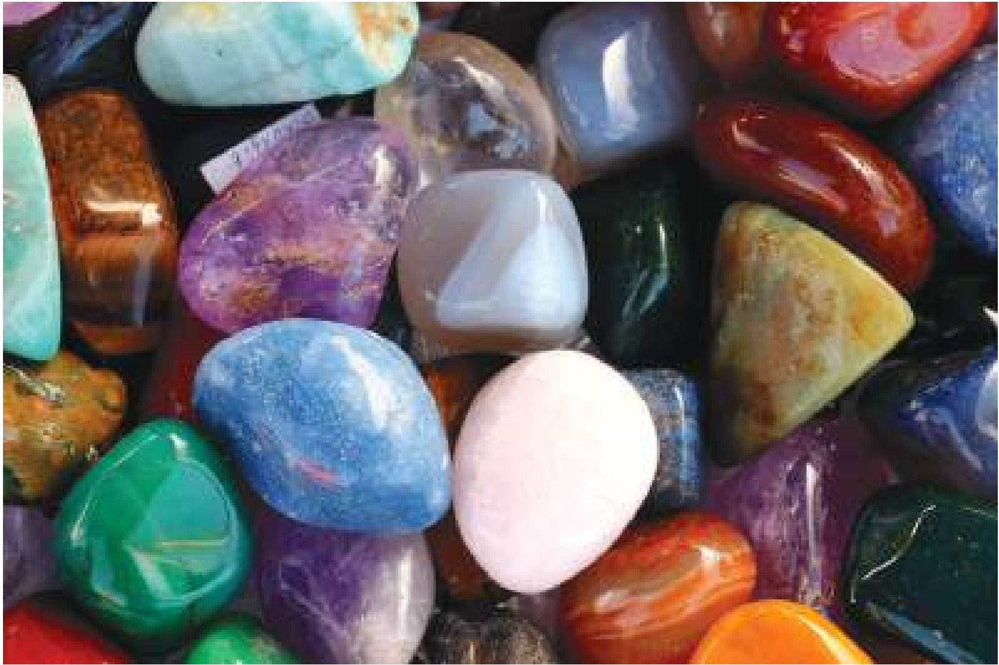

<!-- chemistry-9-10-bn-c10-t10.0-p002 · text · p.233 -->
**নানা বর্ণের খনিজ পাথর**

<!-- chemistry-9-10-bn-c10-t10.0-p003 · text · p.233 -->
টিন, লোহা, তামা, সোনা, চিনামাটির তৈরি থালাবাসন, প্রাকৃতিক গ্যাসসহ হাজার হাজার প্রয়োজনীয় সামগ্রী আমরা পারিবারিক জীবন, শিল্পকারখানাসহ বিভিন্ন ক্ষেত্রে প্রতিনিয়ত ব্যবহার করে আসছি। এগুলো মৌলিক, যৌগিক বা বিভিন্ন মৌল ও যৌগের মিশ্রণ হতে পারে। এদের মধ্যে অনেক পদার্থ খনি থেকে পাওয়া যায়। খনিজ সম্পদ কী? কীভাবে খনি থেকে ধাতু ও অধাতু পাওয়া যায়? আবার সেগুলোকে কীভাবে সংরক্ষণ করা যায় বা এগুলো থেকে কীভাবে অন্য কোনো প্রয়োজনীয় সামগ্রী তৈরি করা যায় সেগুলো নিয়েই এ অধ্যায়ে আলোচনা করা হবে।

### এ অধ্যায় পাঠ শেষে আমরা

<!-- chemistry-9-10-bn-c10-t10.0-p004 · text · p.234 · review: known-confusable-corrected -->
* খনিজ সম্পদের ধারণা দিতে পারব।
* শিলা, খনিজ ও আকরিকের মধ্যে তুলনা করতে পারব।
* ধাতুসমূহের নিক্ষাশনের উপযুক্ত উপায় নির্ধারণ করতে পারব।
* ধাতুসংকর তৈরির কারণ ব্যাখ্যা করতে পারব।
* সালফারের উৎস এবং এদের কতিপয় প্রয়োজনীয় যৌগ প্রস্তুতের বিক্রিয়া, রাসায়নিক ধর্মের বর্ণনা এবং গৃহে, শিল্পে ও কৃষিক্ষেত্রে তা ব্যবহারের গুরুত্ব বিশ্লেষণ করতে পারব।
* খনিজ দ্রব্যের সসীমতা, যথাযথ ব্যবহার ও পুনর্ব্যবহারের গুরুত্ব বিশ্লেষণ করতে পারব।
* খনিজ দ্রব্যের ব্যবহারে সতর্কতা এবং সংরক্ষণে আগ্রহ প্রদর্শন করতে পারব।

## 10.1 খনিজ সম্পদ (Mineral Resources)

<!-- chemistry-9-10-bn-c10-t10.1-p001 · text · p.235 -->
খনিজ সম্পদ (Mineral Resources) বলতে সাধারণভাবে ভূতাত্ত্বিক প্রক্রিয়ায় প্রাকৃতিকভাবে শিলা বা মৃত্তিকার মধ্যে সৃষ্ট কঠিন, তরল বা গ্যাসীয় পদার্থকে বোঝায়, যা উতোলন ও প্রক্রিয়াকরণের মাধ্যমে অর্থনৈতিক কাজে ব্যবহার করা যায়। সহজ ভাষায়, খনিজ সম্পদ হল সেই সব উপাদান যা পৃথিবীর অভ্যন্তর থেকে আহরণ করা যায় এবং যা বিভিন্ন শিল্প ও অন্যান্য কাজে ব্যবহার করা হয়।

<!-- chemistry-9-10-bn-c10-t10.1-p002 · text · p.235 -->
খনিজ সম্পদকে সাধারণত দুই ভাগে ভাগ করা যায়:

<!-- chemistry-9-10-bn-c10-t10.1-p003 · text · p.235 -->
**১. ধাতব খনিজ (Metallic Minerals):** যে সকল খনিজ থেকে ধাতু নিষ্কাশন করা যায়, যেমন- লোহা, তামা, সোনা, রূপা ইত্যাদি।

<!-- chemistry-9-10-bn-c10-t10.1-p004 · text · p.235 -->
**২. অধাতব খনিজ (Non-metallic Minerals):** যে সকল খনিজ থেকে ধাতু পাওয়া যায় না, যেমন- চুনাপাথর, কয়লা, খনিজ তেল, প্রাকৃতিক গ্যাস ইত্যাদি।

<!-- chemistry-9-10-bn-c10-t10.1-p005 · text · p.235 -->
খনিজ সম্পদ মানুষের জীবনযাত্রার জন্য অত্যন্ত গুরুত্বপূর্ণ।

<!-- chemistry-9-10-bn-c10-t10.1-p006 · text · p.235 · review: known-confusable-corrected -->
আমাদের দেশে প্রচুর পরিমাণ প্রাকৃতিক গ্যাস পাওয়া যায় যা রান্নার কাজে, যানবাহনের জ্বালানি হিসেবে, বিদ্যুৎ উৎপাদনে বা বিভিন্ন শিল্পকারখানায় কাঁচামাল হিসেবে ব্যবহার করা হচ্ছে। মধ্যপ্রাচ্যের বিভিন্ন দেশে পেট্রোলিয়ামের খনি রয়েছে, যা তারা সারা পৃথিবীতে রপ্তানি করছে এবং সমস্ত পৃথিবীর খনিজ তেলের চাহিদা পূরণ করছে। দক্ষিণ আফ্রিকাতে রয়েছে সোনা ও হীরার খনি। এছাড়া বিভিন্ন দেশে বিভিন্ন ধরনের খনি পাওয়া যায়, যা দেশ তথা সমগ্র পৃথিবীর উন্নয়নে মুখ্য ভূমিকা পালন করছে।

### চিত্র ১০.০১: ভূহকের প্রধান প্রধান উপাদান

<!-- chemistry-9-10-bn-c10-t10.1-p007 · table · p.235 · review: verify-table -->
<table><tr><th>উপাদান</th><th>শতকরা পরিমাণ (%)</th></tr>
<tr><th>অক্সিজেন</th><td>৪৬.৬</td></tr>
<tr><th>সোডিয়াম</th><td>৩</td></tr>
<tr><th>অন্যান্য</th><td>২</td></tr>
<tr><th>ম্যাঙ্গানিজ</th><td>২</td></tr>
<tr><th>পটাসিয়াম</th><td>৩</td></tr>
<tr><th>ক্যালসিয়াম</th><td>৪</td></tr>
<tr><th>আয়রন</th><td>৫</td></tr>
<tr><th>অ্যালুমিনিয়াম</th><td>৩.৪</td></tr>
<tr><th>জিংক</th><td>২৭</td></tr></table>

<!-- chemistry-9-10-bn-c10-t10.1-p008 · figure · p.235 -->
**চিত্র ১০.০১: ভূহকের প্রধান প্রধান উপাদান**

### ১০.১.১ শিলা (Rocks)

<!-- chemistry-9-10-bn-c10-t10.1-p009 · text · p.235 · review: known-confusable-corrected -->
বিভিন্ন খনিজ পদার্থ মিশ্রিত হয়ে কিছু শক্ত কণা তৈরি হয়, ঐ শক্ত কণাসমূহ একত্র হয়ে যে পদার্থ তৈরি হয় তাকে শিলা বলে। এসব শিলা যেভাবে তৈরি হয়েছে তার উপর ভিত্তি করে শিলা সাধারণত তিন প্রকার: (i) আগ্নেয় শিলা, (ii) পাল্লিক শিলা ও (iii) রূপান্তরিত শিলা।

### আগ্নেয় শিলা (Igneous Rock)

<!-- chemistry-9-10-bn-c10-t10.1-p010 · text · p.236 -->
আগ্নেয়গিরি থেকে যে গলিত পদার্থসমূহের মিশ্রণ বের হয় তাকে ম্যাগমা বলে। ম্যাগমা যখন ঠান্ডা হয়ে কঠিন পদার্থে পরিণত হয় তখন তাকে আগ্নেয় শিলা বলে। যেমন- গ্রানাইট। আগ্নেয় শিলা থেকে অনেক মূল্যবান খনিজ পাওয়া যায়।

<!-- chemistry-9-10-bn-c10-t10.1-p011 · figure · p.236 -->
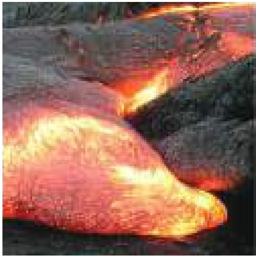

<!-- chemistry-9-10-bn-c10-t10.1-p012 · figure · p.236 -->
**চিত্র ১০.০২: আগ্নেয় শিলা, পাল্লিক শিলা এবং রূপান্তরিত শিলা**

### পাল্লিক শিলা (Sedimentary Rock)

<!-- chemistry-9-10-bn-c10-t10.1-p013 · text · p.236 -->
আবহাওয়া ও জলবায়ু ইত্যাদি পরিবর্তনের ফলে বৃষ্টির পানি, বাতাস, কুয়াশা, ঝড় ইত্যাদির কারণে মাটির উপরিভাগের ভূ-ভূকের কাদামাটি, বালিমাটি ইত্যাদি ধুয়ে কোনো কোনো জায়গায় পলি আকারে জমা হয় তারপরে পলির মধ্যে জমে থাকা কণাগুলো বিভিন্ন স্তরে স্তরে সজ্জিত হয়ে যে শিলা তৈরি হয় তাকে পাল্লিক শিলা বলে। যেমন- বেলেপাথর।

### রূপান্তরিত শিলা (Metamorphic Rock)

<!-- chemistry-9-10-bn-c10-t10.1-p014 · text · p.236 -->
আগ্নেয় শিলা, পাল্লিক শিলা বিভিন্ন তাপ ও চাপে পরিবর্তিত হয়ে নতুন ধরনের যে শিলা তৈরি হয় সেগুলোকে রূপান্তরিত শিলা বলে। যেমন- কয়লা।

<!-- chemistry-9-10-bn-c10-t10.1-p015 · figure · p.236 -->
**চিত্র ১০.০৩: শিলায় বিভিন্ন স্তর**

### মাটির নিচে শিলায় বিভিন্ন স্তর সৃষ্টির প্রক্রিয়া

<!-- chemistry-9-10-bn-c10-t10.1-p016 · text · p.236 -->
মাটির নিচে শিলা বিভিন্ন স্তরে সজ্জিত থাকে।

<!-- chemistry-9-10-bn-c10-t10.1-p017 · text · p.237 -->
মাধ্যাকর্ষণ বল, তাপ, চাপ এবং প্রাকৃতিক শক্তির প্রভাবে মাটির নিচে শিলা বিভিন্ন স্তর সৃষ্টি করে।

### ১০.১.২ খনিজ ও আকরিক

<!-- chemistry-9-10-bn-c10-t10.1-p018 · text · p.237 -->
**খনিজ (Minerals):** মাটির উপরিভাগে বা মাটির তলদেশে যেসকল পদার্থ থেকে আমরা প্রয়োজনীয় দ্রব্যাদি যেমন- বিভিন্ন প্রকার ধাতু বা অধাতু ইত্যাদি সংগ্রহ করে থাকি তাদেরকে খনিজ বলা হয়। যে অংশগুল থেকে খনিজ উত্তোলন করা হয় তাকে খনি বলে।

<!-- chemistry-9-10-bn-c10-t10.1-p019 · text · p.237 -->
**আকরিক (Ores)**

<!-- chemistry-9-10-bn-c10-t10.1-p020 · text · p.237 -->
যে সকল খনিজ থেকে লাভজনকভাবে ধাতু বা অধাতুকে সংগ্রহ বা নিষ্কাশন করা যায় সে সকল খনিজকে আকরিক বলে। যেমন- গ্যালেনা (PbS) থেকে লাভজনকভাবে লেড ধাতু নিষ্কাশন করা যায়, তাই গ্যালেনাকে লেড ধাতুর আকরিক বা লেড ধাতুর খনিজ বলা হয়। বস্মাইট থেকে লাভজনকভাবে অ্যালুমিনিয়াম ধাতু নিষ্কাশন করা যায়। অতএব বস্মাইটকে অ্যালুমিনিয়ামের আকরিক বা খনিজ বলা হয়। আবার, কাদামাটি থেকে লাভজনকভাবে অ্যালুমিনিয়াম ধাতু নিষ্কাশন করা যায় না, সেজন্য কাদামাটি শুধু অ্যালুমিনিয়ামের খনিজ কিন্তু আকরিক নয়। অতএব, আমরা বলতে পারি আকরিক হলে সেটা অবশ্যই খনিজ হবে কিন্তু খনিজ হলে সেটা আকরিক নাও হতে পারে।

<!-- chemistry-9-10-bn-c10-t10.1-p021 · text · p.237 -->
আয়রনের সালফাইডকে আয়রন পাইরাইটস (FeS2) বলা হয়। আয়রন পাইরাইটস থেকে আয়রন ধাতু নিষ্কাশন করা যায়।

<!-- chemistry-9-10-bn-c10-t10.1-p022 · text · p.237 -->
**খনিজ সম্পদের অবস্থান**

<!-- chemistry-9-10-bn-c10-t10.1-p023 · text · p.237 -->
আগে মনে করা হতো যে শুধু ভূগর্ভে বা মাটির নিচেই বুঝি খনিজ পদার্থ পাওয়া যায়। এখন আর এ ধারণা সঠিক বলা যায় না। কোনো কোনো খনিজ ভূগর্ভে আবার কোনো কোনো খনিজ ভূপৃষ্ঠে পাওয়া যায়। সালফার খনিজ ভূগর্ভে পাওয়া যায়। নেত্রকোনার বিজয়পুরে সাদা মাটি বা কেউলিন খনিজ ভূপৃষ্ঠেই পাওয়া যায়। কঙ্কবাজারের সমুদ্রের বালিতে জিরকোনিয়ামের খনিজ জিরকন, আবার লোহার খনিজ হেম্যাটাইট, অ্যালুমিনিয়ামের খনিজ বস্মাইট এগুলো অনেক জায়গাতে ভূপৃষ্ঠেই পাওয়া যায়। হ্যালোজেনসমূহের খনিজ সমুদ্রের পানিতে পাওয়া যায়।

## 10.2 ধাতু নিষ্কাশন (Metal Extraction)

<!-- chemistry-9-10-bn-c10-t10.2-p001 · text · p.237 · review: known-confusable-corrected -->
যে পদ্ধতিতে আকরিক থেকে ধাতু সংগ্রহ করা হয় তাকে ধাতু নিষ্কাশন বলে। বিভিন্ন ধাতুর ধর্মও বিভিন্ন। সে কারণে সকল ধাতুকে পৃথক করতে নির্দিষ্ট কোনো একটি প্রক্রিয়া নেই। তাই বিভিন্ন ধাতুর নিষ্কাশন প্রক্রিয়ায় ভিন্নতা থাকে। কিছু কিছু অসক্রিয় ধাতু যেমন- সোনা, প্লাটিনাম এগুলোকে কখনো কখনো বিশুদ্ধ অবস্থায় পাওয়া যায়। কিন্তু কম বা অধিক সক্রিয় ধাতুসমূহ সাধারণত যৌগ হিসেবে প্রকৃতিতে পাওয়া যায়, যেমন- ধাতুসমূহের অক্সাইড, সালফাইড, নাইট্রেট, কার্বনেট ও অন্যান্য অনেক প্রকার যৌগ হিসেবে। তাই সক্রিয় ধাতুসমূহের যৌগগুলোকে বিজারিত করে বা তড়িৎ বিল্লেখণ প্রক্রিয়ায় তাদের যৌগ থেকে পৃথক করা হয়। ধাতু আকারিক থেকে ধাতু নিষ্কাশনের অনেকগুলো ধাপ রয়েছে। ধাপগুলো হলো: (i) আকারিককে চূর্ণ-বিচূর্ণ করা (ii) আকারিক এর ঘনীকরণ (iii) ঘনিকৃত আকারিককে অক্সাইডে রূপান্তর (iv) ধাতব অক্সাইডকে মুক্ত ধাতুতে রূপান্তর (v) ধাতু বিশুদ্ধিকরণ। তবে একটি নির্দিষ্ট ধাতুর জন্য সব সময় সবগুলো ধাপ প্রয়োজন নয়। প্রত্যেকটি ধাতুর ধর্মের উপর ভিত্তি করেই সেই ধাতুর জন্য প্রয়োজন ধাপগুলো ব্যবহার করতে হবে। নিচে বিভিন্ন ধাপ সংক্ষেপে আলোচনা করা হলো।

### (i) আকারিককে চূর্ণ-বিচূর্ণ করা

<!-- chemistry-9-10-bn-c10-t10.2-p002 · text · p.238 -->
সাধারণত খনি থেকে যে আকারিককে উত্তোলন করা হয় তা যদি বড় এবং কাঠিন শিলাখণ্ড হয় তবে এই কাঠিন শিলাকে চূর্ণ-বিচূর্ণ করা হয়। প্রথমে শিলাখণ্ডকে জো ক্রাশারের সাহায্যে ছোট ছোট টুকরায় পরিণত করা হয় এবং তারপর বল ক্রাশারের সাহায্যে আকারিকের ছোট ছোট টুকরাকে মিহি দানায় বা পাউডারে পরিণত করা হয়।

### (ii) আকারিক এর ঘনীকরণ

<!-- chemistry-9-10-bn-c10-t10.2-p003 · text · p.238 -->
সাধারণত যে আকারিক থেকে ধাতু নিষ্কাশন করা হবে সেই আকারিক ব্যতীত অন্যান্য কিছু পদার্থ আকারিকের সাথে মিশ্রিত অবস্থায় থাকে। আকারিকের সাথে মিশ্রিত থাকা এসব পদার্থকে অপদ্ব্য বা খনিজমল বলে। কাজেই আকারিককে যখন চূর্ণ-বিচূর্ণ করে পাউডারের দানায় পরিণত করা হয় তখনো সেই পাউডার দানার মধ্যে বিভিন্ন অপদ্ব্য বা খনিজমল থাকে। যেমন- বক্সাইট আকারিককে খনি থেকে তোলার সময় বক্সাইট আকারিকের সাথে খনিজমল হিসেবে বালি মিশ্রিত থাকে। এই খনিজমলসমূহকে দূর করে বিশুদ্ধ আকারিক পাওয়ার জন্য যে পদ্ধতি প্রয়োগ করা হয় তাকে আকারিকের ঘনীকরণ বলা হয়। আকারিকের ঘনীকরণের জন্য বিভিন্ন পদ্ধতি ব্যবহার করা হয়। যেমন: হাইড্রোলাইটিক পদ্ধতি, চৌম্বকীয় পৃথকীকরণ, ফেনা ভাসমান পদ্ধতি, রাসায়নিক পদ্ধতি ইত্যাদি।

<!-- chemistry-9-10-bn-c10-t10.2-p004 · figure · p.238 -->

<!-- chemistry-9-10-bn-c10-t10.2-p005 · figure · p.238 -->
**চিত্র ১০.০৪: জো ক্রাশার**

### হাইড্রোলাইটিক পদ্ধতি (Hydrolytic Method)

<!-- chemistry-9-10-bn-c10-t10.2-p006 · text · p.239 · review: known-confusable-corrected -->
এ পদ্ধতিটি সাধারণত ব্যবহৃত হয় অক্সাইড আকারিকের ক্ষেত্রে। অক্সাইড আকারিকের কণাগুলো ভারী হয়। আর এতে থাকা অপদ্রব্যগুলো কিন্তু তুলনামূলক হালকা হয়। এই পদ্ধতিতে ১টি কমপমান হেলানো খাঁজকোটা টেবিলের মধ্যে আকারিককে ঢালা হয়, এই আকারিকের উপর দিয়ে পানি প্রবাহিত করা হয়। এতে ভারী আকারিক ঘনীভূত হয়ে খাঁজের মধ্যে পড়ে থাকে এবং হালকা খনিজমলসমূহ পানির প্রবাহে ধৌত হয়ে চলে যায়। এভাবে আকারিক থেকে খনিজমলসমূহ চলে যাবার পর আকারিক গাঢ় হয়।

### ফেনা ভাসমান পদ্ধতি (Froth Floatation Method)

<!-- chemistry-9-10-bn-c10-t10.2-p007 · text · p.239 -->
এ পদ্ধতিতে সালফাইড আকারিকগুলোকে ঘনীকরণ করা হয়। একটি বড় ট্যাংকে আকারিক নিয়ে এর মধ্যে পানি দেওয়া হয়, তারপর এর মধ্যে অল্প অল্প করে তেল যোগ করা হয়। এরপর এই মিশ্রণের মধ্যে বায়ুপ্রবাহ চালনা করলে সালফাইড আকারিকগুলো তেলে দ্রবীভূত হয় এবং ফেনার আকারে ভেসে উঠে। ফেনাসহ আকারিক পৃথক করে নেওয়া হয় এবং খনিজমল পাত্রের তলায় পড়ে থাকে।

### তেল ফেনা ভাসমান প্রণালির পরীক্ষা

<!-- chemistry-9-10-bn-c10-t10.2-p008 · figure · p.239 -->
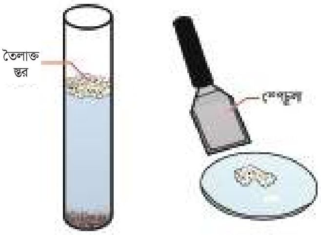

<!-- chemistry-9-10-bn-c10-t10.2-p009 · figure · p.239 -->
**চিত্র ১০.০৫: তেল ফেনা ভাসমান প্রণালি**

<!-- chemistry-9-10-bn-c10-t10.2-p010 · text · p.239 -->
1. উপকরণ: বালি, কেরোসিন, স্পেচুলা, তরল/ গুঁড়া সাবান, ওয়াচ গ্লাস, ছিপিসহ একটি বড় টেস্টটিউব, কপার পাইরাইট, গ্যালেনা বা হেম্যাটাইট আকারিক গুঁড়ো।
2. টেস্টটিউবের মুখে ছিপি লাগিয়ে ঝাঁকাও। বালি এবং খনিজ কি পৃথক হয়েছে?
3. টেস্টটিউবে একটু তরল/গুঁড়া সাবান এবং কয়েক ফোঁটা কেরোসিন যোগ করো।
4. টেস্টটিউবের মুখে ছিপি লাগিয়ে পুনরায় ঝালো করে ঝাঁকাও।
5. স্পেচুলা দিয়ে কিছুটা ফেনা ওয়াচ গ্লাসে নিয়ে পরীক্ষা করো এতে খনিজ আছে কি না?
6. বালি তলানিতে পড়ে থাকে কিন্তু খনিজ টেস্টটিউবের উপরের অংশে ভাসমান থাকে।

### চৌম্বকীয় পৃথকীকরণ পদ্ধতি

<!-- chemistry-9-10-bn-c10-t10.2-p011 · text · p.239 -->
যখন খনিজমল বা আকারিক এদের মধ্যে যেকোনো একটি চৌম্বক দ্বারা আকর্ষিত হয় তখন এই পদ্ধতি ব্যবহার করা হয়। এ পদ্ধতিতে চৌর্ণিক্ত আকারিককে একটি ঘূর্ণায়মান বেল্টের উপর দিয়ে চালনা করা হয়। বেল্টটি চিত্রের মতো দুইটি ধাতব চাকার সাহায্যে ঘোরে। এই ধাতব চাকা দুইটির একটি চৌম্বক ধর্ম বিশিষ্ট । এই চুষ্ক দ্বারা আকর্ষিত হয়ে খনিজমলযুক্ত আকরিকের চৌষক অংশটি চুষ্ক ধর্ম বিশিষ্ট চাকার নিচে এবং কাছে স্তূপ আকারে জমা হয়। অন্যদিকে অচৌষক অংশটি একটু দূরে চিঙের মতো জমা হয়। ফলে আকরিক খনিজমল থেকে পৃথক হয়ে যায়। কোমাইট FeO.Cr2O3, বুটাইল TiO2 এর মতো চৌষকধর্ম বিশিষ্ট আকরিক থেকে খনিজমল অপসারণ করার জন্য চুষ্কীয় পৃথকীকরণ পদ্ধতি প্রয়োগ করা হয়।

<!-- chemistry-9-10-bn-c10-t10.2-p012 · figure · p.240 -->
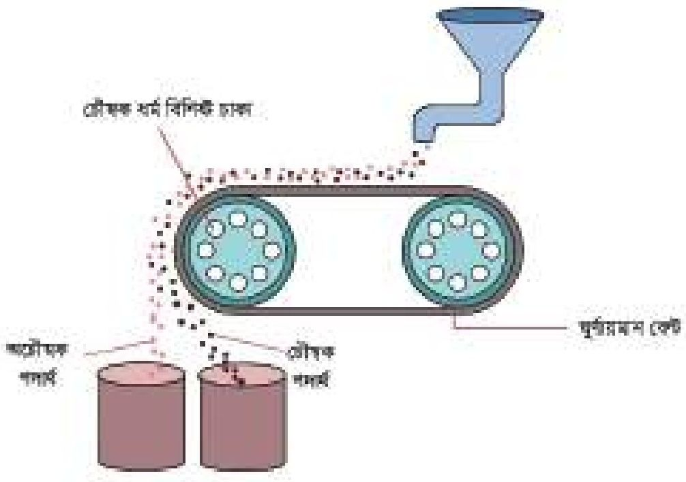

<!-- chemistry-9-10-bn-c10-t10.2-p013 · figure · p.240 -->
**চিত্র ১০.০৬: চৌষকীয় পৃথকীকরণ**

### রাসায়নিক পদ্ধতি

<!-- chemistry-9-10-bn-c10-t10.2-p014 · text · p.240 -->
যে সকল ক্ষেত্রে কোনো পদার্থ আকরিক বা খনিজমলের যেকোনো একটির সাথে বিক্রিয়া করে কিন্তু অন্যটির সাথে বিক্রিয়া করে না সে সকল ক্ষেত্রে আকরিক থেকে খনিজমল অপসারণ করার জন্য রাসায়নিক পদ্ধতি প্রয়োগ করা হয়। যেমন- বক্রাইট থেকে অ্যালুমিনিয়াম অক্সাইড পাবার জন্য রাসায়নিক পদ্ধতি প্রয়োগ করা হয়। বক্রাইটের সাথে আয়রন অক্সাইড, টাইটেনিয়াম অক্সাইড, বালি ইত্যাদি খনিজমল মিশ্রিত থাকে। বক্রাইটের মধ্যে সোডিয়াম হাইড্রোক্সাইড (NaOH) যোগ করে উত্তপ্ত করলে বক্রাইটের (Al2O3.2H2O) সাথে সোডিয়াম হাইড্রোক্সাইড (NaOH) বিক্রিয়া করে সোডিয়াম অ্যালুমিনেট (NaAlO2) ও পানি তৈরি হয়।

<!-- chemistry-9-10-bn-c10-t10.2-p015 · formula · p.240 · review: verify-formula -->
$$Al_2O_3.2H_2O + 2NaOH \xrightarrow{\Delta} 2NaAlO_2 + 3H_2O$$

<!-- chemistry-9-10-bn-c10-t10.2-p016 · text · p.240 -->
গরম সোডিয়াম অ্যালুমিনেটকে পানির সাথে বিক্রিয়া করালে অ্যালুমিনিয়াম হাইড্রোক্সাইড এবং সোডিয়াম হাইড্রোক্সাইড উৎপন্ন হয়। সোডিয়াম হাইড্রোক্সাইড পানিতে দ্রবীভূত থাকে এবং অ্যালুমিনিয়াম হাইড্রোক্সাইড পাত্রের নিচে তলানি আকারে অধঃক্ষিপ্ত হয়।

<!-- chemistry-9-10-bn-c10-t10.2-p017 · formula · p.240 · review: verify-formula -->
$$NaAlO_2 + 2H_2O \longrightarrow Al(OH)_3\downarrow + NaOH$$

<!-- chemistry-9-10-bn-c10-t10.2-p018 · text · p.240 -->
অ্যালুমিনিয়াম হাইড্রোক্সাইডকে পৃথক করে এনে তাকে 1100°C তাপমাত্রায় উত্তপ্ত করলে বিশুদ্ধ অ্যালুমিনিয়াম অক্সাইড এবং পানি উৎপন্ন হয়।

<!-- chemistry-9-10-bn-c10-t10.2-p019 · text · p.241 · review: verify-formula -->
$$2Al(OH)_3 \xrightarrow{1100^\circC} Al_2O_3 + 3H_2O$$
অ্যালুমিনিয়াম হাইড্রোক্সাইড অ্যালুমিনিয়াম অক্সাইড

<!-- chemistry-9-10-bn-c10-t10.2-p020 · text · p.241 -->
উপরের প্রক্রিয়ায় বক্সাইট আকারিকের ঘনীকরণ করে বিশুদ্ধ অ্যালুমিনিয়াম অক্সাইড পাওয়া যায়।

### (iii) ঘনীকৃত আকারিককে অক্সাইডে রূপান্তর

<!-- chemistry-9-10-bn-c10-t10.2-p021 · text · p.241 -->
ঘনীকৃত আকারিককে ভক্ষ্মীকরণ বা তাপজারণ পদ্ধতিতে ধাতুর অক্সাইডে পরিণত করা হয়।

### আকারিকের ভক্ষ্মীকরণ (Calcination of Ores)

<!-- chemistry-9-10-bn-c10-t10.2-p022 · text · p.241 -->
আকারিকে উপস্থিত ধাতুকে বিজারিত করে পৃথক করার আগে ঘনীকৃত আকারিকে গলনাঙ্কের চেয়ে কম তাপমাত্রায় বাতাসের অনুপস্থিতিতে উত্তপ্ত করা হয়। এই প্রক্রিয়াকে ভক্ষ্মীকরণ বলে। ভক্ষ্মীকরণের ফলে আকারিক থেকে পানিসহ কার্বনেট, বাইকার্বনেট, হাইড্রোক্সাইড জাতীয় কিছু অপদ্রব্য কার্বন ডাই-অক্সাইড কিংবা পানি হিসেবে দূরীভূত হয়। এ সকল অপদ্রব্য দূর না করলে পরবর্তীতে এগুলো দূর করা কঠিন।

<!-- chemistry-9-10-bn-c10-t10.2-p023 · formula · p.241 · review: latin-junk,verify-formula -->
$$Fe_2O_3 \cdot 3H_2O \xrightarrow{\Delta} Fe_2O_3 + 3H_2O \quad \Delta = তাপ$$

<!-- chemistry-9-10-bn-c10-t10.2-p024 · formula · p.241 · review: verify-formula -->
$$ZnCO_3 \xrightarrow{\Delta} ZnO + CO_2$$

<!-- chemistry-9-10-bn-c10-t10.2-p025 · formula · p.241 · review: verify-formula -->
$$CaCO_3 \xrightarrow{\Delta} CaO + CO_2$$

### আকারিকের তাপজারণ

<!-- chemistry-9-10-bn-c10-t10.2-p026 · text · p.241 -->
সাধারণত সালফাইড আকারিকের তাপজারণ করা হয়। সালফাইড আকারিককে গলনাঙ্কের চেয়ে কম তাপমাত্রায় বাতাসের উপস্থিতিতে উত্তপ্ত করা হয়। এর ফলে সালফাইড, ফসফরাস, আর্সেনিক ইত্যাদি উদ্ভাষী খনিজমল অক্সাইড হিসেবে দূরীভূত হয়।

<!-- chemistry-9-10-bn-c10-t10.2-p027 · formula · p.241 · review: verify-formula -->
$$2PbS + 3O_2 \xrightarrow{\Delta} 2PbO + 2SO_2$$

<!-- chemistry-9-10-bn-c10-t10.2-p028 · formula · p.241 · review: verify-formula -->
$$2ZnS + 3O_2 \xrightarrow{\Delta} 2ZnO + 2SO_2$$

### (iv) ধাতব অক্সাইডকে মুক্ত ধাতুতে রূপান্তর

<!-- chemistry-9-10-bn-c10-t10.2-p029 · text · p.241 -->
আকারিককে ভক্ষ্মীকরণ বা তাপজারণ করায় যে ধাতব অক্সাইড পাওয়া যায় তাদেরকে বিজারিত করলে ধাতু পাওয়া যায়। বিভিন্নভাবে এ বিজারণ সম্পন্ন করা যায়, যেমন- তড়িৎ বিশ্লেষণের মাধ্যমে বিজারণ, কার্বন বিজারণ পদ্ধতি, স্ববিজারণ ইত্যাদি। ধাতুর সক্রিয়তা সিরিজে তাদের অবস্থানের উপর কোন পদ্ধতিতে বিজারণ সম্পন্ন করা হবে তা নির্ভর করে। তোমরা যেন সহজে সেটা বুঝতে পারো তার জন্য নিচের ছকটি দেওয়া হলো।

<!-- chemistry-9-10-bn-c10-t10.2-p030 · table · p.242 · review: verify-table -->
**টেবিল ১০.০১: ধাতুর সক্রিয়তা সিরিজ**
<table><tr><th>সক্রিয়তা সিরিজে ধাতুর অবস্থান</th><th>ধাতু</th><th>বিজারণের পদ্ধতি</th></tr>
<tr><td rowspan="5">বেশি সক্রিয় ধাতুসমূহ যাদের অবস্থান সক্রিয়তা সিরিজে উপরের দিকে।</td><td>K</td><td rowspan="5">তড়িৎ বিক্ষ্লেশণের মাধ্যমে বিজারণ ঘটে।</td></tr>
<tr><td>Na</td></tr>
<tr><td>Ca</td></tr>
<tr><td>Mg</td></tr>
<tr><td>Al</td></tr>
<tr><td rowspan="3">মধ্যম মানের সক্রিয় ধাতুসমূহ যাদের অবস্থান সক্রিয়তা সিরিজে মাঝে।</td><td>Zn</td><td rowspan="3">কার্বন বিজারণ পদ্ধতিতে বিজারণ ঘটে।</td></tr>
<tr><td>Fe</td></tr>
<tr><td>Pb</td></tr>
<tr><td rowspan="3">কম সক্রিয় ধাতুসমূহ যাদের অবস্থান সক্রিয়তা সিরিজে নিচের দিকে।</td><td>Cu</td><td rowspan="3">স্ববিজারণ পদ্ধতিতে বিজারণ ঘটে।</td></tr>
<tr><td>Hg</td></tr>
<tr><td>Ag</td></tr>
<tr><td rowspan="2">প্রায় অসক্রিয় ধাতু যাদের অবস্থান সক্রিয়তা সিরিজে একেবারে নিচে।</td><td>Pt</td><td rowspan="2">বিশুদ্ধ অবস্থায় পাওয়া যায়।</td></tr>
<tr><td>Au</td></tr></table>

### তড়িৎ বিক্ষ্লেশণের মাধ্যমে বিজারণ (Reduction by Electrolysis)

<!-- chemistry-9-10-bn-c10-t10.2-p031 · text · p.242 -->
সক্রিয়তা সিরিজে প্রদর্শিত উপরের দিকে অবস্থিত অধিক সক্রিয় ধাতু K, Na, Ca, Mg, Al ইত্যাদি ধাতুসমূহের জন্য তড়িৎ বিক্ষ্লেশণের মাধ্যমে বিজারণ সম্ভব করা হয়। নিচে অ্যালুমিনিয়ামের অক্সাইড থেকে তড়িৎ বিক্ষ্লেশণ পদ্ধতি প্রয়োগ করে অ্যালুমিনিয়াম ধাতু নিষ্কাশন পদ্ধতি বর্ণনা করা হলো।

<!-- chemistry-9-10-bn-c10-t10.2-p032 · text · p.242 -->
এই পদ্ধতিতে প্রথমে কঠিন অ্যালুমিনিয়াম অক্সাইডকে গলিয়ে তরল করতে হবে। অ্যালুমিনিয়াম অক্সাইড 2050°C তাপমাত্রায় গলে যায়। এত বেশি তাপমাত্রা তৈরি করা অত্যন্ত কঠিন কাজ। যদি অ্যালুমিনিয়াম অক্সাইড এর মধ্যে ক্রায়োলাইট (Na3AlF6) যোগ করা হয়, তাহলে অ্যালুমিনিয়াম অক্সাইড 800°C-1000°C তাপমাত্রায় গলে যায়। গলিত Al2O3 এর মধ্যে Al3+ এবং O2- আয়ন থাকে।

<!-- chemistry-9-10-bn-c10-t10.2-p033 · formula · p.242 · review: verify-formula -->
$$Al_2O_3 \longrightarrow 2Al^{3+} + 3O^{2-}$$

<!-- chemistry-9-10-bn-c10-t10.2-p034 · text · p.242 · review: verify-formula -->
গ্রাফাইট কার্বন এর আস্তরণযুক্ত একটি স্টিলের পাত্রের মধ্যে গলিত অ্যালুমিনিয়াম অক্সাইড এবং ক্রায়োলাইট এর মিশ্রণ নেওয়া হয় এবং এর মধ্যে কয়েকটি কার্বন দণ্ড এমনভাবে প্রবেশ করানো হয় যাতে এটি স্টিলের পাত্রকে স্পর্শ না করে। এবার স্টিলের পাত্রকে ব্যটারির ঝণাত্বক প্রান্তের সাথে এবং কার্বন দণ্ডগুলোকে ব্যাটারির ধনাত্মক প্রান্তের সাথে যুক্ত করা হয়। বিদ্যুৎ প্রবাহের সাথে সাথে তড়িৎ বিশ্লেষণ শুরু হয়। তড়িৎ বিশ্লেষণকালে $O^{2-}$ অ্যানোডে ইলেকট্রন ত্যাগ করে $O_2$ গ্যাস তৈরি করে এবং দ্রবণে বিদ্যমান $Al^{3+}$ ক্যাথোড থেকে ইলেকট্রন গ্রহণ করে $Al$ ধাতুতে পরিণত হয়।

<!-- chemistry-9-10-bn-c10-t10.2-p035 · text · p.243 · review: latin-junk,verify-formula -->
$$6O^{2-} \xrightarrow{} 3O_2 + 12e^- \quad [অ্যানোড বিক্রিয়া]$$
$$2Al^{3+} + 6e^- \xrightarrow{} 2Al \quad [ক্যাথোড বিক্রিয়া]$$

<!-- chemistry-9-10-bn-c10-t10.2-p036 · figure · p.243 -->
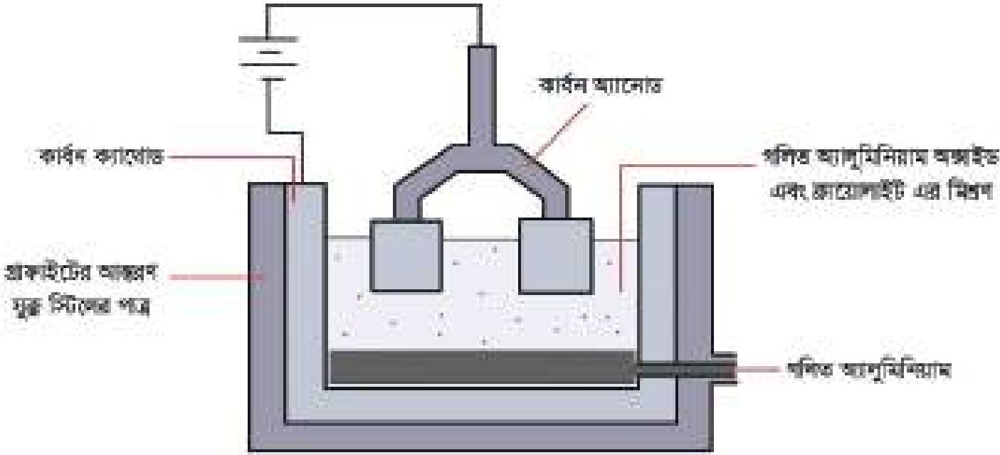

<!-- chemistry-9-10-bn-c10-t10.2-p037 · figure · p.243 -->
**চিত্র ১০.০৭: তড়িৎ বিশ্লেষণের পদ্ধতিতে অ্যালুমিনিয়াম ধাতু নিষ্কাশন**

### কার্বন বিজারণ পদ্ধতি (Method of Carbon Reduction)

<!-- chemistry-9-10-bn-c10-t10.2-p038 · text · p.243 -->
ধাতব অক্সাইড এর সাথে কার্বনকে উত্তপ্ত করে ধাতু নিষ্কাশন করা হয়। যেমন: ZnO থেকে Zn ধাতু, FeO থেকে Fe ধাতু, PbO থেকে Pb ধাতু কিংবা CuO থেকে Cu ধাতুকে এই পদ্ধতিতে নিষ্কাশন করা হয়।

<!-- chemistry-9-10-bn-c10-t10.2-p039 · text · p.243 · review: verify-formula -->
$$ZnO + C \xrightarrow{\Delta} Zn + CO$$
$$FeO + C \xrightarrow{\Delta} Fe + CO$$
$$PbO + C \xrightarrow{\Delta} Pb + CO$$
$$CuO + C \xrightarrow{\Delta} Cu + CO$$

<!-- chemistry-9-10-bn-c10-t10.2-p040 · text · p.243 -->
এই পদ্ধতিকে বলা হয় কার্বন বিজারণ পদ্ধতি। সক্রিয়তা সিরিজে প্রদর্শিত মধ্যম মানের সক্রিয় ধাতুসমূহকে এ পদ্ধতিতে বিজারণ ঘটেনো হয়।

### একক কাজ

<!-- chemistry-9-10-bn-c10-t10.2-p041 · activity · p.244 -->
**শিক্ষার্থীর কাজ: লেড বা সিসার অক্সাইড থেকে ধাতব লেড নিষ্কাশন।**

<!-- chemistry-9-10-bn-c10-t10.2-p042 · activity · p.244 -->
**উপকরণ:** হলুদ বর্ণের লেড অক্সাইড, এক টুকরা সাদা কাগজ, বুনসেন বার্নার/স্পিরিট ল্যাম্প, দিয়াশলাইয়ের কাঠি।

<!-- chemistry-9-10-bn-c10-t10.2-p043 · activity · p.244 -->
**সতর্কতা:** লেড, লেড অক্সাইড ও এর বাষ্প বিষাক্ত পদার্থ। একে খালি হাতে স্পর্শ করবে না। এর বাষ্প শ্বাস-প্রশ্বাসের সাথে টেনে নিবে না।

<!-- chemistry-9-10-bn-c10-t10.2-p044 · activity · p.244 · review: latin-junk -->
**পদ্ধতি:** (i) প্রথমে বার্নারের শিখাটি ছোট করে নাও।
(ii) একটি দিয়াশলাইয়ের কাঠি এমনভাবে পোড়াও যেন বারুদের কোনো অবশেষ না থাকে।
(iii) দিয়াশলাইয়ের কাঠির কয়লা হয়ে যাওয়া অংশটি পানিতে ভিজিয়ে একটু লেড অক্সাইড যুক্ত করো।
(iv) দিয়াশলাইয়ের কাঠির লেড অক্সাইড যুক্ত মাথাটি বার্নারের আগুনে ধরো এবং উজ্জ্বল ধূসর বর্ণের গলিত লেডের ছোট বিন্দু সৃষ্টি হয় কি না তা লক্ষ্য করো।
(v) দিয়াশলাইয়ের কাঠিটি ঠান্ডা হতে দাও। একে একটি সাদা কাগজের উপরে রেখে লেড কণা খুঁজে বের করো। প্রয়োজনে একটি আতসি কাচ (লেস) ব্যবহার করো। পর্যবেক্ষণে যদি লেড না পাওয়া যায় তাহলে ii-v ধাপের কাজগুলো পুনরায় করো।

<!-- chemistry-9-10-bn-c10-t10.2-p045 · activity · p.244 -->
**মনতব্য করো:**
(i) দিয়াশলাইয়ের কাঠির পোড়া অংশটি পানিতে ভেজানোর কারণ ব্যাখ্যা করো।
(ii) এতে কোনো রাসায়নিক বিক্রিয়া হয়েছে কি? তোমার উত্তরের পক্ষে যুক্তি দাও।
(iii) সিসা বা লেড মুক্ত করার জন্য প্রয়োজনীয় কার্বন কোথা থেকে এলো?
(iv) কথায় ও আণবিক সংকেত ব্যবহার করে বিক্রিয়াটির রাসায়নিক সমীকরণ লেখো।
(v) কপার, আয়রন বা জিংক অক্সাইড নিয়ে পরীক্ষাটি করলে একই রকম ফল পাওয়া যাবে কি? তোমার উত্তরের পক্ষে যুক্তি দাও।

### স্ববিজারণ (Auto-Reduction)

<!-- chemistry-9-10-bn-c10-t10.2-p046 · text · p.244 -->
সক্রিয়তা সিরিজে অবস্থিত নিচের দিকে অবস্থিত কম সক্রিয় ধাতু Cu, Hg, Ag ধাতুসমূহের সালফাইড এর ক্ষেত্রে কোনো বিজারক যোগ না করে শুধু উত্তপ্ত করেও বিজারণ ঘটেনো হয়। উদাহরণ হিসেবে মার্কারির আকারিককে এভাবে বিজারিত করা যায়:

<!-- chemistry-9-10-bn-c10-t10.2-p047 · formula · p.245 · review: verify-formula -->
$$HgS + O_2 \longrightarrow Hg(l) + SO_2$$

<!-- chemistry-9-10-bn-c10-t10.2-p048 · text · p.245 -->
বা,

<!-- chemistry-9-10-bn-c10-t10.2-p049 · text · p.245 · review: verify-formula -->
$$2HgS + 3O_2 \longrightarrow 2HgO(s) + 2SO_2(g)$$
$$2HgO(s) + HgS(s) \longrightarrow 3Hg(l) + SO_2(g)$$

### (v) ধাতু বিশুদ্ধিকরণ

<!-- chemistry-9-10-bn-c10-t10.2-p050 · text · p.245 -->
উপরে উল্লিখিত বিজারণ পদ্ধতিসমূহের মাধ্যমে প্রাপ্ত ধাতুসমূহ সম্পূর্ণরূপে বিশুদ্ধ হয় না। এতেও উল্লেখযোগ্য পরিমাণ অপদ্রব্য থেকে যায়। এ অপদ্রব্য দূর করতে বিভিন্ন পদ্ধতি ব্যবহার করা হয়।

<!-- chemistry-9-10-bn-c10-t10.2-p051 · text · p.245 · review: known-confusable-corrected -->
**বিগালক যোগ করার পদ্ধতি:** উচ্চ তাপমাত্রায় কার্বন বিজারণ পদ্ধতিতে প্রাপ্ত ধাতুর মধ্যে কিছু খনিজমল দ্রবীভূত থাকতে পারে। এই খনিজমল অপসারণ করার জন্য যে পদার্থ যোগ করা হয় তাকে বিগালক বলে। খনিজমল ক্ষারকীয় হলে এসিডিক বিগালক (SiO2) যোগ করা হয় এবং খনিজমল এসিডিক হলে তার মধ্যে ক্ষারকীয় বিগালক (CaO) যোগ করা হয়। বিগালক এবং খনিজমল একত্র হয়ে ধাতুর মল বা ধাতুমল তৈরি হয়। ধাতুর মল গলিত ধাতুতে দ্রবীভূত হয় না বলে উপর থেকে ধাতুমলকে গলিত ধাতু থেকে আলাদা করে ফেলা হয়। বিগলন প্রক্রিয়ায় প্রাপ্ত ধাতু বিশুদ্ধ নয়। এই অবিশুদ্ধ ধাতুকে তড়িৎ বিলোষণ পদ্ধতি প্রয়োগ করে ধাতু বিশুদ্ধ করা হয়। নিচে ধাতু বিশুদ্ধিকরণের জন্য তড়িৎ বিলোষণ পদ্ধতি আলোচনা করা হলো।

<!-- chemistry-9-10-bn-c10-t10.2-p052 · text · p.245 -->
**তড়িৎ বিলোষণ পদ্ধতিতে ধাতুর বিশোধন:** তড়িৎ বিলোষণ পদ্ধতিতে ধাতুর বিশোধনে অবিশুদ্ধ ধাতুকে অ্যানোড এবং বিশুদ্ধ ধাতুর একটি পাতকে ক্যাথোড হিসেবে ব্যবহার করা হয়। তড়িৎ বিলোষ্য হিসেবে যে ধাতুকে বিশুদ্ধ করতে হবে তার লবণের দ্রবণকে ব্যবহার করা হয়। যখন তড়িৎ বিলোষ্য কোষে বিদ্যুৎ প্রবাহিত করা হয় তখন অ্যানোড থেকে ধাতুর পরমাণু ইলেকট্রন ত্যাগ করে আয়ন হিসেবে দ্রবণে প্রবেশ করে। অপরদিকে, ধাতব আয়ন ইলেকট্রন গ্রহণ করে বিশুদ্ধ ধাতু হিসেবে ধাতবপাতে জমা হয়। তড়িৎ বিলোষণ পদ্ধতিতে কপার ধাতু ও অন্যান্য ধাতু বিশোধন করা হয়। নিচে তড়িৎ বিলোষণ পদ্ধতিতে কপার ধাতুর বিশুদ্ধিকরণ বর্ণনা করা হলো।

<!-- chemistry-9-10-bn-c10-t10.2-p053 · text · p.245 -->
**তড়িৎ বিলোষণ পদ্ধতিতে কপার ধাতুর বিশুদ্ধিকরণ:** বিজারণ প্রক্রিয়ায় প্রাপ্ত কপার ধাতু ৯৪% বিশুদ্ধ। একে তড়িৎ বিশোধন পদ্ধতি প্রয়োগ করে ৯৯.৯% বিশুদ্ধ কপার ধাতু তৈরি করা যায়। এক্ষেত্রে CuSO4 এর জলীয় দ্রবণ একটি পাত্রে নেওয়া হয়। এই পাত্রে যে ধাতবদণ্ডকে বিশুদ্ধ করতে হবে সেই অবিশুদ্ধ কপারদণ্ডকে ব্যাটারির ধনাত্মক প্রান্তের সাথে যুক্ত করা হয়। এটি অ্যানোড হিসেবে কাজ করে। একটি বিশুদ্ধ কপার দণ্ডকে ঐ ব্যাটারির ঋণাত্মক প্রান্তের সাথে যুক্ত করা হয়। এটি ক্যাথোড হিসেবে কাজ করে। সাধারণত, অবিশুদ্ধ কপার দণ্ড মোটা থাকে এবং বিশুদ্ধ কপার দণ্ড পাতলা থাকে।

<!-- chemistry-9-10-bn-c10-t10.2-p054 · figure · p.246 -->
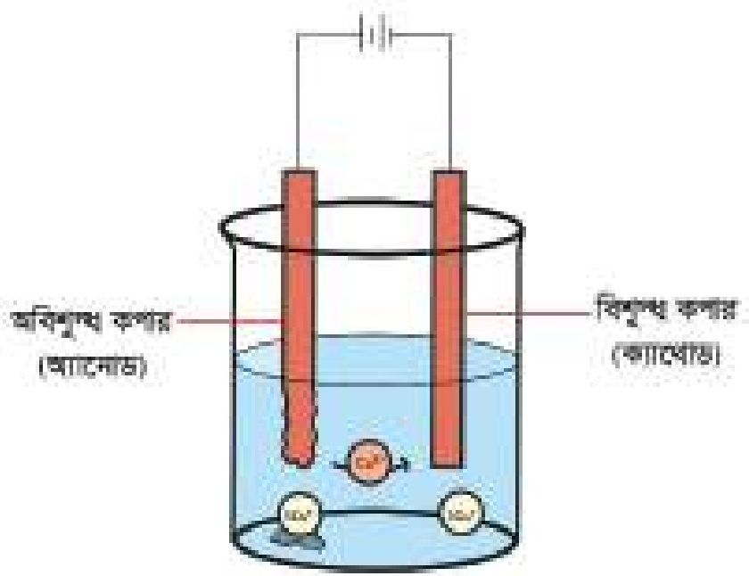

<!-- chemistry-9-10-bn-c10-t10.2-p055 · figure · p.246 -->
**চিত্র ১০.০৮: তড়িৎ বিশ্লেষণের সাহায্যে অবিশুদ্ধ কপার বিশোধন**

<!-- chemistry-9-10-bn-c10-t10.2-p056 · text · p.246 -->
এবার ব্যাটারির সাহায্যে দ্রবণের মধ্যে তড়িৎ প্রবাহিত করলে অ্যানোড হিসেবে ব্যবহৃত অবিশুদ্ধ কপার দণ্ড থেকে Cu2+ আয়ন হিসেবে দ্রবণে চলে যায় এবং দ্রবণ থেকে Cu2+ বিশুদ্ধ কপার দণ্ডে জমা হয়। এক্ষেত্রে অ্যানোডের জারণ বিক্রিয়া সংঘটিত হয় এবং ক্যাথোডের বিজারণ বিক্রিয়া সম্পন্ন হয়।

<!-- chemistry-9-10-bn-c10-t10.2-p057 · text · p.246 · review: verify-formula -->
$$Cu(s) \longrightarrow Cu^{2+} + 2e^-  (অবিশুদ্ধ কপার অ্যানোড থেকে  Cu^{2+}  এর দ্রবণে গমন)$$
$$Cu^{2+} + 2e^- \longrightarrow Cu(s)  (দ্রবণ থেকে  Cu^{2+}  বিশুদ্ধ কপার ক্যাথোডে জমা হওয়া)$$

### আয়রন নিষ্কাশন প্রক্রিয়া

<!-- chemistry-9-10-bn-c10-t10.2-p058 · text · p.246 -->
আয়রন একটি গুরুত্বপূর্ণ ধাতু। আয়রন এর গুরুত্বপূর্ণ আকারিক হলো হেমটাইট Fe2O3। প্রধানত তিনটি ধাপে যেমন-

<!-- chemistry-9-10-bn-c10-t10.2-p059 · text · p.246 -->
(1) গাঠিকরণ, (2) ভস্মীকরণ/ তাপজারণ ও
(3) বিগলন দ্বারা বাত্যাচুলিতে লৌহ নিষ্কাশন করা হয়। চিত্র ১০.০৯

<!-- chemistry-9-10-bn-c10-t10.2-p060 · text · p.246 -->
এই পদ্ধতিতে একাধিক রাসায়নিক বিক্রিয়া ঘটে:

<!-- chemistry-9-10-bn-c10-t10.2-p061 · text · p.246 · review: verify-formula -->
$$Fe_2O_3 + 3C \longrightarrow Fe + 3CO$$
$$3Fe_2O_3 + CO \longrightarrow 2Fe_3O_4 + CO_2$$
$$Fe_3O_4 + CO \longrightarrow Fe + CO_2$$
$$CaCO_3 \longrightarrow CaO + CO_2$$
$$CaO + SiO_2 \longrightarrow CaSiO_3  (ধাতুমল)$$

<!-- chemistry-9-10-bn-c10-t10.2-p062 · figure · p.246 -->
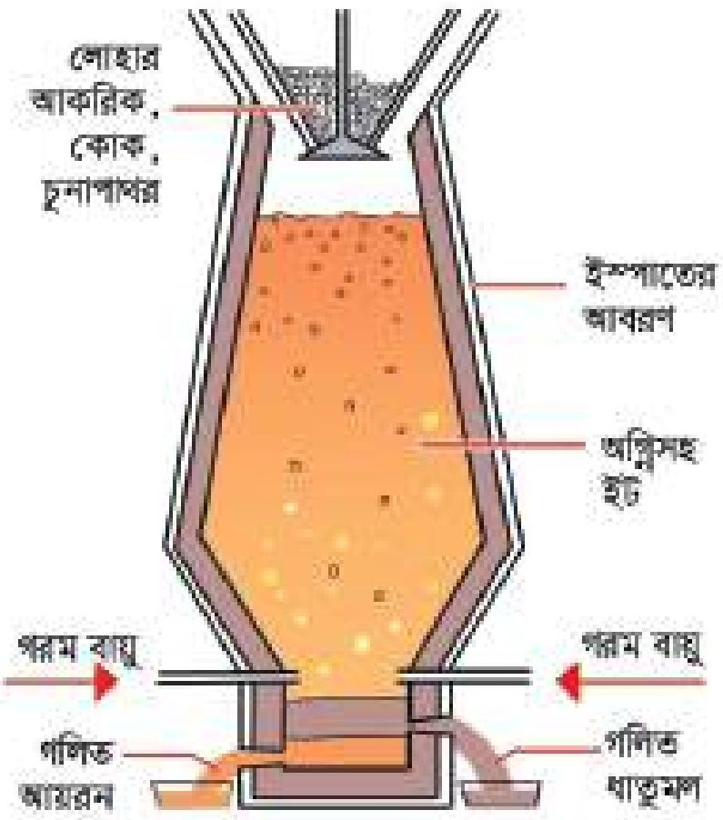

<!-- chemistry-9-10-bn-c10-t10.2-p063 · figure · p.246 -->
**চিত্র ১০.০৯: বাত্যা চুলিতে আয়রন নিষ্কাশন**

### দলীয় কাজ

<!-- chemistry-9-10-bn-c10-t10.2-p064 · activity · p.247 · review: known-confusable-corrected -->
**1.** সোডিয়াম ক্লোরাইডের গলনাঙ্ক 801°C। সোডিয়াম ক্লোরাইড 40-42% এবং ক্যালসিয়াম ক্লোরাইড 58-60% মিশ্রণের গলনাঙ্ক প্রায় 600° C। উপর্যুক্ত বিষয়টি বিবেচনায় নিয়ে সোডিয়াম ধাতু নিষ্কাশনের একটি কৌশল বর্ণনা করো। এ জন্য যে বিষয়সমূহ তুমি বিবেচনা করবে তা হলো:

<!-- chemistry-9-10-bn-c10-t10.2-p065 · activity · p.247 · review: known-confusable-corrected -->
* বিগলনের খরচ
* মিশ্রণ ব্যবহার করলে সোডিয়াম ও ক্যালসিয়াম উভয় ধাতু একত্রে মুক্ত হবে কি না?
* বিক্রিয়ায় উৎপন্ন উৎপাদনসমূহের পরিবেশ দূষণ।

<!-- chemistry-9-10-bn-c10-t10.2-p066 · activity · p.247 -->
**2.** কপার নিষ্কাশনের সময় উপজাত গ্যাস পরিবেশের কী ক্ষতি করবে? এ ক্ষতি (এসিড বৃষ্টি) থেকে পরিত্রানের উপায় ব্যাখ্যা করো। পরিবেশের ক্ষতি প্রতিরোধ করে এই উপজাত গ্যাসকে লাভজনক কাজে ব্যবহার করার উপায় সম্বর্কে তোমার মতামত দাও।

<!-- chemistry-9-10-bn-c10-t10.2-p067 · activity · p.247 -->
**3.** টেবিলে উপস্থাপিত আকরিক থেকে ধাতু নিষ্কাশনের সম্ভাব্য বিক্রিয়া টেবিলে উপস্থাপন করো। তোমার উত্তরের পক্ষে যুক্তি মনতব্য কলামে উপস্থাপন করো।

<!-- chemistry-9-10-bn-c10-t10.2-p068 · table · p.247 · review: verify-table -->
<table><tr><th>ধাতু</th><th>আকরিক</th><th>নিষ্কাশনের বিক্রিয়া</th><th>মনতব্য</th></tr>
<tr><td>মার্কারি</td><td>সিন্ধাবার HgS</td><td></td><td></td></tr>
<tr><td rowspan="2">জিংক</td><td>জিংক লুয়েন্ড ZnS</td><td></td><td></td></tr>
<tr><td>ক্যালামাইন ZnCO3</td><td></td><td></td></tr>
<tr><td>লেড</td><td>গ্যালেনা PbS</td><td></td><td></td></tr>
<tr><td rowspan="3">আয়রন</td><td>ম্যাগনেটাইট Fe3O4</td><td></td><td></td></tr>
<tr><td>হেমটাইট Fe2O3</td><td></td><td></td></tr>
<tr><td>লিমোনাইট Fe2O3.3H2O</td><td></td><td></td></tr>
<tr><td rowspan="2">কপার</td><td>কপার পাইরাইট CuFeS2</td><td></td><td></td></tr>
<tr><td>চালকোসাইট Cu2S</td><td></td><td></td></tr>
<tr><td>অ্যালুমিনিয়াম</td><td>বস্বাইট Al2O3.2H2O</td><td></td><td></td></tr>
<tr><td>সোডিয়াম</td><td>সাগরের পানি NaCl</td><td></td><td></td></tr>
<tr><td>ক্যালসিয়াম</td><td>চুনাপাথর CaCO3</td><td></td><td></td></tr></table>

<!-- chemistry-9-10-bn-c10-t10.2-p069 · activity · p.248 -->
**4.** অ্যালুমিনিয়াম অক্সাইডের গলনাঙ্ক 2050° C। অ্যালুমিনিয়াম অক্সাইড এবং ক্রায়োলাইট Na3AlF6 মিশ্রণের গলনাঙ্ক 800-1000° C এর মধ্যে। উপর্যুক্ত বিষয়টি বিবেচনায় নিয়ে অ্যালুমিনিয়াম ধাতু নিষ্কাশনের একটি কৌশল বর্ণনা করো। এ জন্য যে বিষয়সমূহ তুমি বিবেচনা করবে তা হলো:

<!-- chemistry-9-10-bn-c10-t10.2-p070 · activity · p.248 -->
* বিগলনের খরচ
* মিশ্রণ ব্যবহার করলে সোডিয়াম ও অ্যালুমিনিয়াম উভয় ধাতু একত্রে মুক্ত হবে কি না?
* বিক্রিয়ায় উৎপাদসমূহের পরিবেশ দূষণ।

## 10.3 নির্বাচিত সংকর ধাতু (Selected Alloys)

<!-- chemistry-9-10-bn-c10-t10.3-p001 · text · p.248 -->
কতগুলো ধাতুকে একত্রে গলানোর পর গলিত মিশ্রণকে ঠান্ডা করলে যে ধাতু মিশ্রণ পাওয়া যায় তাকে সংকর ধাতু বলা হয়। প্রিষ্টপূর্ব 5000 থেকে প্রিষ্টপূর্ব 3000 পর্যন্ত সময়কালকে তাম্রযুগ বলা হয়। কারণ এই সময়ে তামা দিয়ে মানুষ গয়না, অস্ত্র এবং যন্ত্রপাতি তৈরি করত। কিন্তু তামা নরম ধাতু বিধায় এই ধাতু দিয়ে যে অস্ত্র এবং যন্ত্রপাতি তৈরি করা হতো তা বেশি দিন কার্যকর থাকত না। সেজন্য সেই প্রাচীনকালেই মানুষ গলিত কপারের সাথে গলিত টিন মিশিয়ে মিশ্রণকে ঠান্ডা করে ব্রোঞ্জ তৈরি করেছিল। ব্রোঞ্জ মূলত একটি সংকর ধাতু। কোনো গরম গলিত ধাতুর মধ্যে অন্য কোনো গরম গলিত ধাতু বা অধাতু মিশিয়ে সেই মিশ্রণকে ঠান্ডা করলে যে কঠিন পদার্থ পাওয়া যায় তাকে বলা হয় সংকর ধাতু। প্রাচীনকালের মানুষদের সংকর ধাতু ব্রোঞ্জ আবিষ্কার ছিল একটি যুগান্তকারী ঘটনা। প্রিষ্টপূর্ব 3000 থেকে 1000 পর্যন্ত সময়কালকে বলা হয় ব্রোঞ্জ যুগ। এই সময় ব্রোঞ্জ দ্বারা বিভিন্ন অস্ত্র এবং যন্ত্রপাতি তৈরি করা হতো। বিভিন্ন যন্ত্রপাতি তৈরি করতে ধাতুর চেয়ে সংকর ধাতু বেশি উপযোগী। লোহা এবং কার্বন মিশিয়ে স্টিল নামক সংকর ধাতু তৈরি করা হয়। ছুরি, কাঁচি, রেলের চাকা, রেললাইন, জাহাজ, কৃষি যন্ত্রপাতি ইত্যাদি স্টিল দ্বারা তৈরি করা হয়। আবার গরম গলিত লোহার মধ্যে গলিত কার্বন, নিকেল ও ক্রোমিয়াম মিশিয়ে যে সংকর ধাতু তৈরি হয় তাকে স্টেইনলেস স্টিল বলে। হাসপাতালে ডাক্তাররা যে ছুরি বা কাঁচি ব্যবহার করে তা স্টেইনলেস স্টিলের তৈরি। গলিত কপার এবং গলিত জিংক একত্রে মিশিয়ে পিতল নামক সংকর ধাতু তৈরি হয়। বৈদ্যুতিক সুইচ, পাতিল ইত্যাদি তৈরিতে পিতল ব্যবহৃত হয়। কপার ও টিন মিশিয়ে সংকর ধাতু কার্সা বা ব্রোঞ্জ তৈরি হয়। থালাবাসন, ছুঁাস ইত্যাদি তৈরিতে ব্রোঞ্জ ব্যবহৃত হয়। অ্যালুমিনিয়াম, কপার, ম্যাগনেসিয়াম, ম্যাঙ্গানিজ ও লোহার মিশ্রণে ডুরালমিন নামক সংকর ধাতু তৈরি করা হয়। এটি উদ্ভোজাহাজের বডি তৈরি করতে ব্যবহৃত হয়।

<!-- chemistry-9-10-bn-c10-t10.3-p002 · table · p.249 · review: verify-table -->
**টেবিল ১০.০২: বিভিন্ন সংকর ধাতু ও তার ব্যবহার**
<table><tr><th>ধাতু সংকর</th><th>উপাদান ও সংযুক্তি</th><th>ব্যবহার</th></tr>
<tr><td>স্টিল</td><td>লোহা 99% কার্বন 1%</td><td>রেলের চাকা ও লাইন, ইঞ্জিন, জাহাজ, যানবাহন, ক্রেন, যুদ্ধাস্ত্র, ছুরি, কাঁচি, ঘড়ির স্পিং, চুষক, কৃষি যন্ত্রপাতি ইত্যাদি।</td></tr>
<tr><td>মরিচাবিহীন ইস্পাত (স্টেইনলেস স্টিল)</td><td>লোহা 74% ক্রোমিয়াম 18% নিকেল 8%</td><td>ছুরি, কাঁটা চামচ, পাকঘরের সিঙ্ক, রসায়ন শিল্পের বিক্রিয়া পাত্র, অস্ফোটচারের যন্ত্রপাতি ইত্যাদি।</td></tr>
<tr><td>পিতল (ব্রাস)</td><td>কপার 65% জিংক 35%</td><td>অলংকার, কলকব্জার বিয়ারিং, বৈদ্যুতিক সুইচ, দরজার হাতল, ডেকচি পাতিল ইত্যাদি।</td></tr>
<tr><td>কাঁসা (ব্রোঞ্জ)</td><td>কপার 90% টিন 10%</td><td>ধাতু গলানো যন্ত্রাংশ, থালা, গ্লাস ইত্যাদি।</td></tr>
<tr><td>ডুরালমিন</td><td>অ্যালুমিনিয়াম 95% কপার 4% ম্যাগনেসিয়াম, ম্যাঙ্গানিজ ও লোহা 1%</td><td>উদ্ভোজাহাজের বডি, বাইসাইকেলের পার্টস ইত্যাদি।</td></tr>
<tr><td>24 ক্যারেট স্বর্ণ</td><td>স্বর্ণ 100%</td><td>ডেন্টিস্ট্রি, মুদ্রা, ইলেকট্রনিক সংযোগ।</td></tr>
<tr><td>22 ক্যারেট স্বর্ণ</td><td>স্বর্ণ 91.67% কপার এবং অন্যান্য ধাতু 8.33%</td><td>অলংকার।</td></tr>
<tr><td>21 ক্যারেট স্বর্ণ</td><td>স্বর্ণ 87.5% কপার এবং অন্যান্য ধাতু 12.5%</td><td>অলংকার।</td></tr></table>

<!-- chemistry-9-10-bn-c10-t10.3-p003 · text · p.249 -->
তোমরা এতক্ষণ জানলে বিভিন্ন ধাতু একত্রে মিশিয়ে সংকর ধাতু তৈরি করা হয়। এই সংকর ধাতু তৈরিতে সকল ধাতুকে সমান পরিমাণে মেশানো হয় না। সংকর ধাতুর মধ্যে একটি থাকে প্রধান ধাতু এবং অন্য এক বা একাধিক পদার্থ থাকে অপ্রধান ধাতু বা অধাতু। যেমন- পিতলের মধ্যে প্রধান ধাতু কপার থাকে 65% এবং জিংক 35% থাকে। প্রধান ধাতুর নাম অনুসারে সংকর ধাতুর নামকরণ করা হয়। যেমন-স্টিলের মধ্যে লোহা প্রধান ধাতু এবং কার্বন অপ্রধান অধাতু। স্টিলে লোহা থাকে ৯৯% এবং কার্বন থাকে ১% এজন্য স্টিলকে লোহার সংকর ধাতু বলা হয়। অনুরূপভাবে, কার্ভার মধ্যে প্রধান ধাতু কপার থাকে ৯০%, টিন থাকে ১০%। এজন্য কার্ভা কপারের সংকর ধাতু। আবার, পিতলে প্রধান ধাতু কপার থাকে ৬৫% এবং অপ্রধান ধাতু জিংক থাকে ৩৫%। এজন্য পিতলও কপারের সংকর ধাতু। কপারের দুইটি সংকর ধাতু আছে, যথা- পিতল (ব্রাস) ও কার্ভা (ব্রোঞ্জ)।

## 10.4 কতিপয় ধাতু এবং সংকর ধাতুর ক্ষয় হওয়ার লক্ষণ, কারণ ও প্রতিকার (Symptoms, Causes and Prevention of Corrosion of Certain Metals and Alloys)

<!-- chemistry-9-10-bn-c10-t10.4-p001 · text · p.250 · review: known-confusable-corrected -->
লোহা বা লোহার সংকর ধাতুর তৈরি জিনিসপত্র জানালার গ্রিল, আলমিরা ইত্যাদি খোলা জায়গা বা বাতাসে দীর্ঘদিন থাকলে এসব জিনিসপত্রের উপর লালচে বাদমি বর্ণের এক ধরনের পদার্থ তৈরি হয়। এই বাদমি পদার্থকে লোহার মরিচা বলা হয়। মরিচা তৈরির মাধ্যমে লোহা ক্ষয়প্রাপ্ত হয়। বিশুদ্ধ কপার বা পিতল বা কার্ভার তৈরি জিনিসপত্র দীর্ঘদিন বাতাসে থাকার ফলে এদের উপর কালো বা বাদমি বা সবুজ বর্ণের একটি আস্তরণ পড়ে। এই আস্তরণকে কপারের তাম্রমল বলা হয়। তাম্রমল তৈরির মাধ্যমে তামা ক্ষয়প্রাপ্ত হয়।

<!-- chemistry-9-10-bn-c10-t10.4-p002 · text · p.250 -->
সাধারণত বিশুদ্ধ ধাতু বা সংকর ধাতু দীর্ঘদিন বাতাসে থাকার ফলে ধাতু বা সংকর ধাতুর উপর ভিন্ন বর্ণযুক্ত একটি নতুন পদার্থের সৃষ্টি হয়। এই প্রক্রিয়াকে ধাতুর ক্ষয় বলে।

<!-- chemistry-9-10-bn-c10-t10.4-p003 · text · p.250 -->
লোহা ক্ষয়প্রাপ্ত হয়ে যে লালচে বাদমি বর্ণের মরিচা তৈরি হয় সেটি হলো আর্দ্র ফেরিক অক্সাইড (Fe2O3.nH2O)। আবার বিভিন্ন বর্ণের তাম্রমলে বিভিন্ন ধরনের পদার্থ উপস্থিত থাকে। যেমন- কোনো কোনো তাম্রমলে কিউপ্রাস অক্সাইড (Cu2O) উপস্থিত থাকে। কোনো কোনো তাম্রমলে কিউপ্রাস সালফাইড বা চালকোসাইট (Cu2S) উপস্থিত থাকে। তাম্রমলকে কোনো নির্দিষ্ট রাসায়নিক সংকেতে প্রকাশ করা যায় না। কারণ তাম্রমলের সব জায়গায় একই ধরনের পদার্থ তৈরি হয় না। সাধারণত কোনো কোনো ধাতু বা সংকর ধাতু যখন বায়ুমণ্ডলে থাকে তখন ধাতুসমূহ ইলেকট্রন ত্যাগ করে ধনাত্মক আয়নে পরিণত হয়। এখানে একটি জারণ বিক্রিয়া হয়। আবার, ধাতু যে ইলেকট্রন ত্যাগ করে বায়ুমণ্ডলের কোনো উপাদান সেই ইলেকট্রন গ্রহণ করে ঋণাত্মক আয়নে পরিণত হয়। এখানে একটি বিজারণ বিক্রিয়া সংঘটিত হয়। অতঃপর ধনাত্মক আয়ন এবং ঋণাত্মক আয়নের মধ্যে বিক্রিয়ায় একটি যৌগ তৈরি হয়। নতুন যৌগটি রূপান্তরিত হয়ে বা অন্যান্য যৌগের সাথে বিক্রিয়া করে। এভাবে ধাতু বা সংকর ধাতু ক্ষয়প্রাপ্ত হয়।

<!-- chemistry-9-10-bn-c10-t10.4-p004 · text · p.251 -->
লোহার উপর মরিচা পড়ার বিক্রিয়া অনেক ধীরে সংঘটিত হয় এবং অনেকগুলো ধাপে সংঘটিত হয়। এ সকল ধাপসমূহের মধ্যে একটি ধাপে জারণ বিক্রিয়া এবং একটি ধাপে বিজারণ বিক্রিয়া সংঘটিত হয়। এজন্য লোহায় মরিচা পড়ার বিক্রিয়াটি জারণ বিজারণ বিক্রিয়া। লোহায় মরিচা পড়ার জন্য বায়ুমণ্ডলের অক্সিজেন (O2) এবং পানির (H2O) প্রয়োজন হয়। বায়ুমণ্ডলের পানি কিছুটা বিয়োজিত হয়ে H+ ও OH- তৈরি করে।

<!-- chemistry-9-10-bn-c10-t10.4-p005 · formula · p.251 · review: verify-formula -->
$$H_2O \longrightarrow H^+ + OH^-$$

<!-- chemistry-9-10-bn-c10-t10.4-p006 · text · p.251 -->
লোহা যখন বায়ুমণ্ডলের H+এর সংস্পর্শে আসে তখন লোহা ইলেকট্রন ত্যাগ করে Fe2+ এ পরিণত হয়। এখানে জারণ বিক্রিয়া সংঘটিত হয়।

<!-- chemistry-9-10-bn-c10-t10.4-p007 · formula · p.251 · review: verify-formula -->
$$2Fe \longrightarrow 2Fe^{2+} + 4e^-$$

<!-- chemistry-9-10-bn-c10-t10.4-p008 · text · p.251 -->
Fe যে ইলেকট্রন দান করে O2 এবং H+ সেই ইলেকট্রন গ্রহণ করে H2O উৎপন্ন করে। এখানে বিজারণ বিক্রিয়া সংঘটিত হয়।

<!-- chemistry-9-10-bn-c10-t10.4-p009 · formula · p.251 · review: verify-formula -->
$$O_2 + 4H^+ + 4e^- \longrightarrow 2H_2O$$

<!-- chemistry-9-10-bn-c10-t10.4-p010 · text · p.251 -->
এবার Fe2+ এবং H+ এবং O2 বিক্রিয়া করে Fe3+ ও পানি উৎপন্ন করে।

<!-- chemistry-9-10-bn-c10-t10.4-p011 · formula · p.251 · review: verify-formula -->
$$4Fe^{2+} + 4H^+ + O_2 \longrightarrow 4Fe^{3+} + 2H_2O$$

<!-- chemistry-9-10-bn-c10-t10.4-p012 · text · p.251 -->
অতঃপর Fe3+ OH- এর সাথে বিক্রিয়া করে Fe(OH)3 তৈরি করে।

<!-- chemistry-9-10-bn-c10-t10.4-p013 · formula · p.251 · review: verify-formula -->
$$Fe^{3+} + 3OH^- \longrightarrow Fe(OH)_3$$

<!-- chemistry-9-10-bn-c10-t10.4-p014 · text · p.251 -->
এই ফেরিক হাইড্রোক্সাইড পরিবর্তিত হয়ে পানিযুক্ত ফেরিক অক্সাইড বা মরিচা Fe2O3.3H2O তৈরি হয়।

<!-- chemistry-9-10-bn-c10-t10.4-p015 · formula · p.251 · review: verify-formula -->
$$2Fe(OH)_3 \longrightarrow Fe_2O_3.3H_2O$$

### লোহায় মরিচা সৃষ্টির পরীক্ষা

<!-- chemistry-9-10-bn-c10-t10.4-p016 · text · p.251 -->
* চারটি টেস্টটিউব নাও এবং ১ থেকে ৪ নম্বর দিয়ে চিহ্নিত করো।
* টেস্টটিউবগুলোতে চিহ্নের ন্যায় ব্যবস্থা করো।
* ৩ নং টেস্টটিউবের পানিকে এক মিনিট ফুটিয়ে পানির উপর এক মিলি রান্নার তেল বা অলিভ অয়েল যোগ করো। তেলের বাধার কারণে ভেতরে বায়ু প্রবেশ করতে পারবে না।

<!-- chemistry-9-10-bn-c10-t10.4-p017 · text · p.252 -->
এভাবে টেস্টটিউবগুলোকে এক সপ্তাহ রেখে দাও এবং পর্যবেক্ষণ করো।

<!-- chemistry-9-10-bn-c10-t10.4-p018 · figure · p.252 -->
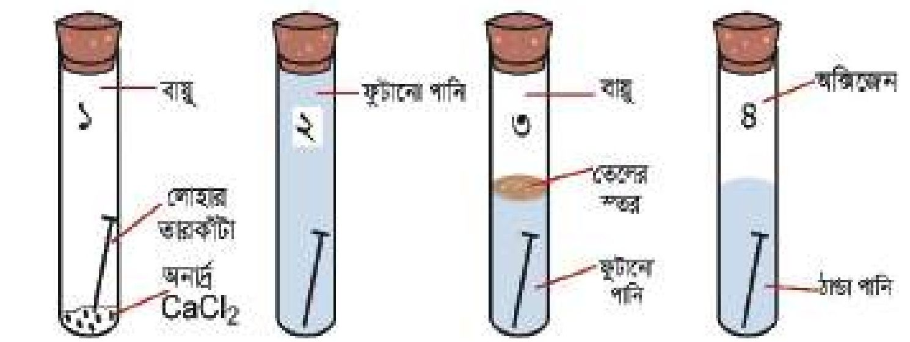

<!-- chemistry-9-10-bn-c10-t10.4-p019 · figure · p.252 -->
**চিত্র ১০.১০: মরিচা সূক্ষ্মির পরীক্ষা (পানির দ্রবীভূত অক্সিজেন অপসারণের জন্য পানি ফোটোনো হয়)**

### ধাতু ক্ষয়রোধের উপায়

<!-- chemistry-9-10-bn-c10-t10.4-p020 · text · p.252 -->
ধাতু বা সংকর ধাতু যদি বাতাসের অক্সিজেন এবং পানির সংস্পর্শে না আসে তবে ধাতু ক্ষয়প্রাপ্ত হয় না। এটি বিভিন্নভাবে করা যায়, যেমন- (i) রং করে (ii) ইলেকট্রোপ্লোটিং ও (iii) গ্যালভানাইজিং করে ইত্যাদি। তোমরা বাড়িতে লোহার তৈরি দরজা-জানালা রং করো যেন লোহা বাতাসের অক্সিজেন এবং পানির সংস্পর্শে না আসে। আমরা জানি কম সক্রিয় ধাতু সাধারণত বাতাসের অক্সিজেনের সাথে বিক্রিয়া করে না। কিন্তু বেশি সক্রিয় ধাতু বাতাসের অক্সিজেন এবং পানির সাথে দ্রুত বিক্রিয়া করে। অতএব, বেশি সক্রিয় ধাতুর ক্ষয় হওয়া থেকে ধাতুকে রক্ষা করার জন্য বেশি সক্রিয় ধাতুর উপর কম সক্রিয় ধাতুর প্রলেপ দেওয়া হয়। এভাবে বেশি সক্রিয় ধাতুকে ক্ষয় হওয়া থেকে রক্ষা করা যায়। একটি অধিক সক্রিয় ধাতুর উপর কম সক্রিয় ধাতুর প্রলেপ দুইভাবে দেওয়া যায়, যথা- ইলেকট্রোপ্লোটিং ও গ্যালভানাইজিং।

<!-- chemistry-9-10-bn-c10-t10.4-p021 · figure · p.252 -->
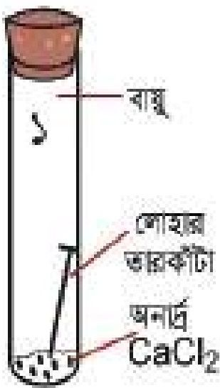

<!-- chemistry-9-10-bn-c10-t10.4-p022 · figure · p.252 -->
**চিত্র ১০.১১: চাবির উপর কপার ধাতুর ইলেকট্রোপ্লোটিং**

### ইলেকট্রোপ্লোটিং (Electroplating)

<!-- chemistry-9-10-bn-c10-t10.4-p023 · text · p.253 -->
সাধারণত তড়িৎ বিদ্যুৎ পদ্ধতি প্রয়োগ করে একটি ধাতুর উপর আরেকটি ধাতুর প্রলেপ দেওয়ার প্রক্রিয়াকে বলা হয় ইলেকট্রোপ্লোটিং। এখানে যে ধাতুর প্রলেপ দিতে হবে তাকে ব্যাটারির ধনাত্মক প্রান্তের সাথে যুক্ত করা হয়। যে ধাতুর উপর প্রলেপ দিতে হবে তাকে ব্যাটারির ঋণাত্মক প্রান্তের সাথে যুক্ত করা হয়। এরপর তড়িৎ বিদ্যুৎ পদ্ধতির মাধ্যমে ইলেকট্রোপ্লোটিং করা হয়। যেমন— লোহার উপর কপার ধাতুর প্রলেপ দেওয়ার জন্য CuSO4 এর একটি দ্রবণ নেওয়া হয় এবং কপার দণ্ডকে ব্যাটারির ধনাত্মক প্রান্তের সাথে এবং লোহা দণ্ডকে ব্যাটারির ঋণাত্মক প্রান্তের সাথে যুক্ত করে দ্রবণে তড়িৎ প্রবাহিত করা হয়। তড়িৎ প্রবাহকালে Cu দণ্ডের কপার 2টি ইলেকট্রন ত্যাগ করে Cu2+ হিসেবে দ্রবণে চলে যায়।

<!-- chemistry-9-10-bn-c10-t10.4-p024 · formula · p.253 · review: latin-junk,verify-formula -->
$$Cu \longrightarrow Cu^{2+} + 2e^-  [জারণ বিক্রিয়া]$$

<!-- chemistry-9-10-bn-c10-t10.4-p025 · text · p.253 -->
এবার এই Cu2+ দ্রবণের মধ্য দিয়ে Fe দণ্ড থেকে 2টি ইলেকট্রন গ্রহণ করে Cu এ পরিণত হয় এবং Fe দণ্ডের উপর লেগে যায়।

<!-- chemistry-9-10-bn-c10-t10.4-p026 · formula · p.253 · review: latin-junk,verify-formula -->
$$Cu^{2+} + 2e^- \longrightarrow Cu  [বিজারণ বিক্রিয়া]$$

<!-- chemistry-9-10-bn-c10-t10.4-p027 · text · p.253 -->
**গ্যালভানাইজিং (Galvanizing):** যে কোনো ধাতুর উপর জিংকের প্রলেপ দেওয়াকে গ্যালভানাইজিং বলে। এখানে তড়িৎ বিদ্যুৎ প্রয়োজন নেই। কোনো ধাতুর উপর যে কোনো ভাবে জিংকের প্রলেপ দিয়ে গ্যালভানাইজিং করা হয়।

### ধাতু পুনঃপ্রক্রিয়াজাতকরণ (Recycling of Metals)

<!-- chemistry-9-10-bn-c10-t10.4-p028 · text · p.253 -->
পৃথিবীতে প্রতিটি মৌলিক পদার্থ বা ধাতুর পরিমাণ নির্দিষ্ট। কোনো ধাতুর তৈরি জিনিসপত্র ব্যবহারের পর সেটা ফেলে না দিয়ে সেটাকে সংগ্রহ করে ঐ ধাতু তৈরির কারখানায় সেগুলো পাঠিয়ে দেওয়া হয়। ঐ পরিতান্ত্রিক ধাতু থেকে ব্যবহার উপযোগী ধাতু তৈরি করা হয়। পরিতান্ত্রিক ধাতু থেকে আবার ব্যবহার উপযোগী ধাতুতে পরিণত করার পদ্ধতিকে ধাতু পুনঃপ্রক্রিয়াজাতকরণ বলে। যেমন— পরিতান্ত্রিক অ্যালুমিনিয়ামের হাঁড়ি-পাতিলকে অ্যালুমিনিয়াম তৈরির কারখানায় প্রেরণ করে অ্যালুমিনিয়াম ধাতু পুনঃপ্রক্রিয়াজাতকরণ করা হয়। পরিতান্ত্রিক লোহাকে লোহা তৈরির কারখানায় প্রেরণ করে লোহা ধাতু পুনঃপ্রক্রিয়াজাতকরণ করা হয়। আমেরিকায় যে কপার ব্যবহৃত হয় সেই কপারের প্রায় 21% কপার পুনঃপ্রক্রিয়াজাত এর মাধ্যমে তৈরি করে। ইউরোপে যে অ্যালুমিনিয়াম ব্যবহৃত হয় সেই অ্যালুমিনিয়ামের 60% অ্যালুমিনিয়াম পুনঃপ্রক্রিয়াজাতকরণের মাধ্যমে তৈরি হয়।

## 10.5 খনিজ অধাতু (Nonmetal Minerals)

<!-- chemistry-9-10-bn-c10-t10.5-p001 · text · p.254 -->
খনি থেকে যে অধাতুসমূহকে পাওয়া যায় তাদেরকে খনিজ অধাতু বলা হয়। সালফার একটি খনিজ অধাতু এবং খনি থেকে সালফার সংগ্রহ করা হয়।

### সালফার

<!-- chemistry-9-10-bn-c10-t10.5-p002 · text · p.254 -->
সালফার হলুদ বর্ণের পদার্থ। সালফারের খনি মাটির অনেক নিচে থাকে। ফ্রাশ (Frasch) পদ্ধতিতে সালফারের খনি থেকে সালফারকে নিষ্কাশন করা হয়। এক্ষেত্রে মাটির অনেক নিচে সালফারের খনির মধ্যে তিনটি এককেন্দ্রিক পাইপ প্রবেশ করানো হয়, যাকে ফ্রাশ পাইপ বলে। সালফার ১১৫° C তাপমাত্রায় গলে যায়। এজন্য সালফারের গলনাঙ্কের চেয়ে বেশি তাপমাত্রায় গরম পানি (সুপার হিটেড ওয়াটার) তিনটি এককেন্দ্রিক নলের বাইরের পাইপ দিয়ে প্রবাহিত করা হয় যাতে গরম পানির তাপমাত্রায় সালফার গলে যায়। আমরা জানি এক বায়ুমণ্ডলীয় চাপে পানির স্ফুটনাঙ্ক ১০০° C, কিন্তু চাপ বাড়ালে পানির স্ফুটনাঙ্ক বৃদ্ধি পায়। এভাবে অতিরিক্ত চাপে ১০০° C থেকে ৩৭৪° C তাপমাত্রার মধ্যবর্তী যেকোনো তাপমাত্রার পানিকে সুপার হিটেড ওয়াটার বলে। এবার সবচেয়ে ভিতরের পাইপ দিয়ে ২০-২২ বায়ুমণ্ডল চাপের বাতাস প্রবাহিত করা হয়। একদিকে বাইরের পাইপ দিয়ে গরম পানির চাপে এবং সবচেয়ে ভিতরের পাইপ দিয়ে বাতাসের চাপে গলিত সালফার মাঝের পাইপ দিয়ে মাটির উপরে উঠে এসে বাইরের পাত্রে জমা হয়।

### সালফারের ব্যবহার

<!-- chemistry-9-10-bn-c10-t10.5-p003 · text · p.254 -->
সালফার বিভিন্ন শিল্পকারখানায় প্রচুর পরিমাণে ব্যবহৃত হয়। যেমন—

<!-- chemistry-9-10-bn-c10-t10.5-p004 · text · p.254 -->
(i) সালফিউরিক এসিড প্রস্তুতিতে সালফার ব্যবহার করা হয়।

<!-- chemistry-9-10-bn-c10-t10.5-p005 · text · p.254 -->
(ii) রাবারকে টেকসই করার জন্য রাবারের মধ্যে সালফার যোগ করা হয়। একে রাবারের ভলকানাইজিং বলে।

<!-- chemistry-9-10-bn-c10-t10.5-p006 · text · p.254 -->
(iii) সালফানাইড দ্বারা বিভিন্ন প্রকার ওষুধ তৈরি করা হয়। সালফানাইড ব্যাকটেরিয়া ধ্বংস করে।

<!-- chemistry-9-10-bn-c10-t10.5-p007 · text · p.254 -->
সালফানাইড প্রস্তুতিতে সালফার ব্যবহার করা হয়।

<!-- chemistry-9-10-bn-c10-t10.5-p008 · figure · p.254 -->
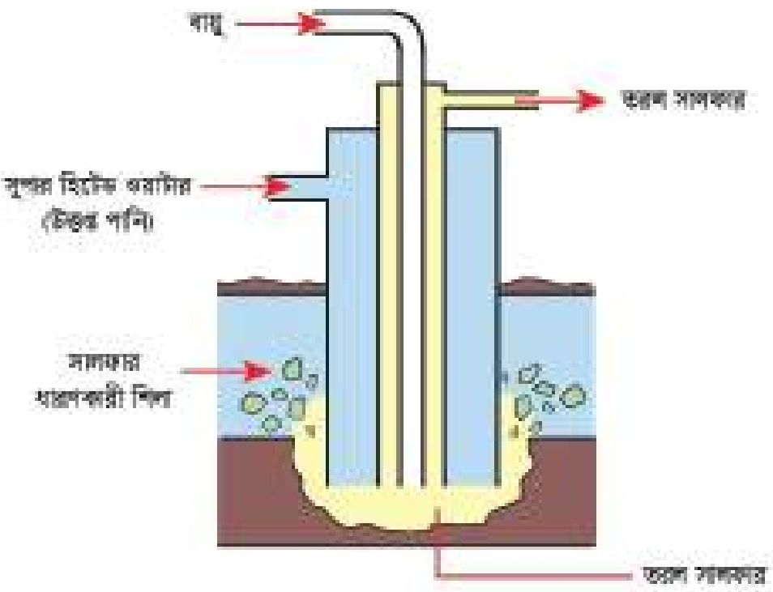

<!-- chemistry-9-10-bn-c10-t10.5-p009 · figure · p.254 -->
**চিত্র ১০.১২: ফ্রাশ পদ্ধতিতে সালফার উত্তোলন**

### সালফারের যৌগ

<!-- chemistry-9-10-bn-c10-t10.5-p010 · text · p.255 -->
সালফারের কতগুলো গুরুত্বপূর্ণ যৌগ নিচে আলোচনা করা হলো।

### সালফার ডাই-অক্সাইড

<!-- chemistry-9-10-bn-c10-t10.5-p011 · text · p.255 -->
সালফারকে বাতাসের অক্সিজেনের সাথে বিক্রিয়া করে সালফার ডাই-অক্সাইড উৎপন্ন করে।

<!-- chemistry-9-10-bn-c10-t10.5-p012 · formula · p.255 · review: verify-formula -->
$$S + O_2 \longrightarrow SO_2$$

<!-- chemistry-9-10-bn-c10-t10.5-p013 · text · p.255 · review: verify-formula -->
সালফার ডাই-অক্সাইড গ্যাস অত্যন্ত বিষাক্ত। এই গ্যাস নাক বা মুখের মধ্যে দিয়ে শরীরে প্রবেশ করলে শরীরের ক্ষতি হয়। $SO_2$ গ্যাস চোখে প্রবেশ করলে চোখ জ্বালাপোড়া করে। কয়লার মধ্যে যদি সালফার থাকে বা পেট্রোলিয়াম তেলের মধ্যে যদি সালফার থাকে তবে কয়লা বা তেলকে বাতাসে পোড়ালে কয়লা বা তেলের মধ্যের সালফার অক্সিজেনের সাথে বিক্রিয়া করে তীব্র ঝাঁজালো $SO_2$ গ্যাস উৎপন্ন হয়। এই গ্যাস বায়ুমণ্ডলে চলে যায়। যখন বৃষ্টি হয় তখন এই গ্যাস পানির সাথে বিক্রিয়া করে সালফিউরাস এসিড ($H_2SO_3$) উৎপন্ন করে যেটি বৃষ্টির পানির সাথে মেশিতে পড়ে। এই বৃষ্টিকে এসিড বৃষ্টি বলে।

<!-- chemistry-9-10-bn-c10-t10.5-p014 · formula · p.255 · review: verify-formula -->
$$SO_2 + H_2O \longrightarrow H_2SO_3$$

### সালফিউরিক এসিড

<!-- chemistry-9-10-bn-c10-t10.5-p015 · text · p.255 -->
সালফিউরিক এসিড অন্যান্য রাসায়নিক দ্রব্য অপেক্ষা সবচেয়ে বেশি ব্যবহৃত হয় বলে সালফিউরিক এসিডকে রাসায়নিক দ্রবের রাজা বলা হয়। শিল্পকারখানায় কঠিন সালফার থেকে সালফিউরিক এসিডকে প্রস্তুত করা হয়। এই পদ্ধতিকে স্পার্স পদ্ধতি বলে।

<!-- chemistry-9-10-bn-c10-t10.5-p016 · text · p.255 -->
**স্পার্স পদ্ধতি:** স্পার্স পদ্ধতিটি কয়েকটি ধাপে সম্পন্ন হয়।

<!-- chemistry-9-10-bn-c10-t10.5-p017 · figure · p.255 -->
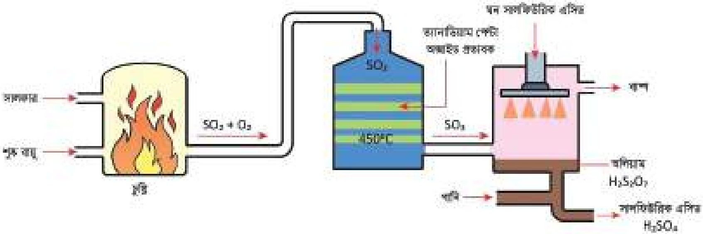

<!-- chemistry-9-10-bn-c10-t10.5-p018 · figure · p.255 -->
**চিত্র ১০.১৩: স্পার্স পদ্ধতিতে সালফিউরিক এসিড (H2SO4) প্রস্তুতি**

<!-- chemistry-9-10-bn-c10-t10.5-p019 · text · p.256 -->
**ধাপ ১:** প্রথমে একটি চুল্লিতে সালফার (S) এবং শুষ্ক বায়ু (যে বায়ুতে জলীয় বাষ্প নেই) প্রবাহিত করা হয়। এই চুল্লিতে সালফার এবং অক্সিজেন বিক্রিয়া করে সালফার ডাই-অক্সাইড উৎপন্ন করে।

<!-- chemistry-9-10-bn-c10-t10.5-p020 · formula · p.256 · review: verify-formula -->
$$S + O_2 \longrightarrow SO_2$$

<!-- chemistry-9-10-bn-c10-t10.5-p021 · text · p.256 -->
**ধাপ ২:** SO2 গ্যাসের সাথে কিছু O2 গ্যাস একটি চুল্লিতে প্রবেশ করা হয়। এই চুল্লির তাপমাত্রা থাকে 4500C - 5500C এবং প্রভাবক থাকে ভ্যানাডিয়াম পেন্টা-অক্সাইড। এই চুল্লিতে উচ্চ তাপমাত্রায় প্রভাবকের উপস্থিতিতে SO2 এবং O2 বিক্রিয়া করে সালফার ট্রাই-অক্সাইড উৎপন্ন করে।

<!-- chemistry-9-10-bn-c10-t10.5-p022 · formula · p.256 · review: verify-formula -->
$$2SO_2 + O_2 \longrightarrow 2SO_3$$

<!-- chemistry-9-10-bn-c10-t10.5-p023 · text · p.256 -->
**ধাপ ৩:** উৎপন্ন SO3 এর সাথে H2O এর সংস্পর্শ ঘটলে H2SO4 তৈরি হবে। কিন্তু SO3 এর সাথে সরাসরি H2O বিক্রিয়ায় বাষ্পীয় H2SO4 তৈরি হয় যা ঘন কুয়াশার মতো অবস্থা তৈরি করে। এতে শিল্পকারখানায় কাজের অসুবিধা হয়। এছাড়া এই বাষ্পীয় H2SO4 কে ঘনীভূত করে তরল H2SO4 এ পরিণত করা কঠিন। এজন্য SO3 কে প্রথমে গ্যুড H2SO4 এর মধ্যে শোষণ করিয়ে ধূমায়মান সালফিউরিক এসিড তৈরি করা হয়। (ধূমায়মান সালফিউরিক এসিডকে অলিয়াম বলে। এর সংকেত H2S2O7)।

<!-- chemistry-9-10-bn-c10-t10.5-p024 · formula · p.256 · review: verify-formula -->
$$H_2SO_4 + SO_3 \longrightarrow H_2S_2O_7$$

<!-- chemistry-9-10-bn-c10-t10.5-p025 · text · p.256 -->
ধূমায়মান সালফিউরিক এসিড এর সাথে পানির বিক্রিয়া ঘটিয়ে তরল সালফিউরিক এসিড তৈরি করা হয়।

<!-- chemistry-9-10-bn-c10-t10.5-p026 · formula · p.256 · review: verify-formula -->
$$H_2S_2O_7 + H_2O \longrightarrow 2H_2SO_4$$

### সালফিউরিক এসিডের ধর্ম

<!-- chemistry-9-10-bn-c10-t10.5-p027 · text · p.256 -->
**এসিড ধর্ম:** লঘু H2SO4 বা গ্যুড H2SO4 কোনো ক্ষারের সাথে বিক্রিয়া করে লবণ এবং পানি তৈরি করে। একে H2SO4 এর এসিড ধর্ম বলে। যেমন: সালফিউরিক এসিড ক্যালসিয়াম হাইড্রোক্সাইড এর সাথে বিক্রিয়া করে ক্যালসিয়াম সালফেট লবণ এবং পানি উৎপন্ন করে।

<!-- chemistry-9-10-bn-c10-t10.5-p028 · formula · p.256 · review: verify-formula -->
$$H_2SO_4 + Ca(OH)_2 \longrightarrow CaSO_4 + 2H_2O$$

<!-- chemistry-9-10-bn-c10-t10.5-p029 · text · p.256 -->
সালফিউরিক এসিড ক্যালসিয়াম হাইড্রোক্সাইড ক্যালসিয়াম সালফেট পানি

### জারণ ধর্ম (Oxidation Property)

<!-- chemistry-9-10-bn-c10-t10.5-p030 · text · p.256 -->
H2SO4 এর মধ্যে অনেক বেশি পানি থাকলে অর্থাৎ পানির মধ্যে H2SO4 দিলে সেই H2SO4 কে লঘু H2SO4 এসিড বলে। লঘু H2SO4 এর জারণ ধর্ম নেই। কিন্তু যে H2SO4 এর মধ্যে পানি কম পরিমাণে থাকে সেই H2SO4 কে গ্যুড H2SO4 বলে। গ্যুড H2SO4 এর জারণ ধর্ম আছে। গ্যুড H2SO4 কপারকে জারিত করে কপার সালফেট পরিণত করে এবং নিজে বিজারিত হয়ে সালফার ডাই-অক্সাইড এবং পানি উৎপন্ন করে।

<!-- chemistry-9-10-bn-c10-t10.5-p031 · formula · p.257 · review: verify-formula -->
$$2H_2SO_4  (গাঢ়) + Cu \longrightarrow CuSO_4 + SO_2 + 2H_2O$$

### নিরুদন ধর্ম (The Dehydrating Property)

<!-- chemistry-9-10-bn-c10-t10.5-p032 · text · p.257 · review: verify-formula -->
যে পদার্থ কোনো যৌগ থেকে পানি শোষণ করে সেই পদার্থকে নিরুদক বলে। পানি শোষণ করার ধর্মকে নিরুদন ধর্ম বলে। লঘু $H_2SO_4$ এর কোনো নিরুদন ধর্ম নেই, কিন্তু গাঢ় $H_2SO_4$ এর নিরুদন ধর্ম আছে। গাঢ় $H_2SO_4$ চিনি ($C_{12}H_{22}O_{11}$) থেকে পানি শোষণ করে। এজন্য গাঢ় $H_2SO_4$ কে নিরুদক বলে।

<!-- chemistry-9-10-bn-c10-t10.5-p033 · formula · p.257 · review: verify-formula -->
$$C_{12}H_{22}O_{11} + H_2SO_4 \longrightarrow 12C + H_2SO_4 \cdot 11H_2O$$

<!-- chemistry-9-10-bn-c10-t10.5-p034 · text · p.257 -->
* একটি টেস্টটিউবে 2-3 mL চুনের পানি নিয়ে এতে কয়েক ফোঁটা লঘু সালফিউরিক এসিড যোগ করো। ভালোভাবে পর্যবেক্ষণ করো। পরিবর্তনের কারণ ব্যাখ্যা করো এবং সন্তাব্য বিক্রিয়াটি লেখো।

<!-- chemistry-9-10-bn-c10-t10.5-p035 · text · p.257 · review: latin-junk -->
* একটি টেস্টটিউবে এক চিমটি পটাশিয়াম আয়োডাইড KI নিয়ে এতে কয়েক ফোঁটা ঘন সালফিউরিক এসিড যোগ করো। ভালোভাবে পর্যবেক্ষণ করো। পরিবর্তনের কারণ ব্যাখ্যা করো এবং সন্তাব্য বিক্রিয়াটি লেখো।

<!-- chemistry-9-10-bn-c10-t10.5-p036 · figure · p.257 -->

<!-- chemistry-9-10-bn-c10-t10.5-p037 · figure · p.257 -->
**চিত্র ১০.১৪: সালফিউরিক এসিডের ব্যবহার**

<!-- chemistry-9-10-bn-c10-t10.5-p038 · text · p.257 · review: verify-formula -->
* একটি টেস্টটিউবে এক চামচ চিনি ($C_{12}H_{22}O_{11}$) নিয়ে এতে কয়েক ফোঁটা ঘন সালফিউরিক এসিড যোগ করো। ভালোভাবে পর্যবেক্ষণ করো।
* পরিবর্তনের কারণ ব্যাখ্যা করো এবং সন্তাব্য বিক্রিয়াটি লেখো। এই পরীক্ষাটি সাবধান করে করতে হবে।
* উপরের পরীক্ষা তিনটির কোনটিতে সালফিউরিক এসিডের কোন ধর্ম (এসিড, জারক, নিরুদক) প্রকাশ করে তা ব্যাখ্যা করো।
* সালফিউরিক এসিডের ব্যবহার প্রকাশকারী পাই চার্টের (চিত্র: ১০.১৪) তথ্যের ভিত্তিতে বাংলাদেশে সালফিউরিক এসিডের অর্থনৈতিক গুরুত্ব বিশ্লেষণ করো।

## 10.ex নমুনা প্রশ্ন

### বহুনির্বাচনি প্রশ্ন

<!-- chemistry-9-10-bn-c10-t10.ex-p001 · exercise · p.258 -->
**১. টেবিলের কোন রেকর্ডটি সাধারণত ধাতুর বৈশিষ্ট্য প্রকাশ করে?**

<!-- chemistry-9-10-bn-c10-t10.ex-p002 · table · p.258 · review: verify-table -->
<table><tr><th></th><th>গলনাঙ্ক</th><th>স্ফুটনাঙ্ক</th><th>ঘনত্ব</th></tr>
<tr><td>(ক)</td><td>1539</td><td>2887</td><td>7.86</td></tr>
<tr><td>(গ)</td><td>-113</td><td>45</td><td>0.79</td></tr></table>

<!-- chemistry-9-10-bn-c10-t10.ex-p003 · table · p.258 · review: verify-table -->
<table><tr><th></th><th>গলনাঙ্ক</th><th>স্ফুটনাঙ্ক</th><th>ঘনত্ব</th></tr>
<tr><td>(খ)</td><td>-219</td><td>183</td><td>0.002</td></tr>
<tr><td>(ঘ)</td><td>117</td><td>888</td><td>1.96</td></tr></table>

<!-- chemistry-9-10-bn-c10-t10.ex-p004 · exercise · p.258 -->
উদ্দীপক থেকে ২ ও ৩ নং প্রশ্নের উত্তর দাও।

<!-- chemistry-9-10-bn-c10-t10.ex-p005 · exercise · p.258 -->
একদল শিক্ষার্থী মরিচার অনুসন্ধান করছিল। তারা বাম থেকে ক্রমাক্ষয়ে চারটি টেস্টটিউবে চারটি লোহার পেরেক রাখল এবং নিচের চিত্রানুযায়ী ব্যবস্থা নিল।

<!-- chemistry-9-10-bn-c10-t10.ex-p006 · figure · p.258 -->
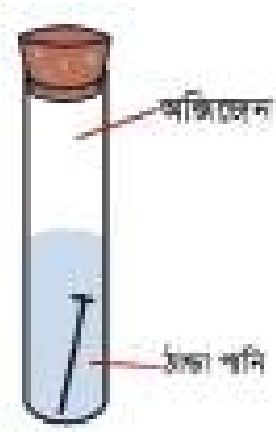

<!-- chemistry-9-10-bn-c10-t10.ex-p007 · exercise · p.258 -->
**২. কোন টেস্টটিউবের পেরেকটিতে সবচেয়ে বেশি মরিচা ধরবে?**

<!-- chemistry-9-10-bn-c10-t10.ex-p008 · exercise · p.258 -->
(ক) প্রথম                      (খ) দ্বিতীয়
(গ) তৃতীয়                      (ঘ) চতুর্থ

<!-- chemistry-9-10-bn-c10-t10.ex-p009 · exercise · p.258 -->
**৩. পরীক্ষাটির ভিত্তিতে যে সিদ্ধান্তসমূহ গ্রহণ করা যায়-**

<!-- chemistry-9-10-bn-c10-t10.ex-p010 · exercise · p.258 -->
(i) মরিচা ধরার জন্য অক্সিজেন আবশ্যক
(ii) লবণ প্রভাবক হিসেবে কাজ করছে
(iii) কেবল অক্সিজেন উপস্থিত থাকলেই মরিচা ধরে না

<!-- chemistry-9-10-bn-c10-t10.ex-p011 · exercise · p.258 -->
নিচের কোনটি সঠিক?

<!-- chemistry-9-10-bn-c10-t10.ex-p012 · exercise · p.258 · review: latin-junk -->
(ক) i ও ii                      (খ) ii ও iii
(গ) i ও iii                      (ঘ) i, ii ও iii

<!-- chemistry-9-10-bn-c10-t10.ex-p013 · exercise · p.258 -->
**৪. গিনি সোনার কোন নমুনাটি সর্বোচ্চ দূর্ঘ?**

<!-- chemistry-9-10-bn-c10-t10.ex-p014 · exercise · p.258 -->
(ক) 18 ক্যারেট                      (খ) 21 ক্যারেট
(গ) 22 ক্যারেট                      (ঘ) 24 ক্যারেট

<!-- chemistry-9-10-bn-c10-t10.ex-p015 · exercise · p.259 · review: latin-junk -->
৫. লঘুকরণের পানিতে ফোঁটায় ফোঁটায় সালফিউরিক এসিড যোগ করার কারণ, সালফিউরিক এসিড-
    (i) এর হাইড্রেশন তাপ অত্যধিক
    (ii) একটি দ্বিধ্রাবকীয় এসিড
    (iii) স্ফয়কারক পদার্থ
নিচের কোনটি সঠিক?
    (ক) i                      (খ) i ও iii
    (গ) ii ও iii              (ঘ) i, ii ও iii

<!-- chemistry-9-10-bn-c10-t10.ex-p016 · exercise · p.259 · review: latin-junk -->
৬. SO3 কে ৯৮% সালফিউরিক এসিডে শোষণ করে পানি যোগে প্রয়োজনমতো লঘু করা হয়, কারণ সালফিউরিক এসিড-
    (i) জলীয় বাষ্পের সাথে ঘন কুয়াশা সৃষ্টি করে
    (ii) পানিযোগে প্রচুর তাপ নির্গত করে
    (iii) একটি নিরুদক পদার্থ
নিচের কোনটি সঠিক?
    (ক) i                      (খ) i ও iii
    (গ) ii ও iii              (ঘ) i, ii ও iii

<!-- chemistry-9-10-bn-c10-t10.ex-p017 · exercise · p.259 -->
৭. নিচের কোনটি খনিজমল?
    (ক) Al2O3                      (খ) ZnS
    (গ) SiO2                      (ঘ) PbS

<!-- chemistry-9-10-bn-c10-t10.ex-p018 · exercise · p.259 -->
৮. সিনেবার কোন ধাতুর আকরিক?
    (ক) মার্কারি                      (খ) কপার
    (গ) জিংক                      (ঘ) লেড

<!-- chemistry-9-10-bn-c10-t10.ex-p019 · exercise · p.259 -->
৯. Al2O3 গলনাঙ্ক কত?
    (ক) 2050°C                      (খ) 2000°C
    (গ) 1000°C                      (ঘ) 950°C

<!-- chemistry-9-10-bn-c10-t10.ex-p020 · exercise · p.259 -->
১০. নিচের কোনটির সক্রিয়তা বেশি?
    (ক) Cu                      (খ) Zn
    (গ) Fe                      (ঘ) Pb

<!-- chemistry-9-10-bn-c10-t10.ex-p021 · exercise · p.259 · review: latin-junk -->
১১. তাম্রমলে থাকে
    i. CuCO3
    ii. CuSO4
    iii. Cu(OH)2
নিচের কোনটি সঠিক?
    (ক) i ও ii                      (খ) i ও iii
    (গ) ii ও iii              (ঘ) i, ii ও iii

### সৃজনশীল প্রশ্ন

<!-- chemistry-9-10-bn-c10-t10.ex-p022 · figure · p.260 · review: known-confusable-corrected -->
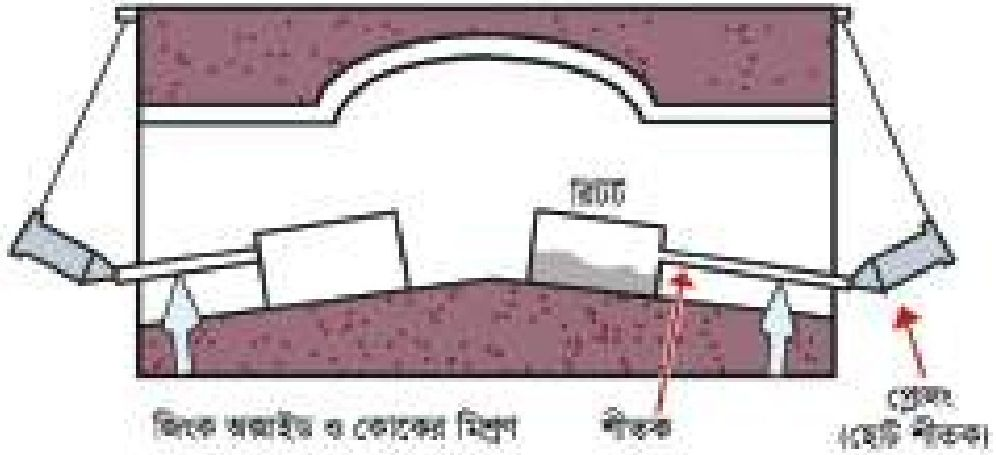

<!-- chemistry-9-10-bn-c10-t10.ex-p023 · exercise · p.260 · review: known-confusable-corrected -->
১. (ক) ক্যালামাইনের রাসায়নিক সংকেত লেখো।
(খ) তাপজারণের ব্যাখ্যা দাও।
(গ) রিট্রে সংঘটিত মূল বিক্রিয়াটি ব্যাখ্যা করো।
(ঘ) উদ্দীপকের ধাতু কেবল তড়িৎ বিচ্ছেদণ প্রক্রিয়ায় নিষ্কাশন না করে তিন ধাপে করার কারণ মূল্যায়ন করো।

<!-- chemistry-9-10-bn-c10-t10.ex-p024 · exercise · p.260 · review: known-confusable-corrected -->
২. একটি খনিতে বক্রাইট ও ক্যালামাইন মিশ্রিত কিছু খনিজের অস্তিত্ব পাওয়া গেল। প্রফেসর রহমানের নেতৃত্বে একদল রসায়নবিদ উক্ত খনিজ থেকে দুটি ভিন্ন পদ্ধতিতে ধাতু দুটি নিষ্কাশন করলেন।

<!-- chemistry-9-10-bn-c10-t10.ex-p025 · exercise · p.260 · review: known-confusable-corrected -->
(ক) খনিজ কাকে বলে?
(খ) ‘সকল খনিজই আকরিক নয়’ ব্যাখ্যা করো।
(গ) দ্বিতীয় আকরিকটির বিয়োজন প্রাপ্ত অক্সাইডদ্বয়ের প্রকৃতি ব্যাখ্যা করো।
(ঘ) ভিন্ন পদ্ধতিতে ধাতু দুটি নিষ্কাশনের কারণ যুক্তিসহ লেখো।

<!-- chemistry-9-10-bn-c10-t10.ex-p026 · exercise · p.260 · review: known-confusable-corrected -->
৩. পর্যায় সারণির গ্রুপ-16 এর একটি মৌলকে বায়ুতে পোড়ালে একটি অক্সাইড A পাওয়া যায়। অক্সাইডটি ঝাঁজালো গন্ধযুক্ত অতান্ত বিস্তুত গ্যাস। লা-শাতেলিয়ার নীতি প্রয়োগ করে শিল্পক্ষেত্রে A থেকে একটি এসিড B তৈরি করা যায়।

<!-- chemistry-9-10-bn-c10-t10.ex-p027 · exercise · p.260 · review: known-confusable-corrected -->
(ক) আকরিক কাকে বলে?
(খ) A অক্সাইড অম্লধর্মী- ব্যাখ্যা করো।
(গ) উদ্দীপকের B এসিডটি তৈরি করার প্রক্রিয়া বর্ণনা করো।
(ঘ) উদ্দীপকের B এসিডটির গাঢ়ত্বের ওপর জারণ ধর্ম নির্ভর করে- যুক্তি দ্বারা প্রমাণ করো।

### সংক্ষিপ্ত-উত্তর প্রশ্ন

<!-- chemistry-9-10-bn-c10-t10.ex-p028 · exercise · p.260 · review: verify-formula -->
১. ম্যাগনেসিয়াম ধাতুকে কার্বন বিজারণ প্রক্রিয়ায় নিষ্কাশন করা যায় না কেন? ব্যাখ্যা করো।
২. $SO_2$ কে অম্লধর্মী অক্সাইড বলা হয় কেন? ব্যাখ্যা করো।
৩. অ্যালুমিনিয়াম ধাতু নিষ্কাশনে ক্রায়োলাইট ব্যবহার করা হয় কেন? ব্যাখ্যা করো।
