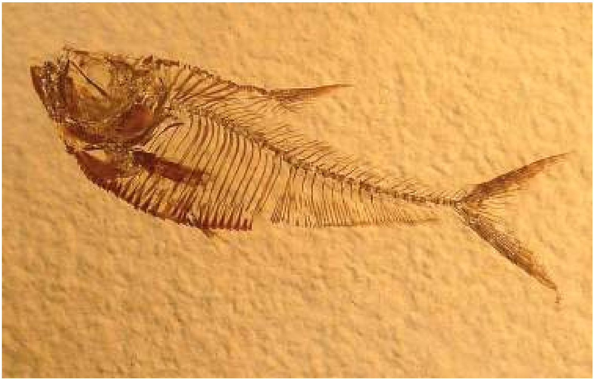
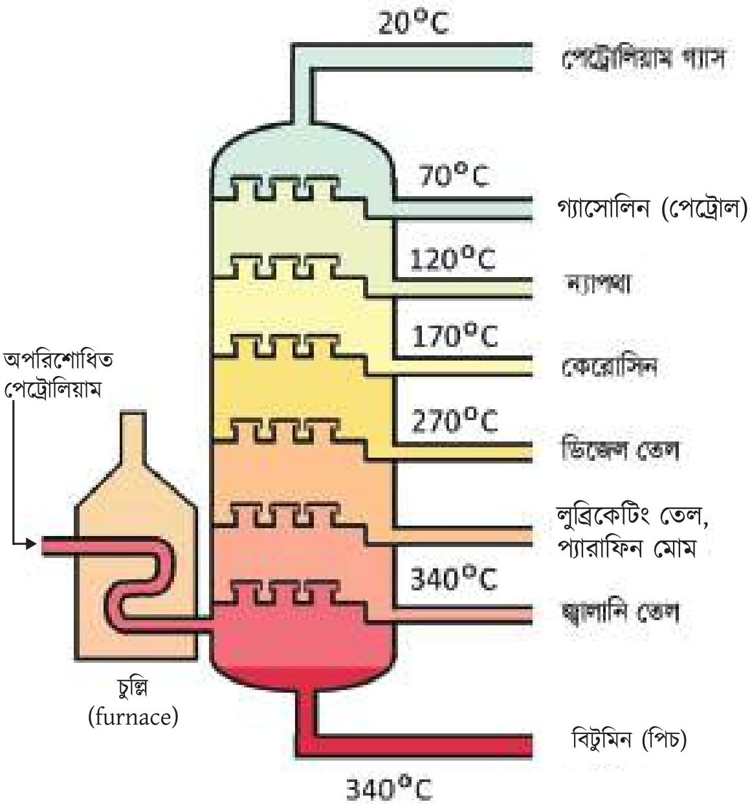
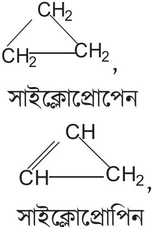
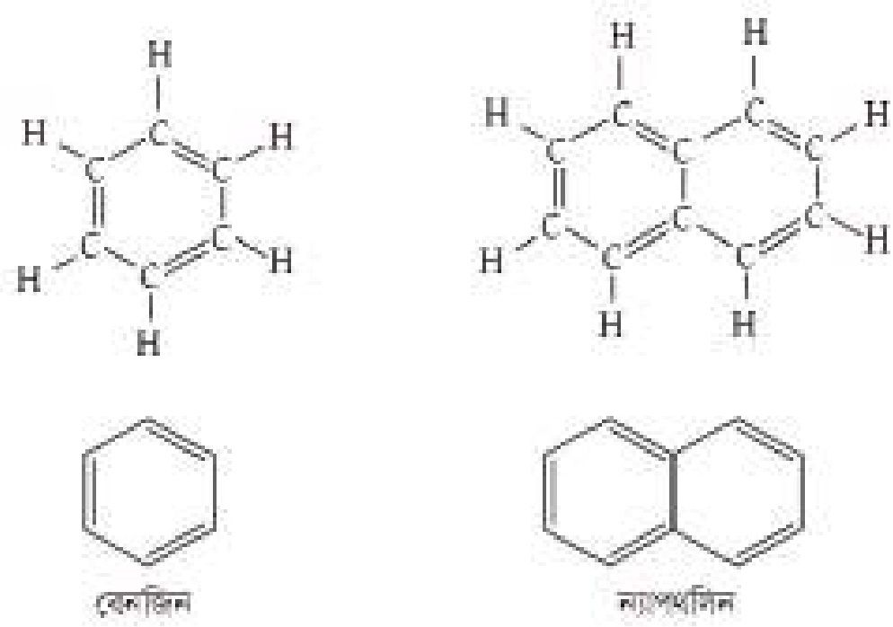
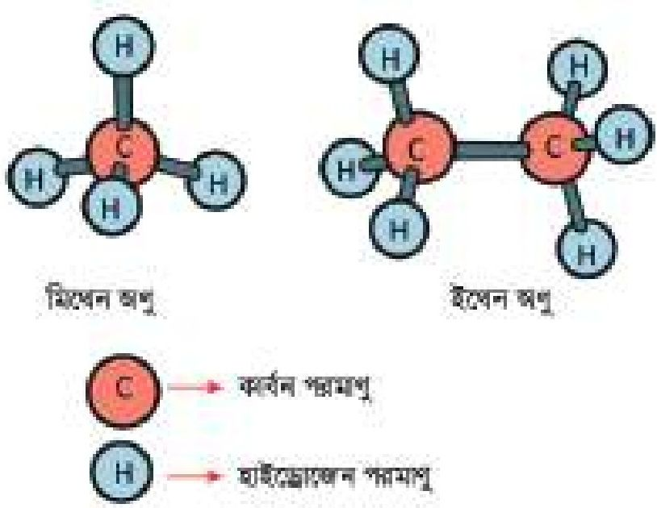
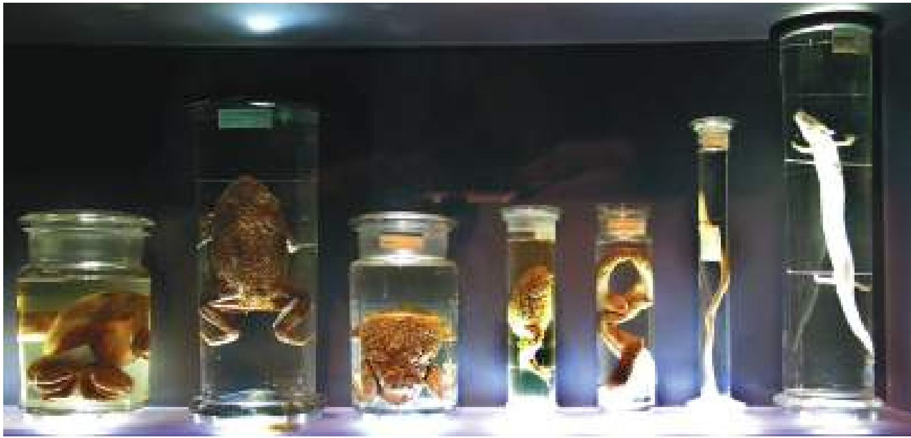
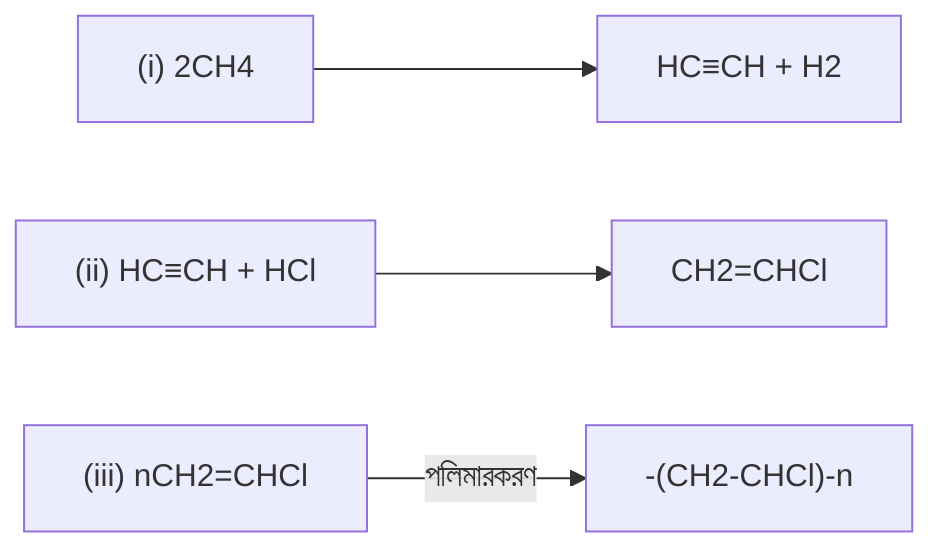

# 11. খনিজ সম্পদ: জীবাশ্ম

Source: Chemistry Bangla Version, printed pp. 261-286

## 11.0 ভূমিকা ও শিখনফল

<!-- chemistry-9-10-bn-c11-t11.0-p001 · figure · p.261 -->


<!-- chemistry-9-10-bn-c11-t11.0-p002 · text · p.261 · review: known-confusable-corrected -->
এ পৃথিবীর বয়স প্রায় 4.54 বিলিয়ন বছর। আজকে পৃথিবীকে যেমন দেখছ, অনেক অনেক বছর আগে পৃথিবীর রূপ কিন্তু এমন ছিল না। আজ থেকে 500 বা 600 মিলিয়ন বছর আগে এই পৃথিবী ছিল ঘন বনজঙ্গল, নিচু জলাভূমি আর সাগর-মহাসাগরে পরিপূর্ণ। প্রাকৃতিক বিপর্ষয়ে ধ্বংসপ্রাপ্ত মৃত প্রাণী, উদ্ভিদ, শৈবাল-ছত্রাক নিচু এলাকাগুলোতে জমা হয়েছিল। তার উপর পড়তে থাকল পলির আস্তরণ। এভাবে মিলিয়ন মিলিয়ন বছর ধরে এ সকল উদ্ভিদ আর প্রাণীর দেহাবশেষের উপর হাজার হাজার ফুট মাটি, বিভিন্ন শিলার আস্তরণ হয়ে গেল। উচ্চচাপ, উচ্চ তাপমাত্রা, মিলিয়ন মিলিয়ন বছর ধরে বিভিন্ন ভৌত আর রাসায়নিক পরিবর্তন ঘটে কয়লা, পেট্রোলিয়াম আর প্রকৃতিক গ্যাস সৃষ্টি হলো। এদেরকে বলে জীবাশ্ম জ্বালানি। কয়লার মূল উপাদান কার্বন। আর পেট্রোলিয়ামের মূল উপাদান শুধু কার্বন ও হাইড্রোজেনের দ্বারা সৃষ্ট যৌগ হাইড্রোকার্বন। হাইড্রোকার্বন হলো জৈব যৌগ। অ্যালকোহল, অ্যালডিহাইড, কিটোন, কার্বক্সিলিক এসিডসহ আরও যে সকল জৈব যৌগ আছে তারা মূলত হাইড্রোকার্বন থেকেই সৃষ্ট। এগুলো নিয়েই এ অধ্যয়ে আলোচনা করা হবে।

<!-- chemistry-9-10-bn-c11-t11.0-p003 · text · p.261 -->
২০২২

### এ অধ্যায় পাঠ শেষে আমরা

<!-- chemistry-9-10-bn-c11-t11.0-p004 · text · p.262 · review: known-confusable-corrected -->
* জীবাশ্ম জ্বালানির ধারণা ব্যাখ্যা করতে পারব।
* পেট্রোলিয়ামকে জৈব যৌগের মিশ্রণ হিসেবে ব্যাখ্যা করতে পারব।
* পেট্রোলিয়ামের ব্যবহার ব্যাখ্যা করতে পারব।
* হাইড্রোকার্বনের ধরন ও শ্রেণিবিভাগ ব্যাখ্যা করতে পারব।
* সম্পূর্ণ ও অসম্পূর্ণ হাইড্রোকার্বনের প্রস্তুতির বিক্রিয়া ও ধর্ম ব্যাখ্যা এবং এদের মধ্যে পার্থক্য করতে পারব।
* প্লাস্টিক দ্ব্য ও তন্তু তৈরির রাসায়নিক বিক্রিয়া এবং এর ব্যবহার বর্ণনা করতে পারব।
* পরিবেশের ওপর প্লাস্টিক দ্ব্য অপব্যবহারের কুফল উল্লেখ করতে পারব।
* প্রাকৃতিক গ্যাস, পেট্রোলিয়াম এবং কয়লা ব্যবহারের সুবিধা, অসুবিধা ও ব্যবহারের কৌশল ব্যাখ্যা করতে পারব।
* হাইড্রোকার্বন থেকে অ্যালকোহল অ্যালডিহাইড ও জৈব এসিডের প্রস্তুতির কৌশল ব্যাখ্যা করতে পারব।
* অ্যালকোহল, অ্যালডিহাইড ও জৈব এসিডের ব্যবহার করতে পারব।
* পরিবেশের উপর প্লাস্টিক দ্রব্যের প্রভাব সম্মর্শিত অনুসন্ধানমূলক কাজ করতে পারব।
* পরীক্ষার মাধ্যমে জৈব ও অজৈব যৌগের মধ্যে পার্থক্য করে দেখাতে পারব।
* জীবাশ্ম জ্বালানির সঠিক ব্যবহার সম্পর্কে সচেতনতা প্রদর্শন করতে পারব।

## 11.1 জীবাশ্ম জ্বালানি (Fossil Fuel)

<!-- chemistry-9-10-bn-c11-t11.1-p001 · text · p.263 -->
বহু প্রাচীনকালের উদ্ভিদ এবং প্রাণীর মৃতদেহের যে ধ্বংসাবশেষ মাটির নিচে পাওয়া যায় তাকে জীবাশ্ম বলে। কয়লা, প্রাকৃতিক গ্যাস ও পেট্রোলিয়াম যেগুলো আমরা জ্বালানি হিসেবে ব্যবহার করি সেগুলো মাটির নিচের জীবাশ্ম শত শত মিলিয়ন বছর ধরে পরিবর্তিত হয়ে তৈরি হয়েছে। তাই কয়লা, প্রাকৃতিক গ্যাস ও পেট্রোলিয়ামকে জীবাশ্ম জ্বালানি বলে।

<!-- chemistry-9-10-bn-c11-t11.1-p002 · text · p.263 -->
শত শত মিলিয়ন বছর আগে এ পৃথিবীর ইতিহাসে বিভিন্ন সময় ছিল যখন এ পৃথিবীজুড়ে ছিল ঘন বনজঙ্গল, নিচু জলাভূমি আর সমুদ্র সেখানে ছিল জলজ উদ্ভিদ, ফাইটোপ্ল্যাঙ্কটন (পানিতে বসবাসকারী এক ধরনের শৈবাল), জুওপ্ল্যাঙ্কটন (পানিতে বসবাসকারী এক ধরনের ছোট প্রাণী)। বিভিন্ন সময় বড় বড় প্রাকৃতিক বিপর্ষয়ে এই ধরনের উদ্ভিদ, প্রাণী মাটিচাপা পড়ে যায়। সময়ের বিবর্তনে তার উপর আরও মাটি পড়ে। ধীরে ধীরে এগুলো মাটির গভীর থেকে গভীরে চলে যেতে থাকে। ফলে এর উপর চাপ ও তাপমাত্রা বাড়তে থাকে। বায়ুর অনুপস্থিতিতে এগুলোর ক্ষয় ও রাসায়নিক পরিবর্তন ঘটেতে থাকে। শত শত মিলিয়ন বছর ধরে তাপ, চাপ আর রাসায়নিক পরিবর্তনের কারণে বড় বড় উদ্ভিদ ও প্রাণী থেকে শুরু করে স্কুড্রতম উদ্ভিদ ও প্রাণী পর্যন্ত সকল ধরনের উদ্ভিদ ও প্রাণী থেকে জীবাশ্ম জ্বালানির সৃষ্টি হয়েছে। বড় বড় উদ্ভিদ থেকে কয়লা আর ফাইটোপ্ল্যাঙ্কটন, জুওপ্ল্যাঙ্কটন ও মৃত প্রাণীর দেহাবশেষ থেকে পেট্রোলিয়ামের সৃষ্টি হয়েছে। এ পরিবর্তন অব্যাহত থাকায় পেট্রোলিয়াম আরও পরিবর্তিত হয়ে প্রাকৃতিক গ্যাস সৃষ্টি হয়। তাই কোথাও কোথাও পেট্রোলিয়াম ও প্রাকৃতিক গ্যাস এক সাথেই থাকে। যেমন- বাংলাদেশের হরিপুর গ্যাসক্ষেত্রে প্রাকৃতিক গ্যাসের সাথে পেট্রোলিয়ামও পাওয়া গেছে। এই জীবাশ্ম জ্বালানির মূল উৎস জীবদেহ, তাই এ সকল জ্বালানির মূল উপাদান কার্বন ও কার্বনের যৌগ।

### ১১.১.১ প্রাকৃতিক গ্যাস (Natural Gas)

<!-- chemistry-9-10-bn-c11-t11.1-p003 · text · p.263 -->
সাধারণত প্রাকৃতিক গ্যাসের বিভিন্ন উপাদানের অনুপাত তার প্রাকৃতিক উৎসের ভিত্তিতে ভিন্ন হয়ে থাকে। প্রাকৃতিক গ্যাসের প্রধান উপাদান হলো মিথেন। এছাড়া প্রাকৃতিক গ্যাসে ইথেন, প্রোপেন, বিউটেন ও আইসোবিউটেন এবং পেনেটন থাকে। বাংলাদেশে প্রাপ্ত প্রাকৃতিক গ্যাসে ৯৩-৯৮% মিথেন, ০.২-৩.৯% ইথেন, ০.০৫-১.২% প্রোপেন, ০.১-০.৭২% বিউটেন এবং ১.২% পেনেটন পাওয়া গেছে।

### ১১.১.২ পেট্রোলিয়ামের উপাদানসমূহ ও তাদের পৃথকীকরণ

<!-- chemistry-9-10-bn-c11-t11.1-p004 · text · p.263 -->
পেট্রোলিয়াম সাধারণত 5000 ফুট বা তার চেয়েও গভীরে শিলা স্তরের মধ্যে পাওয়া যায়। পেট্রোলিয়ামের সাথে অনেক সময় প্রাকৃতিক গ্যাস থাকে, যা পেট্রোলিয়ামের উপরিভাগে চাপ প্রয়োগ করে। কূপ খনন করা হলে এই প্রাকৃতিক গ্যাস পেট্রোলিয়ামকে ভূপৃষ্ঠের উপরিভাগে উঠে আসতে সাহায্য করে। যে পেট্রোলিয়াম খনি থেকে সরাসরি পাওয়া যায় তাকে অপরিশোধিত তেল (Crude Oil) বা পেট্রোলিয়াম বলে। এই অপরিশোধিত তেল অস্বচ্ছ, এতে কখনো কখনো সালফারের কিছু কিছু যোগ থাকার কারণে দূর্গন্ধযুক্ত হয়। এই পেট্রোলিয়াম মূলত বিভিন্ন হাইড্রোকার্বনের মিশ্রণ এবং সরাসরি ব্যবহার উপযোগী নয়। এই অপরিশোধিত তেল আংশিক পাতন পদ্ধতিতে স্ফুটনাঙ্কের উপর ভিত্তি করে পৃথক করা হয়।

<!-- chemistry-9-10-bn-c11-t11.1-p005 · text · p.264 -->
আংশিক পাতনও হলো এক ধরনের পাতন। এখানে বাষ্পকে ঠান্ডা করার জন্য লস্যা কলাম থাকে। কলাম আবার বিভিন্ন অংশে বিভক্ত। নিচের অংশটির তাপমাত্রা সবচেয়ে বেশি। যে অংশ যত উপরে তার তাপমাত্রা তত কম। ফলে যদি একাধিক তরলের মিশ্রণকে তাপ দিয়ে বাষ্পীভূত করে আংশিক পাতন কলামের নিচের অংশে প্রবেশ করানো হয় তবে বাষ্পের ধর্ম অনুযায়ী তা কলামের উপরের দিকে উঠবে। যেহেতু উপরের অংশগুলোর তাপমাত্রা কম থাকে, তাই তরলের মিশ্রণের প্রত্যেকটি উপাদান তাদের স্ফুটনাঙ্ক অনুযায়ী আংশিক

<!-- chemistry-9-10-bn-c11-t11.1-p006 · figure · p.264 -->


<!-- chemistry-9-10-bn-c11-t11.1-p007 · figure · p.264 -->
**চিত্র ১১.০১: পেট্রোলিয়ামের আংশিক পাতন**

<!-- chemistry-9-10-bn-c11-t11.1-p008 · text · p.264 -->
পাতন কলামের বিভিন্ন অংশে পৃথক হয়। পেট্রোলিয়াম বিভিন্ন হাইড্রোকার্বনের মিশ্রণ। এদের স্ফুটনাঙ্কও বিভিন্ন। আগেই বলা হয়েছে অপরিশোধিত তেল ব্যবহারের উপযুক্ত নয়, কিন্তু একে যদি আংশিক পাতনের সাহায্যে পৃথক করা হয় তবে এ অপরিশোধিত তেল থেকে পেট্রোল, গ্যাস, পেট্রোলিয়াম, ন্যাপথা, কেরোসিন, ডিজেল, প্যারাফিন মোম এবং পিচ প্রভৃতি অংশে বিভক্ত হয়ে যায়। যা বিভিন্ন কাজে ব্যবহার করা যায়। আংশিক পাতন কলাম থেকে প্রাপ্ত বিভিন্ন অংশের নাম, বিভিন্ন অংশের স্ফুটনাঙ্ক, বিভিন্ন অংশে যে হাইড্রোকার্বনসমূহ থাকে তাদের কার্বন সংখ্যা এবং তাদের ব্যবহার নিচে বর্ণনা করা হলো:

<!-- chemistry-9-10-bn-c11-t11.1-p009 · text · p.265 · review: latin-junk -->
**(i) পেট্রোলিয়াম গ্যাস:** এ অংশের স্ফুটনাঙ্ক 0°C থেকে 20°C পর্যন্ত। এ অংশে যে হাইড্রোকার্বনসমূহ থাকে তাদের অণুতে কার্বন সংখ্যা 1 থেকে 4 পর্যন্ত। পেট্রোলিয়ামে শতকরা দুই ভাগ পেট্রোলিয়াম গ্যাস থাকে। এ গ্যাসকে চাপ প্রয়োগ করে তরলে পরিণত করে সিলিন্ডারে ভর্তি করা হয় এবং LPG (Liquefied Petroleum Gas) নামে রান্নার কাজে ও অন্যান্য কাজে তাপ উৎপাদনের জন্য ব্যবহার করা হয়।

<!-- chemistry-9-10-bn-c11-t11.1-p010 · text · p.265 -->
**(ii) পেট্রোল (গ্যাসোলিন):** এ অংশের স্ফুটনাঙ্ক 21°C থেকে 70°C পর্যন্ত। এ অংশে যে হাইড্রোকার্বনসমূহ থাকে তাদের অণুতে কার্বন সংখ্যা 5 থেকে 10 পর্যন্ত। পেট্রোলিয়ামে শতকরা 5 ভাগ পেট্রোল থাকে। একে গ্যাসোলিনও বলা হয়। যানবাহনের ইঞ্জিনে জ্বালানি হিসেবে গ্যাসোলিন ব্যবহার করা হয়।

<!-- chemistry-9-10-bn-c11-t11.1-p011 · text · p.265 -->
**(iii) ন্যাপথা:** এ অংশের স্ফুটনাঙ্ক 71°C থেকে 120°C পর্যন্ত। এ অংশে যে হাইড্রোকার্বনসমূহ থাকে তাদের অণুতে কার্বন সংখ্যা 7 থেকে 14 পর্যন্ত। পেট্রোলিয়ামে শতকরা 10 ভাগ ন্যাপথা থাকে। জ্বালানি ও পেট্রোকেমিক্যাল শিল্পে বিভিন্ন রাসায়নিক পদার্থ ও অন্যান্য অনেক ব্যবহার্য দ্রব্য তৈরি করা হয়।

<!-- chemistry-9-10-bn-c11-t11.1-p012 · text · p.265 -->
**(iv) কেরোসিন:** এ অংশের স্ফুটনাঙ্ক 121°C থেকে 170°C পর্যন্ত। এ অংশে যে সকল হাইড্রোকার্বন থাকে তাদের অণুতে কার্বন সংখ্যা 11 থেকে 16 পর্যন্ত। পেট্রোলিয়ামে শতকরা 13 ভাগ কেরোসিন থাকে। পেট্রোলিয়ামের এই অংশকে জেট ইঞ্জিনের জ্বালানি হিসেবে ব্যবহার করা হয়।

<!-- chemistry-9-10-bn-c11-t11.1-p013 · text · p.265 -->
**(v) ডিজেল:** এ অংশের স্ফুটনাঙ্ক 171°C থেকে 270°C পর্যন্ত। এ অংশে যে হাইড্রোকার্বনসমূহ থাকে তাদের অণুতে কার্বন সংখ্যা 17 থেকে 20 পর্যন্ত। যানবাহনের জ্বালানি, পিচ্ছিলকারক পদার্থ ও দ্রাবক হিসেবে ব্যবহার করা হয়।

<!-- chemistry-9-10-bn-c11-t11.1-p014 · text · p.265 -->
**(vi) প্যারাফিন মোম:** এ অংশের স্ফুটনাঙ্ক 271°C থেকে 340°C পর্যন্ত। এ অংশে যে হাইড্রোকার্বনসমূহ থাকে তাদের অণুতে কার্বন সংখ্যা 20 থেকে 30 পর্যন্ত। প্যারাফিন মোম টয়লেট্রিজ এবং ভ্যাসলিন তৈরিতে ব্যবহৃত হয়।

<!-- chemistry-9-10-bn-c11-t11.1-p015 · text · p.265 -->
**(vii) পিচ:** এ অংশের স্ফুটনাঙ্ক 340°C থেকে উচ্চ তাপমাত্রা পর্যন্ত। এ অংশে যে হাইড্রোকার্বনসমূহ থাকে তাদের অণুতে কার্বন সংখ্যা 30 এর বেশি। রাস্তা তৈরিতে এটি কাজ লাগে।

## 11.2 হাইড্রোকার্বন (Hydrocarbons)

<!-- chemistry-9-10-bn-c11-t11.2-p001 · text · p.266 -->
হাইড্রোকার্বন হলো শুধু কার্বন ও হাইড্রোজেন এর সম্বন্ধে গঠিত যৌগ। যেমন: মিথেন (CH<sub>4</sub>), ইথিন (C<sub>2</sub>H<sub>4</sub>), সাইক্লোহেক্সেন (C<sub>6</sub>H<sub>12</sub>), বেনজিন (C<sub>6</sub>H<sub>6</sub>) ইত্যাদি। দেখতেই পাচ্ছ যৌগগুলোতে কার্বন আর হাইড্রোজেন ছাড়া আর কোনো মৌল নেই।

<!-- chemistry-9-10-bn-c11-t11.2-p002 · text · p.266 -->
হাইড্রোকার্বন মূলত দুই প্রকার: (i) অ্যালিফেটিক হাইড্রোকার্বন ও (ii) অ্যারোমেটিক হাইড্রোকার্বন।

### ১১.২.১ অ্যালিফেটিক হাইড্রোকার্বন (Aliphatic Hydrocarbons)

<!-- chemistry-9-10-bn-c11-t11.2-p003 · text · p.266 -->
অ্যালিফেটিক কথ্যটির অর্থ হলো চর্বিজাত। এই শ্রেণির হাইড্রোকার্বন মূলত প্রাণীর চর্বি থেকে পাওয়া গিয়েছিল। তাই এ ধরনের হাইড্রোকার্বনের নাম অ্যালিফেটিক হাইড্রোকার্বন দেওয়া হয়েছে। অ্যালিফেটিক হাইড্রোকার্বন দুই ধরনের— (i) মুক্ত শিকল হাইড্রোকার্বন এবং (ii) বদ্ধ শিকল হাইড্রোকার্বন।

### (i) মুক্ত শিকল হাইড্রোকার্বন (Open Chain Hydrocarbon)

<!-- chemistry-9-10-bn-c11-t11.2-p004 · text · p.266 -->
যে সকল হাইড্রোকার্বনের কার্বন শিকলের দুই প্রান্তের কার্বন দুইটি মুক্ত অবস্থায় থাকে। তাদেরকে মুক্ত শিকল হাইড্রোকার্বন বলে। যেমন—

<!-- chemistry-9-10-bn-c11-t11.2-p005 · text · p.266 -->
বিউটেন: CH<sub>3</sub>-CH<sub>2</sub>-CH<sub>2</sub>-CH<sub>3</sub>, ইথিন: CH<sub>2</sub>=CH<sub>2</sub> ইত্যাদি।

<!-- chemistry-9-10-bn-c11-t11.2-p006 · text · p.266 -->
মুক্ত শিকল হাইড্রোকার্বন আবার সম্পৃক্ত (saturated) এবং অসম্পৃক্ত (unsaturated) দুই ধরনের হয়।

<!-- chemistry-9-10-bn-c11-t11.2-p007 · text · p.266 -->
**(a) সম্পৃক্ত মুক্ত শিকল হাইড্রোকার্বন (Saturated Open Chain Hydrocarbons):** যে মুক্ত শিকল হাইড্রোকার্বনে শুধু কার্বন-কার্বন একক বন্ধন (C-C) থাকে, তাকে সম্পৃক্ত মুক্ত শিকল হাইড্রোকার্বন বা অ্যালকেন বলে। যেমন—

<!-- chemistry-9-10-bn-c11-t11.2-p008 · text · p.266 -->
প্রোপেন: CH<sub>3</sub>-CH<sub>2</sub>-CH<sub>3</sub>, পেন্টেন: CH<sub>3</sub>-CH<sub>2</sub>-CH<sub>2</sub>-CH<sub>2</sub>-CH<sub>3</sub>

<!-- chemistry-9-10-bn-c11-t11.2-p009 · text · p.266 -->
**(b) অসম্পৃক্ত মুক্ত শিকল হাইড্রোকার্বন (Unsaturated Open Chain Hydrocarbons):** যে মুক্ত শিকল হাইড্রোকার্বনে এক বা একাধিক কার্বন-কার্বন দ্বিবন্ধন বা কার্বন-কার্বন ত্রিবন্ধন থাকে, তাকে অসম্পৃক্ত মুক্ত শিকল হাইড্রোকার্বন বলে। যেমন: ইথাইন (CH≡CH)

<!-- chemistry-9-10-bn-c11-t11.2-p010 · text · p.266 -->
অসম্পৃক্ত হাইড্রোকার্বনে কার্বন-কার্বন দ্বিবন্ধন বা ত্রিবন্ধনের পাশাপাশি কার্বন-কার্বন একক বন্ধনও থাকতে পারে।

<!-- chemistry-9-10-bn-c11-t11.2-p011 · text · p.267 -->
অসম্পূর্ণ মুক্ত শিকল হাইড্রোকার্বনকে দ্বিবন্ধন কিংবা ত্রিবন্ধনের উপর নির্ভর করে আবার অ্যালকিন ও অ্যালকাইনে ভাগ করা হয়েছে। আমরা এই অধ্যায়ে অ্যালকিন ও অ্যালকাইন সম্পর্কে বিস্তারিতভাবে জানব।

<!-- chemistry-9-10-bn-c11-t11.2-p012 · text · p.267 · review: latin-junk -->
অ্যালকিনে কার্বন-কার্বন দ্বিবন্ধন উপস্থিত থাকে। যেমন: প্রোপিন (CH<sub>3</sub>-CH=CH<sub>2</sub>)
অ্যালকাইনে কার্বন-কার্বন ত্রিবন্ধন উপস্থিত থাকে। যেমন: ইথাইন (CH ≡ CH), প্রোপাইন (H<sub>3</sub>C–C≡CH)

### (ii) বদ্ধ শিকল হাইড্রোকার্বন (Closed Chain Hydrocarbons)

<!-- chemistry-9-10-bn-c11-t11.2-p013 · text · p.267 · review: known-confusable-corrected -->
এ জাতীয় হাইড্রোকার্বনের কার্বন শিকলের দুই প্রান্তের কার্বন পরস্পর যুক্ত হয়ে একটি বলয় বা চক্র গঠন করে। বিভিন্ন আকারের শিকল বিভিন্ন আকারের বলয় গঠন করে। মুক্ত শিকল হাইড্রোকার্বনের মতো এরাও সম্পূর্ণ বা অসম্পূর্ণ এ দুই ধরনের হতে পারে:

<!-- chemistry-9-10-bn-c11-t11.2-p014 · figure · p.267 -->


<!-- chemistry-9-10-bn-c11-t11.2-p015 · text · p.267 -->
বদ্ধ শিকল হাইড্রোকার্বনকে অনেক সময় অ্যালিসাইক্রিক হাইড্রোকার্বনও বলা হয়।

### ১১.২.২ অ্যারোমেটিক হাইড্রোকার্বন (Aromatic Hydrocarbons)

<!-- chemistry-9-10-bn-c11-t11.2-p016 · text · p.267 -->
গ্রিক শব্দ অ্যারোমা (Aroma) থেকে অ্যারোমেটিক শব্দটি এসেছে। অ্যারোমেটিক শব্দের অর্থ হলো সুগন্ধযুক্ত। প্রথমে যে অ্যারোমেটিক যৌগগুলো পাওয়া গিয়েছিল সেগুলো ছিল সুগন্ধযুক্ত, তাই এ ধরনের নামকরণ করা হয়েছে। বেনজিন (C<sub>6</sub>H<sub>6</sub>) বা ন্যাপথলিন (C<sub>10</sub>H<sub>8</sub>) হচ্ছে অ্যারোমেটিক হাইড্রোকার্বনের উদাহরণ।

<!-- chemistry-9-10-bn-c11-t11.2-p017 · text · p.267 -->
অ্যারোমেটিক যৌগগুলো সাধারণত 5, 6 কিংবা 7 সদস্যের সমতলীয় যৌগ (planar compounds)। এগুলোতে একান্তর (alternate) দ্বিবন্ধন থাকে, অর্থাৎ পর্যায়েকে কার্বন-কার্বন একটি একক বন্ধন এবং তারপর একটি দ্বিবন্ধন থাকে।

<!-- chemistry-9-10-bn-c11-t11.2-p018 · figure · p.268 -->


<!-- chemistry-9-10-bn-c11-t11.2-p019 · figure · p.268 -->
**চিত্র ১১.০২: অ্যারোমেটিক যৌগ বেনজিন (C<sub>6</sub>H<sub>6</sub>),এবং ন্যাপথলিন (C<sub>10</sub>H<sub>8</sub>)**

<!-- chemistry-9-10-bn-c11-t11.2-p020 · text · p.268 -->
আমরা এই অধ্যায়ে আমাদের আলোচনা মূলত অ্যালিফেটিক হাইড্রোকার্বনের মাঝে সীমাবদ্ধ রাখব।

<!-- chemistry-9-10-bn-c11-t11.2-p021 · text · p.268 -->
**সমগোত্রীয় শ্রেণি (Homologous Series):** যে সকল যৌগের কার্যকরীমূলক একই হওয়ায় তাদের ভৌত ও রাসায়নিক ধর্মের গভীর মিল থাকে তারা একই শ্রেণিভুক্ত। এদেরকে সমগোত্রীয় শ্রেণি বলে। একই সমগোত্রীয় শ্রেণির সকল সদস্যকে একটি সাধারণ সংকেত দিয়ে প্রকাশ করা যায়। যেমন- অ্যালকেন সমগোত্রীয় শ্রেণির সকল যৌগকে C<sub>n</sub>H<sub>2n+2</sub> সংকেত দিয়ে প্রকাশ করা যেতে পারে। নিচে বিভিন্ন সমগোত্রীয় শ্রেণির উদাহরণ দেওয়া হলো:

<!-- chemistry-9-10-bn-c11-t11.2-p022 · text · p.268 -->
**টেবিল ১১.০১: সমগোত্রীয় শ্রেণি**

<!-- chemistry-9-10-bn-c11-t11.2-p023 · table · p.268 · review: verify-table -->
<table><tr><th>সমগোত্রীয় শ্রেণি</th><th>সাধারণ সংকেত</th><th>প্রথম কয়েকটি সদস্যের নাম ও সংকেত</th></tr>
<tr><td>অ্যালকেন</td><td>C<sub>n</sub>H<sub>2n+2</sub></td><td>মিথেন (CH<sub>4</sub>), ইথেন (C<sub>2</sub>H<sub>6</sub>), প্রোপেন (C<sub>3</sub>H<sub>8</sub>), বিউটেন<br />(C<sub>4</sub>H<sub>10</sub>)</td></tr>
<tr><td>অ্যালকিন</td><td>C<sub>n</sub>H<sub>2n</sub></td><td>ইথিন (C<sub>2</sub>H<sub>4</sub>), প্রোপিন (C<sub>3</sub>H<sub>6</sub>)</td></tr>
<tr><td>অ্যালকাইন</td><td>C<sub>n</sub>H<sub>2n-2</sub></td><td>ইথাইন (C<sub>2</sub>H<sub>2</sub>), প্রোপাইন (C<sub>3</sub>H<sub>4</sub>)</td></tr>
<tr><td>অ্যালকোহল</td><td>C<sub>n</sub>H<sub>2n+1</sub>OH</td><td>মিথানল (CH<sub>3</sub>—OH), ইথানল (C<sub>2</sub>H<sub>5</sub>OH)</td></tr>
<tr><td>অ্যালডিহাইড</td><td>C<sub>n</sub>H<sub>2n+1</sub> CHO</td><td>ইথান্যাল (CH<sub>3</sub>—CHO), প্রোপান্যাল (C<sub>2</sub>H<sub>5</sub>CHO)</td></tr>
<tr><td>কার্বক্সিলিক<br />এসিড</td><td>C<sub>n</sub>H<sub>2n+1</sub> COOH</td><td>ইথানয়িক এসিড (CH<sub>3</sub>COOH), প্রোপানয়িক এসিড<br />(C<sub>2</sub>H<sub>5</sub>COOH)</td></tr></table>

## 11.3 সম্পৃক্ত হাইড্রোকার্বন: অ্যালকেন

### (Saturated Hydrocarbons: Alkanes)

<!-- chemistry-9-10-bn-c11-t11.3-p001 · text · p.269 · review: verify-formula -->
যে সকল হাইড্রোকার্বনের কার্বন শিকলে কার্বন-কার্বন একক বন্ধন বিদ্যমান থাকে তাকে অ্যালকেন বলে। অ্যালকেনের সাধারণ সংকেত $C_nH_{2n+2}$ ($n = 1, 2, 3, 4, ...$)। এ শ্রেণির প্রথম সদস্যের নাম মিথেন। প্রথম সদস্য বলে সাধারণ সংকেতে $n = 1$, তাই এর সংকেত $CH_4$। দ্বিতীয় সদস্য ($n = 2$) এর নাম ইথেন। ইথেনের সংকেত $C_2H_6$। অ্যালকেনের কার্বন-কার্বন ও কার্বন-হাইড্রোজেন বন্ধন ভাঙা অনেক কঠিন। তাই অ্যালকেন রাসায়নিকভাবে অনেকটা নিষ্ক্রিয়। এজন্য এদেরকে প্যারাফিন বলে, প্যারাফিন অর্থ স্তব্ধ আসক্তি। সাধারণত উচ্চ তাপমাত্রা, উচ্চ চাপ কিংবা শক্তিশালী প্রভাবকের উপস্থিতিতেই অ্যালকেন রাসায়নিক বিক্রিয়ায় অংশগ্রহণ করে।

<!-- chemistry-9-10-bn-c11-t11.3-p002 · figure · p.269 -->


<!-- chemistry-9-10-bn-c11-t11.3-p003 · figure · p.269 -->
**চিত্র ১১.০৩: মিথেন এবং ইথেন**

### অ্যালকেনের নামকরণ

<!-- chemistry-9-10-bn-c11-t11.3-p004 · text · p.269 · review: latin-junk -->
IUPAC পদ্ধতিতে অ্যালকেনের নামকরণের নিয়ম এরকম:

<!-- chemistry-9-10-bn-c11-t11.3-p005 · text · p.269 · review: verify-formula -->
(i) সরল শিকলবিশিষ্ট অ্যালকেনে এক কার্বনবিশিষ্ট অ্যালকেন ($CH_4$) কে মিথেন, দুই কার্বন বিশিষ্ট অ্যালকেন ($CH_3-CH_3$) কে ইথেন, তিন কার্বনবিশিষ্ট অ্যালকেন ($CH_3-CH_2-CH_3$) কে প্রোপেন এবং চার কার্বনবিশিষ্ট অ্যালকেন ($CH_3-CH_2-CH_2-CH_3$) কে বিউটেন নাম দেওয়া হয়েছে।

<!-- chemistry-9-10-bn-c11-t11.3-p006 · text · p.269 -->
(ii) অ্যালকেনের ক্ষেত্রে কার্বন সংখ্যার হ্রিক সংখ্যাসূচক শব্দের শেষে এন (ane) যোগ করে নামকরণ করা হয়।

### অ্যালকাইল মূলক (Alkyl Group)

<!-- chemistry-9-10-bn-c11-t11.3-p007 · text · p.269 · review: verify-formula -->
অ্যালকেন থেকে একটি হাইড্রোজেন পরমাণু অপসারণ করলে যে একযোজী মূলকের সৃষ্টি হয় তাকে অ্যালকাইল মূলক বলে। যেহেতু অ্যালকেনের সাধারণ সংকেত $C_nH_{2n+2}$, তাই অ্যালকাইল মূলক $R$ ব্যবহার করে লিখতে চাইলে আমরা $C_nH_{2n+2}$ এর পরিবর্তে $R-H$ লিখতে পারি। যেখানে অ্যালকাইল মূলক $R = C_nH_{2n+1}$। যে অ্যালকেন থেকে হাইড্রোজেন পরমাণুকে অপসারণ করে অ্যালকাইল মূলক তৈরি হয় সেই অ্যালকেন এর নামের শেষ অংশের এন (ane) বাদ দিয়ে আইল (yl) যোগ করে অ্যালকাইল মূলকের নামকরণ করা হয়। উদাহরণ হিসেবে বলা যায়, মিথেন ($CH_4$) থেকে মিথাইল ($CH_3-$), ইথেন ($C_2H_6$) থেকে ইথাইল ($CH_3-CH_2-$), প্রোপেন থেকে প্রোপাইল ($CH_3-CH_2-CH_2-$), বিউটেন থেকে বিউটাইল (CH<sub>3</sub>-CH<sub>2</sub>-CH<sub>2</sub>-CH<sub>2</sub>-), পেন্টেন থেকে পেন্টাইল (CH<sub>3</sub>-CH<sub>2</sub>-CH<sub>2</sub>-CH<sub>2</sub>-CH<sub>2</sub>-) ইত্যাদি।

<!-- chemistry-9-10-bn-c11-t11.3-p008 · table · p.270 · review: verify-table -->
**টেবিল ১১.০২: অ্যালকেনের কার্বন সংখ্যা, নাম এবং সংকেত**
<table><tr><th>অ্যালকেনের কার্বন সংখ্যা</th><th>অ্যালকেনের নাম</th><th>অ্যালকেনের সংকেত</th></tr>
<tr><td>1</td><td>মিথেন<br />(Methane)</td><td>CH<sub>4</sub></td></tr>
<tr><td>2</td><td>ইথেন<br />(Ethane)</td><td>CH<sub>3</sub>-CH<sub>3</sub></td></tr>
<tr><td>3</td><td>প্রোপেন<br />(Propane)</td><td>CH<sub>3</sub>-CH<sub>2</sub>-CH<sub>3</sub></td></tr>
<tr><td>4</td><td>বিউটেন<br />(Butane)</td><td>CH<sub>3</sub>-CH<sub>2</sub>-CH<sub>2</sub>-CH<sub>3</sub></td></tr>
<tr><td>5</td><td>পেন্টেন<br />(Pentane)</td><td>CH<sub>3</sub>-CH<sub>2</sub>-CH<sub>2</sub>-CH<sub>2</sub>-CH<sub>3</sub></td></tr>
<tr><td>6</td><td>হেক্সেন<br />(Hexane)</td><td>CH<sub>3</sub>-CH<sub>2</sub>-CH<sub>2</sub>-CH<sub>2</sub>-CH<sub>2</sub>-CH<sub>3</sub></td></tr>
<tr><td>7</td><td>হেপ্টেন<br />(Heptane)</td><td>CH<sub>3</sub>-CH<sub>2</sub>-CH<sub>2</sub>-CH<sub>2</sub>-CH<sub>2</sub>-CH<sub>2</sub>-CH<sub>3</sub></td></tr>
<tr><td>8</td><td>অক্টেন<br />(Octane)</td><td>CH<sub>3</sub>-CH<sub>2</sub>-CH<sub>2</sub>-CH<sub>2</sub>-CH<sub>2</sub>-CH<sub>2</sub>-CH<sub>2</sub> -CH<sub>3</sub></td></tr>
<tr><td>9</td><td>ননেন<br />(Nonane)</td><td>CH<sub>3</sub>-CH<sub>2</sub>-CH<sub>2</sub>-CH<sub>2</sub>-CH<sub>2</sub>-CH<sub>2</sub> -CH<sub>2</sub>-CH<sub>2</sub>-CH<sub>3</sub></td></tr>
<tr><td>10</td><td>ডেকেন<br />(Decane)</td><td>CH<sub>3</sub>-CH<sub>2</sub>-CH<sub>2</sub>-CH<sub>2</sub>-CH<sub>2</sub>-CH<sub>2</sub>-CH<sub>2</sub>-CH<sub>2</sub>-CH<sub>2</sub>-CH<sub>3</sub></td></tr></table>

### অ্যালকেনের প্রস্তুতি

<!-- chemistry-9-10-bn-c11-t11.3-p009 · text · p.270 -->
কার্বন ডাই-অক্সাইড থেকে: নিকেল প্রভাবকের উপস্থিতিতে কার্বন ডাই-অক্সাইডের সাথে হাইড্রোজেনকে 250°C তাপমাত্রায় উত্তপ্ত করলে মিথেন এবং পানি উৎপন্ন হয়।

<!-- chemistry-9-10-bn-c11-t11.3-p010 · text · p.271 · review: verify-formula -->
$$CO_2 + 4H_2 \xrightarrow[250^\circC]{Ni} CH_4 + 2H_2O$$
কার্বন ডাই-অক্সাইড হাইড্রোজেন মিথেন পানি

<!-- chemistry-9-10-bn-c11-t11.3-p011 · text · p.271 -->
**অ্যালকিন ও অ্যালকাইন থেকে:** নিকেল প্রভাবক এর উপস্থিতিতে পৃথকভাবে ইথিন এবং ইথাইনের সাথে হাইড্রোজেনকে 180°C-200°C তাপমাত্রায় উত্তপ্ত করলে ইথেন উৎপন্ন হয়।

<!-- chemistry-9-10-bn-c11-t11.3-p012 · text · p.271 · review: verify-formula -->
$$CH_2=CH_2 + H_2 \xrightarrow[180^\circC-200^\circC]{Ni} CH_3-CH_3$$
ইথিন হাইড্রোজেন ইথেন

<!-- chemistry-9-10-bn-c11-t11.3-p013 · text · p.271 · review: verify-formula -->
$$CH\equivCH + 2H_2 \xrightarrow[180^\circC-200^\circC]{Ni} CH_3-CH_3$$
ইথাইন হাইড্রোজেন ইথেন

<!-- chemistry-9-10-bn-c11-t11.3-p014 · text · p.271 -->
**ডিকার্বক্সাইলেশন বিক্রিয়া থেকে :** ক্যালসিয়াম অক্সাইডের উপস্থিতিতে সোডিয়াম ইথানয়েটকে সোডালাইম (NaOH + CaO) এর সাথে উত্তপ্ত করলে মিথেন এবং সোডিয়াম কার্বনেট উৎপন্ন হয়। এই বিক্রিয়াকে ডিকার্বক্সাইলেশন বিক্রিয়া বলে।

<!-- chemistry-9-10-bn-c11-t11.3-p015 · text · p.271 · review: verify-formula -->
$$CH_3COONa + NaOH \xrightarrow[\Delta]{CaO} CH_4 + Na_2CO_3$$
সোডিয়াম ইথানয়েট সোডিয়াম হাইড্রোঅক্সাইড মিথেন সোডিয়াম কার্বনেট

### অ্যালকেনের ধর্ম

<!-- chemistry-9-10-bn-c11-t11.3-p016 · text · p.271 · review: known-confusable-corrected -->
**ভৌত ধর্ম:** সম্পূর্ণ হাইড্রোকার্বন বা অ্যালকেনের গলনাঙ্ক, স্ফুটনাঙ্ক এবং ভৌত অবস্থা অ্যালকেনের কার্বন সংখ্যার উপর নির্ভর করে। কার্বন সংখ্যার পরিবর্তন হলে ভৌত অবস্থার পরিবর্তন হয়। 1 থেকে 4 কার্বন সংখ্যার সম্পূর্ণ হাইড্রোকার্বনের স্ফুটনাঙ্ক ক্রমশ তাপমাত্রার নিচে, তাই এগুলো গ্যাসীয় অবস্থায় থাকে। 5 থেকে 15 কার্বন সংখ্যার সম্পূর্ণ হাইড্রোকার্বনের স্ফুটনাঙ্ক ক্রমশ তাপমাত্রার উপরে বলে এগুলো তরল অবস্থায় থাকে। 5 কার্বনবিশিষ্ট সম্পূর্ণ হাইড্রোকার্বন পেঁটেনের স্ফুটনাঙ্ক 36.1°C। সম্পূর্ণ হাইড্রোকার্বনের কার্বন সংখ্যা 16 থেকে বেশি হলে এগুলো কঠিন প্রকৃতির হয়।

### রাসায়নিক ধর্ম

<!-- chemistry-9-10-bn-c11-t11.3-p017 · text · p.271 -->
আগেই বলা হয়েছে অ্যালকেনসমূহ রাসায়নিকভাবে অনেকটা নিষ্ক্রিয়। তাই সাধারণ অবস্থায় এসিড, ক্ষারক, জারক বা বিজারকের সাথে বিক্রিয়া করে না। তারপরও এরা কিছু রাসায়নিক বিক্রিয়ায় অংশগ্রহণ করে।

<!-- chemistry-9-10-bn-c11-t11.3-p018 · text · p.272 -->
**ক্লোরিনের সাথে বিক্রিয়া:** অতিবেগুনি (UV) আলোর উপস্থিতিতে মিথেনের সাথে ক্লোরিন মিশ্রিত করলে টেট্রাক্লোরো মিথেন উৎপন্ন হয়। এই বিক্রিয়া চার ধাপে সম্পন্ন হয়।

<!-- chemistry-9-10-bn-c11-t11.3-p019 · formula · p.272 · review: latin-junk,verify-formula -->
$$\begin{array}{c}
CH_4 + Cl_2 \xrightarrow{UV} CH_3Cl + HCl \\
মিথেন \quad \quad \quad ক্লোরিন \quad \quad \quad ক্লোরো মিথেন \quad \quad \quad হাইড্রোজেন ক্লোরাইড
\end{array}$$

<!-- chemistry-9-10-bn-c11-t11.3-p020 · formula · p.272 · review: latin-junk,verify-formula -->
$$\begin{array}{c}
CH_3Cl + Cl_2 \xrightarrow{UV} CH_2Cl_2 + HCl \\
ক্লোরো মিথেন \quad \quad \quad ক্লোরিন \quad \quad \quad ডাইক্লোরো মিথেন \quad \quad \quad হাইড্রোজেন ক্লোরাইড
\end{array}$$

<!-- chemistry-9-10-bn-c11-t11.3-p021 · formula · p.272 · review: latin-junk,verify-formula -->
$$\begin{array}{c}
CH_2Cl_2 + Cl_2 \xrightarrow{UV} CHCl_3 + HCl \\
ডাইক্লোরো মিথেন \quad \quad \quad ক্লোরিন \quad \quad \quad ট্রাইক্লোরো মিথেন \quad \quad \quad হাইড্রোজেন ক্লোরাইড
\end{array}$$

<!-- chemistry-9-10-bn-c11-t11.3-p022 · formula · p.272 · review: latin-junk,verify-formula -->
$$\begin{array}{c}
CHCl_3 + Cl_2 \xrightarrow{UV} CCl_4 + HCl \\
ট্রাইক্লোরো মিথেন \quad \quad \quad ক্লোরিন \quad \quad \quad টেট্রাক্লোরো মিথেন \quad \quad \quad হাইড্রোজেন ক্লোরাইড
\end{array}$$

<!-- chemistry-9-10-bn-c11-t11.3-p023 · text · p.272 -->
**অক্সিজেনের সাথে দহন বিক্রিয়া:** মিথেন বায়ুর অক্সিজেনের সাথে বিক্রিয়া করে কার্বন ডাই-অক্সাইড জলীয় বাষ্প এবং তাপশক্তি উৎপন্ন হয়। এই তাপশক্তি রান্নাবান্নার কাজে ব্যবহৃত হয়।

<!-- chemistry-9-10-bn-c11-t11.3-p024 · formula · p.272 · review: latin-junk,known-confusable-corrected,verify-formula -->
$$\begin{array}{c}
CH_4 + 2O_2 \xrightarrow{} CO_2 + 2H_2O + তাপশক্তি \\
মিথেন \quad \quad অক্সিজেন \quad \quad \quad কার্বন ডাই-অক্সাইড \quad \quad \quad পানী
\end{array}$$

## 11.4 অসম্পূর্ণ হাইড্রোকার্বন: অ্যালকিন ও অ্যালকাইন

### ১১.৪.১ অ্যালকিন (Alkenes)

<!-- chemistry-9-10-bn-c11-t11.4-p001 · text · p.272 · review: verify-formula -->
যে জৈব যৌগের কার্বন শিকলে অন্তত একটি কার্বন-কার্বন দ্বিবন্ধন থাকে তাকে অ্যালকিন বলে। অ্যালকিনের সাধারণ সংকেত $C_nH_{2n}$। অ্যালকিনের নিম্নতর সদস্যগুলো (ইথিন, প্রোপিন ইত্যাদি)

<!-- chemistry-9-10-bn-c11-t11.4-p002 · text · p.273 -->
হ্যালোজেনের (Cl<sub>2</sub>, Br<sub>2</sub>) এর সঙ্গে বিক্রিয়ায় তৈলাক্ত পদার্থ উৎপন্ন করে বলে অ্যালকিনিকে অনেক সময় অলিফিন (Olefin, Greek: Olefiant = oil forming) বলে।

### অ্যালকিনের নামকরণ

<!-- chemistry-9-10-bn-c11-t11.4-p003 · text · p.273 · review: latin-junk -->
IUPAC পদ্ধতিতে অ্যালকেনের নামের শেষের এন (ane) বাদ দিয়ে ইন (ene) যোগ করে অ্যালকিনের নামকরণ করতে হয়।

<!-- chemistry-9-10-bn-c11-t11.4-p004 · table · p.273 · review: verify-table -->
<table><tr><th>অ্যালকেন (Alkane)</th><th>অ্যালকিন (Alkene)</th><th>অ্যালকিনের সংকেত</th></tr>
<tr><td>ইথেন (Ethane)</td><td>ইথিন (Ethene)</td><td>CH<sub>2</sub>=CH<sub>2</sub></td></tr>
<tr><td>প্রোপেন (Propane)</td><td>প্রোপিন (Propene)</td><td>CH<sub>3</sub>-CH=CH<sub>2</sub></td></tr></table>

### অ্যালকিনের প্রস্তুতি

<!-- chemistry-9-10-bn-c11-t11.4-p005 · text · p.273 -->
**ইথাইল ক্লোরাইড থেকে:** ইথাইল ক্লোরাইড এর সাথে সোডিয়াম হাইড্রোক্সাইডের অ্যালকোহলীয় দ্রবণকে উত্তপ্ত করলে ইথিন, সোডিয়াম ক্লোরাইড এবং পানি উৎপন্ন হয়।

<!-- chemistry-9-10-bn-c11-t11.4-p006 · text · p.273 · review: verify-formula -->
$$CH_3-CH_2Cl + NaOH \xrightarrow{Alcoholic} CH_2=CH_2 + NaCl + H_2O$$
ইথাইল ক্লোরাইড সোডিয়াম হাইড্রোক্সাইড ইথিন সোডিয়াম ক্লোরাইড পানি

<!-- chemistry-9-10-bn-c11-t11.4-p007 · text · p.273 -->
**ইথানল থেকে:** ইথানলের সাথে অতিরিক্ত গাঢ় সালফিউরিক এসিডকে উত্তপ্ত করলে ইথিন এবং পানি উৎপন্ন হয়।

<!-- chemistry-9-10-bn-c11-t11.4-p008 · text · p.273 · review: verify-formula -->
$$CH_3-CH_2-OH \xrightarrow{H_2SO_4} CH_2=CH_2 + H_2O$$
ইথানল ইথিন পানি

### অ্যালকিনের রাসায়নিক ধর্ম

<!-- chemistry-9-10-bn-c11-t11.4-p009 · text · p.273 -->
অ্যালকিনে কার্বন-কার্বন দ্বিবন্ধন থাকে। এই দ্বিবন্ধন থাকার কারণে এরা রাসায়নিকভাবে খুবই সক্রিয়। কারণ দ্বিবন্ধনের একটি বন্ধন শক্তিশালী হলেও অন্যটি তুলনামূলকভাবে দুর্বল। সাধারণত বিক্রিয়া করার সময় অ্যালকিনের দুর্বল বন্ধন ভেঙে যায় এবং সংযোজন বিক্রিয়ায় অংশগ্রহণ করে।

<!-- chemistry-9-10-bn-c11-t11.4-p010 · text · p.273 -->
**হাইড্রোজেন সংযোজন:** নিকেল প্রভাবকের উপস্থিতিতে ইথিনকে হাইড্রোজেনের সাথে 180-200°C তাপমাত্রায় উত্তপ্ত করলে ইথেন উৎপন্ন হয়।

<!-- chemistry-9-10-bn-c11-t11.4-p011 · text · p.273 · review: verify-formula -->
$$CH_2 = CH_2 + H_2 \xrightarrow[180-200^\circC]{Ni} CH_3-CH_3$$
ইথিন হাইড্রোজেন ইথেন

<!-- chemistry-9-10-bn-c11-t11.4-p012 · text · p.274 -->
**পানি সংযোজন:** ফসফরিক এসিড প্রভাবকের উপস্থিতিতে ইথিন পানির বাষ্পের সাথে উচ্চ তাপ এবং উচ্চ চাপে বিক্রিয়া করে ইথানল উৎপন্ন করে।

<!-- chemistry-9-10-bn-c11-t11.4-p013 · text · p.274 · review: latin-junk,verify-formula -->
$$CH_2 = CH_2 + H_2O \xrightarrow[ফসফরিক এসিড]{উচ্চ তাপ এবং উচ্চ চাপ} CH_3-CH_2OH$$
ইথিন পানি ইথানল
(H<sub>3</sub>PO<sub>4</sub>)

<!-- chemistry-9-10-bn-c11-t11.4-p014 · text · p.274 -->
অ্যালকোহলকে পরিবেশবান্ধব জ্বালানি হিসেবে ব্যবহার করা হয় এবং পেট্রোলিয়াম শিল্পে দ্রাবক হিসেবে ব্যবহার করা হয় বলে এই বিক্রিয়া অত্যন্ত গুরুত্বপূর্ণ।

<!-- chemistry-9-10-bn-c11-t11.4-p015 · text · p.274 -->
**ব্রোমিন সংযোজন:** ইথিনের মধ্যে লাল বর্ণের ব্রোমিন দ্রবণ যোগ করলে ইথিন লাল বর্ণের ব্রোমিন দ্রবণের সাথে বিক্রিয়া করে ডাইব্রোমো ইথেন উৎপন্ন করে। এই বিক্রিয়ায় ব্রোমিনের লাল বর্ণ অপসারিত হয়। সকল অসম্পূর্ণ হাইড্রোকার্বন এই বিক্রিয়া প্রদর্শন করে। ইথিন যে অসম্পূর্ণ যৌগ তা এই বিক্রিয়া দ্বারা প্রমাণিত হয়।

<!-- chemistry-9-10-bn-c11-t11.4-p016 · text · p.274 · review: verify-formula -->
$$CH_2 = CH_2 + Br_2 \longrightarrow CH_2Br-CH_2Br$$
ইথিন ব্রোমিন ডাইব্রোমো ইথেন

<!-- chemistry-9-10-bn-c11-t11.4-p017 · text · p.274 · review: known-confusable-corrected -->
**পটাশিয়াম পারম্যাঙ্গানেট (জায়মান অক্সিজেন) দ্বারা জারণ:** ইথিনের মধ্যে পটাশিয়াম পারম্যাঙ্গানেট এর গোলাপি বর্ণের দ্রবণ এবং পটাশিয়াম হাইড্রোক্সাইড যোগ করলে ইথিলিন গ্লাইকল উৎপন্ন করে। এই বিক্রিয়ায় পটাশিয়াম পারম্যাঙ্গানেট এর গোলাপি বর্ণ অপসারিত হয়। সকল অসম্পূর্ণ হাইড্রোকার্বন এই বিক্রিয়া প্রদর্শন করে। ইথিন যে অসম্পূর্ণ যৌগ তা এই বিক্রিয়া দ্বারা প্রমাণিত হয়। (প্রথমে পটাশিয়াম পারম্যাঙ্গানেট এবং পটাশিয়াম হাইড্রোক্সাইড বিক্রিয়া করে যে জায়মান অক্সিজেন তৈরি করে, সেই জায়মান অক্সিজেন এবং দ্রবণের পানি ইথিনের সাথে বিক্রিয়ায় অংশগ্রহণ করে ইথিলিন গ্লাইকল উৎপন্ন করে।)

<!-- chemistry-9-10-bn-c11-t11.4-p018 · text · p.274 · review: verify-formula -->
$$CH_2 = CH_2 + H_2O + [O] \xrightarrow[KOH]{KMnO_4} CH_2OH-CH_2OH$$
ইথিন পানি ইথিলিন গ্লাইকল

<!-- chemistry-9-10-bn-c11-t11.4-p019 · text · p.274 · review: latin-junk -->
**ইথিনের পলিমারকরণ বিক্রিয়া:** সামান্য পরিমাণ অক্সিজেনের উপস্থিতিতে 1000 atm চাপে ও 200°C তাপমাত্রায় ইথিনকে উত্তপ্ত করলে পলিথিন উৎপন্ন হয়। এই বিক্রিয়াকে পলিমারকরণ বিক্রিয়া বলে। এই বিক্রিয়ায় ইথিনকে মনোমার বলা হয়।

<!-- chemistry-9-10-bn-c11-t11.4-p020 · text · p.274 · review: latin-junk,verify-formula -->
$$nCH_2 = CH_2 \xrightarrow[200^\circC তাপমাত্রা, সামান্য অক্সিজেন]{1000 atm} (-CH_2-CH_2-)_n$$
ইথিন পলিথিন

### ১১.৪.২ অ্যালকাইন (Alkynes)

<!-- chemistry-9-10-bn-c11-t11.4-p021 · text · p.275 · review: verify-formula -->
যে জৈব যৌগে কার্বন শিকলে অন্তত একটি কার্বন-কার্বন ত্রিবন্ধন ($-C \equiv C-$) থাকে তাকে অ্যালকাইন বলে। তাই অ্যালকাইনের সাধারণ সংকেত $C_nH_{2n-2}$। অ্যালকাইন শ্রেণির সূচ্রতম সরল সদস্য ইথাইন ($CH \equiv CH$) বা এসিটিলিন (acetylene)।

### অ্যালকাইনের নামকরণ

<!-- chemistry-9-10-bn-c11-t11.4-p022 · text · p.275 · review: verify-formula -->
অ্যালকেনের নামের শেষের এন (ane) বাদ দিয়ে আইন (yne) যোগ করে অ্যালকাইনের নামকরণ করা হয়। যেমন: $CH \equiv CH$ এর নাম ইথাইন, $CH_3-C \equiv CH$ এর নাম প্রোপাইন, $CH_3-C \equiv C-CH_3$ এর নাম বিউটাইন-২।

### অ্যালকাইনের প্রস্তুতি

<!-- chemistry-9-10-bn-c11-t11.4-p023 · text · p.275 -->
ক্যালসিয়াম কার্বাইড থেকে: ক্যালসিয়াম কার্বাইডের মধ্যে পানি যোগ করলে ইথাইন এবং ক্যালসিয়াম হাইড্রোক্সাইড উৎপন্ন হয়।

<!-- chemistry-9-10-bn-c11-t11.4-p024 · formula · p.275 · review: verify-formula -->
$$CaC_2 + 2H_2O \longrightarrow CH \equiv CH + Ca(OH)_2$$

<!-- chemistry-9-10-bn-c11-t11.4-p025 · text · p.275 -->
ক্যালসিয়াম কার্বাইড          পানি                      ইথাইন          ক্যালসিয়াম হাইড্রোক্সাইড

### অ্যালকাইনের রাসায়নিক ধর্ম

<!-- chemistry-9-10-bn-c11-t11.4-p026 · text · p.275 -->
অ্যালকাইনে কার্বন-কার্বন ত্রিবন্ধন থাকে। এখানে একটি বন্ধন শক্তিশালী এবং অন্য দুইটি দুর্বল বন্ধন থাকে। অ্যালকাইনে এই দুর্বল বন্ধনগুলো ভেঙে সংযোজন বিক্রিয়ায় অংশগ্রহণ করে।

<!-- chemistry-9-10-bn-c11-t11.4-p027 · text · p.275 -->
**হাইড্রোজেন সংযোজন:** তোমরা এর মাঝে জেনে গেছ, নিকেল প্রভাবকের উপস্থিতিতে ইথাইনকে হাইড্রোজেনের সাথে ১৮০-২০০°C তাপমাত্রায় উত্তপ্ত করলে ইথেন উৎপন্ন হয়।

<!-- chemistry-9-10-bn-c11-t11.4-p028 · formula · p.275 · review: verify-formula -->
$$CH \equiv CH + 2H_2 \xrightarrow[180-200^\circC]{Ni} CH_3-CH_3$$

<!-- chemistry-9-10-bn-c11-t11.4-p029 · text · p.275 -->
ইথাইন                      হাইড্রোজেন                      ইথেন

<!-- chemistry-9-10-bn-c11-t11.4-p030 · text · p.275 -->
**ব্রোমিন সংযোজন:** ইথাইনের মধ্যে লাল বর্ণের ব্রোমিন দ্রবণ যোগ করলে ইথাইন লাল বর্ণের ব্রোমিন দ্রবণের সাথে বিক্রিয়া করে টেট্রা ব্রোমো ইথেন উৎপন্ন করে। এই বিক্রিয়ায় ব্রোমিনের লাল বর্ণ অপসারিত হয়। ইথাইন যে অসম্পূর্ণ যৌগ তা এই বিক্রিয়া দ্বারা প্রমাণিত হয়।

<!-- chemistry-9-10-bn-c11-t11.4-p031 · formula · p.275 · review: verify-formula -->
$$CH \equiv CH + 2Br_2 \longrightarrow CHBr_2-CHBr_2$$

<!-- chemistry-9-10-bn-c11-t11.4-p032 · text · p.275 -->
ইথাইন                      ব্রোমিন                      টেট্রাব্রোমো ইথেন

<!-- chemistry-9-10-bn-c11-t11.4-p033 · text · p.276 -->
**পানি সংযোজন:** 80°C তাপমাত্রায় ইথাইন এর মধ্যে 20% সালফিউরিক এসিড এবং 2% মার্কিউরিক সালফেট দ্রবণ যোগ করলে ইথান্যাল উৎপন্ন হয় ।

<!-- chemistry-9-10-bn-c11-t11.4-p034 · formula · p.276 · review: verify-formula -->
$$CH\equivCH + H_2O \xrightarrow[80^\circC]{20\% H_2SO_4, 2\% HgSO_4} CH_3CHO$$

<!-- chemistry-9-10-bn-c11-t11.4-p035 · text · p.276 -->
ইথাইন পানি ইথান্যাল বা এসিটালডিহাইড

## 11.5 অ্যালকোহল, অ্যালডিহাইড ও ফ্যাটি এসিড

### ১১.৫.১ অ্যালকোহল (Alcohol)

<!-- chemistry-9-10-bn-c11-t11.5-p001 · text · p.276 · review: latin-junk -->
যে জৈব যোগে হাইড্রক্সিল মূলক (-OH) বিদ্যমান থাকে তাকে অ্যালকোহল বলে। তবে কিছু কিছু যোগে হাইড্রক্সিল মূলক (-OH) বিদ্যমান থাকলেও তাদেরকে অ্যালকোহল বলা হয় না (যেমন ফেনল C<sub>6</sub>H<sub>5</sub>-OH)। অ্যালকোহলের সাধারণ সংকেত C<sub>n</sub>H<sub>2n+1</sub>OH। এ শ্রেণির প্রথম সদস্য হচ্ছে মিথানল (CH<sub>3</sub>-OH), দ্বিতীয় সদস্য ইথানল (CH<sub>3</sub>-CH<sub>2</sub>-OH)। অ্যালকোহলকে R-OH দিয়ে প্রকাশ করা যায় যেখানে R হলো অ্যালকাইল মূলক। এ শ্রেণির প্রথম দিকের সদস্যগুলো বর্গহীন তরল পদার্থ এবং পানিতে যে কোনো অনুপাতে মিশ্রিত হয়।

<!-- chemistry-9-10-bn-c11-t11.5-p002 · text · p.276 -->
**নামকরণ:** অ্যালকেনের নামের শেষের ‘e’ বাদ দিয়ে অল (ol) যোগ করে অ্যালকোহলের নামকরণ করা হয়। যেমন: ইথানল (CH<sub>3</sub>CH<sub>2</sub>OH)

<!-- chemistry-9-10-bn-c11-t11.5-p003 · text · p.276 -->
**অ্যালকোহলের প্রস্তুতি**

<!-- chemistry-9-10-bn-c11-t11.5-p004 · text · p.276 -->
**ইথাইল ব্রোমাইড থেকে:** ব্রোমো ইথেন এর মধ্যে সোডিয়াম হাইড্রোক্সাইড এর জলীয় দ্রবণ যোগ করে উৎপন্ন করলে ইথানল এবং সোডিয়াম ব্রোমাইড উৎপন্ন হয়।

<!-- chemistry-9-10-bn-c11-t11.5-p005 · formula · p.276 · review: verify-formula -->
$$CH_3-CH_2Br + NaOH \xrightarrow{\Delta} CH_3-CH_2OH + NaBr$$

<!-- chemistry-9-10-bn-c11-t11.5-p006 · text · p.276 -->
ব্রোমো ইথেন সোডিয়াম হাইড্রোক্সাইড ইথানল সোডিয়াম ব্রোমাইড

### ১১.৫.২ অ্যালডিহাইড (Aldehyde)

<!-- chemistry-9-10-bn-c11-t11.5-p007 · text · p.276 -->
যে জৈব যোগে অ্যালডিহাইড গ্রুপ (-CHO) বিদ্যমান থাকে তাকে অ্যালডিহাইড বলে।

<!-- chemistry-9-10-bn-c11-t11.5-p008 · text · p.277 -->
**নামকরণ:** অ্যালকেনের নামের শেষের ‘e’ বাদ দিয়ে অ্যাল (al) যোগ করে অ্যালডিহাইড এর নামকরণ করা হয়। যেমন: প্রোপান্যাল (CH<sub>3</sub>CH<sub>2</sub>CHO)। অ্যালডিহাইড শ্রেণির প্রথম সদস্যের নাম মিথান্যাল (H-CHO)।

### অ্যালডিহাইডের প্রস্তুতি

<!-- chemistry-9-10-bn-c11-t11.5-p009 · text · p.277 -->
**পানি সংযোজন:** 80°C তাপমাত্রায় ইথাইন এর মধ্যে 20% সালফিউরিক এসিড এবং 2% মার্কিউরিক সালফেট দ্রবণ যোগ করলে ইথান্যাল উৎপন্ন হয়।

<!-- chemistry-9-10-bn-c11-t11.5-p010 · formula · p.277 · review: verify-formula -->
$$CH\equivCH + H_2O \xrightarrow[80^\circC]{20\%H_2SO_4, 2\%HgSO_4} CH_3CHO$$

<!-- chemistry-9-10-bn-c11-t11.5-p011 · text · p.277 -->
ইথাইন                      পানি                      ইথান্যাল

<!-- chemistry-9-10-bn-c11-t11.5-p012 · figure · p.277 -->


<!-- chemistry-9-10-bn-c11-t11.5-p013 · figure · p.277 -->
**চিত্র ১১.০৪: ফরমালিনে রক্ষিত বিভিন্ন মৃত প্রাণীদেহ**

<!-- chemistry-9-10-bn-c11-t11.5-p014 · text · p.277 -->
**ফরমালিন (Formalin):** ফরমালডিহাইড (মিথান্যাল) এর 40% জলীয় দ্রবণকে ফরমালিন বলে। ফরমালিনে 40 ভাগ মিথান্যাল আর 60 ভাগ পানি থাকে। গবেষণাগারে ফরমালিন এর ব্যাপক ব্যবহার রয়েছে। বিভিন্ন মৃত প্রাণীদেহ সংরক্ষণ করার জন্য ফরমালিন ব্যবহার করা হয়।

### ১১.৫.৩ জৈব এসিড বা ফ্যাটি এসিড (Fatty Acid)

<!-- chemistry-9-10-bn-c11-t11.5-p015 · text · p.277 · review: latin-junk -->
যে জৈব যৌগে কার্বক্সিল গ্রুপ (-COOH) বিদ্যমান থাকে তাকে জৈব এসিড বা ফ্যাটি এসিড বলে। জৈব এসিড এর সাধারণ সংকেত C<sub>n</sub>H<sub>2n+1</sub>COOH। এটাকে সংক্ষেপে R-COOH দিয়ে প্রকাশ করা হয়। জৈব এসিড এর সাধারণ সংকেত C<sub>n</sub>H<sub>2n+1</sub>COOH।

<!-- chemistry-9-10-bn-c11-t11.5-p016 · text · p.278 -->
**নামকরণ:** মূল অ্যালকেনের ইংরেজি নামের শেষের ‘e’ বাদ দিয়ে অযিক এসিড (oic acid) যুক্ত করে জৈব এসিডের নামকরণ করা হয়। যেমন: ইথানয়িক এসিড।

### ফ্যাটি এসিডের প্রস্তুতি

<!-- chemistry-9-10-bn-c11-t11.5-p017 · text · p.278 -->
**ইথান্যাল থেকে:** ইথান্যালের মধ্যে লঘু সালফিউরিক এসিড ও পটাশিয়াম ডাইক্রোমেট যোগ করলে ইথানয়িক এসিড উৎপন্ন হয়। (প্রথমে পটাশিয়াম ডাইক্রোমেট এবং সালফিউরিক এসিড বিক্রিয়া করে যে জায়মান অক্সিজেন তৈরি করে সেই জায়মান অক্সিজেন এবং ইথান্যাল বিক্রিয়া করে ইথানয়িক এসিড উৎপন্ন করে।)

<!-- chemistry-9-10-bn-c11-t11.5-p018 · text · p.278 · review: verify-formula -->
$$CH_3-CHO + [O] \xrightarrow{K_2Cr_2O_7 + H_2SO_4} CH_3-COOH$$
ইথান্যাল জায়মান অক্সিজেন ইথানয়িক এসিড বা এসিটিক এসিড

### ফ্যাটি এসিডের রাসায়নিক ধর্ম

<!-- chemistry-9-10-bn-c11-t11.5-p019 · text · p.278 -->
**অম্লীয় ধর্ম:** সকল ফ্যাটি এসিড হলো দুর্বল এসিড। ফ্যাটি এসিডসমূহ জলীয় দ্রবণে সামান্য পরিমাণে আয়নিত হয়। ফ্যাটি এসিডের জলীয় দ্রবণ নীল লিটমাসকে লাল করে। ফ্যাটি এসিড ক্ষারের সাথে বিক্রিয়া করে লবণ ও পানি উৎপন্ন করে। যেমন, ইথানয়িক এসিড সোডিয়াম হাইড্রোক্সাইডের জলীয় দ্রবণের সাথে বিক্রিয়া করে সোডিয়াম ইথানয়েট লবণ ও পানি উৎপন্ন করে।

<!-- chemistry-9-10-bn-c11-t11.5-p020 · text · p.278 · review: verify-formula -->
$$CH_3COOH + NaOH \longrightarrow CH_3COONa + H_2O$$
ইথানয়িক এসিড সোডিয়াম হাইড্রোক্সাইড সোডিয়াম ইথানয়েট পানি

<!-- chemistry-9-10-bn-c11-t11.5-p021 · text · p.278 -->
**ভিনেগার:** ইথানয়িক এসিডের 4% থেকে 10% জলীয় দ্রবণকে ভিনেগার (Vinegar) বলে। ভিনেগার খাবার তৈরিতে ও খাদ্য সংরক্ষক হিসেবে কাজ করে। এ দ্রবণ মৃদু অম্লীয় বলে খাদ্যে ব্যবহার করলে খাদ্যে ব্যাকটেরিয়া বা ইস্ট জন্মাতে পারে না। ফলে খাদ্য পচে না।

### ১১.৫.৪ হাইড্রোকার্বন থেকে অ্যালকোহল, অ্যালডিহাইড ও জৈব এসিড প্রস্তুতি

<!-- chemistry-9-10-bn-c11-t11.5-p022 · text · p.278 -->
তোমরা বিভিন্ন প্রক্রিয়ায় অ্যালকোহল, অ্যালডিহাইড ও জৈব এসিড প্রস্তুতির কথা জেনেছ। পেট্রোলিয়ামের প্রধান উপাদান হচ্ছে হাইড্রোকার্বন (অ্যালকেন, অ্যালকিন ও অ্যালকাইন) এবং এই হাইড্রোকার্বন থেকেও অ্যালকোহল, অ্যালডিহাইড ও জৈব এসিড প্রস্তুত করা যায়।

<!-- chemistry-9-10-bn-c11-t11.5-p023 · text · p.278 · review: known-confusable-corrected -->
(i) সূর্যালোকের উপস্থিতিতে সম্পূর্ণ হাইড্রোকার্বন বা অ্যালকেন হ্যালোজেনের সাথে বিক্রিয়া করে অ্যালকাইল হ্যালাইড উৎপন্ন করে। তোমরা ইতোমধ্যে জেনেছ, সূর্যালোকের অতিবেগুনি রশ্মির উপস্থিতিতে কীভাবে মিথেনের সাথে ক্লোরিন বিক্রিয়া করছে। হাইড্রোজেন পার-অক্সাইডের উপস্থিতিতে অ্যালকিন হাইড্রোজেন ব্রোমাইডের সাথে বিক্রিয়া করে অ্যালকাইল ব্রোমাইড উৎপন্ন করে। অ্যালকাইল হ্যালেইড সোডিয়াম হাইড্রোক্সাইডের জলীয় দ্রবণের সাথে বিক্রিয়ায় অ্যালকোহলে পরিণত হয়। উৎপন্ন অ্যালকোহলকে শক্তিশালী জারক (K<sub>2</sub>Cr<sub>2</sub>O<sub>7</sub> ও H<sub>2</sub>SO<sub>4</sub>) দ্বারা জারিত করলে প্রথমে অ্যালডিহাইড/কিটোন এবং পরবর্তীকালে জৈব এসিডে পরিণত হয়।

<!-- chemistry-9-10-bn-c11-t11.5-p024 · text · p.279 · review: latin-junk -->
(ii) ফসফরিক এসিডের উপস্থিতিতে অ্যালকিন 300°C তাপমাত্রায় এবং 60 atm চাপে জলীয় বাষ্পের (H<sub>2</sub>O) সাথে বিক্রিয়া করে অ্যালকোহল উৎপন্ন করে। 2% মার্কিউরিক সালফেট (HgSO<sub>4</sub>) এবং 20% সালফিউরিক এসিডের (H<sub>2</sub>SO<sub>4</sub>) উপস্থিতিতে অ্যালকাইন (ইথাইন) পানির সাথে বিক্রিয়া করে অ্যালডিহাইড উৎপন্ন করে। তবে HgSO<sub>4</sub> বিষাক্ত হওয়ায় শিল্পক্ষেত্রে এর ব্যবহার নিরূৎসাহিত করা হয়। পেট্রোলিয়াম থেকে প্রাপ্ত অ্যালকেনকে উচ্চ তাপ ও চাপে বায়ুর অক্সিজেন দ্বারা জারিত করলে জৈব এসিড উৎপন্ন হয়।

## 11.6 অ্যালকোহল, অ্যালডিহাইড ও জৈব এসিডের ব্যবহার

### (The Uses of Alcohol, Aldehydes and Organic Acids)

<!-- chemistry-9-10-bn-c11-t11.6-p001 · text · p.279 -->
**অ্যালকোহল:** মিথানল বিষাক্ত রাসায়নিক পদার্থ। মিথানল মূলত অন্য রাসায়নিক পদার্থ প্রস্তুত করতে ব্যবহৃত হয়। রাসায়নিক শিল্পে ইথানয়িক এসিড, বিভিন্ন জৈব এসিডের এস্টার প্রস্তুত করা হয়। ইথানলকে প্রধানত পারফিউম, কসমেটিকস ও ওষুধ শিল্পে দ্রাবক হিসেবে ব্যবহার করা হয়। ফার্মাসিউটিক্যাল গ্রেডের ইথানলকে ওষুধ শিল্পে এবং রেকটিফাইড স্পিরিটকে হোমিও ওষুধে ব্যবহার করা হয়। ইথানলের 95.6% জলীয় দ্রবণকে রেকটিফাইড স্পিরিট (rectified spirit) বলে। পারফিউম শিল্পেও ইথানলের ব্যাপক ব্যবহার রয়েছে। পারফিউমে ইথানল ব্যবহারের পূর্বে তাকে গন্ধমুক্ত করা হয়। ওষুধ ও খাদ্য শিল্প ব্যতীত অন্য শিল্পে রেকটিফাইড স্পিরিট সামান্য মিথানল যোগে বিষাক্ত করে ব্যবহার করা হয়। একে মেথিলেটেড স্পিরিট (methylated spirit) বলে। কাঠ এবং ধাতুর তৈরি আসবাবপত্র বার্নিশ করার জন্য মেথিলেটেড স্পিরিট ব্যবহার করা হয়। বর্তমানে ব্রাজিলে জীবাশ্ম জ্বালানির পরিবর্তে ইথানলকে মোটর ইঞ্জিনের জ্বালানিরূপে ব্যবহার করা হচ্ছে।

<!-- chemistry-9-10-bn-c11-t11.6-p002 · text · p.279 -->
স্টার্চ (চাল, গম, আলু ও ভুট্টা) থেকে গ্যাজন (Fermentation) প্রক্রিয়ায় অ্যালকোহল প্রস্তুত করা হয়। এছাড়া চিনি শিল্পের উপজাত উৎপাদ (by-product) চিটাগুড় থেকে একই প্রক্রিয়ায় অ্যালকোহল (ইথানল) পাওয়া যায়। বাংলাদেশের দর্শনায় কেবু এবং কেবু কোম্পানিতে ইথানল প্রস্তুত করে দেশের চাহিদা পূরণ করা হয়। অ্যালকোহলকে জ্বালানি হিসেবে ব্যবহার করলে একদিকে জীবাশ্ম জ্বালানির উপর চাপ কমে, অপরদিকে পরিবেশকে দূষণমুক্ত রাখা যায়।

<!-- chemistry-9-10-bn-c11-t11.6-p003 · text · p.279 -->
**অ্যালডিহাইড:** অ্যালডিহাইড এর পলিমারকরণ বিক্রিয়ায় বিভিন্ন প্লাস্টিক দ্রব্য তৈরি করা হয়। ফরমালডিহাইড (মিথান্যাল) এর জলীয় দ্রবণকে অতি নিম্ন চাপে উত্তপ্ত করলে ডেরলিন পলিমার উৎপন্ন হয়। ডেরলিন পলিমার দিয়ে চেয়ার, ডাইনিং টেবিল, বালতি ইত্যাদি প্লাস্টিক দ্বারা তৈরি করা হয়। ফরমালডিহাইড ও ইউরিয়া থেকে ঘনীভবন পলিমারকরণ বিক্রিয়ায় ইউরিয়া-ফরমালডিহাইড রেজিন উৎপন্ন হয় যা গৃহের প্লোট, গ্লাস, মগ ইত্যাদি তৈরি করতে ব্যবহৃত হয়।

<!-- chemistry-9-10-bn-c11-t11.6-p004 · text · p.280 -->
**জৈব এসিড:** জৈব এসিডসমূহ অজৈব এসিডের তুলনায় দুর্বল। জৈব এসিড মানুষের খাদ্যোপযোগী উপাদান। আমরা লেবুর রস (সাইট্রিক এসিড), টেঁতুল (টারটারিক এসিড), দধি (ল্যাকটিক এসিড) ইত্যাদি জৈব এসিডকে খাবার হিসেবে গ্রহণ করি। জৈব এসিডের ব্যাকটেরিয়া ধ্বংস করার ক্ষমতা থাকায় একে খাদ্য সংরক্ষক হিসেবে ব্যবহার করা হয়। ইথানয়িক এসিডের 4% থেকে 10% জলীয় দ্রবণকে ভিনেগার বলা হয়। ভিনেগার সস ও আচার সংরক্ষণের জন্য ব্যবহৃত হয়।

## 11.7 পলিমার (Polymer)

<!-- chemistry-9-10-bn-c11-t11.7-p001 · text · p.280 -->
যে বিক্রিয়ায় কোনো পদার্থের অনেকগুলো ক্ষুদ্র অণু পরস্পর যুক্ত হয়ে বৃহৎ অণু গঠন করে সেই বিক্রিয়াকে পলিমারকরণ বিক্রিয়া (Polymerization Reaction) বলে। পলিমারকরণ বিক্রিয়ায় যে ছোট অণুগুলো অংশগ্রহণ করে তাদের প্রত্যেকটিকে এক একটি মনোমার (monomer) বলে এবং বিক্রিয়ার ফলে যে বৃহৎ অণু গঠিত হয় তাকে পলিমার অণু বলে। দুইটি মনোমার একসাথে যুক্ত হলে তাকে বলে ডাইমার (dimer), তিনটি মনোমার একসাথে যুক্ত হয়ে তৈরি হয় ট্রাইমার (trimer)। এভাবে অনেকগুলো মনোমার এক সাথে যুক্ত হয়ে পলিমারের সৃষ্টি হয়। আমাদের খাদ্যের একটি প্রধান উপাদান প্রোটিন। এই প্রোটিনও অ্যামাইনো এসিডের একটি পলিমার।

<!-- chemistry-9-10-bn-c11-t11.7-p002 · text · p.280 -->
পলিমারকে বিভিন্নভাবে শ্রেণিবিভাগ করা যেতে পারে। তবে গঠন প্রকৃতি অনুযায়ী পলিমার দুই প্রকার, যথা- সংযোজন বা যুত পলিমার এবং ঘনীভবন পলিমার।

### ১১.৭.১ সংযোজন বা যুত পলিমার (Addition Polymer)

<!-- chemistry-9-10-bn-c11-t11.7-p003 · text · p.280 -->
যে পলিমারকরণ বিক্রিয়ায় মনোমার অণুগুলো সরাসরি একে অপরের সাথে যুক্ত হয়ে দীর্ঘ শিকলবিশিষ্ট পলিমার গঠন করে তাকে সংযোজন পলিমারকরণ বিক্রিয়া বলা হয়। সংযোজন পলিমারকরণ বিক্রিয়ায় গঠিত পলিমারকে সংযোজন পলিমার বলে।

<!-- chemistry-9-10-bn-c11-t11.7-p004 · text · p.280 · review: latin-junk -->
**সংযোজন পলিমারকরণ বিক্রিয়া :** সামান্য পরিমাণ অক্সিজেনের উপস্থিতিতে 1000 atm চাপে ও 200°C তাপমাত্রায় ইথিনকে উত্তপ্ত করলে পলিথিন উৎপন্ন হয়। এই বিক্রিয়াকে সংযোজন পলিমারকরণ বিক্রিয়া বলে। এই বিক্রিয়ায় ইথিনকে মনোমার বলা হয়।

<!-- chemistry-9-10-bn-c11-t11.7-p005 · text · p.281 · review: latin-junk,verify-formula -->
$$nCH_2 = CH_2 \xrightarrow[200^\circC তাপমাত্রা, সামান্য অক্সিজেন]^{1000  atm} (-CH_2-CH_2-)_{n}$$
ইথিন $\qquad\qquad\qquad\qquad\qquad\qquad\qquad\qquad\qquad\qquad\qquad\qquad\qquad\qquad$ পলিথিন

<!-- chemistry-9-10-bn-c11-t11.7-p006 · text · p.281 · review: latin-junk -->
**পলিপ্রোপিন (Polypropene):** প্রোপিনকে টাইটানিয়াম ক্লোরাইডের উপস্থিতিতে 140 atm চাপে 120°C তাপমাত্রায় উত্তপ্ত করলে পলিপ্রোপিন উৎপন্ন হয়।

<!-- chemistry-9-10-bn-c11-t11.7-p007 · text · p.281 · review: latin-junk,verify-formula -->
$$nCH_2=CH(CH_3) \xrightarrow[120^\circC, টাইটানিয়াম ক্লোরাইড]^{140  atm} [-CH_2-CH(CH_3)-]_{n}$$
প্রোপিন $\qquad\qquad\qquad\qquad\qquad\qquad\qquad\qquad\qquad\qquad\qquad\qquad\qquad\qquad$ পলিপ্রোপিন

<!-- chemistry-9-10-bn-c11-t11.7-p008 · text · p.281 -->
পলিপ্রোপিন পলিথিনের চেয়ে মজবুত ও হালকা এবং উচ্চ তাপ সহ্য করতে পারে, তাই পলিপ্রোপিন দিয়ে দড়ি, পাইপ, কাপেট প্রভৃতি তৈরি করা যায়।

<!-- chemistry-9-10-bn-c11-t11.7-p009 · text · p.281 -->
**পলিভিনাইল ক্লোরাইড বা পিভিসি (PVC):** ভিনাইল ক্লোরাইডকে জৈব পার-অক্সাইডের উপস্থিতিতে উচ্চ চাপ এবং উচ্চ তাপমাত্রায় উত্তপ্ত করলে পলিভিনাইল ক্লোরাইড বা পিভিসি উৎপন্ন হয়। বিভিন্ন ধরণের পাইপ, তার এমনকি মেডিকেল ডিভাইস তৈরিতে এই পলিমার বহুল ব্যবহৃত।

<!-- chemistry-9-10-bn-c11-t11.7-p010 · text · p.281 · review: latin-junk,verify-formula -->
$$nCH_2 = CHCl \xrightarrow[জৈব পার-অক্সাইড]^{উচ্চ চাপ, উচ্চ তাপমাত্রা} -(CH_2-CHCl)_{-n}$$
ভিনাইল ক্লোরাইড $\qquad\qquad\qquad\qquad\qquad\qquad\qquad\qquad\qquad\qquad\qquad\qquad\qquad\qquad$ পলি ভিনাইল ক্লোরিহড

### ১১.৭.২ ঘনীভবন পলিমার (Condensation Polymer)

<!-- chemistry-9-10-bn-c11-t11.7-p011 · text · p.281 -->
যে পলিমারকরণ বিক্রিয়ায় মনোমার অণুসমূহ পরস্পরের সাথে যুক্ত হবার সময় স্ফুড় স্ফুড় অণু যেমন: H<sub>2</sub>O, CO<sub>2</sub> ইত্যাদি অপসারণ করে সেই পলিমারকরণ বিক্রিয়াকে ঘনীভবন পলিমারকরণ বিক্রিয়া বলা হয়। ঘনীভবন পলিমারকরণ বিক্রিয়ায় নাইলন ৬ : ৬ পলিমার তৈরি হয়।

<!-- chemistry-9-10-bn-c11-t11.7-p012 · text · p.281 -->
**নাইলন ৬:৬ উৎপাদন:** টাইটানিয়াম অক্সাইড এর উপস্থিতিতে হেক্সামিথিলিন ডাই-অ্যামিন এর সাথে অ্যাডিপিক এসিড উত্তপ্ত করলে নাইলন- ৬ : ৬ উৎপন্ন হয়।

<!-- chemistry-9-10-bn-c11-t11.7-p013 · formula · p.281 · review: latin-junk,verify-formula -->
$$\begin{array}{c}
nHOOC-(CH_2)_4-COOH \quad + \quad nNH_2-(CH_2)_6-NH_2 \\
অ্যাডিপিক এসিড \quad \quad \quad \quad \quad \quad \quad হেক্সামিথিলিন ডাই-অ্যামিন
\end{array}
\xrightarrow[\Delta]{TiO_2}$$

<!-- chemistry-9-10-bn-c11-t11.7-p014 · text · p.281 · review: known-confusable-corrected,verify-formula -->
$$\begin{array}{c}
(-OC-(CH_2)_4-CONH-(CH_2)_6-NH-)_n \\
নাইলন 6 : 6
\end{array}
\quad + \quad 2nH_2O$$
$$পানী$$

<!-- chemistry-9-10-bn-c11-t11.7-p015 · text · p.281 -->
উৎসের উপর ভিত্তি করে পলিমারকে আবার দুই ভাগে ভাগ করা যায়: প্রাকৃতিক পলিমার এবং কৃত্রিম পলিমার বা প্লাস্টিক।

### প্রাকৃতিক পলিমার

<!-- chemistry-9-10-bn-c11-t11.7-p016 · text · p.282 -->
প্রাকৃতিকভাবে অনেক পলিমার উৎপন্ন হয়। যেমন- উদ্ভিদদের সেলুলোজ ও স্টার্চ দুটোই প্রাকৃতিক পলিমার, যা বহুসংখ্যক গুণকোজ অণু থেকে তৈরি হয়।

<!-- chemistry-9-10-bn-c11-t11.7-p017 · text · p.282 -->
প্রোটিন অ্যামাইনো এসিডের পলিমার। রাবার গাছের কষ একটি প্রাকৃতিক পলিমার। আমাদের দেশে পাবত্য চটগ্রাম, কস্কুবাজার, হবিগঞ্জ, সিলেট ও টাঙ্গাইল জেলায় রাবার চাষ হচ্ছে। প্রাকৃতিক রাবারের চেয়ে বহুগুণ বেশি প্লাস্টিক শিল্পকারখানায় সংশ্লিষ্টণ করা হচ্ছে।

<!-- chemistry-9-10-bn-c11-t11.7-p018 · table · p.282 · review: verify-table -->
**টেবিল ১১.০৩: বিভিন্ন ধরনের পলিমার, তার ধর্ম ও ব্যবহার**
<table><tr><th>পলিমারের নাম</th><th>মনোমারের সংকেত</th><th>পলিমারের ধর্ম</th><th>ব্যবহার</th></tr>
<tr><td>পলিথিন</td><td>CH<sub>2</sub>=CH<sub>2</sub></td><td>সহজে কাটা যায় না,<br />টেকসই</td><td>প্লাস্টিক ব্যাগ,<br />প্লাস্টিক শিট</td></tr>
<tr><td>পলিপ্রোপিন</td><td>CH<sub>2</sub>=CH-CH<sub>3</sub></td><td>সহজে কাটা যায় না,<br />টেকসই</td><td>প্লাস্টিক রশি,<br />প্লাস্টিক বোতল</td></tr>
<tr><td>পলিভিনাইল<br />ক্লোরাইড (PVC)</td><td>CH<sub>2</sub>=CHCl</td><td>শক্ত, কঠিন এবং<br />পলিথিনের তুলনায় কম<br />নমনীয়</td><td>পানির পাইপ, বিদ্যুৎ<br />অপরিবাহী পদার্থ</td></tr>
<tr><td>নাইলন ৬:৬</td><td>HOOC-(CH<sub>2</sub>)<sub>4</sub>-COOH<br />ও<br />H<sub>2</sub>N-(CH<sub>2</sub>)<sub>6</sub>-NH<sub>2</sub></td><td>চকচকে, টেকসই, নমনীয়</td><td>কৃত্রিম কাপড়, রশি,<br />দাঁতের ব্রাশ</td></tr></table>

### কৃত্রিম পলিমার বা প্লাস্টিক

<!-- chemistry-9-10-bn-c11-t11.7-p019 · text · p.282 -->
শক্ত, হালকা, সস্তা এবং যেকোনো পছন্দসই রঙের প্লাস্টিক (plastic) পাওয়া যায়। প্লাস্টিককে গলানো যায় এবং ছাঁচে ঢেলে যেকোনো আকার দেওয়া যায়। প্লাস্টিক শব্দটি এসেছে গ্রিক শব্দ *Plastikos* থেকে। *Plastikos* অর্থ হলো গলানো সস্তব। অনেকেকই পরিতাক্ত প্লাস্টিক অংশটি গলিয়ে নানা কিছু তৈরি করেন। এটি করা বিপজ্জনক কারণ, প্লাস্টিক দ্রব্যকে পোড়ালে বা উত্তাপে গলানো হলে অনেক রকম বিষাক্ত গ্যাস উৎপন্ন হয়। খাবার রাখার পাত্র, মোড়ক, বলপেন, চেয়ার, টেবিল, গাড়ির যন্ত্রাংশ, পানির ট্যাংক, গামলা, বালতি, মগ ইত্যাদি সামগ্রী প্রস্তুত করার জন্য ব্যাপকভাবে প্লাস্টিক দ্রব্য ব্যবহার করা হয়।

### ১১.৭.৩ প্লাস্টিক ব্যবহারের সুবিধা ও অসুবিধা

<!-- chemistry-9-10-bn-c11-t11.7-p020 · text · p.283 -->
বর্তমান বিশ্বে ব্যাপক হারে প্লাস্টিক জাতীয় কৃত্রিম পলিমার ব্যবহার করা হচ্ছে। এ জাতীয় পদার্থ ব্যবহারের প্রচুর সুবিধা রয়েছে। অপরদিকে, প্লাস্টিক জাতীয় পদার্থ আমাদের পরিবেশের জন্য হুমকিস্বরূপ। বর্তমানে এ জাতীয় পদার্থ আমাদের দৈনন্দিন জীবনের সাথে নিবিড়ভাবে জড়িয়ে গেছে। তাই এগুলোকে বর্জনও করতে পারছি না। সেক্ষেত্রে এগুলোর ব্যবহার সঠিক উপায়ে করতে পারলে আমরা এ সকল অসুবিধা থেকে কিছুটা মুক্তি পেতে পারি।

<!-- chemistry-9-10-bn-c11-t11.7-p021 · text · p.283 -->
**সুবিধা:** প্লাস্টিক জাতীয় পদার্থ থেকে আমাদের নিত্যপ্রয়োজনীয় জিনিস যেমন- থালাবাসন, বিভিন্ন ধরনের পাইপ, বিভিন্ন কন্টেইনার, ব্যাগসহ আরও অনেক কিছু প্রস্তুত করা হয়। এগুলো তৈরিতে আগে সম্পূর্ণরূপে ধাতু, প্রাকৃতিক তন্তু যেমন- তুলা, পাট, রেশম, কাঠ ইত্যাদি ব্যবহার করা হতো। প্লাস্টিক এদের তুলনায় অনেক পাতলা। প্লাস্টিককে ইচ্ছা অনুযায়ী রূপ দিয়ে আমরা বিভিন্ন আকারের জিনিস তৈরি করতে পারি। তাতে বিভিন্ন ধরনের রং মিশিয়ে আকর্ষণীয় করে তুলতে পারি।

<!-- chemistry-9-10-bn-c11-t11.7-p022 · text · p.283 -->
**অসুবিধা:** প্লাস্টিক জাতীয় দ্রব্যের সবচেয়ে বড় অসুবিধা হলো তা পরিবেশের জন্য ক্ষতিকর। আমরা যে সকল জিনিস মাটিতে বা পানিতে ফেলি সেগুলো ব্যাকটেরিয়া বা বায়ুমণ্ডলের অক্সিজেন বা মাটি বা পানিতে অন্য পদার্থের সাথে বিক্রিয়া করে ক্ষয়প্রাপ্ত হয় এবং পরিবেশের ভারসাম্য বজায় রাখে। কিন্তু প্লাস্টিক দ্রব্য যেমন ব্যাকটেরিয়া দ্বারা ক্ষয়প্রাপ্ত হয় না, তেমনিই অন্যান্য পদার্থের সাথেও বিক্রিয়া করে না। তাই মাটিতে বা পানিতে ফেললে তা একই রকম থেকে যায়। ফলে মাটি ও পানির দূষণ ঘটেয়। সেই সাথে পরিবেশেরও ভারসাম্য নষ্ট হয়।

<!-- chemistry-9-10-bn-c11-t11.7-p023 · text · p.283 -->
**আমাদের করণীয়:** প্লাস্টিক জাতীয় দ্রব্যকে যেখানে-সেখানে ফেলে না দিয়ে তাকে সংরক্ষণ করে আবার প্রক্রিয়াজাত (recycling) করে পুনরায় ব্যবহার করা উচিত। অন্যদিকে কাঠ, ধাতু, প্রাকৃতিক তন্তু ব্যবহারের পরিমাণও আমাদের বাড়াতে হবে। বিজ্ঞানীরা পচনশীল প্লাস্টিক দ্রব্য তৈরি করার চেষ্টা করছেন এবং ইতোমধ্যে তারা অনেক ক্ষেত্রে সফলও হয়েছেন। তাই আশা করা যায় অদূর ভবিষ্যতে বাজারে বর্তমানে ব্যবহৃত প্লাস্টিক দ্রব্যের পরিবর্তে পচনশীল প্লাস্টিকের তৈরি দ্রব্যসামগ্রী পাওয়া যাবে।

### ১১.৭.৪ জৈব ও অজৈব যৌগের পার্থক্য

<!-- chemistry-9-10-bn-c11-t11.7-p024 · text · p.283 -->
এ অধ্যায়ে তোমরা যে সকল যৌগ সম্পর্কে অধ্যয়ন করেছ তার সবই জৈব যৌগ। সাধারণত সমযোজী বন্ধনের মাধ্যমে জৈব যৌগসমূহ গঠিত হয় এবং আয়নিক বন্ধনের মাধ্যমে অজৈব যৌগসমূহ গঠিত হয়।

<!-- chemistry-9-10-bn-c11-t11.7-p025 · table · p.284 · review: verify-table -->
<table><tr><th>জৈব যোগ</th><th>অজৈব যোগ</th></tr>
<tr><td>1. সাধারণত জৈব যোগে কার্বন অবশ্যই থাকবে। যেমন: মিথেন (CH<sub>4</sub>)</td><td>1. দু-একটি ব্যতিক্রম ছাড়া সাধারণত অজৈব যোগে কার্বন থাকে না। যেমন: হাইড্রোজেন সালফাইড (H<sub>2</sub>S)</td></tr>
<tr><td>2. জৈব যোগের বিক্রিয়া হতে সাধারণত অনেক বেশি সময় লাগে।</td><td>2. অজৈব যোগের বিক্রিয়া হতে সাধারণত অনেক কম সময় লাগে।</td></tr>
<tr><td>3. জৈব যোগসমূহ সাধারণত সমযোজী বন্ধনের মাধ্যমে গঠিত হয়।</td><td>3. অজৈব যোগসমূহ সাধারণত আয়নিক বা সমযোজী বন্ধনের মাধ্যমে গঠিত হয়।</td></tr></table>

### নিজে করো

<!-- chemistry-9-10-bn-c11-t11.7-p026 · activity · p.284 -->
**কাজ:** জৈব যোগের সংজ্ঞা দাও। কয়েকটি জৈব ও অজৈব যোগ নিয়ে গলনাঙ্ক নির্ণয় করে পার্থক্য দেখাও।

<!-- chemistry-9-10-bn-c11-t11.7-p027 · activity · p.284 -->
**চিন্তা করো:** আয়নিক ও সমযোজী যোগের পার্থক্যের ভিত্তিতে কীভাবে জৈব ও অজৈব যোগের মধ্যে পার্থক্য করা যায়।

## 11.ex নমুনা প্রশ্ন

### বহুনির্বাচনি প্রশ্ন

<!-- chemistry-9-10-bn-c11-t11.ex-p001 · exercise · p.285 · review: known-confusable-corrected -->
**১. প্রাকৃতিক গ্যাসে শতকরা কত ভাগ ইথেন থাকে?**

<!-- chemistry-9-10-bn-c11-t11.ex-p002 · exercise · p.285 · review: known-confusable-corrected -->
(ক) ৩ ভাগ                      (খ) ৪ ভাগ
(গ) ৬ ভাগ                      (ঘ) ৭ ভাগ

<!-- chemistry-9-10-bn-c11-t11.ex-p003 · exercise · p.285 · review: known-confusable-corrected -->
**২. নিচের কোন যৌগটি ব্রোমিন দ্রবণের লাল বর্ণকে বর্ণহীন করতে পারে?**

<!-- chemistry-9-10-bn-c11-t11.ex-p004 · exercise · p.285 · review: known-confusable-corrected -->
(ক) C<sub>3</sub>H<sub>8</sub>                      (খ) C<sub>3</sub>H<sub>8</sub>O
(গ) C<sub>2</sub>H<sub>6</sub>O                      (ঘ) C<sub>2</sub>H<sub>4</sub>

<!-- chemistry-9-10-bn-c11-t11.ex-p005 · exercise · p.285 · review: known-confusable-corrected,verify-formula -->
**বিক্রিয়া:**
$$CH_3-C\equivCH \xrightarrow{Br_2} X \xrightarrow{Br_2} Y$$

<!-- chemistry-9-10-bn-c11-t11.ex-p006 · exercise · p.285 · review: known-confusable-corrected -->
**উপরের বিক্রিয়া থেকে ৩ ও ৪ নং প্রশ্নের উত্তর দাও:**

<!-- chemistry-9-10-bn-c11-t11.ex-p007 · exercise · p.285 · review: known-confusable-corrected -->
**৩. Y যৌগটির নাম কী?**

<!-- chemistry-9-10-bn-c11-t11.ex-p008 · exercise · p.285 · review: known-confusable-corrected -->
(ক) 1, 1- ডাইব্রোমো প্রোপেন                      (খ) 2, 2- ডাইব্রোমো প্রোপেন
(গ) 1, 1, 2, 2- টেট্রাব্রোমো প্রোপেন      (ঘ) 1, 2- ডাইব্রোমো প্রোপিন

<!-- chemistry-9-10-bn-c11-t11.ex-p009 · exercise · p.285 · review: known-confusable-corrected -->
**৪. উদ্দীপকের ‘X’ যৌগটি-**

<!-- chemistry-9-10-bn-c11-t11.ex-p010 · exercise · p.285 · review: known-confusable-corrected -->
(i) সংযোজন বিক্রিয়া দেয়
(ii) প্লাস্টিক তৈরিতে ব্যবহৃত হয়
(iii) Y অপেক্ষা কম সক্রিয়

<!-- chemistry-9-10-bn-c11-t11.ex-p011 · exercise · p.285 · review: known-confusable-corrected -->
**নিচের কোনটি সঠিক?**

<!-- chemistry-9-10-bn-c11-t11.ex-p012 · exercise · p.285 · review: latin-junk,known-confusable-corrected -->
(ক) i ও ii                      (খ) ii ও iii
(গ) i ও iii                      (ঘ) i, ii ও iii

### সৃজনশীল প্রশ্ন

<!-- chemistry-9-10-bn-c11-t11.ex-p013 · exercise · p.286 · review: known-confusable-corrected -->
১. মার্চ-জুন মাসে বাংলাদেশে সংরক্ষণের অভাবে প্রচুর পরিমাণে আলু নষ্ট হয়। আলু থেকে নিচের বিক্রিয়ায় ইথানল উৎপন্ন করা যায়।

<!-- chemistry-9-10-bn-c11-t11.ex-p014 · exercise · p.286 · review: known-confusable-corrected -->


<!-- chemistry-9-10-bn-c11-t11.ex-p015 · exercise · p.286 · review: known-confusable-corrected -->
(ক) পেট্রোলিয়ামের প্রধান উপাদান কী?
(খ) অ্যালকেন অপেক্ষা অ্যালকিন সক্রিয় কেন? ব্যাখ্যা করো।
(গ) উদ্দীপকের বিক্রিয়া ব্যবহার করে আলু থেকে মিথেন প্রস্তুতির বর্ণনা দাও।
(ঘ) অতিরিক্ত আলুকে জীবাশ্ব জ্বালানির বিকল্প হিসেবে ব্যবহারের সন্তাবনা বিশ্লেষণ করো।

<!-- chemistry-9-10-bn-c11-t11.ex-p016 · exercise · p.286 · review: latin-junk,known-confusable-corrected -->
২. পর্যায়ে একটি গ্যাসকে i থেকে iii বিক্রিয়ার মাধ্যমে বিভিন্ন পদার্থে পরিণত করা হয়।

<!-- chemistry-9-10-bn-c11-t11.ex-p017 · exercise · p.286 · review: known-confusable-corrected -->


<!-- chemistry-9-10-bn-c11-t11.ex-p018 · exercise · p.286 · review: latin-junk,known-confusable-corrected -->
(ক) হাইড্রোকার্বন কাকে বলে?
(খ) বেনজিন অ্যারোমেটিক হাইড্রোকার্বন কেন?
(গ) ii নং বিক্রিয়াটি কোন ধরনের বিক্রিয়া? ব্যাখ্যা করো।
(ঘ) উদ্দীপকের প্রথম বিক্রিয়ক গ্যাসটির ব্যবহার বহুমুখিকরণের সন্তাবনা বিশ্লেষণ করো।

<!-- chemistry-9-10-bn-c11-t11.ex-p019 · exercise · p.286 · review: known-confusable-corrected -->
৩.

<!-- chemistry-9-10-bn-c11-t11.ex-p020 · exercise · p.286 · review: known-confusable-corrected -->
```mermaid
flowchart LR
    A["X"] + B["NaOH"] --> C["CH3COONa"] + D["H2O"]
```

<!-- chemistry-9-10-bn-c11-t11.ex-p021 · exercise · p.286 · review: known-confusable-corrected,verify-formula -->
সোডিয়াম হাইড্রোক্সাইড $\rightarrow$ সোডিয়াম ইথানয়েট $\rightarrow$ পানি

<!-- chemistry-9-10-bn-c11-t11.ex-p022 · exercise · p.286 · review: known-confusable-corrected -->
(ক) অ্যারোমেটিক হাইড্রোকার্বন কী?
(খ) ক্যালসিয়াম কার্বাইড থেকে কীভাবে ইথাইন তৈরি করা যায়? বিক্রিয়াসহ লেখো।
(গ) উদ্দীপকের বিক্রিয়াটি সম্পন্ন করো।
(ঘ) X যৌগটি এসিড হবে কী? বিশ্লেষণ করো।

### সংক্ষিপ্ত-উত্তর প্রশ্ন

<!-- chemistry-9-10-bn-c11-t11.ex-p023 · exercise · p.286 -->
১. ন্যাপথলিনকে অ্যারোমেটিক যৌগ বলা হয় কেন? ব্যাখ্যা করো।
২. ‘প্রোটিন একটি প্রাকৃতিক পলিমার’ ব্যাখ্যা করো।
৩. ইথানল ও ইথিন সমগোত্রীয় শ্রেণিভুক্ত নয় কেন? ব্যাখ্যা করো।
