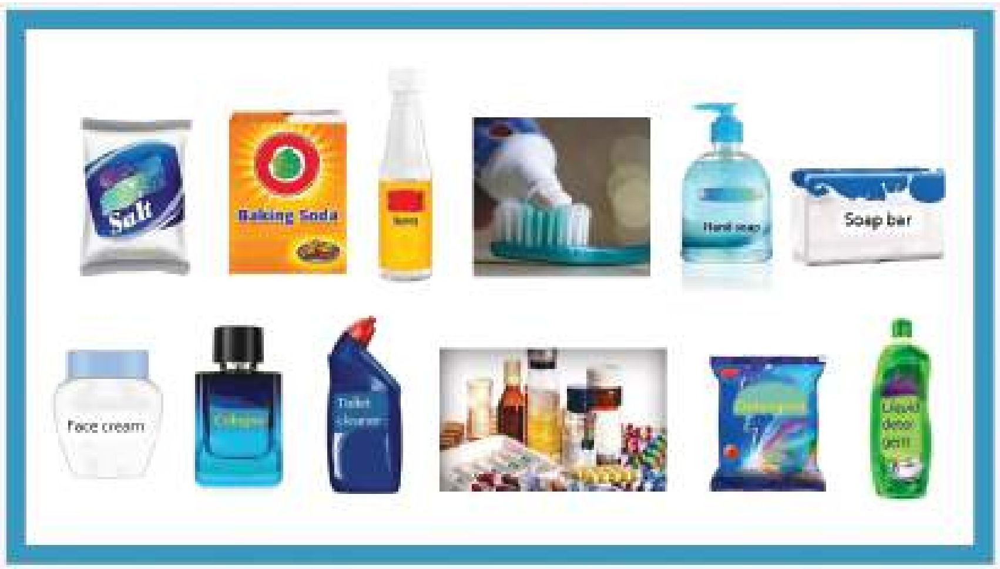
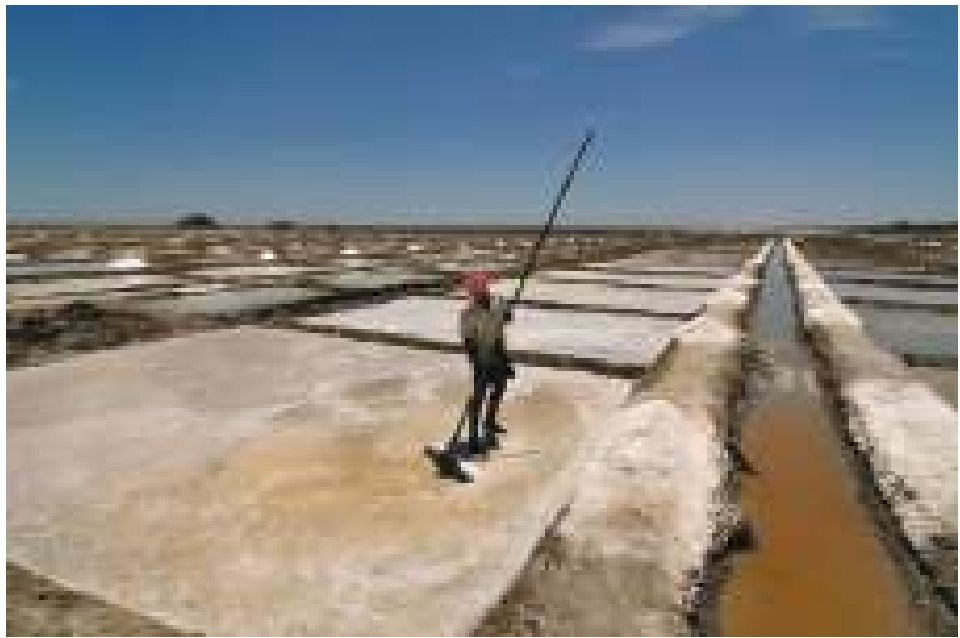
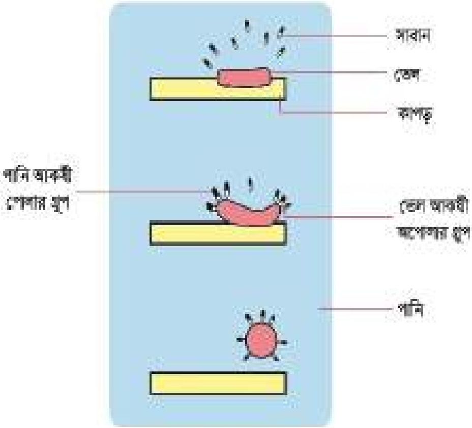
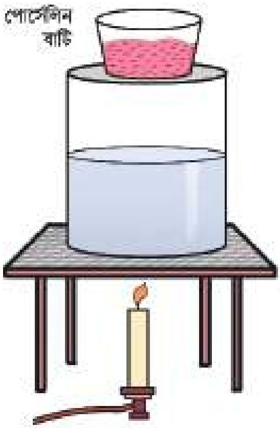
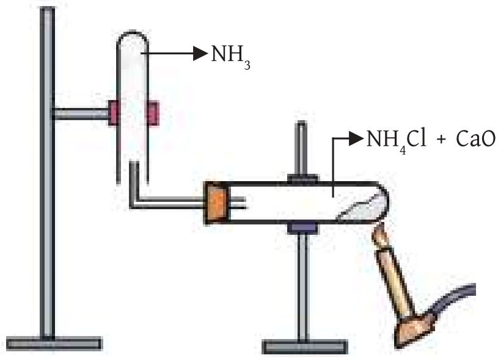

# 12. আমাদের জীবনে রসায়ন

Source: Chemistry Bangla Version, printed pp. 287-305

## 12.0 ভূমিকা ও শিখনফল

<!-- chemistry-9-10-bn-c12-t12.0-p001 · figure · p.287 -->

<!-- chemistry-9-10-bn-c12-t12.0-p002 · text · p.287 -->
**আমাদের দৈনন্দিন জীবনে ব্যবহৃত কিছু রাসায়নিক পণ্য**

<!-- chemistry-9-10-bn-c12-t12.0-p003 · text · p.287 · review: latin-junk -->
আমরা মাটির উর্বরতা বাড়ানোর জন্য জমিতে বিভিন্ন প্রকার সার দেই। এই সার মূলত রাসায়নিক পদার্থ দ্বারা তৈরি। তোমরা কি জানো? পAUবুটি ফোলানোর জন্য আমরা ময়দার মধ্যে বেকিং সোডা ব্যবহার করি। কোনো খাদ্য দীর্ঘদিন বাড়িতে রেখে দেওয়ার জন্য ভিনেগার বা অন্যান্য ফুড প্রিজারভেটিভ ব্যবহার করি। এসব কিছুই রাসায়নিক পদার্থ। আবার, শিল্পকারখানার যে সকল বর্জ্য পরিবেশকে দূষিত করে সেগুলোও রাসায়নিক পদার্থ। আমাদের জীবনের প্রতিটি ক্ষেত্রে রাসায়নিক পদার্থের ভূমিকা রয়েছে। এ সকল রাসায়নিক পদার্থ কীভাবে প্রস্তুত করা হয়, এগুলোর ধর্ম, ব্যবহার ইত্যাদি এই অধ্যায়ের আলোচ্য বিষয়।

### এ অধ্যায় পাঠ শেষে আমরা

<!-- chemistry-9-10-bn-c12-t12.0-p004 · text · p.288 -->
* গৃহে ব্যবহার্য কতিপয় খাদ্যসামগ্রীর আহরণ, ধর্ম ও ব্যবহারের গুরুত্ব বিশ্লেষণ করতে পারব।
* গৃহে প্রসাধন সামগ্রীর উপযোগিতা নির্ধারণে pH এর গুরুত্ব বর্ণনা করতে পারব।
* গৃহে ব্যবহার্য পরিষ্কারক সামগ্রীর প্রস্তুতি ও পরিষ্কার করার কৌশল ব্যাখ্যা করতে পারব।
* কৃষিক্ষেত্রে উপযুক্ত যৌগ ব্যবহার করে মাটির pH মান নিয়ন্ত্রণ করে পারব।
* কৃষিদ্রব্য প্রকিয়াকরণের উপায় ব্যাখ্যা করতে পারব।
* কৃষিদ্রব্য সংরক্ষণের উপায় ব্যাখ্যা করতে পারব।
* রাসায়নিক বর্জ্য সম্বর্কে জেনে এর স্কতিকারক প্রভাব ব্যাখ্যা করতে পারব।
* রাসায়নিক দ্রব্য ব্যবহার করে সাবান প্রস্তুত করতে পারব।
* ব্লিচিং পাউডারের বিরুদ্ধন ক্রিয়া প্রদর্শন করতে পারব।
* মাটি, পানি ও বায়ু দূষণ রোধে রাসায়নিক দ্রব্যের যথাযথ ব্যবহারের বিষয়ে আস্থার সাথে স্বতঃস্ফূর্তভাবে মতামত দিতে পারব।
* স্বাস্থ্য সচেতন দ্রব্য ব্যবহারে আগ্রহ প্রদর্শন করতে পারব।
* স্বাস্থ্যসম্মত খাদ্যদ্রব্য ব্যবহারে আগ্রহ প্রদর্শন করতে পারব।
* খাদ্যদ্রব্যে বেকিং পাউডারের ভূমিকা পরীক্ষার মাধ্যমে দেখাতে পারব।

## 12.1 গৃহস্থালির রসায়ন (Domestic Chemistry)

<!-- chemistry-9-10-bn-c12-t12.1-p001 · text · p.289 -->
আমরা আমাদের বাসায় নানা ধরনের রাসায়নিক পদার্থ ব্যবহার করি। যেমন- খাদ্য লবণ, বেকিং পাউডার, ভিনেগার, কোমল পানীয় ইত্যাদি রাসায়নিক পদার্থ।

### খাদ্যলবণ

<!-- chemistry-9-10-bn-c12-t12.1-p002 · text · p.289 -->
সাগরের পানিতে অনেক বেশি পরিমাণে খাদ্য লবণ বা সোডিয়াম ক্লোরাইড (NaCl) এবং তার সাথে খুবই সামান্য পরিমাণে CaCl2, MgCl2 সহ অন্য কিছু লবণ দ্রবীভূত থাকে। আবার, মাটির তলদেশে খনিজ পদার্থ হিসেবেও সোডিয়াম ক্লোরাইড পাওয়া যায়। আমাদের দেশে সমুদ্রের পানি থেকে খাদ্য লবণ সংগ্রহ করা হয়। সমুদ্র উপকূলের লবণ চাষিরা বিভিন্ন আকৃতির বর্গাকার বা আয়তাকার জমির চারপাশে বাঁধ নির্মাণ করে খানিকটা খুলে রাখে। জোয়ারের সময় যখন পানি ঐ জায়গায় প্রবেশ করে তখন পানি প্রবেশের মুখ বন্ধ করে জোয়ারের পানি আটকে দেওয়া হয়। যখন ঐ পানি সূর্যের তাপে শুকিয়ে যায় তখন ঐ জায়গায় লবণ দেখতে পাওয়া যায়। এটাকে সল্ট হারভেস্টিং বলে। সল্ট হারভেস্টিং এর মাধ্যমে পাওয়া এই লবণকে শিল্পকারখানায় বিভিন্ন প্রক্রিয়া সম্বাদন করে খাবার উপযোগী খাদ্যলবণে পরিণত করা হয়।

<!-- chemistry-9-10-bn-c12-t12.1-p003 · figure · p.289 -->

<!-- chemistry-9-10-bn-c12-t12.1-p004 · figure · p.289 -->
**চিত্র ১২.০১: সমুদ্র উপকূলে লবণ চাষ**

<!-- chemistry-9-10-bn-c12-t12.1-p005 · text · p.289 -->
সল্ট হারভেস্টিং এর মাধ্যমে পাওয়া লবণের সাথে বালু মিশ্রিত থাকে। এই লবণকে কোনো পাত্রে নিয়ে পানি মিশালে লবণ পানিতে দ্রবীভূত হয়ে যায় কিন্তু বালু পাত্রের তলায় পড়ে থাকে। তখন লবণ পানির দ্রবণকে ছেঁকে আলাদা করে নেওয়া হয়। এবার এই দ্রবণকে তাপ প্রয়োগ করলে পানি বাষ্পীভূত হয়ে উড়ে যায় এবং লবণ পাত্রের তলায় পড়ে থাকে। এভাবে উৎপন্ন লবণকে প্যাকেটে করে বিক্রির জন্য পাঠানো হয়। আমাদের শরীরের যাবতীয় কাজ সুষ্ঠুভাবে পরিচালিত হবার জন্য বিভিন্ন আয়ন যেমন: Na+, K+ ইত্যাদি দরকার হয়। শরীরে যদি কোনো কারণে Na+ এর ঘাটতি হয় তবে NaCl পানির সাথে মিশিয়ে খেলে সেই ঘাটতি পূরণ হয়।

<!-- chemistry-9-10-bn-c12-t12.1-p006 · text · p.289 -->
**NaCl এর ব্যবহার:** NaCl অনেক কাজে ব্যবহার করা হয়। যেমন-

<!-- chemistry-9-10-bn-c12-t12.1-p007 · text · p.289 -->
(i) ভাত-এর সাথে আমরা তরকারি খাই। তরকারিতে NaCl লবণ না দিলে তরকারি সুস্বাদু হয় না।

<!-- chemistry-9-10-bn-c12-t12.1-p008 · text · p.290 -->
(ii) শিল্পকারখানায় NaOH যোগ প্রস্তুত করার জন্য NaCl ব্যবহৃত হয়।

<!-- chemistry-9-10-bn-c12-t12.1-p009 · text · p.290 -->
(iii) ডায়রিয়া বা পানিশূন্যতা পুরণের জন্য ওষুধ শিল্পে স্যালাইন তৈরিতে NaCl প্রয়োজন হয়।

### বেকিং পাউডার

<!-- chemistry-9-10-bn-c12-t12.1-p010 · text · p.290 -->
বেকিং সোডা বা খাবার সোডার রাসায়নিক নাম সোডিয়াম হাইড্রোজেন কার্বনেট (NaHCO3)। খাবার সোডাকে সোডিয়াম বাই-কার্বনেটও বলা হয়ে থাকে। বেকিং সোডা (NaHCO3) তৈরি করে তার মধ্যে টার্টারিক এসিড (C4H6O6) মিশালে বেকিং পাউডার তৈরি হয়। সাধারণত কেক বানানোর কাজে বেকিং পাউডার ব্যবহার করা হয়।

### বেকিং সোডা প্রস্তুতি

<!-- chemistry-9-10-bn-c12-t12.1-p011 · text · p.290 -->
অ্যামোনিয়া গ্যাস, খাদ্যলবণ, পানি এবং কার্বন ডাই-অক্সাইড থেকে বেকিং সোডা প্রস্তুত করা যায়। প্রথমে পানির মধ্যে NaCl কে দ্রবীভূত করে NaCl এর সম্পূর্ণ দ্রবণ প্রস্তুত করা হয়। এবার এই সম্পূর্ণ দ্রবণের মধ্যে NH3 গ্যাস প্রবাহিত করে NH3 দ্বারা সম্পূর্ণ করা হয়। কার্বন ডাই-অক্সাইড গ্যাসকে NH3 সম্পূর্ণ NaCl দ্রবণের মধ্যে প্রবাহিত করা হয়। এভাবে CO2, NH3, H2O একত্র হয়ে প্রথমে অ্যামোনিয়াম হাইড্রোজেন কার্বনেট (NH4HCO3) উৎপন্ন হয়। এরপর অ্যামোনিয়াম হাইড্রোজেন কার্বনেট সোডিয়াম ক্লোরাইড-এর সাথে বিক্রিয়া করে সোডিয়াম হাইড্রোজেন কার্বনেট (NaHCO3) বা বেকিং সোডা উৎপন্ন করে।

<!-- chemistry-9-10-bn-c12-t12.1-p012 · formula · p.290 · review: verify-formula -->
$$CO_2 + NH_3 + H_2O \longrightarrow NH_4HCO_3$$

<!-- chemistry-9-10-bn-c12-t12.1-p013 · formula · p.290 · review: verify-formula -->
$$NH_4HCO_3 + NaCl \longrightarrow NaHCO_3 + NH_4Cl$$

<!-- chemistry-9-10-bn-c12-t12.1-p014 · text · p.290 -->
বেকিং সোডাকে বিক্রিয়া পাত্র থেকে পৃথক করে তার সাথে টার্টারিক এসিড মেশানো হয়। এ মিশ্রণকে বেকিং পাউডার বলে।

<!-- chemistry-9-10-bn-c12-t12.1-p015 · text · p.290 -->
**বেকিং সোডার ব্যবহার:** কেক প্রস্তুতির সময় ময়দার মধ্যে বেকিং পাউডার মিশিয়ে তাপ প্রদান করা হয়। বেকিং সোডা মিশ্রণের টার্টারিক এসিডের (C4H6O6) সাথে বিক্রিয়া করে সোডিয়াম টার্টারেট (C4H4 Na2O6), CO2 গ্যাস এবং H2O উৎপন্ন করে। এই CO2 গ্যাস এর জন্য কেক ফুলে উঠে।

<!-- chemistry-9-10-bn-c12-t12.1-p016 · formula · p.290 · review: verify-formula -->
$$2NaHCO_3 + C_4H_6O_6 \longrightarrow C_4H_4Na_2O_6 + 2CO_2 + 2H_2O$$

<!-- chemistry-9-10-bn-c12-t12.1-p017 · text · p.290 -->
বাদিতে কিংবা বেকারিতে পাউরুটি ফোলানোর জন্য ইস্ট নামক ছত্রাকও ব্যবহার করা হয়। এজন্য প্রথমে চিনির দ্রবণে ইস্ট মেশানো হয়। এই মিশ্রণ দিয়ে ময়দা মাখিয়ে দলা করে উষণ জায়গায় রেখে দিলে ইস্টের সবাৎ শ্বসনের কারণে কার্বন ডাই-অক্সাইডের উৎপন্ন হয় যা পাউরুটিকে ফুলতে সাহায্য করে। পাউরুটি ফুলে ওঠার পর ওভেনে বেকিং করা হলে উত্তাপে ইস্ট মারা যায়, তখন পাউরুটির ফোলা বন্ধ হয়।

### একক কাজ

<!-- chemistry-9-10-bn-c12-t12.1-p018 · activity · p.291 · review: known-confusable-corrected -->
পৃথকভাবে বেকিং পাউডার এবং ইস্টের সাথে ময়দা মেখে রেখে দাও। কিছু সময় পরে এই ময়দা দিয়ে আলাদা আলাদাভাবে কেক বানাও। দুটি কেকের মাঝে তুলনা করো। কেক দুটিতে কোনো পার্থক্য দেখা যায়? এর কারণ ব্যাখ্যা করো।

### সিরকা বা ভিনেগার

<!-- chemistry-9-10-bn-c12-t12.1-p019 · text · p.291 -->
ইথানয়িক এসিড বা অ্যাসিটিক এসিডের 4%—10% জলীয় দ্রবণকে ভিনেগার বলা হয়। ভিনেগার তরল পদার্থ। সাধারণত আচার তৈরি করার সময় ভিনেগার যোগ করা হয়।

### ভিনেগারের প্রস্তুতি

<!-- chemistry-9-10-bn-c12-t12.1-p020 · text · p.291 -->
25°C-35°C তাপমাত্রায় রাখা একটি স্টিলের পাত্রে ইথানল (CH3CH2OH) এবং অ্যাসিটোব্যাক্টার নিয়ে এর মধ্যে অক্সিজেন গ্যাসের বুববুদ প্রবাহিত করলে ভিনেগার বা অ্যাসিটিক এসিড বা ইথানয়িক এসিড (CH3COOH) প্রস্তুত হয়। অ্যাসিটোব্যাক্টার (Acetobacter) ব্যাকটেরিয়া এমন এক ধরনের এনজাইম নিঃসৃত করে যা ইথানলকে অক্সিজেনের সাথে বিক্রিয়া করতে সাহায্য করে।

<!-- chemistry-9-10-bn-c12-t12.1-p021 · formula · p.291 · review: latin-junk,verify-formula -->
$$CH_3CH_2OH + O_2 \xrightarrow{অ্যাসিটোব্যাক্টার} CH_3COOH + H_2O$$

### খাদ্য সংরক্ষণে ভিনেগারের ভূমিকা

<!-- chemistry-9-10-bn-c12-t12.1-p022 · text · p.291 -->
আচারকে যদি ব্যাকটেরিয়া আক্রমণ করে তবে আচার পচে যায় বা নষ্ট হয়ে যায়। আচার-এর মধ্যে ভিনেগার দিলে আচারকে ব্যাকটেরিয়া আক্রমণ করতে পারে না। ভিনেগারের মূল উপাদান ইথানয়িক এসিড। ভিনেগারকে যখন আচারের মধ্যে দেওয়া হয় তখন ইথানয়িক এসিড কঠুক ত্যাগকৃত প্রোটন, H+ ব্যাকটেরিয়াকে ধ্বংস করে এবং খাদ্য দীর্ঘকাল ব্যাকটেরিয়ার আক্রমণ থেকে রক্ষা পায়। এভাবে ভিনেগার দিয়ে খাদ্য সংরক্ষণ করা হয়।

### কোমল পানীয় (Soft drinks or Carbonated soda)

<!-- chemistry-9-10-bn-c12-t12.1-p023 · text · p.291 -->
ঠান্ডা অবস্থায় ও উচ্চ চাপে পানিতে কার্বন ডাই-অক্সাইড গ্যাস দ্রবীভূত করে কোমল পানীয় তৈরি করা হয়। কোমল পানীয়তে কার্বন ডাই-অক্সাইড এবং পানি বিক্রিয়া করে কার্বনিক এসিড (H2CO3) উৎপন্ন করে। খাদ্য হজম বা পরিপাক হবার জন্য মানুষ কোমল পানীয় পান করে থাকে, যদিও এর কোনো বৈজ্ঞানিক ভিত্তি (scientific evidence) নেই।

## 12.2 পরিষ্কার-পরিচ্ছন্নতায় রসায়ন (Chemistry for Cleanliness)

<!-- chemistry-9-10-bn-c12-t12.2-p001 · text · p.292 -->
সুস্থ দেহের সুস্থ মনকেই স্বাস্থ্য বলা হয়। স্বাস্থ্য ভালো রাখার জন্য আমরা আমাদের শরীরকে পরিষ্কার-পরিচ্ছন্ন রাখি। আমাদের শরীর পরিষ্কার-পরিচ্ছন্ন থাকলে মনও ভালো থাকে। গোসলের সময় আমরা প্রসাধনী সাবান ব্যবহার করি। আমাদের পোশাক বা কাপড়-চোপড় পরিষ্কার রাখার জন্য আমরা কাপড় কাচা সোডা, ব্লিচিং পাউডার ইত্যাদি ব্যবহার করি। ঘরের জানালার কাচ বা অন্যান্য কাচদ্ব্য পরিষ্কার করার জন্য আমরা গ্লাস ক্লিনার ব্যবহার করি। টয়লেট পরিষ্কার-পরিচ্ছন্ন রাখার জন্য টয়লেট ক্লিনার ব্যবহার করি। এসব পরিষ্কার সামগ্রীর প্রস্তুতি এবং পরিষ্কারকরণের ক্রিয়াকৌশল নিমে আলোচনা করা হলো:

### কাপড় কাচা সোডা

<!-- chemistry-9-10-bn-c12-t12.2-p002 · text · p.292 -->
সোডিয়াম কার্বনেট (Na2CO3) কে সোডা অ্যাস (Soda ash) বলা হয়। সোডা অ্যাসের ১ অণুর সাথে ১০ অণু পানি রাসায়নিকভাবে যুক্ত হলে তাকে কাপড় কাচা সোডা বা ওয়াশিং সোডা বলে। কাপড় কাচা সোডার রাসায়নিক নাম সোডিয়াম কার্বনেট ডেকা হাইড্রেট (Na2CO3.10H2O)।

### কাপড় কাচা সোডা প্রস্তুতি

<!-- chemistry-9-10-bn-c12-t12.2-p003 · text · p.292 -->
গাঢ় NaOH এর দ্রবণের মধ্যে CO2 কে অধিক পরিমাণে চালনা করলে সোডিয়াম কার্বনেট উৎপন্ন হয় যা পানিতে দ্রবীভূত অবস্থায় থাকে।

<!-- chemistry-9-10-bn-c12-t12.2-p004 · formula · p.292 · review: verify-formula -->
$$2NaOH + CO_2 \longrightarrow Na_2CO_3 + H_2O$$

<!-- chemistry-9-10-bn-c12-t12.2-p005 · text · p.292 -->
বিক্রিয়া পাত্রের মধ্যে Na2CO3 এবং পানি থাকে। সোডিয়াম কার্বনেট ১০ অণু পানির সাথে যুক্ত হয়ে কাপড় কাচা সোডা (Na2CO3.10H2O) উৎপন্ন হয়।

<!-- chemistry-9-10-bn-c12-t12.2-p006 · formula · p.292 · review: verify-formula -->
$$Na_2CO_3 + 10H_2O \longrightarrow Na_2CO_3.10H_2O$$

### কাপড় কাচা সোডার ব্যবহার

<!-- chemistry-9-10-bn-c12-t12.2-p007 · text · p.292 -->
কাপড় পরিষ্কার করতে কাপড় কাচা সোডা ব্যবহার করা হয়।

### টয়লেট ক্লিনার

<!-- chemistry-9-10-bn-c12-t12.2-p008 · text · p.292 -->
টয়লেট ক্লিনারের মূল উপাদান হাইড্রোক্লোরিক এসিড (HCl)। হাইড্রোক্লোরিক এসিড এর সাথে সোডিয়াম হাইপোক্লোরাইট (NaOCl) মিশ্রিত থাকে। বেসিন, কমোড ইত্যাদি পরিষ্কার করার জন্য টয়লেট ক্লিনার ব্যবহার করা হয়। টয়লেট, বেসিন, কমোড ইত্যাদিতে চর্বি জাতীয় পদার্থ, প্রোটিন জাতীয় পদার্থ, বিভিন্ন রং (Pigments) এর জৈব পদার্থ, অজৈব পদার্থ, রোগজীবীরা ইত্যাদি থাকে। যখন টয়লেট, বেসিন, কমোড ইত্যাদিতে টয়লেট ক্লিনার যোগ করা হয়, তখন সোডিয়াম হাইপোক্লোরাইট বিভিন্ন পিগমেন্ট এবং রোগজীবীবাণুর সাথে বিক্রিয়া করে এদের কার্যকারিতা নষ্ট করে দেয়।

### টয়লেট ক্লিনার দ্বারা টয়লেট পরিষ্কারের কৌশল

<!-- chemistry-9-10-bn-c12-t12.2-p009 · text · p.293 -->
টয়লেট ক্লিনারকে যখন টয়লেটের উপর ঢালা হয় তখন টয়লেট ক্লিনারের বিভিন্ন উপাদান বিভিন্নরূপে বিক্রিয়া করে।

<!-- chemistry-9-10-bn-c12-t12.2-p010 · text · p.293 -->
টয়লেট ক্লিনারের সোডিয়াম হাইপোক্লোরাইট (NaOCl) পানির সাথে বিক্রিয়া করে হাইপোক্লোরাস এসিডে (HOCl) পরিণত হয় যা ভেঙে জায়মান অক্সিজেন উৎপন্ন করে। এই জায়মান অক্সিজেন রঙিন পদার্থকে বর্ণহীন করে এবং জীবীবাণুকে ধ্বংস করে।

<!-- chemistry-9-10-bn-c12-t12.2-p011 · formula · p.293 · review: latin-junk,verify-formula -->
$$\begin{aligned}
NaOCl + H_2O & \xrightarrow{ } NaOH + HOCl \\
HOCl & \xrightarrow{ } HCl + [O] \\
রঙিন পদার্থ + [O] & \xrightarrow{ } বর্ণহীন পদার্থ \\
জীবীবাণু + [O] & \xrightarrow{ } মৃত জীবীবাণু
\end{aligned}$$

<!-- chemistry-9-10-bn-c12-t12.2-p012 · text · p.293 · review: latin-junk -->
এভাবে টয়লেট ক্লিনার রঙিন পদার্থকে বর্ণহীন করে এবং জীবীবাণুকে ধ্বংস করে। (তৃতীয় বন্ধনীর মধ্যে অক্সিজেন পরমাণু দিয়ে জায়মান অক্সিজেনকে বোঝানো হয়। জায়মান অক্সিজেন = [O], জায়মান অক্সিজেন বা nascent oxygen বলতে সত্য তৈরি হওয়া অস্থায়ী রিয়েকটিভ অক্সিজেন পরমাণুকে বোঝায় যা এখেনো O2 অণু তৈরি করেনি।

### সাবান

<!-- chemistry-9-10-bn-c12-t12.2-p013 · text · p.293 -->
সাধারণত সাবান হলো উচ্চতর ফ্যাটি এসিডের সোডিয়াম লবণ (R-COONa) বা উচ্চতর ফ্যাটি এসিডের পটাশিয়াম লবণ (R-COOK)। এখানে R কে অ্যালকাইল মূলক বলা হয়। R এর সাধারণ সংকেত CnH2n+1 এবং n এর মান 12 থেকে 18 পর্যন্ত। যেমন: সোডিয়াম স্টিয়ারেট সাবানের সংকেত C17H35COONa এবং পটাশিয়াম স্টিয়ারেট সাবানের সংকেত C17H35COOK। তেল বা চর্বি সাথে সোডিয়াম হাইড্রোক্লোআইড বা পটাশিয়াম হাইড্রোক্লোআইড বিক্রিয়া করে সাবান এবং গ্লিসারিন তৈরি হয়। সাবান ও গ্লিসারিন তৈরির এই প্রক্রিয়াকে সাবানায়ন (Saponification) বলে। সাবানায়ন প্রক্রিয়ায় প্রাপ্ত সাবান এবং গ্লিসারিনের মিশ্রণের মধ্যে NaCl যোগ করলে গ্লিসারিন পাত্রের নিচে অবস্থান করে এবং সাবানের অণুগুলো NaCl কে ঘিরে একত্র হয়ে পাত্রের উপরের দিকে কেকের আকারে ভেসে উঠে। একে সোপ কেক বলে। সোপ কেককে ছাঁকনির সাহায্যে ছেকে পৃথক করে বিভিন্ন আকৃতির ছাঁচে ঢেলে বিভিন্ন আকৃতির সাবান তৈরি করা হয়।

<!-- chemistry-9-10-bn-c12-t12.2-p014 · text · p.293 -->
সাবান একটি পরিষ্কারক দ্রব্য যা তেল বা চর্বি এবং স্কার থেকে প্রস্তুত করা হয়। ব্যবহারের উপর ভিত্তি করে সাবানকে মূলত দুই ভাগে ভাগ করা যায়- প্রসাধনী সাবান এবং লণ্ড্রি সাবান।

<!-- chemistry-9-10-bn-c12-t12.2-p015 · text · p.294 -->
**প্রসাধনী সাবান (Cosmetic soap):** আমাদের ত্বকে পরিষ্কার করার জন্য যেসব সাবান ব্যবহার করি তাদেরকে প্রসাধনী সাবান বলে।

<!-- chemistry-9-10-bn-c12-t12.2-p016 · text · p.294 -->
**লান্ড্রি সাবান (Laundry soap):** কাপড়-চোপড় পরিষ্কার করার জন্য আমরা যেসব সাবান ব্যবহার করি তাদেরকে কাপড় কাচা সাবান বা ল্যান্ড্রি সাবান বলা হয়।

<!-- chemistry-9-10-bn-c12-t12.2-p017 · text · p.294 · review: known-confusable-corrected -->
সাবান তৈরির সময় সাবানের সাথে গ্লিসারিনও তৈরি হয়। সাবান এবং গ্লিসারিনের মিশ্রণের সাথে তেল, চর্বি বা স্কার ইত্যাদি থেকে যেতে পারে। এগুলো থেকে সাবানকে আলাদা করা হয়। এই আলাদা করার সময় যদি সাবানের মধ্যে অধিক তেল বা চর্বি থেকে যায় তখন সাবানের মধ্যে তৈলাক্ত ভাব থেকে যায়। এই সাবান ব্যবহারের সময় তেমন কোনো ফেনা উৎপন্ন করে না। যদি সাবানের মধ্যে অধিক পরিমাণে স্কার থেকে যায় তবে এই সাবান ব্যবহার করলে ত্বকের ক্ষতি হয়। এজন্য সাবান তৈরি কারখানায় সঠিক অনুপাতে তেল বা চর্বি এবং স্কার যোগ করতে হয় যাতে তেল বা চর্বি এবং স্কার সম্পূর্ণরূপে বিক্রিয়া করতে পারে। কার্বক্লিন গ্রুপ অনেক বড় কার্বন শিকলের সাথে যুক্ত থাকলে ঐ যৌগকে উচ্চতর ফ্যাকটি এসিড বলে। ফ্যাকটি এসিড অ্যালকোহল বা গ্লিসারিনের সাথে বিক্রিয়া করে এস্টার উৎপন্ন করে। উচ্চতর ফ্যাকটি এসিড ও গ্লিসারিনের ট্রাই এস্টার তরল অবস্থায় থাকলে তাকে তেল এবং কাঠিন অবস্থায় থাকলে তাকে চর্বি বলা হয়।

<!-- chemistry-9-10-bn-c12-t12.2-p018 · text · p.294 -->
স্টীয়ারিক এসিড হলো প্রাণিদেহের ফ্যাকটি থেকে প্রাপ্ত সমপূঙ্ক ফ্যাকটি এসিড। সমপূঙ্ক ফ্যাকটি এসিডে কার্বন-কার্বন একক বন্ধন থাকে। কোনো দ্বিবন্ধন বা কোনো ত্রিবন্ধন থাকে না।

<!-- chemistry-9-10-bn-c12-t12.2-p019 · text · p.294 -->
জলপাই থেকে যে তেল পাওয়া যায় তাকে অলিভ অয়েল বলে। অলিভ অয়েল থেকে অলিক এসিড পাওয়া যায়। অলিক এসিড হলো অসমপূঙ্ক ফ্যাকটি এসিড। অসমপূঙ্ক ফ্যাকটি এসিডে কার্বন-কার্বন দ্বিবন্ধন বা কার্বন-কার্বন ত্রিবন্ধন থাকে। ল্যান্ড্রি সাবানে স্কার বা অন্যান্য অপদ্রব্য তুলনামূলক বেশি থাকে এবং এতে সুগন্ধি বা জীবায়ুনাশক পদার্থ যোগ করা হয় না। প্রসাধনী সাবানে স্কার এবং অন্যান্য অপদ্রব্যের পরিমাণ তুলনামূলক কম থাকে। প্রসাধনী সাবানে সুগন্ধিকারক পদার্থ বা জীবায়ুনাশক পদার্থ যোগ করা হয়।

### ডিটারজেন্ট

<!-- chemistry-9-10-bn-c12-t12.2-p020 · text · p.294 · review: known-confusable-corrected -->
ডিটারজেন্ট সাবানের মতোই এক প্রকার পরিষ্কারক দ্রব্য। ডিটারজেন্ট সাধারণত পাউডারের মতো হয় এবং তরল আকারেও পাওয়া যায়। লরাইল অ্যালকোহলের (C12H26O) সাথে সালফিউরিক এসিড (H2SO4) বিক্রিয়া করে লরাইল হাইড্রোজেন সালফেট (C12H26SO4) এবং পানি উৎপন্ন করে। এই লরাইল হাইড্রোজেন সালফেট (C12H26SO4) এর সাথে সোডিয়াম হাইড্রোক্সাইড (NaOH) বিক্রিয়া করে সোডিয়াম লরাইল সালফেট (C12H25SO4Na) এবং পানি (H2O) উৎপন্ন হয়। সোডিয়াম লরাইল সালফেট (C12H25SO4Na) ডিটারজেন্ট নামে পরিচিত।

<!-- chemistry-9-10-bn-c12-t12.2-p021 · formula · p.295 · review: verify-formula -->
$$C_{12}H_{26}O + H_2SO_4 \longrightarrow C_{12}H_{26}SO_4 + H_2O$$

<!-- chemistry-9-10-bn-c12-t12.2-p022 · formula · p.295 · review: verify-formula -->
$$C_{12}H_{26}SO_4 + NaOH \longrightarrow C_{12}H_{25}SO_4Na + H_2O$$

<!-- chemistry-9-10-bn-c12-t12.2-p023 · text · p.295 -->
ডিটারজেন্টকে ব্যবহার উপযোগী করার জন্য ডিটারজেন্টের মধ্যে বিভিন্ন পদার্থ যোগ করা হয়। ডিটারজেন্টকে পৌড়ার আকৃতির করার জন্য সোডিয়াম সালফেট (Na2SO4) যোগ করা হয়।

### সাবান ও ডিটারজেন্ট দ্বারা ময়লা পরিষ্কার করার কৌশল

<!-- chemistry-9-10-bn-c12-t12.2-p024 · text · p.295 -->
সাবান ও ডিটারজেন্ট এর মূল কাজ হলো কাপড়-চোপড় থেকে তেলকে অপসারণ করা এবং পানি দিয়ে ধুয়ে ধুলাবালিকে অপসারণ করা। আমাদের শরীর থেকে তৈলাক্ত পদার্থ বের হয়ে কাপড়ে লেগে যায়। এছাড়া বাতাস থেকে কিছু তৈলাক্ত পদার্থ কাপড়ে লেগে যায়। এরপর ধুলাবালি এই তৈলাক্ত পদার্থের উপর লেগে ময়লা তৈরি করে।

<!-- chemistry-9-10-bn-c12-t12.2-p025 · figure · p.295 -->

<!-- chemistry-9-10-bn-c12-t12.2-p026 · text · p.295 -->
সাবান (R-COONa) ও ডিটারজেন্ট (C12H25SO4Na) একটি দীর্ঘ কার্বন শিকলবিশিষ্ট অণু। পানিতে দ্রবীভূত অবস্থায় এরা ঋণাত্মক চার্জ বিশিষ্ট সাবান (R-COO-) বা ডিটারজেন্ট আয়ন (C12H25SO4-) এবং ধনাত্মক সোডিয়াম আয়নে (Na+) ভাগ হয়ে যায়। সাবান বা ডিটারজেন্ট আয়নের এক প্রান্তে ঋণাত্মক চার্জ যুক্ত থাকে। এই প্রান্ত পানিকে আকর্ষণ করে বলে হাইড্রোফিলিক বা পানি আকর্ষী বলে। সাবান বা ডিটারজেন্ট আয়নের অন্য প্রান্ত তেল বা গ্রিজে দ্রবীভূত হয়, এই প্রান্তকে হাইড্রোফোবিক বা পানি বিকর্ষী বলে।

<!-- chemistry-9-10-bn-c12-t12.2-p027 · figure · p.295 -->
**চিত্র ১২.০২: সাবান কিংবা ডিটারজেন্ট দিয়ে ময়লা পরিষ্কার করার কৌশল**

<!-- chemistry-9-10-bn-c12-t12.2-p028 · text · p.295 -->
সাবান কিংবা ডিটারজেন্টকে যখন পানির উপস্থিতিতে তেল বা গ্রিজজাতীয় ময়লাযুক্ত কাপড়ের সংস্পর্শে আনা হয় তখন তার হাইড্রোফোবিক প্রান্ত তেল বা গ্রিজে দিকে আকর্ষিত হয় এবং এতে দ্রবীভূত হয়। অন্যদিকে হাইড্রোফিলিক অংশ পানির দিকে আকর্ষিত হয়ে পানির স্তরে প্রসারিত হয়। এ অবস্থায় কাপড়কে ঘষা দিলে বা মোচড়ানো হলে তেল বা গ্রিজে ময়লার কণা চারদিক থেকে সাবান বা ডিটারজেন্টের ঋণাত্মক চার্জবিশিষ্ট আয়ন দিয়ে আবৃত হয়ে পড়ে এবং তেল বা গ্রিজে ময়লার কণার চারপাশে ঝণাত্বরক চার্জের একটা বলয় সৃষ্টি হয়। তখন এগুলো একটি আরেকটি থেকে সম্ভাব্য সর্বোচ্চ দূরত্বে থাকতে চায় এবং তেল, সাবান এবং পানির সাথে একত্র হয়ে একটি মিশ্রণ তৈরি করে। এই মিশ্রণ ফেনা নামে পরিচিত। ফেনাতে আরও পানি যোগ করলে ফেনা অপসারিত হবার সাথে তেল ও ধুলাবালি কাপড় থেকে অপসারিত হয়। এভাবেই সাবান ময়লা পরিষ্কার করে।

### সাবান ও ডিটারজেন্টের পার্থক্য

<!-- chemistry-9-10-bn-c12-t12.2-p029 · table · p.296 · review: verify-table -->
<table><tr><th>সাবান</th><th>ডিটারজেন্ট</th></tr>
<tr><td>1. সাবান হলো দীর্ঘ কার্বন শিকলবিশিষ্ট ফ্যাটি এসিডের সোডিয়াম বা পটাশিয়াম লবণ।</td><td>1. ডিটারজেন্ট হলো দীর্ঘ কার্বন শিকলবিশিষ্ট বেনজিন সালফোনিক এসিডের সোডিয়াম লবণ।</td></tr>
<tr><td>2. সাবান খর পানিতে ভালো কাজ করতে পারে না।</td><td>2. ডিটারজেন্ট খর পানিতেও ভালো কাজ করতে পারে।</td></tr>
<tr><td>3. ডিটারজেন্ট এর চেয়ে পরিষ্কারকরণের ক্ষমতা সাবানের কম।</td><td>3. সাবানের চেয়ে পরিষ্কারকরণের ক্ষমতা ডিটারজেন্টের বেশি।</td></tr></table>

### অতিরিক্ত সাবান ও ডিটারজেন্ট ব্যবহারের কুফল

<!-- chemistry-9-10-bn-c12-t12.2-p030 · text · p.296 · review: known-confusable-corrected -->
সাবানের মধ্যে কিছু পরিমাণ ক্ষার, গ্লিসারিন, তেল, চর্বি ইত্যাদি থেকে যায়। অতিরিক্ত সাবান ব্যবহার করলে ক্ষার হাতের স্ক্রতি করে। আবার পুকুর বা জলাশয়ের ধারে বা নদীর তীরে কাপড় কাচা হলে সাবানের ফেনা পানিতে দ্রবীভূত অক্সিজেনের সাথে বিক্রিয়া করে পানিতে দ্রবীভূত অক্সিজেনের পরিমাণ কমিয়ে দেয়। পানিতে দ্রবীভূত অক্সিজেনের পরিমাণ কমে গেলে পানির মধ্যে যে সকল জলজ উদ্ভিদ এবং মাছ রয়েছে সেগুলো মারা যায়। এভাবেই অতিরিক্ত সাবান ব্যবহারে পানি দূষিত হয়। আবার ডিটারজেন্টের মধ্যে ট্রাইসোডিয়াম ফসফেট (Na3PO4) থাকে। এই ট্রাইসোডিয়াম ফসফেট উদ্ভিদের বেঁচে থাকার জন্য ভালো সার হিসেবে কাজ করে। এতে পুকুরে উদ্ভিদের পরিমাণ বেড়ে যায়। উদ্ভিদ তার বেঁচে থাকার জন্য পানির মধ্যে দ্রবীভূত অক্সিজেন খরচ করে ফেলে, ফলে পানিতে অক্সিজেনের অভাবে মাছ মরে যায়। এভাবেই অতিরিক্ত ডিটারজেন্ট ব্যবহারে পানি দূষিত হয়।

### প্রসাধনী ব্যবহারে

<!-- chemistry-9-10-bn-c12-t12.2-p031 · text · p.296 -->
মানুষ ত্বক পরিষ্কার করতে, ত্বকের সৌন্দর্য রক্ষায়, চুল পরিষ্কার করতে এবং বিভিন্ন কাজে প্রসাধনী (সাবান, ক্রিম, শ্যাম্পু) ব্যবহার করে। তোমরা আগেই জেনেছ ত্বকের pH 4.8 থেকে 5.5 এর মধ্যে। অর্থাৎ ত্বক অম্লীয় প্রকৃতির যা ত্বকে জীবাণুর আক্রমণ বা বংশবৃদ্ধি প্রতিরোধ করে। কাজেই প্রসাধনীর pH 4.8 থেকে 5.5 এর বেশি থাকলে সেই প্রসাধনী ব্যবহারের কারণে ত্বকের স্বাভাবিক অম্লত্ব কমে যাবে, যার কারণে ত্বকের সৌন্দর্য নষ্ট হবে এবং জীবাণুর সংক্রমণ হওয়ার আশঙ্কা বেড়ে যাবে। তাই প্রসাধনীর pH এবং ত্বকের pH এর সামঞ্জস্য থাকতে হয়।

### সাবান প্রস্তুতি

<!-- chemistry-9-10-bn-c12-t12.2-p032 · text · p.297 -->
**অনুমিত প্রকল্প:** স্কারের সাথে তেল বা চর্বি বিক্রিয়ায় সাবান উৎপন্ন হয়। উৎপন্ন সাবানের pH মান 7 এর বেশি হবে।

<!-- chemistry-9-10-bn-c12-t12.2-p033 · text · p.297 -->
**উপকরণ:** নারকেল তেল, কস্টিক সোডা, NaCl এর সম্বন্ধু দ্রবণ, বাজারের সাবান, কেরোসিন তেল।

<!-- chemistry-9-10-bn-c12-t12.2-p034 · text · p.297 -->
**যন্ত্রপাতি:** একটি বুনসেন বার্নার/স্পিরিট ল্যাম্প/কেরোসিন কুকার, দুইটি বিকার 400 mL, দুইটি টেস্টটিউব, একটি বড় পোসেলিন বাটি, একটি নাড়ানি কাঠি, একটি স্পেচুলা, একটি মাপ চোঙ (10 mL), একটি ফানেল, একটি ফিল্টার পেপার।

<!-- chemistry-9-10-bn-c12-t12.2-p035 · figure · p.297 -->

<!-- chemistry-9-10-bn-c12-t12.2-p036 · figure · p.297 -->
**চিত্র ১২.০৩: সাবান প্রস্তুতি**

### নিরাপত্তামূলক সতর্কতা

<!-- chemistry-9-10-bn-c12-t12.2-p037 · text · p.297 -->
সোডিয়াম হাইড্রোক্সাইড গরম অবস্থায় অত্যন্ত তীব্র ক্ষয়কারক পদার্থ। কাজেই এটি যেন পড়ে গিয়ে কোনো দুঘটনা না ঘটে সে ব্যাপারে সতর্ক থাকতে হবে। উৎপন্ন সাবান হাতে বা গায়ে ব্যবহার না করা।

### কার্যপদ্ধতি

<!-- chemistry-9-10-bn-c12-t12.2-p038 · text · p.297 -->
(a) একটি বিকারে পানি পূর্ণ করে এর উপরে চিত্রের ন্যায় পোসেলিন বাটি বসিয়ে স্টিম বাথ প্রস্তুত করো।

<!-- chemistry-9-10-bn-c12-t12.2-p039 · text · p.297 -->
(b) পোসেলিন বাটিতে 5 mL নারকেল তেল বা 5 গ্রাম চর্বি এবং 30 mL সোডিয়াম হাইড্রোক্সাইড দ্রবণ নাও।

<!-- chemistry-9-10-bn-c12-t12.2-p040 · text · p.298 -->
(c) মিশ্রণটিকে স্টিম বাথে 30 মিনিট ধরে ফুটাও। এ সময় নাড়ানি কার্ঠি দিয়ে একটু পর পর নাড়তে থাকো এবং পানি যোগ করে স্টিম বাথের বাষ্পীভূত পানির ঘাটতি পূরণ করো। এ সময় তেল বা চর্বি সম্পূর্ণ দ্রবীভূত হয়ে এক ধরনের আঠালো পদার্থ সৃষ্টি হবে।

<!-- chemistry-9-10-bn-c12-t12.2-p041 · text · p.298 -->
(d) তখন তাপ দেওয়া বন্ধ করো এবং মিশ্রণটিকে ঠান্ডা হতে দাও।

<!-- chemistry-9-10-bn-c12-t12.2-p042 · text · p.298 -->
(e) ঠান্ডা মিশ্রণে 50 mL NaCl এর সম্পূর্ণ দ্রবণ যোগ করে সারা রাত রেখে দাও।

<!-- chemistry-9-10-bn-c12-t12.2-p043 · text · p.298 -->
(f) পরের দিন একটি ফিল্টার পেপারের সাহায্যে মিশ্রণটিকে ছেঁকে পরিস্রুতটুকু ফেলে দাও এবং সাবানকে শুকোতে দাও।

### উৎপন্ন সাবানের পরীক্ষা

<!-- chemistry-9-10-bn-c12-t12.2-p044 · text · p.298 -->
1. একটি টেস্টটিউবের তিন ভাগের এক ভাগ পানি ও তোমার তৈরি সাবানের নমুনা নাও। টেস্টটিউবের মুখ বন্ধ করো ঝাঁকিও। লক্ষ্য করো ফেনা উৎপন্ন হয় কি না।

<!-- chemistry-9-10-bn-c12-t12.2-p045 · text · p.298 -->
2. এবার টেস্টটিউবে 2/3 ফোঁটা কেরোসিন যোগ করে ঝাঁকিও এবং পর্যবেক্ষণ করো। কেরোসিনকে গ্রিজ ধরে নিয়ে ফলাফল ব্যাখ্যা করো।

<!-- chemistry-9-10-bn-c12-t12.2-p046 · text · p.298 -->
3. তোমার তৈরি সাবানের pH মান নির্ণয় করো।

<!-- chemistry-9-10-bn-c12-t12.2-p047 · text · p.298 -->
4. বাজার থেকে কিনে আনা সাবানের জন্য উপরের পরীক্ষা তিনটি সম্পন্ন করো এবং তোমার তৈরি সাবানের সাথে বাজারের সাবানের তুলনা করো।

### ব্লিচিং পাউডার

<!-- chemistry-9-10-bn-c12-t12.2-p048 · text · p.298 -->
ব্লিচিং পাউডার এর রাসায়নিক নাম ক্যালসিয়াম ক্লোরো হাইপোক্লোরাইট, Ca(OCl)Cl। বলপেন এর কালি বা অন্য কোনো রং যেগুলো সাবান এবং ডিটারজেন্ট দিয়ে তোলা যায় না সেগুলোকে কাপড় থেকে উঠানোর জন্য তথা বর্ণহীন করার জন্য ব্লিচিং পাউডার ব্যবহার করা হয়। এছাড়া মেঝে, কমোড, বেসিন ইত্যাদি জায়গা থেকে জীবাণু ধ্বংস করার কাজেও ব্লিচিং পাউডার ব্যবহার করা হয়। 40°C তাপমাত্রায় কার্ঠিন ক্যালসিয়াম হাইড্রোক্লোরাইডের মধ্যে ক্লোরিন গ্যাস চালনা করলে ব্লিচিং পাউডার, Ca(OCl)Cl উৎপন্ন হয়।

<!-- chemistry-9-10-bn-c12-t12.2-p049 · formula · p.298 · review: verify-formula -->
$$Ca(OH)_2 + Cl_2 \xrightarrow{\Delta} Ca(OCl)Cl + H_2O$$

### ব্লিচিং পাউডার দ্বারা কাপড়ের রঙিন দাগ উঠানোর কৌশল

<!-- chemistry-9-10-bn-c12-t12.2-p050 · text · p.298 -->
ব্লিচিং পাউডার কাপড়ের রঙিন দাগকে বর্ণহীন করে। এজন্য ব্লিচিং পাউডারকে বিরঞ্জক বলা হয়। কাপড়ের দাগ ও ব্লিচিং পাউডার উভয়ই রাসায়নিক পদার্থ। ব্লিচিং পাউডারকে যখন কোনো কাপড়ের দাগের উপর রেখে পানি যোগ করা হয় তখন ব্লিচিং পাউডার প্রথমে পানির সাথে বিক্রিয়া করে ক্যালসিয়াম ক্লোরাইড (CaCl2) এবং হাইপোক্লোরাস এসিড (HOCl) তৈরি হয়।

<!-- chemistry-9-10-bn-c12-t12.2-p051 · formula · p.299 · review: verify-formula -->
$$Ca(OCl)Cl + H_2O \longrightarrow CaCl_2 + HOCl$$

<!-- chemistry-9-10-bn-c12-t12.2-p052 · text · p.299 -->
HOCl ভেঙে গিয়ে HCl ও জায়মান অক্সিজেন [O] তৈরি করে

<!-- chemistry-9-10-bn-c12-t12.2-p053 · formula · p.299 · review: verify-formula -->
$$HOCl \longrightarrow HCl + [O]$$

<!-- chemistry-9-10-bn-c12-t12.2-p054 · text · p.299 -->
রঙিন পদার্থের সাথে জায়মান অক্সিজেনের (O) বিক্রিয়া করে রঙিন পদার্থকে বর্ণহীন করে।

<!-- chemistry-9-10-bn-c12-t12.2-p055 · formula · p.299 · review: latin-junk,verify-formula -->
$$রঙিন পদার্থ + [O] \longrightarrow বর্ণহীন পদার্থ$$

### ব্লিচিং পাউডার দ্বারা জীবাণু ধ্বংস করার কৌশল

<!-- chemistry-9-10-bn-c12-t12.2-p056 · text · p.299 -->
ঘরের মেঝে, কমোড, বেসিন ইত্যাদি জায়গা থেকে জীবাণু ধ্বংস করার কাজে ব্লিচিং পাউডার ব্যবহার করা হয়। ব্লিচিং পাউডারকে যখন কোনো ঘরের মেঝে, কমোড, বেসিন ইত্যাদির উপর রেখে পানি যোগ করা হয় তখন ব্লিচিং পাউডার প্রথমে পানির সাথে বিক্রিয়া করে ক্যালসিয়াম ক্লোরাইড (CaCl2) এবং হাইপোক্লোরাস এসিডে (HOCl) পরিণত হয়।

<!-- chemistry-9-10-bn-c12-t12.2-p057 · formula · p.299 · review: verify-formula -->
$$Ca(OCl)Cl + H_2O \longrightarrow CaCl_2 + HOCl$$

<!-- chemistry-9-10-bn-c12-t12.2-p058 · text · p.299 -->
হাইপোক্লোরাস এসিড ভেঙে গিয়ে জায়মান অক্সিজেন [O] তৈরি করে যা জীবাণুকে ধ্বংস করে।

<!-- chemistry-9-10-bn-c12-t12.2-p059 · text · p.299 · review: latin-junk,verify-formula -->
$$HOCl \longrightarrow HCl + [O]$$
$$জীবাণু + [O] \longrightarrow মৃত জীবাণু$$

### গ্লাস ক্লিনার

<!-- chemistry-9-10-bn-c12-t12.2-p060 · text · p.299 -->
গ্লাস পরিষ্কার করার জন্য যে পরিষ্কারক দ্ব্য ব্যবহার করা হয় তাকে গ্লাস ক্লিনার বলে। কাচের গায়ে যদি তেল, চর্বি বা গ্রিজ লাগে তবে এগুলোর উপর ধুলাবালি পড়ে কাচে ময়লা তৈরি হয়। কাচ পরিষ্কারকরণে এমন একটি ক্লিনার ব্যবহার করতে হবে যা তেল, চর্বি বা গ্রিজে সাথে বিক্রিয়া করে কিন্তু কাচের উপাদান সোডিয়াম সিলিকেট বা ক্যালসিয়াম সিলিকেট এর সাথে বিক্রিয়া করে না। সাধারণত অ্যামোনিয়া গ্যাসকে পানিতে দ্রবীভূত করে তৈরিকৃত অ্যামোনিয়াম হাইড্রোক্লোরাইড (NH4OH) এর সাথে আইসো প্রোপাইল অ্যালকোহল, CH3CH(OH)CH3 মিশিয়ে গ্লাস ক্লিনার প্রস্তুত করা হয়। অ্যামোনিয়াম হাইড্রোক্লোরাইডকে অ্যামোনিয়া দ্রবণ বলেও উল্লেখ করা হয়।

### গ্লাস ক্লিনার দ্বারা কাচ পরিষ্কার করার কৌশল

<!-- chemistry-9-10-bn-c12-t12.2-p061 · text · p.299 · review: known-confusable-corrected -->
গ্লাস ক্লিনারকে যখন কাচের গায়ে দেওয়া হয় তখন NH4OH কাচের তেল, চর্বি বা গ্রিজে সাথে বিক্রিয়া করে তেল বা চর্বি বা গ্রিজে কাচ থেকে অপসারণ করে। যদি কাচের গায়ে কোনো জৈব পদার্থ লেগে থাকে তবে আইসো-প্রোপাইল অ্যালকোহল সেই জৈব পদার্থকে দ্রবীভূত করে জৈব পদার্থকে কাচ থেকে অপসারিত করে। গ্লাস ক্লিনার দিয়ে যখন কাচ পরিষ্কার করা হয় তখন নাকে ও মুখে মাস্ক পরে নিতে হয়। কারণ গ্লাস ক্লিনারের মধ্যে যে অ্যামোনিয়াম হাইড্রোক্সাইড থাকে সেই অ্যামোনিয়াম হাইড্রোক্সাইড গ্যাস বের হয়ে নাকে ও মুখে যেতে পারে।

<!-- chemistry-9-10-bn-c12-t12.2-p062 · figure · p.300 -->

<!-- chemistry-9-10-bn-c12-t12.2-p063 · figure · p.300 -->
**চিত্র ১২.০৪: পরীক্ষাগারে অ্যামোনিয়া গ্যাসের প্রস্তুতি**

### অ্যামোনিয়া গ্যাসের পরীক্ষাগার প্রস্তুতি

<!-- chemistry-9-10-bn-c12-t12.2-p064 · text · p.300 -->
পরীক্ষাগারে সাধারণত দুইটি পদ্ধতিতে অ্যামোনিয়া গ্যাস প্রস্তুত করা হয়।

<!-- chemistry-9-10-bn-c12-t12.2-p065 · text · p.300 -->
পরীক্ষাগারে একটি টেস্টটিউবে অ্যামোনিয়াম ক্লোরাইড (NH4Cl) এবং ক্যালসিয়াম অক্সাইড (CaO) মিশিয়ে উত্তপ্ত করে অ্যামোনিয়া উৎপন্ন করা হয়।

<!-- chemistry-9-10-bn-c12-t12.2-p066 · formula · p.300 · review: verify-formula -->
$$2NH_4Cl + CaO \longrightarrow 2NH_3 + CaCl_2 + H_2O$$

<!-- chemistry-9-10-bn-c12-t12.2-p067 · text · p.300 -->
অথবা পরীক্ষাগারে একটি টেস্টটিউবে অ্যামোনিয়াম ক্লোরাইড এবং ক্যালসিয়াম হাইড্রোক্সাইড Ca(OH)2 মিশিয়ে উত্তপ্ত করলে অ্যামোনিয়া গ্যাস, ক্যালসিয়াম ক্লোরাইড এবং পানি উৎপন্ন হয়।

<!-- chemistry-9-10-bn-c12-t12.2-p068 · formula · p.300 · review: verify-formula -->
$$2NH_4Cl(s) + Ca(OH)_2 \xrightarrow{\Delta} 2NH_3 + CaCl_2 + 2H_2O$$

### শিল্পকারখানায় অ্যামোনিয়া গ্যাস প্রস্তুতি

<!-- chemistry-9-10-bn-c12-t12.2-p069 · text · p.300 -->
শিল্পকারখানায় হেবার পদ্ধতিতে অ্যামোনিয়া গ্যাস উৎপাদন করা যায়। হেবার পদ্ধতিতে N2 এবং H2 গ্যাস 1:3 অনুপাতে মিশ্রিত করে এর মধ্যে Fe প্রভাবক যোগ করে যদি মিশ্রণকে 450-550°C তাপমাত্রায় উত্তপ্ত করা হয় তবে NH3 গ্যাস উৎপন্ন হয়। (1:3 অনুপাতে N2 ও H2 দ্বারা বোঝায় N2 যত লিটার নেওয়া হবে তার 3 গুণ H2 নেওয়া হবে।) NH3 গ্যাস উৎপাদনের সময় কিছু তাপ উৎপন্ন হয়। এই বিক্রিয়াটি উভমুখী বিক্রিয়া। একদিকে N2 এবং H2 বিক্রিয়া করে NH3 তৈরি হয়, অপরদিকে কিছু NH3 গ্যাস ভেঙে N2 এবং H2 গ্যাসে পরিণত হয়। এই বিক্রিয়ায় উভমুখী তির চিহ্ন ব্যবহৃত হয়।

<!-- chemistry-9-10-bn-c12-t12.2-p070 · formula · p.300 · review: verify-formula -->
$$N_2(g) + 3H_2(g) \underset{\substack{200-250  atm \\ 450^\circC-550^\circC}}{\rightleftharpoons_{Fe}} 2NH_3 + 92  kJ$$

## 12.3 কৃষি ও শিল্পক্ষেত্রে রসায়ন

### (Chemistry in Agriculture and Industries)

<!-- chemistry-9-10-bn-c12-t12.3-p001 · text · p.301 -->
শিল্পকারখানায় উৎপন্ন বিভিন্ন রাসায়নিক পদার্থ মাটিতে প্রয়োগ করে মাটির উর্বরতা বৃদ্ধি করা হয়। চুনাপাথর (CaCO3) একটি মূল্যবান খনিজ সম্পদ। আমাদের দেশে সুনামগঞ্জ জেলায় এবং সেন্টমার্টিন দ্বীপে প্রচুর চুনাপাথর পাওয়া যায়। চুনাপাথর দ্বারা অনেক পদার্থ তৈরি করা যায়। যেমন- সিমেন্ট তৈরি করার প্রধান উপাদান হিসেবে চুনাপাথর ব্যবহার করা হয়। কোনো কারণে মাটি যদি অম্লীয় হয় অর্থাৎ মাটিতে যদি H+ এর পরিমাণ বেড়ে যায়, তবে মাটির অম্লত্ব কমানোর জন্য সেই মাটিতে চুনাপাথর প্রয়োগ করা হয়। চুনাপাথর H+ এর সাথে বিক্রিয়া করে ক্যালসিয়াম আয়ন (Ca2+), কার্বন ডাই-অক্সাইড এবং পানি তৈরি করে। ফলে মাটির অম্লত্ব কমে যায়।

<!-- chemistry-9-10-bn-c12-t12.3-p002 · formula · p.301 · review: verify-formula -->
$$CaCO_3 + 2H^+ \longrightarrow Ca^{2+} + CO_2 + H_2O$$

### ইউরিয়া (Urea)

<!-- chemistry-9-10-bn-c12-t12.3-p003 · text · p.301 · review: latin-junk -->
ইউরিয়া মূল্যবান পদার্থ। কার্বন ডাইঅক্সাইড এবং অ্যামোনিয়া গ্যাসের মিশ্রণকে উচ্চ চাপে এবং 1300-1500C তাপমাত্রায় উত্তপ্ত করলে প্রথমে অ্যামোনিয়াম কার্বামেট (NH2COONH4) উৎপন্ন হয়। পরবর্তীতে অ্যামোনিয়াম কার্বামেট ভেঙে ইউরিয়া (NH2-CO-NH2) প্রস্তুত হয়।

<!-- chemistry-9-10-bn-c12-t12.3-p004 · text · p.301 · review: verify-formula -->
$$CO_2 + 2NH_3 \xrightarrow{\Delta} NH_2COONH_4$$
$$NH_2COONH_4 \longrightarrow NH_2-CO-NH_2 + H_2O$$

<!-- chemistry-9-10-bn-c12-t12.3-p005 · text · p.301 -->
শিল্পক্ষেত্রে এবং কৃষিক্ষেত্রে ইউরিয়ার ব্যাপক ব্যবহার রয়েছে। শিল্পক্ষেত্রে ইউরিয়া থেকে ম্যালামাইন পলিমার তৈরি করা হয়। কৃষিক্ষেত্রে ইউরিয়াকে সার হিসেবে ব্যবহার করা হয়। জমিতে ইউরিয়া সার দেওয়া হয় যাতে গাছ ইউরিয়া সার থেকে প্রয়োজনীয় পুষ্টি উপাদান নাইট্রোজেন গ্রহণ করতে পারে। উদ্ভিদ বায়ু থেকে সরাসরি N2 গ্রহণ করে না। মাটিতে ইউরিয়েজ (urease) এনজাইমের উপস্থিতিতে ইউরিয়া পানির সাথে বিক্রিয়া করে NH4+, OH- এবং CO2 তৈরি করে। উদ্ভিদ এই NH4+ শোষণ করে।

<!-- chemistry-9-10-bn-c12-t12.3-p006 · formula · p.301 · review: latin-junk,verify-formula -->
$$NH_2-CO-NH_2 + 3H_2O \xrightarrow{ইউরিয়েজ এনজাইম} 2NH_4^+ + 2OH^- + CO_2$$

### অ্যামোনিয়াম সালফেট (Ammonium Sulphate)

<!-- chemistry-9-10-bn-c12-t12.3-p007 · text · p.301 -->
অ্যামোনিয়া এবং সালফিউরিক এসিড বিক্রিয়া করে অ্যামোনিয়াম সালফেট [(NH4)2SO4] এবং পানি উৎপন্ন হয়।

<!-- chemistry-9-10-bn-c12-t12.3-p008 · formula · p.301 · review: verify-formula -->
$$2NH_3 + H_2SO_4 \longrightarrow (NH_4)_2SO_4 + H_2O$$

<!-- chemistry-9-10-bn-c12-t12.3-p009 · text · p.301 · review: known-confusable-corrected -->
কৃষিক্ষেত্রে অ্যামোনিয়াম সালফেট এর ব্যাপক ব্যবহার রয়েছে। অ্যামোনিয়াম সালফেট ক্ষারকের সাথে বিক্রিয়া করতে পারে কাজেই মাটিতে ক্ষারকের পরিমাণ বেড়ে গেলে অ্যামোনিয়াম সালফেট প্রয়োগ করে ক্ষারকের পরিমাণ কমানো হয়। এটি উদ্ভিদের জন্য অতি প্রয়োজনীয় পুষ্টি উপাদান। এ থেকে উদ্ভিদ নাইট্রোজেন ও সালফার গ্রহণ করে।

### কৃষিদ্ব্য প্রক্রিয়াকরণে রাসায়নিক দ্রব্য

<!-- chemistry-9-10-bn-c12-t12.3-p010 · text · p.302 -->
ফলমূল, শাকসবজি, মাছ ইত্যাদিকে কৃষিদ্ব্য বলা হয়। যে প্রক্রিয়ায় কোনো রাসায়নিক পদার্থের মাধ্যমে কোনো কৃষিজাত দ্রব্যকে দীর্ঘদিন ভালো রাখা বা পচনের হাত থেকে রক্ষা করা হয় সেই প্রক্রিয়াকে কৃষিদ্ব্য প্রক্রিয়াকরণ বলা হয়। রাসায়নিক দ্রব্য ব্যবহারের ভালো এবং খারাপ উভয় দিকই রয়েছে। ব্যবসায়ীরা পাকা আম বাস, ট্রাক বা ট্রেনে করে এক জায়গা থেকে অন্য জায়গায় নিয়ে যাবার সময় আমার গায়ে দাগ লাগে। এই দাগযুক্ত আম মানুষ কিনতে চায় না। এজন্য অসাধু ব্যবসায়ী অনেক সময় কাঁচা আম কিনে এক স্থান থেকে অন্য স্থানে নিয়ে যায়, ফলে আমার গায়ে দাগ পড়ে না। এরপর এই কাঁচা আমের উপর অসাধু ব্যবসায়ীরা ক্যালসিয়াম কার্বাইডের জলীয় দ্রবণ ব্যবহার করে, ফলে আম পেকে যায়। ক্যালসিয়াম কার্বাইড (CaC2) এর মধ্যে পানি যোগ করে অ্যাসিটিলিন গ্যাস তৈরি করা হয়। এই অ্যাসিটিলিন গ্যাস ফল পাকাতে সাহায্য করে।

<!-- chemistry-9-10-bn-c12-t12.3-p011 · formula · p.302 · review: verify-formula -->
$$CaC_2 + 2H_2O \longrightarrow C_2H_2 + Ca(OH)_2$$

<!-- chemistry-9-10-bn-c12-t12.3-p012 · text · p.302 -->
এছাড়া ইথিলিন গ্যাস দ্বারাও কাঁচা আম পাকানো হয়। ইথিলিনও আমাদের শরীরের উপর বিরূপ প্রভাব ফেলে। কার্বাইড দিয়ে আম পাকানো বলতে অ্যাসিটিলিন দ্বারা আম পাকানোর পদ্ধতিকেই বোঝানো হয়। সাধারণত পাকা ফল থেকে ইথিলিন (প্রাকৃতিক হরমোন) গ্যাস নিঃসৃত হয়ে আশপাশের কাঁচা ফলকেও পাকিয়ে ফেলে।

### কৃষিদ্ব্য সংরক্ষণে রাসায়নিক দ্রব্য

<!-- chemistry-9-10-bn-c12-t12.3-p013 · text · p.302 -->
কৃষিদ্ব্য যাতে দূর্গন্ধ না হয় বা যাতে এগুলোতে পচন না ধরে সেজন্য বরফ, খাদ্য লবণ, ভিনেগার ইত্যাদি দ্বারা কৃষিদ্ব্য সংরক্ষণ করা হয়। বরফ দ্বারা মাছ সংরক্ষণ করা হয়। টমেটো, কাঁচা আম ইত্যাদি কোটাতে দীর্ঘদিন সংরক্ষণ করার জন্য ভিনেগার ব্যবহৃত হয়। খাদ্যের সাথে আমাদের শরীরে ভিনেগার প্রবেশ করলেও আমাদের কোনো সমস্যা হয় না। ফরমালিন দ্বারা খাদ্য সংরক্ষণ করা হয় না। কারণ ফরমালিন মানুষ এবং প্রাণী সকলের জন্য বিষাক্ত পদার্থ। আমাদের শরীরে ফরমালিন প্রবেশ করে আমাদের মৃত্যুর কারণও হতে পারে। অতএব, ফরমালিন দ্বারা কৃষিপণ্য সংরক্ষণ করা উচিত না। গবেষণাগারে মৃত প্রাণীদেহ সংরক্ষণে ফরমালিন ব্যবহার করা হয়।

### কয়েকটি অনুমোদিত ফুড প্রিজারভেটিভ

<!-- chemistry-9-10-bn-c12-t12.3-p014 · text · p.302 -->
যেসব রাসায়নিক দ্রব্য খাদ্যসামগ্রীতে দিলে খাদ্যসামগ্রীতে ব্যাকটেরিয়া জন্মাতে পারে না, দূর্গন্ধ হয় না, পচন হয় না সেসব রাসায়নিক দ্রব্যকে ফুড প্রিজারভেটিভ বলে। যেসব ফুড প্রিজারভেটিভ আমাদের শরীরে গেলে শরীরের কোনো ক্ষতি হয় না এবং যেগুলোকে বিশ্বস্বাস্থ্য সংস্থা (WHO) খাদ্য সংরক্ষক হিসেবে অনুমোদন দিয়েছে, সেসব ফুড প্রিজারভেটিভকে অনুমোদিত ফুড প্রিজারভেটিভ বলা হয়। যেসব ফুড প্রিজারভেটিভ আমাদের শরীরে গেলে আমাদের শরীরের ক্ষতি হয় সেগুলোকে অননুমোদিত ফুড প্রিজারভেটিভ বলা হয়। সোডিয়াম বেনজোয়েট, বেনজোয়িক এসিড, ভিনেগার, লবণের দ্রবণ, চিনির দ্রবণ ইত্যাদি অননুমোদিত ফুড প্রিজারভেটিভ। ইথিলিন, অ্যাসিটিলিন ইত্যাদি অননুমোদিত ফুড প্রিজারভেটিভ।

### শিল্প বর্জ্য ও পরিবেশ দূষণ

<!-- chemistry-9-10-bn-c12-t12.3-p015 · text · p.303 · review: known-confusable-corrected -->
শিল্পকারখানা থেকে নির্গত বর্জ্য পদার্থ পরিবেশকে দূষিত করে। বাংলাদেশে চামড়া শিল্প, রং শিল্প, কীটনাশক শিল্প থেকে বর্জ্য হিসেবে বিভিন্ন প্রকার ভারী ধাতু; যেমন- ক্রোমিয়াম (Cr), লেড (Pb), মার্কারি (Hg) এবং ক্যাডমিয়াম (Cd) ইত্যাদি নির্গত হয়। এসব ভারী ধাতু বা বর্জ্য পদার্থ মাটি এবং পানিতে প্রবেশ করে। এসব মাটিতে যেসব উদ্ভিদ জন্মে সেসব উদ্ভিদের মধ্যে এসব ধাতু প্রবেশ করে। এসব উদ্ভিদের ফলমূল খেলে আমাদের শরীরে এসব ভারী ধাতু প্রবেশ করে আমাদের কিডনি ও লিভারের ক্ষতি করে এমনকি, মৃত্যুও ঘটাতে পারে। আবার সাবান ও ডিটারজেন্ট কারখানা থেকে প্রচুর পরিমাণে কস্টিক সোডা (NaOH) মাটি এবং পানিতে নির্গত হয়। পানিতে NaOH গেলে পানিতে ক্ষারকের মাত্রা বেড়ে যায়, ফলে পানিতে জলজ প্রাণী এবং উদ্ভিদ ভালোভাবে বাঁচতে পারে না।

<!-- chemistry-9-10-bn-c12-t12.3-p016 · text · p.303 -->
১. অ্যামোনিয়া গ্যাস উৎপাদনে ব্যবহৃত হাইড্রোজেন ও নাইট্রোজেনের অনুপাত কতো?

<!-- chemistry-9-10-bn-c12-t12.3-p017 · text · p.303 -->
(ক) 1 : 2 (খ) 1 : 3
(গ) 2 : 1 (ঘ) 3 : 1

<!-- chemistry-9-10-bn-c12-t12.3-p018 · text · p.303 -->
২. NH3 + H2SO4 বিক্রিয়াটি—
(i) একটি প্রশমন বিক্রিয়া
(ii) উৎপাদ উদ্ভিদের একটি গুরুত্বপূর্ণ পুষ্টি উপাদান
(iii) উৎপাদের জলীয় দ্রবণের pH এর মান 7 এর চেয়ে বেশি
নিচের কোনটি সঠিক?

<!-- chemistry-9-10-bn-c12-t12.3-p019 · text · p.303 · review: latin-junk -->
(ক) i ও ii (খ) ii ও iii
(গ) i ও iii (ঘ) i, ii ও iii

<!-- chemistry-9-10-bn-c12-t12.3-p020 · text · p.303 -->
৩. কোনটি রঙিন পদার্থকে বর্ণহীন করে?

<!-- chemistry-9-10-bn-c12-t12.3-p021 · text · p.303 -->
(ক) NaOH (খ) Ca(OCl)Cl
(গ) HCl (ঘ) CH3COOH

<!-- chemistry-9-10-bn-c12-t12.3-p022 · text · p.304 -->
৪. জমিতে ইউরিয়া প্রয়োগ করলে কোন আয়ন উদ্ভিদ দ্বারা পরিশোধিত হয়?

<!-- chemistry-9-10-bn-c12-t12.3-p023 · text · p.304 -->
(ক) OH- (খ) NH4+
(গ) H+ (ঘ) Cl-

## 12.ex সৃজনশীল প্রশ্ন

<!-- chemistry-9-10-bn-c12-t12.ex-p001 · exercise · p.304 -->
১. দশম শ্রেণির ছাত্র শাওন টিউবওয়েলের পানিতে সাবান দিয়ে কাপড় ধুয়ে দেখল সেটি তেমন পরিষ্কার হয়নি এবং ফেনাও ভালো হয়নি। তার বন্ধু রিয়াদকে কথাটি জানালে রিয়াদ তাকে ডিটারজেন্ট ব্যবহার করার পরামর্শ দিলো।

<!-- chemistry-9-10-bn-c12-t12.ex-p002 · exercise · p.304 -->
(ক) সাবান কী?
(খ) গ্লাস ক্লিনার ও টয়লেট ক্লিনারের পার্থক্য লেখো।
(গ) শাওন প্রথমে যে পদার্থ দিয়ে কাপড় পরিষ্কার করার চেষ্টা করেছিল তার পরিষ্কারক কৌশল বর্ণনা করো।
(ঘ) রিয়াদ কাপড় পরিষ্কার করার জন্য শাওনকে যে পরিষ্কারক সামগ্রীর পরামর্শ দিয়েছিল সেটি কার্যকর হওয়ার কারণ যুক্তিসহ ব্যাখ্যা দাও।

<!-- chemistry-9-10-bn-c12-t12.ex-p003 · exercise · p.304 · review: known-confusable-corrected -->
২. ডা. চন্দ্রার গৃহকর্মীর বদহজম হওয়ায় গৃহকর্মী বিশ্রাম নিচ্ছেন। হঠাৎ বাড়ির ফ্রিজটি বিকল হওয়ায় ডা. চন্দ্রা বাজার থেকে আনা কাঁচা মাছ-মাংস, লবণ, হলুদ, বেকিং পাউডার এবং ভিনেগার নিয়ে চিন্তায় পড়লেন। ইতোমধ্যে গৃহকর্মী গোপনে বেকিং পাউডার খেয়ে সুস্থবোধ করলেন। ডা. চন্দ্রা ঘটনাটি জেনে, ভবিষ্যতে তাকে এটি খেতে নিষেধ করলেন।

<!-- chemistry-9-10-bn-c12-t12.ex-p004 · exercise · p.304 -->
(ক) গ্লাস ক্লিনারের মূল উপাদান কী?
(খ) আমাদের দেশের অ্যামোনিয়া শিল্পে বাতাসের ভূমিকা কোথায়?
(গ) তাৎক্ষণিক ব্যবস্থা নিতে ডা. চন্দ্রা মাছ, মাংস সংরক্ষণের জন্য গৃহকর্মীকে উদ্দীপকের কোনটিকে ব্যবহার করতে বলবেন? ব্যাখ্যা করো।
(ঘ) উদ্দীপকের গৃহকর্মীর বদহজম থেকে মুক্তি পাওয়ার রসায়ন সমীকরণসমূহ ব্যাখ্যা করো।

### সংক্ষিপ্ত-উত্তর প্রশ্ন

<!-- chemistry-9-10-bn-c12-t12.ex-p005 · exercise · p.304 -->
১. সাবান প্রস্তুতিতে NaCl ব্যবহার করা হয় কেন? ব্যাখ্যা করো।
২. অতিরিক্ত ডিটারজেন্ট ব্যবহার জলাশয়ের জন্য ক্ষতিকর কেন? ব্যাখ্যা করো।
৩. প্রসাধনীর pH 4.8 থেকে 5.5 এর মধ্যে হয় কেন? ব্যাখ্যা করো।

### নবম ও দশম : রসায়ন

<!-- chemistry-9-10-bn-c12-t12.ex-p006 · exercise · p.305 -->
স্বপ্ন সেটা নয় যা তুমি ঘুমিয়ে দেখ,
স্বপ্ন সেটা যা তোমাকে ঘুমাতে দেয় না।
— এ পি জে আক্বুল কালাম

<!-- chemistry-9-10-bn-c12-t12.ex-p007 · figure · p.305 -->

<!-- chemistry-9-10-bn-c12-t12.ex-p008 · exercise · p.305 -->
গণপ্রজাতন্ত্রী বাংলাদেশ সরকার কর্তৃক বিনামূল্যে বিতরণের জন্য।
