# 1. সেট ও ফাংশন

Source: Higher Math Bangla Version, printed pp. 1-37

## 1.0 ভূমিকা ও শিখনফল

<!-- higher-math-9-10-bn-c01-t1.0-p001 · text · p.1 -->
সেটের ধারণা ও ব্যবহার গণিতে বিশেষ গুরুত্বপূর্ণ। এ জন্য অষ্টম ও নবম-দশম শ্রেণির গণিত বইতে সেট সম্পর্কে আলোচনা করা হয়েছে। এ অধ্যায়ে তার বিস্তৃতি হিসেবে আরও আলোচনা করা হলো।

<!-- higher-math-9-10-bn-c01-t1.0-p002 · text · p.1 -->
এ অধ্যায় শেষে শিক্ষার্থীরা -

<!-- higher-math-9-10-bn-c01-t1.0-p003 · text · p.1 · review: known-confusable-corrected -->
* সার্বিক সেট, উপসেট, পূরক সেট ও শক্তি সেট গঠন করতে পারবে;
* বিভিন্ন সেটের সংযোগ, ছেদ ও অন্তুর নির্ণয় করতে পারবে;
* সেট প্রক্রিয়ার ধর্মাবলির যৌক্তিক প্রমাণ করতে পারবে;
* সমতুল সেট বর্ণনা করতে পারবে এবং এর মাধ্যমে অসীম সেটের ধারণা ব্যাখ্যা করতে পারবে;
* সেটের সংযোগের শক্তি সেট নির্ণয়ের সূত্র ব্যাখ্যা করতে পারবে এবং ভেনচিত্র ও উদাহরণের সাহায্যে তা যাচাই করতে পারবে;
* সেট প্রক্রিয়া প্রয়োগ করে জীবনভিত্তিক সমস্যা সমাধান করতে পারবে;
* সেটের সাহায্যে অন্বয় ও ফাংশন এর ধারণা ব্যাখ্যা করতে পারবে;
* ফাংশনের ডোমেন ও রেঞ্জ নির্ণয় করতে পারবে;
* এক-এক ফাংশন, সার্বিক ফাংশন এবং এক-এক ও সার্বিক ফাংশন উদাহরণের সাহায্যে ব্যাখ্যা করতে পারবে;
* বিপরীত ফাংশন ব্যাখ্যা করতে পারবে;
* লেখচিত্রের সাহায্যে কোন অন্বয় ফাংশন কিনা তা যাচাই করতে পারবে;
* অন্বয় ও ফাংশনের লেখচিত্র অঙ্কন করতে পারবে।

## 1.1 সেট (Set)

<!-- higher-math-9-10-bn-c01-t1.1-p001 · text · p.1 · review: verify-formula -->
বাস্তব বা চিন্তা জগতের বস্তুর যেকোনো সুনির্ধারিত সংগ্রহকে সেট বলা হয়। যেমন, $S = \{1, 4, 9, 16, 25, 36, 49, 64, 81, 100\}$ তালিকাটি 10 থেকে ব ডা নয় এমন স্বাভাবিক সংখ্যার বর্গের সেট। সেটকে এভাবে তালিকার সাহায্যে বর্ণনা করাকে তালিকা পদ্ধতি(Tabular form) বলা হয়। যে সকল বস্তু নিয়ে সেট গঠিত এদের প্রতোককে ঐ সেটের উপাদান বলা হয়। $x, A$ সেটের উপাদান হলে লেখা হয় $x \in A$ এবং $x, A$ সেটের উপাদান না হলে লেখা হয় $x \notin A$। উপরিউক্ত সেট $S$ কে লেখা যায়

<!-- higher-math-9-10-bn-c01-t1.1-p002 · text · p.1 · review: verify-formula -->
ফর্মা-১, উচ্চতর গণিত, ৯ম-১০ম শ্রেণি $S = \{x : x, 100$ থেকে বড় নয় এমন পূর্ণবর্গ সংখ্যা$\}$। এই পদ্ধতিকে সেট গঠন পদ্ধতি (Set builder method) বলা হয়।

<!-- higher-math-9-10-bn-c01-t1.1-p003 · text · p.2 · review: verify-formula -->
> **কাজ:** উপরের আলোচনায় ক) $S$ যে সেট তা ব্যাখ্যা করো। খ) $S$ কে অন্যভাবে প্রকাশ করো।

## 1.2 সার্বিক সেট (Universal Set)

<!-- higher-math-9-10-bn-c01-t1.2-p001 · text · p.2 -->
মনে করি

<!-- higher-math-9-10-bn-c01-t1.2-p002 · text · p.2 · review: verify-formula -->
$S = \{x : x$ ধনাত্মক পূর্ণসংখ্যা এবং $5x \le 16\}$

<!-- higher-math-9-10-bn-c01-t1.2-p003 · text · p.2 · review: verify-formula -->
$T = \{x : x$ ধনাত্মক পূর্ণসংখ্যা এবং $x^2 < 20\}$

<!-- higher-math-9-10-bn-c01-t1.2-p004 · text · p.2 · review: verify-formula -->
$P = \{x : x$ ধনাত্মক পূর্ণসংখ্যা এবং $\sqrt{x} \le 2\}$

<!-- higher-math-9-10-bn-c01-t1.2-p005 · text · p.2 · review: verify-formula -->
এই সেট তিনটির উপাদানসমূহ $U = \{x : x$ ধনাত্মক পূর্ণসংখ্যা$\}$ সেটটির উপাদান নিয়ে গঠিত। $U$ কে $S, T, P$ সেটের জন্য সার্বিক সেট বিবেচনা করা যায়।

<!-- higher-math-9-10-bn-c01-t1.2-p006 · text · p.2 -->
সেটসংক্রান্ত কোনো আলোচনায় একটি নির্দিষ্ট সেটকে সার্বিক সেট বলা হয়, যদি আলোচনাধীন সকল সেটের উপাদানসমূহ ঐ নির্দিষ্ট সেটের অন্তর্ভুক্ত হয়।

## 1.3 কয়েকটি বিশেষ সংখ্যা সেট

<!-- higher-math-9-10-bn-c01-t1.3-p001 · text · p.2 · review: verify-formula -->
$N = \{1, 2, 3, \dots\}$ অর্থাৎ সকল স্বাভাবিক সংখ্যা বা ধনাত্মক পূর্ণসংখ্যার সেট।

<!-- higher-math-9-10-bn-c01-t1.3-p002 · text · p.2 · review: verify-formula -->
$Z = \{\dots, -2, -1, 0, 1, 2, 3, \dots\}$ অর্থাৎ সকল পূর্ণসংখ্যার সেট।

<!-- higher-math-9-10-bn-c01-t1.3-p003 · text · p.2 · review: verify-formula -->
$Q = \{x : x = \frac{p}{q}, যেখানে  p  যেকোনো পূর্ণসংখ্যা এবং  q  যেকোনো ধনাত্মক পূর্ণসংখ্যা\}$ অর্থাৎ সকল মূলদ সংখ্যার সেট।

<!-- higher-math-9-10-bn-c01-t1.3-p004 · text · p.2 · review: verify-formula -->
$R = \{x : x  বাস্তব সংখ্যা\}$ অর্থাৎ সকল বাস্তব সংখ্যার সেট।

## 1.4 উপসেট (Subset)

<!-- higher-math-9-10-bn-c01-t1.4-p001 · text · p.2 · review: verify-formula -->
$A$ ও $B$ সেট হলে $A$ কে $B$ এর উপসেট বলা হয় যদি ও কেবল যদি $A$ এর প্রত্যেক উপাদান $B$ এর উপাদান হয় এবং একে $A \subseteq B$ লিখে প্রকাশ করা হয়। যেমন $A = \{2, 3\}, B = \{2, 3, 5, 7\}$ এর উপসেট। $A, B$ এর উপসেট না হলে $A \not\subseteq B$ লেখা হয়। যেমন $A = \{1, 3\}, B = \{2, 3, 5, 7\}$ এর উপসেট নয়।

<!-- higher-math-9-10-bn-c01-t1.4-p002 · text · p.2 · review: verify-formula -->
**উদাহরণ ১.** যদি $A = \{x : x  ধনাত্মক পূর্ণসংখ্যা\}, B = \{0\}$ এবং $X = \{x : x  পূর্ণসংখ্যা\}$ হয়, তবে $A, B$ এবং $X$ এর মধ্যে সম্পর্ক কী?

<!-- higher-math-9-10-bn-c01-t1.4-p003 · text · p.2 · review: verify-formula -->
**সমাধান:** এখানে $A \subseteq X, B \subseteq X, B \not\subseteq A$।

<!-- higher-math-9-10-bn-c01-t1.4-p004 · text · p.3 · review: verify-formula -->
**কাজ:** মনে করো $X = \{x : x  পূর্ণসংখ্যা\}$।
ক) $X$ কে সার্বিক সেট ধরে, $X$ এর তিনটি উপসেট বর্ণনা করো।
খ) $X$ এর দুটি উপসেট বর্ণনা করো যাদের কোনোটিই অপরটির উপসেট নয়।

## 1.5 ফাঁকা সেট (Empty Set)

<!-- higher-math-9-10-bn-c01-t1.5-p001 · text · p.3 · review: verify-formula -->
অনেক সময় এরূপ সেট বিবেচনা করতে হয় যাতে কোনো উপাদান থাকে না। এরূপ সেটকে ফাঁকা সেট বলা হয় এবং $\emptyset$ অথবা $\{\}$ লিখে প্রকাশ করা হয়।

<!-- higher-math-9-10-bn-c01-t1.5-p002 · text · p.3 · review: verify-formula -->
**উদাহরণ ২.** $\{x : x  বাস্তব সংখ্যা এবং  x^2 < 0\}$ একটি ফাঁকা সেট, কেননা কোনো বাস্তব সংখ্যার বর্গ ঋণাত্মক নয়।

<!-- higher-math-9-10-bn-c01-t1.5-p003 · text · p.3 · review: verify-formula -->
**উদাহরণ ৩.** $F = \{x : x, 2014  সাল পর্যন্ত ফুটবলের বিশ্বকাপ বিজয়ী আফ্রিকার দেশ\}$ একটি ফাঁকা সেট, কেননা আফ্রিকার কোনো দেশই 2014 সাল পর্যন্ত ফুটবলের বিশ্বকাপ জয় করতে পারেনি।

## 1.6 সেট সমতা (Equality of Sets)

<!-- higher-math-9-10-bn-c01-t1.6-p001 · text · p.3 · review: verify-formula -->
$A$ ও $B$ সেট যদি এমন হয় যে এদের উপাদানগুলো একই তবে $A$ ও $B$ একই সেট এবং তা $A = B$ লিখে প্রকাশ করা হয়। যেমন $A = \{1, 2, 3, 4\}$, $B = \{1, 2, 2, 3, 4, 4, 4\}$। লক্ষ্য কর কোনো সেটে একই উপাদান বার বার থাকলেও সেটা একবার থাকার মতোই বিবেচনা করা হচ্ছে। $A = B$ হয় যদি ও কেবল যদি $A \subseteq B$ এবং $B \subseteq A$ হয়। সেট সমতা প্রমাণে এই তথ্য খুবই প্রয়োজনীয়।

## 1.7 প্রকৃত উপসেট (Proper Subset)

<!-- higher-math-9-10-bn-c01-t1.7-p001 · text · p.3 · review: verify-formula -->
$A$ কে $B$ এর প্রকৃত উপসেট বলা হয় যদি ও কেবল যদি $A \subsetneq B$ এবং $A \neq B$। অর্থাৎ $A$ এর প্রত্যেক উপাদান $B$ এরও উপাদান এবং $B$ তে অন্তত একটি উপাদান আছে যা $A$ তে নেই। যেমন $A = \{1, 2\}$, $B = \{1, 2, 3\}$। $A, B$ এর প্রকৃত উপসেট বুঝাতে $A \subset B$ লেখা হয়।

<!-- higher-math-9-10-bn-c01-t1.7-p002 · text · p.3 · review: verify-formula -->
ক) যেকোনো সেট $A$ এর জন্য $A \subsetneq A$। এর কারণ $x \in A \implies x \in A$।

<!-- higher-math-9-10-bn-c01-t1.7-p003 · text · p.3 · review: verify-formula -->
খ) যেকোনো সেট $A$ এর জন্য $\emptyset \subsetneq A$। এর কারণ $\emptyset \subsetneq A$ না হলে $\emptyset$ তে একটি উপাদান $x$ আছে যা $A$ তে নাই। কিন্তু ইহা কখনই সত্য নয় কারণ $\emptyset$ ফাঁকা সেট। অতএব $\emptyset \subsetneq A$। উল্লেখ্য ফাঁকা সেট বা $\emptyset$ যেকোনো সেটের প্রকৃত উপসেট।

## 1.8 সেটের অন্তর (Difference of Sets)

<!-- higher-math-9-10-bn-c01-t1.8-p001 · text · p.3 · review: verify-formula -->
$A$ ও $B$ সেট হলে $A \setminus B$ সেটটি হচ্ছে $\{x : x \in A  এবং  x \notin B\}$।

<!-- higher-math-9-10-bn-c01-t1.8-p002 · text · p.3 · review: verify-formula -->
$A \setminus B$ কে $A$ বাদ $B$ সেট বলা হয় এবং $A$ এর যে সকল উপাদান $B$ তে আছে সেগুলো $A$ থেকে বর্জন করে $A \setminus B$ গঠন করা হয়। $A \setminus B \subseteq A$।

<!-- higher-math-9-10-bn-c01-t1.8-p003 · text · p.3 · review: verify-formula -->
**উদাহরণ ৪.** $A = \{0, 1, 2, 3, 4, 5, 6, 7, 8, 9\}$ এবং $B = \{0, 2, 4, 6, 8, 10\}$ হলে
$A \setminus B = \{1, 3, 5, 7, 9\}$।

## 1.9 পূরক সেট (Complementary Set)

<!-- higher-math-9-10-bn-c01-t1.9-p001 · text · p.4 · review: verify-formula -->
সার্বিক সেট $U$ এবং $A \subseteq U$ হলে $A$ এর পূরক সেট হচ্ছে $U \setminus A$।

<!-- higher-math-9-10-bn-c01-t1.9-p002 · text · p.4 · review: verify-formula -->
অর্থাৎ $U \setminus A = \{x : x \in U  এবং  x \notin A\}$।

<!-- higher-math-9-10-bn-c01-t1.9-p003 · text · p.4 · review: verify-formula -->
সার্বিক সেট থেকে $A$ সেটের উপাদানগুলো বর্জন করলেই $A$ এর পূরক সেট পাওয়া যায় এবং তাকে $A'$ বা $A^c$ লিখে প্রকাশ করা হয়।

<!-- higher-math-9-10-bn-c01-t1.9-p004 · text · p.4 · review: verify-formula -->
**উদাহরণ ৫.** যদি সার্বিক সেট $U$ সকল পূর্ণসংখ্যার সেট হয় এবং $A$ সকল ঋণাত্মক পূর্ণসংখ্যার সেট হয়, তবে ($U$ সাপেক্ষে) $A$ এর পূরক সেট $A'$ বা $A^c = \{0, 1, 2, 3, \dots\}$

## 1.10 শক্তি সেট (Power Set)

<!-- higher-math-9-10-bn-c01-t1.10-p001 · text · p.4 · review: verify-formula -->
$A$ সেটের সকল উপসেটের সেটকে $A$ এর শক্তি সেট বলা হয় এবং $P(A)$ দ্বারা নির্দেশ করা হয়। উল্লেখ্য যে $\emptyset \subseteq A$। কাজেই $\emptyset, P(A)$ এরও উপাদান।

<!-- higher-math-9-10-bn-c01-t1.10-p002 · table · p.4 · review: verify-formula,verify-table -->
<table><tr><th>$A$ সেট</th><th>$P(A)$ শক্তি সেট</th></tr>
<tr><td>$A = \emptyset$</td><td>$P(A) = \{\emptyset\}$</td></tr>
<tr><td>$A = \{a\}$</td><td>$P(A) = \{\emptyset, A\}$</td></tr>
<tr><td>$A = \{a, b\}$</td><td>$P(A) = \{\emptyset, \{a\}, \{b\}, A\}$</td></tr>
<tr><td>$A = \{a, b, c\}$</td><td>$P(A) = \{\emptyset, \{a\}, \{b\}, \{c\}, \{a, b\}, \{a, c\}, \{b, c\}, A\}$</td></tr></table>

<!-- higher-math-9-10-bn-c01-t1.10-p003 · text · p.4 -->
**কাজ:**

<!-- higher-math-9-10-bn-c01-t1.10-p004 · text · p.4 · review: verify-formula -->
ক) $U = \{1, 2, 3, 4, 5, 6, 7, 8, 9, 10\}$ হলে নিচের সেটগুলো তালিকা পদ্ধতিতে লেখো:
(১) $A = \{x : x \in U, 5x > 37\}$ (২) $B = \{x : x \in U, x + 5 < 12\}$
(৩) $C = \{x : x \in U, 6 < 2x < 17\}$ (৮) $D = \{x : x \in U, x^2 < 37\}$

<!-- higher-math-9-10-bn-c01-t1.10-p005 · text · p.4 · review: verify-formula -->
খ) $U = \{x : x \in Z^+, 1 \le x \le 20\}$ হলে নিচের সেটগুলো তালিকা পদ্ধতিতে লেখো:
(১) $A = \{x : x, 2  এর গুণিতক\}$ (২) $B = \{x : x, 5  এর গুণিতক\}$
(৩) $C = \{x : x, 10  এর গুণিতক\}$

<!-- higher-math-9-10-bn-c01-t1.10-p006 · text · p.4 · review: verify-formula -->
প্রদত্ত তথ্যের আলোকে $C \subset A, B \subset A, C \subset B$ এর কোনগুলো সত্য বা মিথ্যা বলো।

<!-- higher-math-9-10-bn-c01-t1.10-p007 · text · p.4 · review: verify-formula -->
গ) যদি $A = \{a, b, c, d, e\}$ হয়, তবে $P(A)$ নির্ণয় করো।

<!-- higher-math-9-10-bn-c01-t1.10-p008 · text · p.4 · review: verify-formula -->
**উদাহরণ ৬.** $A = \{a, b\}$ এবং $B = \{b, c\}$ হলে দেখাও যে, $P(A) \cup P(B) \subseteq P(A \cup B)$।

<!-- higher-math-9-10-bn-c01-t1.10-p009 · text · p.4 · review: verify-formula -->
**সমাধান:** এখানে, $P(A) = \{\emptyset, \{a\}, \{b\}, \{a, b\}\}$, $P(B) = \{\emptyset, \{b\}, \{c\}, \{b, c\}\}$।

<!-- higher-math-9-10-bn-c01-t1.10-p010 · text · p.4 · review: verify-formula -->
$\therefore P(A) \cup P(B) = \{\emptyset, \{a\}, \{b\}, \{c\}, \{a, b\}, \{b, c\}\}$।

<!-- higher-math-9-10-bn-c01-t1.10-p011 · text · p.4 · review: verify-formula -->
$A \cup B = \{a, b, c\}, P(A \cup B) = \{\emptyset, \{a\}, \{b\}, \{c\}, \{a, b\}, \{a, c\}, \{b, c\}, \{a, b, c\}\}$।

<!-- higher-math-9-10-bn-c01-t1.10-p012 · text · p.4 · review: verify-formula -->
সুতরাং, $P(A) \cup P(B) \subseteq P(A \cup B)$।

<!-- higher-math-9-10-bn-c01-t1.10-p013 · text · p.5 -->
**কাজ:**

<!-- higher-math-9-10-bn-c01-t1.10-p014 · text · p.5 · review: verify-formula -->
ক) যদি $A = \{1, 2, 3\}$, $B = \{1, 2\}$, $C = \{2, 3\}$ এবং $D = \{1, 3\}$ হয়, তবে দেখাও যে, $P(A) = \{A, B, C, D, \{1\}, \{2\}, \{3\}, \emptyset\}$।

<!-- higher-math-9-10-bn-c01-t1.10-p015 · text · p.5 · review: verify-formula -->
খ) যদি $A = \{1, 2\}$ এবং $B = \{2, 5\}$ হয়, তবে দেখাও যে,
(১) $P(A) \cap P(B) = P(A \cap B)$, (২) $P(A) \cup P(B) \neq P(A \cup B)$।

## 1.11 ভেনচিত্র (Venn Diagram)

<!-- higher-math-9-10-bn-c01-t1.11-p001 · text · p.5 · review: known-confusable-corrected -->
সেটসংক্রান্ত তথ্যাদি অনেক সময় চিত্রে প্রকাশ করা সুবিধাজনক। উদ্ভাবক John Venn (১৮৩৪ - ১৯২৩) এর নামানুসারে এরূপ চিত্রকে ভেনচিত্র বলা হয়। গণিত বইতে এ সম্পর্কে বিশদ আলোচনা করা হয়েছে।

<!-- higher-math-9-10-bn-c01-t1.11-p002 · text · p.5 · review: verify-formula -->
**উদাহরণ ৭.** সার্বিক সেট $U$ এর সাপেক্ষে $A$ সেট এর পূরক সেট $A'$ এর চিত্ররূপ:

<!-- higher-math-9-10-bn-c01-t1.11-p003 · figure · p.5 -->
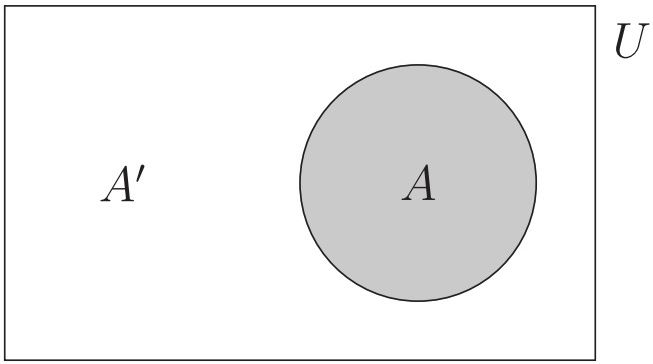

## 1.12 সেটের সংযোগ (Union of Sets)

<!-- higher-math-9-10-bn-c01-t1.12-p001 · text · p.5 · review: verify-formula -->
$A$ ও $B$ সেট হলে এদের সংযোগ সেট হচ্ছে $A \cup B = \{x : x \in A  অথবা  x \in B\}$।

<!-- higher-math-9-10-bn-c01-t1.12-p002 · text · p.5 · review: verify-formula -->
অর্থাৎ $A$ ও $B$ উভয় সেটের সকল উপাদান নিয়ে গঠিত সেটই $A \cup B$।

## 1.13 সেটের ছেদ (Intersection of Sets)

<!-- higher-math-9-10-bn-c01-t1.13-p001 · text · p.5 · review: verify-formula -->
$A$ ও $B$ সেট হলে এদের ছেদ সেট হচ্ছে $A \cap B = \{x : x \in A  এবং  x \in B\}$।

<!-- higher-math-9-10-bn-c01-t1.13-p002 · text · p.5 · review: verify-formula -->
অর্থাৎ $A$ ও $B$ সেটের সকল সাধারণ উপাদান নিয়ে গঠিত সেটই $A \cap B$।

<!-- higher-math-9-10-bn-c01-t1.13-p003 · text · p.5 · review: verify-formula -->
**উদাহরণ ৮.** সার্বিক সেট $U = \{0, 1, 2, 3, 4, 5, 6, 7, 8, 9\}$ এর দুটি উপসেট $A = \{x : x  মৌলিক সংখ্যা\}$ এবং $B = \{x : x  বিজোড় সংখ্যা\}$।

<!-- higher-math-9-10-bn-c01-t1.13-p004 · text · p.5 · review: verify-formula -->
তাহলে $A = \{2, 3, 5, 7\}$ এবং $B = \{1, 3, 5, 7, 9\}$।

<!-- higher-math-9-10-bn-c01-t1.13-p005 · text · p.5 · review: verify-formula -->
সুতরাং $A \cup B = \{1, 2, 3, 5, 7, 9\}$, $A \cap B = \{3, 5, 7\}$,

<!-- higher-math-9-10-bn-c01-t1.13-p006 · formula · p.5 · review: verify-formula -->
$$A' = \{0, 1, 4, 6, 8, 9\}, B' = \{0, 2, 4, 6, 8\},$$

<!-- higher-math-9-10-bn-c01-t1.13-p007 · formula · p.5 · review: verify-formula -->
$$A' \cup B' = \{0, 1, 2, 4, 6, 8, 9\}, A' \cap B' = \{0, 4, 6, 8\},$$

<!-- higher-math-9-10-bn-c01-t1.13-p008 · text · p.5 · review: verify-formula -->
$$(A \cap B)' = \{0, 1, 2, 4, 6, 8, 9\}, (A \cup B)' = \{0, 4, 6, 8\}$$।

<!-- higher-math-9-10-bn-c01-t1.13-p009 · text · p.6 -->
**কাজ:** আগের পৃষ্ঠার উদাহরণের সেটগুলোকে ভেন চিত্রে দেখাও।

## 1.14 নিশ্চেষ্ট সেট (Disjoint Set)

<!-- higher-math-9-10-bn-c01-t1.14-p001 · text · p.6 · review: verify-formula -->
যদি $A$ ও $B$ সেট এমন হয় যে $A \cap B = \varnothing$, তবে $A$ ও $B$ কে নিশ্চেষ্ট সেট বলা হয়।

<!-- higher-math-9-10-bn-c01-t1.14-p002 · text · p.6 · review: verify-formula -->
**উদাহরণ ৯.** $A = \{x : x  ধনাত্মক পূর্ণসংখ্যা\}$ এবং $B = \{x : x  ঋণাত্মক পূর্ণসংখ্যা\}$ হলে $A$ ও $B$ সেটদ্বয় নিশ্চেষ্ট, কেননা $A \cap B = \varnothing$।

<!-- higher-math-9-10-bn-c01-t1.14-p003 · text · p.6 · review: verify-formula -->
**উদাহরণ ১০.** $A = \{x : x \in R  এবং  0 \le x \le 2\}$ এবং $B = \{x : x \in N  এবং  0 \le x \le 2\}$ হলে $B \subseteq A, A \cup B = A, A \cap B = B = \{1, 2\}$।

<!-- higher-math-9-10-bn-c01-t1.14-p004 · text · p.6 · review: verify-formula -->
**উদাহরণ ১১.** $A = \{x : x \in R  এবং  1 \le x \le 2\}$ এবং $B = \{x : x \in R  এবং  0 < x < 1\}$ হলে, $A \cup B = \{x : x \in R  এবং  0 < x \le 2\}$ এবং $A \cap B = \varnothing$ অর্থাৎ $A$ ও $B$ নিশ্চেষ্ট।

## 1.15 কার্তেসীয় গুণজসেট (Cartesian Product Set)

<!-- higher-math-9-10-bn-c01-t1.15-p001 · text · p.6 · review: verify-formula -->
দুটি সেট $A$ এবং $B$ এর কার্তেসীয় গুণজ $A \times B = \{(x, y) : x \in A  এবং  y \in B\}$।

<!-- higher-math-9-10-bn-c01-t1.15-p002 · text · p.6 · review: verify-formula -->
**উদাহরণ ১২.** $A = \{1, 2\}, B = \{a, b, c\}$ দুটি সেট। সুতরাং এই দুটি সেটের কার্তেসীয় গুণজ সেট $A \times B = \{(1, a), (1, b), (1, c), (2, a), (2, b), (2, c)\}$।

## 1.16 সেট প্রক্রিয়ার কতিপয় প্রতিজ্ঞা

<!-- higher-math-9-10-bn-c01-t1.16-p001 · text · p.6 · review: verify-formula -->
এখানে প্রত্যেক ক্ষেত্রে $U$ সার্বিক সেট এবং $A, B, C$ সেটগুলো $U$ এর উপসেট।

### ক) বিনিময়বিধি

<!-- higher-math-9-10-bn-c01-t1.16-p002 · text · p.6 · review: verify-formula -->
(১) $A \cup B = B \cup A$ (২) $A \cap B = B \cap A$

### খ) সংযোগবিধি

<!-- higher-math-9-10-bn-c01-t1.16-p003 · text · p.6 · review: verify-formula -->
(১) $(A \cup B) \cup C = A \cup (B \cup C)$ (২) $(A \cap B) \cap C = A \cap (B \cap C)$

### গ) বণ্টনবিধি

<!-- higher-math-9-10-bn-c01-t1.16-p004 · text · p.6 · review: verify-formula -->
(১) $A \cup (B \cap C) = (A \cup B) \cap (A \cup C)$
(২) $A \cap (B \cup C) = (A \cap B) \cup (A \cap C)$

### ঘ) ডি মরগ্যানের সূত্র

<!-- higher-math-9-10-bn-c01-t1.16-p005 · text · p.6 · review: verify-formula -->
(১) $(A \cup B)' = A' \cap B'$ (২) $(A \cap B)' = A' \cup B'$

### ঙ) অন্যান্য সূত্র

<!-- higher-math-9-10-bn-c01-t1.16-p006 · text · p.6 · review: verify-formula -->
(১) $A \cup A = A, A \cap A = A$ (২) $A \cup \varnothing = A, A \cap \varnothing = \varnothing$
(৩) $A \cup U = U, A \cap U = A$ (৪) $A \subseteq B \implies B' \subseteq A'$
(৫) $A \subseteq B \implies A \cup B = B$ (৬) $A \subseteq B \implies A \cap B = A$

<!-- higher-math-9-10-bn-c01-t1.16-p007 · text · p.7 · review: verify-formula -->
(৭) $A \subseteq A \cup B$
(৮) $A \cap B \subseteq A$
(৯) $A \setminus B = A \cap B'$

## 1.17 বিনিময়বিধির প্রতিজ্ঞা দুটি যাচাইকরণ

<!-- higher-math-9-10-bn-c01-t1.17-p001 · text · p.7 · review: verify-formula -->
নিচের বামের চিত্রে গাঢ় অংশটুকু $A \cup B$ এবং $B \cup A$ উভয় সেটই নির্দেশ করে। সুতরাং এখানে দেখা যাচ্ছে $A \cup B = B \cup A$। নিচের ডানের চিত্রে গাঢ় অংশটুকু $A \cap B$ এবং $B \cap A$ উভয় সেটই নির্দেশ করে। সুতরাং এখানে দেখা যাচ্ছে $A \cap B = B \cap A$।

<!-- higher-math-9-10-bn-c01-t1.17-p002 · figure · p.7 -->
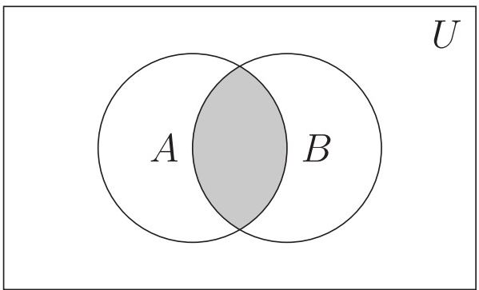

<!-- higher-math-9-10-bn-c01-t1.17-p003 · text · p.7 · review: known-confusable-corrected -->
উপরে ভেনচিত্রের সাহায্যে যাচাই করা হয়েছে। এবার সুনির্দিষ্ট উদাহরণ দিয়ে দেখা যাক।

<!-- higher-math-9-10-bn-c01-t1.17-p004 · text · p.7 · review: verify-formula -->
মনে করি, $A = \{1, 2, 4\}$ এবং $B = \{2, 3, 5\}$ দুটি সেট।

<!-- higher-math-9-10-bn-c01-t1.17-p005 · text · p.7 · review: verify-formula -->
তাহলে, $A \cup B = \{1, 2, 4\} \cup \{2, 3, 5\} = \{1, 2, 3, 4, 5\}$।

<!-- higher-math-9-10-bn-c01-t1.17-p006 · text · p.7 · review: verify-formula -->
আবার, $B \cup A = \{2, 3, 5\} \cup \{1, 2, 4\} = \{1, 2, 3, 4, 5\}$।

<!-- higher-math-9-10-bn-c01-t1.17-p007 · text · p.7 · review: verify-formula -->
সুতরাং এখানে $A \cup B = B \cup A$।

<!-- higher-math-9-10-bn-c01-t1.17-p008 · text · p.7 · review: verify-formula -->
অন্যদিকে, $A \cap B = \{1, 2, 4\} \cap \{2, 3, 5\} = \{2\}$

<!-- higher-math-9-10-bn-c01-t1.17-p009 · text · p.7 · review: verify-formula -->
এবং $B \cap A = \{2, 3, 5\} \cap \{1, 2, 4\} = \{2\}$।

<!-- higher-math-9-10-bn-c01-t1.17-p010 · text · p.7 · review: verify-formula -->
সুতরাং এখানে $A \cap B = B \cap A$।

## 1.18 সংযোগবিধির প্রতিজ্ঞা দুটির যাচাইকরণ

<!-- higher-math-9-10-bn-c01-t1.18-p001 · text · p.7 · review: verify-formula -->
নিচের বামের চিত্রে গাঢ় অংশটুকু $A \cup (B \cup C)$ এবং $(A \cup B) \cup C$ উভয় সেটই নির্দেশ করে। সুতরাং এখানে $A \cup (B \cup C) = (A \cup B) \cup C$। নিচের ডানের চিত্রে গাঢ় অংশটুকু $A \cap (B \cap C)$ এবং $(A \cap B) \cap C$ উভয় সেটই নির্দেশ করে। সুতরাং এখানে $(A \cap B) \cap C = A \cap (B \cap C)$।

<!-- higher-math-9-10-bn-c01-t1.18-p002 · figure · p.7 -->
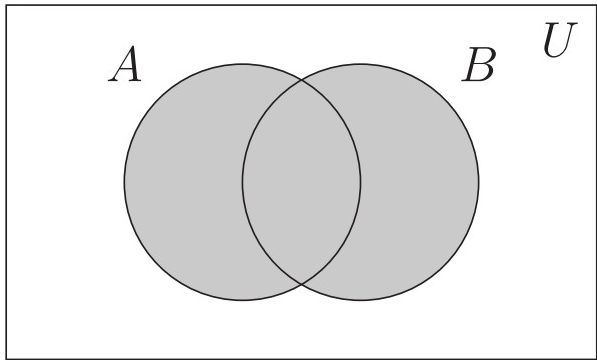

<!-- higher-math-9-10-bn-c01-t1.18-p003 · text · p.8 · review: verify-formula -->
মনে করি, $A = \{a, b, c, d\}$, $B = \{b, c, f\}$ এবং $C = \{c, d, g\}$।

<!-- higher-math-9-10-bn-c01-t1.18-p004 · text · p.8 · review: verify-formula -->
তাহলে, $B \cup C = \{b, c, f\} \cup \{c, d, g\} = \{b, c, d, f, g\}$

<!-- higher-math-9-10-bn-c01-t1.18-p005 · text · p.8 · review: verify-formula -->
এবং $A \cup (B \cup C) = \{a, b, c, d\} \cup \{b, c, d, f, g\} = \{a, b, c, d, f, g\}$।

<!-- higher-math-9-10-bn-c01-t1.18-p006 · text · p.8 · review: verify-formula -->
আবার, $A \cup B = \{a, b, c, d\} \cup \{b, c, f\} = \{a, b, c, d, f\}$

<!-- higher-math-9-10-bn-c01-t1.18-p007 · text · p.8 · review: verify-formula -->
এবং $(A \cup B) \cup C = \{a, b, c, d, f\} \cup \{c, d, g\} = \{a, b, c, d, f, g\}$।

<!-- higher-math-9-10-bn-c01-t1.18-p008 · text · p.8 · review: verify-formula -->
সুতরাং এক্ষেত্রে $(A \cup B) \cup C = A \cup (B \cup C)$।

<!-- higher-math-9-10-bn-c01-t1.18-p009 · text · p.8 · review: verify-formula -->
আবার, $B \cap C = \{b, c, f\} \cap \{c, d, g\} = \{c\}$

<!-- higher-math-9-10-bn-c01-t1.18-p010 · text · p.8 · review: verify-formula -->
এবং $A \cap (B \cap C) = \{a, b, c, d\} \cap \{c\} = \{c\}$।

<!-- higher-math-9-10-bn-c01-t1.18-p011 · text · p.8 · review: verify-formula -->
আবার, $A \cap B = \{a, b, c, d\} \cap \{b, c, f\} = \{b, c\}$

<!-- higher-math-9-10-bn-c01-t1.18-p012 · text · p.8 · review: verify-formula -->
এবং $(A \cap B) \cap C = \{b, c\} \cap \{c, d, g\} = \{c\}$।

<!-- higher-math-9-10-bn-c01-t1.18-p013 · text · p.8 · review: verify-formula -->
সুতরাং এক্ষেত্রে $A \cap (B \cap C) = (A \cap B) \cap C$।

<!-- higher-math-9-10-bn-c01-t1.18-p014 · text · p.8 · review: verify-formula -->
**কাজ:** বগ্নবিশির সূত্রটি যাচাই করো, যেখানে $A = \{1, 2, 3, 6\}$, $B = \{2, 3, 4, 5\}$ এবং $C = \{3, 5, 6, 7\}$। এই যাচাইকরণ ভেনচিএর মাধ্যমেও দেখাও।

<!-- higher-math-9-10-bn-c01-t1.18-p015 · text · p.8 -->
**দ্রষ্টব্য:** সেটের সংযোগ ও ছেদ প্রক্রিয়া দুটির প্রতিটি অপরটির প্রেক্ষিতে বগ্ন নিয়ম মনে চলে।

<!-- higher-math-9-10-bn-c01-t1.18-p016 · text · p.8 · review: verify-formula -->
**প্রতিজ্ঞা ১** (ডি মরগ্যানের সূত্র). সার্বিক সেট $U$ এর যেকোনো উপসেট $A$ ও $B$ এর জন্য

<!-- higher-math-9-10-bn-c01-t1.18-p017 · text · p.8 · review: verify-formula -->
ক) $(A \cup B)' = A' \cap B'$ খ) $(A \cap B)' = A' \cup B'$

<!-- higher-math-9-10-bn-c01-t1.18-p018 · text · p.8 -->
**প্রমাণ:** ( কেবল প্রথমটির প্রমাণ নিচে দেখানো হয়েছে। পরেরটির প্রমাণ নিজে করো।)

<!-- higher-math-9-10-bn-c01-t1.18-p019 · text · p.8 · review: verify-formula -->
ক) মনে করি, $x \in (A \cup B)'$। তাহলে, $x \notin A \cup B$।

<!-- higher-math-9-10-bn-c01-t1.18-p020 · formula · p.8 · review: latin-junk,verify-formula -->
$$\implies x \notin A  এবং  x \notin B \implies x \in A'  এবং  x \in B' \implies x \in A' \cap B'$$

<!-- higher-math-9-10-bn-c01-t1.18-p021 · text · p.8 · review: verify-formula -->
$\therefore (A \cup B)' \subseteq A' \cap B'$।

<!-- higher-math-9-10-bn-c01-t1.18-p022 · text · p.8 · review: verify-formula -->
আবার মনে করি, $x \in A' \cap B'$। তাহলে, $x \in A'$ এবং $x \in B'$।

<!-- higher-math-9-10-bn-c01-t1.18-p023 · formula · p.8 · review: latin-junk,verify-formula -->
$$\implies x \notin A  এবং  x \notin B \implies x \notin A \cup B \implies x \in (A \cup B)'$$

<!-- higher-math-9-10-bn-c01-t1.18-p024 · text · p.8 · review: verify-formula -->
$\therefore A' \cap B' \subseteq (A \cup B)'$।

<!-- higher-math-9-10-bn-c01-t1.18-p025 · text · p.8 · review: verify-formula -->
সুতরাং $(A \cup B)' = A' \cap B'$।

<!-- higher-math-9-10-bn-c01-t1.18-p026 · text · p.8 · review: verify-formula -->
**প্রতিজ্ঞা ২.** সার্বিক সেট $U$ এর যেকোনো উপসেট $A$ ও $B$ এর জন্য $A \setminus B = A \cap B'$

<!-- higher-math-9-10-bn-c01-t1.18-p027 · text · p.9 · review: latin-junk,verify-formula -->
**প্রমাণ:** মনে করি, $x \in A \setminus B$। তাহলে, $x \in A$ এবং $x \notin B$।
$$\implies x \in A  এবং  x \in B' \implies x \in A \cap B'$$
$\therefore A \setminus B \subseteq A \cap B'$।

<!-- higher-math-9-10-bn-c01-t1.18-p028 · text · p.9 · review: latin-junk,verify-formula -->
আবার মনে করি, $x \in A \cap B'$। তাহলে, $x \in A$ এবং $x \in B'$।
$$\implies x \in A  এবং  x \notin B \implies x \in A \setminus B$$
$\therefore A \cap B' \subseteq A \setminus B$।

<!-- higher-math-9-10-bn-c01-t1.18-p029 · text · p.9 · review: verify-formula -->
সুতরাং, $A \setminus B = A \cap B'$।

### প্রতিজ্ঞা ৩. যেকোনো সেট $A, B, C$ এর জন্য

<!-- higher-math-9-10-bn-c01-t1.18-p030 · text · p.9 · review: verify-formula -->
ক) $A \times (B \cap C) = (A \times B) \cap (A \times C)$

<!-- higher-math-9-10-bn-c01-t1.18-p031 · text · p.9 · review: verify-formula -->
খ) $A \times (B \cup C) = (A \times B) \cup (A \times C)$

<!-- higher-math-9-10-bn-c01-t1.18-p032 · text · p.9 -->
**প্রমাণ:** (কেবল প্রথমটির প্রমাণ নিচে দেখানো হয়েছে। পরেরটির প্রমাণ নিজে করো।)

<!-- higher-math-9-10-bn-c01-t1.18-p033 · text · p.9 · review: latin-junk,verify-formula -->
ক) সংজ্ঞানুসারে, $A \times (B \cap C)$
$$= \{(x, y) : x \in A, y \in B \cap C\}$$
$$= \{(x, y) : x \in A, y \in B  এবং  y \in C\}$$
$$= \{(x, y) : x \in A, y \in B  এবং  x \in A, y \in C\}$$
$$= \{(x, y) : (x, y) \in A \times B  এবং  (x, y) \in A \times C\}$$
$$= \{(x, y) : (x, y) \in (A \times B) \cap (A \times C)\}$$
$\therefore A \times (B \cap C) \subseteq (A \times B) \cap (A \times C)$

<!-- higher-math-9-10-bn-c01-t1.18-p034 · text · p.9 · review: latin-junk,verify-formula -->
আবার, $(A \times B) \cap (A \times C)$
$$= \{(x, y) : (x, y) \in A \times B  এবং  (x, y) \in A \times C\}$$
$$= \{(x, y) : x \in A, y \in B  এবং  x \in A, y \in C\}$$
$$= \{(x, y) : x \in A, y \in B \cap C\}$$
$$= \{(x, y) : (x, y) \in A \times (B \cap C)\}$$
$\therefore (A \times B) \cap (A \times C) \subseteq A \times (B \cap C)$

<!-- higher-math-9-10-bn-c01-t1.18-p035 · text · p.9 · review: verify-formula -->
সুতরাং, $A \times (B \cap C) = (A \times B) \cap (A \times C)$।

## 1.19 সেট প্রক্রিয়াসংক্রান্ত আরও কতিপয় প্রতিজ্ঞা

<!-- higher-math-9-10-bn-c01-t1.19-p001 · text · p.9 · review: verify-formula -->
ক) $A$ যেকোনো সেট হলে $A \subseteq A$।

<!-- higher-math-9-10-bn-c01-t1.19-p002 · text · p.9 · review: verify-formula -->
খ) ফাঁকা সেট $\emptyset$ যেকোনো সেট $A$ এর উপসেট।

<!-- higher-math-9-10-bn-c01-t1.19-p003 · text · p.10 · review: verify-formula -->
গ) $A$ ও $B$ যেকোনো সেট হলে $A = B$ হবে যদি ও কেবল যদি $A \subseteq B$ এবং $B \subseteq A$ হয়।

<!-- higher-math-9-10-bn-c01-t1.19-p004 · text · p.10 · review: verify-formula -->
ঘ) যদি $A \subseteq \emptyset$ হয়, তবে $A = \emptyset$।

<!-- higher-math-9-10-bn-c01-t1.19-p005 · text · p.10 · review: verify-formula -->
ঙ) যদি $A \subseteq B$ এবং $B \subseteq C$ তবে, $A \subseteq C$।

<!-- higher-math-9-10-bn-c01-t1.19-p006 · text · p.10 · review: verify-formula -->
চ) $A$ ও $B$ যেকোনো সেট হলে, $A \cap B \subseteq A$ এবং $A \cap B \subseteq B$।

<!-- higher-math-9-10-bn-c01-t1.19-p007 · text · p.10 · review: verify-formula -->
ছ) $A$ ও $B$ যেকোনো সেট হলে, $A \subseteq A \cup B$ এবং $B \subseteq A \cup B$।

<!-- higher-math-9-10-bn-c01-t1.19-p008 · text · p.10 -->
**প্রমাণ:** কেবল দুইটি প্রতিজ্বার প্রমাণ দেওয়া হয়েছে। অন্যগুলো নিজে করো।

<!-- higher-math-9-10-bn-c01-t1.19-p009 · text · p.10 · review: verify-formula -->
ঘ) দেওয়া আছে, $A \subseteq \emptyset$, আবার আমরা জানি, $\emptyset \subseteq A$। সুতরাং $A = \emptyset$।

<!-- higher-math-9-10-bn-c01-t1.19-p010 · text · p.10 · review: verify-formula -->
ছ) সেট সংযোগের সংজ্ঞানুযায়ী, $A$ সেটের সকল উপাদান $A \cup B$ সেটে থাকে। সুতরাং উপসেটের সংজ্ঞানুযায়ী $A \subseteq A \cup B$। একই যুক্তিতে $B \subseteq A \cup B$।

<!-- higher-math-9-10-bn-c01-t1.19-p011 · text · p.10 · review: verify-formula -->
**কাজ:** নিচের সকল সেট সার্বিক সেট $U$ এর উপসেট বিবেচনা করতে হবে।

<!-- higher-math-9-10-bn-c01-t1.19-p012 · text · p.10 · review: verify-formula -->
ক) দেখাও যে, $A \cap (B \cap C) = (A \cap B) \cap (A \cap C)$।

<!-- higher-math-9-10-bn-c01-t1.19-p013 · text · p.10 · review: verify-formula -->
খ) দেখাও যে, $A \subset B$ হবে যদি এবং কেবল যদি নিম্নোক্ত যেকোনো একটি শর্ত থাকে:
(১) $A \cap B = A$
(২) $A \cup B = B$
(৩) $B' \subset A'$
(৪) $A \cap B' = \emptyset$
(৫) $B \cup A' = U$

<!-- higher-math-9-10-bn-c01-t1.19-p014 · text · p.10 · review: verify-formula -->
গ) দেখাও যে,
(১) $A \setminus B \subset A \cup B$
(২) $A' \setminus B' = B \setminus A$
(৩) $A \setminus B \subset A$
(৪) $A \subset B$ হলে, $A \cup (B \setminus A) = B$
(৫) $A \cap B = \emptyset$ হলে, $A \subset B'$ এবং $A \cap B' = A$ এবং $A \cup B' = B'$

<!-- higher-math-9-10-bn-c01-t1.19-p015 · text · p.10 · review: verify-formula -->
ঘ) দেখাও যে,
(১) $(A \cap B)' = A' \cup B'$
(২) $(A \cup B \cup C)' = A' \cap B' \cap C'$
(৩) $(A \cap B \cap C)' = A' \cup B' \cup C'$

## 1.20 এক-এক মিল (One-One Correspondence)

<!-- higher-math-9-10-bn-c01-t1.20-p001 · text · p.11 · review: verify-formula -->
মনে করি, $A = \{a, b, c\}$ তিনজন লোকের সেট এবং $B = \{30, 40, 50\}$ ঐ তিনজন লোকের বয়সের সেট। অধিকন্তু মনে করি, $a$ এর বয়স 30 বছর, $b$ এর বয়স 40 বছর এবং $c$ এর বয়স 50 বছর। বলা যায় যে, $A$ সেটের সাথে $B$ সেটের এক-এক মিল আছে।

<!-- higher-math-9-10-bn-c01-t1.20-p002 · definition · p.11 · review: verify-formula -->
**সংজ্ঞা ১ (এক-এক মিল):** যদি $A$ সেটের প্রতিটি উপাদানের সাথে $B$ সেটের একটি ও কেবল একটি উপাদান এবং $B$ সেটের প্রতিটি উপাদানের সাথে $A$ সেটের একটি ও কেবল একটি উপাদানের মিল স্থাপন করা যায়, তবে তাকে $A$ ও $B$ এর মধ্যে এক-এক মিল বলা হয়। $A$ ও $B$ এর মধ্যে এক-এক মিলকে সাধারণত $A \leftrightarrow B$ লিখে প্রকাশ করা হয় এবং $A$ সেটের কোনো সদস্য $x$ এর সঙ্গে $B$ সেটের যে সদস্য $y$ এর মিল করা হয়েছে তা $x \leftrightarrow y$ লিখে বর্ণনা করা হয়।

## 1.21 সমতুল সেট (Equivalent Set)

<!-- higher-math-9-10-bn-c01-t1.21-p001 · text · p.11 · review: verify-formula -->
ধরি, $A = \{1, 2, 3\}$ এবং $B = \{a, b, c\}$ দুটি সেট। নিচের চিত্রে $A$ ও $B$ সেটদ্বয়ের মধ্যে একটি এক-এক মিল স্থাপন করে দেখানো হলো:

<!-- higher-math-9-10-bn-c01-t1.21-p002 · text · p.11 -->
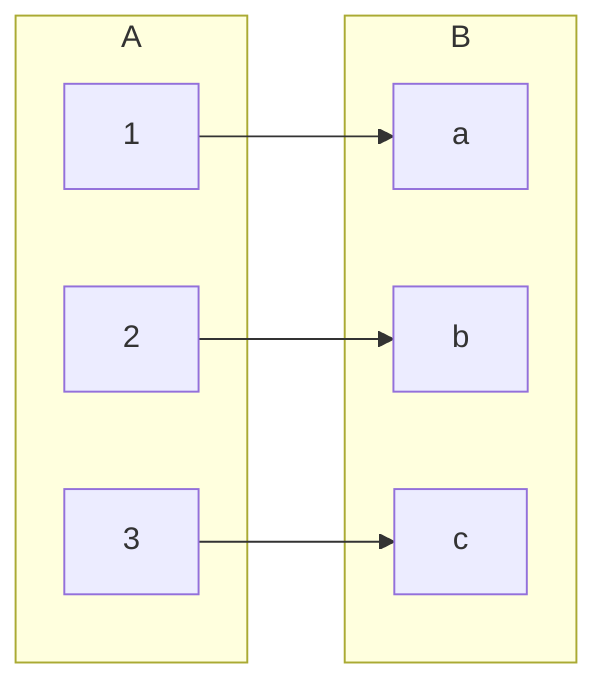

<!-- higher-math-9-10-bn-c01-t1.21-p003 · definition · p.11 · review: verify-formula -->
**সংজ্ঞা ২ (সমতুল সেট):** যেকোনো সেট $A$ ও $B$ এর মধ্যে যদি একটি এক-এক মিল $A \leftrightarrow B$ বর্ণনা করা যায়, তবে $A$ ও $B$ কে সমতুল সেট বলা হয়। $A$ ও $B$ কে সমতুল বোঝাতে $A \sim B$ লেখা হয়। $A \sim B$ হলে, এদের যেকোনো একটিকে অপরটির সাথে সমতুল বলা হয়। লক্ষণীয় যে, যেকোনো সেট $A, B$ ও $C$ এর জন্য

<!-- higher-math-9-10-bn-c01-t1.21-p004 · text · p.11 · review: verify-formula -->
ক) $A \sim A$

<!-- higher-math-9-10-bn-c01-t1.21-p005 · text · p.11 · review: verify-formula -->
খ) $A \sim B$ হলে $B \sim A$

<!-- higher-math-9-10-bn-c01-t1.21-p006 · text · p.11 · review: verify-formula -->
গ) $A \sim B$ এবং $B \sim C$ হলে $A \sim C$।

<!-- higher-math-9-10-bn-c01-t1.21-p007 · text · p.11 · review: verify-formula -->
**উদাহরণ ১৩.** দেখাও যে, $A = \{1, 2, 3, \dots, n\}$ এবং $B = \{1, 3, 5, \dots, 2n - 1\}$ সেটদ্বয় সমতুল, যেখানে $n$ একটি স্বাভাবিক সংখ্যা।

<!-- higher-math-9-10-bn-c01-t1.21-p008 · text · p.11 · review: verify-formula -->
**সমাধান:** $A$ ও $B$ সমতুল, কারণ সেট দুটির মধ্যে নিচের মতো একটি এক-এক মিল রয়েছে।

<!-- higher-math-9-10-bn-c01-t1.21-p009 · text · p.11 -->
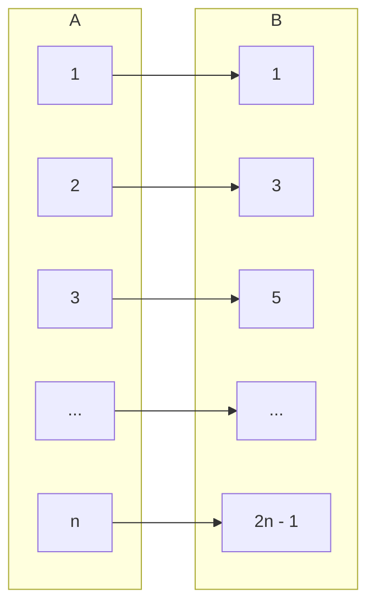

<!-- higher-math-9-10-bn-c01-t1.21-p010 · text · p.12 · review: verify-formula -->
**মন্তব্য:** আগের পৃষ্ঠায় চিত্রিত এক-এক মিলটিকে $A \leftrightarrow B : k \leftrightarrow 2k - 1, k \in A$ দ্বারা বর্ণনা করা যায়।

<!-- higher-math-9-10-bn-c01-t1.21-p011 · text · p.12 · review: verify-formula -->
**উদাহরণ ১৪.** দেখাও যে, স্বাভাবিক সংখ্যার সেট $N$ এবং জোড় সংখ্যার সেট $A = \{2, 4, 6, \dots, 2n, \dots\}$ সমতুল।

<!-- higher-math-9-10-bn-c01-t1.21-p012 · text · p.12 · review: verify-formula -->
**সমাধান:** $N = \{1, 2, 3, \dots, n, \dots\}$ ও $A$ সমতুল সেট, কারণ $N$ এবং $A$ এর মধ্যে নিচের চিত্রের মতো একটি এক-এক মিল রয়েছে।

<!-- higher-math-9-10-bn-c01-t1.21-p013 · text · p.12 -->
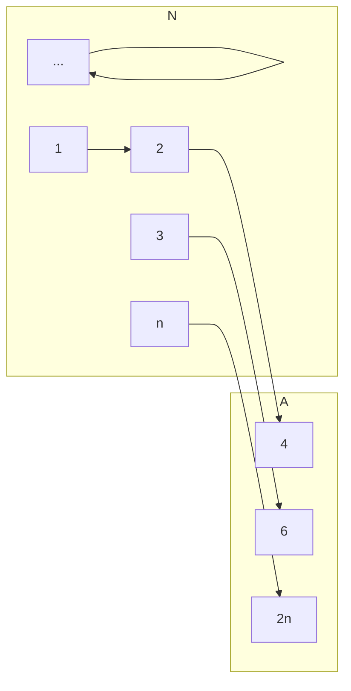

<!-- higher-math-9-10-bn-c01-t1.21-p014 · text · p.12 · review: verify-formula -->
**মন্তব্য:** উপরে চিত্রিত এক-এক মিলটিকে $N \leftrightarrow A : n \leftrightarrow 2n, n \in N$ দ্বারা বর্ণনা করা যায়।

<!-- higher-math-9-10-bn-c01-t1.21-p015 · text · p.12 · review: verify-formula -->
**দ্রষ্টব্য:** ফাঁকা সেট $\emptyset$ কে নিজের সমতুল ধরা হয়। অর্থাৎ, $\emptyset \sim \emptyset$।

<!-- higher-math-9-10-bn-c01-t1.21-p016 · text · p.12 · review: verify-formula -->
**প্রতিজ্ঞা ৪.** প্রত্যেক সেট $A$ তার নিজের সমতুল। অর্থাৎ, $A \sim A$।

<!-- higher-math-9-10-bn-c01-t1.21-p017 · text · p.12 · review: verify-formula -->
**প্রমাণ:** $A = \emptyset$ হলে, $A \sim A$ ধরা হয়। আর $A \neq \emptyset$ হলে প্রত্যেক সদস্য $x$ এর সঙ্গে তার নিজেকে মিল করে এক-এক মিল $A \leftrightarrow A : x \leftrightarrow x, x \in A$ স্থাপিত হয়। সুতরাং $A \sim A$।

<!-- higher-math-9-10-bn-c01-t1.21-p018 · text · p.12 -->
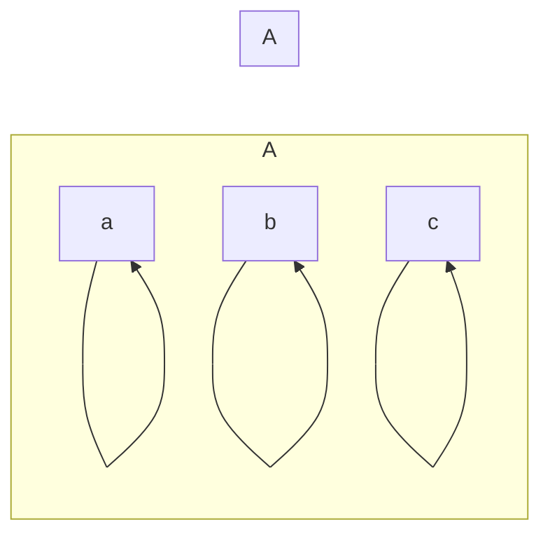

<!-- higher-math-9-10-bn-c01-t1.21-p019 · text · p.12 · review: verify-formula -->
**প্রতিজ্ঞা ৫.** $A$ ও $B$ সমতুল সেট এবং $B$ ও $C$ সমতুল সেট হলে $A$ ও $C$ সমতুল সেট।

<!-- higher-math-9-10-bn-c01-t1.21-p020 · text · p.12 · review: verify-formula -->
**প্রমাণ:** যেহেতু $A \sim B$, সুতরাং $A$ এর প্রত্যেক সদস্য $x$ এর সঙ্গে $B$ এর একটি অনন্য সদস্য $y$ এর মিল করা যায়। আবার যেহেতু $B \sim C$, সুতরাং $B$ এর এই সদস্য $y$ এর সঙ্গে $C$ এর একটি অনন্য সদস্য $z$ এর মিল করা যায়। এখন $A$ এর সদস্য $x$ এর সঙ্গে $C$ এর সদস্য $z$ এর মিল করা হলে, $A$ ও $C$ সেটের মধ্যে একটি এক-এক মিল স্থাপিত হয়। অর্থাৎ, $A \sim C$ হয়।

## 1.22 ব্যবধি (Interval)

<!-- higher-math-9-10-bn-c01-t1.22-p001 · text · p.12 · review: verify-formula -->
$a$ ও $b$ বাস্তব সংখ্যা এবং $a < b$ হলে

<!-- higher-math-9-10-bn-c01-t1.22-p002 · text · p.12 · review: verify-formula -->
ক) $(a, b) = \{x \in R : a < x < b\}$ কে খোলা ব্যবধি (open interval) বলে।

<!-- higher-math-9-10-bn-c01-t1.22-p003 · text · p.12 · review: verify-formula -->
খ) $[a, b] = \{x \in R : a \leq x \leq b\}$ কে বদ্ধ ব্যবধি (closed interval) বলে।

<!-- higher-math-9-10-bn-c01-t1.22-p004 · text · p.13 · review: verify-formula -->
গ) $(a, b] = \{x \in R : a < x \le b\}$ এবং $[a, b) = \{x \in R : a \le x < b\}$ কে যথাক্রমে খোলা-বদ্ধ ও বদ্ধ-খোলা ব্যবধি বলে।

## 1.23 সান্ত ও অনন্ত সেট (Finite and Infinite Sets)

<!-- higher-math-9-10-bn-c01-t1.23-p001 · text · p.13 · review: verify-formula -->
$A = \{15, 16, 17, 18, 19, 20, 21, 22\}$ সেটটির সদস্যগুলো গণনা করে দেখা যায় যে, $A$ সেটের সদস্য সংখ্যা ৪। এই গণনার কাজ $A$ সেটের সঙ্গে $B = \{1, 2, 3, 4, 5, 6, 7, 8\}$ সেটের একটি এক-এক মিল স্থাপন করে সম্পন্ন করা হয়। যেমন, নিচের চিত্রে দেখানো হয়েছে।

<!-- higher-math-9-10-bn-c01-t1.23-p002 · figure · p.13 -->
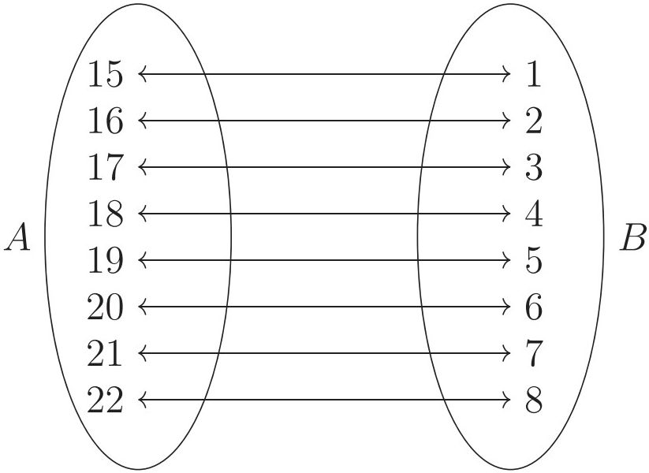

<!-- higher-math-9-10-bn-c01-t1.23-p003 · definition · p.13 · review: verify-formula -->
**সংজ্ঞা ৩ (সান্ত ও অনন্ত সেট):** গণনা করে যে সকল সেটের সদস্য সংখ্যা নির্ধারণ করা যায়, এদের সান্ত সেট বলা হয়। কোনো সেট $A$ সান্ত সেট না হলে, একে অনন্ত সেট বলা হয়।

<!-- higher-math-9-10-bn-c01-t1.23-p004 · text · p.13 · review: verify-formula -->
ক) ফাঁকা সেট $\emptyset$ সান্ত সেট, এর সদস্য সংখ্যা ০।

<!-- higher-math-9-10-bn-c01-t1.23-p005 · text · p.13 · review: verify-formula -->
খ) যদি কোনো সেট $A$ এবং $J_m = \{1, 2, 3, \dots, m\}$ সমতুল হয়, যেখানে $m \in N$, তবে $A$ একটি সান্ত সেট এবং $A$ এর সদস্য সংখ্যা $m$।

<!-- higher-math-9-10-bn-c01-t1.23-p006 · text · p.13 · review: verify-formula -->
গ) $A$ কোনো সান্ত সেট হলে, $A$ এর সদস্য সংখ্যাকে $n(A)$ দ্বারা সূচিত করা হয়।

### দৃষ্টব্য:

<!-- higher-math-9-10-bn-c01-t1.23-p007 · text · p.13 · review: verify-formula -->
ক) $J_1 = \{1\}$, $J_2 = \{1, 2\}$, $J_3 = \{1, 2, 3\}$ ইত্যাদি প্রত্যেককেই $N$ এর সান্ত উপসেট বলা হয় এবং $n(J_1) = 1$, $n(J_2) = 2$, $n(J_3) = 3$ ইত্যাদি। বাস্তবিক পক্ষে, $J_m \sim J_m$ এবং $n(J_m) = m$।

<!-- higher-math-9-10-bn-c01-t1.23-p008 · text · p.13 · review: verify-formula -->
খ) শুধুমাত্র সান্ত সেটেরই সদস্য সংখ্যা নির্দিষ্ট করা যায়। $n(A)$ লিখলে বুঝাতে হবে $A$ সান্ত সেট।

<!-- higher-math-9-10-bn-c01-t1.23-p009 · text · p.13 · review: verify-formula -->
গ) $A$ ও $B$ সমতুল সেট এবং এদের মধ্যে একটি সেট সান্ত হলে অপর সেটটিও সান্ত হবে এবং $n(A) = n(B)$ হবে।

<!-- higher-math-9-10-bn-c01-t1.23-p010 · text · p.13 · review: verify-formula -->
**প্রতিজ্ঞা ৬.** যদি $A$ সান্ত সেট হয় এবং $B$, $A$ এর প্রকৃত উপসেট হয়, তবে $B$ সান্ত সেট এবং $n(B) < n(A)$ হবে।

<!-- higher-math-9-10-bn-c01-t1.23-p011 · text · p.13 · review: verify-formula -->
**প্রতিজ্ঞা ৭.** $A$ অনন্ত সেট হবে যদি ও কেবল যদি $A$ ও $A$ এর একটি প্রকৃত উপসেট সমতুল হয়।

<!-- higher-math-9-10-bn-c01-t1.23-p012 · text · p.14 · review: verify-formula -->
**দ্রষ্টব্য:** স্বাভাবিক সংখ্যার সেট $N$ একটি অনন্ত সেট।

## 1.24 সান্ত সেটের উপাদান সংখ্যা

<!-- higher-math-9-10-bn-c01-t1.24-p001 · text · p.14 · review: verify-formula -->
সান্ত সেট $A$ এর উপাদান সংখ্যা $n(A)$ দ্বারা সূচিত করা হয়েছে এবং $n(A)$ নির্ধারণের পদ্ধতি ব্যাখ্যা করা হয়েছে। এবার মনে করি, $n(A) = p > 0$, $n(B) = q > 0$ যেখানে $A \cap B = \emptyset$।

<!-- higher-math-9-10-bn-c01-t1.24-p002 · figure · p.14 -->
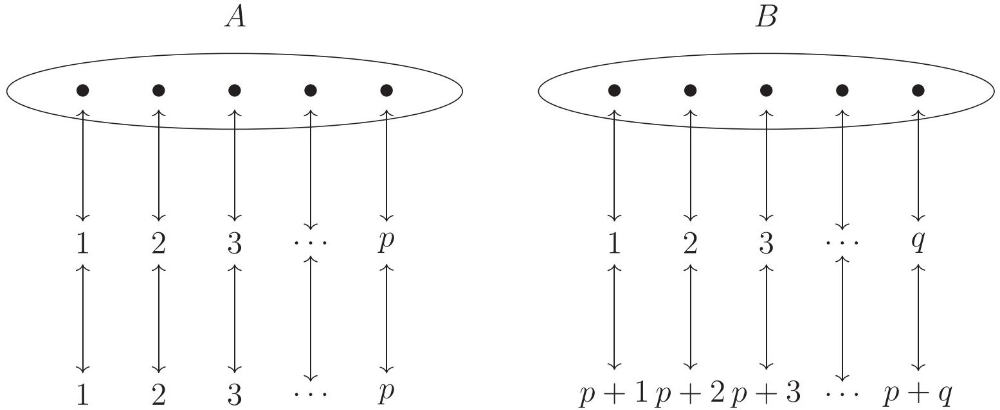

<!-- higher-math-9-10-bn-c01-t1.24-p003 · text · p.14 · review: verify-formula -->
উপরের চিত্রে বর্ণিত এক-এক মিল থেকে দেখা যায় যে, $A \cup B \sim J_{p+q}$।

<!-- higher-math-9-10-bn-c01-t1.24-p004 · text · p.14 · review: verify-formula -->
অর্থাৎ, $n(A \cup B) = p + q = n(A) + n(B)$। এ থেকে নিচের প্রতিজ্ঞাটি বলা যায়।

<!-- higher-math-9-10-bn-c01-t1.24-p005 · text · p.14 · review: verify-formula -->
**প্রতিজ্ঞা ৮.** যদি $A$ ও $B$ পরস্পর নিশ্চেষ্ট সান্ত সেট হয়, তবে $n(A \cup B) = n(A) + n(B)$।

<!-- higher-math-9-10-bn-c01-t1.24-p006 · text · p.14 · review: verify-formula -->
এই প্রতিজ্ঞাকে সমপ্রসারণ করে বলা যায় যে, $n(A \cup B \cup C) = n(A) + n(B) + n(C)$।

<!-- higher-math-9-10-bn-c01-t1.24-p007 · text · p.14 · review: verify-formula -->
একইভাবে $n(A \cup B \cup C \cup D) = n(A) + n(B) + n(C) + n(D)$ ইত্যাদি,

<!-- higher-math-9-10-bn-c01-t1.24-p008 · text · p.14 · review: verify-formula -->
যেখানে $A, B, C, D$ সেটগুলো পরস্পর নিশ্চেষ্ট সান্ত সেট।

<!-- higher-math-9-10-bn-c01-t1.24-p009 · text · p.14 · review: verify-formula -->
**প্রতিজ্ঞা ৯.** যেকোনো সান্ত সেট $A$ ও $B$ এর জন্য $n(A \cup B) = n(A) + n(B) - n(A \cap B)$।

<!-- higher-math-9-10-bn-c01-t1.24-p010 · text · p.14 · review: verify-formula -->
**প্রমাণ:** এখানে, $A \setminus B$, $A \cap B$ এবং $B \setminus A$ সেট তিনটি পরস্পর নিশ্চেষ্ট সেট [ভেনচিত্র দ্রষ্টব্য]।

<!-- higher-math-9-10-bn-c01-t1.24-p011 · figure · p.14 -->
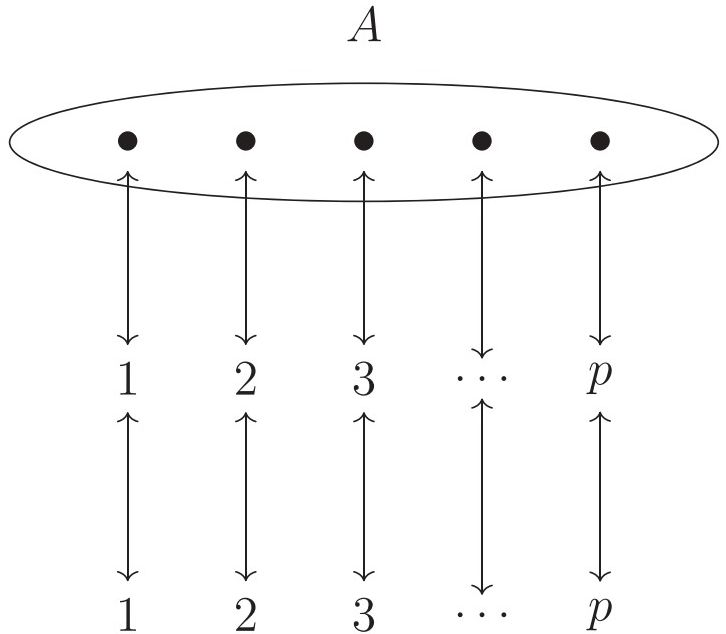

<!-- higher-math-9-10-bn-c01-t1.24-p012 · text · p.15 · review: verify-formula -->
ফলে $A = (A \setminus B) \cup (A \cap B)$ এবং $B = (B \setminus A) \cup (A \cap B)$

<!-- higher-math-9-10-bn-c01-t1.24-p013 · text · p.15 · review: verify-formula -->
অতএব $A \cup B = (A \setminus B) \cup (A \cap B) \cup (B \setminus A)$

<!-- higher-math-9-10-bn-c01-t1.24-p014 · formula · p.15 · review: verify-formula -->
$\therefore n(A) = n(A \setminus B) + n(A \cap B) \dots \dots (1)$

<!-- higher-math-9-10-bn-c01-t1.24-p015 · formula · p.15 · review: verify-formula -->
$\therefore n(B) = n(B \setminus A) + n(A \cap B) \dots \dots (2)$

<!-- higher-math-9-10-bn-c01-t1.24-p016 · formula · p.15 · review: verify-formula -->
$n(A \cup B) = n(A \setminus B) + n(A \cap B) + n(B \setminus A) \dots \dots (3)$

<!-- higher-math-9-10-bn-c01-t1.24-p017 · text · p.15 · review: verify-formula -->
সুতরাং, (1) নং থেকে পাই, $n(A \setminus B) = n(A) - n(A \cap B)$

<!-- higher-math-9-10-bn-c01-t1.24-p018 · text · p.15 · review: verify-formula -->
এবং (2) নং থেকে পাই, $n(B \setminus A) = n(B) - n(A \cap B)$

<!-- higher-math-9-10-bn-c01-t1.24-p019 · text · p.15 · review: verify-formula -->
এখন, $n(A \setminus B)$ এবং $n(B \setminus A)$ (3) এ বসিয়ে পাই,

<!-- higher-math-9-10-bn-c01-t1.24-p020 · formula · p.15 · review: verify-formula -->
$n(A \cup B) = n(A) - n(A \cap B) + n(B) - n(A \cap B) + n(A \cap B)$

<!-- higher-math-9-10-bn-c01-t1.24-p021 · formula · p.15 · review: verify-formula -->
$\therefore n(A \cup B) = n(A) + n(B) - n(A \cap B)$

<!-- higher-math-9-10-bn-c01-t1.24-p022 · text · p.15 -->
**কাজ:**

<!-- higher-math-9-10-bn-c01-t1.24-p023 · text · p.15 · review: verify-formula -->
ক) নিম্নোক্ত প্রত্যেক ক্ষেত্রে $A$ ও $B$ এর মধ্যে সম্বাধ্য সকল এক-এক মিল বর্ণনা করো:
(১) $A = \{a, b\}, B = \{1, 2\}$ (২) $A = \{a, b, c\}, B = \{a, b, c\}$

<!-- higher-math-9-10-bn-c01-t1.24-p024 · text · p.15 · review: verify-formula -->
খ) ক নং প্রশ্নে বর্ণিত প্রত্যেক এক-এক মিলকরণের জন্য $F = \{(x, y) : x \in A, y \in B\}$ এবং $x \leftrightarrow y$ সেটটি তালিকা পদ্ধতিতে বর্ণনা করো।

<!-- higher-math-9-10-bn-c01-t1.24-p025 · text · p.15 · review: verify-formula -->
গ) মনে করি $A = \{a, b, c, d\}$ এবং $B = \{1, 2, 3, 4\}$। $A \times B$ এর একটি উপসেট $F$ বর্ণনা কর যার অন্তর্ভুক্ত কুমজোড়গুলোর প্রথম পদের সঙ্গে দ্বিতীয় পদের মিল করা হলে, $A$ ও $B$ এর একটি এক-এক মিল স্থাপিত হয় যেখানে, $a \leftrightarrow 3$।

<!-- higher-math-9-10-bn-c01-t1.24-p026 · text · p.15 · review: verify-formula -->
ঘ) দেখাও যে, $A = \{1, 2, 3, \dots, n\}$ ও $B = \{1, 2, 2^2, \dots, 2^{n-1}\}$ সেট দুটি সমতুল।

<!-- higher-math-9-10-bn-c01-t1.24-p027 · text · p.15 · review: verify-formula -->
ঙ) দেখাও যে, $S = \{3^n : n = 0  অথবা  n \in N\}$ সেটটি $N$ এর সমতুল।

<!-- higher-math-9-10-bn-c01-t1.24-p028 · text · p.15 · review: verify-formula -->
চ) ঠিক উপরের প্রশ্নে বর্ণিত সেট $S$ এর একটি প্রকৃত উপসেট বর্ণনা কর যা $S$ এর সমতুল।

<!-- higher-math-9-10-bn-c01-t1.24-p029 · text · p.15 · review: verify-formula -->
ছ) দেখাও যে, সকল বিজোড় স্বাভাবিক সংখ্যার সেট $A = \{1, 3, 5, 7, \dots\}$ অনন্ত সেট।

## 1.25 বাস্তব সমস্যা সমাধানে সেট

<!-- higher-math-9-10-bn-c01-t1.25-p001 · text · p.15 -->
বাস্তব সমস্যা সমাধানে ভেনচিত্র ব্যবহার করা হয়। এখানে উল্লেখ্য যে, প্রতি সেটের উপাদান সংখ্যা ভেনচিত্রে লেখা হবে, তা কয়েকটি উদাহরণের মাধ্যমে দেখানো হলো।

<!-- higher-math-9-10-bn-c01-t1.25-p002 · text · p.15 -->
**উদাহরণ ১৫.** ৫০জন লোকের মধ্যে ৩৫জন ইংরেজি বলতে পারে, ২৫জন ইংরেজি ও বাংলা বলতে পারে এবং প্রত্যেকেই দুটি ভাষার অন্তত একটি বলতে পারে। বাংলা বলতে পারে কতজন? কেবল মাত্র বাংলা বলতে পারে কতজন?

<!-- higher-math-9-10-bn-c01-t1.25-p003 · text · p.16 · review: verify-formula -->
**সমাধান:** মনে করি, সকল লোকের সেট $S$ এবং তাদের মধ্যে যারা ইংরেজি বলতে পারে তাদের সেট $E$, যারা বাংলা বলতে পারে তাদের সেট $B$।

<!-- higher-math-9-10-bn-c01-t1.25-p004 · figure · p.16 -->
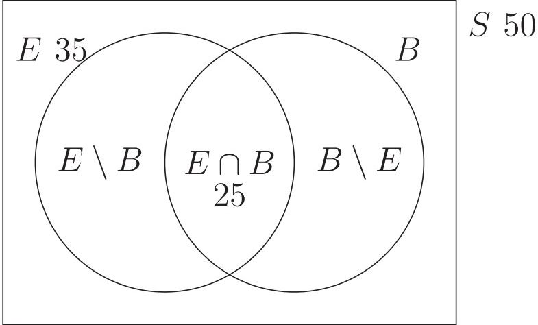

<!-- higher-math-9-10-bn-c01-t1.25-p005 · text · p.16 · review: verify-formula -->
তাহলে প্রশ্নানুসারে, $n(S) = 50$, $n(E) = 35$, $n(E \cap B) = 25$ এবং $S = E \cup B$। মনে করি, $n(B) = x$।

<!-- higher-math-9-10-bn-c01-t1.25-p006 · text · p.16 · review: verify-formula -->
তাহলে, $n(S) = n(E \cup B) = n(E) + n(B) - n(E \cap B)$ থেকে পাই,

<!-- higher-math-9-10-bn-c01-t1.25-p007 · text · p.16 · review: verify-formula -->
$50 = 35 + x - 25$ বা, $x = 50 - 35 + 25 = 40$ অর্থাৎ, $n(B) = 40$

<!-- higher-math-9-10-bn-c01-t1.25-p008 · text · p.16 · review: verify-formula -->
$\therefore$ বাংলা বলতে পারে 40জন।

<!-- higher-math-9-10-bn-c01-t1.25-p009 · text · p.16 · review: verify-formula -->
এখন, যারা কেবলমাত্র বাংলা বলতে পারে, তাদের সেট হচ্ছে $(B \setminus E)$।

<!-- higher-math-9-10-bn-c01-t1.25-p010 · text · p.16 · review: verify-formula -->
মনে করি, $n(B \setminus E) = y$।

<!-- higher-math-9-10-bn-c01-t1.25-p011 · text · p.16 · review: verify-formula -->
যেহেতু $E \cap B$ এবং $(B \setminus E)$ নিশ্চেষ্ট এবং $B = (E \cap B) \cup (B \setminus E)$ [ভেনচিত্র দৃষ্টব্য]

<!-- higher-math-9-10-bn-c01-t1.25-p012 · text · p.16 · review: verify-formula -->
সুতরাং $n(B) = n(E \cap B) + n(B \setminus E)$।

<!-- higher-math-9-10-bn-c01-t1.25-p013 · text · p.16 · review: verify-formula -->
$\therefore 40 = 25 + y$ বা, $y = 40 - 25 = 15$ অর্থাৎ, $n(B \setminus E) = 15$

<!-- higher-math-9-10-bn-c01-t1.25-p014 · text · p.16 · review: verify-formula -->
$\therefore$ কেবলমাত্র বাংলা বলতে পারে 15জন।

<!-- higher-math-9-10-bn-c01-t1.25-p015 · text · p.16 -->
অতএব, বাংলা বলতে পারে 40জন এবং কেবলমাত্র বাংলা বলতে পারে 15জন।

<!-- higher-math-9-10-bn-c01-t1.25-p016 · text · p.16 · review: verify-formula -->
**উদাহরণ ১৬.** একটি শ্রেণির 35জন বালিকার প্রত্যেকে দৌড়, সাঁতার ও নাচের কমপক্ষে যেকোনো একটি পছন্দ করে। তাদের মধ্যে 15জন দৌড়, 4জন সাঁতার, দৌড় ও নাচ, 2জন শুধু দৌড়, 7জন দৌড় ও সাঁতার পছন্দ করে কিন্তু নাচ নয়। $x$ জন সাঁতার ও নাচ কিন্তু দৌড় নয়, $2x$ জন শুধু নাচ, 2জন শুধু সাঁতার পছন্দ করে।

<!-- higher-math-9-10-bn-c01-t1.25-p017 · text · p.16 -->
ক) এ তথ্যগুলো ভেনচিত্র দেখাও।

<!-- higher-math-9-10-bn-c01-t1.25-p018 · text · p.16 · review: verify-formula -->
খ) $x$ নির্ণয় করো।

<!-- higher-math-9-10-bn-c01-t1.25-p019 · text · p.16 -->
গ) সেটের মাধ্যমে ব্যাখ্যা কর: যে সমস্ত বালিকা দৌড় ও নাচ পছন্দ করে কিন্তু সাঁতার নয়।

<!-- higher-math-9-10-bn-c01-t1.25-p020 · text · p.16 -->
ঘ) কতজন বালিকা দৌড় ও নাচ পছন্দ করে কিন্তু সাঁতার পছন্দ করে না?

### সমাধান:

<!-- higher-math-9-10-bn-c01-t1.25-p021 · text · p.17 · review: known-confusable-corrected,verify-formula -->
ক) ধরি, সেট $J =$ যারা দৌড় পছন্দ করে, $S =$ যারা সাঁতার পছন্দ করে, $D =$ যারা নাচ পছন্দ করে। নিচে তথ্যগুলো ভেনচিত্রে দেখানো হলো।

<!-- higher-math-9-10-bn-c01-t1.25-p022 · figure · p.17 -->
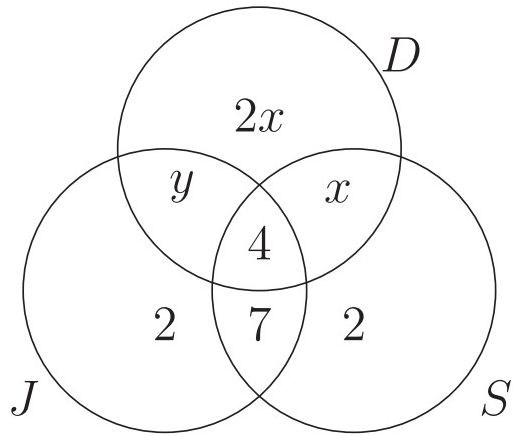

<!-- higher-math-9-10-bn-c01-t1.25-p023 · text · p.17 · review: known-confusable-corrected,verify-formula -->
খ) ভেনচিত্র হতে $J' = \{$যে সব বালিকা দৌড় পছন্দ করে না$\}$।

<!-- higher-math-9-10-bn-c01-t1.25-p024 · text · p.17 · review: verify-formula -->
অর্থাৎ $n(J') = 35 - 15 = 20$ বা, $2x + x + 2 = 20$ বা, $3x = 18$ বা $x = 6$।

<!-- higher-math-9-10-bn-c01-t1.25-p025 · text · p.17 · review: verify-formula -->
গ) যে সব বালিকা দৌড় ও নাচ পছন্দ করে কিন্তু সাঁতার পছন্দ করে না: $J \cap D \cap S'$।

<!-- higher-math-9-10-bn-c01-t1.25-p026 · text · p.17 · review: known-confusable-corrected,verify-formula -->
ঘ) ভেনচিত্রে $n(J \cap D \cap S') = y$ এবং দেওয়া আছে $n(J) = 15$।

<!-- higher-math-9-10-bn-c01-t1.25-p027 · text · p.17 · review: verify-formula -->
$\therefore y + 4 + 7 + 2 = 15$ বা $y = 2$।

<!-- higher-math-9-10-bn-c01-t1.25-p028 · text · p.17 -->
শুধু 2জন বালিকা দৌড় এবং নাচ পছন্দ করে কিন্তু সাঁতার পছন্দ করে না।

<!-- higher-math-9-10-bn-c01-t1.25-p029 · text · p.17 · review: known-confusable-corrected,verify-formula -->
**উদাহরণ ১৭.** 24জন ছাত্রের 18জন ব্যস্কিটবল খেলা পছন্দ করে, 12জন ভলিবল খেলা পছন্দ করে। দেওয়া আছে, $U =$ শ্রেণির ছাত্রদের সেট, $B =$ ব্যস্কিটবল খেলা পছন্দ করে এমন ছাত্রের সেট, $V =$ ভলিবল খেলা পছন্দ করে এমন ছাত্রদের সেট। মনে কর $n(B \cap V) = x$ এবং ভেনচিত্রে নিচের তথ্যগুলো ব্যাখ্যা করো:

<!-- higher-math-9-10-bn-c01-t1.25-p030 · text · p.17 · review: verify-formula -->
ক) $B \cup V$ সেটের বর্ণনা দাও এবং $n(B \cup V)$ কে $x$ এর মাধ্যমে প্রকাশ করো।

<!-- higher-math-9-10-bn-c01-t1.25-p031 · text · p.17 · review: verify-formula -->
খ) $x$ এর সম্ভাব্য ন্যূনতম মান নির্ণয় করো।

<!-- higher-math-9-10-bn-c01-t1.25-p032 · text · p.17 · review: verify-formula -->
গ) $x$ এর সম্ভাব্য বৃহত্তম মান নির্ণয় করো।

<!-- higher-math-9-10-bn-c01-t1.25-p033 · text · p.17 · review: verify-formula -->
ক) $B \cup V$ হলো এমন সব ছাত্রের সেট যারা ব্যস্কিটবল বা ভলিবল খেলা পছন্দ করে।

<!-- higher-math-9-10-bn-c01-t1.25-p034 · figure · p.18 -->
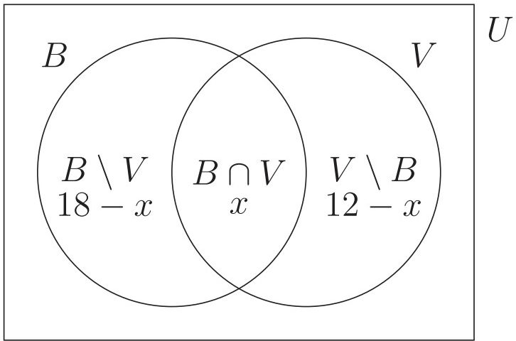

<!-- higher-math-9-10-bn-c01-t1.25-p035 · formula · p.18 · review: verify-formula -->
$$n(B \cup V) = (18 - x) + x + (12 - x) = 30 - x$$

<!-- higher-math-9-10-bn-c01-t1.25-p036 · text · p.18 · review: known-confusable-corrected,verify-formula -->
খ) $x$ বা $n(B \cap V)$ ক্ষুদ্রতম যখন $B \cup V = U$

<!-- higher-math-9-10-bn-c01-t1.25-p037 · text · p.18 · review: verify-formula -->
অর্থাৎ $n(B \cup V) = n(U)$ বা $30 - x = 24$ বা $x = 6$

<!-- higher-math-9-10-bn-c01-t1.25-p038 · text · p.18 · review: known-confusable-corrected,verify-formula -->
$\therefore$ সন্যাব্য ক্ষুদ্রতম মান $x = 6$।

<!-- higher-math-9-10-bn-c01-t1.25-p039 · text · p.18 · review: verify-formula -->
গ) $n(B \cap V)$ বৃহত্তম যখন $V \subset B$

<!-- higher-math-9-10-bn-c01-t1.25-p040 · text · p.18 · review: verify-formula -->
তখন, $n(B \cap V) = n(V)$ বা $x = 12$

<!-- higher-math-9-10-bn-c01-t1.25-p041 · text · p.18 · review: verify-formula -->
$\therefore$ সন্যাব্য বৃহত্তম মান $x = 12$।

### কাজ:

<!-- higher-math-9-10-bn-c01-t1.25-p042 · text · p.18 -->
ক) কোনো শ্রেণির 30জন ছাত্রের 20জন ফুটবল এবং 15জন দাবা পছন্দ করে। প্রত্যেক ছাত্র দুটি খেলার অন্তত যেকোনো একটি খেলা পছন্দ করে। কতজন ছাত্র দুটি খেলাই পছন্দ করে?

<!-- higher-math-9-10-bn-c01-t1.25-p043 · text · p.18 -->
খ) কিছু সংখ্যক লোকের মধ্যে 50জন বাংলা, 20জন ইংরেজি এবং 10জন বাংলা ও ইংরেজি বলতে পারে। দুটি ভাষার অন্তত একটি ভাষা কতজন বলতে পারে?

<!-- higher-math-9-10-bn-c01-t1.25-p044 · text · p.18 -->
গ) ঢাকা বিশ্ববিদ্যালয়ের আধুনিক ভাষা ইনস্টিটিউটের 100 জন শিক্ষার্থীর মধ্যে 42 জন ফ্রঞ্চ, 30জন জার্মান, 28জন স্প্যানিশ নিয়েছে। 10জন নিয়েছে ফ্রঞ্চও ও স্প্যানিশ, 8জন নিয়েছে জার্মান ও স্প্যানিশ, 5জন নিয়েছে জার্মান ও ফ্রঞ্চ, 3জন তিনটি ভাষাই নিয়েছে।

<!-- higher-math-9-10-bn-c01-t1.25-p045 · text · p.18 -->
(১) কতজন শিক্ষার্থী ঐ তিনটি ভাষার একটিও নেয়নি?

<!-- higher-math-9-10-bn-c01-t1.25-p046 · text · p.18 -->
(২) কতজন শিক্ষার্থী ঐ তিনটি ভাষার কেবল একটি ভাষা নিয়েছে?

<!-- higher-math-9-10-bn-c01-t1.25-p047 · text · p.18 -->
(৩) কতজন শিক্ষার্থী ঐ তিনটি ভাষার কেবল দুটি ভাষা নিয়েছে?

<!-- higher-math-9-10-bn-c01-t1.25-p048 · text · p.18 -->
ঘ) কোনো স্কুলের নবম শ্রেণির বিজ্ঞান শাখার 50জন শিক্ষার্থীর মধ্যে 29জন জীববিজ্ঞান, 24জন উচ্চতর গণিত এবং 11জন জীববিজ্ঞান ও উচ্চতর গণিত উভয় বিষয় নিয়েছে। কতজন শিক্ষার্থী জীববিজ্ঞান বা উচ্চতর গণিত বিষয় দুটির কোনটিই নেয়নি?

## 1.ex অনুশীলনী ১.১

<!-- higher-math-9-10-bn-c01-t1.ex-p001 · exercise · p.19 · review: verify-formula -->
১. *(i)* কোন সেটের সদস্য সংখ্যা $2n$ হলে, এর উপসেটের সংখ্যা হবে $4^n$।
    *(ii)* সকল মূলদ সংখ্যার সেট $Q = \left\{ \frac{p}{q} : p, q \in Z \right\}$।
    *(iii)* $a, b \in R; (a, b) = \{x : x \in R  এবং  a < x < b\}$।

<!-- higher-math-9-10-bn-c01-t1.ex-p002 · exercise · p.19 · review: verify-formula -->
উপরের উক্তিগুলোর আলোকে নিচের কোনটি সঠিক?
    ক) $i$ ও $ii$                      খ) $ii$ ও $iii$                      গ) $i$ ও $iii$                      ঘ) $i, ii$ ও $iii$

<!-- higher-math-9-10-bn-c01-t1.ex-p003 · exercise · p.19 · review: verify-formula -->
প্রত্যেক $n \in N$ এর জন্য $A_n = \{n, 2n, 3n, \dots \}$ হলে (২ - ৪) নং প্রশ্নের উত্তর দাও:

<!-- higher-math-9-10-bn-c01-t1.ex-p004 · exercise · p.19 · review: verify-formula -->
২. $A_1 \cap A_2$ এর সমান নিচের কোনটি?
    ক) $A_1$                      খ) $A_2$                      গ) $A_3$                      ঘ) $A_4$

<!-- higher-math-9-10-bn-c01-t1.ex-p005 · exercise · p.19 · review: verify-formula -->
৩. নিচের কোনটি $A_3 \cap A_6$ এর সমান?
    ক) $A_2$                      খ) $A_3$                      গ) $A_4$                      ঘ) $A_6$

<!-- higher-math-9-10-bn-c01-t1.ex-p006 · exercise · p.19 · review: verify-formula -->
৪. $A_2 \cap A_3$ এর পরিবর্তে নিচের কোনটি লেখা যায়?
    ক) $A_3$                      খ) $A_4$                      গ) $A_5$                      ঘ) $A_6$

<!-- higher-math-9-10-bn-c01-t1.ex-p007 · exercise · p.19 · review: verify-formula -->
৫. দেওয়া আছে $U = \{x : 1 \le x \le 20, x \in Z\}$, $A = \{x : x  বিজোড় সংখ্যা\}$ এবং $B = \{x : x  মৌলিক সংখ্যা\}$। নিম্নের সেটগুলো তালিকা পদ্ধতিতে লিপিবদ্ধ করো:
    ক) $A$                      খ) $B$
    গ) $C = \{x : x \in A  এবং  x \in B\}$                      ঘ) $D = \{x : x \in A  অথবা  x \in B\}$

<!-- higher-math-9-10-bn-c01-t1.ex-p008 · exercise · p.19 · review: verify-formula -->
৬. ভেনচিয়ে $A$ ও $B$ সেটের উপাদানগুলোর সংখ্যা দেখানো হয়েছে। যদি $n(A) = n(B)$ হয়, তবে নির্ণয় করো ক) $x$ এর মান খ) $n(A \cup B)$ গ) $n(B \setminus A)$।

<!-- higher-math-9-10-bn-c01-t1.ex-p009 · figure · p.19 -->
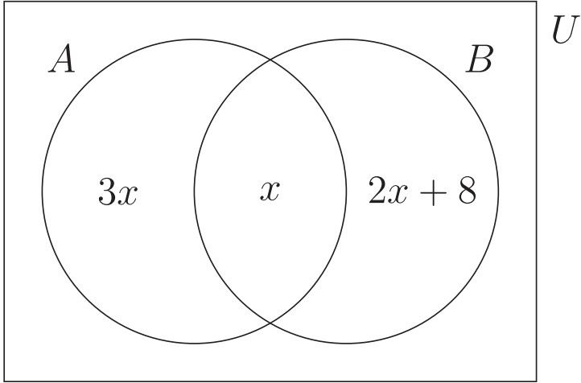

<!-- higher-math-9-10-bn-c01-t1.ex-p010 · exercise · p.19 · review: verify-formula -->
৭. যদি $U = \{x : x  ধনাত্মক পূর্ণসংখ্যা\}$, $A = \{x : x \ge 5\} \subset U$ এবং $B = \{x : 5x < 12\} \subset U$ তবে $n(A \cap B)$ এবং $n(A' \cup B)$ এর মান নির্ণয় করো।

<!-- higher-math-9-10-bn-c01-t1.ex-p011 · exercise · p.19 · review: verify-formula -->
৮. যদি $U = \{x : x  জোড় পূর্ণসংখ্যা\}$, $A = \{x : 3x \ge 25\} \subset U$ এবং $B = \{x : 5x < 12\} \subset U$ হয়, তাহলে $n(A \cap B)$ এবং $n(A' \cap B')$ এর মান নির্ণয় করো।

<!-- higher-math-9-10-bn-c01-t1.ex-p012 · exercise · p.20 · review: verify-formula -->
৯. দেখাও যে, ক) $A \setminus A = \varnothing$ খ) $A \setminus (A \setminus A) = A$।

<!-- higher-math-9-10-bn-c01-t1.ex-p013 · exercise · p.20 · review: verify-formula -->
১০. দেখাও যে, $A \times (B \cup C) = (A \times B) \cup (A \times C)$।

<!-- higher-math-9-10-bn-c01-t1.ex-p014 · exercise · p.20 · review: verify-formula -->
১১. যদি $A \subset B$ এবং $C \subset D$ হয়, তবে দেখাও যে, $(A \times C) \subset (B \times D)$।

<!-- higher-math-9-10-bn-c01-t1.ex-p015 · exercise · p.20 · review: verify-formula -->
১২. দেখাও যে, $A = \{1, 2, 3, \dots, n\}$ এবং $B = \{1, 2, 2^2, \dots, 2^{n-1}\}$ সেট দুটি সমতুল।

<!-- higher-math-9-10-bn-c01-t1.ex-p016 · exercise · p.20 · review: verify-formula -->
১৩. দেখাও যে, স্বাভাবিক সংখ্যাসমূহের বর্গের সেট $\{1, 4, 9, 16, 25, 36, \dots\}$ একটি অনন্ত সেট।

<!-- higher-math-9-10-bn-c01-t1.ex-p017 · exercise · p.20 · review: verify-formula -->
১৪. প্রমাণ করো যে, $n(A) = p, n(B) = q$ এবং $A \cap B = \varnothing$ হলে, $n(A \cup B) = p + q$।

<!-- higher-math-9-10-bn-c01-t1.ex-p018 · exercise · p.20 · review: verify-formula -->
১৫. প্রমাণ করো যে, $A, B, C$ সান্ত সেট হলে, $n(A \cup B \cup C) = n(A) + n(B) + n(C) - n(A \cap B) - n(B \cap C) - n(C \cap A) + n(A \cap B \cap C)$।

<!-- higher-math-9-10-bn-c01-t1.ex-p019 · exercise · p.20 · review: verify-formula -->
১৬. $A = \{a, b, x\}$ এবং $B = \{c, y\}$ সার্বিক সেট $U = \{a, b, c, x, y, z\}$ এর উপসেট হলে,

<!-- higher-math-9-10-bn-c01-t1.ex-p020 · exercise · p.20 · review: verify-formula -->
ক) যাচাই করো যে, $(i) A \subset B'$ $(ii) A \cup B' = B'$ $(iii) A' \cap B = B$।

<!-- higher-math-9-10-bn-c01-t1.ex-p021 · exercise · p.20 · review: verify-formula -->
খ) নির্ণয় করো $(A \cap B) \cup (A \cap B')$।

<!-- higher-math-9-10-bn-c01-t1.ex-p022 · exercise · p.20 -->
১৭. কোনো শ্রেণির ৩০জন শিক্ষার্থীর মধ্যে ১৯জন অর্থনীতি, ১৭জন ভূগোল, ১১জন পৌরনীতি, ১২জন অর্থনীতি ও ভূগোল, ৪জন পৌরনীতি ও ভূগোল, ৭জন অর্থনীতি ও পৌরনীতি এবং ৩জন তিনটি বিষয়ই নিয়েছে। কতজন শিক্ষার্থী তিনটি বিষয়ের কোনটিই নেয়নি?

<!-- higher-math-9-10-bn-c01-t1.ex-p023 · exercise · p.20 · review: known-confusable-corrected,verify-formula -->
১৮. নিচের ভেনচিত্রে সংশ্লিষ্ট সেটের উপাদান সংখ্যা দেখানো হয়েছে, যেখানে সার্বিক সেট $U = A \cup B \cup C$।

<!-- higher-math-9-10-bn-c01-t1.ex-p024 · figure · p.20 -->
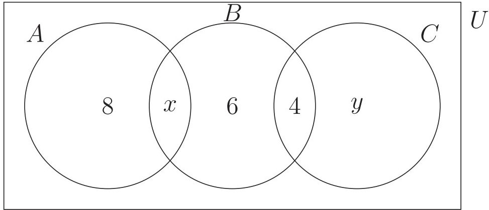

<!-- higher-math-9-10-bn-c01-t1.ex-p025 · exercise · p.20 · review: verify-formula -->
ক) যদি $n(A \cap B) = n(B \cap C)$ হয়, তবে $x$ এর মান নির্ণয় করো।

<!-- higher-math-9-10-bn-c01-t1.ex-p026 · exercise · p.20 · review: verify-formula -->
খ) যদি $n(B \cap C') = n(A' \cap C)$ হয়, তবে $y$ এর মান নির্ণয় করো।

<!-- higher-math-9-10-bn-c01-t1.ex-p027 · exercise · p.20 · review: verify-formula -->
গ) $n(U)$ এর মান নির্ণয় করো।

<!-- higher-math-9-10-bn-c01-t1.ex-p028 · exercise · p.20 · review: known-confusable-corrected,verify-formula -->
১৯. নিচের ভেনচিত্রে $U = A \cup B \cup C$ এবং $n(U) = 50$।

<!-- higher-math-9-10-bn-c01-t1.ex-p029 · figure · p.21 -->
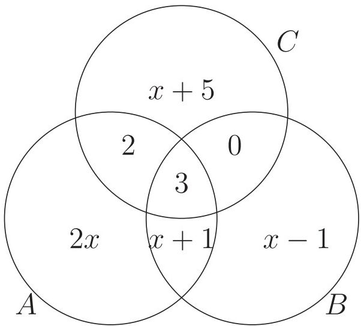

<!-- higher-math-9-10-bn-c01-t1.ex-p030 · exercise · p.21 · review: verify-formula -->
ক) $x$ এর মান নির্ণয় করো।

<!-- higher-math-9-10-bn-c01-t1.ex-p031 · exercise · p.21 · review: verify-formula -->
খ) $n(B \cap C')$ এবং $n(A' \cap B)$ এর মান নির্ণয় করো।

<!-- higher-math-9-10-bn-c01-t1.ex-p032 · exercise · p.21 · review: verify-formula -->
গ) $n(A \cap B \cap C')$ এর মান নির্ণয় করো।

<!-- higher-math-9-10-bn-c01-t1.ex-p033 · exercise · p.21 · review: verify-formula -->
২০. তিনটি সেট $A$, $B$ এবং $C$ এমনভাবে দেওয়া আছে যেন, $A \cap B = \emptyset$, $A \cap C = \emptyset$ এবং $C \subset B$। ভেনচিত্র অঙ্কন করে সেটগুলোর ব্যাখ্যা দাও।

<!-- higher-math-9-10-bn-c01-t1.ex-p034 · exercise · p.21 · review: verify-formula -->
২১. দেওয়া আছে, $A = \{x : 2 < x \le 5, x \in R\}$ এবং $B = \{x : 1 \le x < 3, x \in R\}$। নিম্নের সেটগুলো সেট গঠন পদ্ধতিতে প্রকাশ করো:

<!-- higher-math-9-10-bn-c01-t1.ex-p035 · exercise · p.21 · review: verify-formula -->
ক) $A \cap B$                      খ) $A' \cap B'$                      গ) $A' \cup B$

<!-- higher-math-9-10-bn-c01-t1.ex-p036 · exercise · p.21 · review: verify-formula -->
২২. দেওয়া আছে $U = \{x : x < 10, x \in R\}$, $A = \{x : 1 < x \le 4\}$ এবং $B = \{x : 3 \le x < 6\}$। নিচের সেটগুলো সেট গঠন পদ্ধতিতে প্রকাশ করো:

<!-- higher-math-9-10-bn-c01-t1.ex-p037 · exercise · p.21 · review: verify-formula -->
ক) $A \cap B$                      খ) $A' \cap B$                      গ) $A \cap B'$                      ঘ) $A' \cap B'$

<!-- higher-math-9-10-bn-c01-t1.ex-p038 · exercise · p.21 · review: verify-formula -->
২৩. নিম্নে প্রতিশ্বেত্রে $A$ ও $B$ সেট দেওয়া আছে, $A \cup B$ নির্ণয় করো এবং যাচাই কর যে $A \subset (A \cup B)$ এবং $B \subset (A \cup B)$।

<!-- higher-math-9-10-bn-c01-t1.ex-p039 · exercise · p.21 · review: verify-formula -->
ক) $A = \{-2, -1, 0, 1, 2\}$ এবং $B = \{-3, 0, 3\}$

<!-- higher-math-9-10-bn-c01-t1.ex-p040 · exercise · p.21 · review: verify-formula -->
খ) $A = \{x : x \in N, x < 10  এবং  x, 2  এর গুণিতক\}$ এবং $B = \{x : x \in N, x < 10  এবং  x, 3  এর গুণিতক\}$

<!-- higher-math-9-10-bn-c01-t1.ex-p041 · exercise · p.21 · review: verify-formula -->
২৪. নিম্নের প্রতিশ্বেত্রে $A \cap B$ নির্ণয় করো এবং যাচাই করো যে, $(A \cap B) \subset A$ এবং $(A \cap B) \subset B$।

<!-- higher-math-9-10-bn-c01-t1.ex-p042 · exercise · p.21 · review: verify-formula -->
ক) $A = \{0, 1, 2, 3\}$, $B = \{-1, 0, 2\}$      খ) $A = \{a, b, c, d\}$, $B = \{b, x, c, y\}$

<!-- higher-math-9-10-bn-c01-t1.ex-p043 · exercise · p.21 -->
২৫. বেগম রোকেয়া কলেজের ছাত্রীদের মধ্যে বিচিত্রা, সন্ধ্যানী ও পূর্বানী পত্রিকার পাঠ্যভাষ সমপর্কে পরিচালিত এক সমীক্ষায় দেখা গেল ৬০% ছাত্রী বিচিত্রা, ৫০% ছাত্রী সন্ধ্যানী, ৫০% ছাত্রী পূর্বানী, ৩০% ছাত্রী বিচিত্রা ও সন্ধ্যানী, ৩০% ছাত্রী বিচিত্রা ও পূর্বানী, ২০% ছাত্রী সন্ধ্যানী ও পূর্বানী এবং ১০% ছাত্রী তিনটি পত্রিকাই পড়ে।

<!-- higher-math-9-10-bn-c01-t1.ex-p044 · exercise · p.21 -->
ক) শতকরা কতজন ছাত্রী উক্ত পত্রিকা তিনটির কোনটিই পড়ে না?

<!-- higher-math-9-10-bn-c01-t1.ex-p045 · exercise · p.21 -->
খ) শতকরা কতজন ছাত্রী উক্ত পত্রিকাগুলোর মধ্যে কেবল দুটি পড়ে?

<!-- higher-math-9-10-bn-c01-t1.ex-p046 · exercise · p.22 · review: verify-formula -->
২৬. $A = \{x : x \in R  এবং  x^2 - (a + b)x + ab = 0\}$, $B = \{1, 2\}$ এবং $C = \{2, 4, 5\}$

<!-- higher-math-9-10-bn-c01-t1.ex-p047 · exercise · p.22 · review: verify-formula -->
ক) $A$ সেটের উপাদানসমূহ নির্ণয় করো।

<!-- higher-math-9-10-bn-c01-t1.ex-p048 · exercise · p.22 · review: verify-formula -->
খ) দেখাও যে, $P(B \cap C) = P(B) \cap P(C)$।

<!-- higher-math-9-10-bn-c01-t1.ex-p049 · exercise · p.22 · review: verify-formula -->
গ) প্রমাণ করো যে, $A \times (B \cup C) = (A \times B) \cup (A \times C)$।

<!-- higher-math-9-10-bn-c01-t1.ex-p050 · exercise · p.22 -->
২৭. একটি শ্রেণির 100 জন ছাত্রের মধ্যে 42 জন ফুটবল, 46 জন ক্রিকেট এবং 39 জন দাবা খেলে। এদের মধ্যে 13 জন ফুটবল ও ক্রিকেট, 14 জন ক্রিকেট ও দাবা এবং 12 জন ফুটবল ও দাবা খেলতে পারে। এছাড়া 7 জন কোনো খেলায় পারদর্শী নয়।

<!-- higher-math-9-10-bn-c01-t1.ex-p051 · exercise · p.22 -->
ক) উল্লিখিত তিনটি খেলায় পারদর্শী এমন ছাত্রদের সেট এবং কোনো খেলায় পারদর্শী নয় এমন ছাত্রদের সেট ভেনচিয়ে দেখাও।

<!-- higher-math-9-10-bn-c01-t1.ex-p052 · exercise · p.22 -->
খ) কতজন ছাত্র উল্লিখিত তিনটি খেলায়ই পারদর্শী তা নির্ণয় করো।

<!-- higher-math-9-10-bn-c01-t1.ex-p053 · exercise · p.22 -->
গ) কতজন ছাত্র কেবলমাত্র একটি খেলায় পারদর্শী? কতজন অন্তত দুটি খেলায় পারদর্শী?

<!-- higher-math-9-10-bn-c01-t1.ex-p054 · exercise · p.22 · review: verify-formula -->
২৮. $P(\emptyset)$, $P(\{\emptyset\})$ সেট নির্ণয় করো।

<!-- higher-math-9-10-bn-c01-t1.ex-p055 · exercise · p.22 -->
২৯. এক গ্রামে এক মিস্ত্রী ছিল। সে তাদের ঘর তৈরি করতে যারা নিজেরা নিজেদের ঘর তৈরি করতে না। মিস্ত্রীর ঘর কে তৈরি করতে?

<!-- higher-math-9-10-bn-c01-t1.ex-p056 · exercise · p.22 · review: verify-formula -->
৩০. $A = \{x : x \notin A\}$। সেট $A$ নিয়ে বিস্তৃত আলোচনা করো।

### অনুশীলনী ১.২

<!-- higher-math-9-10-bn-c01-t1.ex-p057 · exercise · p.35 · review: verify-formula -->
১. যদি $F(x) = \sqrt{x - 1}$ হয় তবে $F(10) =$ কত?
ক) 9 খ) 3 গ) $-3$ ঘ) $\sqrt{10}$

<!-- higher-math-9-10-bn-c01-t1.ex-p058 · exercise · p.35 · review: known-confusable-corrected,verify-formula -->
২. $S = \{(x, y) : x^2 + y^2 - 25 = 0  এবং  x \ge 0\}$ হলে,
(i) অন্বয়টি ফাংশন নয়।
(ii) অন্বয়টির লেখচিত্র একটি অর্ধবৃত্ত।
(iii) অন্বয়টির লেখচিত্র $x$ অক্ষের উপর অর্ধতলে থাকবে।
নিচের কোনটি সঠিক?
ক) $i, ii$ খ) $i, iii$ গ) $ii, iii$ ঘ) $i, ii$ ও $iii$

<!-- higher-math-9-10-bn-c01-t1.ex-p059 · exercise · p.35 · review: verify-formula -->
৩. $F(x) = \sqrt{x - 1} = 2$ হলে $x$ এর মান কত?
ক) 5 খ) 24 গ) 25 ঘ) 26

<!-- higher-math-9-10-bn-c01-t1.ex-p060 · exercise · p.35 · review: known-confusable-corrected,verify-formula -->
৪. (i) নিচে প্রদত্ত $S$ অন্বয়গুলোর ডোমেন, রেঞ্জ ও বিপরীত অন্বয় নির্ণয় করো।
(ii) $S$ অথবা $S^{-1}$ অন্বয়গুলো ফাংশন কিনা তা নির্ধারণ করো।
(iii) ফাংশনগুলো এক-এক কিনা নির্ধারণ করো।
ক) $S = \{(1, 5), (2, 10), (3, 15), (4, 20)\}$
খ) $S = \{(-3, 8), (-2, 3), (-1, 0), (0, -1), (1, 0), (2, 3), (3, 8)\}$
গ) $S = \left\{ \left( \frac{1}{2}, 0 \right), (1, 1), (1, -1), \left( \frac{5}{2}, 2 \right), \left( \frac{5}{2}, -2 \right) \right\}$
ঘ) $S = \{(-3, -3), (-1, -1), (0, 0), (1, 1), (3, 3)\}$
ঙ) $S = \{(2, 1), (2, 2), (2, 3)\}$

<!-- higher-math-9-10-bn-c01-t1.ex-p061 · exercise · p.35 · review: verify-formula -->
৫. $F(x) = \sqrt{x - 1}$ দ্বারা বর্ণিত ফাংশনের জন্য
ক) $F(1), F(5)$ এবং $F(10)$ নির্ণয় করো।
খ) $F(a^2 + 1)$ নির্ণয় করো যেখানে $a \in R$।

<!-- higher-math-9-10-bn-c01-t1.ex-p062 · exercise · p.36 · review: verify-formula -->
গ) $F(x) = 5$ হলে, $x$ নির্ণয় করো।

<!-- higher-math-9-10-bn-c01-t1.ex-p063 · exercise · p.36 · review: verify-formula -->
ঘ) $F(x) = y$ হলে, $x$ নির্ণয় করো যেখানে $y \ge 0$।

<!-- higher-math-9-10-bn-c01-t1.ex-p064 · exercise · p.36 · review: verify-formula -->
৬. $F : R \to R, F(x) = x^3$ ফাংশনের জন্য
ক) ডোম $F$ এবং রেঞ্জ $F$ নির্ণয় করো। খ) দেখাও যে, $F$ এক-এক ফাংশন।
গ) $F^{-1}$ নির্ণয় করো। ঘ) দেখাও যে, $F^{-1}$ একটি ফাংশন।

<!-- higher-math-9-10-bn-c01-t1.ex-p065 · exercise · p.36 · review: verify-formula -->
৭. ক) $f : R \to R$ একটি ফাংশন যা $f(x) = ax + b; a, b \in R, a \neq 0$ দ্বারা সংজ্ঞায়িত হলে, দেখাও যে, $f$ এক-এক এবং সার্বিক।
খ) $f : [0, 1] \to [0, 1]$ ফাংশনটি $f(x) = \sqrt{1 - x^2}$ দ্বারা সংজ্ঞায়িত হলে, দেখাও যে, $f$ এক-এক এবং সার্বিক।

<!-- higher-math-9-10-bn-c01-t1.ex-p066 · exercise · p.36 · review: verify-formula -->
৮. ক) যদি $f : R \to R$ এবং $g : R \to R$ ফাংশনদ্বয় $f(x) = x^3 + 5$ এবং $g(x) = (x - 5)^{\frac{1}{3}}$ দ্বারা সংজ্ঞায়িত হয়, তবে দেখাও যে, $g = f^{-1}$।
খ) যদি $f : R \to R$ ফাংশনটি $f(x) = 5x - 4$ দ্বারা সংজ্ঞায়িত হয়, তবে, $y = f^{-1}(x)$ নির্ণয় করো।

<!-- higher-math-9-10-bn-c01-t1.ex-p067 · exercise · p.36 · review: known-confusable-corrected,verify-formula -->
৯. $S$ অন্বয়ের লেখচিত্র অঙ্কন করো এবং অন্বয়টি ফাংশন কিনা তা লেখচিত্র থেকে নির্ণয় করো।
ক) $S = \{(x, y) : 2x - y + 5 = 0\}$ খ) $S = \{(x, y) : x + y = 1\}$
গ) $S = \{(x, y) : 3x + y = 4\}$ ঘ) $S = \{(x, y) : x = -2\}$

<!-- higher-math-9-10-bn-c01-t1.ex-p068 · exercise · p.36 · review: known-confusable-corrected,verify-formula -->
১০. $S$ অন্বয়ের লেখচিত্র অঙ্কন করো এবং অন্বয়টি ফাংশন কিনা তা লেখচিত্র থেকে নির্ণয় করো।
ক) $S = \{(x, y) : x^2 + y^2 = 25\}$ খ) $S = \{(x, y) : x^2 + y = 9\}$

<!-- higher-math-9-10-bn-c01-t1.ex-p069 · exercise · p.36 · review: verify-formula -->
১১. দেওয়া আছে, $F(x) = 2x - 1$।
ক) $F(x + 1)$ এবং $F\left(\frac{1}{2}\right)$ এর মান নির্ণয় করো।
খ) $F(x)$ ফাংশনটি এক-এক কিনা তা যাচাই করো, যখন $x, y \in R$।
গ) $F(x) = y$ হলে $x$ এর তিনটি পূর্ণ সাংখ্যিক মানের জন্য $y$ এর মান নির্ণয় করো এবং $y = 2x - 1$ সমীকরণটির লেখচিত্র অঙ্কন করো।

<!-- higher-math-9-10-bn-c01-t1.ex-p070 · exercise · p.36 · review: verify-formula -->
১২. $f : R \to R$ এবং $g : R \to R$ ফাংশন দুটি যথাক্রমে $f(x) = 3x + 3$ এবং $g(x) = \frac{x - 3}{3}$ দ্বারা সংজ্ঞায়িত।
ক) $g^{-1}(-3)$ এর মান নির্ণয় করো।
খ) $f(x)$ সার্বিক ফাংশন কিনা তা নির্ধারণ করো।
গ) দেখাও যে, $g = f^{-1}$।

### বহুনির্বাচনি প্রশ্ন

<!-- higher-math-9-10-bn-c01-t1.ex-p071 · exercise · p.37 · review: verify-formula -->
১. $F(x) = \sqrt{x - 1}$ ফাংশনটির ডোমেন নিচের কোনটি?
ক) ডোম $F = \{x \in R : x \neq 1\}$
খ) ডোম $F = \{x \in R : x \geq 1\}$
গ) ডোম $F = \{x \in R : x \leq 1\}$
ঘ) ডোম $F = \{x \in R : x > 1\}$

<!-- higher-math-9-10-bn-c01-t1.ex-p072 · exercise · p.37 · review: known-confusable-corrected,verify-formula -->
২. যদি $S = \{(1, 4), (2, 1), (3, 0), (4, 1), (5, 4)\}$ হয় তবে,
(i) $S$ অন্বয়ের রেঞ্জ $\{4, 1, 0\}$
(ii) $S$ অন্বয়ের বিপরীত অন্বয়, $S^{-1} = \{(4, 1), (1, 2), (0, 3), (1, 4), (4, 5)\}$
(iii) $S$ অন্বয়টি একটি ফাংশন
উপরের তথ্যের আলোকে নিচের কোনটি সঠিক?
ক) $i$ ও $ii$
খ) $ii$ ও $iii$
গ) $i$ ও $iii$
ঘ) $i, ii$ ও $iii$

<!-- higher-math-9-10-bn-c01-t1.ex-p073 · exercise · p.37 · review: verify-formula -->
$F(x) = -\sqrt{x - 4}$
উপরের তথ্যের আলোকে ৩ নং ও ৪ নং প্রশ্নের উত্তর দাও—

<!-- higher-math-9-10-bn-c01-t1.ex-p074 · exercise · p.37 · review: verify-formula -->
৩. $F(x) = -2$ হলে $x$ এর মান কত?
(ক) $-2$
(খ) $0$
(গ) $6$
(ঘ) $8$

<!-- higher-math-9-10-bn-c01-t1.ex-p075 · exercise · p.37 · review: verify-formula -->
৪. $F(a^2 + 4) =$ কত?
(ক) $a$
(খ) $-a$
(গ) $-|a|$
(ঘ) $a^2$

### সৃজনশীল প্রশ্ন

<!-- higher-math-9-10-bn-c01-t1.ex-p076 · exercise · p.37 · review: known-confusable-corrected,verify-formula -->
৫. দেওয়া আছে, $f(x) = \sqrt{x - 4}$।
ক) $f(x)$ এর ডোমেন নির্ণয় করো।
খ) $f(x)$ এক-এক ফাংশন কিনা নির্ধারণ করো।
গ) $f^{-1}(x)$ ফাংশন কিনা তা লেখচিত্রের সাহায্যে নির্ণয় করো।

### সংক্ষিপ্ত-উত্তর প্রশ্ন

<!-- higher-math-9-10-bn-c01-t1.ex-p077 · exercise · p.37 · review: known-confusable-corrected,verify-formula -->
৬. (ক) $S = \{(-2, 7), (-1, 2), (0, 1), (1, 2), (2, 7)\}$ হলে, $s^{-1}$ ফাংশন কিনা ব্যাখ্যা করো।
(খ) $F: R \to R, F(x) = x^2$ হলে, $F^{-1}(x)$ নির্ণয় করো।
(গ) $S = \{(x, y) : 2x - y + 6 = 0\}$ অন্বয়ের লেখচিত্র অঙ্কন করে এটি ফাংশন কিনা ব্যাখ্যা করো।
(ঘ) $f: R \to R, f(x) = 2x - 3$ হলে দেখাও যে, $f$ এক-এক ফাংশন।

## 1.27 অন্বয় (Relation)

<!-- higher-math-9-10-bn-c01-t1.27-p001 · text · p.22 · review: known-confusable-corrected,verify-formula -->
অনেক সময় আমরা সেট $X$ এর উপাদানগুলোর মধ্যে অথবা সেট $X$ ও সেট $Y$ এর উপাদানগুলোর মধ্যে বিভিন্ন সম্পর্ক বিবেচনা করি। যেমন, স্বাভাবিক সংখ্যার সেট $N$ এ বড়ো-ছোটো সম্পর্ক, কোনো পরিবারে ভাই-বোন সম্পর্ক, তোমার শ্রেণির শিক্ষার্থীদের সঙ্গে সর্বশেষ জন্মদিনে তাদের বয়সের সম্পর্ক। এ প্রসঙ্গে নবম-দশম শ্রেণির গণিত বই দ্রষ্টব্য।

<!-- higher-math-9-10-bn-c01-t1.27-p002 · text · p.22 · review: known-confusable-corrected,verify-formula -->
**উদাহরণ ১৮.** মনে করি $A = \{0, 1, 2, 3\}$ একটি সেট। $A$ সেটের উপাদানগুলোর মধ্যে $x < y$ সম্পর্কটিকে $A \times A$ এর উপসেট $S = \{(0, 1), (0, 2), (0, 3), (1, 2), (1, 3), (2, 3)\}$ দ্বারা বর্ণনা করা যায়, যেখানে $S$ সেটের অন্তর্ভুক্ত ক্রমজোড়গুলোর (প্রথম অংশক) $<$ (দ্বিতীয় অংশক)। এক্ষেত্রে $S$ হলো $A$ সেটের বর্ণিত $<$ অন্বয়।

<!-- higher-math-9-10-bn-c01-t1.27-p003 · text · p.22 · review: known-confusable-corrected,verify-formula -->
**উদাহরণ ১৯.** মনে করি কোনো পরিবারে $a$ পিতা, $b$ মাতা, $c$ বড়োছেলে, $d$ ছোটো ছেলে, $e$ মেয়ে, $f$ বড়ো ছেলের স্ত্রী। পরিবারের সদস্যদের সেটকে $F$ ধরে আমরা পাই $F = \{a, b, c, d, e, f\}$। $F$ সেটের ভাই সম্পর্ক অর্থাৎ $x$ হলো $y$ এর ভাই সম্পর্কটিকে $B = \{(c, d), (c, e), (d, c), (d, e)\}$ দ্বারা বর্ণনা করা হয়েছে।

<!-- higher-math-9-10-bn-c01-t1.27-p004 · text · p.23 · review: known-confusable-corrected,verify-formula -->
করা যায়, যেখানে $B$ সেটের অন্তর্ভুক্ত ক্রমজোড়গুলোর প্রথম অংশক হলো দ্বিতীয় অংশকের ভাই। $B$ সেট হলো $F$ সেটের ভাই অন্বয়।

<!-- higher-math-9-10-bn-c01-t1.27-p005 · definition · p.23 · review: known-confusable-corrected,verify-formula -->
**সংজ্ঞা ৪ (অন্বয়).** $X$ ও $Y$ অশূন্যক (Nonempty) সেট হলে এদের কার্তেসীয় গুণজ সেট $X \times Y$ এর যেকোনো উপসেটকে $X$ হতে $Y$ এ একটি অন্বয় বলা হয়। অর্থাৎ $R \subseteq X \times Y$ হলো $X$ হতে $Y$ এ বর্ণিত অন্বয়।

<!-- higher-math-9-10-bn-c01-t1.27-p006 · text · p.23 · review: known-confusable-corrected,verify-formula -->
> **কাজ:** $Z$ সেটের '$x$ হলো $y$ এর বর্গ' অন্বয়টিকে ক্রমজোড়ের সেট রূপে বর্ণনা করো।

## 1.28 ফাংশন (Function)

<!-- higher-math-9-10-bn-c01-t1.28-p001 · text · p.23 -->
সেটের মতো ফাংশনের ধারণাও গণিতে একটি অত্যন্ত গুরুত্বপূর্ণ বিষয়। ব্যবহারিক প্রয়োগে দুটি চলক অথবা দুটি সেটের মধ্যে সম্পর্ক বিবেচনা করা হয়।

<!-- higher-math-9-10-bn-c01-t1.28-p002 · text · p.23 · review: verify-formula -->
**উদাহরণ ২০.** বৃত্তের ব্যাসার্ধ ও পরিসীমার মধ্যে যে সম্পর্ক তাকে $p = 2\pi r$ লিখে প্রকাশ করা হয় যেখানে $r$ চলক বৃত্তের ব্যাসার্ধ ও $p$ চলক বৃত্তের পরিসীমা নির্দেশ করে। এখানে $r$ এর প্রত্যেক সম্ভাব্য মানের জন্য $p$ এর একটি ও কেবল একটি মান নির্দিষ্ট হয়। আমরা বলি, $p$ চলক $r$ চলকের একটি ফাংশন এবং লিখি $p = f(r)$, যেখানে $f(r) = 2\pi r$।

<!-- higher-math-9-10-bn-c01-t1.28-p003 · text · p.23 · review: known-confusable-corrected,verify-formula -->
এই ফাংশনীয় সম্পর্কটি দ্বারা $r$ এর ব্যাপ্তি সেট $X$ থেকে $p$ এর ব্যাপ্তি সেট $Y$ এ একটি ফাংশন সংজ্ঞায়িত হয়েছে বলেও ধরা হয়। এই ফাংশনকে $X$ থেকে $Y$ তে বর্ণিত অন্বয় $\{(r, p) : r \in X  এবং  p \in Y  ও  p = 2\pi r\}$ রূপেও বিবেচনা করা হয়। অন্বয়ের ধারণা নবম-দশম শ্রেণির গণিত বইয়ে ব্যখ্যা করা হয়েছে।

<!-- higher-math-9-10-bn-c01-t1.28-p004 · definition · p.23 · review: verify-formula -->
**সংজ্ঞা ৫ (ফাংশন).** যদি $X$ ও $Y$ অশূন্যক সেট হয় এবং কোনো নিয়মের অধীনে $X$ সেটের প্রত্যেক উপাদানের সঙ্গে $Y$ সেটের একটি ও কেবল একটি উপাদানকে সংশ্লিষ্ট করা হয় তবে ঐ নিয়মকে $X$ থেকে $Y$ এ বর্ণিত একটি ফাংশন বলা হয়। এরূপ ফাংশনকে $f, g, F, G$ ইত্যাদি প্রতীক দ্বারা নির্দেশ করা হয়।

<!-- higher-math-9-10-bn-c01-t1.28-p005 · definition · p.23 · review: verify-formula -->
**সংজ্ঞা ৬ (ডোমেন ও কোডোমেন):** যদি $X$ সেট হতে $Y$ সেটে $f$ একটি ফাংশন হয়, তবে তাকে $f : X \to Y$ লিখে প্রকাশ করা হয়। $X$ সেটকে $f : X \to Y$ ফাংশনের ডোমেন (Domain) এবং $Y$ সেটকে এর কোডোমেন (Codomain) বলা হয়।

<!-- higher-math-9-10-bn-c01-t1.28-p006 · definition · p.23 · review: verify-formula -->
**সংজ্ঞা ৭ (প্রতিবিম্ব ও প্রাক প্রতিবিম্ব).** যদি $f : X \to Y$ ফাংশনের অধীনে $x \in X$ এর সাথে $y \in Y$ সংশ্লিষ্ট হয়, তবে এই ফাংশনের অধীনে $y$ কে $x$ এর প্রতিবিম্ব বা ইমেজ (Image) এবং $x$ কে $y$ এর প্রাক প্রতিবিম্ব (Preimage) বলা হয় এবং $y = f(x)$ লিখে তা প্রকাশ করা হয়।

<!-- higher-math-9-10-bn-c01-t1.28-p007 · definition · p.23 · review: verify-formula -->
**সংজ্ঞা ৮ (রেঞ্জ):** $f : X \to Y$ ফাংশনের অধীনে $Y$ এর যে সকল উপাদান $X$ এর কোনো উপাদানের ইমেজ হয়, এদের সেটকে $f$ ফাংশনের রেঞ্জ (Range) বলা হয় এবং 'রেঞ্জ $f$' দ্বারা প্রকাশ করা হয়। অর্থাৎ রেঞ্জ $f = \{y : y = f(x)  যেখানে  x \in X\} = \{f(x) : x \in X\}$। লক্ষণীয় যে রেঞ্জ $f$ কোডোমেন $Y$ এর উপসেট।

<!-- higher-math-9-10-bn-c01-t1.28-p008 · text · p.23 -->
ফাংশনকে বিভিন্নভাবে বর্ণনা করা যায়। নিচের উদাহরণগুলো লক্ষ্য করো।

<!-- higher-math-9-10-bn-c01-t1.28-p009 · text · p.24 · review: verify-formula -->
**উদাহরণ ২১.** $f : x \to 2x + 1, x \in Z$; পূর্ণ সংখ্যার সেট $Z$ হতে $Z$ এ একটি ফাংশন বর্ণনা করে। এই ফাংশনের অধীনে পূর্ণসংখ্যা $x$ এর প্রতিবিষ্টি $y = f(x) = 2x + 1$; ফাংশনটির ডোমেন, ডোম $f = Z$ এবং ফাংশনটির রেঞ্জ, রেঞ্জ $f = \{y : y = 2x + 1, x \in Z\}$ সকল বিজোড় পূর্ণসংখ্যার সেট।

<!-- higher-math-9-10-bn-c01-t1.28-p010 · text · p.24 · review: verify-formula -->
**উদাহরণ ২২.** ক্রমজোড়ের সেট $F = \{(0,0), (1,1), (-1,1), (2,4), (-2,4), (3,9), (-3,9)\}$ একটি ফাংশন বর্ণনা করে, যার ডোমেন হলো $F$ এর অন্তর্ভুক্ত ক্রমজোড়গুলোর প্রথম অংশকগুলোর সেট এবং রেঞ্জ হলো $F$ এর অন্তর্ভুক্ত ক্রমজোড়গুলোর দ্বিতীয় অংশকগুলোর সেট।

<!-- higher-math-9-10-bn-c01-t1.28-p011 · text · p.24 · review: verify-formula -->
অর্থাৎ ডোম $F = \{0, 1, -1, 2, -2, 3, -3\}$ এবং রেঞ্জ $F = \{0, 1, 4, 9\}$

<!-- higher-math-9-10-bn-c01-t1.28-p012 · text · p.24 · review: verify-formula -->
একটু লক্ষ্য করলে এক্ষেত্রে দেখা যাবে যে $F$ এর অধীনে $x \in$ ডোম $F$ এর প্রতিবিষ্টি $F(x) = x^2$। উল্লেখ্য যে, একটি ক্রমজোড়ের সেট কেবল তখনই একটি ফাংশন বর্ণনা করে যখন ভিন্ন ভিন্ন ক্রমজোড়ের প্রথম অংশক ভিন্ন হয়।

<!-- higher-math-9-10-bn-c01-t1.28-p013 · text · p.24 · review: verify-formula -->
**উদাহরণ ২৩.** নিচে বর্ণিত ফাংশন $F$ এর ডোমেনকে $A$ ও রেঞ্জকে $B$ ধরে ফাংশনটিকে চিত্র দ্বারা বর্ণনা করা যায়, যেখানে $A$ এর প্রত্যেক বিন্দু থেকে একটি ও কেবল একটি তীর চিহ্নিত রেখা আরম্ভ হয়ে $B$ সেটের একটি ও কেবল একটি বিন্দুতে শেষ হয়েছে (বামের চিত্র)। উল্লেখ্য যে, ফাংশনের কোডোমেন হিসেবে একটি সেট $Y$ (যার উপসেট $B$) নিয়েও ফাংশনটিকে চিত্রিত করা যায় (ডানের চিত্র)।

<!-- higher-math-9-10-bn-c01-t1.28-p014 · figure · p.24 -->
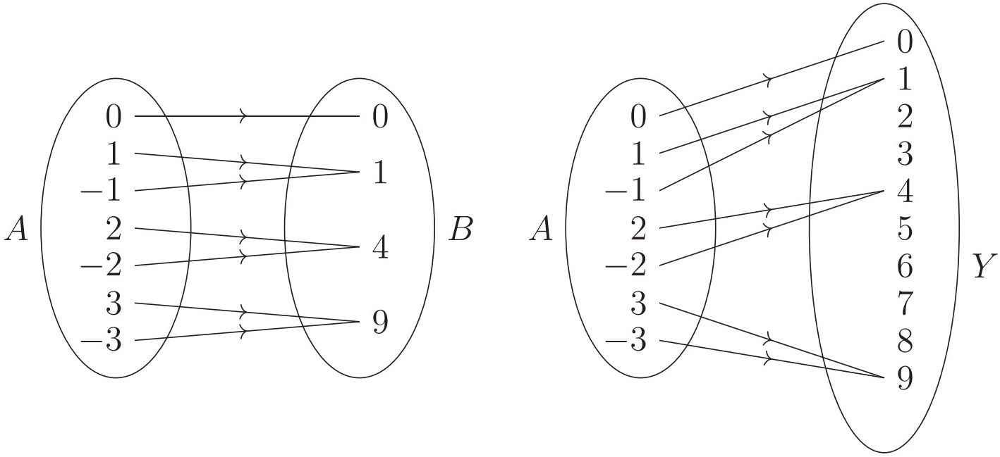

## 1.29 বিপরীত ফাংশন (Inverse Function)

<!-- higher-math-9-10-bn-c01-t1.29-p001 · text · p.24 -->
নিচের তিনটি চিত্রে তিনটি ফাংশন বর্ণনা করা হয়েছে।

<!-- higher-math-9-10-bn-c01-t1.29-p002 · figure · p.24 -->
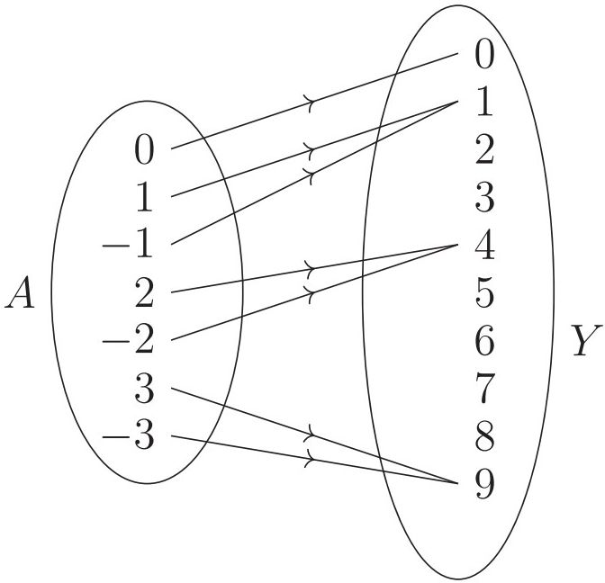

<!-- higher-math-9-10-bn-c01-t1.29-p003 · text · p.24 · review: verify-formula -->
ক) উপরের বামের চিত্রের ফাংশনটির অধীনে $a \to 1, b \to 2, c \to 4$। এই ফাংশনটি এক-এক কিন্তু সার্বিক নয় কেননা ৩ এর কোনো প্রাক প্রতিবিষ্টি নেই।

<!-- higher-math-9-10-bn-c01-t1.29-p004 · text · p.25 · review: verify-formula -->
খ) উপরের মার্কের চিত্রে ফাংশনটির অধীনে $a \to 1, b \to 2, c \to 2$। এই ফাংশনটি সার্বিক কিন্তু এক-এক নয় কেননা $b$ ও $c$ এর প্রতিবিস্ব ২।

<!-- higher-math-9-10-bn-c01-t1.29-p005 · text · p.25 · review: verify-formula -->
গ) উপরের ডানের চিত্রে ফাংশনটির অধীনে $a \to 2, b \to 1, c \to 3$। এই ফাংশনটি এক-এক ও সার্বিক। শেখোন্ত্র ক্ষেত্রে কোডোমেন $D$ এর প্রত্যেক উপাদানের জন্য ডোমেন $A$ এর একটি ও কেবল একটি উপাদান নির্দিষ্ট হয়েছে। ফলে, $D$ হতে $A$ তে একটি ফাংশন বর্ণিত হয়েছে, যেই ফাংশনকে প্রদত্ত ফাংশনের বিপরীত ফাংশন বলা হয়।

<!-- higher-math-9-10-bn-c01-t1.29-p006 · definition · p.25 · review: verify-formula -->
**সংজ্ঞা ৯ (বিপরীত ফাংশন):** মনে করি, $f : A \to B$ একটি এক-এক ও সার্বিক ফাংশন। একটি ফাংশন $g : B \to A$ বর্ণিত হয় যেখানে প্রত্যেক $b \in B$ এর জন্য $g(b) = a$ যদি ও কেবল যদি $f(a) = b$ হয়। এই ফাংশন $g$ কে $f$ এর বিপরীত ফাংশন বলা হয় এবং $f^{-1}$ দ্বারা নির্দেশ করা হয় অর্থাৎ $g = f^{-1}$।

<!-- higher-math-9-10-bn-c01-t1.29-p007 · text · p.25 · review: verify-formula -->
পূর্বে পৃষ্ঠার ডানের চিত্রে বর্ণিত ফাংশনটি $f$ হলে $f^{-1} : D \to A$ এবং $f^{-1}(1) = b, f^{-1}(2) = a, f^{-1}(3) = c$। উপরের অন্য দুটি চিত্রে বর্ণিত ফাংশন দুটির বিপরীত ফাংশন সন্বব নয়।

<!-- higher-math-9-10-bn-c01-t1.29-p008 · text · p.25 · review: verify-formula -->
**উদাহরণ ২৪.** মনে করি, $A = \{2, 3, 5, 7\}$ এবং $B = \{1, 2, 4, 7, 10\}$। $A$ এর যে যে সদস্য দ্বারা $B$ এর যে যে সদস্য বিভাজ্য হয় এদেরকে নিচের চিত্রে তীর চিহ্নিত করে দেখানো হলো:

<!-- higher-math-9-10-bn-c01-t1.29-p009 · text · p.25 -->
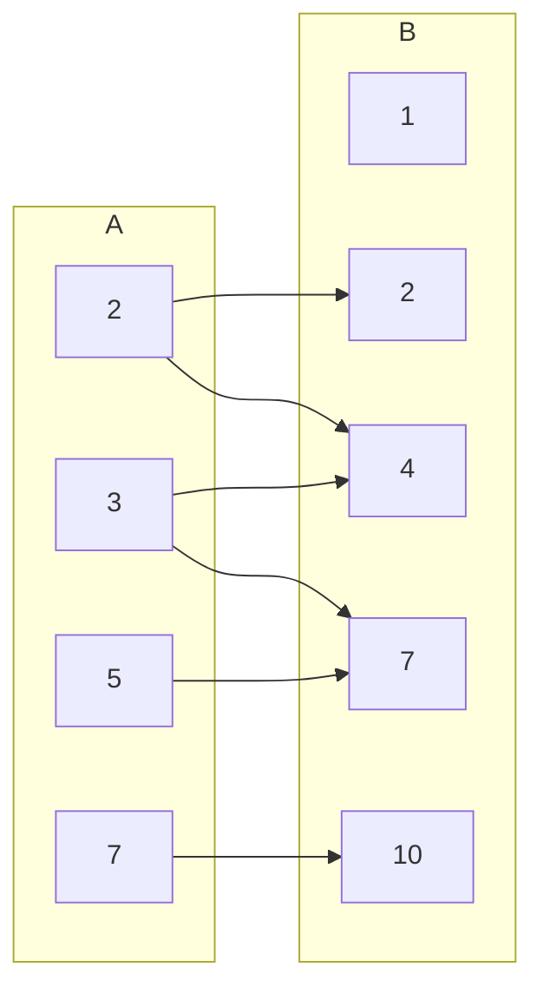

<!-- higher-math-9-10-bn-c01-t1.29-p010 · text · p.25 · review: known-confusable-corrected,verify-formula -->
এখানে $D = \{(2,2), (2,4), (2,10), (5,10), (7,7)\}$ এরূপ অন্বিত সদস্যদের দ্বারা গঠিত ক্রমজোড়গুলোর সেট, যা দ্বারা এই বিভাজ্যতা সম্পর্কটি বর্ণনা করা যায়। $D$ সেট অন্তর্ভুক্ত ক্রমজোড়গুলোর প্রথম অংশ $A$ এর সদস্য ও দ্বিতীয় অংশ $B$ এর সদস্য যেখানে প্রথম অংশ দ্বারা দ্বিতীয় অংশ বিভাজ্য। অর্থাৎ, $D \subset A \times B$ এবং $D = \{(x,y) : x \in A, y \in B  এবং  x  দ্বারা  y  বিভাজ্য\}$, এখানে $D$ সেটটি $A$ সেট থেকে $B$ সেটে একটি অন্বয়।

<!-- higher-math-9-10-bn-c01-t1.29-p011 · text · p.25 · review: verify-formula -->
**উদাহরণ ২৫.** বাস্তব সংখ্যার ক্রমজোড়ের সেট $L = \{(x,y) : x \in R, y \in R  এবং  x < y\}$ বিবেচনা করি। দুটি বাস্তব সংখ্যা $a, b$ এর জন্য $a < b$ যদি ও কেবল যদি $(a,b) \in L$ হয়। সুতরাং $L$ সেট দ্বারা বাস্তব সংখ্যার ছোটো-বড়ো সম্পর্ক বর্ণিত হয়।

<!-- higher-math-9-10-bn-c01-t1.29-p012 · text · p.25 · review: known-confusable-corrected -->
**উদাহরণ ২৬.** নিচের কোন অন্বয়টি (relation) ফাংশন নয়? যুক্তি দাও।

<!-- higher-math-9-10-bn-c01-t1.29-p013 · text · p.25 -->
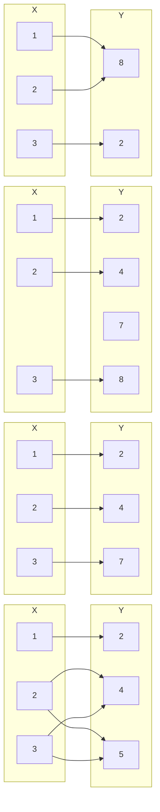

<!-- higher-math-9-10-bn-c01-t1.29-p014 · text · p.26 · review: verify-formula -->
**সমাধান:** উপরের বাম পাশের সম্পর্কটি ফাংশন নয় কারণ $2 \to 4$, $2 \to 5$ এবং $3 \to 4$, $3 \to 5$। বাকি তিনটি সম্পর্কই ফাংশন।

<!-- higher-math-9-10-bn-c01-t1.29-p015 · text · p.26 · review: verify-formula -->
**উদাহরণ ২৭.** $f : x \to 2x^2 + 1$ ফাংশনের রেঞ্জ নির্ণয় কর যেখানে ডোমেন $X = \{1, 2, 3\}$।

<!-- higher-math-9-10-bn-c01-t1.29-p016 · text · p.26 · review: verify-formula -->
**সমাধান:** $f(x) = 2x^2 + 1$ যেখানে $x \in X$।

<!-- higher-math-9-10-bn-c01-t1.29-p017 · text · p.26 · review: verify-formula -->
$f(1) = 2(1)^2 + 1 = 3$, $f(2) = 2(2)^2 + 1 = 9$ এবং $f(3) = 2(3)^2 + 1 = 19$।

<!-- higher-math-9-10-bn-c01-t1.29-p018 · text · p.26 · review: verify-formula -->
$\therefore \{1, 2, 3\}$ এর রেঞ্জ সেট $= \{3, 9, 19\}$।

<!-- higher-math-9-10-bn-c01-t1.29-p019 · text · p.26 · review: verify-formula -->
**উদাহরণ ২৮.** $f : x \to mx + c$ ফাংশনের জন্য 2 এবং 4 এর প্রতিবিম্ব যথাক্রমে 7 ও $-1$। তাহলে নির্ণয় করো:

<!-- higher-math-9-10-bn-c01-t1.29-p020 · text · p.26 · review: verify-formula -->
ক) $m$ এবং $c$ এর মান।
খ) $f$ এর অধীনে 5 এর প্রতিবিম্ব।
গ) $f$ এর অধীনে 3 এর প্রাক প্রতিবিম্ব।

<!-- higher-math-9-10-bn-c01-t1.29-p021 · text · p.26 -->
**সমাধান:**

<!-- higher-math-9-10-bn-c01-t1.29-p022 · text · p.26 · review: verify-formula -->
ক) $f(x) = mx + c$ এ দেওয়া আছে

<!-- higher-math-9-10-bn-c01-t1.29-p023 · text · p.26 · review: verify-formula -->
$f : 2 \to 7$ অর্থাৎ $f(2) = 7$ বা, $2m + c = 7$ (1)

<!-- higher-math-9-10-bn-c01-t1.29-p024 · text · p.26 · review: verify-formula -->
$f : 4 \to -1$ অর্থাৎ $f(4) = -1$ বা, $4m + c = -1$ (2)

<!-- higher-math-9-10-bn-c01-t1.29-p025 · text · p.26 · review: verify-formula -->
(1) ও (2) থেকে পাই $m = -4$ এবং $c = 15$

<!-- higher-math-9-10-bn-c01-t1.29-p026 · text · p.26 · review: verify-formula -->
খ) $f$ এর অধীনে 5 এর প্রতিবিম্ব $f(5) = -4 \times 5 + 15 = -5$

<!-- higher-math-9-10-bn-c01-t1.29-p027 · text · p.26 · review: verify-formula -->
গ) 3 এর প্রাক প্রতিবিম্ব $x$ হলে $f(x) = 3$ অর্থাৎ $-4x + 15 = 3$ বা $x = 3$

<!-- higher-math-9-10-bn-c01-t1.29-p028 · text · p.26 · review: known-confusable-corrected,verify-formula -->
> **কাজ:** $F = \{(-2, 4), (-1, 1), (0, 0), (1, 1), (2, 4)\}$ অন্বয়টি কী ফাংশন? এর ডোমেন ও রেঞ্জ নির্ণয় কর। সম্ভব হলে $F$ এর জন্য একটি সূত্র নির্ণয় করো।

<!-- higher-math-9-10-bn-c01-t1.29-p029 · text · p.26 · review: known-confusable-corrected,verify-formula -->
**মন্তব্য:** কোনো ফাংশন $F$ এর ডোমেন এবং ডোমেনের প্রত্যেক সদস্য $x$ এর অনন্য প্রতিবিম্ব $F(x)$ নির্দিষ্ট করা হলেই ফাংশনটি নির্ধারিত হয়। অনেক সময় ডোমেন উহু রাখা হয়। এরূপ ক্ষেত্রে ডোমেন হিসেবে ঐ সেটকে গ্রহণ করা হয়, যার প্রত্যেক উপাদানের জন্য $F(x)$ নির্ধারিত থাকে।

<!-- higher-math-9-10-bn-c01-t1.29-p030 · text · p.26 · review: verify-formula -->
**উদাহরণ ২৯.** $F(x) = \sqrt{1 - x}$ দ্বারা বর্ণিত ফাংশনের ডোমেন নির্ণয় করো। $F(-3), F(0), F\left(\frac{1}{2}\right), F(1), F(2)$ এর মধ্যে যেগুলো সংজ্ঞায়িত সেগুলো নির্ণয় করো।

<!-- higher-math-9-10-bn-c01-t1.29-p031 · text · p.26 · review: verify-formula -->
**সমাধান:** $F(x) = \sqrt{1 - x} \in R$ যদি ও কেবল যদি $1 - x \ge 0$ বা $1 \ge x$ অর্থাৎ, $x \le 1$

<!-- higher-math-9-10-bn-c01-t1.29-p032 · text · p.26 · review: verify-formula -->
সুতরাং ডোম $F = \{x : x \in R  এবং  x \le 1\}$ এখানে $F(-3) = \sqrt{1 - (-3)} = \sqrt{4} = 2$

<!-- higher-math-9-10-bn-c01-t1.29-p033 · formula · p.27 · review: verify-formula -->
$F(0) = \sqrt{1 - 0} = \sqrt{1} = 1$

<!-- higher-math-9-10-bn-c01-t1.29-p034 · formula · p.27 · review: verify-formula -->
$F\left(\frac{1}{2}\right) = \sqrt{1 - \frac{1}{2}} = \sqrt{\frac{1}{2}} = \frac{1}{\sqrt{2}}$

<!-- higher-math-9-10-bn-c01-t1.29-p035 · formula · p.27 · review: verify-formula -->
$F(1) = \sqrt{1 - 1} = 0$

<!-- higher-math-9-10-bn-c01-t1.29-p036 · text · p.27 · review: verify-formula -->
$F(2)$ সংজ্ঞায়িত নয়, কেননা $2 \notin$ ডোমেন $F$।

### কাজ:

<!-- higher-math-9-10-bn-c01-t1.29-p037 · text · p.27 · review: known-confusable-corrected -->
ক) নিচের কোন অন্বয়টি ফাংশন নয়? যুক্তি দাও।

<!-- higher-math-9-10-bn-c01-t1.29-p038 · text · p.27 -->
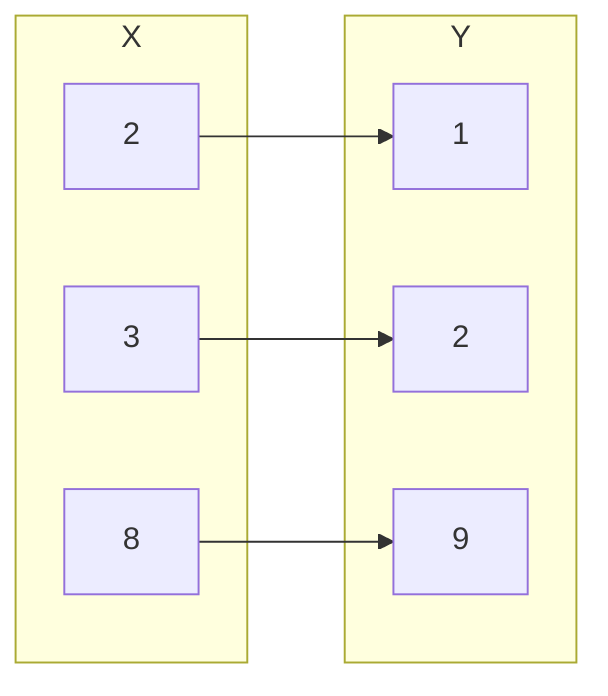

<!-- higher-math-9-10-bn-c01-t1.29-p039 · text · p.27 -->
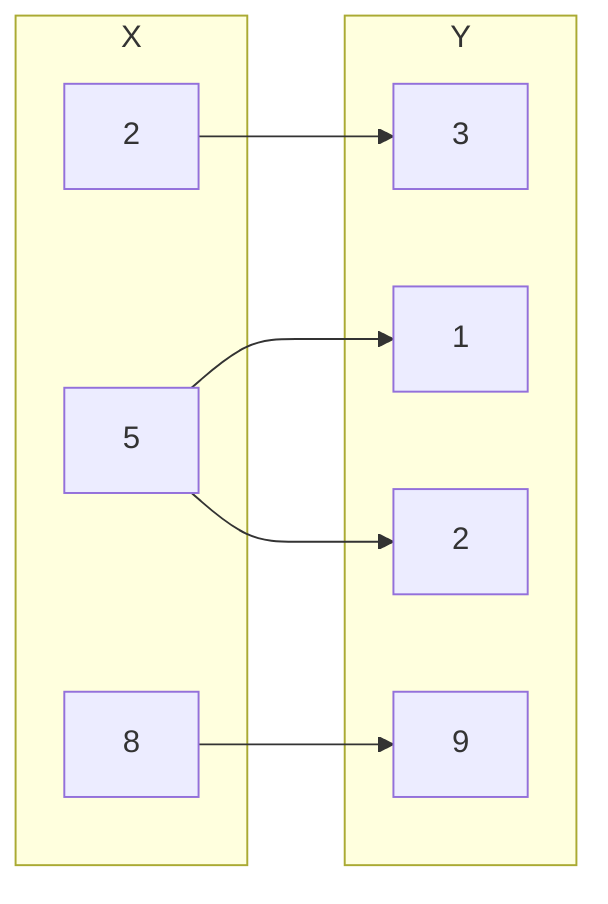

<!-- higher-math-9-10-bn-c01-t1.29-p040 · text · p.27 -->
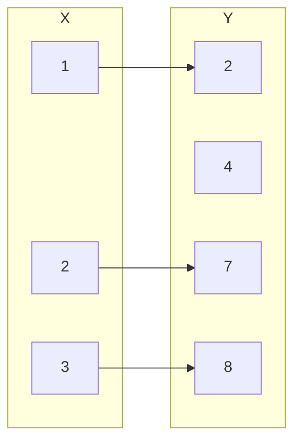

<!-- higher-math-9-10-bn-c01-t1.29-p041 · text · p.27 -->
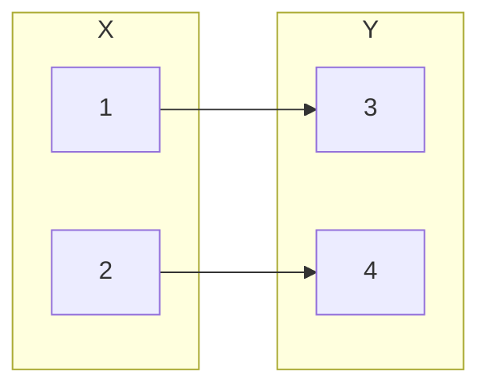

<!-- higher-math-9-10-bn-c01-t1.29-p042 · text · p.27 · review: verify-formula -->
খ) $f : x \to 4x + 2$ দ্বারা বর্ণিত ফাংশন যার ডোমেন $D = \{-1, 3, 5\}$। ফাংশনটির রেঞ্জ সেট নির্ণয় করো।

<!-- higher-math-9-10-bn-c01-t1.29-p043 · text · p.27 · review: known-confusable-corrected,verify-formula -->
গ) প্রদত্ত $S$ অন্বয়টিকে তালিকা পদ্ধতিতে বর্ণনা কর এবং কোনগুলো ফাংশন তা নির্ধারণ করো। ডোমেন $S$ ও রেঞ্জ $S$ নির্ণয় করো, যেখানে $A = \{-2, -1, 0, 1, 2\}$।

<!-- higher-math-9-10-bn-c01-t1.29-p044 · text · p.27 · review: verify-formula -->
(১) $S = \{(x, y) : x \in A, y \in A  এবং  x + y = 1\}$

<!-- higher-math-9-10-bn-c01-t1.29-p045 · text · p.27 · review: verify-formula -->
(২) $S = \{(x, y) : x \in A, y \in A  এবং  x - y = 1\}$

<!-- higher-math-9-10-bn-c01-t1.29-p046 · text · p.27 · review: verify-formula -->
(৩) $S = \{(x, y) : x \in A, y \in A  এবং  y = x^2\}$

<!-- higher-math-9-10-bn-c01-t1.29-p047 · text · p.27 · review: verify-formula -->
(৪) $S = \{(x, y) : x \in A, y \in A  এবং  y^2 = x\}$

<!-- higher-math-9-10-bn-c01-t1.29-p048 · text · p.27 · review: verify-formula -->
ঘ) $F(x) = 2x - 1$ দ্বারা বর্ণিত ফাংশনের জন্য

<!-- higher-math-9-10-bn-c01-t1.29-p049 · text · p.27 · review: verify-formula -->
(১) $F(-2), F(0)$, এবং $F(2)$ নির্ণয় করো।

<!-- higher-math-9-10-bn-c01-t1.29-p050 · text · p.27 · review: verify-formula -->
(২) $F\left(\frac{a + 1}{2}\right)$ নির্ণয় করো, যেখানে $a \in R$।

<!-- higher-math-9-10-bn-c01-t1.29-p051 · text · p.27 · review: verify-formula -->
(৩) $F(x) = 5$ হলে $x$ নির্ণয় করো।

<!-- higher-math-9-10-bn-c01-t1.29-p052 · text · p.27 · review: verify-formula -->
(৪) $F(x) = y$ হলে $x$ নির্ণয় করো, যেখানে $y \in R$।

## 1.30 এক-এক ফাংশন (One-One Function)

<!-- higher-math-9-10-bn-c01-t1.30-p001 · text · p.27 · review: known-confusable-corrected,verify-formula -->
নিচের ভেনচিত্রে $f$ ফাংশনের অধীনে ভিন্ন ভিন্ন সদস্যের প্রতিবিম্ব সর্বদা ভিন্ন।

<!-- higher-math-9-10-bn-c01-t1.30-p002 · text · p.28 -->
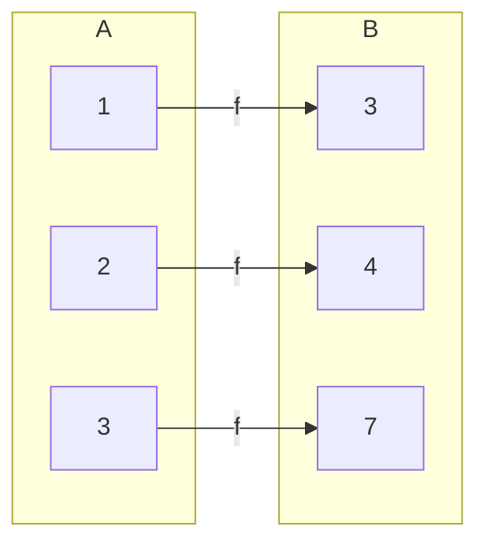

<!-- higher-math-9-10-bn-c01-t1.30-p003 · definition · p.28 · review: verify-formula -->
**সংজ্ঞা ১০ (এক-এক ফাংশন):** যদি কোনো ফাংশন $f$ এর অধীনে এর ডোমেনের ভিন্ন ভিন্ন সদস্যের প্রতিবিষ্টি সর্বদা ভিন্ন হয়, তবে ফাংশনটিকে এক-এক (one-one) ফাংশন বলা হয়। অর্থাৎ $x_1, x_2 \in$ ডোম $f$ এবং $x_1 \neq x_2$ হলে $f(x_1) \neq f(x_2)$।

<!-- higher-math-9-10-bn-c01-t1.30-p004 · text · p.28 · review: verify-formula -->
উপরের সংজ্ঞা থেকে দেখা যায়, একটি ফাংশন $f : A \to B$ এক-এক ফাংশন হবে, যদি ও কেবল যদি $f(x_1) = f(x_2)$ হলে $x_1 = x_2$ হয় যেখানে $x_1, x_2 \in A$।

<!-- higher-math-9-10-bn-c01-t1.30-p005 · text · p.28 · review: verify-formula -->
**উদাহরণ ৩০.** $f(x) = 3x + 5, x \in R$ ফাংশনটি কি এক-এক ফাংশন?

<!-- higher-math-9-10-bn-c01-t1.30-p006 · text · p.28 · review: verify-formula -->
**সমাধান:** মনে করি $a, b \in R$ এবং $f(a) = f(b)$।

<!-- higher-math-9-10-bn-c01-t1.30-p007 · text · p.28 · review: verify-formula -->
তাহলে $3a + 5 = 3b + 5$ বা, $3a = 3b$ বা, $a = b$।

<!-- higher-math-9-10-bn-c01-t1.30-p008 · text · p.28 · review: verify-formula -->
সুতরাং $f$ ফাংশনটি এক-এক।

<!-- higher-math-9-10-bn-c01-t1.30-p009 · text · p.28 · review: verify-formula -->
**উদাহরণ ৩১.** দেখাও যে, $F : R \to R, F(x) = x^2$ ফাংশনটি এক-এক নয়।

<!-- higher-math-9-10-bn-c01-t1.30-p010 · text · p.28 · review: verify-formula -->
**সমাধান:** $x_1 = -1, x_2 = 1$ নিয়ে দেখি যে, $x_1 \in$ ডোম $F, x_2 \in$ ডোম $F$ এবং $x_1 \neq x_2$।

<!-- higher-math-9-10-bn-c01-t1.30-p011 · text · p.28 · review: verify-formula -->
কিন্তু $F(x_1) = F(-1) = (-1)^2 = 1, F(x_2) = F(1) = (1)^2 = 1$।

<!-- higher-math-9-10-bn-c01-t1.30-p012 · text · p.28 · review: verify-formula -->
অর্থাৎ $F(x_1) = F(x_2), \therefore F$ এক-এক নয়।

<!-- higher-math-9-10-bn-c01-t1.30-p013 · text · p.28 -->
**দ্রষ্টব্য:** কোনো ফাংশনের বিপরীত অহয় ফাংশন নাও হতে পারে।

<!-- higher-math-9-10-bn-c01-t1.30-p014 · text · p.28 · review: known-confusable-corrected,verify-formula -->
**উদাহরণ ৩২.** $f(x) = \frac{x}{x - 2}, x \neq 2$ বর্ণিত ফাংশনের জন্য নির্ণয় করো:
ক) $f(5)$
খ) $f^{-1}(2)$

<!-- higher-math-9-10-bn-c01-t1.30-p015 · text · p.28 -->
**সমাধান:**

<!-- higher-math-9-10-bn-c01-t1.30-p016 · text · p.28 · review: verify-formula -->
ক) $f(x) = \frac{x}{x - 2}, x \neq 2$

<!-- higher-math-9-10-bn-c01-t1.30-p017 · formula · p.28 · review: verify-formula -->
$\therefore f(5) = \frac{5}{5 - 2} = \frac{5}{3} = 1\frac{2}{3}$

<!-- higher-math-9-10-bn-c01-t1.30-p018 · text · p.28 · review: verify-formula -->
খ) ধরি, $a = f^{-1}(2)$ তাহলে $f(a) = 2$

<!-- higher-math-9-10-bn-c01-t1.30-p019 · formula · p.28 · review: verify-formula -->
$\implies \frac{a}{a - 2} = 2 \implies a = 2a - 4 \implies a = 4$

<!-- higher-math-9-10-bn-c01-t1.30-p020 · formula · p.28 · review: verify-formula -->
$\therefore f^{-1}(2) = 4$

<!-- higher-math-9-10-bn-c01-t1.30-p021 · text · p.28 · review: verify-formula -->
**উদাহরণ ৩৩.** $f(x) = 3x + 1, 0 \leq x \leq 2$ ক) $f$ এর রেঞ্জ নির্ণয় করো।

<!-- higher-math-9-10-bn-c01-t1.30-p022 · text · p.29 · review: verify-formula -->
খ) দেখাও যে $f$ এক-এক ফাংশন।

<!-- higher-math-9-10-bn-c01-t1.30-p023 · text · p.29 · review: verify-formula -->
গ) $f^{-1}$ নির্ণয় কর এবং $f$ ও $f^{-1}$ এর লেখচিত্র অঙ্কন করো।

### সমাধান:

<!-- higher-math-9-10-bn-c01-t1.30-p024 · text · p.29 · review: verify-formula -->
ক) $f(x) = 3x + 1, 0 \le x \le 2$ হতে পাই প্রান্ত বিন্দুদ্বয় $(0, 1)$ এবং $(2, 7)$

<!-- higher-math-9-10-bn-c01-t1.30-p025 · text · p.29 · review: verify-formula -->
$\therefore$ রেঞ্জ $f : R = \{y : 1 \le y \le 7\}$

<!-- higher-math-9-10-bn-c01-t1.30-p026 · text · p.29 · review: verify-formula -->
খ) যেহেতু প্রত্যেক $y \in R$ এর জন্য একমাত্র $x \in \{0 \le x \le 2\}$ এর ইমেজ $y$ দেখানো হয়েছে। সুতরাং $f$ এক-এক ফাংশন।

<!-- higher-math-9-10-bn-c01-t1.30-p027 · text · p.29 · review: verify-formula -->
গ) ধরি, $y = f(x), x$ এর ইমেজ।

<!-- higher-math-9-10-bn-c01-t1.30-p028 · figure · p.29 -->
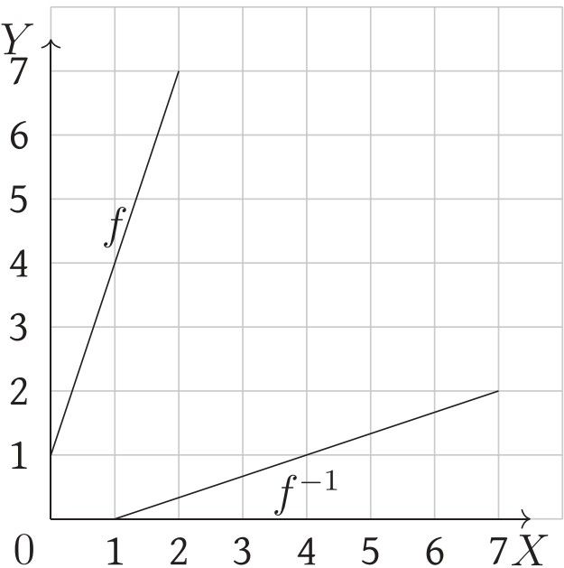

<!-- higher-math-9-10-bn-c01-t1.30-p029 · text · p.29 · review: verify-formula -->
তাহলে, $y = 3x + 1 \implies x = \frac{1}{3}(y - 1)$ যা লেখচিত্রে দেখানো হয়েছে।

<!-- higher-math-9-10-bn-c01-t1.30-p030 · text · p.29 · review: verify-formula -->
বিপরীত ফাংশন $f^{-1} : y \to x$ যেখানে, $x = \frac{1}{3}(y - 1)$

<!-- higher-math-9-10-bn-c01-t1.30-p031 · text · p.29 · review: verify-formula -->
বা, $f^{-1} : y \to \frac{1}{3}(y - 1)$ যা চিত্রে দেখানো হয়েছে।

<!-- higher-math-9-10-bn-c01-t1.30-p032 · text · p.29 · review: verify-formula -->
$y$ এর স্থানে $x$ স্থাপন করে পাই, $f^{-1} : x \to \frac{1}{3}(x - 1)$

<!-- higher-math-9-10-bn-c01-t1.30-p033 · text · p.29 · review: verify-formula -->
$f^{-1}$ এর অঙ্কিত রেখা $y = \frac{1}{3}(x - 1), 1 \le x \le 7$ দেখানো হয়েছে।

## 1.31 সার্বিক ফাংশন (Onto Function)

<!-- higher-math-9-10-bn-c01-t1.31-p001 · text · p.29 · review: verify-formula -->
চিত্রে ফাংশন $f$ এর অধীনে সেট $A = \{1, 2, 3\}$ এবং $B = \{5, 7, 9\}$ বিবেচনা করি যেখানে $1 \to 5, 2 \to 7$ এবং $3 \to 9$ অর্থাৎ $B$ এর প্রত্যেক উপাদান $A$ সেটের একটি উপাদানের প্রতিবিষ্ণ। এইরূপ ফাংশনকে সার্বিক ফাংশন বলা হয়।

<!-- higher-math-9-10-bn-c01-t1.31-p002 · text · p.29 -->
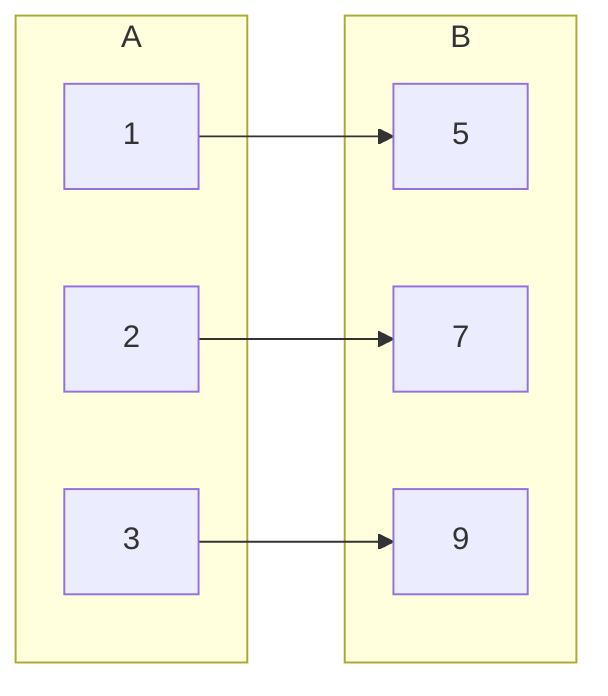

<!-- higher-math-9-10-bn-c01-t1.31-p003 · definition · p.29 · review: verify-formula -->
**সংজ্ঞা ১১ (সার্বিক ফাংশন).** একটি ফাংশন $f : A \to B$ কে সার্বিক ফাংশন (onto function) বলা হবে যদি প্রত্যেক $b \in B$ এর জন্য একটি $a \in A$ পাওয়া যায় যেন $f(a) = b$ হয়। অর্থাৎ $B =$ রেঞ্জ $f$।

<!-- higher-math-9-10-bn-c01-t1.31-p004 · text · p.29 · review: verify-formula -->
**উদাহরণ ৩৪.** যদি $f : R \to R$ এবং $g : R \to R$ ফাংশন দুটি $f(x) = x + 5$ এবং $g(x) = x - 5$ দ্বারা সংজ্ঞায়িত হয়, তবে দেখাও যে, $f$ এর বিপরীত ফাংশন $g$।

<!-- higher-math-9-10-bn-c01-t1.31-p005 · text · p.30 · review: verify-formula -->
**সমাধান:** $f$ ফাংশনটি এক-এক, কেননা
$$f(x_1) = f(x_2)  হলে  x_1 + 5 = x_2 + 5  বা,  x_1 = x_2 ।$$

<!-- higher-math-9-10-bn-c01-t1.31-p006 · text · p.30 · review: latin-junk,verify-formula -->
আবার, $f$ ফাংশনটি সার্বিক, কেননা
$$y = f(x)  হলে  x + 5 = y  বা,  x = y - 5 \in R ।$$

<!-- higher-math-9-10-bn-c01-t1.31-p007 · text · p.30 · review: verify-formula -->
সুতরাং বিপরীত ফাংশন $f^{-1}$ বিদ্যমান।
$$f^{-1}(x) = y  হলে  f(y) = x  বা,  y + 5 = x  বা,  y = x - 5$$

<!-- higher-math-9-10-bn-c01-t1.31-p008 · text · p.30 · review: verify-formula -->
আবার, $f^{-1}(x) = x - 5 = g(x)$
$f^{-1}$ ও $g$ উভয়ের ডোমেন একই হওয়ায় $f^{-1} = g$

### কাজ:

<!-- higher-math-9-10-bn-c01-t1.31-p009 · text · p.30 · review: verify-formula -->
ক) নিম্নের প্রতিটি এক-এক ফাংশনের জন্য সংশ্লিষ্ট $f^{-1}$ নির্ণয় করো, যদি বিদ্যমান হয়।
(১) $f(x) = \frac{3}{x - 1}, x \neq 1$ (২) $f(x) = \frac{2x}{x - 2}, x \neq 2$
(৩) $f : x \to \frac{2x + 3}{2x - 1}, x \neq \frac{1}{2}$

<!-- higher-math-9-10-bn-c01-t1.31-p010 · text · p.30 · review: verify-formula -->
খ) বর্ণিত ফাংশন $f(x) = \frac{4x - 9}{x - 2}, x \neq 2$ এর ক্ষেত্রে যদি $f^{-1}$ বিদ্যমান হয় তবে
(১) $f^{-1}(-1)$ এবং $f^{-1}(1)$ নির্ণয় করো।
(২) $x$ এর মান নির্ণয় করো, যেন $4f^{-1}(x) = x$

<!-- higher-math-9-10-bn-c01-t1.31-p011 · text · p.30 · review: verify-formula -->
গ) বর্ণিত ফাংশন $f(x) = \frac{2x + 2}{x - 1}, x \neq 1$ এর জন্য যদি $f^{-1}$ বিদ্যমান হয় তবে
(১) $f^{-1}(3)$ নির্ণয় করো।
(২) $f^{-1}(p) = kp, p$ এর সাপেক্ষে $k$ কে প্রকাশ করো।

<!-- higher-math-9-10-bn-c01-t1.31-p012 · text · p.30 · review: verify-formula -->
ঘ) নিম্নোক্ত প্রত্যেক ক্ষেত্রে প্রদত্ত সম্পর্ক $F$ একটি ফাংশন কিনা তা নির্ণয় করো। $F$ ফাংশন হলে উহার ডোমেন এবং রেঞ্জ নির্ণয় করো, উহা এক-এক কিনা তাও নির্ধারণ করো:
(১) $F = \{(x, y) \in R^2 : y = x\}$ (২) $F = \{(x, y) \in R^2 : y = x^2\}$
(৩) $F = \{(x, y) \in R^2 : y^2 = x\}$ (৪) $F = \{(x, y) \in R^2 : y = \sqrt{x}\}$

<!-- higher-math-9-10-bn-c01-t1.31-p013 · text · p.30 · review: verify-formula -->
ঙ) যদি $f : \{-2, -1, 0, 1, 2\} \to \{-8, -1, 0, 1, 8\}$ ফাংশনটি $f(x) = x^3$ দ্বারা সংজ্ঞায়িত হয় তবে দেখাও যে, $f$ এক-এক এবং সার্বিক।

<!-- higher-math-9-10-bn-c01-t1.31-p014 · text · p.30 · review: verify-formula -->
চ) $f : \{1, 2, 3, 4\} \to R$ একটি ফাংশন যা $f(x) = 2x + 1$ দ্বারা সংজ্ঞায়িত। দেখাও যে, $f$ এক-এক ফাংশন কিন্তু সার্বিক ফাংশন নয়।

## 1.32 অন্তর ও ফাংশনের লেখচিত্র

<!-- higher-math-9-10-bn-c01-t1.32-p001 · text · p.31 · review: verify-formula -->
লেখচিত্র হলো ফাংশনের জ্যামিতিক উপস্থাপন। $y = f(x)$ লেখচিত্র অঙ্কনের জন্য $O$ বিন্দুতে পরস্পর ছেদী লম্ব দুটি সরলরেখা $XOX'$ এবং $YOY'$ নেওয়া হয়। $O$ কে মূলবিন্দু, $XOX'$ কে $x$ অক্ষ এবং $YOY'$ কে $y$ অক্ষ বলা হয়।

<!-- higher-math-9-10-bn-c01-t1.32-p002 · text · p.31 · review: verify-formula -->
$y = f(x)$ ফাংশনের লেখচিত্র অঙ্কনের জন্য $a \le x \le b$ ব্যবধিতে স্বাধীন চলক $x$ এবং অধীন চলক $y$ এর মানগুলোর তালিকা প্রস্তুত করতে হয়। অতঃপর তালিকার সীমিত সংখ্যক বিন্দুগুলোকে $xy$ সমতলে স্থাপন করতে হয়। প্রাপ্ত বিন্দুগুলোকে সরলরেখা অথবা বক্ররেখা দ্বারা যুক্ত করলে $y = f(x)$ ফাংশনের লেখচিত্র পাওয়া যায়। নবম-দশম শ্রেণির গণিতে লেখচিত্র সম্পর্কে প্রাথমিক ধারণা প্রদান করা হয়েছে। এখানে, সরলরৈখিক (Linear) ফাংশন, দ্বিঘাত (Quadratic) ফাংশন এবং বৃত্তের লেখচিত্র অঙ্কন সম্পর্কে আলোচনা করা হয়েছে।

## 1.33 সরলরৈখিক ফাংশন

<!-- higher-math-9-10-bn-c01-t1.33-p001 · text · p.31 · review: verify-formula -->
সরলরৈখিক ফাংশন এর সাধারণ রূপ হলো $f(x) = mx + b$ যেখানে, $m$ এবং $b$ বাস্তব সংখ্যা। এর লেখচিত্র একটি রেখা যার ঢাল হলো $m$ এবং $y$ অক্ষের ছেদক $b$।

<!-- higher-math-9-10-bn-c01-t1.33-p002 · text · p.31 · review: verify-formula -->
এখানে, ধরি $m = 3$ এবং $b = 2$ তাহলে ফাংশনটি দাঁড়ায় $f(x) = 3x + 2$

<!-- higher-math-9-10-bn-c01-t1.33-p003 · text · p.31 · review: known-confusable-corrected,verify-formula -->
বর্ণিত ফাংশন হতে $x$ ও $y$ এর নিম্নরূপ সংশ্লিষ্ট মান পাওয়া যায়:

<!-- higher-math-9-10-bn-c01-t1.33-p004 · table · p.31 · review: verify-table -->
<table><tr><th>x</th><th>-2</th><th>-1</th><th>0</th><th>1</th><th>2</th></tr>
<tr><th>y</th><th>-4</th><th>-1</th><th>2</th><th>5</th><th>8</th></tr></table>

<!-- higher-math-9-10-bn-c01-t1.33-p005 · figure · p.31 -->
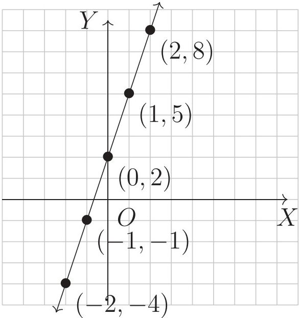

<!-- higher-math-9-10-bn-c01-t1.33-p006 · text · p.31 -->
∴ ফাংশনটির লেখ পাশে দেখানো হলো।

## 1.34 দ্বিঘাত ফাংশন (Quadratic Function)

<!-- higher-math-9-10-bn-c01-t1.34-p001 · text · p.31 · review: known-confusable-corrected,verify-formula -->
দ্বিঘাত ফাংশন হলো একটি ফাংশন যা $y = ax^2 + bx + c$ সমীকরণ দ্বারা বর্ণিত যেখানে $a, b$ ও $c$ বাস্তব সংখ্যা এবং $a \neq 0$। প্রদত্ত ফাংশনে ধরি $a = 1, b = -4, c = -1$। তাহলে $y = ax^2 + bx + c$ কে লেখা যায় $y = x^2 - 4x - 1$। বর্ণিত ফাংশন হতে $x$ ও $y$ এর সংশ্লিষ্ট মান পাওয়া যায় যা নিচের সারণিতে দেখানো হয়েছে।

<!-- higher-math-9-10-bn-c01-t1.34-p002 · table · p.32 · review: verify-table -->
<table><tr><th><em>x</em></th><th><em>x</em>2 — 4<em>x</em> — 1</th><th><em>y</em></th></tr>
<tr><td>-1</td><td>(-1)2 — 4(-1) — 1</td><td>4</td></tr>
<tr><td>0</td><td>(0)2 — 4(0) — 1</td><td>-1</td></tr>
<tr><td>1</td><td>(1)2 — 4(1) — 1</td><td>-4</td></tr>
<tr><td>2</td><td>(2)2 — 4(2) — 1</td><td>-5</td></tr>
<tr><td>3</td><td>(3)2 — 4(3) — 1</td><td>-4</td></tr>
<tr><td>4</td><td>(4)2 — 4(4) — 1</td><td>-1</td></tr>
<tr><td>5</td><td>(5)2 — 4(5) — 1</td><td>4</td></tr></table>

<!-- higher-math-9-10-bn-c01-t1.34-p003 · figure · p.32 -->
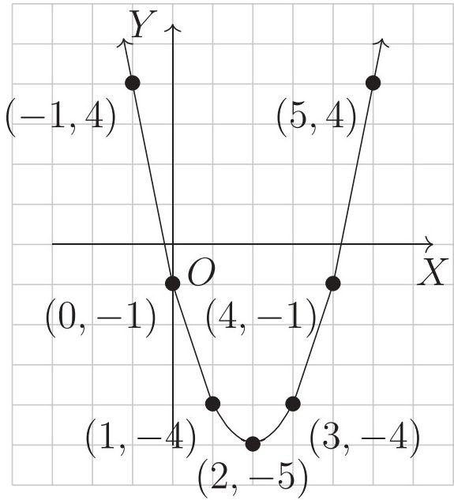

<!-- higher-math-9-10-bn-c01-t1.34-p004 · text · p.32 · review: known-confusable-corrected -->
উপরে দ্বিঘাত ফাংশনটির লেখচিত্র। এই দ্বিঘাত ফাংশন এর কিছু সাধারণ বৈশিষ্ট্য লক্ষ্য করি।

<!-- higher-math-9-10-bn-c01-t1.34-p005 · text · p.32 -->
ক) লেখচিত্রটি পরাবৃত্ত আকারের।

<!-- higher-math-9-10-bn-c01-t1.34-p006 · text · p.32 · review: verify-formula -->
খ) লেখচিত্রটির $y$ অক্ষের সমানতরাল রেখা বা $y$ অক্ষ বরাবর প্রতিসাম্য বিন্দু পাওয়া যাবে।

<!-- higher-math-9-10-bn-c01-t1.34-p007 · text · p.32 -->
গ) একটি বিন্দুতে ফাংশনটির মান সূত্রতম বা বৃহত্তম হবে।

## 1.35 বৃত্তের লেখচিত্র

<!-- higher-math-9-10-bn-c01-t1.35-p001 · text · p.32 · review: known-confusable-corrected,verify-formula -->
উল্লেখ্য যে $p, q$ ও $r$ ধ্রুবক এবং $r \neq 0$ হলে $R$ এ $S = \{(x, y) : (x - p)^2 + (y - q)^2 = r^2\}$ অন্বয়ের লেখ একটি বৃত্ত যার কেন্দ্র $(p, q)$ এবং ব্যাসার্ধ $r$ (নবম-দশম শ্রেণির গণিত দ্রষ্টব্য)। ছক কাগজে $(p, q)$ বিন্দু পাতন করে ঐ বিন্দুকে কেন্দ্র করে $r$ ব্যাসার্ধ নিয়ে বৃত্ত অঙ্কন করে লেখচিত্রটি পাওয়া যায়।

<!-- higher-math-9-10-bn-c01-t1.35-p002 · text · p.32 · review: known-confusable-corrected -->
**মন্তব্য:** যে অন্বয়ের সমাধান সেট অসীম, এর লেখচিত্র অঙ্কনের স্বীকৃত পদ্ধতি হলো যথেষ্ট সংখ্যক সমাধানের প্রতিরূপী বিন্দু ছক কাগজে পাতন করে সাবলীলভাবে ঐ সব বিন্দু যোগ করা, যাতে অন্বয়টির লেখচিত্রের ধরন দ্বারহীনভাবে বুঝা যায়। কিন্তু যে অন্বয়ের লেখচিত্র বৃত্ত, এর জন্য কম্পাস ব্যবহার করলে কাজ সহজ ও সুন্দর হয় বিধায় শেয়োক্ত পদ্ধতি অবলম্বন করা হলো।

<!-- higher-math-9-10-bn-c01-t1.35-p003 · text · p.32 · review: verify-formula -->
**উদাহরণ ৩৫.** $S = \{(x, y) : x^2 + y^2 = 16\}$

<!-- higher-math-9-10-bn-c01-t1.35-p004 · text · p.32 · review: verify-formula -->
সুতরাং $S$ এর লেখচিত্র একটি বৃত্ত, $x^2 + y^2 = 4^2$ যার কেন্দ্র $(0, 0)$ এবং ব্যাসার্ধ $r = 4$।

<!-- higher-math-9-10-bn-c01-t1.35-p005 · text · p.32 · review: verify-formula -->
$S$ এর লেখচিত্র নিমে দেখানো হলো:

<!-- higher-math-9-10-bn-c01-t1.35-p006 · figure · p.33 -->
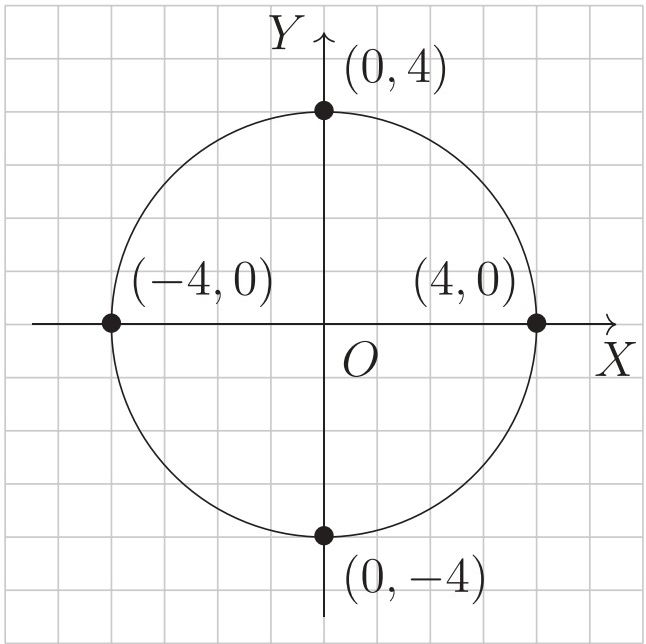

<!-- higher-math-9-10-bn-c01-t1.35-p007 · text · p.33 -->
**কাজ:**

<!-- higher-math-9-10-bn-c01-t1.35-p008 · text · p.33 · review: verify-formula -->
ক) নিম্নের প্রত্যেক ক্ষেত্রে প্রদত্ত সমীকরণ থেকে $y$ কে $x$ এর ফাংশন রূপে প্রকাশ করো।
(১) $y - 2 = 3(x - 5)$ (২) $y - 5 = -2(x + 1)$
(৩) $y - 2 = \frac{1}{2}(x + 3)$ (৪) $y - 5 = \frac{4}{3}(x - 3)$

<!-- higher-math-9-10-bn-c01-t1.35-p009 · text · p.33 · review: verify-formula -->
খ) লেখচিত্র অঙ্কন করো:
(১) $y = 3x - 1$ (২) $x + y = 3$
(৩) $x^2 + y^2 = 9$ (৪) $y = \frac{1}{3}x + 1$

<!-- higher-math-9-10-bn-c01-t1.35-p010 · text · p.33 · review: verify-formula -->
**উদাহরণ ৩৬.** দেওয়া আছে $f : x \rightarrow \frac{2x - 1}{2x + 3}$।

<!-- higher-math-9-10-bn-c01-t1.35-p011 · text · p.33 · review: verify-formula -->
ক) $f\left(-\frac{1}{3}\right) =$ কত?

<!-- higher-math-9-10-bn-c01-t1.35-p012 · text · p.33 -->
খ) ফাংশনটি এক-এক কিনা তা নির্ধারণ করো।

<!-- higher-math-9-10-bn-c01-t1.35-p013 · text · p.33 · review: verify-formula -->
গ) $2f^{-1}(x) = x$ হলে $x$ এর মান নির্ধারণ করো।

<!-- higher-math-9-10-bn-c01-t1.35-p014 · text · p.33 -->
**সমাধান:**

<!-- higher-math-9-10-bn-c01-t1.35-p015 · text · p.33 · review: verify-formula -->
ক) দেওয়া আছে, $f : x \rightarrow \frac{2x - 1}{2x + 3}$। সুতরাং $f(x) = \frac{2x - 1}{2x + 3}$।

<!-- higher-math-9-10-bn-c01-t1.35-p016 · formula · p.33 · review: verify-formula -->
$$f\left(-\frac{1}{3}\right) = \frac{2\left(-\frac{1}{3}\right) - 1}{2\left(-\frac{1}{3}\right) + 3} = \frac{-\frac{2}{3} - 1}{-\frac{2}{3} + 3} = \frac{-\frac{5}{3}}{\frac{7}{3}} = -\frac{5}{3} \cdot \frac{3}{7} = -\frac{5}{7}$$

<!-- higher-math-9-10-bn-c01-t1.35-p017 · text · p.33 · review: verify-formula -->
খ) দেওয়া আছে, $f : x \rightarrow \frac{2x - 1}{2x + 3}$। সুতরাং $f(x) = \frac{2x - 1}{2x + 3}$।

<!-- higher-math-9-10-bn-c01-t1.35-p018 · text · p.34 · review: verify-formula -->
এখানে $2x + 3 = 0$ হলে অর্থাৎ $x = -\frac{3}{2}$ হলে, ফাংশনটি অসংজ্ঞায়িত হয়।

<!-- higher-math-9-10-bn-c01-t1.35-p019 · text · p.34 · review: verify-formula -->
$\therefore x \neq -\frac{3}{2}$, সুতরাং ডোম $f = R \setminus \left\{ -\frac{3}{2} \right\}$।

<!-- higher-math-9-10-bn-c01-t1.35-p020 · text · p.34 · review: verify-formula -->
ধরি, $x_1 \in$ ডোম $f$ এবং $x_2 \in$ ডোম $f$

<!-- higher-math-9-10-bn-c01-t1.35-p021 · text · p.34 · review: verify-formula -->
$\therefore f(x_1) = \frac{2x_1 - 1}{2x_1 + 3}$ এবং $f(x_2) = \frac{2x_2 - 1}{2x_2 + 3}$

<!-- higher-math-9-10-bn-c01-t1.35-p022 · text · p.34 · review: verify-formula -->
এখন $f(x_1) = f(x_2)$ হবে, যদি ও কেবল যদি

<!-- higher-math-9-10-bn-c01-t1.35-p023 · formula · p.34 · review: latin-junk,verify-formula -->
$$\frac{2x_1 - 1}{2x_1 + 3} = \frac{2x_2 - 1}{2x_2 + 3} \quad বা, \quad \frac{2x_1 - 1}{2x_1 + 3} - 1 = \frac{2x_2 - 1}{2x_2 + 3} - 1$$

<!-- higher-math-9-10-bn-c01-t1.35-p024 · text · p.34 · review: verify-formula -->
বা, $\frac{2x_1 - 1 - 2x_1 - 3}{2x_1 + 3} = \frac{2x_2 - 1 - 2x_2 - 3}{2x_2 + 3}$

<!-- higher-math-9-10-bn-c01-t1.35-p025 · text · p.34 · review: verify-formula -->
বা, $\frac{-4}{2x_1 + 3} = \frac{-4}{2x_2 + 3} \quad বা, \quad 2x_1 + 3 = 2x_2 + 3$

<!-- higher-math-9-10-bn-c01-t1.35-p026 · text · p.34 · review: verify-formula -->
বা, $2x_1 = 2x_2 \quad বা \quad x_1 = x_2$ হয়।

<!-- higher-math-9-10-bn-c01-t1.35-p027 · text · p.34 · review: verify-formula -->
$\therefore$ ফাংশনটি এক-এক ফাংশন।

<!-- higher-math-9-10-bn-c01-t1.35-p028 · text · p.34 · review: verify-formula -->
গ) দেওয়া আছে, $f : x \to \frac{2x - 1}{2x + 3}$, সুতরাং $f(x) = \frac{2x - 1}{2x + 3}$

<!-- higher-math-9-10-bn-c01-t1.35-p029 · text · p.34 · review: verify-formula -->
ধরি, $f(x) = y \quad \therefore x = f^{-1}(y)$

<!-- higher-math-9-10-bn-c01-t1.35-p030 · text · p.34 · review: verify-formula -->
এখন, $f(x) = \frac{2x - 1}{2x + 3} \quad বা, \quad y = \frac{2x - 1}{2x + 3}$

<!-- higher-math-9-10-bn-c01-t1.35-p031 · text · p.34 · review: verify-formula -->
বা, $2xy + 3y = 2x - 1 \quad বা, \quad 2xy - 2x = -3y - 1$

<!-- higher-math-9-10-bn-c01-t1.35-p032 · text · p.34 · review: verify-formula -->
বা, $-2x(1 - y) = -(1 + 3y)$

<!-- higher-math-9-10-bn-c01-t1.35-p033 · text · p.34 · review: verify-formula -->
বা, $x = \frac{1 + 3y}{2(1 - y)}$

<!-- higher-math-9-10-bn-c01-t1.35-p034 · text · p.34 · review: verify-formula -->
বা, $f^{-1}(y) = \frac{1 + 3y}{2(1 - y)} \quad [\because x = f^{-1}(y)]$

<!-- higher-math-9-10-bn-c01-t1.35-p035 · text · p.34 · review: verify-formula -->
বা, $f^{-1}(x) = \frac{1 + 3x}{2(1 - x)} \quad [চলক পরিবর্তন করে]$

<!-- higher-math-9-10-bn-c01-t1.35-p036 · text · p.34 · review: verify-formula -->
বা, $2f^{-1}(x) = \frac{1 + 3x}{1 - x}$

<!-- higher-math-9-10-bn-c01-t1.35-p037 · text · p.34 · review: verify-formula -->
বা, $x = \frac{1 + 3x}{1 - x} \quad [\because 2f^{-1}(x) = x]$

<!-- higher-math-9-10-bn-c01-t1.35-p038 · text · p.34 · review: verify-formula -->
বা, $1 + 3x = x - x^2 \quad বা, \quad x^2 + 3x - x + 1 = 0$

<!-- higher-math-9-10-bn-c01-t1.35-p039 · text · p.34 · review: verify-formula -->
বা, $x^2 + 2x + 1 = 0 \quad বা, \quad (x + 1)^2 = 0$ বা, $x + 1 = 0$ বা, $x = -1$

<!-- higher-math-9-10-bn-c01-t1.35-p040 · text · p.35 · review: verify-formula -->
$\therefore$ নির্ণয় মান $x = -1$
