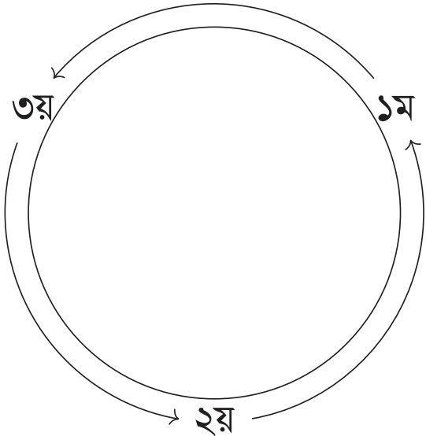

# 2. বীজগাণিতিক রাশি

Source: Higher Math Bangla Version, printed pp. 38-62

## 2.0 ভূমিকা ও শিখনফল

<!-- higher-math-9-10-bn-c02-t2.0-p001 · text · p.38 · review: verify-formula -->
বিভিন্ন প্রকারের বীজগাণিতিক রাশির সঙ্গে আমরা পরিচিত। এক বা একাধিক সংখ্যা ও সংখ্যা নির্দেশক প্রতীককে $+$, $-$, $\times$, $\div$, ঘাত বা মূলদ চিহ্নের যেকোনো একটি অথবা একাধিকের সাহায্যে অর্থবহভাবে সংযুক্ত করলে যে নতুন সংখ্যা নির্দেশক প্রতীকের সৃষ্টি হয়, একে বীজগাণিতিক রাশি (algebraic expression) বা সংক্ষিপে রাশি বলা হয়। যেমন, $2x$, $2x + 3ay$, $6x + 4y^2 + a + \sqrt{z}$ ইত্যাদি প্রতিটিই এক একটি বীজগাণিতিক রাশি।

<!-- higher-math-9-10-bn-c02-t2.0-p002 · text · p.38 -->
এ অধ্যায় শেষে শিক্ষার্থীরা -

<!-- higher-math-9-10-bn-c02-t2.0-p003 · text · p.38 -->
* বহুপদীর ধারণা ব্যাখ্যা করতে পারবে;
* উদাহরণের সাহায্যে এক চলকবিশিষ্ট বহুপদী ব্যাখ্যা করতে পারবে;
* বহুপদীর গুণ ও ভাগ ব্যাখ্যা করতে পারবে;
* ভাগশেষ উপপাদ্য ও উৎপাদক উপপাদ্য ব্যাখ্যা এবং তা প্রয়োগ করে বহুপদীর উৎপাদকে বিশ্লেষণ করতে পারবে;
* সমমাত্রিক রাশি, প্রতিসম রাশি এবং চক্র-ক্রমিক রাশি ব্যাখ্যা করতে পারবে;
* সমমাত্রিক রাশি, প্রতিসম রাশি এবং চক্র-ক্রমিক রাশির উৎপাদক নির্ণয় করতে পারবে;
* মূলদ ভগ্নাংশকে আংশিক ভগ্নাংশে প্রকাশ করতে পারবে।

### চলক, ধ্রুবক ও বহুপদী

<!-- higher-math-9-10-bn-c02-t2.0-p004 · text · p.38 -->
যদি একটি প্রতীক একাধিক সদস্যবিশিষ্ট কোনো সংখ্যা সেটের যেকোনো অনির্ধারিত সদস্য নির্দেশ করে, তবে প্রতীকটিকে চলক বলা হয় এবং সেটটিকে এর ডোমেন বলা হয়। যদি প্রতীকটি একটি নির্দিষ্ট সংখ্যা নির্দেশ করে, তবে একে ধ্রুবক বলা হয়। কোনো আলোচনায় একটি চলক এর ডোমেন থেকে যেকোনো মান গ্রহণ করতে পারে। কিন্তু একটি ধ্রুবকের মান কোনো আলোচনায় নির্দিষ্ট থাকে। বহুপদী বিশেষ ধরনের বীজগাণিতিক রাশি। এরূপ রাশিতে এক বা একাধিক পদ থাকে এবং পদগুলো এক বা একাধিক চলকের শুধু মাত্র অক্ষণাঙ্কক পূর্ণসংখ্যিক ঘাত ও ধ্রুবকের গুণফল হয়।

## 2.1 এক চলকের বহুপদী

<!-- higher-math-9-10-bn-c02-t2.1-p001 · text · p.39 · review: latin-junk,verify-formula -->
মনে করি, $x$ একটি চলক। তাহলে, $(i) a$, $(ii) ax+b$, $(iii) ax^2+bx+c$, $(iv) ax^3+bx^2+cx+d$ ইত্যাদি আকারের রাশিকে $x$ চলকের বহুপদী বলা হয়, যেখানে, $a, b, c, d$ ইত্যাদি ধ্রুবক। সাধারণভাবে, $x$ চলকের বহুপদীর পদসমূহ $cx^p$ আকারের হয়, যেখানে $c$ একটি $x$-বর্জিত নির্দিষ্ট সংখ্যা (যা শূন্যও হতে পারে) এবং $p$ একটি অক্ষণাত্মক পূর্ণসংখ্যা। $p$ শূন্য হলে পদটি শুধু $c$ হয় এবং $c$ শূন্য হলে পদটি বহুপদীতে অনুklেন্থ থাকে। কোনো বহুপদীর সাধারণ পদ $cx^p$ এ $c$ কে $x^p$ এর সহগ (coefficient) এবং $p$ কে এই পদের মাত্রা বা ঘাত (degree) বলা হয়। কোনো বহুপদীতে উল্লিখিত পদসমূহের গরিষ্ঠ মাত্রাকে বহুপদীটির মাত্রা বলা হয়। বহুপদীতে গরিষ্ঠ মাত্রায়ুক্ত পদটিকে মুখ্যপদ ও মুখ্যপদের সহগকে মুখ্যসহগ এবং ০ মাত্রায়ুক্ত অর্থাৎ, চলক-বর্জিত পদটিকে ধ্রুবপদ বলা হয়। যেমন, $2x^6 - 3x^5 - x^4 + 2x - 5$, $x$ চলকের একটি বহুপদী, যার মাত্রা 6, মুখ্যপদ $2x^6$, মুখ্য সহগ 2 এবং ধ্রুবপদ $-5$। $a \neq 0$ হলে, পূর্বোক্ত $(i)$ বহুপদীর মাত্রা 0, $(ii)$ বহুপদীর মাত্রা 1, $(iii)$ বহুপদীর মাত্রা 2 এবং $(iv)$ বহুপদীর মাত্রা 3। যেকোনো অশূন্য ধ্রুবক ($a \neq 0$) প্রদত্ত যেকোনো চলকের 0 মাত্রার বহুপদী ($a = ax^0$ বিবেচ্য)। 0 সংখ্যাটিকে শূন্য বহুপদী বিবেচনা করা হয় এবং শূন্য বহুপদীর মাত্রা অসংজ্ঞায়িত ধরা হয়।

<!-- higher-math-9-10-bn-c02-t2.1-p002 · text · p.39 · review: verify-formula -->
$x$ চলকের বহুপদীকে সাধারণত $x$ এর ঘাতের অধঃক্রমে (অর্থাৎ, মুখ্যপদ থেকে শুরু করে ক্রমে ক্রমে ধ্রুবপদ পর্যন্ত) বর্ণনা করা হয়। এরূপ বর্ণনাকে বহুপদীটির আদর্শ রূপ (standard form) বলা হয়। ব্যবহারের সুবিধার্থে $x$ চলকের বহুপদীকে $P(x), Q(x)$ ইত্যাদি প্রতীক দ্বারা সূচিত করা হয়। যেমন, $P(x) = 2x^2 + 7x + 5$। এরূপ $P(x)$ প্রতীকে $x$ এর উপর বহুপদীটির মানের নির্ভরতা নির্দেশ করে। $P(x)$ বহুপদীতে $x$ চলকের পরিবর্তে কোনো নির্দিষ্ট সংখ্যা $a$ বসালে বহুপদীটির যে মান পাওয়া যায়, একে $P(a)$ দ্বারা সূচিত করা হয়।

<!-- higher-math-9-10-bn-c02-t2.1-p003 · text · p.39 · review: verify-formula -->
**উদাহরণ ১.** যদি $P(x) = 3x^3 + 2x^2 - 7x + 8$ হয়, তবে $P(2), P(-2)$ এবং $P\left(\frac{1}{2}\right)$ এর মান নির্ণয় করো।

<!-- higher-math-9-10-bn-c02-t2.1-p004 · text · p.39 · review: verify-formula -->
**সমাধান:** প্রদত্ত বহুপদীতে $x$ এর পরিবর্তে $2, -2, \frac{1}{2}$ বসিয়ে পাই,

<!-- higher-math-9-10-bn-c02-t2.1-p005 · formula · p.39 · review: verify-formula -->
$$P(2) = 3(2^3) + 2(2^2) - 7(2) + 8 = 26$$

<!-- higher-math-9-10-bn-c02-t2.1-p006 · formula · p.39 · review: verify-formula -->
$$P(-2) = 3(-2)^3 + 2(-2)^2 - 7(-2) + 8 = 6$$

<!-- higher-math-9-10-bn-c02-t2.1-p007 · formula · p.39 · review: verify-formula -->
$$P\left(\frac{1}{2}\right) = 3\left(\frac{1}{2}\right)^3 + 2\left(\frac{1}{2}\right)^2 - 7\left(\frac{1}{2}\right) + 8 = \frac{43}{8}$$

## 2.2 দুই চলকের বহুপদী

<!-- higher-math-9-10-bn-c02-t2.2-p001 · text · p.39 · review: verify-formula -->
নিচের বহুপদীগুলো $x$ ও $y$ চলকের অর্থাৎ দুই চলকের বহুপদী।

<!-- higher-math-9-10-bn-c02-t2.2-p002 · formula · p.39 · review: verify-formula -->
$$2x + 3y - 1$$

<!-- higher-math-9-10-bn-c02-t2.2-p003 · formula · p.39 · review: verify-formula -->
$$x^2 - 4xy + y^2 - 5x + 7y + 1$$

<!-- higher-math-9-10-bn-c02-t2.2-p004 · formula · p.39 · review: verify-formula -->
$$8x^3 + y^3 + 10x^2y + 6xy^2 - 6x + 2$$

<!-- higher-math-9-10-bn-c02-t2.2-p005 · text · p.40 · review: verify-formula -->
সাধারণভাবে এরূপ বহুপদীর পদগুলো $cx^p y^q$ আকারের হয় যেখানে $c$ একটি নির্দিষ্ট সংখ্যা (ধ্রুবক) এবং $p$ ও $q$ অক্ষগাত্বক পূর্ণসংখ্যা। $cx^p y^q$ পদে $c$ হচ্ছে $x^p y^q$ এর সহগ এবং $p + q$ হচ্ছে এই পদের মাত্রা। এরূপ বহুপদীতে উল্লিখিত পদসমূহের গরিষ্ঠ মাত্রাকে বহুপদীটির মাত্রা বলা হয়। এরূপ বহুপদিকে $P(x, y)$ আকারের প্রতীক দ্বারা সূচিত করা হয়। যেমন, $P(x, y) = 8x^3 + y^3 - 4x^2 + 7xy + 2y - 5$ বহুপদীর মাত্রা 3 এবং $P(1, 0) = 8 - 4 - 5 = -1$।

## 2.3 তিন চলকের বহুপদী

<!-- higher-math-9-10-bn-c02-t2.3-p001 · text · p.40 · review: verify-formula -->
$x, y$ ও $z$ চলকের বহুপদীর পদগুলো $cx^p y^q z^r$ আকারের হয়। যেখানে $c$ (ধ্রুবক) পদটির সহগ এবং $p, q, r$ অক্ষগাত্বক পূর্ণসংখ্যা। এখানে $p + q + r$ কে এই পদের মাত্রা এবং বহুপদীতে উল্লিখিত পদসমূহের গরিষ্ঠ মাত্রাকে বহুপদীটির মাত্রা বলা হয়। এরূপ বহুপদিকে $P(x, y, z)$ আকারের প্রতীক দ্বারা সূচিত করা হয়। যেমন, $P(x, y, z) = x^3 + y^3 + z^3 - 3xyz$ বহুপদীর মাত্রা 3 এবং $P(1, 1, -2) = 1 + 1 - 8 + 6 = 0$।

### কাজ:

<!-- higher-math-9-10-bn-c02-t2.3-p002 · text · p.40 -->
ক) নিচের কোনটি বহুপদী নির্ণয় করো:

<!-- higher-math-9-10-bn-c02-t2.3-p003 · table · p.40 · review: verify-formula,verify-table -->
<table><tr><td>(১) $2x^3$</td><td>(২) $7 - 3a^2$</td><td>(৩) $x^3 + x^{-2}$</td></tr>
<tr><td>(৪) $\frac{a^2 + a}{a^3 - a}$</td><td>(৫) $5x^2 - 2xy + 3y^2$</td><td>(৬) $6a + 3b$</td></tr>
<tr><td>(৭) $c^2 + \frac{2}{c} - 3$</td><td>(৮) $3\sqrt{n - 4}$</td><td>(৯) $2x(x^2 + 3y)$</td></tr>
<tr><td>(১০) $3x - (2y + 4z)$</td><td>(১১) $\frac{6}{x} + 2y$</td><td>(১২) $\frac{3}{4}x - 2y$</td></tr></table>

<!-- higher-math-9-10-bn-c02-t2.3-p004 · text · p.40 -->
খ) নিচের বহুপদীগুলোতে চলকের সংখ্যা ও মাত্রা নির্ণয় করো:

<!-- higher-math-9-10-bn-c02-t2.3-p005 · table · p.40 · review: verify-formula,verify-table -->
<table><tr><td>(১) $x^2 + 10x + 5$</td><td>(২) $3a + 2b$</td><td>(৩) $4xyz$</td></tr>
<tr><td>(৪) $2m^2n - mn^2$</td><td>(৫) $7a + b - 2$</td><td>(৬) $6a^2b^2c^2$</td></tr></table>

<!-- higher-math-9-10-bn-c02-t2.3-p006 · text · p.40 -->
গ) নিচের বহুপদীগুলোর প্রত্যেকটিকে

<!-- higher-math-9-10-bn-c02-t2.3-p007 · text · p.40 · review: verify-formula -->
(i) $x$ চলকের বহুপদীর আদর্শ আকারে বর্ণনা করো এবং $x$ চলকের বহুপদী রূপে এর মাত্রা, মুখসহগ ও ধ্রুবপদ নির্ণয় করো।

<!-- higher-math-9-10-bn-c02-t2.3-p008 · text · p.40 · review: verify-formula -->
(ii) $y$ চলকের বহুপদীর আদর্শ আকারে বর্ণনা করো এবং $y$ চলকের বহুপদীরূপে এর মাত্রা, মুখসহগ ও ধ্রুবপদ নির্ণয় করো।

<!-- higher-math-9-10-bn-c02-t2.3-p009 · table · p.40 · review: verify-formula,verify-table -->
<table><tr><td>(১) $3x^2 - y^2 + x - 3$</td><td>(২) $x^2 - x^6 + x^4 + 3$</td></tr>
<tr><td>(৩) $5x^2y - 4x^4y^4 - 2$</td><td>(৪) $x + 2x^2 + 3x^3 + 6$</td></tr>
<tr><td>(৫) $3x^3y + 2xyz - x^4$</td><td></td></tr></table>

<!-- higher-math-9-10-bn-c02-t2.3-p010 · text · p.40 · review: verify-formula -->
ঘ) যদি $P(x) = 2x^2 + 3$ হয়, তবে $P(5)$, $P(6)$, $P\left(\frac{1}{2}\right)$ এর মান নির্ণয় করো।

## 2.4 বহুপদীর গুণফল ও ভাগফল

<!-- higher-math-9-10-bn-c02-t2.4-p001 · text · p.41 · review: verify-formula -->
দুটি বহুপদীর যোগফল, বিয়োগফল এবং গুণফল সবসময় বহুপদী হয়। দুটি বহুপদীর ভাগফল বহুপদী হতেও পারে নাও হতে পারে। যেমন $x^3$ দ্বারা $x$ কে ভাগ করলে ভাগফল যদি $x^{-2}$ ধরা হয় তখন এটি বহুপদী নয়। কিন্তু $x$ কে ভাগশেষ ধরে নিলে সেক্ষেত্রে ভাগফল $0$ একটি বহুপদী।

<!-- higher-math-9-10-bn-c02-t2.4-p002 · text · p.41 · review: verify-formula -->
**উদাহরণ ২.** $(x^2 + 2)$ কে $(x + 1)$ দ্বারা গুণ করলে গুণফল কত?

<!-- higher-math-9-10-bn-c02-t2.4-p003 · text · p.41 · review: verify-formula -->
এখানে $(x^2 + 2)$ এবং $(x + 1)$ বহুপদী দুটির গুণফল $(x^2 + 2)(x + 1) = x^3 + x^2 + 2x + 2$ একটি বহুপদী যার মাত্রা $2 + 1 = 3$ এবং মুখ্যসহগ $1 \times 1 = 1$।

<!-- higher-math-9-10-bn-c02-t2.4-p004 · text · p.41 · review: verify-formula -->
**উদাহরণ ৩.** $(x^2 + 1)(x - 6)$কে $2x^2 + 3$ দ্বারা ভাগ করলে ভাগফল কত?

<!-- higher-math-9-10-bn-c02-t2.4-p005 · text · p.41 · review: verify-formula -->
এখানে ভাজ্য $P(x) = (x^2 + 1)(x - 6) = x^3 - 6x^2 + x - 6$ এর মাত্রা ৩ এবং মুখ্যসহগ ১।
আর ভাজক $Q(x) = 2x^2 + 3$ এর মাত্রা ২ এবং মুখ্যসহগ ২।

<!-- higher-math-9-10-bn-c02-t2.4-p006 · text · p.41 · review: verify-formula -->
$P(x)$ কে $Q(x)$ দিয়ে ভাগ করলে, ভাগফল $F(x) = \frac{1}{2}x - 3$ এবং ভাগশেষ $R(x) = -\frac{x}{2} + 3$।

<!-- higher-math-9-10-bn-c02-t2.4-p007 · text · p.41 · review: verify-formula -->
কাজেই, ভাগফল $F(x)$ একটি বহুপদী যার মাত্রা $3 - 2 = 1$ এবং মুখ্যসহগ $\frac{1}{2}$।

<!-- higher-math-9-10-bn-c02-t2.4-p008 · text · p.41 -->
**দ্রষ্টব্য:** দুইটি বহুপদীর গুণফল ও ভাগফলের মাত্রা ও মুখ্যসহগের ক্ষেত্রে নিম্নোক্ত সূত্রগুলো সত্য।

<!-- higher-math-9-10-bn-c02-t2.4-p009 · text · p.41 · review: verify-formula -->
ক) $x$ চলকের বহুপদী $P(x)$ এবং $Q(x)$ এর গুণফল $F(x) = P(x)Q(x)$ একটি বহুপদী
যার মাত্রা $= P(x)$ এর মাত্রা $+ Q(x)$ এর মাত্রা এবং
মুখ্য সহগ $= P(x)$ এর মুখ্য সহগ $\times Q(x)$ এর মুখ্যসহগ

<!-- higher-math-9-10-bn-c02-t2.4-p010 · text · p.41 · review: verify-formula -->
খ) $x$ চলকের বহুপদী $P(x)$ কে $Q(x)$ দিয়ে ভাগ করলে ভাগফল যদি বহুপদী $R(x) = \frac{P(x)}{Q(x)}$ হয় তাহলে
$R(x)$ এর মাত্রা $= P(x)$ এর মাত্রা $- Q(x)$ এর মাত্রা এবং
মুখ্য সহগ $= \frac{P(x)  এর মুখ্য সহগ}{Q(x)  এর মুখ্য সহগ}$

## 2.5 ভাগ সূত্র

<!-- higher-math-9-10-bn-c02-t2.5-p001 · text · p.41 · review: verify-formula -->
যদি $P(x)$ ও $Q(x)$ উভয়ই $x$ চলকের বহুপদী হয় এবং $Q(x)$ এর মাত্রা $\le P(x)$ এর মাত্রা হয়, তবে $Q(x)$ দ্বারা $P(x)$ কে ভাগ করে ভাগফল $F(x)$ ও ভাগশেষ $R(x)$ পাওয়া যায়, যেখানে

<!-- higher-math-9-10-bn-c02-t2.5-p002 · text · p.41 · review: verify-formula -->
ক) $F(x)$ ও $R(x)$ উভয়ই $x$ চলকের বহুপদী,
খ) $F(x)$ এর মাত্রা $= P(x)$ এর মাত্রা $- Q(x)$ এর মাত্রা,
গ) $R(x) = 0$ অথবা $R(x)$ এর মাত্রা $< Q(x)$ এর মাত্রা,
ঘ) সকল $x$ এর জন্য $P(x) = F(x)Q(x) + R(x)$।

## 2.6 সমতা সূত্র

<!-- higher-math-9-10-bn-c02-t2.6-p001 · text · p.42 · review: verify-formula -->
ক) যদি সকল $x$ এর জন্য $ax + b = px + q$ হয়, তবে $x = 0$ ও $x = 1$ বসিয়ে পাই, $b = q$ এবং $a + b = p + q$ যা থেকে দেখা যায় যে, $a = p, b = q$

<!-- higher-math-9-10-bn-c02-t2.6-p002 · text · p.42 · review: verify-formula -->
খ) যদি সকল $x$ এর জন্য $ax^2 + bx + c = px^2 + qx + r$ হয়, তবে $x = 0, x = 1$ ও $x = -1$ বসিয়ে পাই, $c = r, a + b + c = p + q + r$ এবং $a - b + c = p - q + r$ যা থেকে দেখা যায় যে, $a = p, b = q, c = r$।

<!-- higher-math-9-10-bn-c02-t2.6-p003 · text · p.42 · review: verify-formula -->
গ) সাধারণভাবে দেখা যায় যে, যদি সকল $x$ এর জন্য $a_0x^n + a_1x^{n-1} + a_2x^{n-2} + \dots + a_{n-1}x + a_n = p_0x^n + p_1x^{n-1} + p_2x^{n-2} + \dots + p_{n-1}x + p_n$ হয়, তবে, $a_0 = p_0, a_1 = p_1, \dots, a_{n-1} = p_{n-1}, a_n = p_n$

<!-- higher-math-9-10-bn-c02-t2.6-p004 · text · p.42 · review: verify-formula -->
অর্থাৎ, সমতা চিহ্নের উভয় পক্ষে $x$ এর একই যাতযুক্ত সহগদ্বয় পরস্পর সমান।

<!-- higher-math-9-10-bn-c02-t2.6-p005 · text · p.42 · review: verify-formula -->
**মন্তব্য:** $x$ চলকের $n$ মাত্রার বহুপদীর বর্ণনায় সহগগুলোকে $a_0$ ($a$ সাব-জিরো), $a_1$ ($a$ সাব-ওয়ান) ইত্যাদি নেওয়া সুবিধাজনক।

## 2.7 অভেদ (Identity)

<!-- higher-math-9-10-bn-c02-t2.7-p001 · text · p.42 · review: verify-formula -->
দুটি বহুপদী $P(x)$ ও $Q(x)$ সকল $x$ এর জন্য সমান হলে, এদের সমতাকে অভেদ বলা হয় এবং তা বুঝাতে অনেক সময় $P(x) \equiv Q(x)$ লেখা হয়। এম্ব্রে $P(x)$ ও $Q(x)$ বহুপদী দুটি অভিন্ন হয়। $\equiv$ চিহ্নকে অভেদ চিহ্ন বলা হয়। সাধারণভাবে একই চলকসমূহের দুটি বীজগণিতীয় রাশির সমতাকে অভেদ (identity) বলা হয়, যদি রাশি দুটিতে প্রতিটি চলকের ডোমেন একই হয় এবং চলকসমূহের ডোমেনভুক্ত মানের জন্য রাশি দুটির মান সমান হয়। যেমন, $x(x + 2) = x^2 + 2x$, $(x + y)^2 = x^2 + 2xy + y^2$ উভয়ই অভেদ।

## 2.8 ভাগশেষ ও উৎপাদক উপপাদ্য

<!-- higher-math-9-10-bn-c02-t2.8-p001 · text · p.42 · review: verify-formula -->
এই অনুচ্ছেদে শুধু $x$ চলকের বহুপদী বিবেচনা করা হবে। প্রথমে দুটি উদাহরণ বিবেচনা করি।

<!-- higher-math-9-10-bn-c02-t2.8-p002 · text · p.42 · review: verify-formula -->
**উদাহরণ ৪.** যদি $P(x) = x^2 - 5x + 6$ হয়, তবে $P(x)$ কে $(x - 4)$ দ্বারা ভাগ কর এবং দেখাও যে, ভাগশেষ $P(4)$ এর সমান।

<!-- higher-math-9-10-bn-c02-t2.8-p003 · text · p.42 · review: verify-formula -->
**সমাধান:** $P(x)$ কে $(x - 4)$ দ্বারা নিচের মতো ভাগ করি।

<!-- higher-math-9-10-bn-c02-t2.8-p004 · formula · p.42 · review: verify-formula -->
$$\begin{array}{r}
x^2 - 5x + 6 \\
x - 4 \enclose{longdiv}{x^2 - 5x + 6} \\
<u>x^2 - 4x</u> \\
-x + 6 \\
<u>-x + 4</u> \\
2
\end{array}$$

<!-- higher-math-9-10-bn-c02-t2.8-p005 · text · p.42 -->
এখানে ভাগশেষ ২।

<!-- higher-math-9-10-bn-c02-t2.8-p006 · text · p.42 · review: verify-formula -->
যেহেতু $P(4) = 4^2 - 5(4) + 6 = 2$, সুতরাং, ভাগশেষ $P(4)$ এর সমান।

<!-- higher-math-9-10-bn-c02-t2.8-p007 · text · p.43 · review: verify-formula -->
**উদাহরণ ৫.** যদি $P(x) = ax^3 + bx + c$ হয়, তবে $P(x)$ কে $x - m$ দ্বারা ভাগ করে দেখাও যে, ভাগশেষ $P(m)$ এর সমান।

<!-- higher-math-9-10-bn-c02-t2.8-p008 · text · p.43 · review: verify-formula -->
**সমাধান:** $P(x)$ কে $x - m$ দ্বারা নিচের মতো ভাগ করি।

<!-- higher-math-9-10-bn-c02-t2.8-p009 · formula · p.43 · review: verify-formula -->
$$\begin{array}{r}
ax^2 + amx + am^2 + b \\
x - m \enclose{longdiv}{ax^3 + bx + c} \\
<u>ax^3 - amx^2</u> \\
amx^2 + bx + c \\
<u>amx^2 - am^2x</u> \\
(am^2 + b)x + c \\
<u>(am^2 + b)x - (am^2 + b)m</u> \\
am^3 + bm + c
\end{array}$$

<!-- higher-math-9-10-bn-c02-t2.8-p010 · text · p.43 · review: verify-formula -->
এখানে ভাগশেষ $= am^3 + bm + c$।
আবার, $P(m) = am^3 + bm + c$, সুতরাং ভাগশেষ $P(m)$ এর সমান।
উপরের এই উদাহরণ দুটি থেকে নিম্নের প্রতিজ্ঞাটি সম্পর্কে ধারণা পাওয়া যায়।

<!-- higher-math-9-10-bn-c02-t2.8-p011 · text · p.43 · review: verify-formula -->
**প্রতিজ্ঞা ১ (ভাগশেষ উপপাদ্য).** যদি $P(x)$ ধনাত্মক মাত্রার বহুপদী হয় এবং $a$ কোনো নির্দিষ্ট সংখ্যা হয়, তবে $P(x)$ কে $x - a$ দ্বারা ভাগ করলে ভাগশেষ $P(a)$ হবে।

<!-- higher-math-9-10-bn-c02-t2.8-p012 · text · p.43 · review: verify-formula -->
**প্রমাণ:** $P(x)$ কে $x - a$ দ্বারা ভাগ করলে ভাগশেষ হয় ০ অথবা অশূন্য ধ্রুবক হবে।
মনে করি, ভাগশেষ $R$ এবং ভাগফল $Q(x)$; তাহলে, ভাগের নিয়মে, সকল $x$ এর জন্য

<!-- higher-math-9-10-bn-c02-t2.8-p013 · formula · p.43 · review: verify-formula -->
$$P(x) = (x - a)Q(x) + R$$

<!-- higher-math-9-10-bn-c02-t2.8-p014 · text · p.43 · review: verify-formula -->
যাতে $x = a$ বসিয়ে পাই, $P(a) = 0 \cdot Q(a) + R = R$।
সুতরাং, $P(x)$ কে $x - a$ দ্বারা ভাগ করলে ভাগশেষ $P(a)$ হবে।

<!-- higher-math-9-10-bn-c02-t2.8-p015 · text · p.43 · review: verify-formula -->
**উদাহরণ ৬.** $P(x) = x^3 - 8x^2 + 6x + 60$ কে $x + 2$ দ্বারা ভাগ করলে, ভাগশেষ কত হবে?

<!-- higher-math-9-10-bn-c02-t2.8-p016 · text · p.43 · review: verify-formula -->
**সমাধান:** যেহেতু $x + 2 = x - (-2) = (x - a)$ যেখানে $a = -2$,
সুতরাং, ভাগশেষ $= P(-2) = (-2)^3 - 8(-2)^2 + 6(-2) + 60 = 8$।
প্রতিজ্ঞা ১ এর অনুকরণে নিচের প্রতিজ্ঞাটিও প্রমাণ করা যায়।

<!-- higher-math-9-10-bn-c02-t2.8-p017 · text · p.43 · review: verify-formula -->
**প্রতিজ্ঞা ২.** যদি $P(x)$ ধনাত্মক মাত্রার বহুপদী হয় এবং $a \neq 0$ হয়, তবে $P(x)$ কে $ax + b$ দ্বারা ভাগ করলে ভাগশেষ $P\left(-\frac{b}{a}\right)$ হবে।

<!-- higher-math-9-10-bn-c02-t2.8-p018 · text · p.43 · review: verify-formula -->
**উদাহরণ ৭.** বহুপদী $P(x) = 36x^2 - 8x + 5$ কে $(2x - 1)$ দ্বারা ভাগ করলে ভাগশেষ কত হবে?

<!-- higher-math-9-10-bn-c02-t2.8-p019 · text · p.43 · review: verify-formula -->
**সমাধান:** নির্গেয় ভাগশেষ $P\left(\frac{1}{2}\right) = 36\left(\frac{1}{2}\right)^2 - 8\left(\frac{1}{2}\right) + 5 = 9 - 4 + 5 = 10$।

<!-- higher-math-9-10-bn-c02-t2.8-p020 · text · p.44 · review: verify-formula -->
**উদাহরণ ৮.** যদি $P(x) = 5x^3 + 6x^2 - ax + 6$ কে $x - 2$ দ্বারা ভাগ করলে ভাগশেষ 6 হয়, তবে $a$ এর মান নির্ণয় করো।

<!-- higher-math-9-10-bn-c02-t2.8-p021 · text · p.44 · review: verify-formula -->
**সমাধান:** $P(x)$ কে $x - 2$ দ্বারা ভাগ করলে ভাগশেষ হবে,
$$P(2) = 5(2)^3 + 6(2)^2 - a(2) + 6 = 40 + 24 - 2a + 6 = 70 - 2a$$
শর্তানুসারে, $70 - 2a = 6$ বা, $2a = 70 - 6 = 64$ অর্থাৎ $a = 32$।

<!-- higher-math-9-10-bn-c02-t2.8-p022 · text · p.44 · review: verify-formula -->
**উদাহরণ ৯.** যদি $P(x) = x^3 + 5x^2 + 6x + 8$ হয় এবং $P(x)$ কে $x - a$ এবং $x - b$ দ্বারা ভাগ করলে একই ভাগশেষ থাকে যেখানে $a \neq b$, তবে দেখাও যে, $a^2 + b^2 + ab + 5a + 5b + 6 = 0$।

<!-- higher-math-9-10-bn-c02-t2.8-p023 · text · p.44 · review: verify-formula -->
**সমাধান:** $P(x)$ কে $x - a$ দ্বারা ভাগ করলে ভাগশেষ হবে $P(a) = a^3 + 5a^2 + 6a + 8$,
এবং $P(x)$ কে $x - b$ দ্বারা ভাগ করলে ভাগশেষ হবে $P(b) = b^3 + 5b^2 + 6b + 8$।
শর্তানুসারে, $a^3 + 5a^2 + 6a + 8 = b^3 + 5b^2 + 6b + 8$
বা, $a^3 - b^3 + 5(a^2 - b^2) + 6(a - b) = 0$
বা, $(a - b)(a^2 + b^2 + ab + 5a + 5b + 6) = 0$
$\therefore a^2 + b^2 + ab + 5a + 5b + 6 = 0$, যেহেতু $a \neq b$

<!-- higher-math-9-10-bn-c02-t2.8-p024 · text · p.44 · review: verify-formula -->
**প্রতিজ্ঞা ৩ (উৎপাদক উপপাদ্য).** যদি $P(x)$ ধনাত্মক মাত্রার বহুপদী হয় এবং $P(a) = 0$ হয়, তবে $P(x)$ এর একটি উৎপাদক $x - a$ হবে।

<!-- higher-math-9-10-bn-c02-t2.8-p025 · text · p.44 · review: verify-formula -->
**প্রমাণ:** $P(x)$ বহুপদীকে $x - a$ দ্বারা ভাগ করলে ভাগশেষ উপপাদ্য অনুযায়ী ভাগশেষ $= P(a)$, যা প্রদত্ত শর্ত অনুযায়ী 0। অর্থাৎ $P(x)$ বহুপদী $x - a$ দ্বারা বিভাজ্য।
$\therefore x - a$ হচ্ছে $P(x)$ এর একটি উৎপাদক।

## 2.9 উৎপাদক উপপাদ্যের বিপরীত উপপাদ্য

<!-- higher-math-9-10-bn-c02-t2.9-p001 · text · p.44 · review: verify-formula -->
**প্রতিজ্ঞা ৪.** $x - a$ যদি $P(x)$ বহুপদীর একটি উৎপাদক হয়, তবে $P(a) = 0$ হবে।

<!-- higher-math-9-10-bn-c02-t2.9-p002 · text · p.44 · review: verify-formula -->
**প্রমাণ:** যেহেতু $x - a$, $P(x)$ বহুপদীর একটি উৎপাদক, সুতরাং আরেকটি বহুপদী $Q(x)$ পাওয়া যায় যেন $P(x) = (x - a)Q(x)$।
এখানে $x = a$ বসিয়ে দেখা যায় যে, $P(a) = (a - a)Q(a) = 0 \cdot Q(a) = 0$।

<!-- higher-math-9-10-bn-c02-t2.9-p003 · text · p.44 · review: verify-formula -->
**উদাহরণ ১০.** দেখাও যে, $P(x) = ax^3 + bx^2 + cx + d$ বহুপদীর $x - 1$ একটি উৎপাদক হবে যদি ও কেবল যদি $a + b + c + d = 0$ হয়।

<!-- higher-math-9-10-bn-c02-t2.9-p004 · text · p.44 · review: verify-formula -->
**সমাধান:** মনে করি, $a + b + c + d = 0$।
তাহলে, $P(1) = a + b + c + d = 0$ [শর্তানুসারে]।
সুতরাং, $x - 1$, $P(x)$ এর একটি উৎপাদক [উৎপাদক উপপাদ্যের সাহায্যে]।

<!-- higher-math-9-10-bn-c02-t2.9-p005 · text · p.45 · review: verify-formula -->
এবার মনে করি $P(x)$ এর একটি উৎপাদক $x - 1$।

<!-- higher-math-9-10-bn-c02-t2.9-p006 · text · p.45 -->
তবে, উৎপাদকের বিপরীত উপপাদ্যের সাহায্যে পাই,

<!-- higher-math-9-10-bn-c02-t2.9-p007 · formula · p.45 · review: verify-formula -->
$$P(1) = 0  অর্থাৎ  a + b + c + d = 0$$

<!-- higher-math-9-10-bn-c02-t2.9-p008 · text · p.45 · review: verify-formula -->
**মন্তব্য:** $x - 1$ ধনাত্মক মাত্রার যেকোনো বহুপদীর একটি উৎপাদক হবে যদি ও কেবল যদি বহুপদীটির সহগসমূহের সমষ্টি ০ হয়।

<!-- higher-math-9-10-bn-c02-t2.9-p009 · text · p.45 · review: verify-formula -->
**উদাহরণ ১১.** মনে করি, $P(x) = ax^3 + bx^2 + cx + d$ বহুপদীর সহগগুলো পূর্ণসংখ্যা, $a \neq 0, d \neq 0$ এবং $x - r$ বহুপদীটির একটি উৎপাদক। দেখাও যে,

<!-- higher-math-9-10-bn-c02-t2.9-p010 · text · p.45 · review: verify-formula -->
ক) যদি $r$ পূর্ণসংখ্যা হয়, তবে $r, d$ এর উৎপাদক হবে।

<!-- higher-math-9-10-bn-c02-t2.9-p011 · text · p.45 · review: verify-formula -->
খ) যদি $r = \frac{p}{q}$ লঘিষ্ঠ আকারে প্রকাশিত মূলদ সংখ্যা হয়, তবে $p, d$ এর উৎপাদক ও $q, a$ এর উৎপাদক হবে।

### সমাধান:

<!-- higher-math-9-10-bn-c02-t2.9-p012 · text · p.45 -->
ক) উৎপাদক উপপাদ্যের বিপরীত উপপাদ্য থেকে দেখা যায় যে,

<!-- higher-math-9-10-bn-c02-t2.9-p013 · formula · p.45 · review: latin-junk,verify-formula -->
$$P(r) = ar^3 + br^2 + cr + d = 0 \quad বা,  (ar^2 + br + c)r = -d$$

<!-- higher-math-9-10-bn-c02-t2.9-p014 · text · p.45 · review: verify-formula -->
যেহেতু $(ar^2 + br + c), r$ ও $d$ প্রত্যেকই পূর্ণসংখ্যা, সুতরাং $r, d$ এর একটি উৎপাদক।

<!-- higher-math-9-10-bn-c02-t2.9-p015 · text · p.45 -->
খ) উৎপাদক উপপাদ্যের বিপরীত উপপাদ্য থেকে দেখা যায় যে,

<!-- higher-math-9-10-bn-c02-t2.9-p016 · formula · p.45 · review: verify-formula -->
$$P(r) = ar^3 + br^2 + cr + d = 0$$

<!-- higher-math-9-10-bn-c02-t2.9-p017 · text · p.45 · review: verify-formula -->
বা, $P\left(\frac{p}{q}\right) = a\left(\frac{p}{q}\right)^3 + b\left(\frac{p}{q}\right)^2 + c\left(\frac{p}{q}\right) + d = 0$

<!-- higher-math-9-10-bn-c02-t2.9-p018 · text · p.45 · review: verify-formula -->
বা, $ap^3 + bp^2q + cpq^2 + dq^3 = 0 \dots \dots (1)$

<!-- higher-math-9-10-bn-c02-t2.9-p019 · text · p.45 · review: verify-formula -->
(1) থেকে পাওয়া যায় $(ap^2 + bpq + cq^2)p = -dq^3 \dots \dots (2)$

<!-- higher-math-9-10-bn-c02-t2.9-p020 · text · p.45 · review: verify-formula -->
এবং $(bp^2 + cpq + dq^2)q = -ap^3 \dots \dots (3)$

<!-- higher-math-9-10-bn-c02-t2.9-p021 · text · p.45 · review: verify-formula -->
এখন, $ap^2 + bpq + cq^2, bp^2 + cpq + dq^2, p, q, d, a$ প্রত্যেকেই পূর্ণসংখ্যা।

<!-- higher-math-9-10-bn-c02-t2.9-p022 · text · p.45 · review: verify-formula -->
সুতরাং (2) থেকে পাওয়া যায়, $p, dq^3$ এর একটি উৎপাদক এবং (3) থেকে পাওয়া যায়, $q, ap^3$ এর একটি উৎপাদক। কিন্তু $p$ ও $q$ এর $\pm 1$ ছাড়া কোনো সাধারণ উৎপাদক নেই। সুতরাং $p, d$ এর একটি উৎপাদক এবং $q, a$ এর একটি উৎপাদক।

<!-- higher-math-9-10-bn-c02-t2.9-p023 · text · p.45 · review: verify-formula -->
**দ্রষ্টব্য:** উপরের উদাহরণ থেকে আমরা লক্ষ্য করি যে, উৎপাদক উপপাদ্যের সাহায্যে পূর্ণসাংখ্যিক সহগবিশিষ্ট বহুপদী $P(x)$ এর উৎপাদক নির্ণয়ের জন্য প্রথমে $P(r)$ এবং পরে $P\left(\frac{r}{s}\right)$ পরীক্ষা করা যেতে পারে, যেখানে, $r$ বহুপদীটির ধ্রুব পদের উৎপাদক ($r = \pm 1$ সহ) এবং $s$ বহুপদীটির মুখ্যসহগের উৎপাদক ($s = \pm 1$ সহ)।

<!-- higher-math-9-10-bn-c02-t2.9-p024 · text · p.46 · review: verify-formula -->
**উদাহরণ ১২.** $P(x) = x^3 - 6x^2 + 11x - 6$ কে উৎপাদকে বিশ্লেষণ করো।

<!-- higher-math-9-10-bn-c02-t2.9-p025 · text · p.46 · review: verify-formula -->
**সমাধান:** প্রদত্ত বহুপদীর সহগসমূহ পূর্ণসংখ্যা এবং ধ্রুবপদ $= -6$, মুখ্যসহগ $= 1$।

<!-- higher-math-9-10-bn-c02-t2.9-p026 · text · p.46 · review: verify-formula -->
এখন $r$ যদি পূর্ণসংখ্যা হয় এবং $P(x)$ এর যদি $x - r$ আকারের কোন উৎপাদক থাকে, তবে $r$ অবশ্যই $-6$ এর উৎপাদক অর্থাৎ, $\pm 1, \pm 2, \pm 3, \pm 6$ এর কোনো একটি হবে। এখন $r$ এর এরূপ বিভিন্ন মানের জন্য $P(x)$ পরীক্ষা করি।

<!-- higher-math-9-10-bn-c02-t2.9-p027 · text · p.46 · review: verify-formula -->
$P(1) = 1 - 6 + 11 - 6 = 0, \therefore x - 1, P(x)$ এর একটি উৎপাদক।

<!-- higher-math-9-10-bn-c02-t2.9-p028 · text · p.46 · review: verify-formula -->
$P(-1) = -1 - 6 - 11 - 6 \neq 0, \therefore x + 1, P(x)$ এর উৎপাদক নয়।

<!-- higher-math-9-10-bn-c02-t2.9-p029 · text · p.46 · review: verify-formula -->
$P(2) = 8 - 24 + 22 - 6 = 0, \therefore x - 2, P(x)$ এর একটি উৎপাদক।

<!-- higher-math-9-10-bn-c02-t2.9-p030 · text · p.46 · review: verify-formula -->
$P(-2) = -8 - 24 - 22 - 6 \neq 0, \therefore x + 2, P(x)$ এর উৎপাদক নয়।

<!-- higher-math-9-10-bn-c02-t2.9-p031 · text · p.46 · review: verify-formula -->
$P(3) = 27 - 54 + 33 - 6 = 0, \therefore x - 3, P(x)$ এর একটি উৎপাদক।

<!-- higher-math-9-10-bn-c02-t2.9-p032 · text · p.46 · review: verify-formula -->
যেহেতু, $P(x)$ এর মাত্রা ৩ এবং তিনটি ১ মাত্রার উৎপাদক পাওয়া গেছে, সুতরাং $P(x)$ এর অন্য কোনো উৎপাদক যদি থাকে তবে তা ধ্রুবক হবে।

<!-- higher-math-9-10-bn-c02-t2.9-p033 · text · p.46 · review: verify-formula -->
$\therefore P(x) = k(x - 1)(x - 2)(x - 3)$ যেখানে $k$ ধ্রুবক।

<!-- higher-math-9-10-bn-c02-t2.9-p034 · text · p.46 · review: verify-formula -->
উভয়পক্ষে $x$ এর সর্বোচ্চ ঘাতের সহগ বিবেচনা করে দেখা যায় যে, $k = 1$।

<!-- higher-math-9-10-bn-c02-t2.9-p035 · text · p.46 · review: verify-formula -->
সুতরাং, $P(x) = (x - 1)(x - 2)(x - 3)$।

<!-- higher-math-9-10-bn-c02-t2.9-p036 · text · p.46 · review: verify-formula -->
**দ্রষ্টব্য:** কোনো বহুপদী $P(x)$ কে উৎপাদকে বিশ্লেষণ করার জন্য প্রথমে $(x - r)$ আকারের একটি উৎপাদক নির্ণয় করে $P(x)$ কে সরাসরি $(x - r)$ দ্বারা ভাগ করে অথবা $P(x)$ এর পদসমূহকে পুনর্বিন্যাস করে $P(x)$ কে $P(x) = (x - r)Q(x)$ আকারে লেখা যায়। সেখানে $Q(x)$ বহুপদীর মাত্রা $P(x)$ এর মাত্রা থেকে ১ কম। অতঃপর $Q(x)$ এর উৎপাদক নির্ণয় করে অগ্রসর হতে হয়।

<!-- higher-math-9-10-bn-c02-t2.9-p037 · text · p.46 · review: verify-formula -->
**উদাহরণ ১৩.** উৎপাদকে বিশ্লেষণ কর: $18x^3 + 15x^2 - x - 2$।

<!-- higher-math-9-10-bn-c02-t2.9-p038 · text · p.46 · review: verify-formula -->
**সমাধান:** মনে করি, $P(x) = 18x^3 + 15x^2 - x - 2$।

<!-- higher-math-9-10-bn-c02-t2.9-p039 · text · p.46 · review: verify-formula -->
$P(x)$ এর ধ্রুবপদ $-2$ এর উৎপাদকসমূহের সেট $F_1 = \{1, -1, 2, -2\}$।

<!-- higher-math-9-10-bn-c02-t2.9-p040 · text · p.46 · review: verify-formula -->
$P(x)$ এর মুখ্যসহগ ১৮ এর উৎপাদকসমূহের সেট

<!-- higher-math-9-10-bn-c02-t2.9-p041 · formula · p.46 · review: verify-formula -->
$$F_2 = \{1, -1, 2, -2, 3, -3, 6, -6, 9, -9, 18, -18\}$$

<!-- higher-math-9-10-bn-c02-t2.9-p042 · text · p.46 · review: verify-formula -->
এখন $P(a)$ বিবেচনা করি, যেখানে, $a = \frac{r}{s}$ এবং $r \in F_1, s \in F_2$।

<!-- higher-math-9-10-bn-c02-t2.9-p043 · text · p.46 · review: verify-formula -->
$a = 1$ হলে, $P(1) = 18 + 15 - 1 - 2 \neq 0$।

<!-- higher-math-9-10-bn-c02-t2.9-p044 · text · p.46 · review: verify-formula -->
$a = -1$ হলে, $P(-1) = -18 + 15 + 1 - 2 \neq 0$।

<!-- higher-math-9-10-bn-c02-t2.9-p045 · text · p.47 · review: verify-formula -->
$a = -\frac{1}{2}$ হলে, $P\left(-\frac{1}{2}\right) = 18\left(-\frac{1}{8}\right) + 15\left(\frac{1}{4}\right) + \frac{1}{2} - 2 = 0$।

<!-- higher-math-9-10-bn-c02-t2.9-p046 · text · p.47 · review: verify-formula -->
সুতরাং $x + \frac{1}{2} = \frac{1}{2}(2x + 1)$ অর্থাৎ $(2x + 1)$, $P(x)$ এর একটি উৎপাদক।

<!-- higher-math-9-10-bn-c02-t2.9-p047 · text · p.47 · review: verify-formula -->
এখন, $18x^3 + 15x^2 - x - 2 = 18x^3 + 9x^2 + 6x^2 + 3x - 4x - 2$
$$= 9x^2(2x + 1) + 3x(2x + 1) - 2(2x + 1) = (2x + 1)(9x^2 + 3x - 2)$$

<!-- higher-math-9-10-bn-c02-t2.9-p048 · text · p.47 · review: verify-formula -->
এবং $9x^2 + 3x - 2 = 9x^2 + 6x - 3x - 2 = 3x(3x + 2) - 1(3x + 2) = (3x + 2)(3x - 1)$।

<!-- higher-math-9-10-bn-c02-t2.9-p049 · text · p.47 · review: verify-formula -->
$\therefore P(x) = (2x + 1)(3x + 2)(3x - 1)$।

<!-- higher-math-9-10-bn-c02-t2.9-p050 · text · p.47 · review: verify-formula -->
**উদাহরণ ১৪.** $-3x^2 - 2xy + 8y^2 + 11x - 8y - 6$ কে উৎপাদকে বিশ্লেষণ করো।

<!-- higher-math-9-10-bn-c02-t2.9-p051 · text · p.47 · review: latin-junk,verify-formula -->
**সমাধান:** কেবল $x$ সম্মলিত পদগুলো ও ধ্রুবক নিয়ে পাওয়া যায় $-3x^2 + 11x - 6$।
$$-3x^2 + 11x - 6 \equiv (-3x + 2)(x - 3)  অথবা  (3x - 2)(-x + 3) \dots\dots(1)$$

<!-- higher-math-9-10-bn-c02-t2.9-p052 · text · p.47 · review: latin-junk,verify-formula -->
আবার কেবল $y$ সম্মলিত পদগুলো ও ধ্রুবক নিয়ে পাওয়া যায় $8y^2 - 8y - 6$।
$$8y^2 - 8y - 6 \equiv (4y + 2)(2y - 3)  অথবা  (-4y - 2)(-2y + 3) \dots\dots(2)$$

<!-- higher-math-9-10-bn-c02-t2.9-p053 · text · p.47 · review: verify-formula -->
উপরের (1) ও (2) এর উৎপাদকগুলোকে সমন্যয় করে প্রদত্ত রাশির উৎপাদক পাওয়া যাবে, তবে ধ্রুবকগুলো $+2, -3$ অথবা $-2, +3$ উভয় সম্মীকরণে অবশ্যই একই হতে হবে ঠিক যেমনটি $x$ এবং $y$ এর সহগ।

<!-- higher-math-9-10-bn-c02-t2.9-p054 · text · p.47 · review: verify-formula -->
$\therefore$ নির্ণয়ে উৎপাদক $(-3x + 4y + 2)(x + 2y - 3)$ অথবা $(3x - 4y - 2)(-x - 2y + 3)$।

<!-- higher-math-9-10-bn-c02-t2.9-p055 · text · p.47 · review: verify-formula -->
নির্ণীত উৎপাদক যে সঠিক সেটা যাচাই করার জন্য আমরা $xy$ এর সহগ $-3 \cdot 2 + 4 \cdot 1 = -2$ অথবা $3 \cdot (-2) - 4 \cdot (-1) = -2$ মিলিয়ে দেখতে পারি।

### কাজ:

<!-- higher-math-9-10-bn-c02-t2.9-p056 · text · p.47 · review: verify-formula -->
ক) যদি $P(x) = 2x^4 - 6x^3 + 5x - 2$ হয়, তবে $P(x)$ কে নিম্নলিখিত বহুপদী দ্বারা ভাগ করে ভাগশেষ নির্ণয় করো।

<!-- higher-math-9-10-bn-c02-t2.9-p057 · text · p.47 · review: verify-formula -->
(১) $x - 1$ (২) $x - 2$ (৩) $x + 2$
(৪) $x + 3$ (৫) $2x - 1$ (৬) $2x + 1$

<!-- higher-math-9-10-bn-c02-t2.9-p058 · text · p.47 -->
খ) ভাগশেষ উপপাদ্যের সাহায্যে ভাগশেষ নির্ণয় করো।

<!-- higher-math-9-10-bn-c02-t2.9-p059 · text · p.47 · review: verify-formula -->
(১) ভাজ্য: $4x^3 - 7x + 10$, ভাজক: $x - 2$
(২) ভাজ্য: $5x^3 - 11x^2 - 3x + 4$, ভাজক: $x + 1$
(৩) ভাজ্য: $2y^3 - y^2 - y - 4$, ভাজক: $y + 3$
(৪) ভাজ্য: $2x^3 + x^2 - 18x + 10$, ভাজক: $2x + 1$ গ) দেখাও যে, $3x^3 - 4x^2 + 4x - 3$ এর একটি উৎপাদক $(x - 1)$।

<!-- higher-math-9-10-bn-c02-t2.9-p060 · text · p.48 · review: verify-formula -->
ঘ) $2x^3 + x^2 + ax - 9$ বহুপদীর একটি উৎপাদক $x + 3$ হলে $a$ এর মান নির্ণয় করো।

<!-- higher-math-9-10-bn-c02-t2.9-p061 · text · p.48 · review: verify-formula -->
ঙ) দেখাও যে, $x^3 - 4x^2 + 4x - 3$ বহুপদীর একটি উৎপাদক $x - 3$।

<!-- higher-math-9-10-bn-c02-t2.9-p062 · text · p.48 · review: verify-formula -->
চ) যদি $P(x) = 2x^3 - 5x^2 + 7x - 8$ হয়, তবে $P(x)$ কে $x - 2$ দ্বারা ভাগ করলে যে ভাগশেষ থাকে একে ভাগশেষ উপপাদ্যের সাহায্যে নির্ণয় করো।

<!-- higher-math-9-10-bn-c02-t2.9-p063 · text · p.48 · review: verify-formula -->
ছ) দেখাও যে, $4x^4 - 5x^3 + 5x - 4$ বহুপদীর $x + 1$ এবং $x - 1$ রাশিদ্বয় উৎপাদক।

<!-- higher-math-9-10-bn-c02-t2.9-p064 · text · p.48 -->
জ) উৎপাদকে বিশ্লেষণ করো:

<!-- higher-math-9-10-bn-c02-t2.9-p065 · text · p.48 · review: verify-formula -->
(১) $x^3 + 2x^2 - 5x - 6$ (২) $x^3 + 4x^2 + x - 6$

<!-- higher-math-9-10-bn-c02-t2.9-p066 · text · p.48 · review: verify-formula -->
(৩) $a^3 - a^2 - 10a - 8$ (৪) $x^4 + 3x^3 + 5x^2 + 8x + 5$

<!-- higher-math-9-10-bn-c02-t2.9-p067 · text · p.48 · review: verify-formula -->
(৫) $-2x^2 + 6y^2 + xy + 8x - 2y - 8$

## 2.10 সমমাত্রিক বহুপদী, প্রতিসম ও চক্রক্রমিক রাশি

<!-- higher-math-9-10-bn-c02-t2.10-p001 · text · p.48 · review: verify-formula -->
**সমমাত্রিক বহুপদী:** কোনো বহুপদীর প্রত্যেক পদের মাত্রা একই হলে, একে সমমাত্রিক বহুপদী (homogeneous polynomial) বলা হয়। $x^2 + 2xy + 5y^2$ রাশিটি $x, y$ চলকের দুই মাত্রার একটি সমমাত্রিক বহুপদী (এখানে প্রত্যেক পদের মাত্রা ২)।

<!-- higher-math-9-10-bn-c02-t2.10-p002 · text · p.48 · review: verify-formula -->
$ax^2 + 2hxy + by^2$ রাশিটি $x, y$ চলকের একটি দুই মাত্রার সমমাত্রিক রাশি, যেখানে, $a, h, b$ নির্দিষ্ট সংখ্যা। $x, y, a, h, b$ প্রত্যেককে চলক বিবেচনা করা হলে এটি এই চলকসমূহের তিন মাত্রার সমমাত্রিক বহুপদী হয়। $2x^2y + y^2z + 9z^2x - 5xyz$ বহুপদীটি $x, y, z$ চলকের তিন মাত্রার সমমাত্রিক বহুপদী। (এখানে প্রত্যেক পদের মাত্রা ৩)।

<!-- higher-math-9-10-bn-c02-t2.10-p003 · text · p.48 -->
**প্রতিসম রাশি (Symmetric Expression):** একাধিক চলক সংবলিত কোনো বীজগাণিতিক রাশির যেকোনো দুটি চলক স্থান বিনিময়ে যদি রাশিটি অপরিবর্তিত থাকে, তবে রাশিটিকে ঐ চলকসমূহের প্রতিসম (symmetric) রাশি বলা হয়।

<!-- higher-math-9-10-bn-c02-t2.10-p004 · text · p.48 · review: verify-formula -->
$a + b + c$ রাশিটি $a, b, c$ চলকের প্রতিসম রাশি। কারণ, $a, b, c$ চলক তিনটির যেকোনো দুটির স্থান বিনিময়ে রাশিটি অপরিবর্তিত থাকে। একইভাবে, $ab + bc + ca$ রাশিটি $a, b, c$ চলকের এবং $x^2 + y^2 + z^2 + xy + yz + zx$ রাশিটি $x, y, z$ চলকের প্রতিসম রাশি।

<!-- higher-math-9-10-bn-c02-t2.10-p005 · text · p.48 · review: verify-formula -->
কিন্তু $2x^2 + 5xy + 6y^2$ রাশিটি $x$ ও $y$ চলকের প্রতিসম নয়, কারণ রাশিটিতে $x$ ও $y$ এর পরস্পর স্থান বিনিময়ে $2y^2 + 5xy + 6x^2$ রাশিতে পরিবর্তিত হয় যা পূর্বের রাশি থেকে ভিন্ন।

<!-- higher-math-9-10-bn-c02-t2.10-p006 · text · p.48 -->
**চক্রক্রমিক রাশি (Cyclic Expression):** তিনটি চলক সংবলিত কোনো রাশিতে প্রথম চলক দ্বিতীয় চলকের, দ্বিতীয় চলক তৃতীয় চলকের এবং তৃতীয় চলক প্রথম চলকের স্থলে বসালে রাশিটি যদি পরিবর্তিত না হয়, তবে রাশিটিকে ঐ তিন চলকের উল্লিখিত ক্রমে একটি চক্রক্রমিক রাশি বা চক্র প্রতিসম রাশি (cyclically symmetric expression) বলা হয়। চলকগুলোর স্থান পরিবর্তন নিচের চিত্রের মতো চক্রাকারে করা হয় বলেই এরূপ রাশিকে চক্র-ক্রমিক রাশি বলা হয়ে থাকে।

<!-- higher-math-9-10-bn-c02-t2.10-p007 · figure · p.49 -->

<!-- higher-math-9-10-bn-c02-t2.10-p008 · text · p.49 · review: verify-formula -->
$x^2 + y^2 + z^2 + xy + yz + zx$ রাশিটি $x, y, z$ চলকের একটি চক্রক্রমিক রাশি, কারণ এতে চক্রাকারে $x$ এর পরিবর্তে $y, y$ এর পরিবর্তে $z$ এবং $z$ এর পরিবর্তে $x$ বসালে রাশিটি একই থাকে। একইভাবে $x^2y + y^2z + z^2x$ রাশিটি $x, y, z$ চলকের একটি চক্রক্রমিক রাশি।

<!-- higher-math-9-10-bn-c02-t2.10-p009 · text · p.49 · review: verify-formula -->
$x^2 - y^2 + z^2$ রাশিটি চক্রক্রমিক রাশি নয়, কারণ এতে $x$ এর স্থলে $y, y$ এর স্থলে $z$ এবং $z$ এর স্থলে $x$ বসালে রাশিটি $y^2 - z^2 + x^2$ রাশিতে পরিবর্তিত হয় যা পূর্বের রাশি থেকে ভিন্ন।

<!-- higher-math-9-10-bn-c02-t2.10-p010 · text · p.49 · review: verify-formula -->
তিনটি চলকের প্রত্যেক প্রতিসম রাশি চক্রক্রমিক। কিন্তু প্রত্যেক চক্র-ক্রমিক রাশি প্রতিসম নয়। যেমন, $x^2(y - z) + y^2(z - x) + z^2(x - y)$ রাশিটি চক্র-ক্রমিক, কিন্তু প্রতিসম নয়। কারণ, রাশিটিতে $x$ এবং $y$ স্থান বিনিময় করলে $y^2(x - z) + x^2(z - y) + z^2(y - x)$ রাশি পাওয়া যায় যা পূর্বের রাশিটি থেকে ভিন্ন।

<!-- higher-math-9-10-bn-c02-t2.10-p011 · text · p.49 · review: verify-formula -->
**দ্রষ্টব্য:** বর্ণনার সুবিধার্থে $x, y$ চলকের রাশিকে $F(x, y)$ আকারের এবং $x, y, z$ চলকের রাশিকে $F(x, y, z)$ আকারের প্রতীক দ্বারা সূচিত করা হয়।

<!-- higher-math-9-10-bn-c02-t2.10-p012 · text · p.49 · review: verify-formula -->
> **কাজ:** দেখাও যে, $\frac{x}{y} + \frac{y}{z} + \frac{z}{x}$ রাশিটি প্রতিসম নয় কিন্তু চক্রক্রমিক।

## 2.11 চক্র-ক্রমিক বহুপদীর উৎপাদকে বিশ্লেষণ

<!-- higher-math-9-10-bn-c02-t2.11-p001 · text · p.49 -->
এরূপ রাশিকে উৎপাদকে বিশ্লেষণ করার কোনো ধরা-বাঁধা নিয়ম নেই। সাধারণত, রাশিটির পদগুলোকে পুনর্বিন্যাস করে উৎপাদক বের করা হয়। অনেক সময় রাশিটিকে কোনো একটি চলকের বহুপদী ধরে উৎপাদক উপপাদ্যের সাহায্যে এক বা একাধিক উৎপাদক নির্ণয় করা হয় এবং রাশিটির চক্রক্রমিক ও সমমিত্রিক বৈশিষ্ট্য বিবেচনা করে অপরাপর উৎপাদক নির্ণয় করা হয়।

<!-- higher-math-9-10-bn-c02-t2.11-p002 · text · p.49 · review: verify-formula -->
এ প্রসঙ্গে উল্লেখ্য যে, $a, b, c$ চলকের

<!-- higher-math-9-10-bn-c02-t2.11-p003 · text · p.49 · review: verify-formula -->
ক) কোনো চক্রক্রমিক বহুপদীর $(a - b)$ একটি উৎপাদক হলে, $(b - c)$ এবং $(c - a)$ ও একই চক্রক্রমিক বহুপদীর উৎপাদক হবে।

<!-- higher-math-9-10-bn-c02-t2.11-p004 · text · p.49 · review: verify-formula -->
খ) এক মাত্রার ও দুই মাত্রার সমমিত্রিক চক্রক্রমিক বহুপদী যথাক্রমে $k(a + b + c)$ ও $k(a^2 + b^2 + c^2) + m(ab + bc + ca)$ যেখানে $k$ ও $m$ ধ্রুবক।

<!-- higher-math-9-10-bn-c02-t2.11-p005 · text · p.50 -->
গ) দুটি বহুপদী যদি এমন হয় যে, চলকগুলোর সকল মানের জন্য এদের মান সমান হয়, তবে বহুপদী দুটির অনুরূপ পদ দুটির সহগ পরস্পর সমান হবে।

<!-- higher-math-9-10-bn-c02-t2.11-p006 · text · p.50 · review: verify-formula -->
**উদাহরণ ১৫.** $bc(b - c) + ca(c - a) + ab(a - b)$ কে উৎপাদকে বিশ্লেষণ করো।

<!-- higher-math-9-10-bn-c02-t2.11-p007 · text · p.50 -->
**সমাধান:** এখানে দুটি পদ্ধতি দেখানো হয়েছে।

<!-- higher-math-9-10-bn-c02-t2.11-p008 · text · p.50 · review: verify-formula -->
**প্রথম পদ্ধতি:**
$$\begin{aligned}
& bc(b - c) + ca(c - a) + ab(a - b) \\
= & bc(b - c) + c^2a - ca^2 + a^2b - ab^2 \\
= & bc(b - c) + a^2b - ca^2 - ab^2 + c^2a \\
= & bc(b - c) + a^2(b - c) - a(b^2 - c^2) \\
= & bc(b - c) + a^2(b - c) - a(b + c)(b - c) \\
= & (b - c) \{ bc + a^2 - a(b + c) \} \\
= & (b - c) \{ bc + a^2 - ab - ac \} \\
= & (b - c) \{ bc - ab - ac + a^2 \} \\
= & (b - c) \{ b(c - a) - a(c - a) \} \\
= & (b - c)(c - a)(b - a) \\
= & -(a - b)(b - c)(c - a)
\end{aligned}$$

<!-- higher-math-9-10-bn-c02-t2.11-p009 · text · p.50 · review: verify-formula -->
**দ্বিতীয় পদ্ধতি:** প্রদত্ত রাশিটিকে $a$ এর বহুপদী $P(a)$ ধরে তাতে $a$ এর পরিবর্তে $b$ বসিয়ে দেখি যে,
$$P(b) = bc(b - c) + cb(c - b) + b^2(b - b) = 0$$

<!-- higher-math-9-10-bn-c02-t2.11-p010 · text · p.50 · review: verify-formula -->
সুতরাং উৎপাদক উপপাদ্য অনুযায়ী $(a - b)$ প্রদত্ত রাশির একটি উৎপাদক। এখন যেহেতু প্রদত্ত রাশিটি চক্রক্রমিক রাশি, সেহেতু $(b - c)$ এবং $(c - a)$ উভয়ে প্রদত্ত রাশিটির উৎপাদক।

<!-- higher-math-9-10-bn-c02-t2.11-p011 · text · p.50 -->
প্রদত্ত রাশিটি তিন মাত্রার সমমাত্রিক এবং এর তিনটি এক মাত্রার উৎপাদক পাওয়া গেছে। সুতরাং অন্য উৎপাদক যদি থাকে তা ধ্রুবক হবে।

<!-- higher-math-9-10-bn-c02-t2.11-p012 · text · p.50 · review: verify-formula -->
অর্থাৎ, $bc(b - c) + ca(c - a) + ab(a - b) = k(a - b)(b - c)(c - a) \dots \dots (1)$

<!-- higher-math-9-10-bn-c02-t2.11-p013 · text · p.50 · review: verify-formula -->
যেখানে $k$ একটি ধ্রুবক। $a, b, c$ এর সকল মানের জন্য (1) সত্য।

<!-- higher-math-9-10-bn-c02-t2.11-p014 · text · p.50 · review: verify-formula -->
(1) নং এ $a = 0, b = 1, c = 2$ বসিয়ে পাই,
$$1 \cdot 2(-1) = k(-1)(-1)(2) \quad \therefore k = -1$$

<!-- higher-math-9-10-bn-c02-t2.11-p015 · formula · p.50 · review: verify-formula -->
$\therefore bc(b - c) + ca(c - a) + ab(a - b) = -(a - b)(b - c)(c - a)$

<!-- higher-math-9-10-bn-c02-t2.11-p016 · text · p.50 · review: verify-formula -->
**উদাহরণ ১৬.** $a^3(b - c) + b^3(c - a) + c^3(a - b)$ কে উৎপাদকে বিশ্লেষণ করো।

<!-- higher-math-9-10-bn-c02-t2.11-p017 · text · p.50 · review: verify-formula -->
**সমাধান:** প্রদত্ত রাশিটিকে $a$ এর বহুপদী $P(a)$ বিবেচনা করে তাতে $a$ এর পরিবর্তে $b$ বসিয়ে পাই, $P(b) = b^3(b - c) + b^3(c - b) + c^3(b - b) = 0$। সুতরাং উৎপাদক উপপাদ্য অনুযায়ী $(a - b)$ প্রদত্ত রাশির একটি উৎপাদক। এখন যেহেতু প্রদত্ত রাশিটি চক্রক্রমিক রাশি সেহেতু $(b - c)$ এবং $(c - a)$ উভয়ে প্রদত্ত রাশিটির উৎপাদক। আবার প্রদত্ত রাশিটি চার মাত্রার সমমাত্রিক রাশি এবং $(a - b)(b - c)(c - a)$ তিন মাত্রার সমমাত্রিক রাশি। সুতরাং প্রদত্ত রাশির অপর উৎপাদকটি অবশ্যই চক্রক্রমিক এবং এক মাত্রার সমমাত্রিক রাশি $k(a + b + c)$ হবে, যেখানে $k$ একটি ধ্রুবক।

<!-- higher-math-9-10-bn-c02-t2.11-p018 · text · p.51 · review: verify-formula -->
$$\therefore a^3(b - c) + b^3(c - a) + c^3(a - b) = k(a - b)(b - c)(c - a)(a + b + c)$$ (1)

<!-- higher-math-9-10-bn-c02-t2.11-p019 · text · p.51 · review: verify-formula -->
$a, b, c$ এর সকল মানের জন্য (1) সত্য।

<!-- higher-math-9-10-bn-c02-t2.11-p020 · text · p.51 · review: verify-formula -->
সুতরাং (1) নং এ $a = 0, b = 1, c = 2$ বসিয়ে পাই,

<!-- higher-math-9-10-bn-c02-t2.11-p021 · formula · p.51 · review: latin-junk,verify-formula -->
$$2 + 8(-1) = k(-1)(-1)(2)(3) \quad বা  k = -1$$

<!-- higher-math-9-10-bn-c02-t2.11-p022 · text · p.51 · review: verify-formula -->
(1) এ $k = -1$ বসিয়ে পাই,

<!-- higher-math-9-10-bn-c02-t2.11-p023 · formula · p.51 · review: verify-formula -->
$$a^3(b - c) + b^3(c - a) + c^3(a - b) = -(a - b)(b - c)(c - a)(a + b + c)$$

<!-- higher-math-9-10-bn-c02-t2.11-p024 · text · p.51 · review: verify-formula -->
**উদাহরণ ১৭.** $(b + c)(c + a)(a + b) + abc$ কে উৎপাদকে বিশ্লেষণ করো।

<!-- higher-math-9-10-bn-c02-t2.11-p025 · text · p.51 · review: verify-formula -->
**সমাধান:** রাশিটিকে $a$ এর বহুপদী $P(a)$ ধরে তাতে $a$ এর পরিবর্তে $-b - c$ বসিয়ে পাই,

<!-- higher-math-9-10-bn-c02-t2.11-p026 · formula · p.51 · review: verify-formula -->
$$P(-b - c) = (b + c)(c - b - c)(-b - c + b) + (-b - c)bc = bc(b + c) - bc(b + c) = 0$$

<!-- higher-math-9-10-bn-c02-t2.11-p027 · text · p.51 · review: verify-formula -->
সুতরাং উৎপাদক উপপাদ্য অনুযায়ী $(a + b + c)$ প্রদত্ত রাশির একটি উৎপাদক। প্রদত্ত রাশিটি তিন মাত্রার সমমাত্রিক চক্রক্রমিক বহুপদী এবং এর এক মাত্রার একটি উৎপাদক পাওয়া গেছে। সুতরাং অপর উৎপাদক দুই মাত্রার সমমাত্রিক চক্রক্রমিক বহুপদী হবে, অর্থাৎ $k(a^2 + b^2 + c^2) + m(bc + ca + ab)$ আকারের হবে, যেখানে $k$ ও $m$ ধ্রুবক।

<!-- higher-math-9-10-bn-c02-t2.11-p028 · text · p.51 · review: verify-formula -->
$$\therefore (b + c)(c + a)(a + b) + abc = (a + b + c)\{k(a^2 + b^2 + c^2) + m(bc + ca + ab)\}$$ (1)

<!-- higher-math-9-10-bn-c02-t2.11-p029 · text · p.51 · review: verify-formula -->
$a, b, c$ এর সকল মানের জন্য (1) সত্য।

<!-- higher-math-9-10-bn-c02-t2.11-p030 · text · p.51 · review: verify-formula -->
(1) এ প্রথমে $a = 0, b = 0, c = 1$ এবং পরে $a = 1, b = 1, c = 0$ বসিয়ে যথাক্রমে পাই,

<!-- higher-math-9-10-bn-c02-t2.11-p031 · formula · p.51 · review: latin-junk,verify-formula -->
$$0 = k  এবং  2 = 2(k \times 2 + m) \quad \therefore k = 0, m = 1$$

<!-- higher-math-9-10-bn-c02-t2.11-p032 · text · p.51 · review: verify-formula -->
এখন $k$ ও $m$ এর মান বসিয়ে পাই, $(b + c)(c + a)(a + b) + abc = (a + b + c)(bc + ca + ab)$।

<!-- higher-math-9-10-bn-c02-t2.11-p033 · text · p.51 -->
**মন্তব্য:** উদাহরণ ১৫ এর সমাধানের প্রথম পদ্ধতির অনুরূপ পদ্ধতিতে উদাহরণ ১৬ এবং উদাহরণ ১৭ এ বর্ণিত রাশি দুটিকে উৎপাদকে বিশ্লেষণ করা যাবে।

<!-- higher-math-9-10-bn-c02-t2.11-p034 · text · p.51 · review: verify-formula -->
**একটি বিশেষ বীজগাণিতিক সূত্র:** $a, b, c$ এর সকল মানের জন্য

<!-- higher-math-9-10-bn-c02-t2.11-p035 · formula · p.51 · review: verify-formula -->
$$a^3 + b^3 + c^3 - 3abc = (a + b + c)(a^2 + b^2 + c^2 - ab - bc - ca)$$

<!-- higher-math-9-10-bn-c02-t2.11-p036 · text · p.51 -->
**প্রমাণ:** এখানে দুটি পদ্ধতিতে প্রমাণ দেখানো হয়েছে।

<!-- higher-math-9-10-bn-c02-t2.11-p037 · text · p.51 -->
**প্রথম পদ্ধতি (সরাসরি বীজগাণিতিক প্রক্রিয়া প্রয়োগ করে)**

<!-- higher-math-9-10-bn-c02-t2.11-p038 · formula · p.51 · review: verify-formula -->
$$\begin{aligned}
& a^3 + b^3 + c^3 - 3abc \\
= & (a + b)^3 - 3ab(a + b) + c^3 - 3abc \\
= & (a + b)^3 + c^3 - 3ab(a + b + c) \\
= & (a + b + c)\{(a + b)^2 - (a + b)c + c^2\} - 3ab(a + b + c)
\end{aligned}$$

<!-- higher-math-9-10-bn-c02-t2.11-p039 · text · p.52 · review: verify-formula -->
$$= (a + b + c)(a^2 + 2ab + b^2 - ac - bc + c^2) - 3ab(a + b + c)$$
$$= (a + b + c)(a^2 + b^2 + c^2 - ab - bc - ca)$$

## 2.12 দ্বিতীয় পদ্ধতি (সমমাত্রিক চক্রক্রমিক বহুপদীর ধারণা ব্যবহার করে)

<!-- higher-math-9-10-bn-c02-t2.12-p001 · text · p.52 · review: verify-formula -->
$a^3 + b^3 + c^3 - 3abc$ রাশিটিকে $a$ চলকের বহুপদী $P(a)$ ধরে $a = -(b + c)$ বসিয়ে পাই,

<!-- higher-math-9-10-bn-c02-t2.12-p002 · formula · p.52 · review: verify-formula -->
$$P\{-(b + c)\} = -(b + c)^3 + b^3 + c^3 + 3(b + c)bc = (b + c)^3 - (b + c)^3 = 0$$

<!-- higher-math-9-10-bn-c02-t2.12-p003 · text · p.52 · review: verify-formula -->
সুতরাং $a + b + c$ বিবেচনাধীন রাশিটির একটি উৎপাদক। যেহেতু $a^3 + b^3 + c^3 - 3abc$ তিন মাত্রার সমমাত্রিক চক্রক্রমিক বহুপদী, সুতরাং রাশিটির অপর উৎপাদক $k(a^2 + b^2 + c^2) + m(ab + bc + ca)$ আকারের হবে, যেখানে $k$ ও $m$ ধ্রুবক। অতএব, সকল $a, b$ ও $c$ এর জন্য

<!-- higher-math-9-10-bn-c02-t2.12-p004 · formula · p.52 · review: verify-formula -->
$$a^3 + b^3 + c^3 - 3abc = (a + b + c)\{k(a^2 + b^2 + c^2) + m(ab + bc + ca)\}$$

<!-- higher-math-9-10-bn-c02-t2.12-p005 · text · p.52 · review: verify-formula -->
এখানে প্রথমে $a = 1, b = 0, c = 0$ ও পরে $a = 1, b = 1, c = 0$ বসিয়ে পাই, $k = 1$ এবং $2 = 2(k \times 2 + m)$ অর্থাৎ $k = 1$ এবং $1 = 2 + m \implies m = -1$।

<!-- higher-math-9-10-bn-c02-t2.12-p006 · text · p.52 · review: verify-formula -->
$\therefore a^3 + b^3 + c^3 - 3abc = (a + b + c)(a^2 + b^2 + c^2 - ab - bc - ca)$।

### অনুসিদ্ধান্ত ১. $a^3 + b^3 + c^3 - 3abc = \frac{1}{2}(a + b + c)\{(a - b)^2 + (b - c)^2 + (c - a)^2\}$

<!-- higher-math-9-10-bn-c02-t2.12-p007 · text · p.52 · review: verify-formula -->
**প্রমাণ:** $a^2 + b^2 + c^2 - ab - bc - ca$

<!-- higher-math-9-10-bn-c02-t2.12-p008 · text · p.52 · review: verify-formula -->
$$= \frac{1}{2}(2a^2 + 2b^2 + 2c^2 - 2ab - 2bc - 2ca)$$
$$= \frac{1}{2}\{(a^2 - 2ab + b^2) + (b^2 - 2bc + c^2) + (c^2 - 2ca + a^2)\}$$
$$= \frac{1}{2}\{(a - b)^2 + (b - c)^2 + (c - a)^2\}$$

<!-- higher-math-9-10-bn-c02-t2.12-p009 · formula · p.52 · review: verify-formula -->
$\therefore a^3 + b^3 + c^3 - 3abc = \frac{1}{2}(a + b + c)\{(a - b)^2 + (b - c)^2 + (c - a)^2\}$

## 2.13 অনুসিদ্ধান্ত ২. যদি $a + b + c = 0$ হয়, তবে $a^3 + b^3 + c^3 = 3abc$।

### উদাহরণ ১৮. $(a - b)^3 + (b - c)^3 + (c - a)^3$ কে উৎপাদকে বিশ্লেষণ করো।

<!-- higher-math-9-10-bn-c02-t2.13-p001 · example · p.52 · review: verify-formula -->
**সমাধান:** ধরি $A = a - b, B = b - c, C = c - a$।

<!-- higher-math-9-10-bn-c02-t2.13-p002 · text · p.52 · review: verify-formula -->
তাহলে, $A + B + C = a - b + b - c + c - a = 0$।

<!-- higher-math-9-10-bn-c02-t2.13-p003 · text · p.52 · review: verify-formula -->
সুতরাং, $A^3 + B^3 + C^3 = 3ABC$।

<!-- higher-math-9-10-bn-c02-t2.13-p004 · text · p.52 · review: verify-formula -->
অর্থাৎ, $(a - b)^3 + (b - c)^3 + (c - a)^3 = 3(a - b)(b - c)(c - a)$।

<!-- higher-math-9-10-bn-c02-t2.13-p005 · text · p.53 -->
**কাজ:** উৎপাদকে বিশ্লেষণ করো:

<!-- higher-math-9-10-bn-c02-t2.13-p006 · text · p.53 · review: verify-formula -->
ক) (১) $a(b^2 - c^2) + b(c^2 - a^2) + c(a^2 - b^2)$

<!-- higher-math-9-10-bn-c02-t2.13-p007 · text · p.53 · review: verify-formula -->
(২) $a^2(b - c) + b^2(c - a) + c^2(a - b)$

<!-- higher-math-9-10-bn-c02-t2.13-p008 · text · p.53 · review: verify-formula -->
(৩) $a(b - c)^3 + b(c - a)^3 + c(a - b)^3$

<!-- higher-math-9-10-bn-c02-t2.13-p009 · text · p.53 · review: verify-formula -->
(৪) $bc(b^2 - c^2) + ca(c^2 - a^2) + ab(a^2 - b^2)$

<!-- higher-math-9-10-bn-c02-t2.13-p010 · text · p.53 · review: verify-formula -->
(৫) $a^4(b - c) + b^4(c - a) + c^4(a - b)$

<!-- higher-math-9-10-bn-c02-t2.13-p011 · text · p.53 · review: verify-formula -->
(৬) $a^2(b - c)^3 + b^2(c - a)^3 + c^2(a - b)^3$

<!-- higher-math-9-10-bn-c02-t2.13-p012 · text · p.53 · review: verify-formula -->
(৭) $x^4(y^2 - z^2) + y^4(z^2 - x^2) + z^4(x^2 - y^2)$

<!-- higher-math-9-10-bn-c02-t2.13-p013 · text · p.53 · review: verify-formula -->
(৮) $a^3(b - c) + b^3(c - a) + c^3(a - b)$

<!-- higher-math-9-10-bn-c02-t2.13-p014 · text · p.53 · review: verify-formula -->
খ) যদি $\frac{x^2 - yz}{a} = \frac{y^2 - zx}{b} = \frac{z^2 - xy}{c} \neq 0$ হয়,
তবে দেখাও যে, $(a + b + c)(x + y + z) = ax + by + cz$।

<!-- higher-math-9-10-bn-c02-t2.13-p015 · text · p.53 · review: verify-formula -->
গ) যদি $(a + b + c)(ab + bc + ca) = abc$ হয়, তবে দেখাও যে, $(a + b + c)^3 = a^3 + b^3 + c^3$।

## 2.14 মূলদ ভগ্নাংশ (Rational Fractions)

<!-- higher-math-9-10-bn-c02-t2.14-p001 · text · p.53 · review: verify-formula -->
একটি বহুপদিকে হর এবং একটি বহুপদিকে লব নিয়ে গঠিত ভগ্নাংশকে মূলদ ভগ্নাংশ বলা হয়। যেমন $\frac{x}{(x - a)(x - b)}$ এবং $\frac{a^2 + a + 1}{(a - b)(a - c)}$ মূলদ ভগ্নাংশ।

<!-- higher-math-9-10-bn-c02-t2.14-p002 · text · p.53 · review: verify-formula -->
**উদাহরণ ১৯.** সরল করো: $\frac{a}{(a - b)(a - c)} + \frac{b}{(b - c)(b - a)} + \frac{c}{(c - a)(c - b)}$

<!-- higher-math-9-10-bn-c02-t2.14-p003 · text · p.53 · review: verify-formula -->
**সমাধান:**
$$\frac{a}{(a - b)(a - c)} + \frac{b}{(b - c)(b - a)} + \frac{c}{(c - a)(c - b)}$$
$$= -\frac{a}{(a - b)(c - a)} - \frac{b}{(b - c)(a - b)} - \frac{c}{(c - a)(b - c)}$$
$$= \frac{a(b - c) + b(c - a) + c(a - b)}{-(a - b)(b - c)(c - a)}$$
$$= \frac{0}{-(a - b)(b - c)(c - a)} = 0$$

<!-- higher-math-9-10-bn-c02-t2.14-p004 · text · p.53 · review: verify-formula -->
৯ **উদাহরণ ২০.** সরল করো: $\frac{a^2 - (b - c)^2}{(a + c)^2 - b^2} + \frac{b^2 - (c - a)^2}{(a + b)^2 - c^2} + \frac{c^2 - (a - b)^2}{(b + c)^2 - a^2}$

<!-- higher-math-9-10-bn-c02-t2.14-p005 · text · p.54 · review: verify-formula -->
**সমাধান:** প্রথম ভগ্নাংশ $= \frac{(a + b - c)(a - b + c)}{(a + b + c)(a - b + c)} = \frac{a + b - c}{a + b + c}$

<!-- higher-math-9-10-bn-c02-t2.14-p006 · text · p.54 · review: verify-formula -->
দ্বিতীয় ভগ্নাংশ $= \frac{(a + b - c)(b - a + c)}{(a + b + c)(a + b - c)} = \frac{b + c - a}{a + b + c}$

<!-- higher-math-9-10-bn-c02-t2.14-p007 · text · p.54 · review: verify-formula -->
তৃতীয় ভগ্নাংশ $= \frac{(c + a - b)(c - a + b)}{(a + b + c)(b + c - a)} = \frac{c + a - b}{a + b + c}$

<!-- higher-math-9-10-bn-c02-t2.14-p008 · text · p.54 · review: verify-formula -->
$\therefore$ প্রদত্ত রাশি $\frac{a + b - c}{a + b + c} + \frac{b + c - a}{a + b + c} + \frac{c + a - b}{a + b + c}$

<!-- higher-math-9-10-bn-c02-t2.14-p009 · formula · p.54 · review: verify-formula -->
$= \frac{a + b - c + b + c - a + c + a - b}{a + b + c} = \frac{a + b + c}{a + b + c} = 1$

<!-- higher-math-9-10-bn-c02-t2.14-p010 · text · p.54 · review: verify-formula -->
**উদাহরণ ২১. সরল করো:** $\frac{(ax + 1)^2}{(x - y)(z - x)} + \frac{(ay + 1)^2}{(x - y)(y - z)} + \frac{(az + 1)^2}{(y - z)(z - x)}$

<!-- higher-math-9-10-bn-c02-t2.14-p011 · text · p.54 · review: verify-formula -->
**সমাধান:** প্রদত্ত রাশি $\frac{(ax + 1)^2}{(x - y)(z - x)} + \frac{(ay + 1)^2}{(x - y)(y - z)} + \frac{(az + 1)^2}{(y - z)(z - x)}$

<!-- higher-math-9-10-bn-c02-t2.14-p012 · text · p.54 · review: verify-formula -->
$= \frac{(ax + 1)^2(y - z) + (ay + 1)^2(z - x) + (az + 1)^2(x - y)}{(x - y)(y - z)(z - x)}$ (1)

<!-- higher-math-9-10-bn-c02-t2.14-p013 · text · p.54 -->
এখানে (1) এর লব

<!-- higher-math-9-10-bn-c02-t2.14-p014 · formula · p.54 · review: verify-formula -->
$(a^2x^2 + 2ax + 1)(y - z) + (a^2y^2 + 2ay + 1)(z - x) + (a^2z^2 + 2az + 1)(x - y)$

<!-- higher-math-9-10-bn-c02-t2.14-p015 · formula · p.54 · review: verify-formula -->
$= a^2\{x^2(y - z) + y^2(z - x) + z^2(x - y)\} + 2a\{x(y - z) + y(z - x) + z(x - y)\}$

<!-- higher-math-9-10-bn-c02-t2.14-p016 · formula · p.54 · review: verify-formula -->
$+ \{(y - z) + (z - x) + (x - y)\}$

<!-- higher-math-9-10-bn-c02-t2.14-p017 · text · p.54 · review: verify-formula -->
কিন্তু $x^2(y - z) + y^2(z - x) + z^2(x - y) = -(x - y)(y - z)(z - x)$

<!-- higher-math-9-10-bn-c02-t2.14-p018 · text · p.54 · review: verify-formula -->
তদপরি, $x(y - z) + y(z - x) + z(x - y) = 0$ এবং $(y - z) + (z - x) + (x - y) = 0$

<!-- higher-math-9-10-bn-c02-t2.14-p019 · text · p.54 · review: verify-formula -->
$\therefore$ (1) এর লব $= -a^2(x - y)(y - z)(z - x)$

<!-- higher-math-9-10-bn-c02-t2.14-p020 · text · p.54 · review: verify-formula -->
সুতরাং প্রদত্ত রাশি $= \frac{-a^2(x - y)(y - z)(z - x)}{(x - y)(y - z)(z - x)} = -a^2$

<!-- higher-math-9-10-bn-c02-t2.14-p021 · text · p.54 · review: verify-formula -->
**উদাহরণ ২২. সরল করো:** $\frac{1}{x + a} + \frac{2x}{x^2 + a^2} + \frac{4x^3}{x^4 + a^4} + \frac{8x^7}{a^8 - x^8}$

<!-- higher-math-9-10-bn-c02-t2.14-p022 · text · p.54 -->
**সমাধান:** প্রদত্ত রাশির তৃতীয় ও চতুর্থ পদের যোগফল

<!-- higher-math-9-10-bn-c02-t2.14-p023 · formula · p.54 · review: verify-formula -->
$= \frac{4x^3}{x^4 + a^4} + \frac{8x^7}{a^8 - x^8} = \frac{4x^3}{x^4 + a^4} + \frac{8x^7}{(x^4 + a^4)(a^4 - x^4)}$

<!-- higher-math-9-10-bn-c02-t2.14-p024 · formula · p.54 · review: verify-formula -->
$= \frac{4x^3}{x^4 + a^4} \left( 1 + \frac{2x^4}{a^4 - x^4} \right) = \frac{4x^3}{x^4 + a^4} \times \frac{a^4 - x^4 + 2x^4}{a^4 - x^4}$

<!-- higher-math-9-10-bn-c02-t2.14-p025 · formula · p.55 · review: verify-formula -->
$$= \frac{4x^3}{x^4 + a^4} \times \frac{a^4 + x^4}{a^4 - x^4} = \frac{4x^3}{a^4 - x^4}$$

<!-- higher-math-9-10-bn-c02-t2.14-p026 · text · p.55 · review: verify-formula -->
$\therefore$ দ্বিতীয়, তৃতীয় এবং চতুর্থ পদের যোগফল

<!-- higher-math-9-10-bn-c02-t2.14-p027 · formula · p.55 · review: verify-formula -->
$$= \frac{2x}{x^2 + a^2} + \frac{4x^3}{a^4 - x^4} = \frac{2x}{x^2 + a^2} \left[ 1 + \frac{2x^2}{a^2 - x^2} \right]$$

<!-- higher-math-9-10-bn-c02-t2.14-p028 · formula · p.55 · review: verify-formula -->
$$= \frac{2x}{x^2 + a^2} \times \frac{a^2 - x^2 + 2x^2}{a^2 - x^2} = \frac{2x}{x^2 + a^2} \times \frac{a^2 + x^2}{a^2 - x^2} = \frac{2x}{a^2 - x^2}$$

<!-- higher-math-9-10-bn-c02-t2.14-p029 · text · p.55 · review: verify-formula -->
$\therefore$ প্রদত্ত রাশি $= \frac{1}{x + a} + \frac{2x}{a^2 - x^2} = \frac{a - x + 2x}{a^2 - x^2} = \frac{a + x}{a^2 - x^2} = \frac{1}{a - x}$

<!-- higher-math-9-10-bn-c02-t2.14-p030 · text · p.55 -->
**কাজ: সরল করো:**

<!-- higher-math-9-10-bn-c02-t2.14-p031 · text · p.55 · review: verify-formula -->
ক) $\frac{b + c}{(a - b)(a - c)} + \frac{c + a}{(b - c)(b - a)} + \frac{a + b}{(c - a)(c - b)}$

<!-- higher-math-9-10-bn-c02-t2.14-p032 · text · p.55 · review: verify-formula -->
খ) $\frac{a^3 - 1}{(a - b)(a - c)} + \frac{b^3 - 1}{(b - c)(b - a)} + \frac{c^3 - 1}{(c - a)(c - b)}$

<!-- higher-math-9-10-bn-c02-t2.14-p033 · text · p.55 · review: verify-formula -->
গ) $\frac{bc(a + d)}{(a - b)(a - c)} + \frac{ca(b + d)}{(b - c)(b - a)} + \frac{ab(c + d)}{(c - a)(c - b)}$

<!-- higher-math-9-10-bn-c02-t2.14-p034 · text · p.55 · review: verify-formula -->
ঘ) $\frac{a^3 + a^2 + 1}{(a - b)(a - c)} + \frac{b^3 + b^2 + 1}{(b - c)(b - a)} + \frac{c^3 + c^2 + 1}{(c - a)(c - b)}$

<!-- higher-math-9-10-bn-c02-t2.14-p035 · text · p.55 · review: verify-formula -->
ঙ) $\frac{a^2 + bc}{(a - b)(a - c)} + \frac{b^2 + ca}{(b - c)(b - a)} + \frac{c^2 + ab}{(c - a)(c - b)}$

## 2.15 আংশিক ভগ্নাংশ (Partial Fractions)

<!-- higher-math-9-10-bn-c02-t2.15-p001 · text · p.55 -->
যদি কোনো ভগ্নাংশকে একাধিক ভগ্নাংশের যোগফল রূপে প্রকাশ করা হয়, তবে শেয়োক্ত ভগ্নাংশগুলোর প্রতিেকটিকে প্রথমোক্ত ভগ্নাংশের আংশিক ভগ্নাংশ বলা হয়।

<!-- higher-math-9-10-bn-c02-t2.15-p002 · text · p.55 · review: verify-formula -->
যেমন, একটি ভগ্নাংশ $\frac{3x - 8}{x^2 - 5x + 6}$ কে লেখা যায়:

<!-- higher-math-9-10-bn-c02-t2.15-p003 · formula · p.55 · review: verify-formula -->
$$\frac{3x - 8}{x^2 - 5x + 6} = \frac{2(x - 3) + (x - 2)}{(x - 3)(x - 2)} = \frac{2}{x - 2} + \frac{1}{x - 3}$$

<!-- higher-math-9-10-bn-c02-t2.15-p004 · text · p.55 -->
এখানে প্রদত্ত ভগ্নাংশটিকে দুটি ভগ্নাংশের যোগফল রূপে প্রকাশ করা হয়েছে। অর্থাৎ, ভগ্নাংশটিকে দুটি আংশিক ভগ্নাংশে বিভক্ত করা হয়েছে।

<!-- higher-math-9-10-bn-c02-t2.15-p005 · text · p.55 · review: verify-formula -->
যদি $N(x)$ ও $D(x)$ উভয়ই $x$ চলকের বহুপদী এবং লব $N(x)$ এর মাত্রা হর $D(x)$ এর মাত্রা অপেক্ষা ছোট হয়, তাহলে ভগ্নাংশটি প্রকৃত ভগ্নাংশ (**proper fraction**) বলা হয়। লব $N(x)$ এর মাত্রা হর $D(x)$ এর মাত্রার সমান অথবা বড়ো হলে ভগ্নাংশটিকে অপ্রকৃত ভগ্নাংশ (**improper fraction**)

<!-- higher-math-9-10-bn-c02-t2.15-p006 · text · p.56 · review: verify-formula -->
বলা হয়। যেমন, $\frac{x^2 + 1}{(x + 1)(x + 2)(x - 3)}$ একটি প্রকৃত ভগ্নাংশ। কিন্তু $\frac{2x^4}{x + 1}$ ও $\frac{x^3 + 3x^2 + 2}{x + 2}$ উভয়ই অপ্রকৃত ভগ্নাংশ। উল্লেখ্য যে, অপ্রকৃত ভগ্নাংশের লবকে হর দ্বারা সাধারণ নিয়মে ভাগ করে অথবা লবের পদগুলোকে সুবিধাজনকভাবে পুনর্বিন্যাস করে ভগ্নাংশটিকে একটি বহুপদী (ভাগফল) এবং একটি প্রকৃত ভগ্নাংশের যোগফল রূপে প্রকাশ করা যায়।

<!-- higher-math-9-10-bn-c02-t2.15-p007 · text · p.56 · review: verify-formula -->
যেমন, $\frac{x^3 + 3x^2 + 2}{x + 2} = (x^2 + x - 2) + \frac{6}{x + 2}$

<!-- higher-math-9-10-bn-c02-t2.15-p008 · text · p.56 -->
বিভিন্ন ধরনের প্রকৃত মূলদ ভগ্নাংশকে কীভাবে আংশিক ভগ্নাংশে পরিণত করা হয়, তা নিচে বর্ণনা করা হলো।

<!-- higher-math-9-10-bn-c02-t2.15-p009 · text · p.56 -->
ক) যখন হরে বাস্তব ও একঘাতবিশিষ্ট উৎপাদক থাকে কিন্তু সেগুলোর কোনো পুনরাবৃত্তি হয় না।

<!-- higher-math-9-10-bn-c02-t2.15-p010 · text · p.56 · review: known-confusable-corrected -->
খ) যখন লবের ঘাত হরের ঘাত অপেক্ষা বৃহত্তর বা সমান হয়, তখন লবকে হর দ্বারা ভাগ করে লবের ঘাত হর অপেক্ষা ক্ষুদ্রতর করতে হয়।

<!-- higher-math-9-10-bn-c02-t2.15-p011 · text · p.56 -->
গ) যখন হরে বাস্তব ও একঘাতবিশিষ্ট উৎপাদক থাকে এবং সেগুলোর কয়েকটির পুনরাবৃত্তি হয়।

<!-- higher-math-9-10-bn-c02-t2.15-p012 · text · p.56 -->
ঘ) যখন হরে বাস্তব ও দ্বিঘাতবিশিষ্ট উৎপাদক থাকে কিন্তু কোনো পুনরাবৃত্তি হয় না।

<!-- higher-math-9-10-bn-c02-t2.15-p013 · text · p.56 -->
ঙ) যখন হরে বাস্তব ও দ্বিঘাতবিশিষ্ট উৎপাদক থাকে এবং সেগুলোর কয়েকটির পুনরাবৃত্তি ঘটে।

<!-- higher-math-9-10-bn-c02-t2.15-p014 · text · p.56 -->
**ক) যখন হরে বাস্তব ও একঘাতবিশিষ্ট উৎপাদক থাকে কিন্তু সেগুলোর কোনো পুনরাবৃত্তি হয় না**

<!-- higher-math-9-10-bn-c02-t2.15-p015 · text · p.56 · review: verify-formula -->
**উদাহরণ ২৩.** $\frac{5x - 7}{(x - 1)(x - 2)}$ কে আংশিক ভগ্নাংশে প্রকাশ করো।

<!-- higher-math-9-10-bn-c02-t2.15-p016 · text · p.56 · review: verify-formula -->
**সমাধান:** ধরি, $\frac{5x - 7}{(x - 1)(x - 2)} \equiv \frac{A}{x - 1} + \frac{B}{x - 2}$ (1)

<!-- higher-math-9-10-bn-c02-t2.15-p017 · text · p.56 · review: verify-formula -->
(1) এর উভয়পক্ষকে $(x - 1)(x - 2)$ দ্বারা গুণ করে পাই,

<!-- higher-math-9-10-bn-c02-t2.15-p018 · text · p.56 · review: verify-formula -->
$5x - 7 \equiv A(x - 2) + B(x - 1)$ (2)

<!-- higher-math-9-10-bn-c02-t2.15-p019 · text · p.56 · review: verify-formula -->
যা $x$ এর সকল মানের জন্য সত্য।

<!-- higher-math-9-10-bn-c02-t2.15-p020 · text · p.56 · review: verify-formula -->
এখন (2) এর উভয়পক্ষে $x = 1$ বসিয়ে পাই, $5 - 7 = A(1 - 2) + B(1 - 1)$

<!-- higher-math-9-10-bn-c02-t2.15-p021 · text · p.56 · review: verify-formula -->
বা, $-2 = -A, \therefore A = 2$

<!-- higher-math-9-10-bn-c02-t2.15-p022 · text · p.56 · review: verify-formula -->
আবার, (2) এর উভয়পক্ষে $x = 2$ বসিয়ে পাই, $10 - 7 = A(2 - 2) + B(2 - 1)$

<!-- higher-math-9-10-bn-c02-t2.15-p023 · text · p.56 · review: verify-formula -->
বা, $3 = B, \therefore B = 3$

<!-- higher-math-9-10-bn-c02-t2.15-p024 · text · p.56 · review: verify-formula -->
এখন $A$ এবং $B$ এর মান (1) এ বসিয়ে পাই,

<!-- higher-math-9-10-bn-c02-t2.15-p025 · formula · p.56 · review: latin-junk,verify-formula -->
$$\frac{5x - 7}{(x - 1)(x - 2)} \equiv \frac{2}{x - 1} + \frac{3}{x - 2};  প্রদত্ত ভগ্নাংশটি আংশিক ভগ্নাংশে বিভক্ত হলো।$$

<!-- higher-math-9-10-bn-c02-t2.15-p026 · text · p.56 -->
**মন্তব্য:** প্রদত্ত ভগ্নাংশটির আংশিক ভগ্নাংশে প্রকাশ যে যথাযথ হয়েছে তা পরীক্ষা করা যায়।

<!-- higher-math-9-10-bn-c02-t2.15-p027 · text · p.57 · review: verify-formula -->
ডানপক্ষ $= \frac{2}{x-1} + \frac{3}{x-2} = \frac{2(x-2) + 3(x-1)}{(x-1)(x-2)} = \frac{5x-7}{(x-1)(x-2)} =$ বামপক্ষ

<!-- higher-math-9-10-bn-c02-t2.15-p028 · text · p.57 · review: verify-formula -->
**উদাহরণ ২৪.** $\frac{x+5}{(x-1)(x-2)(x-3)}$ কে আংশিক ভগ্নাংশে প্রকাশ করো।

<!-- higher-math-9-10-bn-c02-t2.15-p029 · text · p.57 · review: verify-formula -->
**সমাধান:** ধরি, $\frac{x+5}{(x-1)(x-2)(x-3)} \equiv \frac{A}{x-1} + \frac{B}{x-2} + \frac{C}{x-3}$ (1)

<!-- higher-math-9-10-bn-c02-t2.15-p030 · text · p.57 · review: verify-formula -->
(1) এর উভয়পক্ষকে $(x-1)(x-2)(x-3)$ দ্বারা গুণ করে পাই,

<!-- higher-math-9-10-bn-c02-t2.15-p031 · text · p.57 · review: verify-formula -->
$x+5 \equiv A(x-2)(x-3) + B(x-1)(x-3) + C(x-1)(x-2)$ (2)

<!-- higher-math-9-10-bn-c02-t2.15-p032 · text · p.57 · review: verify-formula -->
(2) এর উভয়পক্ষ $x$ এর সকল মানের জন্য সত্য।

<!-- higher-math-9-10-bn-c02-t2.15-p033 · text · p.57 · review: verify-formula -->
(2) এর উভয়পক্ষে $x=1$ বসিয়ে পাই,

<!-- higher-math-9-10-bn-c02-t2.15-p034 · text · p.57 · review: verify-formula -->
$1+5 = A(-1)(-2) \implies 6 = 2A \implies A = 3$।

<!-- higher-math-9-10-bn-c02-t2.15-p035 · text · p.57 · review: verify-formula -->
আবার (2) এর উভয়পক্ষে $x=2$ বসিয়ে পাই,

<!-- higher-math-9-10-bn-c02-t2.15-p036 · text · p.57 · review: verify-formula -->
$2+5 = B(1)(-1) \implies 7 = -B, \therefore B = -7$।

<!-- higher-math-9-10-bn-c02-t2.15-p037 · text · p.57 · review: verify-formula -->
এবং (2) এর উভয়পক্ষে $x=3$ বসিয়ে পাই,

<!-- higher-math-9-10-bn-c02-t2.15-p038 · text · p.57 · review: verify-formula -->
$3+5 = C(2)(1)$ বা $8 = 2C$ বা $C = 4$।

<!-- higher-math-9-10-bn-c02-t2.15-p039 · text · p.57 · review: verify-formula -->
এখন, $A, B$ এবং $C$ এর মান (1) এ বসিয়ে পাই,

<!-- higher-math-9-10-bn-c02-t2.15-p040 · text · p.57 · review: verify-formula -->
$\frac{x+5}{(x-1)(x-2)(x-3)} \equiv \frac{3}{x-1} - \frac{7}{x-2} + \frac{4}{x-3}$।

<!-- higher-math-9-10-bn-c02-t2.15-p041 · text · p.57 -->
**থ)** যখন লবের ঘাত হরের ঘাত অপেক্ষা বৃহত্তর বা সমান হয়, তখন লবকে হর দ্বারা ভাগ করে লবের ঘাত অপেক্ষা কুদ্দতর করতে হয়।

<!-- higher-math-9-10-bn-c02-t2.15-p042 · text · p.57 · review: verify-formula -->
**উদাহরণ ২৫.** $\frac{(x-1)(x-5)}{(x-2)(x-4)}$ কে আংশিক ভগ্নাংশে প্রকাশ করো।

<!-- higher-math-9-10-bn-c02-t2.15-p043 · text · p.57 -->
**সমাধান:** এখানে লবকে হর দ্বারা ভাগ করলে 1 হয়।

<!-- higher-math-9-10-bn-c02-t2.15-p044 · text · p.57 · review: verify-formula -->
সুতরাং ধরি, $\frac{(x-1)(x-5)}{(x-2)(x-4)} \equiv 1 + \frac{A}{x-2} + \frac{B}{x-4}$ (1)

<!-- higher-math-9-10-bn-c02-t2.15-p045 · text · p.57 · review: verify-formula -->
(1) এর উভয়পক্ষকে $(x-2)(x-4)$ দ্বারা গুণ করে পাই,

<!-- higher-math-9-10-bn-c02-t2.15-p046 · text · p.57 · review: verify-formula -->
$(x-1)(x-5) \equiv (x-2)(x-4) + A(x-4) + B(x-2)$ (2)

<!-- higher-math-9-10-bn-c02-t2.15-p047 · text · p.57 · review: verify-formula -->
(2) এর উভয়পক্ষে পর্যায়ক্রমে $x=2, 4$ বসিয়ে পাই,

<!-- higher-math-9-10-bn-c02-t2.15-p048 · text · p.57 · review: verify-formula -->
$(2-1)(2-5) = A(2-4)$ বা, $A = \frac{3}{2}$ এবং $(4 - 1)(4 - 5) = B(4 - 2)$ বা, $B = \frac{-3}{2}$

<!-- higher-math-9-10-bn-c02-t2.15-p049 · text · p.58 · review: verify-formula -->
এখন $A$ এবং $B$ এর মান (1) এ বসিয়ে পাই,

<!-- higher-math-9-10-bn-c02-t2.15-p050 · formula · p.58 · review: latin-junk,verify-formula -->
$$\frac{(x - 1)(x - 5)}{(x - 2)(x - 4)} \equiv 1 + \frac{3}{2(x - 2)} - \frac{3}{2(x - 4)}, যা নির্ণয়ে আংশিক ভগ্নাংশ।$$

<!-- higher-math-9-10-bn-c02-t2.15-p051 · text · p.58 · review: verify-formula -->
**উদাহরণ ২৬.** $\frac{2x^3}{(x - 1)(x - 2)(x - 3)}$ কে আংশিক ভগ্নাংশে প্রকাশ করো।

<!-- higher-math-9-10-bn-c02-t2.15-p052 · text · p.58 -->
**সমাধান:** এখানে লবকে হর দ্বারা ভাগ করলে 2 হয়।

<!-- higher-math-9-10-bn-c02-t2.15-p053 · text · p.58 · review: verify-formula -->
সুতরাং ধরি, $\frac{2x^3}{(x - 1)(x - 2)(x - 3)} \equiv 2 + \frac{A}{x - 1} + \frac{B}{x - 2} + \frac{C}{x - 3}$ (1)

<!-- higher-math-9-10-bn-c02-t2.15-p054 · text · p.58 · review: verify-formula -->
(1) এর উভয়পক্ষকে $(x - 1)(x - 2)(x - 3)$ দ্বারা গুণ করে পাই,

<!-- higher-math-9-10-bn-c02-t2.15-p055 · text · p.58 · review: verify-formula -->
$$2x^3 \equiv 2(x - 1)(x - 2)(x - 3) + A(x - 2)(x - 3) + B(x - 1)(x - 3)$$
$$+ C(x - 1)(x - 2)$$ (2)

<!-- higher-math-9-10-bn-c02-t2.15-p056 · text · p.58 · review: verify-formula -->
(2) এর উভয়পক্ষে পর্যায়ক্রমে $x = 1, 2, 3$ বসিয়ে পাই,

<!-- higher-math-9-10-bn-c02-t2.15-p057 · formula · p.58 · review: latin-junk,verify-formula -->
$$2 = A(-1)(-2)  বা,  A = 1; \quad 16 = B(1)(-1)  বা,  B = -16$$

<!-- higher-math-9-10-bn-c02-t2.15-p058 · text · p.58 · review: verify-formula -->
এবং $54 = C(2)(1)$ বা, $C = \frac{54}{2} = 27$

<!-- higher-math-9-10-bn-c02-t2.15-p059 · text · p.58 · review: verify-formula -->
এখন $A, B, C$ এর মান (1) এ বসিয়ে পাই,

<!-- higher-math-9-10-bn-c02-t2.15-p060 · formula · p.58 · review: latin-junk,verify-formula -->
$$\frac{2x^3}{(x - 1)(x - 2)(x - 3)} \equiv 2 + \frac{1}{x - 1} - \frac{16}{x - 2} + \frac{27}{x - 3}  যা নির্ণয়ে আংশিক ভগ্নাংশ।$$

<!-- higher-math-9-10-bn-c02-t2.15-p061 · text · p.58 -->
**গ)** যখন হরে বাস্তব ও একঘাতবিশিষ্ট উৎপাদক থাকে এবং সেগুলোর কয়েকটির পুনরাবৃত্তি হয়

<!-- higher-math-9-10-bn-c02-t2.15-p062 · text · p.58 · review: verify-formula -->
**উদাহরণ ২৭.** $\frac{x}{(x - 1)^2(x - 2)}$ কে আংশিক ভগ্নাংশে প্রকাশ করো।

<!-- higher-math-9-10-bn-c02-t2.15-p063 · text · p.58 · review: verify-formula -->
**সমাধান:** ধরি $\frac{x}{(x - 1)^2(x - 2)} \equiv \frac{A}{x - 1} + \frac{B}{(x - 1)^2} + \frac{C}{x - 2}$

<!-- higher-math-9-10-bn-c02-t2.15-p064 · text · p.58 · review: verify-formula -->
(1) এর উভয়পক্ষকে $(x - 1)^2(x - 2)$ দ্বারা গুণ করে পাই,

<!-- higher-math-9-10-bn-c02-t2.15-p065 · text · p.58 · review: verify-formula -->
$$x \equiv A(x - 1)(x - 2) + B(x - 2) + C(x - 1)^2$$ (1)

<!-- higher-math-9-10-bn-c02-t2.15-p066 · text · p.58 · review: verify-formula -->
(2) এর উভয়পক্ষকে পর্যায়ক্রমে $x = 1, 2$ বসিয়ে পাই,

<!-- higher-math-9-10-bn-c02-t2.15-p067 · formula · p.58 · review: latin-junk,verify-formula -->
$$1 = B(1 - 2)  বা,  B = -1  এবং  2 = C(2 - 1)^2  বা,  2 = C \implies C = 2$$

<!-- higher-math-9-10-bn-c02-t2.15-p068 · text · p.58 · review: verify-formula -->
আবার, (2) এ $x^2$ এর সহগ সমীকৃত করে পাই,

<!-- higher-math-9-10-bn-c02-t2.15-p069 · formula · p.58 · review: verify-formula -->
$$0 = A + C  বা,  A = -C = -2$$

<!-- higher-math-9-10-bn-c02-t2.15-p070 · text · p.59 · review: verify-formula -->
এখন $A$, $B$ এবং $C$ এর মান (1) এ বসিয়ে পাই,

<!-- higher-math-9-10-bn-c02-t2.15-p071 · formula · p.59 · review: latin-junk,verify-formula -->
$$\frac{x}{(x-1)^2(x-2)} \equiv \frac{-2}{x-1} + \frac{-1}{(x-1)^2} + \frac{2}{x-2}  যা নির্ণয়ে আংশিক ভগ্নাংশ।$$

<!-- higher-math-9-10-bn-c02-t2.15-p072 · text · p.59 -->
য) যখন হরে বাস্তব ও দ্বিঘাতবিশিষ্ট উৎপাদক থাকে কিন্তু কোনো পুনরাবৃত্তি হয় না:

<!-- higher-math-9-10-bn-c02-t2.15-p073 · text · p.59 · review: verify-formula -->
**উদাহরণ ২৮.** $\frac{x}{(x-1)(x^2+4)}$ কে আংশিক ভগ্নাংশে প্রকাশ করো।

<!-- higher-math-9-10-bn-c02-t2.15-p074 · text · p.59 · review: verify-formula -->
**সমাধান:** ধরি, $\frac{x}{(x-1)(x^2+4)} \equiv \frac{A}{x-1} + \frac{Bx+C}{x^2+4}$ (1)

<!-- higher-math-9-10-bn-c02-t2.15-p075 · text · p.59 · review: verify-formula -->
উভয়পক্ষকে $(x-1)(x^2+4)$ দ্বারা গুণ করে পাই,

<!-- higher-math-9-10-bn-c02-t2.15-p076 · text · p.59 · review: verify-formula -->
$$x \equiv A(x^2+4) + (Bx+C)(x-1)$$ (2)

<!-- higher-math-9-10-bn-c02-t2.15-p077 · text · p.59 · review: verify-formula -->
(2) এ $x=1$ বসিয়ে পাই,

<!-- higher-math-9-10-bn-c02-t2.15-p078 · formula · p.59 · review: verify-formula -->
$$1 = A(5) \implies A = \frac{1}{5}$$

<!-- higher-math-9-10-bn-c02-t2.15-p079 · text · p.59 · review: verify-formula -->
$x^2$ ও $x$ এর সহগ সমীকৃত করে পাই,

<!-- higher-math-9-10-bn-c02-t2.15-p080 · text · p.59 · review: verify-formula -->
$$A + B = 0$$ (3) এবং $C - B = 1$ (4)

<!-- higher-math-9-10-bn-c02-t2.15-p081 · text · p.59 · review: verify-formula -->
(3) নং এ $A = \frac{1}{5}$ বসিয়ে পাই, $B = -\frac{1}{5}$।

<!-- higher-math-9-10-bn-c02-t2.15-p082 · text · p.59 · review: verify-formula -->
(4) নং এ $B = -\frac{1}{5}$ বসিয়ে পাই, $C = \frac{4}{5}$।

<!-- higher-math-9-10-bn-c02-t2.15-p083 · text · p.59 · review: verify-formula -->
এখন, $A$, $B$ ও $C$ এর মান (1) নং এ বসিয়ে পাই,

<!-- higher-math-9-10-bn-c02-t2.15-p084 · formula · p.59 · review: verify-formula -->
$$\frac{x}{(x-1)(x^2+4)} \equiv \frac{\frac{1}{5}}{x-1} + \frac{-\frac{x}{5} + \frac{4}{5}}{x^2+4} = \frac{1}{5(x-1)} - \frac{x-4}{5(x^2+4)}$$

<!-- higher-math-9-10-bn-c02-t2.15-p085 · text · p.59 -->
যা নির্ণয়ে আংশিক ভগ্নাংশ।

<!-- higher-math-9-10-bn-c02-t2.15-p086 · text · p.59 -->
ও) যখন হরে বাস্তব ও দ্বিঘাতবিশিষ্ট উৎপাদক থাকে এবং সেগুলোর কয়েকটির পুনরাবৃত্তি ঘটে

<!-- higher-math-9-10-bn-c02-t2.15-p087 · text · p.59 · review: verify-formula -->
**উদাহরণ ২৯.** $\frac{1}{x(x^2+1)^2}$ কে আংশিক ভগ্নাংশে প্রকাশ করো।

<!-- higher-math-9-10-bn-c02-t2.15-p088 · text · p.59 · review: verify-formula -->
**সমাধান:** ধরি, $\frac{1}{x(x^2+1)^2} \equiv \frac{A}{x} + \frac{Bx+C}{x^2+1} + \frac{Dx+E}{(x^2+1)^2}$ (1)

<!-- higher-math-9-10-bn-c02-t2.15-p089 · text · p.59 · review: verify-formula -->
(1) এর উভয়পক্ষে $x(x^2+1)^2$ দ্বারা গুণ করে পাই,

<!-- higher-math-9-10-bn-c02-t2.15-p090 · formula · p.59 · review: verify-formula -->
$$1 \equiv A(x^2+1)^2 + (Bx+C)(x^2+1)x + (Dx+E)x$$

<!-- higher-math-9-10-bn-c02-t2.15-p091 · formula · p.59 · review: verify-formula -->
$$\equiv A(x^4 + 2x^2 + 1) + (Bx+C)(x^3 + x) + Dx^2 + Ex$$

<!-- higher-math-9-10-bn-c02-t2.15-p092 · text · p.60 · review: verify-formula -->
বা, $1 \equiv Ax^4 + 2Ax^2 + A + Bx^4 + Bx^2 + Cx^3 + Cx + Dx^2 + Ex \dots\dots (2)$

<!-- higher-math-9-10-bn-c02-t2.15-p093 · text · p.60 · review: verify-formula -->
(2) নং এর উভয় পক্ষে $x^4, x^3, x^2, x$ এর সহগ এবং ধ্রুবক পদ সমীকৃত করে পাই,

<!-- higher-math-9-10-bn-c02-t2.15-p094 · formula · p.60 · review: verify-formula -->
$A + B = 0, C = 0, 2A + B + D = 0, C + E = 0, A = 1$

<!-- higher-math-9-10-bn-c02-t2.15-p095 · text · p.60 · review: verify-formula -->
$C + E = 0$ তে $C = 0$ বসিয়ে পাই $E = 0$।

<!-- higher-math-9-10-bn-c02-t2.15-p096 · text · p.60 · review: verify-formula -->
$A + B = 0$ তে $A = 1$ বসিয়ে পাই $B = -1$।

<!-- higher-math-9-10-bn-c02-t2.15-p097 · text · p.60 · review: verify-formula -->
$2A + B + D = 0$ তে $A = 1$ এবং $B = -1$ বসিয়ে পাই $D = -1$।

<!-- higher-math-9-10-bn-c02-t2.15-p098 · text · p.60 · review: verify-formula -->
$\therefore A = 1, B = -1, C = 0, D = -1$ এবং $E = 0$।

<!-- higher-math-9-10-bn-c02-t2.15-p099 · text · p.60 · review: verify-formula -->
(1) নং এ $A, B, C, D$ ও $E$ এর মান বসিয়ে পাই,

<!-- higher-math-9-10-bn-c02-t2.15-p100 · formula · p.60 · review: latin-junk,verify-formula -->
$$\frac{1}{x(x^2 + 1)^2} \equiv \frac{1}{x} - \frac{x}{x^2 + 1} - \frac{x}{(x^2 + 1)^2}, যা নির্ণয়ে আংশিক ভগ্নাংশ।$$

<!-- higher-math-9-10-bn-c02-t2.15-p101 · text · p.60 -->
**কাজ: আংশিক ভগ্নাংশে প্রকাশ করো:**

<!-- higher-math-9-10-bn-c02-t2.15-p102 · text · p.60 · review: verify-formula -->
ক) $\frac{x^2 + x + 1}{x^3 + x^2 - 6x}$

<!-- higher-math-9-10-bn-c02-t2.15-p103 · text · p.60 · review: verify-formula -->
খ) $\frac{x^2}{x^4 + x^2 - 2}$

<!-- higher-math-9-10-bn-c02-t2.15-p104 · text · p.60 · review: verify-formula -->
গ) $\frac{x^3}{x^4 + 3x^2 + 2}$

<!-- higher-math-9-10-bn-c02-t2.15-p105 · text · p.60 · review: verify-formula -->
ঘ) $\frac{x^2}{(x - 1)^3(x - 2)}$

<!-- higher-math-9-10-bn-c02-t2.15-p106 · text · p.60 · review: verify-formula -->
ঙ) $\frac{1}{1 - x^3}$

<!-- higher-math-9-10-bn-c02-t2.15-p107 · text · p.60 · review: verify-formula -->
চ) $\frac{2x}{(x + 1)(x^2 + 1)^2}$

## 2.ex অনুশীলনী ২

<!-- higher-math-9-10-bn-c02-t2.ex-p001 · exercise · p.60 · review: verify-formula -->
১. মনে কর, $P(x) \equiv ax^5 + bx^4 + cx^3 + cx^2 + bx + a$ যেখানে $a, b, c$ ধ্রুবক এবং $a \neq 0$। দেখাও যে, $x - r$ যদি $P(x)$ এর একটি উৎপাদক হয়, তবে $P(x)$ এর আরেকটি উৎপাদক হবে $(rx - 1)$।

<!-- higher-math-9-10-bn-c02-t2.ex-p002 · exercise · p.60 -->
২. উৎপাদকে বিশ্লেষণ করো:

<!-- higher-math-9-10-bn-c02-t2.ex-p003 · exercise · p.60 · review: verify-formula -->
ক) $x^4 + 7x^3 + 17x^2 + 17x + 6$

<!-- higher-math-9-10-bn-c02-t2.ex-p004 · exercise · p.60 · review: verify-formula -->
খ) $x^3 + 2x^2 + 2x + 1$

<!-- higher-math-9-10-bn-c02-t2.ex-p005 · exercise · p.60 · review: verify-formula -->
গ) $x(y^2 + z^2) + y(z^2 + x^2) + z(x^2 + y^2) + 3xyz$

<!-- higher-math-9-10-bn-c02-t2.ex-p006 · exercise · p.60 · review: verify-formula -->
ঘ) $(x + 1)^2(y - z) + (y + 1)^2(z - x) + (z + 1)^2(x - y)$

<!-- higher-math-9-10-bn-c02-t2.ex-p007 · exercise · p.60 · review: verify-formula -->
ঙ) $b^2c^2(b^2 - c^2) + c^2a^2(c^2 - a^2) + a^2b^2(a^2 - b^2)$

<!-- higher-math-9-10-bn-c02-t2.ex-p008 · exercise · p.60 · review: verify-formula -->
চ) $15x^2 + 2xy - 24y^2 - x + 24y - 6$

<!-- higher-math-9-10-bn-c02-t2.ex-p009 · exercise · p.60 · review: verify-formula -->
ছ) $15x^2 - 24y^2 - 6z^2 + 2xy - xz + 24yz$

<!-- higher-math-9-10-bn-c02-t2.ex-p010 · exercise · p.61 · review: verify-formula -->
৩. যদি $\frac{1}{a^3} + \frac{1}{b^3} + \frac{1}{c^3} = \frac{3}{abc}$ হয়, তবে দেখাও যে, $bc + ca + ab = 0$ অথবা, $a = b = c$।

<!-- higher-math-9-10-bn-c02-t2.ex-p011 · exercise · p.61 · review: verify-formula -->
৪. যদি $x = b + c - a$, $y = c + a - b$, এবং $z = a + b - c$ হয়, তবে দেখাও যে,
$$x^3 + y^3 + z^3 - 3xyz = 4(a^3 + b^3 + c^3 - 3abc)$$।

### ৫. সরল করো:

<!-- higher-math-9-10-bn-c02-t2.ex-p012 · exercise · p.61 · review: verify-formula -->
ক) $\frac{(a + b)^2 - ab}{(b - c)(a - c)} + \frac{(b + c)^2 - bc}{(c - a)(b - a)} + \frac{(c + a)^2 - ca}{(a - b)(c - b)}$

<!-- higher-math-9-10-bn-c02-t2.ex-p013 · exercise · p.61 · review: verify-formula -->
খ) $\frac{a}{(a - b)(a - c)(x - a)} + \frac{b}{(b - c)(b - a)(x - b)} + \frac{c}{(c - a)(c - b)(x - c)}$

<!-- higher-math-9-10-bn-c02-t2.ex-p014 · exercise · p.61 · review: verify-formula -->
গ) $\frac{1}{(1 + x)} + \frac{2}{(1 + x^2)} + \frac{4}{(1 + x^4)} + \frac{8}{(1 + x^8)} + \frac{16}{(x^{16} - 1)}$

### ৬. আংশিক ভগ্নাংশে প্রকাশ করো:

<!-- higher-math-9-10-bn-c02-t2.ex-p015 · exercise · p.61 · review: verify-formula -->
ক) $\frac{5x + 4}{x(x + 2)}$

<!-- higher-math-9-10-bn-c02-t2.ex-p016 · exercise · p.61 · review: verify-formula -->
খ) $\frac{x + 2}{x^2 - 7x + 12}$

<!-- higher-math-9-10-bn-c02-t2.ex-p017 · exercise · p.61 · review: verify-formula -->
গ) $\frac{x^2 - 9x - 6}{x(x - 2)(x + 3)}$

<!-- higher-math-9-10-bn-c02-t2.ex-p018 · exercise · p.61 · review: verify-formula -->
ঘ) $\frac{x^2 - 4x - 7}{(x + 1)(x^2 + 4)}$

<!-- higher-math-9-10-bn-c02-t2.ex-p019 · exercise · p.61 · review: verify-formula -->
ঙ) $\frac{x^2}{(2x + 1)(x + 3)^2}$

<!-- higher-math-9-10-bn-c02-t2.ex-p020 · exercise · p.61 · review: verify-formula -->
৭. $x, y, z$ এর একটি বহুপদী, $F(x, y, z) = x^3 + y^3 + z^3 - 3xyz$।

<!-- higher-math-9-10-bn-c02-t2.ex-p021 · exercise · p.61 · review: verify-formula -->
ক) দেখাও যে, $F(x, y, z)$ হলো একটি চক্রবৃমিক রাশি।

<!-- higher-math-9-10-bn-c02-t2.ex-p022 · exercise · p.61 · review: verify-formula -->
খ) $F(x, y, z)$ কে উৎপাদকে বিশ্লেষণ কর এবং যদি $F(x, y, z) = 0$, $(x + y + z) \neq 0$ হয়, তবে দেখাও যে, $x^2 + y^2 + z^2 = xy + yz + zx$।

<!-- higher-math-9-10-bn-c02-t2.ex-p023 · exercise · p.61 · review: verify-formula -->
গ) যদি $x = (b + c - a)$, $y = (c + a - b)$ এবং $z = (a + b - c)$ হয়, তবে দেখাও যে, $F(a, b, c) : F(x, y, z) = 1 : 4$।

<!-- higher-math-9-10-bn-c02-t2.ex-p024 · exercise · p.61 · review: verify-formula -->
৮. চলক $x$ এর দুটি বহুপদী $P(x) = 7x^2 - 3x + 4x^4 - a + 12x^3$ এবং $Q(x) = 6x^3 + x^2 - 9x + 26$।

<!-- higher-math-9-10-bn-c02-t2.ex-p025 · exercise · p.61 · review: verify-formula -->
ক) $P(x)$ কে আদর্শরূপে লিখে এর মুখসহগ নির্ণয় করো।

<!-- higher-math-9-10-bn-c02-t2.ex-p026 · exercise · p.61 · review: verify-formula -->
খ) $P(x)$ এর একটি উৎপাদক $(x + 2)$ হলে $a$ এর মান নির্ণয় করো।

<!-- higher-math-9-10-bn-c02-t2.ex-p027 · exercise · p.61 · review: verify-formula -->
গ) দেখাও যে, $P(x)$ এবং $Q(x)$ এর একটি সাধারণ উৎপাদক বিদ্যমান।

### বহুনির্বাচনি প্রশ্ন

<!-- higher-math-9-10-bn-c02-t2.ex-p028 · exercise · p.61 -->
১. নিচের কোন রাশিটি প্রতিসম?

<!-- higher-math-9-10-bn-c02-t2.ex-p029 · exercise · p.61 · review: verify-formula -->
ক) $a + b + c$

<!-- higher-math-9-10-bn-c02-t2.ex-p030 · exercise · p.61 · review: verify-formula -->
খ) $xy - yz + zx$

<!-- higher-math-9-10-bn-c02-t2.ex-p031 · exercise · p.61 · review: verify-formula -->
গ) $x^2 - y^2 + z^2$

<!-- higher-math-9-10-bn-c02-t2.ex-p032 · exercise · p.61 · review: verify-formula -->
ঘ) $2a^2 - 5bc - c^2$

<!-- higher-math-9-10-bn-c02-t2.ex-p033 · exercise · p.62 · review: verify-formula -->
২. $P(x, y, z) = x^3 + y^3 + z^3 - 3xyz$ হলে
    (i) $P(x, y, z)$ চক্রক্রমিক রাশি
    (ii) $P(x, y, z)$ প্রতিসম রাশি
    (iii) $P(1, -2, 1) = 0$
    নিচের কোনটি সঠিক?
    ক) $i, ii$                      খ) $i, iii$                      গ) $ii, iii$                      ঘ) $i, ii, iii$

<!-- higher-math-9-10-bn-c02-t2.ex-p034 · exercise · p.62 · review: verify-formula -->
$P(x) = x^5 - x^4 + x^3 - x^2 + x - 1$
উপদ্বের তথ্যের আলোকে ৩ নং ও ৪ নং প্রশ্নের উত্তর দাও-

<!-- higher-math-9-10-bn-c02-t2.ex-p035 · exercise · p.62 · review: verify-formula -->
৩. $P(x)$ এর একটি উৎপাদক নিচের কোনটি?
    (ক) $x + 1$                      (খ) $x^2 - x - 1$
    (গ) $x^2 + x - 1$                (ঘ) $x - 1$

<!-- higher-math-9-10-bn-c02-t2.ex-p036 · exercise · p.62 · review: verify-formula -->
৪. $P(-2)$ এর মান নিচের কোনটি?
    (ক) $-63$                      (খ) $-55$
    (গ) $-47$                      (ঘ) $-31$

### সৃজনশীল প্রশ্ন

<!-- higher-math-9-10-bn-c02-t2.ex-p037 · exercise · p.62 · review: known-confusable-corrected,verify-formula -->
৫. $P(a, b, c) = (a + b + c)(ab + bc + ca)$ এবং $Q = a^{-3} + b^{-3} + c^{-3} - 3a^{-1}b^{-1}c^{-1}$।
    ক) $P(a, b, c)$ চক্রক্রমিক ও প্রতিসম রাশি কিনা তা কারণসহ উল্লেখ করো।
    খ) $Q = 0$ হলে, প্রমাণ করো যে, $a = b = c$ অথবা $ab + bc + ca = 0$।
    গ) $P(a, b, c) = abc$ হলে দেখাও যে, $\frac{1}{(a + b + c)^7} = \frac{1}{a^7} + \frac{1}{b^7} + \frac{1}{c^7}$।

<!-- higher-math-9-10-bn-c02-t2.ex-p038 · exercise · p.62 · review: known-confusable-corrected,verify-formula -->
৬. $P(x) = 18x^3 + bx^2 - x - 2$ এবং $Q(x) = 4x^4 + 12x^3 + 7x^2 - 3x - 2$।
    ক) $\frac{Q(x)}{P(x)}$ ভাগফলটির মাত্রা নির্ণয় করো।
    খ) $3x + 2, P(x)$ এর একটি উৎপাদক হলে $b$ এর মান নির্ণয় করো।
    গ) $\frac{8x^2 - 2}{Q(x)}$ কে আংশিক ভঙ্গাংশে প্রকাশ করো।

### সংক্ষিপ্ত-উত্তর প্রশ্ন

<!-- higher-math-9-10-bn-c02-t2.ex-p039 · exercise · p.62 · review: verify-formula -->
৭. ক) $x^4 - 5x^3 + 7x^2 - a$ বহুপদীর একটি উৎপাদক $x - 2$ হলে, দেখাও যে, $a = 4$।
    খ) $4a^4 + 12a^3 + 7a^2 - 3a - 2$ কে উৎপাদকে বিশ্লেষণ করো।
    গ) সরল করো: $\frac{a^2}{(a - b)(a - c)} + \frac{b^2}{(b - c)(b - a)} + \frac{c^2}{(c - a)(c - b)}$
