# 3. জ্যামিতি

Source: Higher Math Bangla Version, printed pp. 63-81

## 3.0 ভূমিকা ও শিখনফল

<!-- higher-math-9-10-bn-c03-t3.0-p001 · text · p.63 -->
৮ম ও ৯ম-১০ম শ্রেণির জ্যামিতিতে পিথাগোরাসের উপপাদ্য ও এর বিপরীত উপপাদ্য নিয়ে বিস্তারিত আলোচনা করা হয়েছে। গণিত শিক্ষায় এ সংক্রান্ত বিষয়াবলি অত্যন্ত গুরুত্বপূর্ণ ভূমিকা পালন করে। তাই মাধ্যমিক উচ্চতর গণিতে পিথাগোরাসের উপপাদ্যের আলোকে অধিকতর আলোচনা আবশ্যক। এ সংক্রান্ত আলোচনার জন্য লক্ষ্য অভিক্ষেপ সমপর্কে সুস্পষ্ট ধারণা থাকা দরকার। সে লক্ষ্যে এই পর্যায়ে প্রথম অংশে পিথাগোরাসের উপপাদ্যের সংক্ষিপ্ত আলোচনা, দ্বিতীয় পর্যায়ে লক্ষ্য অভিক্ষেপের ধারণা এবং পিথাগোরাসের উপপাদ্যের অনুসন্ধানত নিয়ে আলোচনা করা হবে। আলোচনার শেষ অংশে পিথাগোরাসের উপপাদ্য এবং এর বিস্তৃতির ধারণার উপর ভিত্তি করে যুক্তিমূলক আলোচনা ও প্রমাণের জন্য কিছু সমস্যা অন্তর্ভুক্ত করা হবে।

<!-- higher-math-9-10-bn-c03-t3.0-p002 · text · p.63 -->
এ অধ্যায় শেষে শিক্ষার্থীরা -

<!-- higher-math-9-10-bn-c03-t3.0-p003 · text · p.63 -->
* লক্ষ্য অভিক্ষেপের ধারণা ব্যাখ্যা করতে পারবে;
* পিথাগোরাসের উপপাদ্যের উপর ভিত্তি করে প্রদত্ত উপপাদ্যগুলো প্রমাণ ও প্রয়োগ করতে পারবে;
* ত্রিভুজের পরিকেন্দ্র, ভরকেন্দ্র ও লক্ষ্যবিন্দু সমপর্কিত উপপাদ্যগুলো প্রমাণ ও প্রয়োগ করতে পারবে;
* ব্রহ্মগুপ্তের উপপাদ্য প্রমাণ ও প্রয়োগ করতে পারবে;
* টেলমির উপপাদ্য প্রমাণ ও প্রয়োগ করতে পারবে।

### পিথাগোরাস সমপর্কিত আলোচনা

<!-- higher-math-9-10-bn-c03-t3.0-p004 · text · p.63 -->
গ্রিস্টের জন্মের প্রায় ৬০০ বছর আগে বিখ্যাত গ্রিক পণ্ডিত পিথাগোরাস (জন্ম গ্রিস্টপূর্ব ৫৭০-মৃত্যু গ্রিস্টপূর্ব ৪৯৫) সমকোণী ত্রিভুজের ক্ষেত্রে একটি অত্যন্ত গুরুত্বপূর্ণ উপপাদ্য (theorem) বর্ণনা করেন। এই উপপাদ্যটি তার নামানুসারে পিথাগোরাসের উপপাদ্য বলে পরিচিত। জানা যায় তারও প্রায় ১০০০ বছর আগে মিশরীয় ভূমি জরিপকারীগণের এই উপপাদ্যটি সম্বন্ধে ধারণা ছিল। পিথাগোরাসের উপপাদ্য বিভিন্নভাবে প্রমাণ করা যায়। নিম্ন মাধ্যমিক পর্যায়ে এর দুটি প্রমাণ দেওয়া আছে। তাই এখানে কোনো প্রমাণ দেওয়া হবে না। এখানে শুধুমাত্র এর বর্ণনা ও কিছু আলোচনা থাকবে।

<!-- higher-math-9-10-bn-c03-t3.0-p005 · text · p.63 -->
উপপাদ্য ১ (পিথাগোরাসের উপপাদ্য). একটি সমকোণী ত্রিভুজের অতিভুজের উপর অঙ্কিত বর্গক্ষেত্রের ক্ষেত্রফল অপর দুই বাহুর উপর অঙ্কিত বর্গক্ষেত্রদ্বয়ের ক্ষেত্রফলের সমষ্টির সমান।

<!-- higher-math-9-10-bn-c03-t3.0-p006 · figure · p.64 -->
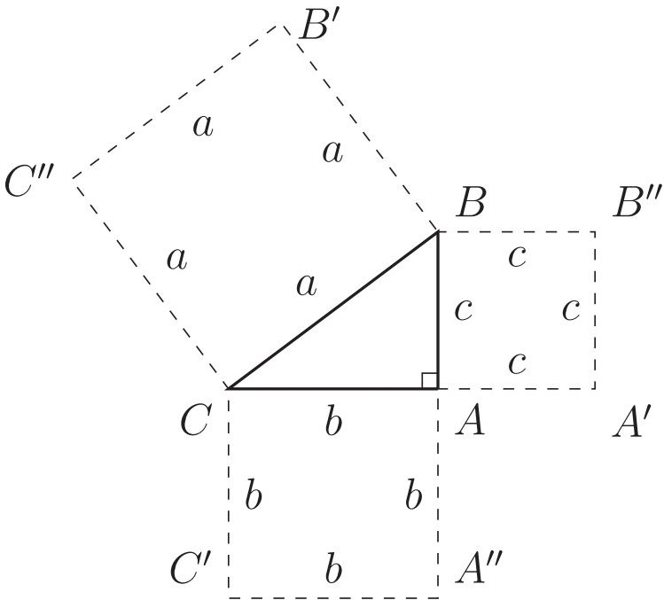

<!-- higher-math-9-10-bn-c03-t3.0-p007 · text · p.64 · review: verify-formula -->
উপরের চিত্রে $ABC$ একটি সমকোণী ত্রিভুজ। $\angle BAC$ সমকোণ এবং $BC$ অতিভুজ। $BC$ অতিভুজের উপর কোনো বর্গক্ষেত্র অঙ্কন করলে তার যে ক্ষেত্রফল হবে সমকোণ সংলগ্ন বাহুদ্বয় $AB$ ও $AC$ এর উপর বর্গক্ষেত্র অঙ্কন করলে তাদের ক্ষেত্রফলের যোগফল তার সমান হবে।

<!-- higher-math-9-10-bn-c03-t3.0-p008 · text · p.64 · review: verify-formula -->
এখানে $BC^2 = BB'C''C$ বর্গক্ষেত্রের ক্ষেত্রফল $= a^2$, $AB^2 = AA'B''B$ বর্গক্ষেত্রের ক্ষেত্রফল $= c^2$, এবং $CA^2 = CC'A''A$ বর্গক্ষেত্রের ক্ষেত্রফল $= b^2$।

<!-- higher-math-9-10-bn-c03-t3.0-p009 · text · p.64 · review: verify-formula -->
অতএব $BC^2 = AB^2 + AC^2$ বা $a^2 = b^2 + c^2$।

<!-- higher-math-9-10-bn-c03-t3.0-p010 · text · p.64 · review: verify-formula -->
উদাহরণস্বরূপ, একটি সমকোণী ত্রিভুজের সমকোণ সংলগ্ন বাহুদ্বয়ের দৈর্ঘ্য $b = 8$ সে.মি. ও $c = 6$ সে.মি. হলে পিথাগোরাসের উপপাদ্যের মাধ্যমে বলা যায় এর অতিভুজের দৈর্ঘ্য $a = 10$ সে.মি.।

<!-- higher-math-9-10-bn-c03-t3.0-p011 · text · p.64 -->
অনুরূপভাবে, যেকোনো দুই বাহুর দৈর্ঘ্যের মাধ্যমে তৃতীয় বাহুর দৈর্ঘ্য জানা সম্ভব।

<!-- higher-math-9-10-bn-c03-t3.0-p012 · text · p.64 -->
উপপাদ্য ২ (পিথাগোরাসের উপপাদ্যের বিপরীত উপপাদ্য). কোনো ত্রিভুজের একটি বাহুর উপর অঙ্কিত বর্গক্ষেত্রের ক্ষেত্রফল অপর দুই বাহুর উপর অঙ্কিত বর্গক্ষেত্রদ্বয়ের ক্ষেত্রফলের সমষ্টির সমান হলে শেয়োক্স বাহুদ্বয়ের অন্তর্ভুক্ত কোণটি সমকোণ হবে।

<!-- higher-math-9-10-bn-c03-t3.0-p013 · figure · p.64 -->
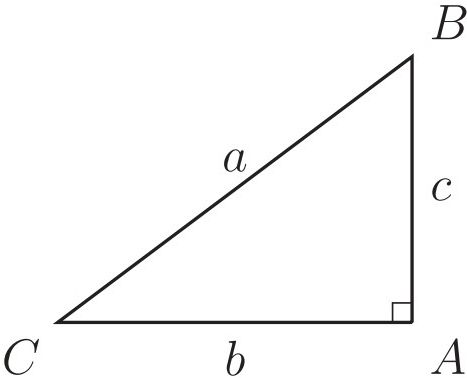

<!-- higher-math-9-10-bn-c03-t3.0-p014 · text · p.64 · review: verify-formula -->
উপরের চিত্রে $\triangle ABC$ এর তিনটি বাহু যথাক্রমে $AB$, $BC$ ও $AC$। $BC$ বাহুর উপর অঙ্কিত বর্গক্ষেত্রের ক্ষেত্রফল অপর দুই বাহু $AB$ ও $AC$ এর উপর অঙ্কিত বর্গক্ষেত্রদ্বয়ের ক্ষেত্রফলের সমষ্টির সমান। অর্থাৎ, $BC^2 = AB^2 + AC^2$ বা, $a^2 = b^2 + c^2$। সুতরাং, $\angle BAC$ একটি সমকোণ। উদাহরণস্বরূপ আমরা বলতে পারি $\triangle ABC$ এর $AB$, $BC$ ও $CA$ বাহুর দৈর্ঘ্য যথাক্রমে ৬ সে.মি., ১০ সে.মি. ও ৪ সে.মি. হলে $\angle BAC$ অবশ্যই সমকোণ হবে।

<!-- higher-math-9-10-bn-c03-t3.0-p015 · text · p.65 · review: verify-formula -->
যেহেতু, $AB^2 = 6^2$ বর্গ সে.মি. $= 36$ বর্গ সে.মি.,

<!-- higher-math-9-10-bn-c03-t3.0-p016 · text · p.65 · review: verify-formula -->
$BC^2 = 10^2$ বর্গ সে.মি. $= 100$ বর্গ সে.মি.,

<!-- higher-math-9-10-bn-c03-t3.0-p017 · text · p.65 · review: verify-formula -->
$AC^2 = 8^2$ বর্গ সে.মি. $= 64$ বর্গ সে.মি.,

<!-- higher-math-9-10-bn-c03-t3.0-p018 · text · p.65 · review: verify-formula -->
$\therefore BC^2 = 100 = 36 + 64 = AB^2 + AC^2$।

<!-- higher-math-9-10-bn-c03-t3.0-p019 · text · p.65 · review: verify-formula -->
$\therefore \angle BAC = 90^\circ =$ এক সমকোণ।

<!-- higher-math-9-10-bn-c03-t3.0-p020 · text · p.65 · review: verify-formula -->
**বিন্দুর লম্ব অভিক্ষেপ (Orthogonal Projection of a Point):** কোনো নির্দিষ্ট সরলরেখার উপর কোনো বিন্দুর লম্ব অভিক্ষেপ বলতে সেই বিন্দু থেকে উক্ত নির্দিষ্ট রেখার উপর অঙ্কিত লম্বের পাদবিন্দুকে বুঝায়। মনে করি, $XY$ একটি নির্দিষ্ট সরলরেখা এবং $P$ যেকোনো বিন্দু (নিচের চিত্রে)। $P$ বিন্দু থেকে $XY$ রেখার উপর অঙ্কিত লম্ব $PP'$ এবং এই লম্বের পাদবিন্দু $P'$। সুতরাং, $P'$ বিন্দু $XY$ রেখার উপর $P$ বিন্দুর লম্ব অভিক্ষেপ। কোনো নির্দিষ্ট রেখার উপর কোনো বিন্দুর লম্ব অভিক্ষেপ একটি বিন্দু।

<!-- higher-math-9-10-bn-c03-t3.0-p021 · figure · p.65 -->
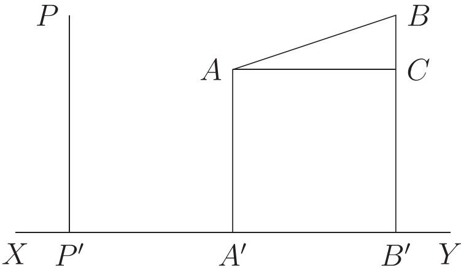

<!-- higher-math-9-10-bn-c03-t3.0-p022 · text · p.65 · review: verify-formula -->
**রেখাংশের লম্ব অভিক্ষেপ (Orthogonal Projection of a Line):** ধরি, $AB$ রেখাংশের প্রান্ত বিন্দুদ্বয় $A$ ও $B$ (উপরের চিত্রে)। এখন $A$ ও $B$ বিন্দু থেকে $XY$ রেখার উপর অঙ্কিত লম্ব যথাক্রমে $AA'$ ও $BB'$। $AA'$ লম্বের পাদবিন্দু $A'$ এবং $BB'$ লম্বের পাদবিন্দু $B'$। এই $A'B'$ রেখাংশই হচ্ছে $XY$ রেখার উপর $AB$ রেখাংশের লম্ব অভিক্ষেপ। সুতরাং, দেখা যাচ্ছে লম্ব অঙ্কনের মাধ্যমে অভিক্ষেপ নির্ণয় করা হয়। তাই $A'B'$ রেখাংশকে $XY$ রেখার উপর $AB$ রেখাংশের লম্ব অভিক্ষেপ বলা হয়। উপরের চিত্রে $AB$ রেখাংশ $XY$ এর সমান্তরাল হলে $AB = A'B'$ হবে। আমরা এ ধারণা থেকে বলতে পারি কোনো সরলরেখার উপর লম্ব যেকোনো সরলরেখার লম্ব অভিক্ষেপ একটি বিন্দু। সে ক্ষেত্রে উক্ত লম্ব অভিক্ষেপের দৈর্ঘ্য হবে শূন্য।

<!-- higher-math-9-10-bn-c03-t3.0-p023 · text · p.65 -->
**দ্রষ্টব্য:**

<!-- higher-math-9-10-bn-c03-t3.0-p024 · text · p.65 -->
১. কোনো রেখার উপর কোনো বিন্দু থেকে অঙ্কিত লম্বের পাদবিন্দুই ঐ বিন্দুর লম্ব অভিক্ষেপ।

<!-- higher-math-9-10-bn-c03-t3.0-p025 · text · p.65 -->
২. কোনো রেখার উপর ঐ রেখার লম্ব রেখাংশের লম্ব অভিক্ষেপ একটি বিন্দু যার দৈর্ঘ্য শূন্য।

<!-- higher-math-9-10-bn-c03-t3.0-p026 · text · p.65 -->
৩. কোন রেখার উপর ঐ রেখার সমান্তরাল কোনো রেখাংশের লম্ব অভিক্ষেপের দৈর্ঘ্য ঐ রেখাংশের দৈর্ঘ্যের সমান।

## 3.1 কতিপয় গুরুত্বপূর্ণ উপপাদ্য

<!-- higher-math-9-10-bn-c03-t3.1-p001 · text · p.66 -->
পিথাগোরাসের উপপাদ্যের উপর ভিত্তি করে এবং লম্ব অভিক্ষেপের ধারণার সাহায্যে আমরা এখন কয়েকটি গুরুত্বপূর্ণ উপপাদ্যের যুক্তিমূলক প্রমাণ উপস্থাপন করব।

<!-- higher-math-9-10-bn-c03-t3.1-p002 · text · p.66 -->
**উপপাদ্য ৩.** স্তূলকোণী ত্রিভুজের স্তূলকোণের বিপরীত বাহুর উপর অঙ্কিত বর্গক্ষেত্রের ক্ষেত্রফল ঐ কোণের সমনিহিত অন্য দুই বাহুর উপর অঙ্কিত বর্গক্ষেত্রদ্বয়ের ক্ষেত্রফল এবং ঐ দুই বাহুর যেকোনো একটি ও তার উপর অপর বাহুর লম্ব অভিক্ষেপের অন্তর্গত আয়তক্ষেত্রের ক্ষেত্রফলের দ্বিগুণের সমষ্টির সমান।

<!-- higher-math-9-10-bn-c03-t3.1-p003 · text · p.66 · review: verify-formula -->
**বিশেষ নির্বাচন:** মনে করি, $ABC$ ত্রিভুজের $\angle BCA$ স্তূলকোণ, $AB$ স্তূলকোণের বিপরীত বাহু এবং স্তূলকোণের সমনিহিত বাহুদ্বয় $BC$ ও $AC$।

<!-- higher-math-9-10-bn-c03-t3.1-p004 · text · p.66 · review: verify-formula -->
$BC$ বাহুর বর্ধিতাংশের উপর $AC$ বাহুর লম্ব অভিক্ষেপ $CD$ (নিচের চিত্র)। প্রমাণ করতে হবে যে, $AB^2 = AC^2 + BC^2 + 2 \cdot BC \cdot CD$

<!-- higher-math-9-10-bn-c03-t3.1-p005 · figure · p.66 -->
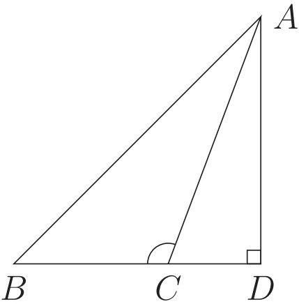

<!-- higher-math-9-10-bn-c03-t3.1-p006 · text · p.66 · review: verify-formula -->
**প্রমাণ:** $BC$ বাহুর বর্ধিতাংশের উপর $AC$ বাহুর লম্ব অভিক্ষেপ $CD$ হওয়ায় $\triangle ABD$ একটি সমকোণী ত্রিভুজ এবং $\angle ADB$ সমকোণ।

<!-- higher-math-9-10-bn-c03-t3.1-p007 · text · p.66 -->
সুতরাং পিথাগোরাসের উপপাদ্য অনুসারে

<!-- higher-math-9-10-bn-c03-t3.1-p008 · formula · p.66 · review: verify-formula -->
$$\begin{aligned}
AB^2 &= AD^2 + BD^2 \\
&= AD^2 + (BC + CD)^2 & [\because BD = BC + CD] \\
&= AD^2 + BC^2 + CD^2 + 2 \cdot BC \cdot CD
\end{aligned}$$

<!-- higher-math-9-10-bn-c03-t3.1-p009 · formula · p.66 · review: verify-formula -->
$$\therefore AB^2 = AD^2 + CD^2 + BC^2 + 2 \cdot BC \cdot CD \dots\dots (1)$$

<!-- higher-math-9-10-bn-c03-t3.1-p010 · text · p.66 · review: verify-formula -->
আবার $\triangle ACD$ সমকোণী ত্রিভুজ এবং $\angle ADC$ সমকোণ।

<!-- higher-math-9-10-bn-c03-t3.1-p011 · formula · p.66 · review: verify-formula -->
$$\therefore AC^2 = AD^2 + CD^2 \dots\dots (2)$$

<!-- higher-math-9-10-bn-c03-t3.1-p012 · text · p.66 · review: verify-formula -->
(2) নং সমীকরণ হতে $AD^2 + CD^2 = AC^2$ (1) নং সমীকরণে বসিয়ে পাই,

<!-- higher-math-9-10-bn-c03-t3.1-p013 · formula · p.66 · review: latin-junk,verify-formula -->
$$AB^2 = AC^2 + BC^2 + 2 \cdot BC \cdot CD \quad [প্রমাণিত]$$

<!-- higher-math-9-10-bn-c03-t3.1-p014 · text · p.66 -->
**উপপাদ্য ৪.** যেকোনো ত্রিভুজের সূক্ষ্মকোণের বিপরীত বাহুর উপর অঙ্কিত বর্গক্ষেত্রের ক্ষেত্রফল অপর দুই বাহুর উপর অঙ্কিত বর্গক্ষেত্রদ্বয়ের ক্ষেত্রফলের সমষ্টি অপেক্ষা ঐ দুই বাহুর যেকোনো একটি ও তার উপর অপরটির লম্ব অভিক্ষেপের অন্তর্গত আয়তক্ষেত্রের ক্ষেত্রফলের দ্বিগুণ পরিমাণ কম।

<!-- higher-math-9-10-bn-c03-t3.1-p015 · text · p.67 · review: verify-formula -->
**বিশেষ নির্বচন:** মনে করি, $\triangle ABC$ ত্রিভুজের $\angle ACB$ সূক্ষ্মকোণ এবং সূক্ষ্মকোণের বিপরীত বাহু $AB$। অপর দুই বাহু $AC$ ও $BC$। মনে করি, $BC$ বাহুর উপর (নিচের বাম পাশের চিত্র) এবং $CB$ বাহুর বর্ধিতাংশের উপর (নিচের ডান পাশের চিত্র) লম্ব $AD$। তাহলে উভয় ত্রিভুজের ক্ষেত্রে $BC$ বাহুর উপর $AC$ বাহুর লম্ব অভিক্ষেপ $CD$। প্রমাণ করতে হবে যে $AB^2 = AC^2 + BC^2 - 2 \cdot BC \cdot CD$।

<!-- higher-math-9-10-bn-c03-t3.1-p016 · text · p.67 · review: verify-formula -->
[উল্লেখ করা দরকার যে এখানে $A$ থেকে $BC$ এর উপর লম্ব টানা হয়েছে। কিন্তু $B$ বিন্দু থেকে $AC$ এর উপর লম্ব অঙ্কনের মাধ্যমেও একইভাবে উপপাদ্যটি প্রমাণ করা যায়।]

<!-- higher-math-9-10-bn-c03-t3.1-p017 · figure · p.67 -->
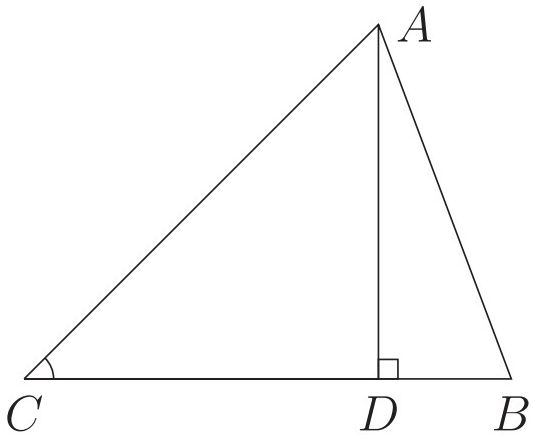

<!-- higher-math-9-10-bn-c03-t3.1-p018 · text · p.67 · review: verify-formula -->
**প্রমাণ:** $\triangle ADB$ সমকোণী ত্রিভুজ এবং $\angle ADB$ সমকোণ।

<!-- higher-math-9-10-bn-c03-t3.1-p019 · text · p.67 · review: verify-formula -->
$\therefore$ পিথাগোরাসের উপপাদ্য অনুসারে $AB^2 = AD^2 + BD^2$ (1)

<!-- higher-math-9-10-bn-c03-t3.1-p020 · text · p.67 · review: verify-formula -->
উপরের বামের চিত্রে $BD = BC - CD$।

<!-- higher-math-9-10-bn-c03-t3.1-p021 · formula · p.67 · review: verify-formula -->
$\therefore BD^2 = (BC - CD)^2 = BC^2 + CD^2 - 2 \cdot BC \cdot CD$

<!-- higher-math-9-10-bn-c03-t3.1-p022 · text · p.67 · review: verify-formula -->
উপরের ডানের চিত্রে $BD = CD - BC$।

<!-- higher-math-9-10-bn-c03-t3.1-p023 · formula · p.67 · review: verify-formula -->
$\therefore BD^2 = (CD - BC)^2 = CD^2 + BC^2 - 2 \cdot CD \cdot BC$

<!-- higher-math-9-10-bn-c03-t3.1-p024 · text · p.67 · review: verify-formula -->
সুতরাং উভয় চিত্রে $BD^2 = BC^2 + CD^2 - 2 \cdot BC \cdot CD$ (2)

<!-- higher-math-9-10-bn-c03-t3.1-p025 · text · p.67 -->
এখন সমীকরণ (1) ও (2) হতে পাওয়া যায়,

<!-- higher-math-9-10-bn-c03-t3.1-p026 · formula · p.67 · review: verify-formula -->
$AB^2 = AD^2 + BC^2 + CD^2 - 2 \cdot BC \cdot CD$

<!-- higher-math-9-10-bn-c03-t3.1-p027 · text · p.67 · review: verify-formula -->
বা, $AB^2 = AD^2 + CD^2 + BC^2 - 2 \cdot BC \cdot CD$ (3)

<!-- higher-math-9-10-bn-c03-t3.1-p028 · text · p.67 · review: verify-formula -->
আবার $\triangle ADC$ সমকোণী ত্রিভুজ এবং $\angle ADC$ সমকোণ।

<!-- higher-math-9-10-bn-c03-t3.1-p029 · text · p.67 · review: verify-formula -->
$\therefore$ পিথাগোরাসের উপপাদ্য অনুসারে $AC^2 = AD^2 + CD^2$ (4)

<!-- higher-math-9-10-bn-c03-t3.1-p030 · text · p.67 -->
সমীকরণ (3) ও (4) হতে পাওয়া যায়,

<!-- higher-math-9-10-bn-c03-t3.1-p031 · text · p.67 · review: verify-formula -->
$AB^2 = AC^2 + BC^2 - 2 \cdot BC \cdot CD$ [প্রমাণিত]

<!-- higher-math-9-10-bn-c03-t3.1-p032 · text · p.67 -->
**মন্তব্য:**

<!-- higher-math-9-10-bn-c03-t3.1-p033 · text · p.67 · review: verify-formula -->
১. সমকোণী ত্রিভুজের ক্ষেত্রে সমকোণের সন্নিহিত বাহুদ্বয় পরস্পর লম্ব বিধায় তাদের প্রত্যেকটির উপর অপরটির লম্ব অভিক্ষেপ শূন্য। $\angle ACB$ সমকোণ হলে $BC$ এর উপর $AC$ এর লম্ব অভিক্ষেপ $CD = 0$। সুতরাং $BC \cdot CD = 0$, ফলে $AB^2 = AC^2 + BC^2$

<!-- higher-math-9-10-bn-c03-t3.1-p034 · text · p.67 -->
২০২

<!-- higher-math-9-10-bn-c03-t3.1-p035 · text · p.68 -->
২. উপপাদ্য ৩ ও উপপাদ্য ৪, উপপাদ্য ১ এর ভিত্তির উপর প্রতিষ্ঠিত। তাই উপপাদ্য ৩ ও উপপাদ্য ৪ কে উপপাদ্য ১ অর্থাৎ পিথাগোরাসের উপপাদ্যের অনুসিদ্ধান্ত বলা যায়।

<!-- higher-math-9-10-bn-c03-t3.1-p036 · text · p.68 · review: verify-formula -->
উপরোক্ত আলোচনা সাপেক্ষে গৃহীত সিদ্ধান্তসমূহ: $\triangle ABC$ এর ক্ষেত্রে,

<!-- higher-math-9-10-bn-c03-t3.1-p037 · text · p.68 · review: verify-formula -->
ক) $\angle ACB$ স্থূলকোণ হলে, $AB^2 > AC^2 + BC^2$ [উপপাদ্য ৩]

<!-- higher-math-9-10-bn-c03-t3.1-p038 · text · p.68 · review: verify-formula -->
খ) $\angle ACB$ সমকোণ হলে, $AB^2 = AC^2 + BC^2$ [উপপাদ্য ১]

<!-- higher-math-9-10-bn-c03-t3.1-p039 · text · p.68 · review: verify-formula -->
গ) $\angle ACB$ সূক্ষ্মকোণ হলে, $AB^2 < AC^2 + BC^2$ [উপপাদ্য ৪]

<!-- higher-math-9-10-bn-c03-t3.1-p040 · text · p.68 -->
নিচের উপপাদ্যটি এ্যাপোলোনিয়াস (জন্ম খ্রিস্টপূর্ব ২৪০-মৃত্যু খ্রিস্টপূর্ব ১৯০) কর্তৃক বর্ণিত বলে এটি অ্যাপোলোনিয়াসের উপপাদ্য নামে পরিচিত। এটি পিথাগোরাসের উপপাদ্যের বিস্তার অর্থাৎ উপপাদ্য ৩ ও উপপাদ্য ৪ এর উপর ভিত্তি করে প্রতিষ্ঠিত।

<!-- higher-math-9-10-bn-c03-t3.1-p041 · text · p.68 -->
উপপাদ্য ৫ (এ্যাপোলোনিয়াসের উপপাদ্য). ত্রিভুজের যেকোনো দুই বাহুর উপর অঙ্কিত বর্গক্ষেত্রদ্বয়ের ক্ষেত্রফলের সমষ্টি, তৃতীয় বাহুর অর্ধেকের উপর অঙ্কিত বর্গক্ষেত্রের ক্ষেত্রফল এবং ঐ বাহুর সমদ্বিখণ্ডক মধ্যমার উপর অঙ্কিত বর্গক্ষেত্রের ক্ষেত্রফলের সমষ্টির দ্বিগুণ।

<!-- higher-math-9-10-bn-c03-t3.1-p042 · text · p.68 · review: verify-formula -->
**বিশেষ নির্দেশ:** মনে করি, $\triangle ABC$ এর $AD$ মধ্যমা $BC$ বাহুকে সমদ্বিখণ্ডিত করেছে। প্রমাণ করতে হবে যে, $AB^2 + AC^2 = 2(AD^2 + BD^2)$।

<!-- higher-math-9-10-bn-c03-t3.1-p043 · figure · p.68 -->
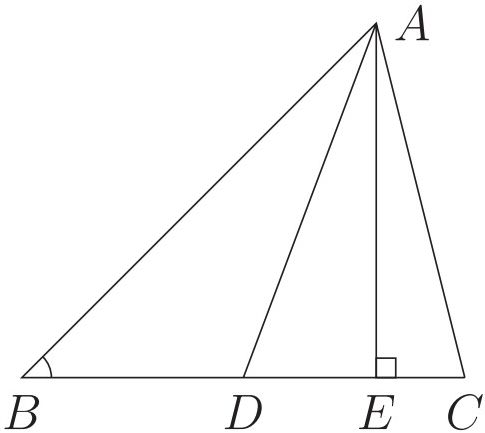

<!-- higher-math-9-10-bn-c03-t3.1-p044 · text · p.68 · review: verify-formula -->
**প্রমাণ:** $BC$ বাহুর উপর (উপরের বাম পাশের চিত্রে) এবং $BC$ বাহুর বর্ধিতাংশের উপর (উপরের ডান পাশের চিত্রে) $AE$ লম্ব অঙ্কন করি। উভয় চিত্রে $\triangle ABD$ এর $\angle ADB$ স্থূলকোণ এবং $BD$ রেখার বর্ধিতাংশের উপর $AD$ রেখার লম্ব অভিক্ষেপ $DE$।

<!-- higher-math-9-10-bn-c03-t3.1-p045 · text · p.68 -->
স্থূলকোণের ক্ষেত্রে পিথাগোরাসের উপপাদ্যের বিস্তৃতি অনুসারে [উপপাদ্য ৩] আমরা পাই,

<!-- higher-math-9-10-bn-c03-t3.1-p046 · formula · p.68 · review: verify-formula -->
$$AB^2 = AD^2 + BD^2 + 2 \cdot BD \cdot DE \dots\dots (1)$$

<!-- higher-math-9-10-bn-c03-t3.1-p047 · text · p.68 · review: verify-formula -->
এখানে, $\triangle ACD$ এর $\angle ADC$ সূক্ষ্মকোণ এবং $DC$ রেখার (উপরের বাম পাশের চিত্রে) এবং $DC$ রেখার বর্ধিতাংশের (উপরের ডান পাশের চিত্রে) উপর $AD$ রেখার লম্ব অভিক্ষেপ $DE$।

<!-- higher-math-9-10-bn-c03-t3.1-p048 · text · p.68 -->
সূক্ষ্মকোণের ক্ষেত্রে পিথাগোরাসের উপপাদ্যের বিস্তৃতি অনুসারে [উপপাদ্য ৪] আমরা পাই,

<!-- higher-math-9-10-bn-c03-t3.1-p049 · formula · p.68 · review: verify-formula -->
$$AC^2 = AD^2 + CD^2 - 2 \cdot CD \cdot DE \dots\dots (2)$$

<!-- higher-math-9-10-bn-c03-t3.1-p050 · text · p.68 · review: latin-junk,verify-formula -->
এখন সমীকরণ (1) ও (2) যোগ করে পাই, $$AB^2 + AC^2 = 2AD^2 + BD^2 + CD^2 + 2 \cdot BD \cdot DE - 2 \cdot CD \cdot DE$$
$$= 2AD^2 + 2BD^2 \quad [\because BD = CD]$$
$$\therefore AB^2 + AC^2 = 2(AD^2 + BD^2) \quad [প্রমাণিত]$$

<!-- higher-math-9-10-bn-c03-t3.1-p051 · text · p.69 -->
অ্যাপোলোনিয়াসের উপপাদ্যের মাধ্যমে ত্রিভুজের বাহু ও মধ্যমার সম্পর্ক নির্ণয়।

<!-- higher-math-9-10-bn-c03-t3.1-p052 · text · p.69 · review: verify-formula -->
মনে করি, $\triangle ABC$ এর $BC$, $CA$ ও $AB$ বাহুর দৈর্ঘ্য যথাক্রমে $a$, $b$ ও $c$। $BC$, $CA$ ও $AB$ বাহুর উপর অঙ্কিত মধ্যমা $AD$, $BE$ ও $CF$ এর দৈর্ঘ্য যথাক্রমে $d$, $e$ ও $f$।

<!-- higher-math-9-10-bn-c03-t3.1-p053 · figure · p.69 -->
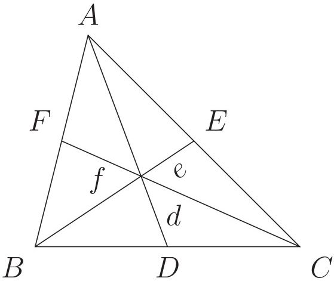

<!-- higher-math-9-10-bn-c03-t3.1-p054 · text · p.69 -->
তাহলে, অ্যাপোলোনিয়াসের উপপাদ্য হতে পাই,

<!-- higher-math-9-10-bn-c03-t3.1-p055 · formula · p.69 · review: verify-formula -->
$$AB^2 + AC^2 = 2(AD^2 + BD^2)$$

<!-- higher-math-9-10-bn-c03-t3.1-p056 · text · p.69 · review: verify-formula -->
বা, $c^2 + b^2 = 2 \left( d^2 + \left( \frac{1}{2} a \right)^2 \right) \quad [\because BD = \frac{1}{2} a]$

<!-- higher-math-9-10-bn-c03-t3.1-p057 · text · p.69 · review: verify-formula -->
বা, $b^2 + c^2 = 2d^2 + 2 \cdot \frac{1}{4} a^2$

<!-- higher-math-9-10-bn-c03-t3.1-p058 · text · p.69 · review: verify-formula -->
বা, $b^2 + c^2 = 2d^2 + \frac{a^2}{2}$

<!-- higher-math-9-10-bn-c03-t3.1-p059 · text · p.69 · review: verify-formula -->
বা, $d^2 = \frac{2(b^2 + c^2) - a^2}{4}$

<!-- higher-math-9-10-bn-c03-t3.1-p060 · text · p.69 · review: verify-formula -->
অনুরূপভাবে পাওয়া যায়, $e^2 = \frac{2(c^2 + a^2) - b^2}{4}$ এবং $f^2 = \frac{2(a^2 + b^2) - c^2}{4}$

<!-- higher-math-9-10-bn-c03-t3.1-p061 · text · p.69 -->
সুতরাং বলা যায় কোনো ত্রিভুজের বাহুগুলোর দৈর্ঘ্য জানা থাকলে মধ্যমাসমূহের দৈর্ঘ্য জানা যায়।

<!-- higher-math-9-10-bn-c03-t3.1-p062 · text · p.69 · review: verify-formula -->
আবার, $d^2 + e^2 + f^2 = \frac{2(b^2 + c^2) - a^2}{4} + \frac{2(c^2 + a^2) - b^2}{4} + \frac{2(a^2 + b^2) - c^2}{4}$

<!-- higher-math-9-10-bn-c03-t3.1-p063 · text · p.69 · review: verify-formula -->
অর্থাৎ, $d^2 + e^2 + f^2 = \frac{3}{4}(a^2 + b^2 + c^2)$

<!-- higher-math-9-10-bn-c03-t3.1-p064 · formula · p.69 · review: verify-formula -->
$\therefore 3(a^2 + b^2 + c^2) = 4(d^2 + e^2 + f^2)$

<!-- higher-math-9-10-bn-c03-t3.1-p065 · text · p.70 -->
সুতরাং বলা যায় কোন ত্রিভুজের তিনটি বাহুর উপর অঙ্কিত বর্গক্ষেত্রসমূহের ক্ষেত্রফলের সমষ্টির তিনগুণ উক্ত ত্রিভুজের মধ্যমাত্রয়ের উপর অঙ্কিত বর্গক্ষেত্রসমূহের ক্ষেত্রফলের সমষ্টির চারগুণের সমান।

<!-- higher-math-9-10-bn-c03-t3.1-p066 · text · p.70 · review: verify-formula -->
ত্রিভুজটি সমকোণী অর্থাৎ $\angle ACB$ সমকোণ এবং $AB$ অতিভুজ হলে

<!-- higher-math-9-10-bn-c03-t3.1-p067 · formula · p.70 · review: verify-formula -->
$$c^2 = a^2 + b^2$$

<!-- higher-math-9-10-bn-c03-t3.1-p068 · text · p.70 · review: verify-formula -->
বা, $a^2 + b^2 + c^2 = 2c^2$

<!-- higher-math-9-10-bn-c03-t3.1-p069 · text · p.70 · review: verify-formula -->
বা, $\frac{4}{3}(d^2 + e^2 + f^2) = 2c^2$

<!-- higher-math-9-10-bn-c03-t3.1-p070 · text · p.70 · review: verify-formula -->
বা, $2(d^2 + e^2 + f^2) = 3c^2$

<!-- higher-math-9-10-bn-c03-t3.1-p071 · text · p.70 -->
সুতরাং, বলা যায় সমকোণী ত্রিভুজের মধ্যমাত্রয়ের উপর অঙ্কিত বর্গক্ষেত্রসমূহের ক্ষেত্রফলের সমষ্টির দ্বিগুণ অতিভুজের উপর অঙ্কিত বর্গক্ষেত্রের ক্ষেত্রফলের তিনগুণের সমান।

## 3.ex অনুশীলনী ৩.১

<!-- higher-math-9-10-bn-c03-t3.ex-p001 · exercise · p.70 · review: verify-formula -->
১. $\triangle ABC$ এর $\angle B = 60^\circ$ হলে প্রমাণ করো যে, $AC^2 = AB^2 + BC^2 - AB \cdot BC$।

<!-- higher-math-9-10-bn-c03-t3.ex-p002 · exercise · p.70 · review: verify-formula -->
২. $\triangle ABC$ এর $\angle B = 120^\circ$ হলে প্রমাণ করো যে, $AC^2 = AB^2 + BC^2 + AB \cdot BC$।

<!-- higher-math-9-10-bn-c03-t3.ex-p003 · exercise · p.70 · review: verify-formula -->
৩. $\triangle ABC$ এর $\angle C = 90^\circ$ এবং $BC$ এর মধ্যবিন্দু $D$। প্রমাণ করো যে, $AB^2 = AD^2 + 3BD^2$।

<!-- higher-math-9-10-bn-c03-t3.ex-p004 · exercise · p.70 · review: verify-formula -->
৪. $\triangle ABC$ এ $AD, BC$ বাহুর উপর লম্ব এবং $BE, AC$ এর উপর লম্ব। দেখাও যে, $BC \cdot CD = AC \cdot CE$।

<!-- higher-math-9-10-bn-c03-t3.ex-p005 · exercise · p.70 · review: verify-formula -->
৫. $\triangle ABC$ এর $BC$ বাহু $P$ ও $Q$ বিন্দুতে তিনটি সমান অংশে বিভক্ত হয়েছে। প্রমাণ করো যে, $AB^2 + AC^2 = AP^2 + AQ^2 + 4PQ^2$।

<!-- higher-math-9-10-bn-c03-t3.ex-p006 · exercise · p.70 · review: verify-formula -->
[সংকেত: $BP = PQ = QC$; $\triangle ABQ$ এর মধ্যমা $AP$।
$AB^2 + AQ^2 = 2(BP^2 + AP^2) = 2PQ^2 + 2AP^2$।
$\triangle APC$ এর মধ্যমা $AQ$। $\therefore AP^2 + AC^2 = 2PQ^2 + 2AQ^2$।]

<!-- higher-math-9-10-bn-c03-t3.ex-p007 · exercise · p.70 · review: verify-formula -->
৬. $\triangle ABC$ এর $AB = AC$। ভূমি $BC$ এর উপর $P$ যেকোনো বিন্দু। প্রমাণ করো যে, $AB^2 - AP^2 = BP \cdot PC$। [সংকেত: $BC$ এর উপর $AD$ লম্ব আঁকো। তাহলে $AB^2 = BD^2 + AD^2$ এবং $AP^2 = PD^2 + AD^2$।]

<!-- higher-math-9-10-bn-c03-t3.ex-p008 · exercise · p.70 · review: verify-formula -->
৭. $\triangle ABC$ এর মধ্যমাত্রয় $G$ বিন্দুতে মিলিত হলে প্রমাণ করো যে, $AB^2 + BC^2 + AC^2 = 3(GA^2 + GB^2 + GC^2)$।

<!-- higher-math-9-10-bn-c03-t3.ex-p009 · exercise · p.70 -->
[সংকেত: অ্যাপোলোনিয়াসের উপপাদ্যের আলোকে গৃহীত সিদ্ধান্তসমূহ ব্যবহার করতে হবে অর্থাৎ ত্রিভুজের বাহুর দৈর্ঘ্য ও মধ্যমার সম্পর্ক ব্যবহার করতে হবে।]

### অনুশীলনী ৩.২

<!-- higher-math-9-10-bn-c03-t3.ex-p010 · exercise · p.79 · review: verify-formula -->
১. $ABC$ ত্রিভুজের পরিবৃত্তস্থ যেকোনো বিন্দু $P$ থেকে $BC$ ও $CA$ এর উপর $PD$ ও $PE$ লম্ব অঙ্কন করা হয়েছে। যদি $ED$ রেখাংশ $AB$ কে $O$ বিন্দুতে ছেদ করে, তবে প্রমাণ করো যে, $PO$ রেখা $AB$ এর উপর লম্ব, অর্থাৎ $PO \perp AB$।

<!-- higher-math-9-10-bn-c03-t3.ex-p011 · exercise · p.79 · review: verify-formula -->
২. $\triangle ABC$ এর $\angle C$ সমকোণ। $C$ থেকে অতিভুজের উপর অঙ্কিত লম্ব $CD$ হলে, প্রমাণ করো যে, $CD^2 = AD \cdot BD$।

<!-- higher-math-9-10-bn-c03-t3.ex-p012 · exercise · p.79 · review: verify-formula -->
৩. $\triangle ABC$ এর শীর্ষত্রয় থেকে বিপরীত বাহুগুলোর উপর লম্ব $AD, BE$ ও $CF$ রেখাত্রয় $O$ বিন্দুতে ছেদ করে। প্রমাণ করো যে, $AO \cdot OD = BO \cdot OE = CO \cdot OF$।

<!-- higher-math-9-10-bn-c03-t3.ex-p013 · exercise · p.79 · review: verify-formula -->
[সংকেত: $\triangle BOF$ এবং $\triangle COE$ সদৃশ। $\therefore BO : CO = OF : OE$।]

<!-- higher-math-9-10-bn-c03-t3.ex-p014 · exercise · p.79 · review: verify-formula -->
৪. $AB$ ব্যাসের উপর অঙ্কিত অর্ধবৃত্তের দুটি জ্যা $AC$ ও $BD$ পরস্পর $P$ বিন্দুতে ছেদ করে। প্রমাণ করো যে, $AB^2 = AC \cdot AP + BD \cdot BP$।

<!-- higher-math-9-10-bn-c03-t3.ex-p015 · exercise · p.79 · review: verify-formula -->
৫. $ABC$ সমদ্বিভাউ ত্রিভুজের শীর্ষবিন্দু $A$ হতে ভূমি $BC$ এর উপর অঙ্কিত লম্ব $AD$ এবং ত্রিভুজের পরিব্যাসার্ধ $R$ হলে প্রমাণ করো যে, $AB^2 = 2R \cdot AD$।

<!-- higher-math-9-10-bn-c03-t3.ex-p016 · exercise · p.79 · review: verify-formula -->
৬. $ABC$ ত্রিভুজের $\angle A$ এর সমদ্বিখণ্ডক $BC$ কে $D$ বিন্দুতে এবং $ABC$ পরিবৃত্তকে $E$ বিন্দুতে ছেদ করেছে। দেখাও যে, $AD^2 = AB \cdot AC - BD \cdot DC$।

<!-- higher-math-9-10-bn-c03-t3.ex-p017 · exercise · p.80 · review: verify-formula -->
৭. $ABC$ ত্রিভুজের $AC$ ও $AB$ বাহুর উপর যথাক্রমে $BE$ ও $CF$ লম্ব। দেখাও যে, $\triangle ABC : \triangle AEF = AB^2 : AE^2$।

<!-- higher-math-9-10-bn-c03-t3.ex-p018 · exercise · p.80 · review: verify-formula -->
৮. $\triangle PQR$ এ $PM, QN$ ও $RS$ মধ্যমত্রয় $O$ বিন্দুতে ছেদ করেছে।

<!-- higher-math-9-10-bn-c03-t3.ex-p019 · exercise · p.80 · review: verify-formula -->
ক) $O$ বিন্দুটির নাম কী? $O$ বিন্দু $PM$ কে কী অনুপাতে বিভক্ত করে?

<!-- higher-math-9-10-bn-c03-t3.ex-p020 · exercise · p.80 · review: verify-formula -->
খ) $\triangle PQR$ হতে $PQ^2 + PR^2 = 2(PM^2 + QM^2)$ সম্পর্কটি প্রতিষ্ঠিত করো।

<!-- higher-math-9-10-bn-c03-t3.ex-p021 · exercise · p.80 · review: verify-formula -->
গ) দেখাও যে, $\triangle PQR$ এর বাহু তিনটির বর্গের সমষ্টি $O$ বিন্দু হতে শীর্ষবিন্দু তিনটির দূরত্বের বর্গের সমষ্টির তিনগুণ।

### বহুনির্বাচনি প্রশ্ন

<!-- higher-math-9-10-bn-c03-t3.ex-p022 · exercise · p.80 -->
১. একটি সমবাহু ত্রিভুজের প্রতিটি মধ্যমার দৈর্ঘ্য ৩ সে.মি. হলে প্রতিটি বাহুর দৈর্ঘ্য কত?

<!-- higher-math-9-10-bn-c03-t3.ex-p023 · exercise · p.80 -->
ক) 4.5 সে.মি. খ) 3.46 সে.মি. গ) 3.35 সে.মি. ঘ) 2.59 সে.মি.

<!-- higher-math-9-10-bn-c03-t3.ex-p024 · exercise · p.80 · review: verify-formula -->
২. $\triangle ABC$ এর ক্ষেত্রে-

<!-- higher-math-9-10-bn-c03-t3.ex-p025 · exercise · p.80 · review: verify-formula -->
(i) $\angle ACB$ তুলকোণ হলে $AB^2 > AC^2 + BC^2$

<!-- higher-math-9-10-bn-c03-t3.ex-p026 · exercise · p.80 · review: verify-formula -->
(ii) $\angle ACB$ সমকোণ হলে $AB^2 = AC^2 + BC^2$

<!-- higher-math-9-10-bn-c03-t3.ex-p027 · exercise · p.80 · review: verify-formula -->
(iii) $\angle ACB$ সূক্ষ্মকোণ হলে $AB^2 < AC^2 + BC^2$

<!-- higher-math-9-10-bn-c03-t3.ex-p028 · figure · p.80 -->
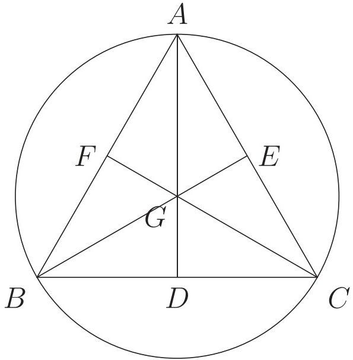

<!-- higher-math-9-10-bn-c03-t3.ex-p029 · exercise · p.80 · review: verify-formula -->
উপরের চিত্রে $D, E, F$ যথাক্রমে $BC, AC$ ও $AB$ এর মধ্যবিন্দু। সেই আলোকে ৩-৪ নং প্রশ্নের উত্তর দাও:

<!-- higher-math-9-10-bn-c03-t3.ex-p030 · exercise · p.80 · review: verify-formula -->
৩. $G$ বিন্দুর নাম কী?

<!-- higher-math-9-10-bn-c03-t3.ex-p031 · exercise · p.80 -->
ক) লম্ববিন্দু খ) অন্তঃকেন্দ্র গ) ভরকেন্দ্র ঘ) পরিকেন্দ্র

<!-- higher-math-9-10-bn-c03-t3.ex-p032 · exercise · p.81 · review: verify-formula -->
৪. $\triangle ABC$ এর ক্ষেত্রে নিচের কোনটি অ্যাপোলোনিয়াসের উপপাদ্যকে সমর্থন করে?

<!-- higher-math-9-10-bn-c03-t3.ex-p033 · exercise · p.81 · review: verify-formula -->
ক) $AB^2 + AC^2 = BC^2$ খ) $AB^2 + AC^2 = 2(AD^2 + BD^2)$
গ) $AB^2 + AC^2 = 2(AG^2 + GD^2)$ ঘ) $AB^2 + AC^2 = 2(BD^2 + CD^2)$

### সৃজনশীল প্রশ্ন

<!-- higher-math-9-10-bn-c03-t3.ex-p034 · exercise · p.81 · review: known-confusable-corrected,verify-formula -->
৫. নিচের চিত্রে $S, O$ যথাক্রমে $\triangle ABC$ এর পরিকেন্দ্র ও লম্ববিন্দু। $AP$ মধ্যমা, $BC = a$, $AC = b$ এবং $AB = c$।

<!-- higher-math-9-10-bn-c03-t3.ex-p035 · figure · p.81 · review: known-confusable-corrected -->
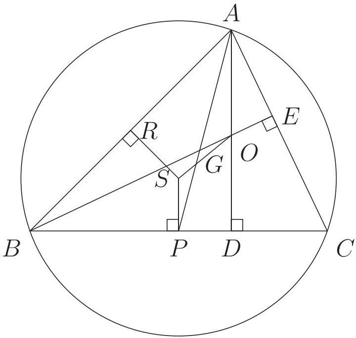

<!-- higher-math-9-10-bn-c03-t3.ex-p036 · exercise · p.81 · review: known-confusable-corrected,verify-formula -->
(ক) চিত্র অঙ্কন করে $BC$ এর উপর $BE$ এর লম্ব অভিক্ষেপ চিহ্নিত করো।
খ) দেখাও যে, $S, G, O$ একই সরলরেখায় অবস্থিত।
গ) $\angle C$ সূক্ষ্মকোণ হলে $a \cdot CD = b \cdot CE$ সমীকরণটি প্রতিষ্ঠিত করো।

### সংক্ষিপ্ত-উত্তর প্রশ্ন

<!-- higher-math-9-10-bn-c03-t3.ex-p037 · exercise · p.81 -->
৬. ক) কোনো ত্রিভুজের তিনটি বাহুর দৈর্ঘ্য ৪ সেমি, ৫ সেমি এবং ৬ সেমি হলে, ত্রিভুজটির মধ্যমাগুলোর বর্গের সমষ্টি নির্ণয় করো।
খ) কোনো সমকোণী ত্রিভুজের মধ্যমাগুলোর বর্গের সমষ্টি ৩৭.৫ বর্গ একক হলে, ত্রিভুজটির অতিভুজের দৈর্ঘ্য নির্ণয় করো।
গ) কোনো সমবাহু ত্রিভুজের পরিবৃত্তের ব্যাসার্ধ ৩ সে.মি. হলে ঐ ত্রিভুজের বাহুর দৈর্ঘ্য নির্ণয় করো।

## 3.2 ত্রিভুজ ও বৃত্তবিষয়ক উপপাদ্য

<!-- higher-math-9-10-bn-c03-t3.2-p001 · text · p.71 -->
এই অংশে ত্রিভুজ ও বৃত্তবিষয়ক কয়েকটি গুরুত্বপূর্ণ উপপাদ্যের যুক্তিমূলক প্রমাণ উপস্থাপন করা হবে। উপপাদ্যসমূহ প্রমাণের জন্য দুটি ত্রিভুজের সদৃশতা সম্পর্কে পূর্বজ্ঞান থাকা আবশ্যক। মাধ্যমিক জ্যামিতিতে ত্রিভুজের সদৃশতা সম্পর্কে বিস্তারিত আলোচনা করা হয়েছে। শিক্ষার্থীদের সুবিধার্থে ত্রিভুজের সদৃশতা সম্পর্কে সংক্ষেপে আলোচনা করা হলো।

<!-- higher-math-9-10-bn-c03-t3.2-p002 · text · p.71 -->
**কোণের ক্ষেত্রে সদৃশতা:** সমান সংখ্যক বাহুবিশিষ্ট দুটি বহুভুজের একটির কোণগুলো যদি যথাক্রমে অপরটির কোণগুলোর সমান হয়, তবে বহুভুজ দুইটিকে সদৃশকোণী বহুভুজ বলা হয়।

<!-- higher-math-9-10-bn-c03-t3.2-p003 · text · p.71 -->
**বাহুর অনুপাতের ক্ষেত্রে সদৃশতা:** সমান সংখ্যক বাহুবিশিষ্ট দুটি বহুভুজের একটির শীর্ষ বিন্দুগুলোকে যদি যথাক্রমে অপরটির শীর্ষবিন্দুগুলোর সঙ্গে এমনভাবে মিল করা যায় যে, বহুভুজ দুটির

<!-- higher-math-9-10-bn-c03-t3.2-p004 · text · p.71 -->
ক) অনুরূপ কোণগুলো সমান হয় এবং

<!-- higher-math-9-10-bn-c03-t3.2-p005 · text · p.71 -->
খ) অনুরূপ দুইটি বাহুর অনুপাত সমান হয়

<!-- higher-math-9-10-bn-c03-t3.2-p006 · text · p.71 -->
তবে বহুভুজ দুটিকে সদৃশ (similar) বহুভুজ বলা হয়।

<!-- higher-math-9-10-bn-c03-t3.2-p007 · figure · p.71 -->
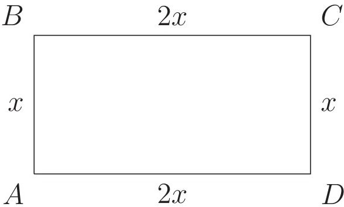

<!-- higher-math-9-10-bn-c03-t3.2-p008 · text · p.71 -->
উপরের চিত্রে লক্ষ্য করলে দেখব যে,

<!-- higher-math-9-10-bn-c03-t3.2-p009 · text · p.71 · review: verify-formula -->
ক) আয়ত $ABCD$ ও বর্গ $EFGH$ সদৃশ নয় যদিও তারা সদৃশকোণী। সবগুলো কোণই সমকোণ কিন্তু অনুরূপ বাহুগুলোর অনুপাত সমান নয়।

<!-- higher-math-9-10-bn-c03-t3.2-p010 · text · p.71 · review: verify-formula -->
খ) বর্গ $EFGH$ ও রম্বস $KLMN$ সদৃশ নয় যদিও তাদের শীর্ষবিন্দুগুলোর যেকোনো ধারাবাহিক মিলকরণের ফলে অনুরূপ বাহু দুইটির অনুপাতগুলো সমান কিন্তু অনুরূপ কোণগুলো সমান নয়।

<!-- higher-math-9-10-bn-c03-t3.2-p011 · text · p.71 -->
দুটি ত্রিভুজের বোঝায় অবশ্য এ রকম হয় না। দুটি ত্রিভুজের শীর্ষবিন্দুগুলোর কোণ মিলকরণের ফলে যদি সদৃশতার সংজ্ঞায় উল্লেখিত শর্ত দুটির একটি সত্য হয়, তবে অপরটিও সত্য হয় এবং ত্রিভুজ দুটি সদৃশ হয়। এ প্রসঙ্গে উল্লেখ্য যে,

<!-- higher-math-9-10-bn-c03-t3.2-p012 · text · p.71 -->
ক) দুটি ত্রিভুজ সদৃশকোণী হলে সমান কোণ দুটিকে অনুরূপ কোণ এবং অনুরূপ কোণের বিপরীত বাহু দুটিকে অনুরূপ বাহু ধরা হয়।

<!-- higher-math-9-10-bn-c03-t3.2-p013 · text · p.71 -->
খ) দুটি ত্রিভুজের একটির দুই বাহু অপরটির দুই বাহুর সমানুপাতিক হলে, অনুপাতিক বাহু দুটিকে অনুরূপ বাহু এবং অনুরূপ বাহুর বিপরীত কোণ দুটিকে অনুরূপ কোণ ধরা হয়।

<!-- higher-math-9-10-bn-c03-t3.2-p014 · text · p.72 · review: verify-formula -->
গ) উভয়ক্ষেত্রে অনুরূপ কোণগুলোর শীর্ষবিন্দু মিল করে ত্রিভুজ দুটি বর্ণনা করা হয়। যেমন, $\triangle ABC$ ও $\triangle DEF$ এর অনুরূপ কোণগুলো হচ্ছে $\angle A$ ও $\angle D$, $\angle B$ ও $\angle E$, $\angle C$ ও $\angle F$ এবং অনুরূপ বাহুগুলো হচ্ছে $AB$ ও $DE$, $AC$ ও $DF$, $BC$ ও $EF$।

<!-- higher-math-9-10-bn-c03-t3.2-p015 · text · p.72 -->
দুটি ত্রিভুজের সদৃশতা সম্পর্কিত কয়েকটি উপপাদ্যের সংক্ষিপ্ত বর্ণনা দেওয়া হলো।

<!-- higher-math-9-10-bn-c03-t3.2-p016 · text · p.72 -->
**উপপাদ্য ৬.** দুটি ত্রিভুজ সদৃশকোণী হলে তাদের অনুরূপ বাহুগুলো সমানুপাতিক হবে।

<!-- higher-math-9-10-bn-c03-t3.2-p017 · figure · p.72 -->
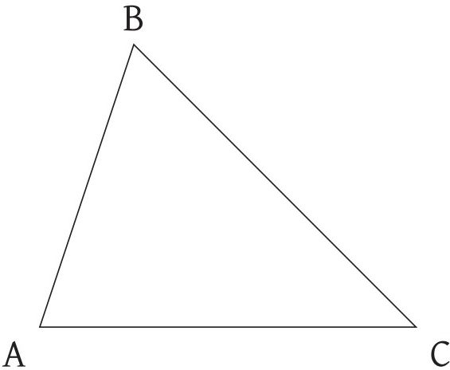

<!-- higher-math-9-10-bn-c03-t3.2-p018 · text · p.72 · review: verify-formula -->
উপরের চিত্রে $\triangle ABC$ ও $\triangle DEF$ সদৃশকোণী ত্রিভুজ।

<!-- higher-math-9-10-bn-c03-t3.2-p019 · text · p.72 · review: verify-formula -->
অর্থাৎ, $\angle A = \angle D$, $\angle B = \angle E$ এবং $\angle C = \angle F$ হওয়ায় $\frac{AB}{DE} = \frac{AC}{DF} = \frac{BC}{EF}$ হবে।

<!-- higher-math-9-10-bn-c03-t3.2-p020 · text · p.72 -->
অর্থাৎ অনুরূপ বাহুগুলো সমানুপাতিক হবে।

<!-- higher-math-9-10-bn-c03-t3.2-p021 · text · p.72 -->
**অনুসিদ্ধান্ত ১.** দুটি ত্রিভুজ সদৃশকোণী হলে, তারা সদৃশ হয়।

<!-- higher-math-9-10-bn-c03-t3.2-p022 · text · p.72 -->
**মন্তব্য:** দুইটি ত্রিভুজের একটির দুই কোণ অপরটির দুই কোণের সমান হলে ত্রিভুজ দুটি সদৃশকোণী এবং এর ফলে এগুলো সদৃশ হয়। কারণ যেকোনো ত্রিভুজের তিন কোণের সমষ্টি দুই সমকোণ।

<!-- higher-math-9-10-bn-c03-t3.2-p023 · text · p.72 -->
**উপপাদ্য ৭.** দুটি ত্রিভুজের বাহুগুলো পরস্পরের সমানুপাতিক হলে অনুরূপ বাহুগুলোর বিপরীত কোণগুলো পরস্পর সমান হয়।

<!-- higher-math-9-10-bn-c03-t3.2-p024 · figure · p.72 -->

<!-- higher-math-9-10-bn-c03-t3.2-p025 · text · p.72 · review: verify-formula -->
উপরের চিত্রে $\triangle ABC$ ও $\triangle DEF$ এর বাহুগুলো সমানুপাতিক অর্থাৎ $\frac{AB}{DE} = \frac{AC}{DF} = \frac{BC}{EF}$ হওয়ায় ত্রিভুজদ্বয়ের কোণগুলো পরস্পর সমান। সুতরাং, $\angle A = \angle D$, $\angle B = \angle E$ এবং $\angle C = \angle F$।

<!-- higher-math-9-10-bn-c03-t3.2-p026 · text · p.72 -->
উপপাদ্য ৬ কে উপপাদ্য ৭ এর বিপরীত উপপাদ্য বলা যেতে পারে।

<!-- higher-math-9-10-bn-c03-t3.2-p027 · text · p.73 -->
**উপপাদ্য ৮.** দুটি ত্রিভুজের একটির এক কোণ অপরটির এক কোণের সমান এবং সমান কোণ সংলগ্ন বাহুগুলো সমানুপাতিক হলে ত্রিভুজ দুটি সম্ভাষ হবে।

<!-- higher-math-9-10-bn-c03-t3.2-p028 · text · p.73 · review: verify-formula -->
নিচের চিত্রের $\triangle ABC$ ও $\triangle DEF$ এর $\angle A = \angle D$ এবং সমান কোণ সংলগ্ন বাহুদ্বয় $AB, AC$ এবং $DE, DF$ সমানুপাতিক। অর্থাৎ $\frac{AB}{DE} = \frac{AC}{DF}$ হওয়ায় $\triangle ABC$ ও $\triangle DEF$ সম্ভাষ।

<!-- higher-math-9-10-bn-c03-t3.2-p029 · figure · p.73 -->
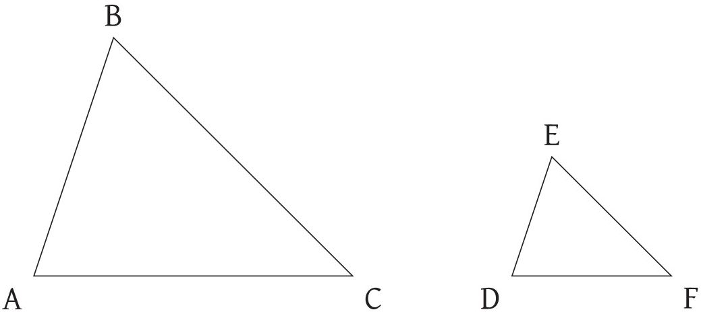

<!-- higher-math-9-10-bn-c03-t3.2-p030 · text · p.73 -->
**উপপাদ্য ৯.** দুইটি সম্ভাষ ত্রিভুজক্ষেত্রের ক্ষেত্রফলদ্বয়ের অনুপাত তাদের যেকোনো দুই অনুরূপ বাহুর উপর অঙ্কিত বর্গক্ষেত্রের ক্ষেত্রফলদ্বয়ের অনুপাতের সমান।

<!-- higher-math-9-10-bn-c03-t3.2-p031 · text · p.73 · review: verify-formula -->
নিচের চিত্রের $\triangle ABC$ ও $\triangle DEF$ ত্রিভুজদ্বয় সম্ভাষ। ত্রিভুজ দুটির অনুরূপ বাহু $BC$ ও $EF$। এই অবস্থায় ত্রিভুজদ্বয়ের ক্ষেত্রফলের অনুপাত $BC$ ও $EF$ বাহুদ্বয়ের উপর অঙ্কিত বর্গক্ষেত্রের ক্ষেত্রফলদ্বয়ের অনুপাতের সমান। অর্থাৎ, $\frac{\triangle ABC}{\triangle DEF} = \frac{BC^2}{EF^2}$। একইভাবে ত্রিভুজ দুটির $AB$ ও $DE$ এবং $AC$ ও $DF$ অনুরূপ হলে, $\frac{\triangle ABC}{\triangle DEF} = \frac{AB^2}{DE^2} = \frac{AC^2}{DF^2}$।

<!-- higher-math-9-10-bn-c03-t3.2-p032 · figure · p.73 -->
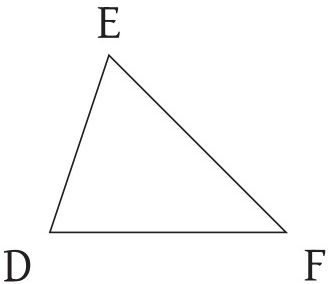

## 3.3 ত্রিভুজের পরিকেন্দ্র, ভরকেন্দ্র ও লম্ববিন্দু

<!-- higher-math-9-10-bn-c03-t3.3-p001 · text · p.73 -->
**ত্রিভুজের পরিকেন্দ্র:** ত্রিভুজের যেকোনো দুই বাহুর লম্বদ্বিখণ্ডক যে বিন্দুতে ছেদ করে তাকে ত্রিভুজের পরিকেন্দ্র বলে। উল্লেখ্য, তৃতীয় বাহুর লম্বদ্বিখণ্ডকও ঐ বিন্দুগামী।

<!-- higher-math-9-10-bn-c03-t3.3-p002 · text · p.73 -->
**ত্রিভুজের ভরকেন্দ্র:** ত্রিভুজের মধ্যমাগুলো যে বিন্দুতে ছেদ করে ঐ বিন্দুকে ত্রিভুজটির ভরকেন্দ্র বলা হয়। ত্রিভুজের ভরকেন্দ্রে মধ্যমাগুলো ২ : ১ অনুপাতে বিভক্ত হয়।

<!-- higher-math-9-10-bn-c03-t3.3-p003 · text · p.73 -->
**ত্রিভুজের লম্ববিন্দু:** ত্রিভুজের শীর্ষবিন্দুগুলো হতে বিপরীত বাহুর উপর অঙ্কিত লম্বগুলো যে বিন্দুতে ছেদ করে তাহাই লম্ববিন্দু।

<!-- higher-math-9-10-bn-c03-t3.3-p004 · text · p.74 -->
এখানে উল্লেখ্য, কোনো ত্রিভুজের লম্ববিন্দু থেকে শীর্ষের দূরত্ব ত্রিভুজের পরিকেন্দ্র থেকে ঐ শীর্ষের বিপরীত বাহুর লম্ব দূরত্বের দ্বিগুণ।

### উপপাদ্য ১০. ত্রিভুজের পরিকেন্দ্র, ভরকেন্দ্র ও লম্ববিন্দু সমরেখ।

<!-- higher-math-9-10-bn-c03-t3.3-p005 · text · p.74 · review: verify-formula -->
**বিশেষ নির্বাচন:** মনে করি, $\triangle ABC$ এর লম্ববিন্দু $O$, পরিকেন্দ্র $S$ এবং $AP$ একটি মধ্যমা। লম্ববিন্দু $O$ এবং পরিকেন্দ্র $S$ এর সংযোগ রেখা $AP$ মধ্যমাকে $G$ বিন্দুতে ছেদ করেছে। $S, P$ যোগ করলে $SP$ রেখা $BC$ এর উপর লম্ব। তাহলে, $G$ বিন্দুটি $\triangle ABC$ এর ভরকেন্দ্র এটি প্রমাণ করাই যথেষ্ট।

<!-- higher-math-9-10-bn-c03-t3.3-p006 · figure · p.74 -->
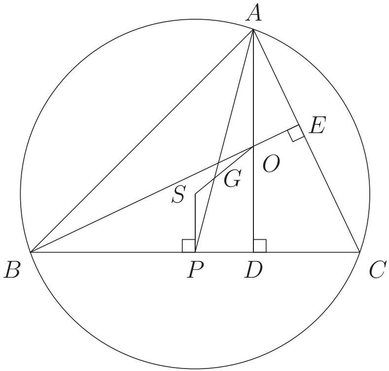

<!-- higher-math-9-10-bn-c03-t3.3-p007 · text · p.74 · review: verify-formula -->
**প্রমাণ:** $\triangle ABC$ এর লম্ববিন্দু $O$ থেকে $A$ শীর্ষের দূরত্ব $OA$ এবং পরিকেন্দ্র $S$ থেকে $A$ শীর্ষের বিপরীত বাহু $BC$ এর দূরত্ব $SP$। $\therefore OA = 2SP$ (1)

<!-- higher-math-9-10-bn-c03-t3.3-p008 · text · p.74 · review: verify-formula -->
এখন যেহেতু $AD$ ও $SP$ উভয়ই $BC$ এর উপর লম্ব সেহেতু $AD \parallel SP$। এখন $AD \parallel SP$ এবং $AP$ এদের ছেদক। সুতরাং একান্তর কোণ হওয়ায় $\angle PAD = \angle APS$, অর্থাৎ, $\angle OAG = \angle SPG$।

<!-- higher-math-9-10-bn-c03-t3.3-p009 · text · p.74 · review: verify-formula -->
এখন $\triangle AGO$ এবং $\triangle PGS$ এর মধ্যে

<!-- higher-math-9-10-bn-c03-t3.3-p010 · formula · p.74 · review: latin-junk,verify-formula -->
$$\angle AGO = \angle PGS \quad [বিপরীত কোণ]$$

<!-- higher-math-9-10-bn-c03-t3.3-p011 · formula · p.74 · review: latin-junk,verify-formula -->
$$\angle OAG = \angle SPG \quad [একান্তর কোণ]$$

<!-- higher-math-9-10-bn-c03-t3.3-p012 · text · p.74 · review: verify-formula -->
$\therefore$ অবশিষ্ট $\angle AOG = অবশিষ্ট  \angle PSG$

<!-- higher-math-9-10-bn-c03-t3.3-p013 · text · p.74 · review: verify-formula -->
$\therefore \triangle AGO$ এবং $\triangle PGS$ সদৃশকোণী।

<!-- higher-math-9-10-bn-c03-t3.3-p014 · text · p.74 · review: verify-formula -->
সুতরাং, $\frac{AG}{GP} = \frac{OA}{SP}$ অর্থাৎ, $\frac{AG}{GP} = \frac{2SP}{SP}$ [(1) নং সমীকরণ হতে]

<!-- higher-math-9-10-bn-c03-t3.3-p015 · text · p.74 · review: verify-formula -->
অতএব $\frac{AG}{GP} = \frac{2}{1}$ বা, $AG : GP = 2 : 1$ অর্থাৎ, $G$ বিন্দু $AP$ মধ্যমাকে ২ : ১ অনুপাতে বিভক্ত করেছে।

<!-- higher-math-9-10-bn-c03-t3.3-p016 · text · p.75 · review: verify-formula -->
$\therefore G$ বিন্দু $\triangle ABC$ এর ভরকেন্দ্র। [প্রমাণিত]

<!-- higher-math-9-10-bn-c03-t3.3-p017 · text · p.75 -->
**দ্রষ্টব্য:**

<!-- higher-math-9-10-bn-c03-t3.3-p018 · text · p.75 -->
ক) **নববিন্দুবৃত্ত (Nine Point Circle):** কোনো ত্রিভুজের বাহুগুলোর মধ্যবিন্দুএয়, শীর্ষবিন্দুগুলো থেকে বিপরীত বাহুএয়ের উপর অঙ্কিত লম্বএয়ের পাদবিন্দুএয় এবং শীর্ষবিন্দু ও লম্ববিন্দুর সংযোজক রেখাএয়ের মধ্যবিন্দুএয়, সর্বমোট এই নয়টি বিন্দু একই বৃত্তের উপর অবস্থান করে। এই বৃত্তকেই নববিন্দুবৃত্ত বলে।

<!-- higher-math-9-10-bn-c03-t3.3-p019 · text · p.75 -->
খ) ত্রিভুজের লম্ববিন্দু ও পরিকেন্দ্র সংযোজনকারী রেখাংশের মধ্যবিন্দুই নববিন্দু বৃত্তের কেন্দ্র।

<!-- higher-math-9-10-bn-c03-t3.3-p020 · text · p.75 -->
গ) নববিন্দু বৃত্তের ব্যাসার্ধ ত্রিভুজের পরিব্যাসারের অর্ধেকের সমান।

<!-- higher-math-9-10-bn-c03-t3.3-p021 · text · p.75 -->
**উপপাদ্য ১১ (ব্রহ্মগুণ্তের উপপাদ্য).** বৃত্তে অন্তলিখিত কোনো চতুর্ভুজের কর্ণ দুটি যদি পরস্পর লম্ব হয়, তবে তাদের ছেদ বিন্দু হতে কোনো বাহুর উপর অঙ্কিত লম্ব বিপরীত বাহুকে সমদ্বিখণ্ডিত করে।

<!-- higher-math-9-10-bn-c03-t3.3-p022 · text · p.75 · review: verify-formula -->
**বিশেষ নির্দেশ:** মনে করি, বৃত্তে অন্তলিখিত $ABCD$ চতুর্ভুজের কর্ণদ্বয় $AC$ ও $BD$ পরস্পরকে লম্বভাবে $M$ বিন্দুতে ছেদ করে। $M$ হতে $BC$ বাহুর উপর $ME$ লম্ব এবং বর্ধিত $EM$ বিপরীত $AD$ বাহুকে $F$ বিন্দুতে ছেদ করে। প্রমাণ করতে হবে $AF = FD$।

<!-- higher-math-9-10-bn-c03-t3.3-p023 · figure · p.75 -->
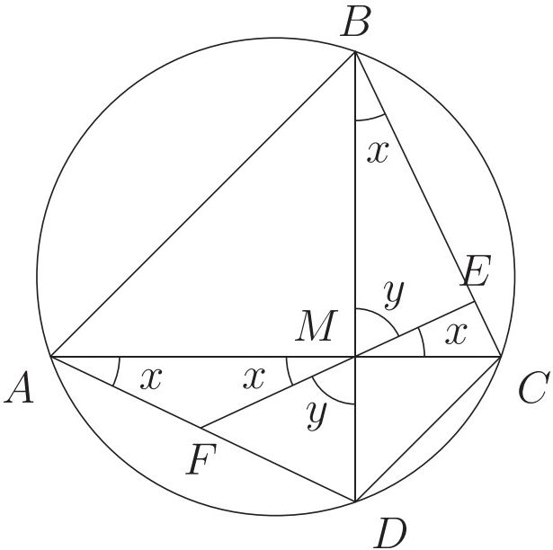

<!-- higher-math-9-10-bn-c03-t3.3-p024 · text · p.75 · review: verify-formula -->
**প্রমাণ:** একই চাপ $CD$ এর উপর দন্ডায়মান বলে $\angle CBD = \angle CAD$

<!-- higher-math-9-10-bn-c03-t3.3-p025 · text · p.75 · review: verify-formula -->
অর্থাৎ, $\angle CBM = \angle MAF$

<!-- higher-math-9-10-bn-c03-t3.3-p026 · text · p.75 · review: verify-formula -->
আবার, $\angle CBM = \angle CME$ [উভয়ে একই $\angle BME$ এর পূরক কোণ বলে]

<!-- higher-math-9-10-bn-c03-t3.3-p027 · text · p.75 · review: verify-formula -->
সুতরাং $\angle MAF = \angle FMA$ [$\because \angle CME =$ বিপরীত $\angle FMA$]

<!-- higher-math-9-10-bn-c03-t3.3-p028 · text · p.75 · review: verify-formula -->
ফলে $\triangle AFM$ ত্রিভুজে $AF = FM$

<!-- higher-math-9-10-bn-c03-t3.3-p029 · text · p.75 · review: verify-formula -->
অনুরূপভাবে দেখানো যায় যে, $\angle FDM = \angle BCM = \angle BME = \angle DMF$

<!-- higher-math-9-10-bn-c03-t3.3-p030 · text · p.75 · review: verify-formula -->
ফলে, $\triangle DFM$ ত্রিভুজে $FD = FM$ সুতরাং $AF = FD$ [প্রমাণিত]

<!-- higher-math-9-10-bn-c03-t3.3-p031 · text · p.76 -->
উপপাদ্য ১২ (টলেমির উপপাদ্য). বৃত্তে অন্তলিখিত কোনো চতুর্ভুজের কর্ণদ্বয়ের অন্তর্গত আয়তক্ষেত্রের ক্ষেত্রফল ঐ চতুর্ভুজের বিপরীত বাহুদ্বয়ের অন্তর্গত আয়তক্ষেত্রদ্বয়ের ক্ষেত্রফলের সমষ্টির সমান।

<!-- higher-math-9-10-bn-c03-t3.3-p032 · figure · p.76 -->
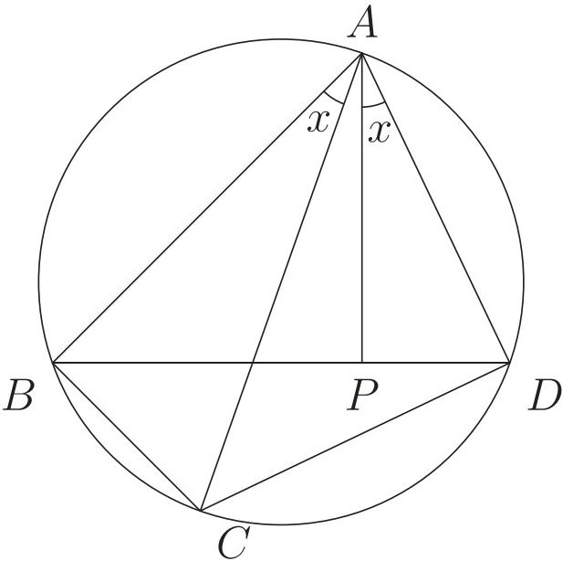

<!-- higher-math-9-10-bn-c03-t3.3-p033 · text · p.76 · review: verify-formula -->
**বিশেষ নির্বাচন:** মনে করি বৃত্তে অন্তলিখিত $ABCD$ চতুর্ভুজের বিপরীত বাহুগুলো যথাক্রমে $AB$ ও $CD$ এবং $BC$ ও $AD$। $AC$ এবং $BD$ চতুর্ভুজটির দুইটি কর্ণ। প্রমাণ করতে হবে যে, $AC \cdot BD = AB \cdot CD + BC \cdot AD$।

<!-- higher-math-9-10-bn-c03-t3.3-p034 · text · p.76 · review: verify-formula -->
**প্রমাণ:** $\angle BAC$ কে $\angle DAC$ থেকে ছোট ধরে নিয়ে $A$ বিন্দুতে $AD$ রেখাংশের সাথে $\angle BAC$ এর সমান করে $\angle DAP$ আঁকি যেন $AP$ রেখা $BD$ কর্ণকে $P$ বিন্দুতে ছেদ করে।

<!-- higher-math-9-10-bn-c03-t3.3-p035 · text · p.76 · review: verify-formula -->
অঙ্কন অনুসারে $\angle BAC = \angle DAP$।

<!-- higher-math-9-10-bn-c03-t3.3-p036 · text · p.76 · review: verify-formula -->
উভয়পক্ষে $\angle CAP$ যোগ করে পাই,

<!-- higher-math-9-10-bn-c03-t3.3-p037 · formula · p.76 · review: latin-junk,verify-formula -->
$$\angle BAC + \angle CAP = \angle DAP + \angle CAP  অর্থাৎ,  \angle BAP = \angle CAD$$

<!-- higher-math-9-10-bn-c03-t3.3-p038 · text · p.76 · review: verify-formula -->
এখন $\triangle ABP$ ও $\triangle ACD$ এর মধ্যে

<!-- higher-math-9-10-bn-c03-t3.3-p039 · formula · p.76 · review: latin-junk,verify-formula -->
$$\angle BAP = \angle CAD  এবং  \angle ABD = \angle ACD  [একই বৃত্তাংশস্থিত কোণ সমান বলে]$$

<!-- higher-math-9-10-bn-c03-t3.3-p040 · text · p.76 · review: verify-formula -->
এবং অবশিষ্ট $\angle APB = অবশিষ্ট  \angle ADC$।

<!-- higher-math-9-10-bn-c03-t3.3-p041 · text · p.76 · review: verify-formula -->
$\therefore \triangle ABP$ ও $\triangle ACD$ সদৃশকোণী।

<!-- higher-math-9-10-bn-c03-t3.3-p042 · formula · p.76 · review: verify-formula -->
$$\therefore \frac{BP}{CD} = \frac{AB}{AC}$$

<!-- higher-math-9-10-bn-c03-t3.3-p043 · text · p.76 · review: verify-formula -->
অর্থাৎ, $AC \cdot BP = AB \cdot CD$ (1)

<!-- higher-math-9-10-bn-c03-t3.3-p044 · text · p.76 · review: verify-formula -->
আবার, $\triangle ABC$ ও $\triangle APD$ এর মধ্যে

<!-- higher-math-9-10-bn-c03-t3.3-p045 · formula · p.76 · review: latin-junk,verify-formula -->
$$\angle BAC = \angle PAD  [অঙ্কন অনুসারে]$$

<!-- higher-math-9-10-bn-c03-t3.3-p046 · formula · p.76 · review: latin-junk,verify-formula -->
$$\angle ADP = \angle ACB  [একই বৃত্তাংশস্থিত কোণ সমান বলে]$$

<!-- higher-math-9-10-bn-c03-t3.3-p047 · text · p.76 · review: verify-formula -->
এবং অবশিষ্ট $\angle ABC = অবশিষ্ট  \angle APD$ $\therefore \triangle ABC$ ও $\triangle APD$ সদৃশকোণী।

<!-- higher-math-9-10-bn-c03-t3.3-p048 · formula · p.77 · review: verify-formula -->
$$\therefore \frac{AD}{AC} = \frac{PD}{BC}$$

<!-- higher-math-9-10-bn-c03-t3.3-p049 · text · p.77 · review: verify-formula -->
অর্থাৎ, $AC \cdot PD = BC \cdot AD$ (2)

<!-- higher-math-9-10-bn-c03-t3.3-p050 · text · p.77 -->
এখন সমীকরণ (1) ও (2) যোগ করে পাই,

<!-- higher-math-9-10-bn-c03-t3.3-p051 · formula · p.77 · review: verify-formula -->
$$AC \cdot BP + AC \cdot PD = AB \cdot CD + BC \cdot AD$$

<!-- higher-math-9-10-bn-c03-t3.3-p052 · text · p.77 · review: verify-formula -->
বা, $AC(BP + PD) = AB \cdot CD + BC \cdot AD$

<!-- higher-math-9-10-bn-c03-t3.3-p053 · text · p.77 · review: verify-formula -->
কিন্তু $BP + PD = BD$

<!-- higher-math-9-10-bn-c03-t3.3-p054 · text · p.77 · review: verify-formula -->
ফলে $AC \cdot BD = AB \cdot CD + BC \cdot AD$ [প্রমাণিত]

<!-- higher-math-9-10-bn-c03-t3.3-p055 · text · p.77 · review: verify-formula -->
**উদাহরণ ১.** $\triangle PQR$ এ $\angle PQR = 90^\circ$ এবং $PQ, QR$ ও $PR$ বাহু তিনটির মধ্যবিন্দু যথাক্রমে $D, E$ ও $F$।

<!-- higher-math-9-10-bn-c03-t3.3-p056 · text · p.77 -->
ক) তথ্যানুযায়ী চিত্র ঐকে ভরকেন্দ্র চিহ্নিত করো।

<!-- higher-math-9-10-bn-c03-t3.3-p057 · text · p.77 · review: verify-formula -->
খ) প্রমাণ করো যে, $PR^2 = PE^2 + QE^2 + 2RE^2$।

<!-- higher-math-9-10-bn-c03-t3.3-p058 · text · p.77 · review: verify-formula -->
গ) $QF \perp PR$ হলে প্রমাণ করো যে, $QF^2 = PF \cdot RF$।

<!-- higher-math-9-10-bn-c03-t3.3-p059 · text · p.77 -->
**সমাধান:**

<!-- higher-math-9-10-bn-c03-t3.3-p060 · text · p.77 · review: verify-formula -->
ক) নিচের চিত্রে $PQ, QR$ ও $PR$ এর মধ্যবিন্দু যথাক্রমে $D, E$ ও $F$ হওয়ায় $PE, QF$ এবং $DR$ মধ্যমা। $PE, QF$ এবং $DR$ মধ্যমাত্রয় $G$ বিন্দুতে ছেদ করেছে। $\therefore G$ বিন্দু ভরকেন্দ্র।

<!-- higher-math-9-10-bn-c03-t3.3-p061 · figure · p.77 -->
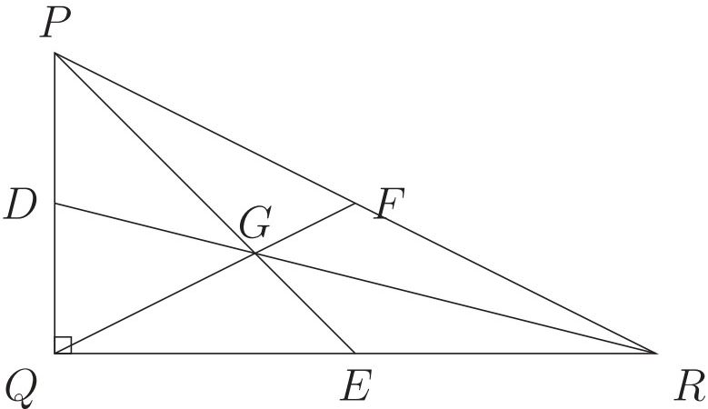

<!-- higher-math-9-10-bn-c03-t3.3-p062 · text · p.77 · review: verify-formula -->
খ) $\angle PQR = 90^\circ$ এবং $\triangle PQR$ এ $QR$ এর মধ্যবিন্দু $E$। $P, E$ যোগ করি। প্রমাণ করতে হবে যে, $PR^2 = PE^2 + QE^2 + 2RE^2$।

<!-- higher-math-9-10-bn-c03-t3.3-p063 · figure · p.78 -->
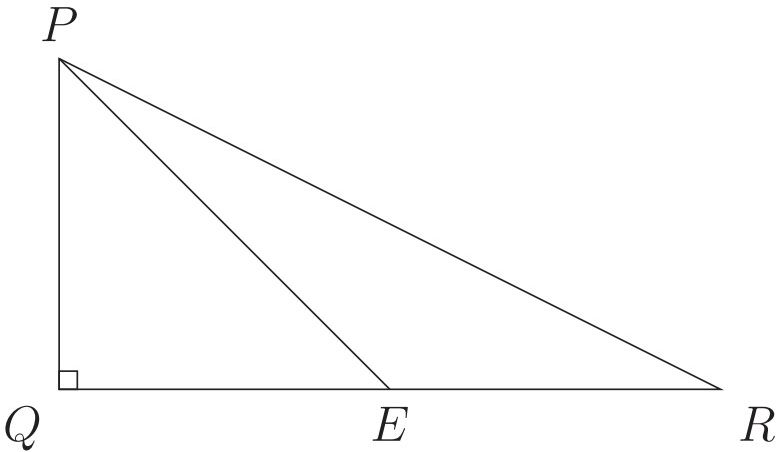

<!-- higher-math-9-10-bn-c03-t3.3-p064 · text · p.78 · review: verify-formula -->
**প্রমাণ:** $\triangle PQE$ এ $\angle PQE = 90^\circ$ এবং $PE$ অতিভুজ
$$\therefore PE^2 = PQ^2 + QE^2 \dots\dots (1)$$

<!-- higher-math-9-10-bn-c03-t3.3-p065 · text · p.78 · review: latin-junk,verify-formula -->
আবার, $\triangle PQR$ এ $\angle PQR = 90^\circ$ এবং $PR$ অতিভুজ
$$\therefore PR^2 = PQ^2 + QR^2$$
বা, $PR^2 = PQ^2 + (QE + RE)^2$
বা, $PR^2 = PQ^2 + QE^2 + RE^2 + 2QE \cdot RE$
বা, $PR^2 = PQ^2 + QE^2 + QE^2 + 2RE \cdot RE$ [$\because QE = RE$]
বা, $PR^2 = PE^2 + QE^2 + 2RE^2$ [(1) নং এর সাহায্যে]
$$\therefore PR^2 = PE^2 + QE^2 + 2RE^2 \quad \quad \quad \quad [প্রমাণিত]$$

<!-- higher-math-9-10-bn-c03-t3.3-p066 · text · p.78 · review: verify-formula -->
গ) $\triangle PQR$ এ $\angle PQR = 90^\circ$ এবং $QF \perp PR$। প্রমাণ করতে হবে যে, $QF^2 = PF \cdot RF$।

<!-- higher-math-9-10-bn-c03-t3.3-p067 · figure · p.78 -->
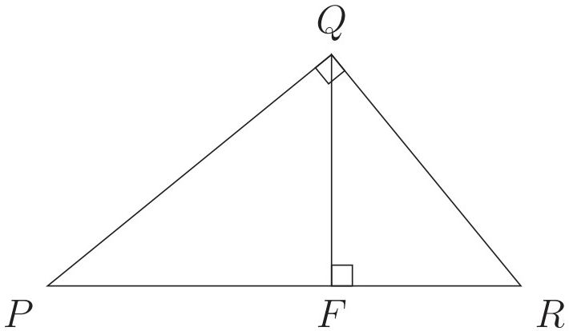

<!-- higher-math-9-10-bn-c03-t3.3-p068 · text · p.78 · review: verify-formula -->
**প্রমাণ:** $\angle PQR = 90^\circ$
$$\therefore \angle PQF + \angle FQR = 90^\circ \dots\dots (1)$$

<!-- higher-math-9-10-bn-c03-t3.3-p069 · text · p.78 · review: verify-formula -->
আবার, $QF \perp PR$ বলে $\angle PFQ = \angle QFR = 90^\circ$

<!-- higher-math-9-10-bn-c03-t3.3-p070 · text · p.78 · review: verify-formula -->
$\triangle PQF$ এ $\angle PFQ + \angle PQF + \angle QPF = 180^\circ$
বা, $90^\circ + \angle PQF + \angle QPF = 180^\circ$
$$\therefore \angle PQF + \angle QPF = 90^\circ \dots\dots (2)$$

<!-- higher-math-9-10-bn-c03-t3.3-p071 · text · p.78 -->
(1) নং এবং (2) নং হতে পাই

<!-- higher-math-9-10-bn-c03-t3.3-p072 · formula · p.79 · review: verify-formula -->
$$\angle PQF + \angle FQR = \angle PQF + \angle QPF$$

<!-- higher-math-9-10-bn-c03-t3.3-p073 · formula · p.79 · review: verify-formula -->
$$\therefore \angle FQR = \angle QPF$$

<!-- higher-math-9-10-bn-c03-t3.3-p074 · text · p.79 · review: verify-formula -->
$\triangle PQF$ এবং $\triangle QFR$ এ

<!-- higher-math-9-10-bn-c03-t3.3-p075 · formula · p.79 · review: verify-formula -->
$$\angle PFQ = \angle QFR, \angle QPF = \angle FQR$$

<!-- higher-math-9-10-bn-c03-t3.3-p076 · text · p.79 · review: verify-formula -->
অবশিষ্ট $\angle PQF = অবশিষ্ট  \angle FRQ$

<!-- higher-math-9-10-bn-c03-t3.3-p077 · text · p.79 · review: verify-formula -->
$\therefore \triangle PQF$ এবং $\triangle QFR$ সদৃশ

<!-- higher-math-9-10-bn-c03-t3.3-p078 · formula · p.79 · review: verify-formula -->
$$\therefore \frac{PQ}{QR} = \frac{QF}{FR} = \frac{PF}{FQ}$$

<!-- higher-math-9-10-bn-c03-t3.3-p079 · text · p.79 · review: verify-formula -->
অর্থাৎ $\frac{QF}{RF} = \frac{PF}{QF}$

<!-- higher-math-9-10-bn-c03-t3.3-p080 · text · p.79 · review: verify-formula -->
বা, $QF^2 = PF \cdot RF$ [প্রমাণিত]
