# 4. জ্যামিতিক অঙ্কন

Source: Higher Math Bangla Version, printed pp. 82-95

## 4.0 ভূমিকা ও শিখনফল

<!-- higher-math-9-10-bn-c04-t4.0-p001 · text · p.82 -->
কম্পাস ও রুলার ব্যবহার করে দেওয়া নির্দিষ্ট শর্ত অনুযায়ী যে চিত্র অঙ্কন করা হয়, তাহাই জ্যামিতিক অঙ্কন। উপপাদ্য প্রমাণের জন্য যে চিত্র অঙ্কন করা হয় তা যথাযথ (accurate) হওয়া খুব জরুরি নয়। সম্পাদ্যের ক্ষেত্রে জ্যামিতিক চিত্র অঙ্কন যথাযথ হওয়া খুবই প্রয়োজন।

<!-- higher-math-9-10-bn-c04-t4.0-p002 · text · p.82 -->
এ অধ্যায় শেষে শিক্ষার্থীরা -

<!-- higher-math-9-10-bn-c04-t4.0-p003 · text · p.82 -->
* প্রদত্ত তথ্য ও উপান্তের ভিত্তিতে ত্রিভুজ অঙ্কন এবং অঙ্কনের যথাযথতা যাচাই করতে পারবে;
* প্রদত্ত তথ্য ও উপান্তের ভিত্তিতে বৃত্ত অঙ্কন এবং অঙ্কনের যথাযথতা যাচাই করতে পারবে।

### ত্রিভুজসংক্রান্ত কতিপয় সম্পাদ্য

<!-- higher-math-9-10-bn-c04-t4.0-p004 · text · p.82 -->
**সম্পাদ্য ১.** ত্রিভুজের ভূমি, ভূমিসংলগ্ন একটি কোণ ও উচ্চতা দেওয়া আছে, ত্রিভুজটি অঙ্কন করো।

<!-- higher-math-9-10-bn-c04-t4.0-p005 · figure · p.82 -->
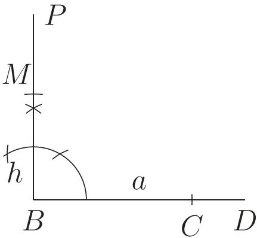

<!-- higher-math-9-10-bn-c04-t4.0-p006 · figure · p.82 -->
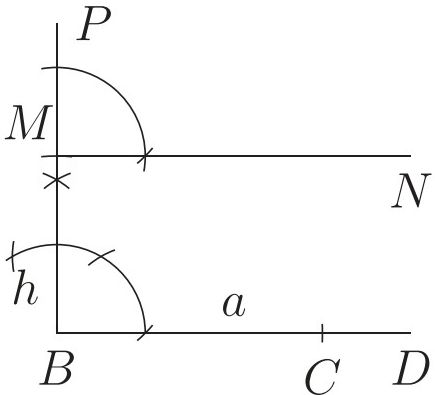

<!-- higher-math-9-10-bn-c04-t4.0-p007 · text · p.82 · review: verify-formula -->
মনে করি, কোনো ত্রিভুজের ভূমি $a$, উচ্চতা $h$ এবং ভূমিসংলগ্ন একটি কোণ $x$ দেওয়া আছে। ত্রিভুজটি অঙ্কন করতে হবে।

<!-- higher-math-9-10-bn-c04-t4.0-p008 · text · p.82 -->
**অঙ্কন:**

<!-- higher-math-9-10-bn-c04-t4.0-p009 · text · p.82 · review: verify-formula -->
**ধাপ ১.** যেকোনো রেখা $BD$ থেকে $BC = a$ অংশ কেটে নিই।

<!-- higher-math-9-10-bn-c04-t4.0-p010 · figure · p.82 -->
drawing: geometric diagram showing a line segment BD with a point C and a length a

<!-- higher-math-9-10-bn-c04-t4.0-p011 · text · p.82 · review: verify-formula -->
**ধাপ ২.** $B$ বিন্দুতে $BC$ এর উপর লম্ব $BP$ আঁকি। $BP$ থেকে $BM = h$ কেটে নিই।

<!-- higher-math-9-10-bn-c04-t4.0-p012 · text · p.82 · review: verify-formula -->
**ধাপ ৩.** $M$ বিন্দুতে $MN \parallel BC$ অঙ্কন করি।

<!-- higher-math-9-10-bn-c04-t4.0-p013 · figure · p.82 -->
drawing: geometric diagram showing a vertical line with points P, M, B and a horizontal line with points N, C, D, and a height h

<!-- higher-math-9-10-bn-c04-t4.0-p014 · text · p.83 · review: verify-formula -->
ধাপ ৪. আবার $B$ বিন্দুতে প্রদত্ত $\angle x$ এর সমান করে $\angle CBE$ অঙ্কন করি। $BE$ রেখাংশ $MN$ কে $A$ বিন্দুতে ছেদ করে।

<!-- higher-math-9-10-bn-c04-t4.0-p015 · text · p.83 · review: verify-formula -->
ধাপ ৫. $A, C$ যোগ করি। তাহলে $ABC$-ই উদ্দিষ্ট ত্রিভুজ।

<!-- higher-math-9-10-bn-c04-t4.0-p016 · figure · p.83 -->
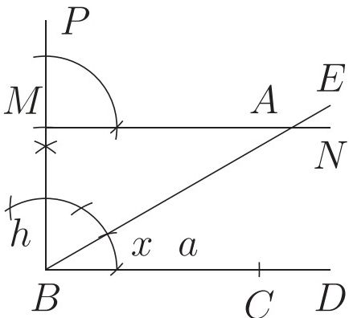

<!-- higher-math-9-10-bn-c04-t4.0-p017 · figure · p.83 -->
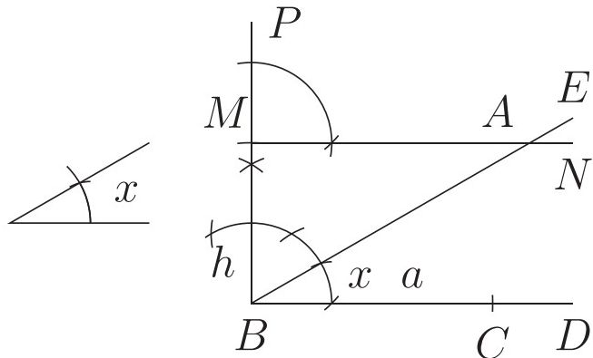

<!-- higher-math-9-10-bn-c04-t4.0-p018 · text · p.83 · review: verify-formula -->
**প্রমাণ:** $MN \parallel BC$ (অঙ্কনানুসারে)। $\therefore ABC$ এর উচ্চতা $BM = h$। আবার, $BC = a$ এবং $\angle ABC = \angle x$। $\therefore \triangle ABC$-ই উদ্দিষ্ট ত্রিভুজ।

<!-- higher-math-9-10-bn-c04-t4.0-p019 · text · p.83 -->
**বিশ্লেষণ:** ভূমি ও ভূমিসংলগ্ন কোণ দেয়া আছে। সুতরাং একটি সরলরেখা থেকে ভূমির সমান অংশ কেটে নিয়ে তার এক প্রান্তে প্রদত্ত কোণের সমান কোণ ঝাঁকতে হবে। অতঃপর ভূমির সঙ্গে নির্দিষ্ট কোণে আনত নতুন অঙ্কিত রেখার উপর এমন একটা বিন্দু নির্ণয় করতে হবে যেন ভূমি থেকে ঐ বিন্দুটির উচ্চতা ত্রিভুজের উচ্চতার সমান হয়।

<!-- higher-math-9-10-bn-c04-t4.0-p020 · text · p.83 -->
**সম্পাদ্য ২.** ত্রিভুজের ভূমি, শিরঃকোণ ও অপর বাহুদ্বয়ের সমষ্টি দেওয়া আছে। ত্রিভুজটি অঙ্কন কর।

<!-- higher-math-9-10-bn-c04-t4.0-p021 · figure · p.83 -->
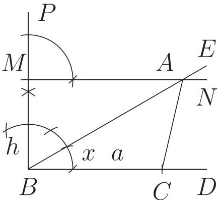

<!-- higher-math-9-10-bn-c04-t4.0-p022 · figure · p.83 -->
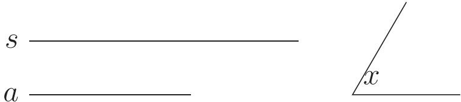

<!-- higher-math-9-10-bn-c04-t4.0-p023 · text · p.83 · review: verify-formula -->
মনে করি, একটি ত্রিভুজের ভূমি $a$, অপর বাহুদ্বয়ের সমষ্টি $s$ এবং শিরঃকোণ $x$ দেওয়া আছে। ত্রিভুজটি অঙ্কন করতে হবে।

<!-- higher-math-9-10-bn-c04-t4.0-p024 · text · p.83 -->
**অঙ্কন:**

<!-- higher-math-9-10-bn-c04-t4.0-p025 · text · p.83 · review: verify-formula -->
ধাপ ১. যেকোনো রেখা $DE$ থেকে $DB = s$ অংশ কেটে নিই।

<!-- higher-math-9-10-bn-c04-t4.0-p026 · figure · p.83 -->
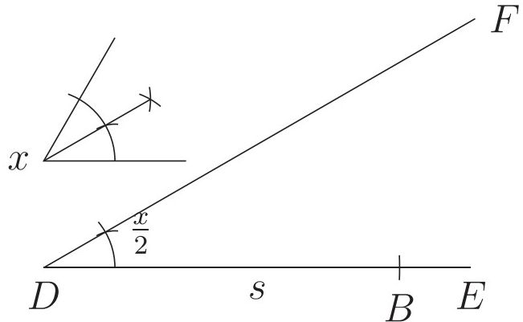

<!-- higher-math-9-10-bn-c04-t4.0-p027 · text · p.83 · review: verify-formula -->
ধাপ ২. $DB$ রেখার $D$ বিন্দুতে $\angle BDF = \frac{1}{2} \angle x$ অঙ্কন করি।

<!-- higher-math-9-10-bn-c04-t4.0-p028 · text · p.83 · review: verify-formula -->
ধাপ ৩. $B$ কে কেন্দ্র করে ভূমি $a$ এর সমান ব্যাসার্ধ নিয়ে একটি বৃত্তচাপ অঙ্কন করি যা $DF$ কে $C$ ও $C'$ বিন্দুতে ছেদ করে। $B, C$ ও $B, C'$ যোগ করি।

<!-- higher-math-9-10-bn-c04-t4.0-p029 · figure · p.84 -->
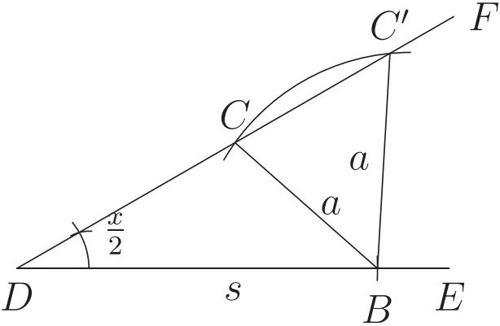

<!-- higher-math-9-10-bn-c04-t4.0-p030 · figure · p.84 -->
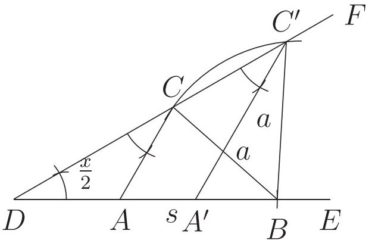

<!-- higher-math-9-10-bn-c04-t4.0-p031 · text · p.84 · review: verify-formula -->
রেখা দুটি $BD$ কে যথাক্রমে $A$ ও $A'$ বিন্দুতে ছেদ করে। তাহলে $ABC$ ও $A'BC'$ ত্রিভুজদ্বয় উদ্দিষ্ট ত্রিভুজ।

<!-- higher-math-9-10-bn-c04-t4.0-p032 · text · p.84 · review: verify-formula -->
**ধাপ ৮.** $C$ বিন্দুতে $\angle BDF$ এর সমান $\angle DCA$ ও $C'$ বিন্দুতে $\angle BDF$ এর সমান $\angle DC'A'$ অঙ্কন করি। $CA$ ও $C'A'$

<!-- higher-math-9-10-bn-c04-t4.0-p033 · text · p.84 · review: verify-formula -->
**প্রমাণ:** যেহেতু $\angle ACD = \angle ADC = \angle A'C'D = \frac{1}{2}\angle x$ (অঙ্কনানুসারে)

<!-- higher-math-9-10-bn-c04-t4.0-p034 · formula · p.84 · review: verify-formula -->
$$\therefore \angle BAC = \angle ADC + \angle ACD = \frac{1}{2}\angle x + \frac{1}{2}\angle x = \angle x$$

<!-- higher-math-9-10-bn-c04-t4.0-p035 · formula · p.84 · review: verify-formula -->
$$\therefore \angle BA'C' = \angle A'DC' + \angle A'C'D = \frac{1}{2}\angle x + \frac{1}{2}\angle x = \angle x$$

<!-- higher-math-9-10-bn-c04-t4.0-p036 · text · p.84 · review: verify-formula -->
এবং $AC = AD, A'C' = A'D$

<!-- higher-math-9-10-bn-c04-t4.0-p037 · text · p.84 · review: verify-formula -->
$ABC$ ত্রিভুজে,

<!-- higher-math-9-10-bn-c04-t4.0-p038 · text · p.84 · review: verify-formula -->
$\angle BAC = \angle x, BC = a$ এবং $CA + AB = DA + AB = DB = s$

<!-- higher-math-9-10-bn-c04-t4.0-p039 · text · p.84 · review: verify-formula -->
$\therefore \triangle ABC$-ই উদ্দিষ্ট ত্রিভুজ।

<!-- higher-math-9-10-bn-c04-t4.0-p040 · text · p.84 · review: verify-formula -->
আবার $A'BC'$ ত্রিভুজে,

<!-- higher-math-9-10-bn-c04-t4.0-p041 · text · p.84 · review: verify-formula -->
$\angle BA'C' = \angle x, BC' = a$ এবং $C'A' + A'B = DA' + A'B = DB = s$

<!-- higher-math-9-10-bn-c04-t4.0-p042 · text · p.84 · review: verify-formula -->
$\therefore \triangle A'BC'$-ই অপর উদ্দিষ্ট ত্রিভুজ।

<!-- higher-math-9-10-bn-c04-t4.0-p043 · text · p.84 -->
**সম্পাদ্য ৩.** ত্রিভুজের ভূমি, শিরঃকোণ ও অপর দুই বাহুর অন্তর দেওয়া আছে। ত্রিভুজটি অঙ্কন করো।

<!-- higher-math-9-10-bn-c04-t4.0-p044 · figure · p.84 -->
drawing: geometric diagram showing a triangle with base d, side a, and angle x

<!-- higher-math-9-10-bn-c04-t4.0-p045 · text · p.84 · review: verify-formula -->
মনে করি, একটি ত্রিভুজের ভূমি $a$, অপর দুই বাহুর অন্তর $d$ এবং শিরঃকোণ $x$ দেওয়া আছে। ত্রিভুজটি অঙ্কন করতে হবে।

<!-- higher-math-9-10-bn-c04-t4.0-p046 · text · p.84 -->
**অঙ্কন:**

<!-- higher-math-9-10-bn-c04-t4.0-p047 · figure · p.84 -->
drawing: geometric diagram showing a line segment BD with a point P and distance d

<!-- higher-math-9-10-bn-c04-t4.0-p048 · text · p.84 · review: verify-formula -->
**ধাপ ১.** যেকোনো রেখা $BD$ থেকে $BP = d$ **ধাপ ২.** $P$ বিন্দুতে $\angle x$ এর সমপূরক কোণের অংশ কেটে নিই। অর্ধেকের সমান $\angle DPM$ অঙ্কন করি।

<!-- higher-math-9-10-bn-c04-t4.0-p049 · figure · p.85 -->
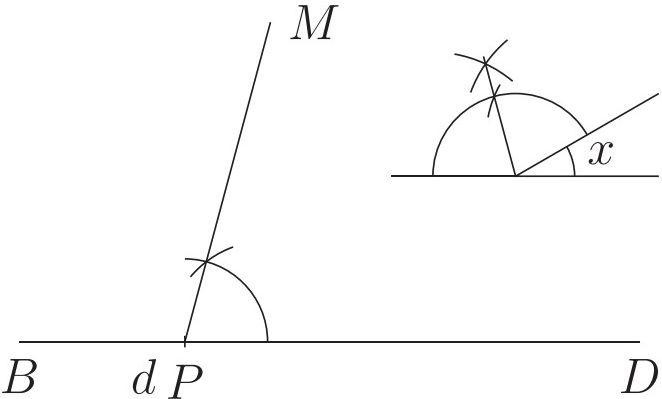

<!-- higher-math-9-10-bn-c04-t4.0-p050 · text · p.85 · review: verify-formula -->
ধাপ ৩. $B$ কে কেন্দ্র করে $a$ এর সমান ব্যাসার্ধ নিয়ে অঙ্কিত বৃত্তচাপ $PM$ সরলরেখাকে $C$ বিন্দুতে ছেদ করে। $B$ ও $C$ যোগ করি।

<!-- higher-math-9-10-bn-c04-t4.0-p051 · figure · p.85 -->
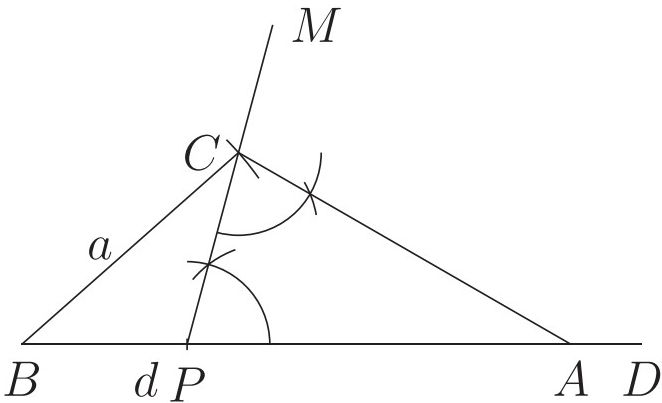

<!-- higher-math-9-10-bn-c04-t4.0-p052 · text · p.85 · review: verify-formula -->
ধাপ ৪. আবার $C$ বিন্দুতে $\angle DPC = \angle PCA$ কোণ অঙ্কন করি যেন $CA$ রেখাংশ $BD$ কে $A$ বিন্দুতে ছেদ করে। তাহলে $ABC$-ই উদ্দিষ্ট ত্রিভুজ।

<!-- higher-math-9-10-bn-c04-t4.0-p053 · figure · p.85 -->
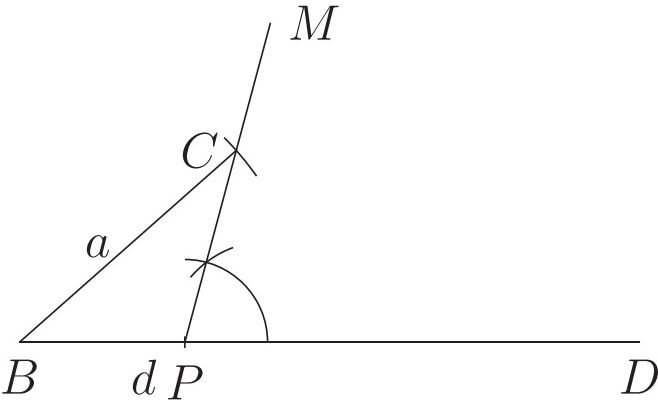

<!-- higher-math-9-10-bn-c04-t4.0-p054 · text · p.85 · review: verify-formula -->
**প্রমাণ:** $\angle APC = \angle ACP$

<!-- higher-math-9-10-bn-c04-t4.0-p055 · formula · p.85 · review: verify-formula -->
$\therefore AP = AC$

<!-- higher-math-9-10-bn-c04-t4.0-p056 · formula · p.85 · review: verify-formula -->
$\therefore AB - AC = AB - AP = d$

<!-- higher-math-9-10-bn-c04-t4.0-p057 · text · p.85 · review: verify-formula -->
আবার $\angle APC = \angle ACP = \angle x$ এর সম্পূরক কোণের অর্ধেক।

<!-- higher-math-9-10-bn-c04-t4.0-p058 · text · p.85 · review: verify-formula -->
$\therefore \angle APC + \angle ACP = \angle x$ এর সম্পূরক $=$ বহিঃস্থ $\angle CAD = \angle CAB$ এর সম্পূরক।

<!-- higher-math-9-10-bn-c04-t4.0-p059 · formula · p.85 · review: verify-formula -->
$\therefore \angle A = \angle CAB = \angle x$

<!-- higher-math-9-10-bn-c04-t4.0-p060 · text · p.85 · review: verify-formula -->
$\therefore ABC$-ই নির্ণেয় ত্রিভুজ।

<!-- higher-math-9-10-bn-c04-t4.0-p061 · text · p.85 -->
**সম্পাদ্য ৪.** ত্রিভুজের উচ্চতা, ভূমির উপর মধ্যমা এবং ভূমিসংলগ্ন একটি কোণ দেওয়া আছে। ত্রিভুজটি অঙ্কন করতে হবে।

<!-- higher-math-9-10-bn-c04-t4.0-p062 · figure · p.85 -->
drawing: geometric construction diagram with labels d, h, and x

<!-- higher-math-9-10-bn-c04-t4.0-p063 · text · p.85 · review: verify-formula -->
মনে করি, ত্রিভুজের উচ্চতা $h$, ভূমির ওপর মধ্যমা $d$ এবং ভূমি সংলগ্ন একটি $\angle x$ দেওয়া আছে। ত্রিভুজটি অঙ্কন করতে হবে।

<!-- higher-math-9-10-bn-c04-t4.0-p064 · figure · p.86 -->
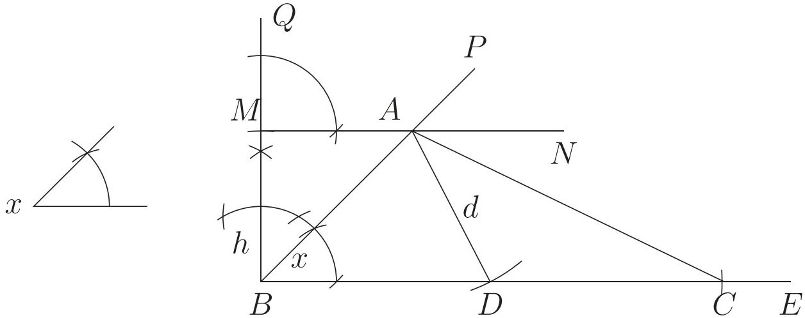

### অঙ্কন:

<!-- higher-math-9-10-bn-c04-t4.0-p065 · text · p.86 · review: verify-formula -->
ধাপ ১. যেকোনো রেখা $BE$ এর $B$ বিন্দুতে $\angle x$ এর সমান $\angle EBP$ অঙ্কন করি।

<!-- higher-math-9-10-bn-c04-t4.0-p066 · text · p.86 · review: verify-formula -->
ধাপ ২. $B$ বিন্দুতে $BE$ রেখার ওপর $BQ$ লম্ব অঙ্কন করি।

<!-- higher-math-9-10-bn-c04-t4.0-p067 · text · p.86 · review: verify-formula -->
ধাপ ৩. $BQ$ থেকে ত্রিভুজের উচ্চতা $h$ এর সমান $BM$ অংশ কেটে নিই।

<!-- higher-math-9-10-bn-c04-t4.0-p068 · text · p.86 · review: verify-formula -->
ধাপ ৪. $M$ বিন্দুতে $MN \parallel BE$ অঙ্কন করি যা $BP$ কে $A$ বিন্দুতে ছেদ করে।

<!-- higher-math-9-10-bn-c04-t4.0-p069 · text · p.86 · review: verify-formula -->
ধাপ ৫. $A$ বিন্দুকে কেন্দ্র করে মধ্যমা $d$ এর সমান ব্যাসার্ধ নিয়ে একটি বৃত্তচাপ অঙ্কন করি। ঐ বৃত্তচাপ $BE$ কে $D$ বিন্দুতে ছেদ করে।

<!-- higher-math-9-10-bn-c04-t4.0-p070 · text · p.86 · review: verify-formula -->
ধাপ ৬. $BE$ থেকে $DC = BD$ অংশ কেটে নিই। $A$ ও $C$ যোগ করি।

<!-- higher-math-9-10-bn-c04-t4.0-p071 · text · p.86 · review: verify-formula -->
তাহলে, $\triangle ABC$-ই উদ্দিষ্ট ত্রিভুজ।

<!-- higher-math-9-10-bn-c04-t4.0-p072 · text · p.86 · review: verify-formula -->
**প্রমাণ:** $BD = DC \implies D$ বিন্দুই $BC$ এর মধ্যবিন্দু।

<!-- higher-math-9-10-bn-c04-t4.0-p073 · text · p.86 · review: verify-formula -->
$A, D$ যোগ করি। $\therefore AD = d =$ ভূমির উপর অঙ্কিত মধ্যমা, অর্থাৎ, $BC$ ভূমি।

<!-- higher-math-9-10-bn-c04-t4.0-p074 · text · p.86 · review: verify-formula -->
$MN$ ও $BE$ সমান্তরাল। সুতরাং $\triangle ABC$ এর উচ্চতা $BM = h$।

<!-- higher-math-9-10-bn-c04-t4.0-p075 · text · p.86 · review: verify-formula -->
আবার, $\angle ABC = \angle x =$ ভূমি সংলগ্ন একটি কোণ।

<!-- higher-math-9-10-bn-c04-t4.0-p076 · text · p.86 · review: verify-formula -->
$\therefore ABC$-ই উদ্দিষ্ট ত্রিভুজ।

<!-- higher-math-9-10-bn-c04-t4.0-p077 · text · p.86 · review: known-confusable-corrected,verify-formula -->
**মন্তব্য:** $\angle x$ এর উপর নির্ভর করে অনেক ক্ষেত্রে দুটি ত্রিভুজ পাওয়া যেতে পারে। এছাড়াও মধ্যমার দৈর্ঘ্য উচ্চতার থেকে কম হলে অঙ্কন করা যাবে না।

<!-- higher-math-9-10-bn-c04-t4.0-p078 · text · p.86 · review: verify-formula -->
**উদাহরণ ১.** ত্রিভুজের ভূমির দৈর্ঘ্য ৫ সে.মি., ভূমি সংলগ্ন কোণ $60^\circ$ এবং অপর দুই বাহুর সমষ্টি ৭ সে.মি.। ত্রিভুজটি অঙ্কন করতে হবে।

<!-- higher-math-9-10-bn-c04-t4.0-p079 · text · p.86 · review: verify-formula -->
**সমাধান:** দেওয়া আছে ভূমি $BC = 5$ সে.মি. অপর দুই বাহুর সমষ্টি $AB + AC = 7$ সে.মি. এবং $\angle ABC = 60^\circ$। $\triangle ABC$ অঙ্কন করতে হবে।

<!-- higher-math-9-10-bn-c04-t4.0-p080 · text · p.86 · review: verify-formula -->
ধাপ ১. যেকোনো রেখা $BX$ থেকে $BC = 5$ সে.মি. কেটে নিই।

<!-- higher-math-9-10-bn-c04-t4.0-p081 · text · p.86 · review: verify-formula -->
ধাপ ২. $\angle XBY = 60^\circ$ আঁকি।

<!-- higher-math-9-10-bn-c04-t4.0-p082 · text · p.87 · review: verify-formula -->
ধাপ ৩. $BY$ রেখা থেকে $BD = 7$ সে.মি. কেটে নিই।

<!-- higher-math-9-10-bn-c04-t4.0-p083 · text · p.87 · review: verify-formula -->
ধাপ ৪. $C, D$ যোগ করি।

<!-- higher-math-9-10-bn-c04-t4.0-p084 · text · p.87 · review: verify-formula -->
ধাপ ৫. $CD$ রেখার লম্বদ্বিখণ্ডক আঁকি যা $BD$ কে $A$ বিন্দুতে ছেদ করে।

<!-- higher-math-9-10-bn-c04-t4.0-p085 · text · p.87 · review: verify-formula -->
ধাপ ৬. $A, C$ যোগ করি, তাহলে $ABC$-ই নির্ণেয় ত্রিভুজ।

<!-- higher-math-9-10-bn-c04-t4.0-p086 · figure · p.87 -->
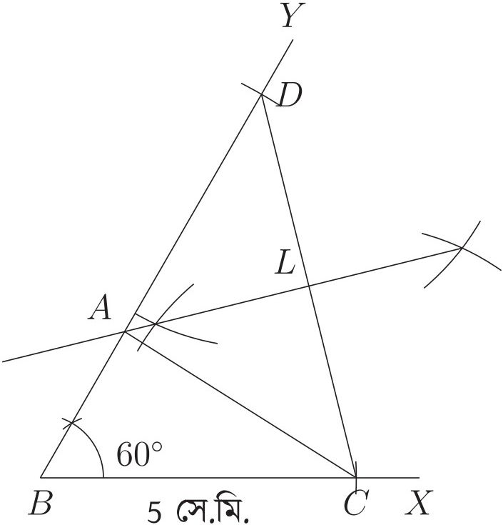

<!-- higher-math-9-10-bn-c04-t4.0-p087 · text · p.87 · review: verify-formula -->
**দ্রষ্টব্য:** যেহেতু $AL, CD$ এর লম্বদ্বিখণ্ডক, $AD = AC$।

<!-- higher-math-9-10-bn-c04-t4.0-p088 · text · p.87 · review: verify-formula -->
তাহলে $BD = BA + AD = BA + AC = 7$ সে.মি.।

<!-- higher-math-9-10-bn-c04-t4.0-p089 · text · p.87 · review: verify-formula -->
**উদাহরণ ২.** ত্রিভুজের ভূমির দৈর্ঘ্য 7.5 সে.মি. ভূমিসংলগ্ন কোণ $45^\circ$ এবং অপর দুই বাহুর অন্তর 2.5 সে.মি. দেওয়া আছে। ত্রিভুজটি অঙ্কন করতে হবে।

<!-- higher-math-9-10-bn-c04-t4.0-p090 · text · p.87 · review: verify-formula -->
**সমাধান:** দেওয়া আছে ভূমি $BC = 7.5$ সে.মি, অপর দুই বাহুর অন্তর $AB - AC$ বা $AC - AB = 2.5$ সে.মি. এবং ভূমি সংলগ্ন কোণ $45^\circ$। ত্রিভুজটি আঁকতে হবে। আমরা এখানে $AB - AC = 2.5$ সে.মি. এর ক্ষেত্রে অঙ্কনের ধাপসমূহ দেখব। [$AC - AB = 2.5$ সে.মি. ধরে ত্রিভুজটি নিজে অঙ্কন করো।]

<!-- higher-math-9-10-bn-c04-t4.0-p091 · figure · p.88 -->
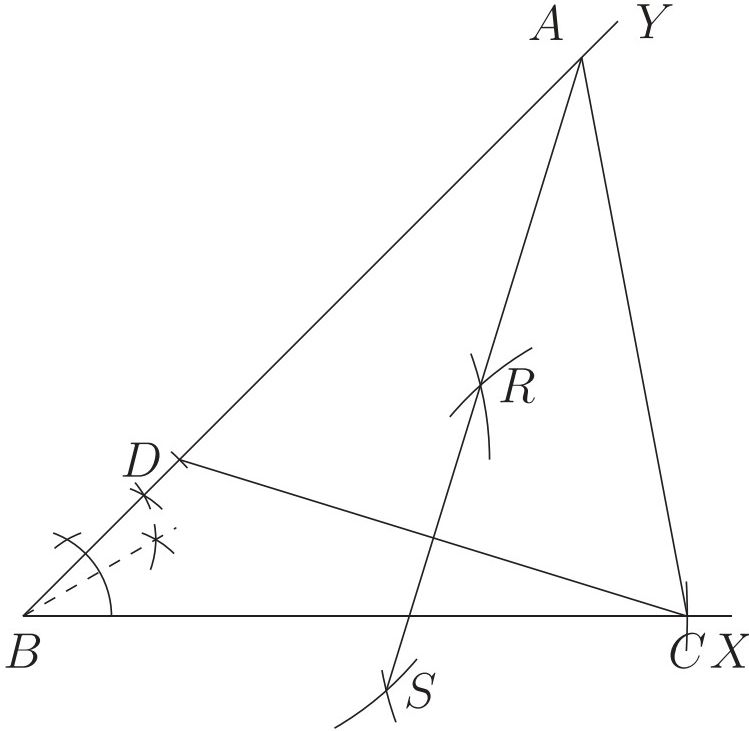

<!-- higher-math-9-10-bn-c04-t4.0-p092 · text · p.88 · review: verify-formula -->
ধাপ ১. যেকোনো রেখা $BX$ থেকে $BC = 7.5$ সে.মি. কেটে নিই।

<!-- higher-math-9-10-bn-c04-t4.0-p093 · text · p.88 · review: verify-formula -->
ধাপ ২. $\angle YBC = 45^\circ$ অঙ্কন করি।

<!-- higher-math-9-10-bn-c04-t4.0-p094 · text · p.88 · review: verify-formula -->
ধাপ ৩. $BY$ রেখা থেকে $BD = 2.5$ সে.মি. কেটে নিই।

<!-- higher-math-9-10-bn-c04-t4.0-p095 · text · p.88 · review: verify-formula -->
ধাপ ৪. $C, D$ যোগ করি।

<!-- higher-math-9-10-bn-c04-t4.0-p096 · text · p.88 · review: verify-formula -->
ধাপ ৫. $CD$ এর ওপর $RS$ লম্বদ্বিখণ্ডক আঁকি যেন $BY$ কে $A$ বিন্দুতে ছেদ করে।

<!-- higher-math-9-10-bn-c04-t4.0-p097 · text · p.88 · review: verify-formula -->
ধাপ ৬. $A$ ও $C$ যোগ করি। তাহলে $ABC$-ই নির্ণয়ে ত্রিভুজ।

<!-- higher-math-9-10-bn-c04-t4.0-p098 · text · p.88 -->
**কাজ:**

<!-- higher-math-9-10-bn-c04-t4.0-p099 · text · p.88 -->
ক) একটি ত্রিভুজের পরিসীমা এবং ভূমিসংলগ্ন কোণদ্বয় দেওয়া আছে। ত্রিভুজটি অঙ্কন করো।

<!-- higher-math-9-10-bn-c04-t4.0-p100 · text · p.88 · review: verify-formula -->
খ) ত্রিভুজের ভূমি $BC = 4.6$ সে.মি., $\angle B = 45^\circ$ এবং $AB + CA = 8.2$ সে.মি. দেওয়া আছে। ত্রিভুজটি আঁকতে হবে।

<!-- higher-math-9-10-bn-c04-t4.0-p101 · text · p.88 -->
গ) সমকোণী ত্রিভুজের দুটি বাহুর দৈর্ঘ্য যথাক্রমে ৩ সে.মি. এবং ৪ সে.মি. দেওয়া আছে। অতিভুজ নির্ণয় করে ত্রিভুজটি আঁকতে হবে।

<!-- higher-math-9-10-bn-c04-t4.0-p102 · text · p.88 · review: verify-formula -->
ঘ) $\triangle ABC$ এর $BC = 4.5$ সে.মি., $\angle B = 45^\circ$ এবং $AB - AC = 2.5$ সে.মি. দেওয়া আছে। $\triangle ABC$ টি অঙ্কন করতে হবে।

<!-- higher-math-9-10-bn-c04-t4.0-p103 · text · p.88 · review: verify-formula -->
ঙ) $\triangle ABC$ এর পরিসীমা 12 সে.মি., $\angle B = 60^\circ$ এবং $\angle C = 45^\circ$ দেওয়া আছে। $\triangle ABC$ টি আঁকতে হবে।

## 4.1 বৃত্তসংকান্ত কতিপয় সম্পাদ্য

<!-- higher-math-9-10-bn-c04-t4.1-p001 · text · p.89 -->
**সম্পাদ্য ৫.** এমন একটি বৃত্ত অঙ্কন করতে হবে যা দুটি নির্দিষ্ট বিন্দু দিয়ে যায় এবং যার কেন্দ্র একটি নির্দিষ্ট সরলরেখায় অবস্থিত থাকে।

<!-- higher-math-9-10-bn-c04-t4.1-p002 · figure · p.89 -->
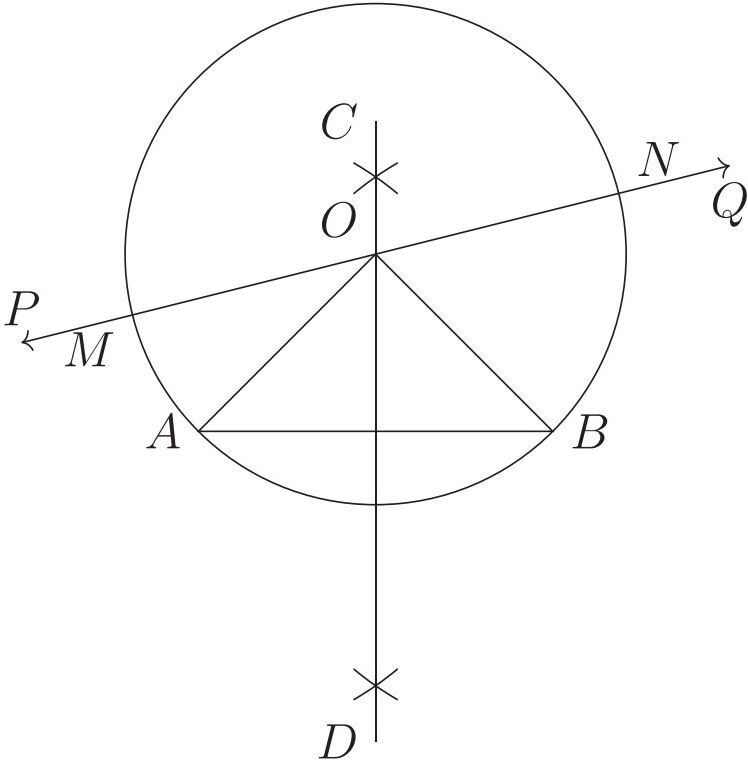

<!-- higher-math-9-10-bn-c04-t4.1-p003 · text · p.89 · review: verify-formula -->
$A$ ও $B$ দুইটি নির্দিষ্ট বিন্দু এবং $PQ$ একটি নির্দিষ্ট সরলরেখা। এমন একটি বৃত্ত অঙ্কন করতে হবে যা $A$ ও $B$ বিন্দু দিয়ে যায় এবং যার কেন্দ্র $PQ$ সরলরেখার উপর অবস্থান করে।

<!-- higher-math-9-10-bn-c04-t4.1-p004 · text · p.89 -->
**অঙ্কন:**

<!-- higher-math-9-10-bn-c04-t4.1-p005 · text · p.89 · review: verify-formula -->
**ধাপ ১.** $A, B$ যোগ করি।

<!-- higher-math-9-10-bn-c04-t4.1-p006 · text · p.89 · review: verify-formula -->
**ধাপ ২.** $AB$ রেখাংশের সমদ্বিখণ্ডক $CD$ অঙ্কন করি।

<!-- higher-math-9-10-bn-c04-t4.1-p007 · text · p.89 · review: verify-formula -->
**ধাপ ৩.** $CD$ রেখাংশ $PQ$ রেখাকে $O$ বিন্দুতে ছেদ করে।

<!-- higher-math-9-10-bn-c04-t4.1-p008 · text · p.89 · review: verify-formula -->
**ধাপ ৪.** $O$ কে কেন্দ্র করে $OA$ বা $OB$ ব্যাসার্ধ নিয়ে $ABNM$ বৃত্ত অঙ্কন করি। যা নির্ণয়ে বৃত্ত।

<!-- higher-math-9-10-bn-c04-t4.1-p009 · text · p.89 · review: known-confusable-corrected,verify-formula -->
**প্রমাণ:** $CD$ রেখা $AB$ রেখার লম্বদ্বিখণ্ডক। সুতরাং $CD$ রেখাস্থ যেকোনো বিন্দু $A$ ও $B$ থেকে সমদূরবর্তী। অঙ্কনানুসারে, $O$ বিন্দুটি $CD$ ও $PQ$ এর উপর অবস্থিত। আবার, $OA$ ও $OB$ সমান বলে $O$ কে কেন্দ্র করে $OA$ বা $OB$ ব্যাসার্ধ নিয়ে বৃত্ত আঁক বৃত্তটি $A$ ও $B$ বিন্দু দিয়ে যাবে এবং বৃত্তের কেন্দ্র $O$ বিন্দুটি $PQ$ রেখার ওপর অবস্থান করবে। $\therefore$ $O$ কে কেন্দ্র করে $OA$ বা $OB$ ব্যাসার্ধ নিয়ে অঙ্কিত বৃত্তই নির্ণয়ে বৃত্ত।

<!-- higher-math-9-10-bn-c04-t4.1-p010 · text · p.89 -->
**সম্পাদ্য ৬.** একটি নির্দিষ্ট রেখাংশের সমান ব্যাসার্ধ বিশিষ্ট একটি বৃত্ত অঙ্কন করতে হবে যা দুটি নির্দিষ্ট বিন্দু দিয়ে যায়।

<!-- higher-math-9-10-bn-c04-t4.1-p011 · text · p.89 · review: verify-formula -->
$A$ ও $B$ দুটি নির্দিষ্ট বিন্দু এবং $r$ একটি নির্দিষ্ট রেখাংশের দৈর্ঘ্য। এমন একটি বৃত্ত অঙ্কন করতে হবে যা $A$ ও $B$ বিন্দু দিয়ে যায় এবং যার ব্যাসার্ধ $r$ এর সমান হয়।

<!-- higher-math-9-10-bn-c04-t4.1-p012 · figure · p.90 -->
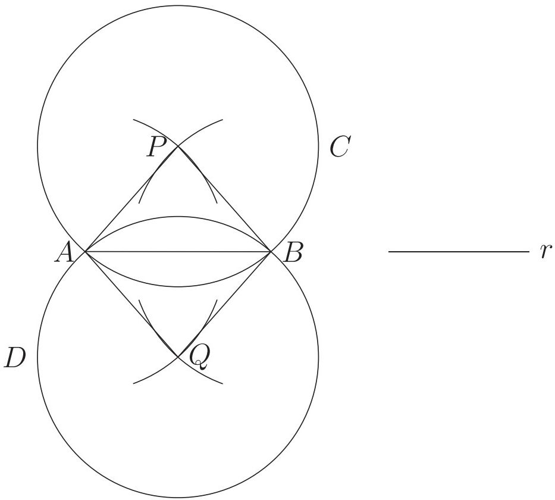

### অঙ্কন:

<!-- higher-math-9-10-bn-c04-t4.1-p013 · text · p.90 · review: verify-formula -->
ধাপ ১. $A$ ও $B$ যোগ করি।

<!-- higher-math-9-10-bn-c04-t4.1-p014 · text · p.90 · review: verify-formula -->
ধাপ ২. $A$ ও $B$ কে কেন্দ্র করে $r$ এর সমান ব্যাসার্ধ নিয়ে $AB$ এর উভয় পাশে দুটি করে বৃত্তচাপ আঁকি। এক পাশের বৃত্তচাপ দুইটি পরস্পরকে $P$ বিন্দুতে এবং অপর পাশের বৃত্তচাপ দুটি পরস্পরকে $Q$ বিন্দুতে ছেদ করে।

<!-- higher-math-9-10-bn-c04-t4.1-p015 · text · p.90 · review: verify-formula -->
ধাপ ৩. $P$ কে কেন্দ্র করে $PA$ ব্যাসার্ধ নিয়ে $ABC$ বৃত্ত অঙ্কন করি।

<!-- higher-math-9-10-bn-c04-t4.1-p016 · text · p.90 · review: verify-formula -->
ধাপ ৪. আবার $Q$ কে কেন্দ্র করে $QA$ ব্যাসার্ধ নিয়ে $ABD$ বৃত্ত অঙ্কন করি।

<!-- higher-math-9-10-bn-c04-t4.1-p017 · text · p.90 · review: verify-formula -->
ধাপ ৫. তাহলে $ABC$ ও $ABD$ বৃত্ত দুইটির প্রত্যেকটিই নির্ণেয় বৃত্ত।

<!-- higher-math-9-10-bn-c04-t4.1-p018 · text · p.90 · review: verify-formula -->
**প্রমাণ:** $PA = PB = r$। $\therefore$ $P$ কে কেন্দ্র করে $PA$ বা $PB$ ব্যাসার্ধ নিয়ে অঙ্কিত $ABC$ বৃত্ত $A$ ও $B$ বিন্দু দিয়ে যায় এবং ব্যাসার্ধ $PA = r$ হয়।

<!-- higher-math-9-10-bn-c04-t4.1-p019 · text · p.90 · review: verify-formula -->
আবার $QA = QB = r$। $\therefore$ $Q$ কে কেন্দ্র করে $QA$ বা $QB$ ব্যাসার্ধ নিয়ে অঙ্কিত $ABD$ বৃত্ত $A$ ও $B$ বিন্দু দিয়ে যায় এবং ব্যাসার্ধ $QA = r$ হয়।

<!-- higher-math-9-10-bn-c04-t4.1-p020 · text · p.90 · review: verify-formula -->
$\therefore$ $ABC$ ও $ABD$ বৃত্ত দুটির প্রতিটিই উদ্দিষ্ট বৃত্ত।

<!-- higher-math-9-10-bn-c04-t4.1-p021 · text · p.90 -->
**সম্পাদ্য ৭.** এরূপ একটি বৃত্ত অঙ্কন করতে হবে যা একটি নির্দিষ্ট বৃত্তকে নির্দিষ্ট বিন্দুতে স্পর্শ করে এবং বৃত্তের বহিঃস্থ কোনো নির্দিষ্ট বিন্দু দিয়ে যায়।

<!-- higher-math-9-10-bn-c04-t4.1-p022 · figure · p.91 -->
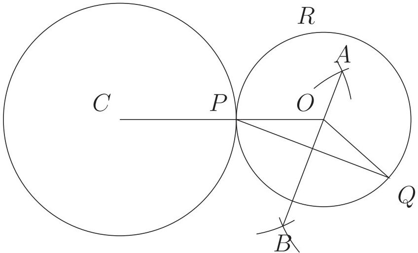

<!-- higher-math-9-10-bn-c04-t4.1-p023 · text · p.91 · review: verify-formula -->
মনে করি, নির্দিষ্ট বৃত্তের কেন্দ্র $C$, $P$ ঐ বৃত্তের উপর অবস্থিত একটি নির্দিষ্ট বিন্দু এবং $Q$ ঐ বৃত্তের বহিঃস্থ একটি নির্দিষ্ট বিন্দু। এরূপ একটি বৃত্ত অঙ্কন করতে হবে যা ঐ বৃত্তকে $P$ বিন্দুতে স্পর্শ করে এবং $Q$ বিন্দু দিয়ে যায়।

<!-- higher-math-9-10-bn-c04-t4.1-p024 · text · p.91 · review: verify-formula -->
ধাপ ১. $P, Q$ যোগ করি।

<!-- higher-math-9-10-bn-c04-t4.1-p025 · text · p.91 · review: verify-formula -->
ধাপ ২. $PQ$ এর লম্বদ্বিখণ্ডক $AB$ আঁকি।

<!-- higher-math-9-10-bn-c04-t4.1-p026 · text · p.91 · review: verify-formula -->
ধাপ ৩. $C, P$ যোগ করি।

<!-- higher-math-9-10-bn-c04-t4.1-p027 · text · p.91 · review: verify-formula -->
ধাপ ৪. বর্ধিত $CP$ রেখাংশ $AB$ কে $O$ বিন্দুতে ছেদ করে।

<!-- higher-math-9-10-bn-c04-t4.1-p028 · text · p.91 · review: verify-formula -->
ধাপ ৫. $O$ কে কেন্দ্র করে $OP$ এর সমান ব্যাসার্ধ নিয়ে অঙ্কিত $PQR$ বৃত্তই উদ্দিষ্ট বৃত্ত।

<!-- higher-math-9-10-bn-c04-t4.1-p029 · text · p.91 · review: verify-formula -->
**প্রমাণ:** $O, Q$ যোগ করি। $AB$ রেখাংশ বা $OB$ রেখাংশ $PQ$ এর লম্বদ্বিখণ্ডক। $\therefore OP = OQ$।

<!-- higher-math-9-10-bn-c04-t4.1-p030 · text · p.91 · review: verify-formula -->
সুতরাং $O$ কে কেন্দ্র করে $OP$ ব্যাসার্ধ নিয়ে বৃত্ত আঁকলে তা $Q$ বিন্দু দিয়ে যাবে।

<!-- higher-math-9-10-bn-c04-t4.1-p031 · text · p.91 · review: verify-formula -->
আবার $P$ বিন্দুটি দুটি বৃত্তের কেন্দ্রদ্বয়ের সংযোজক রেখার ওপর অবস্থিত এবং $P$ বিন্দু উভয় বৃত্তের উপর অবস্থিত। অর্থাৎ $P$ বিন্দুতে বৃত্তদ্বয় মিলিত হয়েছে। সুতরাং বৃত্তদ্বয় $P$ বিন্দুতে স্পর্শ করে।

<!-- higher-math-9-10-bn-c04-t4.1-p032 · text · p.91 · review: verify-formula -->
সুতরাং $O$ কে কেন্দ্র করে $OP$ ব্যাসার্ধ নিয়ে অঙ্কিত বৃত্তই উদ্দিষ্ট বৃত্ত।

<!-- higher-math-9-10-bn-c04-t4.1-p033 · text · p.91 -->
**সম্পাদ্য ৮.** এরূপ একটি বৃত্ত অঙ্কন করতে হবে যা একটি নির্দিষ্ট সরলরেখাকে একটি নির্দিষ্ট বিন্দুতে স্পর্শ করে এবং রেখার বহিঃস্থ কোনো বিন্দু দিয়ে যায়।

<!-- higher-math-9-10-bn-c04-t4.1-p034 · text · p.91 · review: verify-formula -->
মনে করি, $AB$ সরলরেখাস্থ $A$ একটি নির্দিষ্ট বিন্দু এবং $AB$ রেখার বহিঃস্থ $P$ অপর একটি নির্দিষ্ট বিন্দু। এরূপ একটি বৃত্ত আঁকতে হবে যা $AB$ কে $A$ বিন্দুতে স্পর্শ করে এবং $P$ বিন্দু দিয়ে যায়।

<!-- higher-math-9-10-bn-c04-t4.1-p035 · figure · p.92 -->
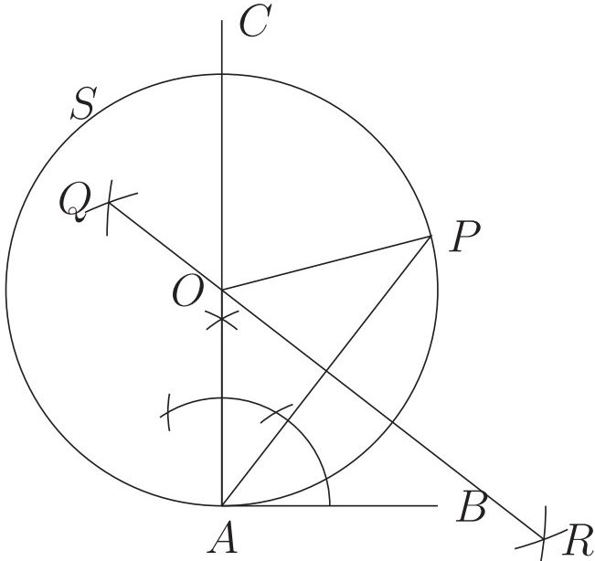

<!-- higher-math-9-10-bn-c04-t4.1-p036 · text · p.92 · review: verify-formula -->
ধাপ ১. $AB$ এর উপর $A$ বিন্দুতে $AC$ লম্ব অঙ্কন করি।

<!-- higher-math-9-10-bn-c04-t4.1-p037 · text · p.92 · review: verify-formula -->
ধাপ ২. $P, A$ যোগ করে তার লম্বদ্বিখণ্ডক $QR$ অঙ্কন করি।

<!-- higher-math-9-10-bn-c04-t4.1-p038 · text · p.92 · review: verify-formula -->
ধাপ ৩. $QR$ এবং $AC$ রেখাদ্বয় $O$ বিন্দুতে ছেদ করে।

<!-- higher-math-9-10-bn-c04-t4.1-p039 · text · p.92 · review: verify-formula -->
ধাপ ৪. $O$ কে কেন্দ্র করে $OA$ ব্যাসার্ধ নিয়ে $APS$ বৃত্ত অঙ্কন করি। তাহলে $APS$ ই উদ্দিষ্ট বৃত্ত।

<!-- higher-math-9-10-bn-c04-t4.1-p040 · text · p.92 · review: verify-formula -->
**প্রমাণ:** $O, P$ যোগ করি। $AP$ রেখার লম্বদ্বিখণ্ডক $QR$ এর উপর $O$ অবস্থিত।

<!-- higher-math-9-10-bn-c04-t4.1-p041 · text · p.92 · review: verify-formula -->
$\therefore OA = OP$।

<!-- higher-math-9-10-bn-c04-t4.1-p042 · text · p.92 · review: verify-formula -->
$\therefore O$ কে কেন্দ্র করে $OA$ ব্যাসার্ধ নিয়ে অঙ্কিত বৃত্ত $P$ বিন্দু দিয়ে যায়।

<!-- higher-math-9-10-bn-c04-t4.1-p043 · text · p.92 · review: verify-formula -->
আবার $OA$ ব্যাসার্ধ রেখার $A$ প্রান্ত বিন্দুতে $AB$ এর ওপর $AO$ লম্ব।

<!-- higher-math-9-10-bn-c04-t4.1-p044 · text · p.92 · review: verify-formula -->
$\therefore AB$ রেখাংশ বৃত্তটিকে $A$ বিন্দুতে স্পর্শ করে।

<!-- higher-math-9-10-bn-c04-t4.1-p045 · text · p.92 · review: verify-formula -->
$\therefore O$ কে কেন্দ্র করে $OA$ ব্যাসার্ধ নিয়ে অঙ্কিত বৃত্তটিই নির্ণেয় বৃত্ত।

<!-- higher-math-9-10-bn-c04-t4.1-p046 · text · p.92 -->
**বিশ্লেষণ:** যেহেতু বৃত্তটি নির্দিষ্ট রেখাকে নির্দিষ্ট বিন্দুতে স্পর্শ করে, সুতরাং নির্দিষ্ট রেখার নির্দিষ্ট বিন্দুতে লম্ব আঁকতে হবে এবং এই লম্বই বৃত্তের একটি ব্যাস হবে। আবার ঐ রেখাস্থ নির্দিষ্ট বিন্দু ও বহিঃস্থ নির্দিষ্ট বিন্দু উভয়েই বৃত্তের পরিধির ওপরে থাকবে বিধায় এই বিন্দুদ্বয়ের সংযোজক রেখার লম্বদ্বিখণ্ডক কেন্দ্র দিয়ে যাবে। তাহলে এই লম্বদ্বিখণ্ডক ও পূর্বাঙ্কিত ব্যাসের ছেদবিন্দু বৃত্তের কেন্দ্র হবে।

<!-- higher-math-9-10-bn-c04-t4.1-p047 · text · p.92 -->
**উদাহরণ ৩.** ২ সে.মি. ব্যাসার্ধ বিশিষ্ট বৃত্তের কেন্দ্র থেকে ৫ সে.মি. দূরে কোনো নির্দিষ্ট বিন্দু হতে অঙ্কিত স্পর্শকদ্বয়ের দৈর্ঘ্য নির্ণয় করো।

<!-- higher-math-9-10-bn-c04-t4.1-p048 · text · p.92 · review: verify-formula -->
**সমাধান:** ২ সে.মি. ব্যাসার্ধ বিশিষ্ট বৃত্তের কেন্দ্র $O$ এবং নির্দিষ্ট $P$ থেকে $O$ বিন্দুর দূরত্ব ৫ সে.মি.। $P$ বিন্দু থেকে উক্ত বৃত্তে স্পর্শক অঙ্কন করে তার দৈর্ঘ্য নির্ণয় করতে হবে।

<!-- higher-math-9-10-bn-c04-t4.1-p049 · figure · p.93 -->
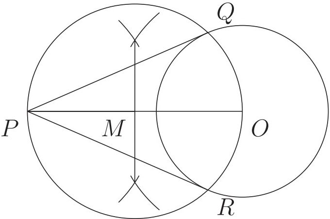

<!-- higher-math-9-10-bn-c04-t4.1-p050 · text · p.93 · review: verify-formula -->
ধাপ ১. $OP$ রেখাকে দ্বিখণ্ডিত করি। ধরি, দ্বিখণ্ডক বিন্দু $M$।

<!-- higher-math-9-10-bn-c04-t4.1-p051 · text · p.93 · review: verify-formula -->
ধাপ ২. $M$ কে কেন্দ্র করে $OM$ ব্যাসার্ধ নিয়ে একটি বৃত্ত আঁকি যা $O$ কেন্দ্রিক বৃত্তের $Q$ এবং $R$ বিন্দুতে ছেদ করে।

<!-- higher-math-9-10-bn-c04-t4.1-p052 · text · p.93 · review: verify-formula -->
ধাপ ৩. $P, Q$ এবং $P, R$ যোগ করি। তাহলে $PQ$ এবং $PR$-ই নির্ণয় স্পর্শক।

<!-- higher-math-9-10-bn-c04-t4.1-p053 · text · p.93 · review: verify-formula -->
এখন, $PQ$ ও $PR$ কে পরিমাপ করে পাই, $PQ = PR = 4.6$ সে.মি.

<!-- higher-math-9-10-bn-c04-t4.1-p054 · text · p.93 -->
**কাজ:**

<!-- higher-math-9-10-bn-c04-t4.1-p055 · text · p.93 -->
ক) 5 সে.মি., 12 সে.মি. ও 13 সে.মি. বাহুবিশিষ্ট একটি ত্রিভুজের অন্তর্বৃত্ত অঙ্কন করে এর ব্যাসার্ধ নির্ণয় করো।

<!-- higher-math-9-10-bn-c04-t4.1-p056 · text · p.93 -->
খ) 6.5 সে.মি., 7 সে.মি. এবং 7.5 সে.মি. বাহুবিশিষ্ট একটি ত্রিভুজের বাহিবৃত্ত অঙ্কন করে এর ব্যাসার্ধ নির্ণয় করো।

## 4.ex অনুশীলনী ৪

<!-- higher-math-9-10-bn-c04-t4.ex-p001 · exercise · p.93 -->
১. ত্রিভুজের দুটি কোণ ও তাদের বিপরীত বাহুদ্বয়ের অন্তর দেওয়া আছে, ত্রিভুজটি আঁকো।

<!-- higher-math-9-10-bn-c04-t4.ex-p002 · exercise · p.93 -->
২. ত্রিভুজের ভূমি, ভূমিসংলগ্ন কোণদ্বয়ের অন্তর ও অপর বাহুদ্বয়ের সমষ্টি দেওয়া আছে, ত্রিভুজটি আঁকো।

<!-- higher-math-9-10-bn-c04-t4.ex-p003 · exercise · p.93 -->
৩. ভূমি, শিরঃকোণ ও অপর কোণদ্বয়ের সমষ্টি দেওয়া আছে, ত্রিভুজটি আঁকো।

<!-- higher-math-9-10-bn-c04-t4.ex-p004 · exercise · p.93 -->
৪. ভূমি, শিরঃকোণ ও অপর কোণদ্বয়ের অন্তর দেওয়া আছে, ত্রিভুজটি আঁকো।

<!-- higher-math-9-10-bn-c04-t4.ex-p005 · exercise · p.93 -->
৫. সমকোণী ত্রিভুজের অতিভুজ ও অপর দুই বাহুর সমষ্টি দেওয়া আছে, ত্রিভুজটি আঁকো।

<!-- higher-math-9-10-bn-c04-t4.ex-p006 · exercise · p.93 -->
৬. ভূমিসংলগ্ন একটি কোণ, উচ্চতা ও অপর দুই বাহুর সমষ্টি দেওয়া আছে, ত্রিভুজটি আঁকো।

<!-- higher-math-9-10-bn-c04-t4.ex-p007 · exercise · p.94 · review: known-confusable-corrected -->
৭. ক) সমকোণী ত্রিভুজের অতিভুজ ও অপর দুই বাহুর অন্তর দেওয়া আছে, ত্রিভুজটি আঁকো।
   খ) একটি ত্রিভুজের মধ্যমাত্রয় দেওয়া আছে ত্রিভুজটি আঁকো।

<!-- higher-math-9-10-bn-c04-t4.ex-p008 · exercise · p.94 -->
৮. এমন একটি বৃত্ত অঙ্কন করো যা একটি নির্দিষ্ট সরলরেখাকে এর কোনো নির্দিষ্ট বিন্দুতে এবং অপর একটি বৃত্তকে স্পর্শ করে।

<!-- higher-math-9-10-bn-c04-t4.ex-p009 · exercise · p.94 -->
৯. এমন একটি বৃত্ত অঙ্কন করো যা একটি নির্দিষ্ট বৃত্তকে এর কোনো নির্দিষ্ট বিন্দুতে এবং অপর একটি বৃত্তকে কোনো বিন্দুতে স্পর্শ করে।

<!-- higher-math-9-10-bn-c04-t4.ex-p010 · exercise · p.94 -->
১০. এমন একটি বৃত্ত অঙ্কন করো যা একটি নির্দিষ্ট সরলরেখাকে কোনো বিন্দুতে এবং একটি নির্দিষ্ট বৃত্তকে এর কোনো নির্দিষ্ট বিন্দুতে স্পর্শ করে।

<!-- higher-math-9-10-bn-c04-t4.ex-p011 · exercise · p.94 · review: known-confusable-corrected -->
১১. ভিন্ন ভিন্ন ব্যাসার্ধবিশিষ্ট এরূপ তিনটি বৃত্ত আঁক যেন তারা পরস্পরকে বহিঃস্পর্শ করে।

<!-- higher-math-9-10-bn-c04-t4.ex-p012 · exercise · p.94 · review: verify-formula -->
১২. $O$ কেন্দ্রবিশিষ্ট কোনো বৃত্তের $AB$ জ্যা এর $P$ যেকোনো বিন্দু। $P$ বিন্দু দিয়ে অপর একটি জ্যা $CD$ অঙ্কন করতে হবে যেন $CP^2 = AP \cdot PB$ হয়।

<!-- higher-math-9-10-bn-c04-t4.ex-p013 · exercise · p.94 · review: verify-formula -->
১৩. সমদ্বিবাহু ত্রিভুজের ভূমি ৫ সে.মি. এবং সমান সমান বাহুর দৈর্ঘ্য ৬ সে.মি.।
   ক) ত্রিভুজটি অঙ্কন করো।
   খ) ত্রিভুজটির পরিবৃত্ত অঙ্কন করে ব্যাসার্ধ নির্ণয় করো।
   গ) এমন একটি বৃত্ত অঙ্কন করো যা পূর্বে অঙ্কিত পরিবৃত্তের ব্যাসার্ধের সমান একটি বৃত্তকে $P$ বিন্দুতে স্পর্শ করে এবং বৃত্তের বহিঃস্পথ কোন বিন্দু $Q$ দিয়ে যায়।

<!-- higher-math-9-10-bn-c04-t4.ex-p014 · exercise · p.94 · review: known-confusable-corrected,verify-formula -->
১৪. $O$ কেন্দ্র বিশিষ্ট বৃত্তের ব্যাসার্ধ ৩ সে.মি. এবং $O$ হতে ৫ সে.মি. দূরে $T$ বিন্দু অবস্থিত।
   ক) তথ্যানুসারে চিত্র আঁকো।
   খ) $T$ হতে বৃত্তে দুটি স্পর্শক আঁকো। (অঙ্কনের চিহ্ন ও বিবরণ আবশ্যক)
   গ) পিথাগোরাসের উপপাদ্য ব্যবহার করে স্পর্শকদ্বয়ের দৈর্ঘ্যের সমষ্টি নির্ণয় করো।

### বহুনির্বাচনি প্রশ্ন

<!-- higher-math-9-10-bn-c04-t4.ex-p015 · exercise · p.94 -->
১. ৩.৫ সে.মি., ৪.৫ সে.মি. এবং ৫.৫ সে.মি. ব্যাসার্ধ বিশিষ্ট তিনটি বৃত্ত পরস্পরকে বহিঃস্পর্শ করলে কেন্দ্রত্রয় দ্বারা উৎপন্ন ত্রিভুজের পরিসীমা কত সে.মি.?

<!-- higher-math-9-10-bn-c04-t4.ex-p016 · exercise · p.94 -->
ক) 54                      খ) 40.5                      গ) 27                      ঘ) 13.5

<!-- higher-math-9-10-bn-c04-t4.ex-p017 · exercise · p.95 · review: verify-formula -->
২. $ABC$ ত্রিভুজে $\angle B = 90^\circ$, $\angle A = 60^\circ$ এবং $BD \perp AC$ হলে-
(i) $\angle CBD = 60^\circ$
(ii) $AD : AB = 1:2$
(iii) $\Delta ABD$ এবং $\Delta BCD$ পরস্পর সদৃশ ।

<!-- higher-math-9-10-bn-c04-t4.ex-p018 · exercise · p.95 · review: latin-junk -->
নিচের কোনটি সঠিক?
(ক) i ও ii                      (খ) i ও iii                      (গ) ii ও iii                      (ঘ) i, ii ও iii

<!-- higher-math-9-10-bn-c04-t4.ex-p019 · exercise · p.95 -->
নিচের চিত্রের আলোকে ৩ ও ৪ নং প্রশ্নের উত্তর দাও।

<!-- higher-math-9-10-bn-c04-t4.ex-p020 · figure · p.95 -->
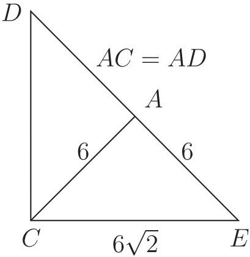

<!-- higher-math-9-10-bn-c04-t4.ex-p021 · exercise · p.95 · review: verify-formula -->
৩. $\angle ADC$ এর মান কত?
ক) $30^\circ$                      খ) $45^\circ$                      গ) $60^\circ$                      ঘ) $75^\circ$

<!-- higher-math-9-10-bn-c04-t4.ex-p022 · exercise · p.95 · review: verify-formula -->
৪. $\Delta ADC$ ও $\Delta AEC$ এর ক্ষেত্রফলদ্বয়ের অনুপাত কত?
ক) $2 : 1$                      খ) $1 : 1$                      গ) $1 : 2$                      ঘ) $1 : \sqrt{2}$

### সৃজনশীল প্রশ্ন

<!-- higher-math-9-10-bn-c04-t4.ex-p023 · exercise · p.95 · review: known-confusable-corrected -->
৫. কোনো সমদ্বিভাভ ত্রিভুজের ভূমি ৬ সেমি এবং সমান সমান বাহুর দৈর্ঘ্য ৫ সেমি।
(ক) ত্রিভুজটির উচ্চতা নির্ণয় করো।
(খ) ত্রিভুজটির অন্তর্বর্তি অঙ্কন করো। [অঙ্কনের চিত্র ও বিবরণ আবশ্যক]
(গ) এমন একটি বৃত্ত অঙ্কন করো যা উদ্দীপকের ভূমির সমান ব্যাসবিশিষ্ট কোনো বৃত্তকে কোনো বিন্দুতে স্পর্শ করে এবং বৃত্তটির বহিঃস্থ কোনো নির্দিষ্ট বিন্দু দিয়ে যায়।

### সংক্ষিপ্ত-উত্তর প্রশ্ন

<!-- higher-math-9-10-bn-c04-t4.ex-p024 · exercise · p.95 · review: verify-formula -->
৬. (ক) ৪ সেমি, ৫ সেমি এবং ৬ সেমি বাহুবিশিষ্ট কোনো ত্রিভুজের পরিবর্ত অঙ্কন করো।
(খ) কোনো ত্রিভুজের ভূমি ৫ সেমি, উচ্চতা ৪ সেমি এবং ভূমি সংলগ্ন একটি কোণ $60^\circ$ হলে, ত্রিভুজটি অঙ্কন করো।
(গ) ৬ সেমি ব্যাসবিশিষ্ট কোনো বৃত্তের বহিঃস্থ কোনো বিন্দু থেকে বৃত্তটিতে দুইটি স্পর্শক অঙ্কন করো।
