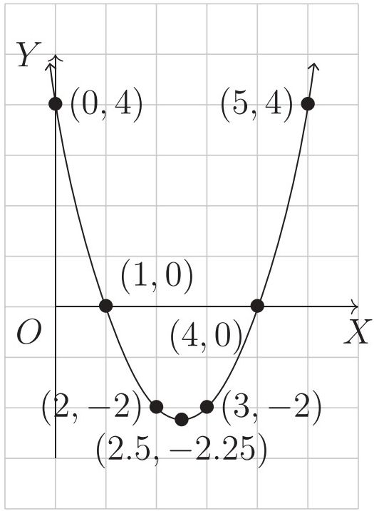
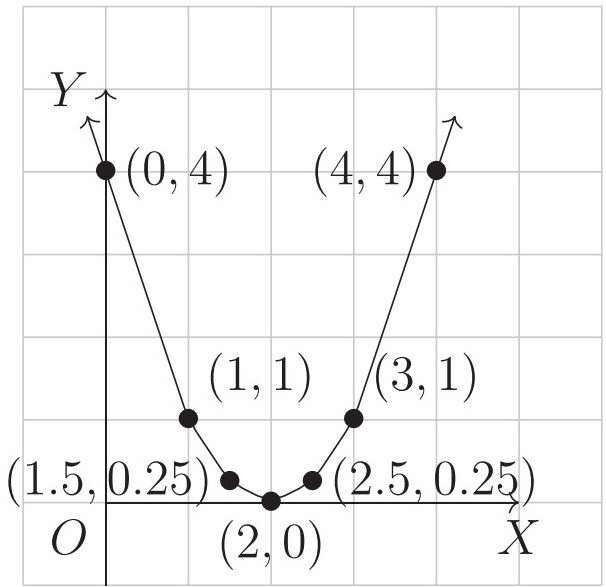
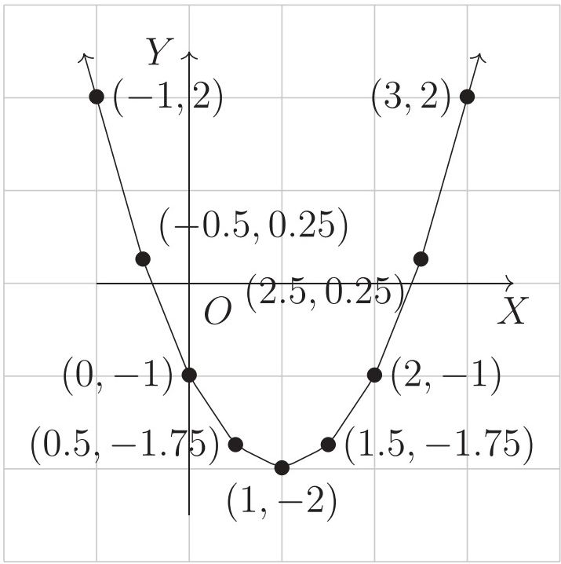
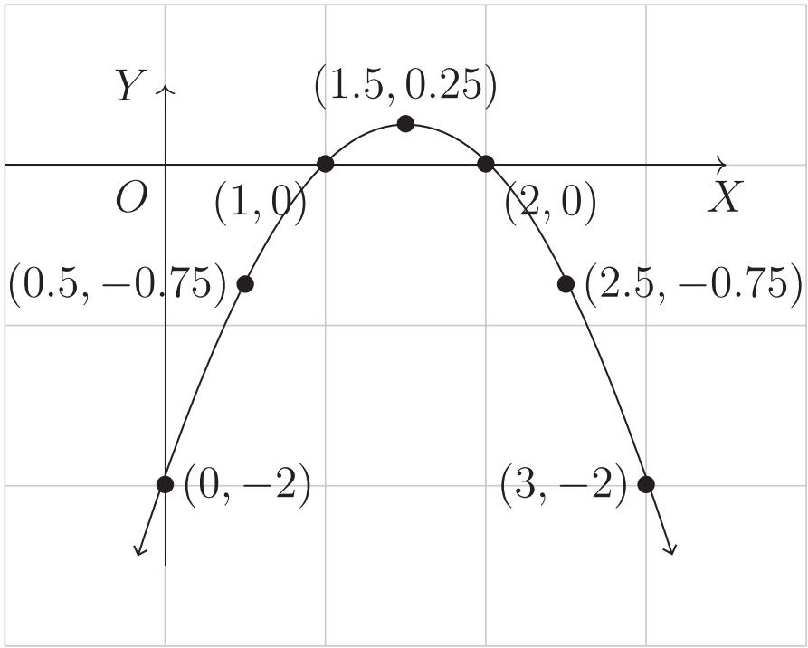

# 5. সমীকরণ

Source: Higher Math Bangla Version, printed pp. 96-122

## 5.0 ভূমিকা ও শিখনফল

<!-- higher-math-9-10-bn-c05-t5.0-p001 · text · p.96 · review: verify-formula -->
বিভিন্ন গাণিতিক সমস্যা বর্ণনায় সমীকরণের উদ্ভব ঘটে। যেমন আমি প্রতিটি 200 টাকা মূল্যের কয়েকটি শার্ট ও 400 টাকা মূল্যের কয়েকটি প্যান্ট কিনি। এতে আমার 1500 টাকা খরচ হয়। এই তথ্যকে আমরা $200s + 400p = 1500$ বা, $2s + 4p = 15$ আকারে বর্ণনা করতে পারি, যেখানে $s$ শার্টের সংখ্যা ও $p$ প্যান্টের সংখ্যা। $2s + 4p = 15$ একটি সমীকরণ যেখানে $s$ ও $p$ অজ্ঞাত রাশি। চলক হিসেবে $s$ ও $p$ এর নির্দিষ্ট ডোমেন রয়েছে, যা থেকে অজ্ঞাত রাশির নির্দিষ্ট মান নির্ণয় করাই সমীকরণের লক্ষ্য। এরূপ সমাধান সম্পর্কে নবম-দশম শ্রেণির গণিত বইয়ে আলোচনা করা হয়েছে।

<!-- higher-math-9-10-bn-c05-t5.0-p002 · text · p.96 -->
এ অধ্যায় শেষে শিক্ষার্থীরা -

<!-- higher-math-9-10-bn-c05-t5.0-p003 · text · p.96 · review: known-confusable-corrected,verify-formula -->
* দ্বিঘাত সমীকরণ ($ax^2 + bx + c = 0$) সমাধান করতে পারবে;
* বর্গমূলবিশিষ্ট সমীকরণ চিহ্নিত করতে পারবে;
* বর্গমূলবিশিষ্ট সমীকরণ সমাধান করতে পারবে;
* সূচকীয় সমীকরণ ব্যাখ্যা করতে পারবে;
* সূচকীয় সমীকরণ সমাধান করতে পারবে;
* দুই চলকের একঘাত ও দ্বিঘাত সমীকরণের জোট সমাধান করতে পারবে;
* বাস্তবভিত্তিক সমস্যাকে দুই চলকের একঘাত ও দ্বিঘাত সমীকরণে প্রকাশ করে সমাধান করতে পারবে;
* দুই চলক বিশিষ্ট সূচকীয় সমীকরণ জোট সমাধান করতে পারবে;
* লেখাচিত্রের সাহায্যে দ্বিঘাত সমীকরণ ($ax^2 + bx + c = 0$) সমাধান করতে পারবে।

### এক চলক সম্পর্কিত দ্বিঘাত সমীকরণ ও তার সমাধান

<!-- higher-math-9-10-bn-c05-t5.0-p004 · text · p.96 · review: known-confusable-corrected -->
আমরা জানি, চলকের যে মান বা মানগুলোর জন্য সমীকরণের উভয় পক্ষ সমান হয়, ঐ মান বা মানগুলোই সমীকরণের মূল (Root) এবং ঐ মান বা মানগুলোর দ্বারা সমীকরণটি সিদ্ধ হয়।

<!-- higher-math-9-10-bn-c05-t5.0-p005 · text · p.96 · review: known-confusable-corrected,verify-formula -->
নবম-দশম শ্রেণির গণিত বইয়ে এক চলকের একঘাত ও দ্বিঘাত সমীকরণ এবং দুই চলকের একঘাত ও দ্বিঘাত সমীকরণ সম্পর্কে বিস্তৃত আলোচনা করা হয়েছে। সমীকরণের মূলগুলো মূলদ সংখ্যা হলে, $ax^2 + bx + c = 0$ সমীকরণের বামপক্ষকে উৎপাদকে বিশ্লেষণ করে সহজেই তার সমাধান করা যায়।

<!-- higher-math-9-10-bn-c05-t5.0-p006 · text · p.97 · review: known-confusable-corrected -->
কিন্তু যেকোনো রাশিমালাকে সহজে উৎপাদকে বিশ্লেষণ করা যায় না। সে জন্য যেকোনো প্রকার দ্বিঘাত সমীকরণের সমাধানের জন্য নিম্নলিখিত পদ্ধতিটি ব্যবহার করা হয়।

<!-- higher-math-9-10-bn-c05-t5.0-p007 · text · p.97 · review: known-confusable-corrected,verify-formula -->
এক চলক সংবলিত দ্বিঘাত সমীকরণের আদর্শরূপ $ax^2 + bx + c = 0$। এখানে $a, b, c$ বাস্তব সংখ্যা এবং $a \neq 0$। আমরা দ্বিঘাত সমীকরণটির সমাধান করি,

<!-- higher-math-9-10-bn-c05-t5.0-p008 · formula · p.97 · review: known-confusable-corrected,verify-formula -->
$$ax^2 + bx + c = 0$$

<!-- higher-math-9-10-bn-c05-t5.0-p009 · text · p.97 · review: known-confusable-corrected,verify-formula -->
বা, $a^2x^2 + abx + ac = 0$ [উভয়পক্ষকে $a$ দ্বারা গুণ করে]

<!-- higher-math-9-10-bn-c05-t5.0-p010 · text · p.97 · review: known-confusable-corrected,verify-formula -->
বা, $(ax)^2 + 2(ax)\frac{b}{2} + \left(\frac{b}{2}\right)^2 - \left(\frac{b}{2}\right)^2 + ac = 0$

<!-- higher-math-9-10-bn-c05-t5.0-p011 · text · p.97 · review: known-confusable-corrected,verify-formula -->
বা, $\left(ax + \frac{b}{2}\right)^2 = \frac{b^2}{4} - ac$

<!-- higher-math-9-10-bn-c05-t5.0-p012 · text · p.97 · review: known-confusable-corrected,verify-formula -->
বা, $\left(ax + \frac{b}{2}\right)^2 = \frac{b^2 - 4ac}{4}$

<!-- higher-math-9-10-bn-c05-t5.0-p013 · text · p.97 · review: known-confusable-corrected,verify-formula -->
বা, $ax + \frac{b}{2} = \pm \frac{\sqrt{b^2 - 4ac}}{2}$ [উভয় পক্ষের বর্গমূল করে]

<!-- higher-math-9-10-bn-c05-t5.0-p014 · text · p.97 · review: known-confusable-corrected,verify-formula -->
বা, $ax = -\frac{b}{2} \pm \frac{\sqrt{b^2 - 4ac}}{2}$

<!-- higher-math-9-10-bn-c05-t5.0-p015 · text · p.97 · review: known-confusable-corrected,verify-formula -->
বা, $x = \frac{-b \pm \sqrt{b^2 - 4ac}}{2a}$ (1)

<!-- higher-math-9-10-bn-c05-t5.0-p016 · text · p.97 · review: known-confusable-corrected,verify-formula -->
অতএব, $x$ এর দুইটি মান পাওয়া গেল এবং মান দুটি হচ্ছে

<!-- higher-math-9-10-bn-c05-t5.0-p017 · text · p.97 · review: latin-junk,known-confusable-corrected,verify-formula -->
$$x_1 = \frac{-b + \sqrt{b^2 - 4ac}}{2a}$$ (2) এবং $x_2 = \frac{-b - \sqrt{b^2 - 4ac}}{2a}$ (3)

<!-- higher-math-9-10-bn-c05-t5.0-p018 · text · p.97 · review: known-confusable-corrected,verify-formula -->
উপরের (1) নং সমীকরণে $b^2 - 4ac$ কে দ্বিঘাত সমীকরণটির নিশ্চায়ক (Discriminant) বলে কারণ ইহা সমীকরণটির মূলদ্বয়ের ধরন ও প্রকৃতি নির্ণয় করে।

## 5.1 নিশ্চায়কের অবস্থাভেদে দ্বিঘাত সমীকরণের মূলদ্বয়ের ধরন ও প্রকৃতি

<!-- higher-math-9-10-bn-c05-t5.1-p001 · text · p.97 · review: verify-formula -->
ধরি $a, b, c$ বাস্তব সংখ্যা এবং $a \neq 0$। তাহলে

<!-- higher-math-9-10-bn-c05-t5.1-p002 · text · p.97 · review: verify-formula -->
ক) $b^2 - 4ac > 0$ এবং পূর্ণবর্গ হলে সমীকরণটির মূলদ্বয় বাস্তব, অসমান ও মূলদ হবে।

<!-- higher-math-9-10-bn-c05-t5.1-p003 · text · p.97 · review: verify-formula -->
খ) $b^2 - 4ac > 0$ কিন্তু পূর্ণবর্গ না হলে সমীকরণটির মূলদ্বয় বাস্তব, অসমান ও অমূলদ হবে।

<!-- higher-math-9-10-bn-c05-t5.1-p004 · text · p.97 · review: verify-formula -->
গ) $b^2 - 4ac = 0$ হলে সমীকরণটির মূলদ্বয় বাস্তব ও পরস্পর সমান হবে, এক্ষেত্রে $x = -\frac{b}{2a}, -\frac{b}{2a}$

<!-- higher-math-9-10-bn-c05-t5.1-p005 · text · p.97 · review: verify-formula -->
ঘ) $b^2 - 4ac < 0$ অর্থাৎ ঋণাত্মক হলে সমীকরণটির বাস্তব মূল নাই।

<!-- higher-math-9-10-bn-c05-t5.1-p006 · text · p.97 · review: verify-formula -->
**উদাহরণ ১.** $x^2 - 5x + 6 = 0$ এর সমাধান করো।

<!-- higher-math-9-10-bn-c05-t5.1-p007 · text · p.98 · review: verify-formula -->
**সমাধান:** $ax^2 + bx + c = 0$ সমীকরণের সাথে তুলনা করে এক্ষেত্রে পাওয়া যায় $a = 1, b = -5$ এবং $c = 6$। অতএব সমীকরণটির সমাধান

<!-- higher-math-9-10-bn-c05-t5.1-p008 · formula · p.98 · review: verify-formula -->
$$x = \frac{-(-5) \pm \sqrt{(-5)^2 - 4 \cdot 1 \cdot 6}}{2 \cdot 1} = \frac{5 \pm \sqrt{25 - 24}}{2} = \frac{5 \pm \sqrt{1}}{2} = \frac{5 \pm 1}{2}$$

<!-- higher-math-9-10-bn-c05-t5.1-p009 · text · p.98 · review: verify-formula -->
বা, $x = \frac{5 + 1}{2}, \frac{5 - 1}{2}$

<!-- higher-math-9-10-bn-c05-t5.1-p010 · text · p.98 · review: verify-formula -->
অর্থাৎ $x_1 = 3, x_2 = 2$

<!-- higher-math-9-10-bn-c05-t5.1-p011 · text · p.98 · review: verify-formula -->
**উদাহরণ ২.** $x^2 - 6x + 9 = 0$ এর সমাধান করো।

<!-- higher-math-9-10-bn-c05-t5.1-p012 · text · p.98 · review: verify-formula -->
**সমাধান:** $ax^2 + bx + c = 0$ সমীকরণের সাথে তুলনা করে এক্ষেত্রে পাওয়া যায় $a = 1, b = -6$ এবং $c = 9$। অতএব সমীকরণটির সমাধান

<!-- higher-math-9-10-bn-c05-t5.1-p013 · formula · p.98 · review: verify-formula -->
$$x = \frac{-(-6) \pm \sqrt{(-6)^2 - 4 \cdot 1 \cdot 9}}{2 \cdot 1} = \frac{6 \pm \sqrt{36 - 36}}{2} = \frac{6 \pm 0}{2}$$

<!-- higher-math-9-10-bn-c05-t5.1-p014 · text · p.98 · review: verify-formula -->
অর্থাৎ $x_1 = 3, x_2 = 3$

<!-- higher-math-9-10-bn-c05-t5.1-p015 · text · p.98 · review: verify-formula -->
**উদাহরণ ৩.** $x^2 - 2x - 2 = 0$ এর সমাধান করো।

<!-- higher-math-9-10-bn-c05-t5.1-p016 · text · p.98 · review: verify-formula -->
**সমাধান:** $ax^2 + bx + c = 0$ সমীকরণের সাথে তুলনা করে এক্ষেত্রে পাওয়া যায় $a = 1, b = -2$ এবং $c = -2$। অতএব সমীকরণটির সমাধান

<!-- higher-math-9-10-bn-c05-t5.1-p017 · formula · p.98 · review: verify-formula -->
$$x = \frac{2 \pm \sqrt{(-2)^2 - 4 \cdot 1 \cdot (-2)}}{2 \cdot 1} = \frac{2 \pm \sqrt{4 + 8}}{2} = \frac{2 \pm \sqrt{12}}{2}$$

<!-- higher-math-9-10-bn-c05-t5.1-p018 · text · p.98 · review: verify-formula -->
বা, $x = \frac{2 \pm 2\sqrt{3}}{2} = \frac{2(1 \pm \sqrt{3})}{2} = 1 \pm \sqrt{3}$

<!-- higher-math-9-10-bn-c05-t5.1-p019 · text · p.98 · review: verify-formula -->
অর্থাৎ $x_1 = 1 + \sqrt{3}, x_2 = 1 - \sqrt{3}$।

<!-- higher-math-9-10-bn-c05-t5.1-p020 · text · p.98 · review: verify-formula -->
এখানে লক্ষণীয় যে, সাধারণ নিয়মে মূলদ সংখ্যার সাহায্যে $x^2 - 2x - 2$ কে উৎপাদকে বিশ্লেষণ করা না গেলেও প্রদত্ত সমীকরণটির সমাধান করা সম্ভব হয়েছে।

<!-- higher-math-9-10-bn-c05-t5.1-p021 · text · p.98 · review: verify-formula -->
**উদাহরণ ৪.** $3 - 4x - x^2 = 0$ এর সমাধান করো।

<!-- higher-math-9-10-bn-c05-t5.1-p022 · text · p.98 · review: verify-formula -->
**সমাধান:** $ax^2 + bx + c = 0$ সমীকরণের সাথে তুলনা করে এক্ষেত্রে পাওয়া যায় $a = -1, b = -4, c = 3$। অতএব সমীকরণটির সমাধান

<!-- higher-math-9-10-bn-c05-t5.1-p023 · formula · p.98 · review: verify-formula -->
$$x = \frac{-(-4) \pm \sqrt{(-4)^2 - 4 \cdot (-1) \cdot 3}}{2 \cdot (-1)} = \frac{4 \pm \sqrt{16 + 12}}{-2} = \frac{4 \pm \sqrt{28}}{-2}$$

<!-- higher-math-9-10-bn-c05-t5.1-p024 · formula · p.98 · review: verify-formula -->
$$= \frac{4 \pm 2\sqrt{7}}{-2}$$

<!-- higher-math-9-10-bn-c05-t5.1-p025 · text · p.98 · review: verify-formula -->
বা, $x = -(2 \pm \sqrt{7})$

<!-- higher-math-9-10-bn-c05-t5.1-p026 · text · p.98 · review: verify-formula -->
অর্থাৎ, $x_1 = -2 - \sqrt{7}, x_2 = -2 + \sqrt{7}$।

<!-- higher-math-9-10-bn-c05-t5.1-p027 · text · p.99 · review: verify-formula -->
**কাজ:** উপরের (2) ও (3) নং সূত্রের সাহায্যে $ax^2 + bx + c = 0$ সমীকরণ হতে মূল $x_1$ এবং $x_2$ এর মান নির্ণয় করো: যখন

<!-- higher-math-9-10-bn-c05-t5.1-p028 · text · p.99 · review: verify-formula -->
ক) $b = 0$ খ) $c = 0$ গ) $b = c = 0$
ঘ) $a = 1$ ঙ) $a = 1, b = c = 2p$

## 5.ex অনুশীলনী ৫.১

<!-- higher-math-9-10-bn-c05-t5.ex-p001 · exercise · p.99 -->
সূত্রের সাহায্যে নিচের সমীকরণগুলোর সমাধান করো:

<!-- higher-math-9-10-bn-c05-t5.ex-p002 · exercise · p.99 · review: verify-formula -->
১. $2x^2 + 9x + 9 = 0$ ২. $3 - 4x - 2x^2 = 0$ ৩. $4x - 1 - x^2 = 0$
৪. $2x^2 - 5x - 1 = 0$ ৫. $3x^2 + 7x + 1 = 0$ ৬. $2 - 3x^2 + 9x = 0$
৭. $x^2 - 8x + 16 = 0$ ৮. $2x^2 + 7x - 1 = 0$ ৯. $7x - 2 - 3x^2 = 0$

### অনুশীলনী ৫.২

<!-- higher-math-9-10-bn-c05-t5.ex-p003 · exercise · p.102 -->
**সমাধান করো:**

<!-- higher-math-9-10-bn-c05-t5.ex-p004 · exercise · p.102 · review: verify-formula -->
১. $\sqrt{x - 4} + 2 = \sqrt{x + 12}$
২. $\sqrt{11x - 6} = \sqrt{4x + 5} - \sqrt{x - 1}$
৩. $\sqrt{2x + 7} + \sqrt{3x - 18} = \sqrt{7x + 1}$
৪. $\sqrt{x + 4} + \sqrt{x + 11} = \sqrt{8x + 9}$
৫. $\sqrt{11x - 6} = \sqrt{4x + 5} + \sqrt{x - 1}$
৬. $\sqrt{x^2 - 8} + \sqrt{x^2 - 14} = 6$
৭. $\sqrt{x^2 - 6x + 9} - \sqrt{x^2 - 6x + 6} = 1$
৮. $\sqrt{x - 2} - \sqrt{x - 9} = 1$
৯. $6\sqrt{\frac{2x}{x - 1}} + 5\sqrt{\frac{x - 1}{2x}} = 13$
১০. $\sqrt{\frac{x - 1}{3x + 2}} + 2\sqrt{\frac{3x + 2}{x - 1}} = 3$

### অনুশীলনী ৫.৩

<!-- higher-math-9-10-bn-c05-t5.ex-p005 · exercise · p.106 -->
**সমাধান করো:**

<!-- higher-math-9-10-bn-c05-t5.ex-p006 · exercise · p.106 · review: verify-formula -->
১. $3^{x+2} = 81$

<!-- higher-math-9-10-bn-c05-t5.ex-p007 · exercise · p.106 · review: verify-formula -->
২. $5^{3x-7} = 3^{3x-7}$

<!-- higher-math-9-10-bn-c05-t5.ex-p008 · exercise · p.106 · review: verify-formula -->
৩. $2^{x-4} = 4a^{x-6}$ ($a > 0, a \neq 2$)

<!-- higher-math-9-10-bn-c05-t5.ex-p009 · exercise · p.106 · review: verify-formula -->
৪. $(\sqrt{3})^{x+5} = (\sqrt[3]{3})^{2x+5}$

<!-- higher-math-9-10-bn-c05-t5.ex-p010 · exercise · p.106 · review: verify-formula -->
৫. $(\sqrt[5]{4})^{4x+7} = (\sqrt[11]{64})^{2x+7}$

<!-- higher-math-9-10-bn-c05-t5.ex-p011 · exercise · p.106 · review: verify-formula -->
৬. $\frac{3^{3x-4} \cdot a^{2x-5}}{3^{x+1}} = a^{2x-5}$ ($a > 0$)

<!-- higher-math-9-10-bn-c05-t5.ex-p012 · exercise · p.106 · review: verify-formula -->
৭. $\frac{5^{2x} \cdot b^{x-3}}{5^{x+3}} = a^{x-3}$ ($a, b > 0, 5b \neq a$)

<!-- higher-math-9-10-bn-c05-t5.ex-p013 · exercise · p.106 · review: verify-formula -->
৮. $4^{x+2} = 2^{2x+1} + 14$

<!-- higher-math-9-10-bn-c05-t5.ex-p014 · exercise · p.106 · review: verify-formula -->
৯. $5^x + 5^{2-x} = 26$

<!-- higher-math-9-10-bn-c05-t5.ex-p015 · exercise · p.106 · review: verify-formula -->
১০. $3(9^x - 4 \cdot 3^{x-1}) + 1 = 0$

<!-- higher-math-9-10-bn-c05-t5.ex-p016 · exercise · p.106 · review: verify-formula -->
১১. $4^{1+x} + 4^{1-x} = 10$

<!-- higher-math-9-10-bn-c05-t5.ex-p017 · exercise · p.106 · review: verify-formula -->
১২. $2^{2x} - 3 \cdot 2^{x+2} = -32$

### অনুশীলনী ৫.৪

<!-- higher-math-9-10-bn-c05-t5.ex-p018 · exercise · p.109 -->
**সমাধান করো:**

<!-- higher-math-9-10-bn-c05-t5.ex-p019 · exercise · p.109 · review: verify-formula -->
১. $(2x + 3)(y - 1) = 14, (x - 3)(y - 2) = -1$

<!-- higher-math-9-10-bn-c05-t5.ex-p020 · exercise · p.109 · review: verify-formula -->
২. $(x - 2)(y - 1) = 3, (x + 2)(2y - 5) = 15$

<!-- higher-math-9-10-bn-c05-t5.ex-p021 · exercise · p.109 · review: verify-formula -->
৩. $x^2 = 7x + 6y, y^2 = 7y + 6x$

<!-- higher-math-9-10-bn-c05-t5.ex-p022 · exercise · p.109 · review: verify-formula -->
৪. $x^2 = 3x + 2y, y^2 = 3y + 2x$

<!-- higher-math-9-10-bn-c05-t5.ex-p023 · exercise · p.109 · review: verify-formula -->
৫. $x + \frac{4}{y} = 1, y + \frac{4}{x} = 25$

<!-- higher-math-9-10-bn-c05-t5.ex-p024 · exercise · p.110 · review: verify-formula -->
৬. $y + 3 = \frac{4}{x}, \quad x - 4 = \frac{5}{3y}$

<!-- higher-math-9-10-bn-c05-t5.ex-p025 · exercise · p.110 · review: verify-formula -->
৭. $xy - x^2 = 1, \quad y^2 - xy = 2$

<!-- higher-math-9-10-bn-c05-t5.ex-p026 · exercise · p.110 · review: verify-formula -->
৮. $x^2 - xy = 14, \quad y^2 + xy = 60$

<!-- higher-math-9-10-bn-c05-t5.ex-p027 · exercise · p.110 · review: verify-formula -->
৯. $x^2 + y^2 = 25, \quad xy = 12$

<!-- higher-math-9-10-bn-c05-t5.ex-p028 · exercise · p.110 · review: verify-formula -->
১০. $\frac{x + y}{x - y} + \frac{x - y}{x + y} = \frac{10}{3}, \quad x^2 - y^2 = 3$

<!-- higher-math-9-10-bn-c05-t5.ex-p029 · exercise · p.110 · review: verify-formula -->
১১. $x^2 + xy + y^2 = 3, \quad x^2 - xy + y^2 = 7$

<!-- higher-math-9-10-bn-c05-t5.ex-p030 · exercise · p.110 · review: verify-formula -->
১২. $2x^2 + 3xy + y^2 = 20, \quad 5x^2 + 4y^2 = 41$

### অনুশীলনী ৫.৫

<!-- higher-math-9-10-bn-c05-t5.ex-p031 · exercise · p.112 -->
১. দুটি বর্গক্ষেত্রের ক্ষেত্রফলের সমষ্টি 481 বর্গমিটার। ঐ দুটি বর্গক্ষেত্রের দুই বাহু দ্বারা গঠিত আয়তক্ষেত্রের ক্ষেত্রফল 240 বর্গমিটার হলে, বর্গক্ষেত্র দুটির প্রত্যেক বাহুর পরিমাণ কত?

<!-- higher-math-9-10-bn-c05-t5.ex-p032 · exercise · p.112 -->
২. দুইটি ধনাত্মক সংখ্যার বর্গের সমষ্টি 250। সংখ্যা দুটির গুণফল 117, সংখ্যা দুটি নির্ণয় করো।

<!-- higher-math-9-10-bn-c05-t5.ex-p033 · exercise · p.112 -->
৩. একটি আয়তক্ষেত্রের কর্ণের দৈর্ঘ্য 10 মিটার। ইহার বাহুদ্বয়ের যোগফল ও বিয়োগফলের সমান দৈর্ঘ্য বিশিষ্ট বাহুদ্বয় দ্বারা অঙ্কিত আয়তক্ষেত্রের ক্ষেত্রফল 28 বর্গমিটার হলে, প্রথম আয়তক্ষেত্রটির দৈর্ঘ্য ও প্রস্থ নির্ণয় করো।

<!-- higher-math-9-10-bn-c05-t5.ex-p034 · exercise · p.112 -->
৪. দুটি সংখ্যার বর্গের সমষ্টি 181 এবং সংখ্যা দুইটির গুণফল 90, সংখ্যা দুইটির বর্গের অন্তর নির্ণয় করো।

<!-- higher-math-9-10-bn-c05-t5.ex-p035 · exercise · p.112 -->
৫. একটি আয়তক্ষেত্রের ক্ষেত্রফল 24 বর্গমিটার। অপর একটি আয়তক্ষেত্রের দৈর্ঘ্য ও প্রস্থ প্রথম আয়তক্ষেত্রের দৈর্ঘ্য ও প্রস্থ অপেক্ষা যথাক্রমে 4 মিটার এবং 1 মিটার বেশি এবং ক্ষেত্রফল 50 বর্গমিটার। প্রথম আয়তক্ষেত্রের দৈর্ঘ্য ও প্রস্থ নির্ণয় করো।

<!-- higher-math-9-10-bn-c05-t5.ex-p036 · exercise · p.112 -->
৬. একটি আয়তক্ষেত্রের প্রস্থের দ্বিগুণ দৈর্ঘ্য অপেক্ষা 23 মিটার বেশি। আয়তক্ষেত্রের ক্ষেত্রফল 600 বর্গমিটার হলে, তার দৈর্ঘ্য ও প্রস্থ নির্ণয় করো।

<!-- higher-math-9-10-bn-c05-t5.ex-p037 · exercise · p.112 -->
৭. একটি আয়তক্ষেত্রের পরিসীমা কর্ণদ্বয়ের দৈর্ঘ্যের সমষ্টি অপেক্ষা ৪ মিটার বেশি। ক্ষেত্রটির ক্ষেত্রফল 48 বর্গমিটার হলে, তার দৈর্ঘ্য ও প্রস্থ নির্ণয় করো।

<!-- higher-math-9-10-bn-c05-t5.ex-p038 · exercise · p.112 -->
৮. দুই অঙ্কবিশিষ্ট একটি সংখ্যাকে এর অঙ্কদ্বয়ের গুণফল দ্বারা ভাগ করলে ভাগফল 2 হয়। সংখ্যাটির সাথে 27 যোগ করলে অঙ্কদ্বয় স্থান বিনিময় করে। সংখ্যাটি নির্ণয় করো।

<!-- higher-math-9-10-bn-c05-t5.ex-p039 · exercise · p.112 -->
৯. একটি আয়তাকার বাগানের পরিসীমা 56 মিটার এবং কর্ণ 20 মিটার। ঐ বাগানের সমান ক্ষেত্রফলবিশিষ্ট বর্গক্ষেত্রের বাহুর দৈর্ঘ্য কত?

<!-- higher-math-9-10-bn-c05-t5.ex-p040 · exercise · p.113 -->
১০. একটি আয়তক্ষেত্রের ক্ষেত্রফল 300 বর্গমিটার এবং এর অর্ধপরিসীমা একটি কর্ণ অপেক্ষা 10 মিটার বেশি। ক্ষেত্রটির দৈর্ঘ্য ও প্রস্থ নির্ণয় করো।

<!-- higher-math-9-10-bn-c05-t5.ex-p041 · exercise · p.113 · review: verify-formula -->
১১. দুটি বর্গক্ষেত্রের বাহু $x$ ও $y$ দ্বারা আবদ্ধ আয়তক্ষেত্রের ক্ষেত্রফল 49। বর্গক্ষেত্রদ্বয়ের ক্ষেত্রফলের সমষ্টি সর্বোচ্চ কত হতে পারে?

### অনুশীলনী ৫.৬

<!-- higher-math-9-10-bn-c05-t5.ex-p042 · exercise · p.115 -->
**সমাধান করো:**

<!-- higher-math-9-10-bn-c05-t5.ex-p043 · exercise · p.115 · review: verify-formula -->
১. $2^x + 3^y = 31$
$2^x - 3^y = -23$

<!-- higher-math-9-10-bn-c05-t5.ex-p044 · exercise · p.115 · review: verify-formula -->
২. $3^x = 9^y$
$5^{x+y+1} = 25^{xy}$

<!-- higher-math-9-10-bn-c05-t5.ex-p045 · exercise · p.115 · review: verify-formula -->
৩. $3^x \cdot 9^y = 81$
$2x - y = 8$

<!-- higher-math-9-10-bn-c05-t5.ex-p046 · exercise · p.115 · review: verify-formula -->
৪. $a^x \cdot a^{y+1} = a^7$
$a^{2y} \cdot a^{3x+5} = a^{20}$

<!-- higher-math-9-10-bn-c05-t5.ex-p047 · exercise · p.115 · review: verify-formula -->
৫. $2^x \cdot 3^y = 18$
$2^{2x} \cdot 3^y = 36$

<!-- higher-math-9-10-bn-c05-t5.ex-p048 · exercise · p.115 · review: verify-formula -->
৬. $y^x = x^2$
$x^{2x} = y^4$ ($y \neq 1$)

<!-- higher-math-9-10-bn-c05-t5.ex-p049 · exercise · p.116 · review: verify-formula -->
৭. $y^x = 4$
   $y^2 = 2^x$

<!-- higher-math-9-10-bn-c05-t5.ex-p050 · exercise · p.116 · review: verify-formula -->
৮. $4^x = 2^y$
   $(27)^{xy} = 9^{y+1}$

<!-- higher-math-9-10-bn-c05-t5.ex-p051 · exercise · p.116 · review: verify-formula -->
৯. $8y^x - y^{2x} = 16$
   $2^x = y^2$

### অনুশীলনী ৫.৯

<!-- higher-math-9-10-bn-c05-t5.ex-p052 · exercise · p.120 · review: verify-formula -->
১. $x^2 - x - 12 = 0$ সমীকরণটিকে $ax^2 + bx + c = 0$ এর সাথে তুলনা করলে $b$ এর মান কোনটি?
ক) 0                      খ) 1                      গ) -1                      ঘ) 3

<!-- higher-math-9-10-bn-c05-t5.ex-p053 · exercise · p.120 · review: verify-formula -->
২. $x^2 - x - 13 = 0$ হলে সমীকরণটির একটি মূল কোনটি?
ক) $-\frac{-1 + \sqrt{51}}{2}$                      খ) $-\frac{-1 - \sqrt{51}}{2}$
গ) $-\frac{1 + \sqrt{-51}}{2}$                      ঘ) $\frac{1 + \sqrt{53}}{2}$

<!-- higher-math-9-10-bn-c05-t5.ex-p054 · exercise · p.120 · review: known-confusable-corrected,verify-formula -->
৩. $y^x = 9, y^2 = 3^x$ সমীকরণ জোটের একটি সমাধান কোনটি?
ক) $(-3, -3)$                      খ) $(2, \frac{1}{3})$
গ) $(-2, \frac{1}{3})$                      ঘ) $(-2, 3)$

<!-- higher-math-9-10-bn-c05-t5.ex-p055 · exercise · p.120 -->
৪. একটি সংখ্যা ও ঐ সংখ্যার গুণাঙ্ক বিপরীত সংখ্যার সমষ্টি ৬। সন্ন্যব্য সমীকরণটির গঠন হবে

<!-- higher-math-9-10-bn-c05-t5.ex-p056 · exercise · p.120 · review: verify-formula -->
(i) $x + \frac{1}{x} = 6$

<!-- higher-math-9-10-bn-c05-t5.ex-p057 · exercise · p.120 · review: verify-formula -->
(ii) $x^2 + 1 = 6x$

<!-- higher-math-9-10-bn-c05-t5.ex-p058 · exercise · p.120 · review: verify-formula -->
(iii) $x^2 - 6x - 1 = 0$

<!-- higher-math-9-10-bn-c05-t5.ex-p059 · exercise · p.120 · review: verify-formula -->
নিচের কোনটি সঠিক?
ক) $i$ ও $ii$                      খ) $i$ ও $iii$                      গ) $ii$ ও $iii$                      ঘ) $i, ii$ ও $iii$

<!-- higher-math-9-10-bn-c05-t5.ex-p060 · exercise · p.121 · review: verify-formula -->
৫. $2^{px-1} = 2^{2px-2}$ এর সমাধান কোনটি?
ক) $\frac{p}{2}$ খ) $p$ গ) $-\frac{p}{2}$ ঘ) $\frac{1}{p}$

<!-- higher-math-9-10-bn-c05-t5.ex-p061 · exercise · p.121 · review: verify-formula -->
৬. লেখচিত্রের সাহায্যে নিচের সমীকরণগুলোর সমাধান করো:
ক) $x^2 - 4x + 3 = 0$ খ) $x^2 + 2x - 3 = 0$ গ) $x^2 + 7x = 0$
ঘ) $2x^2 - 7x + 3 = 0$ ও) $2x^2 - 5x + 2 = 0$ চ) $x^2 + 8x + 16 = 0$
ছ) $x^2 + x - 3 = 0$ জ) $x^2 = 8$

<!-- higher-math-9-10-bn-c05-t5.ex-p062 · exercise · p.121 -->
৭. একটি সংখ্যার বর্গের দ্বিগুণ সংখ্যাটির ৫ গুণ থেকে ৩ কম। কিন্তু ঐ সংখ্যাটির বর্গের ৫ গুণ সংখ্যাটির ২ গুণ থেকে ৩ বেশি।
ক) উদ্দীপকের তথ্যগুলোর সাহায্যে সমীকরণ গঠন করো।
খ) সূত্র প্রয়োগ করে ১ম সমীকরণটি সমাধান করো।
গ) ২য় সমীকরণটি লেখচিত্রের সাহায্যে সমাধান করো।

<!-- higher-math-9-10-bn-c05-t5.ex-p063 · exercise · p.121 -->
৮. জনাব আশফাক আলীর আয়তাকার এক খণ্ড জমির ক্ষেত্রফল 0.12 হেক্টর। জমিটির অর্ধপরিসীমা এর একটি কর্ণ অপেক্ষা 20 মিটার বেশি। তিনি তাঁর জমি থেকে শ্যাম বাবুর নিকট আয়তাকার এক তৃতীয়াংশ বিক্রি করেন। শ্যাম বাবুর জমির দৈর্ঘ্য, প্রস্থ অপেক্ষা 5 মিটার বেশি। [1 হেক্টর = 10,000 বর্গমিটার]
ক) উদ্দীপকের আলোকে দুটি সমীকরণ গঠন করো।
খ) আশফাক আলীর জমির দৈর্ঘ্য ও প্রস্থ নির্ণয় করো।
গ) শ্যাম বাবুর জমির কর্ণের দৈর্ঘ্য ও পরিসীমা নির্ণয় করো।

<!-- higher-math-9-10-bn-c05-t5.ex-p064 · exercise · p.121 -->
৯. পাঁচটি ক্রমিক পূর্ণসংখ্যার অঙ্কগুলোর যোগফল কি পরবর্তী পাঁচটি ক্রমিক পূর্ণসংখ্যার অঙ্কগুলোর যোগফল দিয়ে গুণ করলে গুণফল 120635 হতে পারে?

<!-- higher-math-9-10-bn-c05-t5.ex-p065 · exercise · p.121 -->
১০. একটি আয়তক্ষেত্রের দৈর্ঘ্য ও প্রস্থের ব্যবধান 1 সেমি। তার ক্ষেত্রফলের শেষ অঙ্ক যদি 6 হয় তাহলে তার কোনো বাহুর দৈর্ঘ্য পূর্ণবর্গ হতে পারে কি?

<!-- higher-math-9-10-bn-c05-t5.ex-p066 · exercise · p.121 -->
১১. ঘড়ির ঘণ্টা ও মিনিটের কাঁটা কতবার পরস্পর ঠিক বিপরীত দিকে বসে? সময়গুলো বের করো।

<!-- higher-math-9-10-bn-c05-t5.ex-p067 · exercise · p.121 -->
১২. ঘড়ির ঘণ্টা ও মিনিটের কাঁটা কতবার ঠিক লম্বালম্বি হয়ে বসে? সময়গুলো বের করো।

### বহুনির্বাচনি প্রশ্ন

<!-- higher-math-9-10-bn-c05-t5.ex-p068 · exercise · p.122 · review: verify-formula -->
১. $16^x = 4^{x+1}$ সমীকরণটির সমাধান কোনটি?
ক) 2 খ) 1 গ) 4 ঘ) 3

<!-- higher-math-9-10-bn-c05-t5.ex-p069 · exercise · p.122 · review: latin-junk,verify-formula -->
২. একটি সংখ্যা এবং ঐ সংখ্যার গুণাত্মক বিপরীত সংখ্যার সমষ্টি 2 হলে -
(i) $x + \frac{1}{x} = 2$
(ii) $x^2 + 2x = 1$
(iii) $x - \frac{1}{x} = 0$
নিচের কোনটি সঠিক?
(ক) i ও ii খ) i ও iii গ) ii ও iii ঘ) i, ii ও iii

<!-- higher-math-9-10-bn-c05-t5.ex-p070 · exercise · p.122 · review: known-confusable-corrected -->
নিচের তথ্যের ভিত্তিতে ৩ ও ৪ নং প্রশ্নের উত্তর দাও:
দুইটি ধনাত্মক পূর্ণ সংখ্যার বর্গের অন্তর 11 এবং গুণফল 30.

<!-- higher-math-9-10-bn-c05-t5.ex-p071 · exercise · p.122 -->
৩. সংখ্যা দুইটির বর্গের সমষ্টি কত?
(ক) 1 খ) 5 গ) 41 ঘ) 61

<!-- higher-math-9-10-bn-c05-t5.ex-p072 · exercise · p.122 -->
৪. সংখ্যা দুইটি কী কী?
(ক) 1 এবং 30 খ) 2 এবং 15
(গ) 5 এবং 6 ঘ) 3 এবং 10

### সৃজনশীল প্রশ্ন

<!-- higher-math-9-10-bn-c05-t5.ex-p073 · exercise · p.122 · review: known-confusable-corrected,verify-formula -->
৫. $f(x) = x^2 - 6x + 15$ এবং $g(x) = x^2 - 6x + 13$
ক) $f(x) = 7$ হলে, $x$ এর মান নির্ণয় করো।
খ) $\sqrt{f(x)} - \sqrt{g(x)} = \sqrt{10} - \sqrt{8}$ হলে, সমীকরণটি সমাধান করো।
গ) $g(x)$ এর লেখচিত্র অঙ্কন করো।

### সংক্ষিপ্ত-উত্তর প্রশ্ন

<!-- higher-math-9-10-bn-c05-t5.ex-p074 · exercise · p.122 · review: verify-formula -->
৬. (ক) $a^{mx-1} = a^{3mx+1}$ হলে, $x$ এর মান নির্ণয় করো।
(খ) $x^2 - x - 11 = 0$ সমীকরণটির মূলদ্বয়ের প্রকৃতি নির্ণয় করো।
(গ) $\frac{81}{625}$ কে $\frac{5}{3}$ এর সূচকে প্রকাশ করো।

## 5.2 মূল চিহ্ন সংবলিত সমীকরণ

<!-- higher-math-9-10-bn-c05-t5.2-p001 · text · p.99 -->
সমীকরণে চলকের বর্গমূল সংবলিত রাশি থাকলে তাকে বর্গ করে বর্গমূল চিহ্নমুক্ত নতুন সমীকরণ পাওয়া যায়। উক্ত সমীকরণ সমাধান করে যে মূলগুলো পাওয়া যায় অনেক সময় সবগুলো মূল প্রদত্ত সমীকরণটিকে সিদ্ধ করে না। এ ধরনের মূল অবান্তর (Extraneous) মূল। সুতরাং মূলচিহ্ন সংবলিত সমীকরণ সমাধান প্রক্রিয়ায় প্রাপ্ত মূলগুলো প্রদত্ত সমীকরণের মূল কিনা তা অবশ্যই পরীক্ষা করে দেখা দরকার। পরীক্ষার পর যে সব মূল উক্ত সমীকরণকে সিদ্ধ করে তাই হবে প্রদত্ত সমীকরণের মূল। নিচে কয়েকটি উদাহরণ দেওয়া হলো।

<!-- higher-math-9-10-bn-c05-t5.2-p002 · text · p.99 · review: verify-formula -->
**উদাহরণ ৫.** সমাধান করো: $\sqrt{8x + 9} - \sqrt{2x + 15} = \sqrt{2x - 6}$

<!-- higher-math-9-10-bn-c05-t5.2-p003 · text · p.99 · review: verify-formula -->
**সমাধান:** $\sqrt{8x + 9} - \sqrt{2x + 15} = \sqrt{2x - 6}$

<!-- higher-math-9-10-bn-c05-t5.2-p004 · text · p.99 · review: verify-formula -->
বা, $\sqrt{2x + 15} + \sqrt{2x - 6} = \sqrt{8x + 9}$

<!-- higher-math-9-10-bn-c05-t5.2-p005 · text · p.99 · review: verify-formula -->
বা, $2x + 15 + 2x - 6 + 2\sqrt{2x + 15}\sqrt{2x - 6} = 8x + 9$ [বর্গ করে]

<!-- higher-math-9-10-bn-c05-t5.2-p006 · text · p.99 · review: verify-formula -->
বা, $\sqrt{2x + 15}\sqrt{2x - 6} = 2x$

<!-- higher-math-9-10-bn-c05-t5.2-p007 · text · p.99 · review: verify-formula -->
বা, $(2x + 15)(2x - 6) = 4x^2$ [পুনরায় বর্গ করে]

<!-- higher-math-9-10-bn-c05-t5.2-p008 · text · p.99 · review: verify-formula -->
বা, $4x^2 + 18x - 90 = 4x^2$

<!-- higher-math-9-10-bn-c05-t5.2-p009 · text · p.99 · review: verify-formula -->
বা, $18x = 90$

<!-- higher-math-9-10-bn-c05-t5.2-p010 · formula · p.99 · review: verify-formula -->
$\therefore x = 5$

<!-- higher-math-9-10-bn-c05-t5.2-p011 · text · p.99 · review: known-confusable-corrected,verify-formula -->
**শুদ্ধি পরীক্ষা:** $x = 5$ হলে, বামপক্ষ $= \sqrt{49} - \sqrt{25} = 7 - 5 = 2$ এবং ডানপক্ষ $= \sqrt{4} = 2$ $\therefore$ নির্ণেয় সমাধান $x = 5$

<!-- higher-math-9-10-bn-c05-t5.2-p012 · text · p.100 · review: verify-formula -->
**কাজ:** $p = \sqrt{\frac{x}{x + 16}}$ ধরে $\sqrt{\frac{x}{x + 16}} + \sqrt{\frac{x + 16}{x}} = \frac{25}{12}$ সমীকরণটির সমাধান করে শুদ্ধি পরীক্ষা করো।

<!-- higher-math-9-10-bn-c05-t5.2-p013 · text · p.100 · review: verify-formula -->
**উদাহরণ ৬.** সমাধান করো: $\sqrt{2x + 8} - 2\sqrt{x + 5} + 2 = 0$

<!-- higher-math-9-10-bn-c05-t5.2-p014 · text · p.100 · review: verify-formula -->
**সমাধান:** $\sqrt{2x + 8} = 2\sqrt{x + 5} - 2$

<!-- higher-math-9-10-bn-c05-t5.2-p015 · text · p.100 · review: verify-formula -->
বা, $2x + 8 = 4(x + 5) + 4 - 8\sqrt{x + 5}$ [বর্গ করে]

<!-- higher-math-9-10-bn-c05-t5.2-p016 · text · p.100 · review: verify-formula -->
বা, $8\sqrt{x + 5} = 4x + 20 + 4 - 2x - 8$ [পক্ষান্তর করে]

<!-- higher-math-9-10-bn-c05-t5.2-p017 · text · p.100 · review: verify-formula -->
বা, $8\sqrt{x + 5} = 2x + 16 = 2(x + 8)$

<!-- higher-math-9-10-bn-c05-t5.2-p018 · text · p.100 · review: verify-formula -->
বা, $4\sqrt{x + 5} = x + 8$

<!-- higher-math-9-10-bn-c05-t5.2-p019 · text · p.100 · review: verify-formula -->
বা, $16(x + 5) = x^2 + 16x + 64$ [বর্গ করে]

<!-- higher-math-9-10-bn-c05-t5.2-p020 · text · p.100 · review: verify-formula -->
বা, $16x + 80 = x^2 + 16x + 64$

<!-- higher-math-9-10-bn-c05-t5.2-p021 · text · p.100 · review: verify-formula -->
বা, $16 = x^2$

<!-- higher-math-9-10-bn-c05-t5.2-p022 · formula · p.100 · review: verify-formula -->
$\therefore x = \pm\sqrt{16} = \pm 4$

<!-- higher-math-9-10-bn-c05-t5.2-p023 · text · p.100 · review: verify-formula -->
**শুদ্ধি পরীক্ষা:** $x = 4$ হলে, বামপক্ষ $= \sqrt{16} - 2\sqrt{9} + 2 = 4 - 2 \times 3 + 2 = 0 =$ ডানপক্ষ

<!-- higher-math-9-10-bn-c05-t5.2-p024 · text · p.100 · review: verify-formula -->
$x = -4$ হলে, বামপক্ষ $= \sqrt{-8 + 8} - 2\sqrt{-4 + 5} + 2 = 0 - 2 \times 1 + 2 = 0 =$ ডানপক্ষ

<!-- higher-math-9-10-bn-c05-t5.2-p025 · text · p.100 · review: known-confusable-corrected,verify-formula -->
$\therefore$ নির্ণেয় সমাধান $x = 4, -4$

<!-- higher-math-9-10-bn-c05-t5.2-p026 · text · p.100 · review: verify-formula -->
**উদাহরণ ৭.** সমাধান করো: $\sqrt{2x + 9} - \sqrt{x - 4} = \sqrt{x + 1}$

<!-- higher-math-9-10-bn-c05-t5.2-p027 · text · p.100 · review: verify-formula -->
**সমাধান:** $\sqrt{2x + 9} - \sqrt{x - 4} = \sqrt{x + 1}$

<!-- higher-math-9-10-bn-c05-t5.2-p028 · text · p.100 · review: verify-formula -->
বা, $2x + 9 + x - 4 - 2\sqrt{2x + 9}\sqrt{x - 4} = x + 1$ [বর্গ করে]

<!-- higher-math-9-10-bn-c05-t5.2-p029 · text · p.100 · review: verify-formula -->
বা, $2x + 4 - 2\sqrt{2x + 9}\sqrt{x - 4} = 0$

<!-- higher-math-9-10-bn-c05-t5.2-p030 · text · p.100 · review: verify-formula -->
বা, $\sqrt{2x + 9}\sqrt{x - 4} = x + 2$

<!-- higher-math-9-10-bn-c05-t5.2-p031 · text · p.100 · review: verify-formula -->
বা, $(2x + 9)(x - 4) = x^2 + 4x + 4$ [বর্গ করে]

<!-- higher-math-9-10-bn-c05-t5.2-p032 · text · p.100 · review: verify-formula -->
বা, $2x^2 + x - 36 = x^2 + 4x + 4$

<!-- higher-math-9-10-bn-c05-t5.2-p033 · text · p.100 · review: verify-formula -->
বা, $x^2 - 3x - 40 = 0$

<!-- higher-math-9-10-bn-c05-t5.2-p034 · text · p.100 · review: verify-formula -->
বা, $(x - 8)(x + 5) = 0$

<!-- higher-math-9-10-bn-c05-t5.2-p035 · text · p.100 · review: verify-formula -->
$\therefore x = 8$ অথবা $x = -5$ শুদ্ধি পরীক্ষা: $x = 8$ হলে, বামপক্ষ $= 5 - 2 = 3$ এবং ডানপক্ষ $= 3$

<!-- higher-math-9-10-bn-c05-t5.2-p036 · text · p.101 · review: verify-formula -->
অতএব, $x = 8$ প্রদত্ত সমীকরণের একটি মূল।

<!-- higher-math-9-10-bn-c05-t5.2-p037 · text · p.101 · review: verify-formula -->
$x = -5$ গ্রহণযোগ্য নয়, কেননা সমীকরণে $x = -5$ বসালে ঋণাত্মক সংখ্যার বর্গমূল আসে যা সংজ্ঞায়িত নয়।

<!-- higher-math-9-10-bn-c05-t5.2-p038 · text · p.101 · review: known-confusable-corrected,verify-formula -->
$\therefore$ নির্ণেয় সমাধান $x = 8$

<!-- higher-math-9-10-bn-c05-t5.2-p039 · text · p.101 · review: verify-formula -->
**মন্তব্য:** এমনকি জটিল সংখ্যায় সমাধান বের করলেও $x = -5$ গ্রহণযোগ্য হয় না।

<!-- higher-math-9-10-bn-c05-t5.2-p040 · text · p.101 · review: verify-formula -->
**উদাহরণ ৮.** সমাধান করো: $\sqrt{(x - 1)(x - 2)} + \sqrt{(x - 3)(x - 4)} = \sqrt{2}$

<!-- higher-math-9-10-bn-c05-t5.2-p041 · text · p.101 · review: verify-formula -->
**সমাধান:** $\sqrt{(x - 1)(x - 2)} + \sqrt{(x - 3)(x - 4)} = \sqrt{2}$

<!-- higher-math-9-10-bn-c05-t5.2-p042 · text · p.101 · review: verify-formula -->
বা, $\sqrt{x^2 - 3x + 2} - \sqrt{2} = -\sqrt{x^2 - 7x + 12}$

<!-- higher-math-9-10-bn-c05-t5.2-p043 · text · p.101 · review: verify-formula -->
বা, $x^2 - 3x + 2 - 2\sqrt{2}\sqrt{x^2 - 3x + 2} + 2 = x^2 - 7x + 12$ [বর্গ করে]

<!-- higher-math-9-10-bn-c05-t5.2-p044 · text · p.101 · review: verify-formula -->
বা, $\sqrt{2x^2 - 6x + 4} = 2x - 4$

<!-- higher-math-9-10-bn-c05-t5.2-p045 · text · p.101 · review: verify-formula -->
বা, $2x^2 - 6x + 4 = (2x - 4)^2 = 4x^2 - 16x + 16$ [বর্গ করে]

<!-- higher-math-9-10-bn-c05-t5.2-p046 · text · p.101 · review: verify-formula -->
বা, $x^2 - 5x + 6 = 0$

<!-- higher-math-9-10-bn-c05-t5.2-p047 · text · p.101 · review: verify-formula -->
বা, $(x - 2)(x - 3) = 0$

<!-- higher-math-9-10-bn-c05-t5.2-p048 · text · p.101 · review: verify-formula -->
$\therefore x = 2$ অথবা $x = 3$।

<!-- higher-math-9-10-bn-c05-t5.2-p049 · text · p.101 · review: verify-formula -->
শুদ্ধি পরীক্ষা: $x = 2$ হলে, বামপক্ষ $= \sqrt{2} =$ ডানপক্ষ

<!-- higher-math-9-10-bn-c05-t5.2-p050 · text · p.101 · review: verify-formula -->
$x = 3$ হলে, বামপক্ষ $= \sqrt{2} =$ ডানপক্ষ

<!-- higher-math-9-10-bn-c05-t5.2-p051 · text · p.101 · review: known-confusable-corrected,verify-formula -->
$\therefore$ নির্ণেয় সমাধান $x = 2, 3$।

<!-- higher-math-9-10-bn-c05-t5.2-p052 · text · p.101 · review: verify-formula -->
**উদাহরণ ৯.** সমাধান করো: $\sqrt{x^2 - 6x + 15} - \sqrt{x^2 - 6x + 13} = \sqrt{10} - \sqrt{8}$

<!-- higher-math-9-10-bn-c05-t5.2-p053 · text · p.101 · review: verify-formula -->
**সমাধান:** $\sqrt{x^2 - 6x + 15} - \sqrt{x^2 - 6x + 13} = \sqrt{10} - \sqrt{8}$

<!-- higher-math-9-10-bn-c05-t5.2-p054 · text · p.101 · review: verify-formula -->
এখন $x^2 - 6x + 13 = y$ ধরলে প্রদত্ত সমীকরণ হবে

<!-- higher-math-9-10-bn-c05-t5.2-p055 · formula · p.101 · review: verify-formula -->
$\sqrt{y + 2} - \sqrt{y} = \sqrt{10} - \sqrt{8}$

<!-- higher-math-9-10-bn-c05-t5.2-p056 · text · p.101 · review: verify-formula -->
বা, $\sqrt{y + 2} + \sqrt{8} = \sqrt{y} + \sqrt{10}$

<!-- higher-math-9-10-bn-c05-t5.2-p057 · text · p.101 · review: verify-formula -->
বা, $y + 2 + 8 + 2\sqrt{8y + 16} = y + 10 + 2\sqrt{10y}$ [বর্গ করে]

<!-- higher-math-9-10-bn-c05-t5.2-p058 · text · p.101 · review: verify-formula -->
বা, $\sqrt{8y + 16} = \sqrt{10y}$

<!-- higher-math-9-10-bn-c05-t5.2-p059 · text · p.101 · review: verify-formula -->
বা, $8y + 16 = 10y$ [বর্গ করে]

<!-- higher-math-9-10-bn-c05-t5.2-p060 · text · p.101 · review: verify-formula -->
বা, $2y = 16$ বা, $y = 8$ বা, $x^2 - 6x + 13 = 8$ [$y$ এর মান বসিয়ে]

<!-- higher-math-9-10-bn-c05-t5.2-p061 · text · p.102 · review: verify-formula -->
বা, $x^2 - 6x + 5 = 0$ বা, $(x - 1)(x - 5) = 0$

<!-- higher-math-9-10-bn-c05-t5.2-p062 · text · p.102 · review: verify-formula -->
$\therefore x = 1$ অথবা $5$।

<!-- higher-math-9-10-bn-c05-t5.2-p063 · text · p.102 · review: verify-formula -->
শুদ্ধি পরীক্ষা: $x = 1$ হলে, বামপক্ষ $= \sqrt{10} - \sqrt{8} =$ ডানপক্ষ

<!-- higher-math-9-10-bn-c05-t5.2-p064 · text · p.102 · review: verify-formula -->
$x = 5$ হলে, বামপক্ষ $= \sqrt{10} - \sqrt{8} =$ ডানপক্ষ

<!-- higher-math-9-10-bn-c05-t5.2-p065 · text · p.102 · review: known-confusable-corrected,verify-formula -->
$\therefore$ নির্ণেয় সমাধান $x = 1, 5$

<!-- higher-math-9-10-bn-c05-t5.2-p066 · text · p.102 · review: verify-formula -->
**উদাহরণ ১০.** সমাধান করো: $(1 + x)^{\frac{1}{3}} + (1 - x)^{\frac{1}{3}} = 2^{\frac{1}{3}}$

<!-- higher-math-9-10-bn-c05-t5.2-p067 · text · p.102 · review: verify-formula -->
**সমাধান:** $(1 + x)^{\frac{1}{3}} + (1 - x)^{\frac{1}{3}} = 2^{\frac{1}{3}}$

<!-- higher-math-9-10-bn-c05-t5.2-p068 · text · p.102 · review: verify-formula -->
বা, $1 + x + 1 - x + 3 \cdot (1 + x)^{\frac{1}{3}}(1 - x)^{\frac{1}{3}} \{(1 + x)^{\frac{1}{3}} + (1 - x)^{\frac{1}{3}}\} = 2$ [ঘন করে]

<!-- higher-math-9-10-bn-c05-t5.2-p069 · text · p.102 · review: verify-formula -->
বা, $2 + 3 \cdot (1 + x)^{\frac{1}{3}}(1 - x)^{\frac{1}{3}} \cdot 2^{\frac{1}{3}} = 2$

<!-- higher-math-9-10-bn-c05-t5.2-p070 · text · p.102 · review: verify-formula -->
বা, $3 \cdot 2^{\frac{1}{3}} \cdot (1 + x)^{\frac{1}{3}} \cdot (1 - x)^{\frac{1}{3}} = 0$

<!-- higher-math-9-10-bn-c05-t5.2-p071 · text · p.102 · review: verify-formula -->
বা, $(1 + x)^{\frac{1}{3}}(1 - x)^{\frac{1}{3}} = 0$

<!-- higher-math-9-10-bn-c05-t5.2-p072 · text · p.102 · review: verify-formula -->
বা, $(1 + x)(1 - x) = 0$ [আবার ঘন করে]

<!-- higher-math-9-10-bn-c05-t5.2-p073 · text · p.102 · review: verify-formula -->
$x = 1$ এবং $x = -1$ উভয়ই সমীকরণটিকে সিদ্ধ করে।

<!-- higher-math-9-10-bn-c05-t5.2-p074 · text · p.102 · review: known-confusable-corrected,verify-formula -->
$\therefore$ নির্ণেয় সমাধান $x = \pm 1$

## 5.3 সূচক সমীকরণ (Indicial Equation)

<!-- higher-math-9-10-bn-c05-t5.3-p001 · text · p.102 · review: verify-formula -->
যে সমীকরণে অঞ্জাত চলক সূচকরূপে থাকে, তাকে সূচক সমীকরণ বলে। $2^x = 8$, $16^x = 4^{x+2}$, $2^{x+1} - 2^x - 8 = 0$ সমীকরণগুলো সূচক সমীকরণ যেখানে $x$ অঞ্জাত চলক। সূচক সমীকরণ সমাধান করতে সূচকের নিম্নলিখিত ধর্মটি প্রায়ই ব্যবহার করা হয়:

<!-- higher-math-9-10-bn-c05-t5.3-p002 · text · p.103 · review: verify-formula -->
$a > 0, a \neq 1$ হলে $a^x = a^m$ হবে যদি ও কেবল যদি $x = m$ হয়। এ জন্য প্রথমে সমীকরণের উভয় পক্ষকে একই সংখ্যার ঘাত রূপে প্রকাশ করা হয়।

<!-- higher-math-9-10-bn-c05-t5.3-p003 · text · p.103 -->
**কাজ:**

<!-- higher-math-9-10-bn-c05-t5.3-p004 · text · p.103 · review: verify-formula -->
ক) 4096 কে $\frac{1}{2}, 2, 4, 8, 16, 2\sqrt{2}$ এবং $\sqrt[3]{4}$ এর সূচকে প্রকাশ করো।

<!-- higher-math-9-10-bn-c05-t5.3-p005 · text · p.103 · review: verify-formula -->
খ) 729 কে 3, 9, 27, 16 এবং $\sqrt[5]{9}$ এর সূচকে লেখো।

<!-- higher-math-9-10-bn-c05-t5.3-p006 · text · p.103 · review: verify-formula -->
গ) $\frac{64}{729}$ কে $\frac{3}{2}$ এবং $\sqrt[3]{\frac{3}{2}}$ এর সূচকে প্রকাশ করো।

<!-- higher-math-9-10-bn-c05-t5.3-p007 · text · p.103 · review: verify-formula -->
**উদাহরণ ১১. সমাধান করো:** $2^{x+7} = 4^{x+2}$

<!-- higher-math-9-10-bn-c05-t5.3-p008 · text · p.103 · review: verify-formula -->
**সমাধান:** $2^{x+7} = 4^{x+2}$

<!-- higher-math-9-10-bn-c05-t5.3-p009 · text · p.103 · review: verify-formula -->
বা, $2^{x+7} = (2^2)^{x+2}$

<!-- higher-math-9-10-bn-c05-t5.3-p010 · text · p.103 · review: verify-formula -->
বা, $2^{x+7} = 2^{2x+4}$

<!-- higher-math-9-10-bn-c05-t5.3-p011 · text · p.103 · review: verify-formula -->
বা, $x + 7 = 2x + 4$

<!-- higher-math-9-10-bn-c05-t5.3-p012 · text · p.103 · review: verify-formula -->
বা, $x = 3$

<!-- higher-math-9-10-bn-c05-t5.3-p013 · text · p.103 · review: verify-formula -->
$\therefore$ নির্ণেয় সমাধান $x = 3$

<!-- higher-math-9-10-bn-c05-t5.3-p014 · text · p.103 · review: verify-formula -->
**উদাহরণ ১২. সমাধান করো:** $3 \cdot 27^x = 9^{x+4}$

<!-- higher-math-9-10-bn-c05-t5.3-p015 · text · p.103 · review: verify-formula -->
**সমাধান:** $3 \cdot 27^x = 9^{x+4}$

<!-- higher-math-9-10-bn-c05-t5.3-p016 · text · p.103 · review: verify-formula -->
বা, $3 \cdot (3^3)^x = (3^2)^{x+4}$

<!-- higher-math-9-10-bn-c05-t5.3-p017 · text · p.103 · review: verify-formula -->
বা, $3 \cdot 3^{3x} = 3^{2(x+4)}$

<!-- higher-math-9-10-bn-c05-t5.3-p018 · text · p.103 · review: verify-formula -->
বা, $3^{3x+1} = 3^{2x+8}$

<!-- higher-math-9-10-bn-c05-t5.3-p019 · text · p.103 · review: verify-formula -->
বা, $3x + 1 = 2x + 8$

<!-- higher-math-9-10-bn-c05-t5.3-p020 · text · p.103 · review: verify-formula -->
বা, $x = 7$

<!-- higher-math-9-10-bn-c05-t5.3-p021 · text · p.103 · review: verify-formula -->
$\therefore$ নির্ণেয় সমাধান $x = 7$

<!-- higher-math-9-10-bn-c05-t5.3-p022 · text · p.103 · review: verify-formula -->
**উদাহরণ ১৩. সমাধান করো:** $3^{mx-1} = 3a^{mx-2}$ ($a > 0, a \neq 3, m \neq 0$)

<!-- higher-math-9-10-bn-c05-t5.3-p023 · text · p.103 · review: verify-formula -->
**সমাধান:** $3^{mx-1} = 3a^{mx-2}$

<!-- higher-math-9-10-bn-c05-t5.3-p024 · text · p.103 · review: verify-formula -->
বা, $\frac{3^{mx-1}}{3} = a^{mx-2}$ [উভয় পক্ষকে 3 দ্বারা ভাগ করে] বা, $3^{mx-2} = a^{mx-2}$

<!-- higher-math-9-10-bn-c05-t5.3-p025 · text · p.104 · review: verify-formula -->
বা, $\left(\frac{a}{3}\right)^{mx-2} = 1 = \left(\frac{a}{3}\right)^0$

<!-- higher-math-9-10-bn-c05-t5.3-p026 · text · p.104 · review: verify-formula -->
বা, $mx - 2 = 0$

<!-- higher-math-9-10-bn-c05-t5.3-p027 · text · p.104 · review: verify-formula -->
বা, $mx = 2$

<!-- higher-math-9-10-bn-c05-t5.3-p028 · text · p.104 · review: verify-formula -->
বা, $x = \frac{2}{m}$

<!-- higher-math-9-10-bn-c05-t5.3-p029 · text · p.104 · review: known-confusable-corrected,verify-formula -->
$\therefore$ নির্ণেয় সমাধান $x = \frac{2}{m}$

<!-- higher-math-9-10-bn-c05-t5.3-p030 · text · p.104 · review: verify-formula -->
**উদাহরণ ১৪. সমাধান করো:** $2^{3x-5} \cdot a^{x-2} = 2^{x-3} \cdot 2a^{1-x}$ ($a > 0$ এবং $a \neq \frac{1}{2}$)

<!-- higher-math-9-10-bn-c05-t5.3-p031 · text · p.104 · review: verify-formula -->
**সমাধান:** $2^{3x-5} \cdot a^{x-2} = 2^{x-3} \cdot 2a^{1-x}$

<!-- higher-math-9-10-bn-c05-t5.3-p032 · text · p.104 · review: verify-formula -->
বা, $\frac{a^{x-2}}{a^{1-x}} = \frac{2^{x-3} \cdot 2^1}{2^{3x-5}}$ বা, $a^{x-2-1+x} = 2^{x-3+1-3x+5}$

<!-- higher-math-9-10-bn-c05-t5.3-p033 · text · p.104 · review: verify-formula -->
বা, $a^{2x-3} = 2^{-2x+3}$ বা, $a^{2x-3} = 2^{-(2x-3)}$

<!-- higher-math-9-10-bn-c05-t5.3-p034 · text · p.104 · review: verify-formula -->
বা, $a^{2x-3} = \frac{1}{2^{2x-3}}$ বা, $a^{2x-3} \cdot 2^{2x-3} = 1$

<!-- higher-math-9-10-bn-c05-t5.3-p035 · text · p.104 · review: verify-formula -->
বা, $(2a)^{2x-3} = 1 = (2a)^0$

<!-- higher-math-9-10-bn-c05-t5.3-p036 · text · p.104 · review: verify-formula -->
বা, $2x - 3 = 0$ বা, $2x = 3$ বা, $x = \frac{3}{2}$

<!-- higher-math-9-10-bn-c05-t5.3-p037 · text · p.104 · review: known-confusable-corrected,verify-formula -->
$\therefore$ নির্ণেয় সমাধান $x = \frac{3}{2}$

<!-- higher-math-9-10-bn-c05-t5.3-p038 · text · p.104 · review: verify-formula -->
**উদাহরণ ১৫. সমাধান করো:** $a^{-x}(a^x + b^{-x}) = \frac{a^2b^2 + 1}{a^2b^2}$ ($a > 0, b > 0, ab \neq 1$)

<!-- higher-math-9-10-bn-c05-t5.3-p039 · text · p.104 · review: verify-formula -->
**সমাধান:** $a^{-x}(a^x + b^{-x}) = 1 + \frac{1}{a^2b^2}$

<!-- higher-math-9-10-bn-c05-t5.3-p040 · text · p.104 · review: verify-formula -->
বা, $a^{-x} \cdot a^x + a^{-x} \cdot b^{-x} = 1 + \frac{1}{a^2b^2}$

<!-- higher-math-9-10-bn-c05-t5.3-p041 · text · p.104 · review: verify-formula -->
বা, $1 + (ab)^{-x} = 1 + (ab)^{-2}$

<!-- higher-math-9-10-bn-c05-t5.3-p042 · text · p.104 · review: verify-formula -->
বা, $(ab)^{-x} = (ab)^{-2}$

<!-- higher-math-9-10-bn-c05-t5.3-p043 · text · p.104 · review: verify-formula -->
বা, $-x = -2$

<!-- higher-math-9-10-bn-c05-t5.3-p044 · text · p.104 · review: verify-formula -->
বা, $x = 2$

<!-- higher-math-9-10-bn-c05-t5.3-p045 · text · p.104 · review: known-confusable-corrected,verify-formula -->
$\therefore$ নির্ণেয় সমাধান $x = 2$

<!-- higher-math-9-10-bn-c05-t5.3-p046 · text · p.104 · review: verify-formula -->
**উদাহরণ ১৬. সমাধান করো:** $3^{x+5} = 3^{x+3} + \frac{8}{3}$

<!-- higher-math-9-10-bn-c05-t5.3-p047 · text · p.105 · review: verify-formula -->
**সমাধান:** $3^{x+5} = 3^{x+3} + \frac{8}{3}$

<!-- higher-math-9-10-bn-c05-t5.3-p048 · text · p.105 · review: verify-formula -->
বা, $3^x \cdot 3^5 = 3^x \cdot 3^3 + \frac{8}{3}$

<!-- higher-math-9-10-bn-c05-t5.3-p049 · text · p.105 · review: verify-formula -->
বা, $3^x \cdot 3^6 - 3^x \cdot 3^4 = 8$ [পক্ষান্তর করে এবং উভয় পক্ষকে 3 দ্বারা গুণ করে]

<!-- higher-math-9-10-bn-c05-t5.3-p050 · text · p.105 · review: verify-formula -->
বা, $3^x \cdot 3^4(3^2 - 1) = 8$

<!-- higher-math-9-10-bn-c05-t5.3-p051 · text · p.105 · review: verify-formula -->
বা, $3^{x+4} \cdot 8 = 8$

<!-- higher-math-9-10-bn-c05-t5.3-p052 · text · p.105 · review: verify-formula -->
বা, $3^{x+4} = 1 = 3^0$

<!-- higher-math-9-10-bn-c05-t5.3-p053 · text · p.105 · review: verify-formula -->
বা, $x + 4 = 0$ বা, $x = -4$

<!-- higher-math-9-10-bn-c05-t5.3-p054 · text · p.105 · review: verify-formula -->
$\therefore$ নির্ণেয় সমাধান $x = -4$

<!-- higher-math-9-10-bn-c05-t5.3-p055 · text · p.105 · review: verify-formula -->
**উদাহরণ ১৭. সমাধান করো:** $3^{2x-2} - 5 \cdot 3^{x-2} - 66 = 0$

<!-- higher-math-9-10-bn-c05-t5.3-p056 · text · p.105 · review: verify-formula -->
**সমাধান:** $3^{2x-2} - 5 \cdot 3^{x-2} - 66 = 0$

<!-- higher-math-9-10-bn-c05-t5.3-p057 · text · p.105 · review: verify-formula -->
বা, $\frac{3^{2x}}{9} - \frac{5}{9} \cdot 3^x - 66 = 0$

<!-- higher-math-9-10-bn-c05-t5.3-p058 · text · p.105 · review: verify-formula -->
বা, $3^{2x} - 5 \cdot 3^x - 594 = 0$ [উভয় পক্ষকে 9 দ্বারা গুণ করে]

<!-- higher-math-9-10-bn-c05-t5.3-p059 · text · p.105 · review: verify-formula -->
বা, $a^2 - 5a - 594 = 0$ [$3^x = a$ ধরে]

<!-- higher-math-9-10-bn-c05-t5.3-p060 · text · p.105 · review: verify-formula -->
বা, $a^2 - 27a + 22a - 594 = 0$

<!-- higher-math-9-10-bn-c05-t5.3-p061 · text · p.105 · review: verify-formula -->
বা, $(a - 27)(a + 22) = 0$

<!-- higher-math-9-10-bn-c05-t5.3-p062 · text · p.105 · review: verify-formula -->
এখন $a \neq -22$ কেননা $a = 3^x > 0$ সুতরাং $a + 22 \neq 0$

<!-- higher-math-9-10-bn-c05-t5.3-p063 · text · p.105 · review: verify-formula -->
অতএব, $a - 27 = 0$

<!-- higher-math-9-10-bn-c05-t5.3-p064 · text · p.105 · review: verify-formula -->
বা, $3^x = 27 = 3^3$

<!-- higher-math-9-10-bn-c05-t5.3-p065 · text · p.105 · review: verify-formula -->
বা, $x = 3$

<!-- higher-math-9-10-bn-c05-t5.3-p066 · text · p.105 · review: verify-formula -->
নির্ণেয় সমাধান: $x = 3$

<!-- higher-math-9-10-bn-c05-t5.3-p067 · text · p.105 · review: verify-formula -->
**উদাহরণ ১৮. সমাধান করো:** $a^{2x} - (a^3 + a)a^{x-1} + a^2 = 0$ ($a > 0, a \neq 1$)

<!-- higher-math-9-10-bn-c05-t5.3-p068 · text · p.105 · review: verify-formula -->
**সমাধান:** $a^{2x} - (a^3 + a)a^{x-1} + a^2 = 0$

<!-- higher-math-9-10-bn-c05-t5.3-p069 · text · p.105 · review: verify-formula -->
বা, $a^{2x} - a(a^2 + 1)a^x \cdot a^{-1} + a^2 = 0$

<!-- higher-math-9-10-bn-c05-t5.3-p070 · text · p.105 · review: verify-formula -->
বা, $a^{2x} - (a^2 + 1)a^x + a^2 = 0$

<!-- higher-math-9-10-bn-c05-t5.3-p071 · text · p.105 · review: verify-formula -->
বা, $p^2 - (a^2 + 1)p + a^2 = 0$ [$a^x = p$ ধরে]

<!-- higher-math-9-10-bn-c05-t5.3-p072 · text · p.105 · review: verify-formula -->
বা, $p^2 - a^2p - p + a^2 = 0$ বা, $(p - 1)(p - a^2) = 0$

<!-- higher-math-9-10-bn-c05-t5.3-p073 · text · p.106 · review: verify-formula -->
বা, $p = 1$ অথবা $p = a^2$

<!-- higher-math-9-10-bn-c05-t5.3-p074 · text · p.106 · review: verify-formula -->
বা, $a^x = 1 = a^0$ অথবা $a^x = a^2$

<!-- higher-math-9-10-bn-c05-t5.3-p075 · text · p.106 · review: verify-formula -->
বা, $x = 0$ অথবা $x = 2$

<!-- higher-math-9-10-bn-c05-t5.3-p076 · text · p.106 · review: known-confusable-corrected,verify-formula -->
$\therefore$ নির্ণেয় সমাধান $x = 0, 2$

## 5.4 দুই চলকবিশিষ্ট দ্বিঘাত সমীকরণ জোট

<!-- higher-math-9-10-bn-c05-t5.4-p001 · text · p.106 · review: known-confusable-corrected -->
দুই চলকবিশিষ্ট দুটি একঘাত সমীকরণ অথবা একটি একঘাত ও একটি দ্বিঘাত সমীকরণ সমস্যায় গঠিত জোটের সমাধান নির্ণয় পদ্ধতি নবম-দশম শ্রেণির গণিত বইয়ে আলোচনা করা হয়েছে। এখানে এরূপ দুটি দ্বিঘাত সমীকরণ সমস্যায় গঠিত কতিপয় জোটের সমাধান নির্ণয় আলোচনা করা হলো।

<!-- higher-math-9-10-bn-c05-t5.4-p002 · text · p.106 · review: known-confusable-corrected,verify-formula -->
উল্লেখ্য যে, চলক দুইটি $x$ ও $y$ হলে $(x, y) = (a, b)$ এরূপ আকারে জোটের একটি সমাধান যদি সমীকরণ দুটিতে $x$ এর স্থানে $a$ এবং $y$ এর স্থানে $b$ বসালে তাদের উভয় পক্ষ সমান হয়।

<!-- higher-math-9-10-bn-c05-t5.4-p003 · text · p.106 · review: verify-formula -->
**উদাহরণ ১৯.** সমাধান করো: $x + \frac{1}{y} = \frac{3}{2}, y + \frac{1}{x} = 3$

<!-- higher-math-9-10-bn-c05-t5.4-p004 · text · p.106 · review: verify-formula -->
**সমাধান:** $x + \frac{1}{y} = \frac{3}{2} \dots (1)$

<!-- higher-math-9-10-bn-c05-t5.4-p005 · formula · p.106 · review: verify-formula -->
$y + \frac{1}{x} = 3 \dots (2)$

<!-- higher-math-9-10-bn-c05-t5.4-p006 · text · p.107 · review: verify-formula -->
(1) থেকে $xy + 1 = \frac{3}{2}y \dots (3)$

<!-- higher-math-9-10-bn-c05-t5.4-p007 · text · p.107 · review: verify-formula -->
(2) থেকে, $xy + 1 = 3x \dots (4)$

<!-- higher-math-9-10-bn-c05-t5.4-p008 · text · p.107 · review: verify-formula -->
(3) ও (4) থেকে $\frac{3}{2}y = 3x$ বা, $y = 2x \dots (5)$

<!-- higher-math-9-10-bn-c05-t5.4-p009 · text · p.107 · review: verify-formula -->
(5) থেকে $y$ এর মান (4) এ বসিয়ে পাই,

<!-- higher-math-9-10-bn-c05-t5.4-p010 · text · p.107 · review: verify-formula -->
$2x^2 + 1 = 3x$ বা, $2x^2 - 3x + 1 = 0$

<!-- higher-math-9-10-bn-c05-t5.4-p011 · text · p.107 · review: verify-formula -->
বা, $(x - 1)(2x - 1) = 0 \therefore x = 1$ অথবা $\frac{1}{2}$

<!-- higher-math-9-10-bn-c05-t5.4-p012 · text · p.107 · review: verify-formula -->
(5) থেকে যখন $x = 1$, তখন $y = 2$ এবং যখন $x = \frac{1}{2}$ তখন $y = 1$

<!-- higher-math-9-10-bn-c05-t5.4-p013 · text · p.107 · review: known-confusable-corrected,verify-formula -->
$\therefore$ নির্ণেয় সমাধান $(x, y) = (1, 2), \left(\frac{1}{2}, 1\right)$

<!-- higher-math-9-10-bn-c05-t5.4-p014 · text · p.107 · review: verify-formula -->
**উদাহরণ ২০.** সমাধান করো: $x^2 = 3x + 6y, \quad xy = 5x + 4y$

<!-- higher-math-9-10-bn-c05-t5.4-p015 · text · p.107 · review: verify-formula -->
**সমাধান:** $x^2 = 3x + 6y \dots (1)$
$$xy = 5x + 4y \dots (2)$$

<!-- higher-math-9-10-bn-c05-t5.4-p016 · text · p.107 · review: verify-formula -->
(1) থেকে (2) বিয়োগ করে, $x(x - y) = -2(x - y)$

<!-- higher-math-9-10-bn-c05-t5.4-p017 · text · p.107 · review: verify-formula -->
বা, $x(x - y) + 2(x - y) = 0$

<!-- higher-math-9-10-bn-c05-t5.4-p018 · text · p.107 · review: verify-formula -->
বা, $(x - y)(x + 2) = 0$

<!-- higher-math-9-10-bn-c05-t5.4-p019 · formula · p.107 · review: verify-formula -->
$\therefore x = y \dots (3)$

<!-- higher-math-9-10-bn-c05-t5.4-p020 · text · p.107 · review: verify-formula -->
বা, $x = -2 \dots (4)$

<!-- higher-math-9-10-bn-c05-t5.4-p021 · text · p.107 · review: verify-formula -->
(3) ও (1) থেকে আমরা পাই, $y^2 = 9y$ বা, $y(y - 9) = 0 \therefore y = 0$ অথবা $9$

<!-- higher-math-9-10-bn-c05-t5.4-p022 · text · p.107 · review: verify-formula -->
(3) থেকে, যখন $y = 0$ তখন $x = 0$ এবং যখন $y = 9$, তখন $x = 9$

<!-- higher-math-9-10-bn-c05-t5.4-p023 · text · p.107 · review: verify-formula -->
আবার (4) ও (1) থেকে আমরা পাই, $x = -2$ এবং $4 = -6 + 6y$ বা, $6y = 10$ বা, $y = \frac{5}{3}$

<!-- higher-math-9-10-bn-c05-t5.4-p024 · text · p.107 · review: known-confusable-corrected,verify-formula -->
$\therefore$ নির্ণেয় সমাধান $(x, y) = (0, 0), (9, 9), (-2, \frac{5}{3})$

<!-- higher-math-9-10-bn-c05-t5.4-p025 · text · p.107 · review: verify-formula -->
**উদাহরণ ২১.** সমাধান করো: $x^2 + y^2 = 61, \quad xy = -30$

<!-- higher-math-9-10-bn-c05-t5.4-p026 · text · p.107 · review: verify-formula -->
**সমাধান:** $x^2 + y^2 = 61 \dots (1)$
$$xy = -30 \dots (2)$$

<!-- higher-math-9-10-bn-c05-t5.4-p027 · text · p.107 · review: verify-formula -->
(2) কে 2 দ্বারা গুণ করে (1) থেকে বিয়োগ করলে আমরা পাই, $(x - y)^2 = 121$ বা, $(x - y) = \pm 11 \dots (3)$

<!-- higher-math-9-10-bn-c05-t5.4-p028 · text · p.108 · review: verify-formula -->
(2) কে 2 দ্বারা গুণ করে (1) এর সাথে যোগ করলে পাই, $(x + y)^2 = 1$

<!-- higher-math-9-10-bn-c05-t5.4-p029 · text · p.108 · review: verify-formula -->
বা, $x + y = \pm 1 \dots (4)$

<!-- higher-math-9-10-bn-c05-t5.4-p030 · text · p.108 -->
(3) ও (4) থেকে,

<!-- higher-math-9-10-bn-c05-t5.4-p031 · formula · p.108 · review: verify-formula -->
$$\left. \begin{aligned} x + y &= 1 \\ x - y &= 11 \end{aligned} \right\} \dots (5)$$

<!-- higher-math-9-10-bn-c05-t5.4-p032 · formula · p.108 · review: verify-formula -->
$$\left. \begin{aligned} x + y &= 1 \\ x - y &= -11 \end{aligned} \right\} \dots (6)$$

<!-- higher-math-9-10-bn-c05-t5.4-p033 · formula · p.108 · review: verify-formula -->
$$\left. \begin{aligned} x + y &= -1 \\ x - y &= 11 \end{aligned} \right\} \dots (7)$$

<!-- higher-math-9-10-bn-c05-t5.4-p034 · formula · p.108 · review: verify-formula -->
$$\left. \begin{aligned} x + y &= -1 \\ x - y &= -11 \end{aligned} \right\} \dots (8)$$

<!-- higher-math-9-10-bn-c05-t5.4-p035 · text · p.108 -->
সমাধান করে পাই,

<!-- higher-math-9-10-bn-c05-t5.4-p036 · text · p.108 · review: verify-formula -->
(5) থেকে, $x = 6, y = -5$ (6) থেকে, $x = -5, y = 6$

<!-- higher-math-9-10-bn-c05-t5.4-p037 · text · p.108 · review: verify-formula -->
(7) থেকে, $x = 5, y = -6$ (8) থেকে $x = -6, y = 5$

<!-- higher-math-9-10-bn-c05-t5.4-p038 · text · p.108 · review: known-confusable-corrected,verify-formula -->
$\therefore$ নির্ণেয় সমাধান $(x, y) = (6, -5), (-5, 6), (5, -6), (-6, 5)$

<!-- higher-math-9-10-bn-c05-t5.4-p039 · text · p.108 · review: verify-formula -->
**উদাহরণ ২২. সমাধান করো:** $x^2 - 2xy + 8y^2 = 8, 3xy - 2y^2 = 4$

<!-- higher-math-9-10-bn-c05-t5.4-p040 · text · p.108 · review: verify-formula -->
**সমাধান:** $x^2 - 2xy + 8y^2 = 8 \dots (1)$

<!-- higher-math-9-10-bn-c05-t5.4-p041 · formula · p.108 · review: verify-formula -->
$$3xy - 2y^2 = 4 \dots (2)$$

<!-- higher-math-9-10-bn-c05-t5.4-p042 · text · p.108 -->
(1) এবং (2) থেকে আমরা পাই,

<!-- higher-math-9-10-bn-c05-t5.4-p043 · formula · p.108 · review: verify-formula -->
$$\frac{x^2 - 2xy + 8y^2}{3xy - 2y^2} = \frac{2}{1}$$

<!-- higher-math-9-10-bn-c05-t5.4-p044 · text · p.108 · review: verify-formula -->
বা, $x^2 - 2xy + 8y^2 = 6xy - 4y^2$

<!-- higher-math-9-10-bn-c05-t5.4-p045 · text · p.108 · review: verify-formula -->
বা, $x^2 - 8xy + 12y^2 = 0$

<!-- higher-math-9-10-bn-c05-t5.4-p046 · text · p.108 · review: verify-formula -->
বা, $x^2 - 6xy - 2xy + 12y^2 = 0$

<!-- higher-math-9-10-bn-c05-t5.4-p047 · text · p.108 · review: verify-formula -->
বা, $(x - 6y)(x - 2y) = 0$

<!-- higher-math-9-10-bn-c05-t5.4-p048 · text · p.108 · review: verify-formula -->
$\therefore x = 6y \dots (3)$ অথবা, $x = 2y \dots (4)$

<!-- higher-math-9-10-bn-c05-t5.4-p049 · text · p.108 · review: verify-formula -->
(3) থেকে $x$ এর মান (2) এ বসিয়ে আমরা পাই,

<!-- higher-math-9-10-bn-c05-t5.4-p050 · text · p.108 · review: verify-formula -->
$3 \cdot 6y \cdot y - 2y^2 = 4$ বা, $16y^2 = 4$ বা, $y^2 = \frac{1}{4}$ বা, $y = \pm \frac{1}{2}$

<!-- higher-math-9-10-bn-c05-t5.4-p051 · text · p.108 · review: verify-formula -->
(3) থেকে, $x = 6 \times \left( \pm \frac{1}{2} \right) = \pm 3$

<!-- higher-math-9-10-bn-c05-t5.4-p052 · text · p.108 · review: verify-formula -->
আবার (4) থেকে $x$ এর মান (2) এ বসিয়ে আমরা পাই, $3 \cdot 2y \cdot y - 2y^2 = 4$ বা, $4y^2 = 4$ বা, $y^2 = 1$ বা, $y = \pm 1$

<!-- higher-math-9-10-bn-c05-t5.4-p053 · text · p.109 · review: verify-formula -->
(4) থেকে $x = 2 \times (\pm 1) = \pm 2$

<!-- higher-math-9-10-bn-c05-t5.4-p054 · text · p.109 · review: known-confusable-corrected,verify-formula -->
$\therefore$ নির্ণেয় সমাধান $(x, y) = \left(3, \frac{1}{2}\right), \left(-3, -\frac{1}{2}\right), (2, 1), (-2, -1)$

<!-- higher-math-9-10-bn-c05-t5.4-p055 · text · p.109 · review: verify-formula -->
**উদাহরণ ২৩.** সমাধান করো: $\frac{x + y}{x - y} + \frac{x - y}{x + y} = \frac{5}{2}, x^2 + y^2 = 90$

<!-- higher-math-9-10-bn-c05-t5.4-p056 · text · p.109 · review: verify-formula -->
**সমাধান:** $\frac{x + y}{x - y} + \frac{x - y}{x + y} = \frac{5}{2} \dots (1)$
$x^2 + y^2 = 90 \dots (2)$

<!-- higher-math-9-10-bn-c05-t5.4-p057 · text · p.109 · review: verify-formula -->
(1) থেকে আমরা পাই,
$$\frac{(x + y)^2 + (x - y)^2}{(x + y)(x - y)} = \frac{5}{2}$$
বা, $\frac{2(x^2 + y^2)}{x^2 - y^2} = \frac{5}{2}$
বা, $\frac{2 \times 90}{x^2 - y^2} = \frac{5}{2}$ [(2) থেকে $x^2 + y^2 = 90$ বসিয়ে]
বা, $x^2 - y^2 = 72 \dots (3)$

<!-- higher-math-9-10-bn-c05-t5.4-p058 · text · p.109 · review: verify-formula -->
(2) + (3) নিলে, $2x^2 = 162$ বা, $x^2 = 81$ বা, $x = \pm 9$
এবং (2) - (3) নিলে, $2y^2 = 18$ বা, $y^2 = 9$ বা, $y = \pm 3$

<!-- higher-math-9-10-bn-c05-t5.4-p059 · text · p.109 · review: known-confusable-corrected,verify-formula -->
$\therefore$ নির্ণেয় সমাধান $(x, y) = (9, 3), (9, -3), (-9, 3), (-9, -3)$

<!-- higher-math-9-10-bn-c05-t5.4-p060 · text · p.109 -->
**কাজ:** উদাহরণ ২০ এবং ২১ এর সমাধান বিকল্প পদ্ধতিতে নির্ণয় করো।

## 5.5 দ্বিঘাত সহসমীকরণের ব্যবহার

<!-- higher-math-9-10-bn-c05-t5.5-p001 · text · p.110 · review: known-confusable-corrected,verify-formula -->
সহসমীকরণের ধারণা ব্যবহার করে দৈনন্দিন জীবনের বহু সমস্যার সমাধান করা যায়। অনেক সময় সমস্যায় দুটি অজ্ঞাত রাশির মান নির্ণয় করতে হয়। সেক্ষেত্রে অজ্ঞাত রাশি দুটি $x$ এবং $y$ বা অন্য যেকোনো দুটি স্বতন্ত্র প্রতীক ধরতে হয়। তারপর সমস্যার শর্ত বা শর্তগুলো থেকে পরস্পর অনির্ভর, সঞ্জাতিপূর্ণ সমীকরণ গঠন করে সমীকরণ জোটের সমাধান করলেই অজ্ঞাত রাশি $x$ এবং $y$ এর মান পাওয়া যায়।

<!-- higher-math-9-10-bn-c05-t5.5-p002 · text · p.110 -->
**উদাহরণ ২৪.** দুটি বর্গক্ষেত্রের ক্ষেত্রফলের সমষ্টি 650 বর্গমিটার। ঐ দুটি বর্গক্ষেত্রের দুই বাহু দ্বারা গঠিত আয়তক্ষেত্রের ক্ষেত্রফল 323 বর্গমিটার হলে, বর্গক্ষেত্র দুটির প্রত্যেক বাহুর দৈর্ঘ্য কত?

<!-- higher-math-9-10-bn-c05-t5.5-p003 · text · p.110 · review: verify-formula -->
**সমাধান:** মনে করি, একটি বর্গক্ষেত্রের বাহুর দৈর্ঘ্য $x$ মিটার এবং অপরটির বাহুর দৈর্ঘ্য $y$ মিটার।

<!-- higher-math-9-10-bn-c05-t5.5-p004 · text · p.110 · review: verify-formula -->
প্রশ্নমতে, $x^2 + y^2 = 650 \dots (1)$

<!-- higher-math-9-10-bn-c05-t5.5-p005 · text · p.110 · review: verify-formula -->
এবং, $xy = 323 \dots (2)$

<!-- higher-math-9-10-bn-c05-t5.5-p006 · formula · p.110 · review: verify-formula -->
$\therefore (x + y)^2 = x^2 + y^2 + 2xy = 650 + 646 = 1296$

<!-- higher-math-9-10-bn-c05-t5.5-p007 · text · p.110 · review: verify-formula -->
অর্থাৎ, $(x + y) = \pm\sqrt{1296} = \pm 36$

<!-- higher-math-9-10-bn-c05-t5.5-p008 · text · p.110 · review: verify-formula -->
এবং, $(x - y)^2 = x^2 + y^2 - 2xy = 650 - 646 = 4$

<!-- higher-math-9-10-bn-c05-t5.5-p009 · text · p.110 · review: verify-formula -->
অর্থাৎ $(x - y) = \pm 2$

<!-- higher-math-9-10-bn-c05-t5.5-p010 · text · p.110 · review: verify-formula -->
যেহেতু দৈর্ঘ্য ধনাত্মক, সেহেতু $x + y$ এর মান ধনাত্মক হতে হবে।

<!-- higher-math-9-10-bn-c05-t5.5-p011 · text · p.110 · review: verify-formula -->
$\therefore (x + y) = 36 \dots (3)$ এবং $(x - y) = \pm 2 \dots (4)$

<!-- higher-math-9-10-bn-c05-t5.5-p012 · text · p.110 · review: verify-formula -->
যোগ করে, $2x = 36 \pm 2$

<!-- higher-math-9-10-bn-c05-t5.5-p013 · text · p.110 · review: verify-formula -->
$\therefore x = \frac{36 \pm 2}{2} = 18 \pm 1 = 19$ বা, 17 সমীকরণ (3) থেকে পাই, $y = 36 - x = 17$ বা, 19।

<!-- higher-math-9-10-bn-c05-t5.5-p014 · text · p.111 · review: verify-formula -->
$\therefore$ একটি বর্গক্ষেত্রের বাহুর দৈর্ঘ্য 19 মিটার এবং অপর বর্গক্ষেত্রের বাহুর দৈর্ঘ্য 17 মিটার।

<!-- higher-math-9-10-bn-c05-t5.5-p015 · text · p.111 -->
**উদাহরণ ২৫.** একটি আয়তক্ষেত্রের দৈর্ঘ্য তার প্রস্থের দ্বিগুণ অপেক্ষা 10 মিটার কম। আয়তক্ষেত্রের ক্ষেত্রফল 600 বর্গমিটার হলে, এর দৈর্ঘ্য নির্ণয় করো।

<!-- higher-math-9-10-bn-c05-t5.5-p016 · text · p.111 · review: verify-formula -->
**সমাধান:** মনে করি, আয়তক্ষেত্রের দৈর্ঘ্য $= x$ মিটার এবং আয়তক্ষেত্রের প্রস্থ $= y$ মিটার

<!-- higher-math-9-10-bn-c05-t5.5-p017 · text · p.111 · review: verify-formula -->
প্রশ্নমতে, $2y = x + 10 \dots (1)$

<!-- higher-math-9-10-bn-c05-t5.5-p018 · formula · p.111 · review: verify-formula -->
$xy = 600 \dots (2)$

<!-- higher-math-9-10-bn-c05-t5.5-p019 · text · p.111 · review: verify-formula -->
সমীকরণ (1) থেকে পাই, $y = \frac{10 + x}{2}$

<!-- higher-math-9-10-bn-c05-t5.5-p020 · text · p.111 · review: verify-formula -->
সমীকরণ (2) এ $y$ এর মান বসিয়ে পাই, $\frac{x(10 + x)}{2} = 600$

<!-- higher-math-9-10-bn-c05-t5.5-p021 · text · p.111 · review: verify-formula -->
বা, $\frac{10x + x^2}{2} = 600$ বা, $x^2 + 10x = 1200$

<!-- higher-math-9-10-bn-c05-t5.5-p022 · text · p.111 · review: verify-formula -->
বা, $x^2 + 10x - 1200 = 0$ বা, $(x + 40)(x - 30) = 0$

<!-- higher-math-9-10-bn-c05-t5.5-p023 · text · p.111 · review: verify-formula -->
সুতরাং, $x + 40 = 0$ বা, $x - 30 = 0$

<!-- higher-math-9-10-bn-c05-t5.5-p024 · text · p.111 · review: verify-formula -->
অর্থাৎ, $x = -40$ বা, $x = 30$

<!-- higher-math-9-10-bn-c05-t5.5-p025 · text · p.111 · review: verify-formula -->
কিন্তু দৈর্ঘ্য ঋণাত্মক হতে পারে না। $\therefore x = 30$

<!-- higher-math-9-10-bn-c05-t5.5-p026 · text · p.111 · review: verify-formula -->
$\therefore$ আয়তক্ষেত্রের দৈর্ঘ্য $= 30$ মিটার।

<!-- higher-math-9-10-bn-c05-t5.5-p027 · text · p.111 -->
**উদাহরণ ২৬.** দুই অঙ্কবিশিষ্ট একটি সংখ্যাকে অঙ্কদ্বয়ের গুণফল দ্বারা ভাগ করলে ভাগফল হয় 3, সংখ্যাটির সাথে 18 যোগ করলে অঙ্কদ্বয় স্থান বিনিময় করে। সংখ্যাটি নির্ণয় করো।

<!-- higher-math-9-10-bn-c05-t5.5-p028 · text · p.111 · review: verify-formula -->
**সমাধান:** মনে করি, দশক স্থানীয় অঙ্ক $x$ এবং একক স্থানীয় অঙ্ক $y$

<!-- higher-math-9-10-bn-c05-t5.5-p029 · text · p.111 · review: verify-formula -->
$\therefore$ সংখ্যাটি $= 10x + y$

<!-- higher-math-9-10-bn-c05-t5.5-p030 · text · p.111 · review: verify-formula -->
প্রথম শর্তানুসারে, $\frac{10x + y}{xy} = 3$ বা, $10x + y = 3xy \dots (1)$

<!-- higher-math-9-10-bn-c05-t5.5-p031 · text · p.111 · review: verify-formula -->
দ্বিতীয় শর্তানুসারে, $10x + y + 18 = 10y + x$ বা, $9x - 9y + 18 = 0$

<!-- higher-math-9-10-bn-c05-t5.5-p032 · text · p.111 · review: verify-formula -->
বা, $x - y + 2 = 0$ বা, $y = x + 2 \dots (2)$

<!-- higher-math-9-10-bn-c05-t5.5-p033 · text · p.111 · review: verify-formula -->
সমীকরণ (1) এ $y = x + 2$ বসিয়ে পাই, $10x + x + 2 = 3 \cdot x(x + 2)$

<!-- higher-math-9-10-bn-c05-t5.5-p034 · text · p.111 · review: verify-formula -->
বা, $11x + 2 = 3x^2 + 6x$

<!-- higher-math-9-10-bn-c05-t5.5-p035 · text · p.111 · review: verify-formula -->
বা, $3x^2 - 5x - 2 = 0$

<!-- higher-math-9-10-bn-c05-t5.5-p036 · text · p.111 · review: verify-formula -->
বা, $3x^2 - 6x + x - 2 = 0$ বা, $3x(x - 2) + 1(x - 2) = 0$

<!-- higher-math-9-10-bn-c05-t5.5-p037 · text · p.112 · review: verify-formula -->
বা, $(x - 2)(3x + 1) = 0$

<!-- higher-math-9-10-bn-c05-t5.5-p038 · text · p.112 · review: verify-formula -->
সুতরাং $x - 2 = 0$ অথবা $3x + 1 = 0$

<!-- higher-math-9-10-bn-c05-t5.5-p039 · text · p.112 · review: verify-formula -->
অর্থাৎ, $x = 2$ বা, $x = -\frac{1}{3}$

<!-- higher-math-9-10-bn-c05-t5.5-p040 · text · p.112 -->
কিন্তু সংখ্যার অঙ্ক ঋণাত্মক বা ভগ্নাংশ হতে পারে না।

<!-- higher-math-9-10-bn-c05-t5.5-p041 · text · p.112 · review: verify-formula -->
সুতরাং $x = 2$ এবং $y = x + 2 = 2 + 2 = 4$

<!-- higher-math-9-10-bn-c05-t5.5-p042 · text · p.112 · review: verify-formula -->
$\therefore$ সংখ্যাটি 24

## 5.6 দুই চলকবিশিষ্ট সূচক সমীকরণ জোট

<!-- higher-math-9-10-bn-c05-t5.6-p001 · text · p.113 · review: known-confusable-corrected -->
পূর্ববর্তী অংশে এক চলকবিশিষ্ট সূচক সমীকরণের সমাধান নির্ণয় সম্পর্কে আলোচনা করা হয়েছে। দুই চলকবিশিষ্ট সূচক সমীকরণ জোটের সমাধান পদ্ধতি বেশ কয়েকটি উদাহরণের মাধ্যমে তুলে ধরা হলো।

<!-- higher-math-9-10-bn-c05-t5.6-p002 · text · p.113 · review: verify-formula -->
**উদাহরণ ২৭.** সমাধান করো: $a^{x+2} \cdot a^{2y+1} = a^{10}$, $a^{2x} \cdot a^{y+1} = a^9$ ($a \neq 1$)

<!-- higher-math-9-10-bn-c05-t5.6-p003 · text · p.113 · review: verify-formula -->
**সমাধান:** $a^{x+2} \cdot a^{2y+1} = a^{10} \dots (1)$ $a^{2x} \cdot a^{y+1} = a^9 \dots (2)$

<!-- higher-math-9-10-bn-c05-t5.6-p004 · text · p.113 · review: verify-formula -->
(1) থেকে $a^{x+2y+3} = a^{10}$ বা, $x + 2y + 3 = 10$ বা, $x + 2y - 7 = 0 \dots (3)$

<!-- higher-math-9-10-bn-c05-t5.6-p005 · text · p.113 · review: verify-formula -->
(2) থেকে, $a^{2x+y+1} = a^9$ বা, $2x + y + 1 = 9$ বা, $2x + y - 8 = 0 \dots (4)$

<!-- higher-math-9-10-bn-c05-t5.6-p006 · text · p.113 -->
(3) ও (4) থেকে আড়গুণন পদ্ধতি অনুসারে,

<!-- higher-math-9-10-bn-c05-t5.6-p007 · formula · p.113 · review: verify-formula -->
$$\frac{x}{-16 + 7} = \frac{y}{-14 + 8} = \frac{1}{1 - 4}$$

<!-- higher-math-9-10-bn-c05-t5.6-p008 · text · p.113 · review: verify-formula -->
বা, $\frac{x}{-9} = \frac{y}{-6} = \frac{1}{-3}$

<!-- higher-math-9-10-bn-c05-t5.6-p009 · text · p.113 · review: verify-formula -->
বা, $\frac{x}{3} = \frac{y}{2} = 1$

<!-- higher-math-9-10-bn-c05-t5.6-p010 · text · p.113 · review: verify-formula -->
বা, $x = 3, y = 2$

<!-- higher-math-9-10-bn-c05-t5.6-p011 · text · p.113 · review: verify-formula -->
$\therefore$ নির্ণেয় সমাধান $(x, y) = (3, 2)$

<!-- higher-math-9-10-bn-c05-t5.6-p012 · text · p.113 · review: verify-formula -->
**উদাহরণ ২৮.** সমাধান করো: $3^{3y-1} = 9^{x+y}$, $4^{x+3y} = 16^{2x+3}$

<!-- higher-math-9-10-bn-c05-t5.6-p013 · text · p.113 · review: verify-formula -->
**সমাধান:** $3^{3y-1} = 9^{x+y} \dots (1)$

<!-- higher-math-9-10-bn-c05-t5.6-p014 · text · p.113 · review: verify-formula -->
বা, $3^{3y-1} = (3^2)^{x+y}$ বা, $3^{3y-1} = 3^{2x+2y}$

<!-- higher-math-9-10-bn-c05-t5.6-p015 · text · p.113 · review: verify-formula -->
বা, $3y - 1 = 2x + 2y$

<!-- higher-math-9-10-bn-c05-t5.6-p016 · text · p.113 · review: verify-formula -->
বা, $2x - y + 1 = 0 \dots (2)$

<!-- higher-math-9-10-bn-c05-t5.6-p017 · text · p.113 · review: verify-formula -->
এবং $4^{x+3y} = 16^{2x+3} \dots (3)$

<!-- higher-math-9-10-bn-c05-t5.6-p018 · text · p.113 · review: verify-formula -->
বা, $4^{x+3y} = (4^2)^{2x+3}$ বা, $4^{x+3y} = 4^{4x+6}$ বা, $x + 3y = 4x + 6$ বা, $3x - 3y + 6 = 0$

<!-- higher-math-9-10-bn-c05-t5.6-p019 · text · p.114 · review: verify-formula -->
বা, $x - y + 2 = 0 \dots (4)$

<!-- higher-math-9-10-bn-c05-t5.6-p020 · text · p.114 · review: verify-formula -->
(2) ও (4) থেকে আড়গুণন পদ্ধতি অনুসারে, $\frac{x}{-2 + 1} = \frac{y}{1 - 4} = \frac{1}{-2 + 1}$

<!-- higher-math-9-10-bn-c05-t5.6-p021 · text · p.114 · review: verify-formula -->
বা, $\frac{x}{-1} = \frac{y}{-3} = -1$

<!-- higher-math-9-10-bn-c05-t5.6-p022 · text · p.114 · review: verify-formula -->
বা, $x = 1, y = 3$

<!-- higher-math-9-10-bn-c05-t5.6-p023 · text · p.114 · review: known-confusable-corrected,verify-formula -->
$\therefore$ নির্ণেয় সমাধান $(x, y) = (1, 3)$

<!-- higher-math-9-10-bn-c05-t5.6-p024 · text · p.114 · review: verify-formula -->
**উদাহরণ ২৯.** সমাধান করো: $x^y = y^x, x = 2y$

<!-- higher-math-9-10-bn-c05-t5.6-p025 · text · p.114 · review: verify-formula -->
**সমাধান:** $x^y = y^x \dots (1)$ $x = 2y \dots (2)$ এখানে $x \neq 0, y \neq 0$

<!-- higher-math-9-10-bn-c05-t5.6-p026 · text · p.114 · review: verify-formula -->
(2) থেকে $x$ এর মান (1) এ বসিয়ে পাই, $(2y)^y = y^{2y}$ বা, $2^y \cdot y^y = y^{2y}$

<!-- higher-math-9-10-bn-c05-t5.6-p027 · text · p.114 · review: verify-formula -->
বা, $\frac{y^{2y}}{y^y} = 2^y$ বা, $y^y = 2^y \therefore y = 2$

<!-- higher-math-9-10-bn-c05-t5.6-p028 · text · p.114 · review: verify-formula -->
(2) থেকে, $x = 4$

<!-- higher-math-9-10-bn-c05-t5.6-p029 · text · p.114 · review: known-confusable-corrected,verify-formula -->
$\therefore$ নির্ণেয় সমাধান $(x, y) = (4, 2)$

<!-- higher-math-9-10-bn-c05-t5.6-p030 · text · p.114 · review: verify-formula -->
**উদাহরণ ৩০.** সমাধান করো: $x^y = y^2, y^{2y} = x^4$, যেখানে $x \neq 1$

<!-- higher-math-9-10-bn-c05-t5.6-p031 · text · p.114 · review: verify-formula -->
**সমাধান:** $x^y = y^2 \dots (1)$ $y^{2y} = x^4 \dots (2)$

<!-- higher-math-9-10-bn-c05-t5.6-p032 · text · p.114 · review: verify-formula -->
(1) থেকে পাই, $(x^y)^y = (y^2)^y$ বা, $x^{y^2} = y^{2y} \dots (3)$

<!-- higher-math-9-10-bn-c05-t5.6-p033 · text · p.114 · review: verify-formula -->
(3) ও (2) থেকে পাই, $x^{y^2} = x^4$

<!-- higher-math-9-10-bn-c05-t5.6-p034 · text · p.114 · review: verify-formula -->
$\therefore y^2 = 4$ বা, $y = \pm 2$

<!-- higher-math-9-10-bn-c05-t5.6-p035 · text · p.114 · review: verify-formula -->
এখন $y = 2$ হলে (1) থেকে পাই, $x^2 = 2^2 = 4$ বা, $x = \pm 2$

<!-- higher-math-9-10-bn-c05-t5.6-p036 · text · p.114 · review: verify-formula -->
আবার, $y = -2$ হলে (1) থেকে পাই, $x^{-2} = (-2)^2 = 4$ বা, $x^2 = \frac{1}{4}$ বা, $x = \pm \frac{1}{2}$

<!-- higher-math-9-10-bn-c05-t5.6-p037 · text · p.114 · review: known-confusable-corrected,verify-formula -->
$\therefore$ নির্ণেয় সমাধান $(x, y) = (2, 2), (-2, 2), \left(\frac{1}{2}, -2\right), \left(-\frac{1}{2}, -2\right)$

<!-- higher-math-9-10-bn-c05-t5.6-p038 · text · p.114 · review: verify-formula -->
**উদাহরণ ৩১.** সমাধান করো: $8 \cdot 2^{xy} = 4^y, 9^x \cdot 3^{xy} = \frac{1}{27}$

<!-- higher-math-9-10-bn-c05-t5.6-p039 · text · p.114 · review: verify-formula -->
**সমাধান:** $8 \cdot 2^{xy} = 4^y \dots (1)$ $9^x \cdot 3^{xy} = \frac{1}{27} \dots (2)$

<!-- higher-math-9-10-bn-c05-t5.6-p040 · text · p.114 · review: verify-formula -->
(1) থেকে পাই, $2^3 \cdot 2^{xy} = (2^2)^y$ বা, $2^{3+xy} = 2^{2y}$ বা, $3 + xy = 2y \dots (3)$

<!-- higher-math-9-10-bn-c05-t5.6-p041 · text · p.114 · review: verify-formula -->
(2) থেকে পাই, $(3^2)^x \cdot 3^{xy} = \frac{1}{3^3}$ বা, $3^{2x+xy} = 3^{-3}$ বা, $2x + xy = -3 \dots (4)$

<!-- higher-math-9-10-bn-c05-t5.6-p042 · text · p.115 · review: verify-formula -->
(3) থেকে (4) বিয়োগ করে পাই, $3 - 2x = 2y + 3$ বা, $-x = y \dots (5)$

<!-- higher-math-9-10-bn-c05-t5.6-p043 · text · p.115 · review: verify-formula -->
(5) থেকে $y$ এর মান (3) এ বসিয়ে পাই, $3 - x^2 = -2x$

<!-- higher-math-9-10-bn-c05-t5.6-p044 · text · p.115 · review: verify-formula -->
বা, $x^2 - 2x - 3 = 0$ বা, $(x + 1)(x - 3) = 0$

<!-- higher-math-9-10-bn-c05-t5.6-p045 · text · p.115 · review: verify-formula -->
$\therefore x = -1$ অথবা $x = 3$

<!-- higher-math-9-10-bn-c05-t5.6-p046 · text · p.115 · review: verify-formula -->
$x = -1$ হলে (5) থেকে পাই, $y = 1$

<!-- higher-math-9-10-bn-c05-t5.6-p047 · text · p.115 · review: verify-formula -->
$x = 3$ হলে (5) থেকে পাই, $y = -3$

<!-- higher-math-9-10-bn-c05-t5.6-p048 · text · p.115 · review: known-confusable-corrected,verify-formula -->
$\therefore$ নির্ণেয় সমাধান $(x, y) = (-1, 1), (3, -3)$

<!-- higher-math-9-10-bn-c05-t5.6-p049 · text · p.115 · review: verify-formula -->
**উদাহরণ ৩২.** সমাধান করো: $18y^x - y^{2x} = 81, 3^x = y^2$

<!-- higher-math-9-10-bn-c05-t5.6-p050 · text · p.115 · review: verify-formula -->
**সমাধান:** $18y^x - y^{2x} = 81 \dots (1)$ $3^x = y^2 \dots (2)$

<!-- higher-math-9-10-bn-c05-t5.6-p051 · text · p.115 · review: verify-formula -->
(1) থেকে পাই, $y^{2x} - 18y^x + 81 = 0$ বা, $(y^x - 9)^2 = 0$

<!-- higher-math-9-10-bn-c05-t5.6-p052 · text · p.115 · review: verify-formula -->
বা, $y^x - 9 = 0$ বা, $y^x = 3^2 \dots (3)$

<!-- higher-math-9-10-bn-c05-t5.6-p053 · text · p.115 · review: verify-formula -->
(2) থেকে পাই, $(3^x)^x = (y^2)^x$ বা, $3^{x^2} = y^{2x} \dots (4)$

<!-- higher-math-9-10-bn-c05-t5.6-p054 · text · p.115 · review: verify-formula -->
(3) থেকে পাই, $(y^x)^2 = (3^2)^2$ বা, $y^{2x} = 3^4 \dots (5)$

<!-- higher-math-9-10-bn-c05-t5.6-p055 · text · p.115 · review: verify-formula -->
(4) ও (5) থেকে পাই, $3^{x^2} = 3^4$

<!-- higher-math-9-10-bn-c05-t5.6-p056 · text · p.115 · review: verify-formula -->
$\therefore x^2 = 4$ বা, $x = \pm 2$

<!-- higher-math-9-10-bn-c05-t5.6-p057 · text · p.115 · review: verify-formula -->
$x = 2$ হলে (2) থেকে পাই, $y^2 = 9$ বা, $y = \pm 3$

<!-- higher-math-9-10-bn-c05-t5.6-p058 · text · p.115 · review: verify-formula -->
$x = -2$ হলে (3) থেকে পাই, $y^{-2} = 9$ বা, $y^2 = \frac{1}{9}$ বা, $y = \pm \frac{1}{3}$

<!-- higher-math-9-10-bn-c05-t5.6-p059 · text · p.115 · review: known-confusable-corrected,verify-formula -->
$\therefore$ নির্ণেয় সমাধান $(x, y) = (2, 3), (2, -3), \left(-2, \frac{1}{3}\right), \left(-2, -\frac{1}{3}\right)$

## 5.7 লেখচিত্রের সাহায্যে দ্বিঘাত সমীকরণের সমাধান

<!-- higher-math-9-10-bn-c05-t5.7-p001 · text · p.116 · review: verify-formula -->
দ্বিঘাত সমীকরণ $ax^2 + bx + c = 0$ এর সমাধান আমরা ইতোপূর্বে বীজগণিতীয় পদ্ধতিতে শিখেছি। এখন লেখচিত্রের সাহায্যে ইহার সমাধান পদ্ধতি আলোচনা করা হবে।

<!-- higher-math-9-10-bn-c05-t5.7-p002 · text · p.116 · review: verify-formula -->
মনে করি $y = ax^2 + bx + c$। তাহলে $x$ এর যে সকল মানের জন্য $y = 0$ হবে অর্থাৎ লেখচিত্রটি $x$-অক্ষকে ছেদ করবে, $x$ এর ঐ সকল মান-ই $ax^2 + bx + c = 0$ সমীকরণটির সমাধান।

<!-- higher-math-9-10-bn-c05-t5.7-p003 · text · p.116 · review: verify-formula -->
**উদাহরণ ৩৩.** লেখচিত্রের সাহায্যে $x^2 - 5x + 4 = 0$ এর সমাধান করো।

<!-- higher-math-9-10-bn-c05-t5.7-p004 · text · p.116 · review: verify-formula -->
**সমাধান:** প্রদত্ত সমীকরণ $x^2 - 5x + 4 = 0 \dots (1)$ মনে করি, $y = x^2 - 5x + 4 \dots (2)$
$x$ এর কয়েকটি মানের জন্য $y$ এর মান নির্ণয় করে (2) নং এর কয়েকটি বিন্দুর স্থানাঙ্ক নির্ণয় করি:

<!-- higher-math-9-10-bn-c05-t5.7-p005 · table · p.116 · review: verify-table -->
<table><tr><th><em>x</em></th><th>0</th><th>1</th><th>2</th><th>2.5</th><th>3</th><th>4</th><th>5</th></tr>
<tr><td><em>y</em></td><td>4</td><td>0</td><td>-2</td><td>-2.25</td><td>-2</td><td>0</td><td>4</td></tr></table>

<!-- higher-math-9-10-bn-c05-t5.7-p006 · text · p.116 -->
উপরের সারণিতে প্রদত্ত বিন্দুগুলো ছক কাগজে স্থাপন করে (2) নং এর লেখচিত্র অঙ্কন করি।

<!-- higher-math-9-10-bn-c05-t5.7-p007 · figure · p.116 -->

<!-- higher-math-9-10-bn-c05-t5.7-p008 · text · p.116 · review: verify-formula -->
দেখা যায় যে লেখচিত্রটি $X$ অক্ষকে $(1, 0)$ ও $(4, 0)$ বিন্দুতে ছেদ করেছে।

<!-- higher-math-9-10-bn-c05-t5.7-p009 · text · p.116 · review: verify-formula -->
সুতরাং, (1) নং এর সমাধান $x = 1, x = 4$।

<!-- higher-math-9-10-bn-c05-t5.7-p010 · text · p.116 · review: verify-formula -->
**উদাহরণ ৩৪.** লেখচিত্রের সাহায্যে $x^2 - 4x + 4 = 0$ এর সমাধান করো।

<!-- higher-math-9-10-bn-c05-t5.7-p011 · text · p.117 · review: verify-formula -->
**সমাধান:** প্রদত্ত সমীকরণ $x^2 - 4x + 4 = 0 \dots (1)$ মনে করি, $y = x^2 - 4x + 4 \dots (2)$

<!-- higher-math-9-10-bn-c05-t5.7-p012 · text · p.117 · review: verify-formula -->
$x$ এর কয়েকটি মানের জন্য $y$ এর মান নির্ণয় করে (2) নং এর কয়েকটি বিন্দুর স্থানাঙ্ক নির্ণয় করি:

<!-- higher-math-9-10-bn-c05-t5.7-p013 · table · p.117 · review: verify-table -->
<table><tr><td><em>x</em></td><td>0</td><td>1</td><td>1.5</td><td>2</td><td>2.5</td><td>3</td><td>4</td></tr>
<tr><td><em>y</em></td><td>4</td><td>1</td><td>0.25</td><td>0</td><td>0.25</td><td>1</td><td>4</td></tr></table>

<!-- higher-math-9-10-bn-c05-t5.7-p014 · text · p.117 -->
উপরের সারণি হতে প্রাপ্ত বিন্দুগুলো ছক কাগজে স্থাপন করে (2) নং এর লেখচিত্র অঙ্কন করি।

<!-- higher-math-9-10-bn-c05-t5.7-p015 · figure · p.117 -->

<!-- higher-math-9-10-bn-c05-t5.7-p016 · text · p.117 · review: verify-formula -->
লেখচিত্রে দেখা যায় যে ইহা $X$ অক্ষকে $(2, 0)$ বিন্দুতে স্পর্শ করেছে। যেহেতু দিযাত সমীকরণের দুটি মূল থাকে, সেহেতু (1) নং এর সমাধান হবে $x = 2, x = 2$।

<!-- higher-math-9-10-bn-c05-t5.7-p017 · text · p.117 · review: verify-formula -->
**উদাহরণ ৩৫.** লেখচিত্রের সাহায্যে $x^2 - 2x - 1 = 0$ এর সমাধান করো।

<!-- higher-math-9-10-bn-c05-t5.7-p018 · text · p.117 · review: verify-formula -->
**সমাধান:** প্রদত্ত সমীকরণ $x^2 - 2x - 1 = 0 \dots (1)$ মনে করি, $y = x^2 - 2x - 1 \dots (2)$

<!-- higher-math-9-10-bn-c05-t5.7-p019 · text · p.117 · review: verify-formula -->
সমীকরণটির লেখচিত্র অঙ্কনের জন্য $x$ এর কয়েকটি মান নিয়ে তাদের অনুরূপ $y$ এর মান নির্ণয় করি:

<!-- higher-math-9-10-bn-c05-t5.7-p020 · table · p.117 · review: verify-table -->
<table><tr><td><em>x</em></td><td>-1</td><td>-0.5</td><td>0</td><td>0.5</td><td>1</td><td>1.5</td><td>2</td><td>2.5</td><td>3</td></tr>
<tr><td><em>y</em></td><td>2</td><td>0.25</td><td>-1</td><td>-1.75</td><td>-2</td><td>-1.75</td><td>-1</td><td>0.25</td><td>2</td></tr></table>

<!-- higher-math-9-10-bn-c05-t5.7-p021 · text · p.117 -->
সারণিতে স্থাপিত বিন্দুগুলো ছক কাগজে স্থাপন করে (2) নং এর লেখচিত্র অঙ্কন করি।

<!-- higher-math-9-10-bn-c05-t5.7-p022 · figure · p.118 -->

<!-- higher-math-9-10-bn-c05-t5.7-p023 · text · p.118 · review: verify-formula -->
দেখা যায় যে লেখচিত্রটি $X$ অক্ষকে $(-0.4, 0)$ ও $(2.4, 0)$ বিন্দুতে ছেদ করেছে। সুতরাং, (1) নং এর সমাধান $x = -0.4$ (আসন্ন), $x = 2.4$ (আসন্ন)।

<!-- higher-math-9-10-bn-c05-t5.7-p024 · text · p.118 · review: verify-formula -->
**উদাহরণ ৩৬.** $-x^2 + 3x - 2 = 0$ এর মূলদ্বয় লেখচিত্রের সাহায্যে নির্ণয় করো।

<!-- higher-math-9-10-bn-c05-t5.7-p025 · text · p.118 · review: verify-formula -->
**সমাধান:** প্রদত্ত সমীকরণ $-x^2 + 3x - 2 = 0 \cdots (1)$ মনে করি, $y = -x^2 + 3x - 2 \cdots (2)$

<!-- higher-math-9-10-bn-c05-t5.7-p026 · text · p.118 · review: verify-formula -->
$x$ এর কয়েকটি মানের জন্য $y$ এর মান নির্ণয় করে (2) নং এর লেখচিত্রের কয়েকটি বিন্দুর স্থানাঙ্ক নির্ণয় করি:

<!-- higher-math-9-10-bn-c05-t5.7-p027 · table · p.118 · review: verify-table -->
<table><tr><th><em>x</em></th><th>0</th><th>0.5</th><th>1</th><th>1.5</th><th>2</th><th>2.5</th><th>3</th></tr>
<tr><td><em>y</em></td><td>-2</td><td>-0.75</td><td>0</td><td>0.25</td><td>0</td><td>-0.75</td><td>-2</td></tr></table>

<!-- higher-math-9-10-bn-c05-t5.7-p028 · text · p.118 · review: verify-formula -->
প্রাপ্ত বিন্দুগুলো ছক কাগজে স্থাপন করে (2) নং এর লেখচিত্র অঙ্কন করি। দেখা যায় যে লেখচিত্রটি $X$ অক্ষের উপর $(1, 0)$ ও $(2, 0)$ বিন্দু দিয়ে গিয়েছে। সুতরাং (1) নং এর সমাধান $x = 1, x = 2$।

<!-- higher-math-9-10-bn-c05-t5.7-p029 · figure · p.118 -->

<!-- higher-math-9-10-bn-c05-t5.7-p030 · text · p.118 · review: verify-formula -->
**উদাহরণ ৩৭.** $x^2 + 4x = m$ ক) $m = -4$ হলে, $x$ এর মান নির্ণয় করো।

<!-- higher-math-9-10-bn-c05-t5.7-p031 · text · p.119 · review: verify-formula -->
খ) $m = 5$ হলে, প্রাপ্ত সমীকরণটির নিশ্চায়ক নির্ণয় কর এবং মূলের প্রকৃতি ব্যাখ্যা করো।

<!-- higher-math-9-10-bn-c05-t5.7-p032 · text · p.119 · review: verify-formula -->
গ) $\sqrt{m - 4} + \sqrt{m - 10} = 6$ হলে, $x$ এর মান নির্ণয় করো।

### সমাধান:

<!-- higher-math-9-10-bn-c05-t5.7-p033 · text · p.119 · review: verify-formula -->
ক) দেওয়া আছে, $x^2 + 4x = m$

<!-- higher-math-9-10-bn-c05-t5.7-p034 · text · p.119 · review: verify-formula -->
এখন, $m = -4$ হলে, $x^2 + 4x = -4$

<!-- higher-math-9-10-bn-c05-t5.7-p035 · text · p.119 · review: verify-formula -->
বা, $x^2 + 4x + 4 = 0$

<!-- higher-math-9-10-bn-c05-t5.7-p036 · text · p.119 · review: verify-formula -->
বা, $(x + 2)^2 = 0$

<!-- higher-math-9-10-bn-c05-t5.7-p037 · text · p.119 · review: verify-formula -->
বা, $x + 2 = 0, x + 2 = 0$

<!-- higher-math-9-10-bn-c05-t5.7-p038 · formula · p.119 · review: verify-formula -->
$\therefore x = -2, -2$

<!-- higher-math-9-10-bn-c05-t5.7-p039 · text · p.119 · review: verify-formula -->
খ) দেওয়া আছে, $x^2 + 4x = m$

<!-- higher-math-9-10-bn-c05-t5.7-p040 · text · p.119 · review: verify-formula -->
এখন, $m = 5$ হলে, $x^2 + 4x = 5$

<!-- higher-math-9-10-bn-c05-t5.7-p041 · text · p.119 · review: verify-formula -->
বা, $x^2 + 4x - 5 = 0$

<!-- higher-math-9-10-bn-c05-t5.7-p042 · text · p.119 · review: verify-formula -->
সমীকরণটির নিশ্চায়ক, $4^2 - 4 \cdot 1 \cdot (-5) = 16 + 20 = 36$, যা একটি পূর্ণবর্গ সংখ্যা।

<!-- higher-math-9-10-bn-c05-t5.7-p043 · text · p.119 -->
যেহেতু সমীকরণটির নিশ্চায়ক ধনাত্মক এবং পূর্ণবর্গ সংখ্যা, সমীকরণটির মূলদয় বাস্তব অসমান ও মূলদ হবে।

<!-- higher-math-9-10-bn-c05-t5.7-p044 · text · p.119 · review: verify-formula -->
গ) দেওয়া আছে, $\sqrt{m - 4} + \sqrt{m - 10} = 6$

<!-- higher-math-9-10-bn-c05-t5.7-p045 · text · p.119 · review: verify-formula -->
বা, $\sqrt{m - 4} = 6 - \sqrt{m - 10}$

<!-- higher-math-9-10-bn-c05-t5.7-p046 · text · p.119 · review: verify-formula -->
বা, $(\sqrt{m - 4})^2 = (6 - \sqrt{m - 10})^2$

<!-- higher-math-9-10-bn-c05-t5.7-p047 · text · p.119 · review: verify-formula -->
বা, $m - 4 = 6^2 - 2 \cdot 6 \cdot \sqrt{m - 10} + m - 10$

<!-- higher-math-9-10-bn-c05-t5.7-p048 · text · p.119 · review: verify-formula -->
বা, $12\sqrt{m - 10} = 26 + 4$

<!-- higher-math-9-10-bn-c05-t5.7-p049 · text · p.119 · review: verify-formula -->
বা, $12\sqrt{m - 10} = 30$

<!-- higher-math-9-10-bn-c05-t5.7-p050 · text · p.119 · review: verify-formula -->
বা, $2\sqrt{m - 10} = 5$

<!-- higher-math-9-10-bn-c05-t5.7-p051 · text · p.119 · review: verify-formula -->
বা, $(2\sqrt{m - 10})^2 = 25$

<!-- higher-math-9-10-bn-c05-t5.7-p052 · text · p.119 · review: verify-formula -->
বা, $4(m - 10) = 25$

<!-- higher-math-9-10-bn-c05-t5.7-p053 · text · p.119 · review: verify-formula -->
বা, $4m - 40 - 25 = 0$

<!-- higher-math-9-10-bn-c05-t5.7-p054 · text · p.119 · review: verify-formula -->
বা, $4(x^2 + 4x) - 65 = 0$

<!-- higher-math-9-10-bn-c05-t5.7-p055 · text · p.119 · review: verify-formula -->
বা, $4x^2 + 16x - 65 = 0$ বা, $4x^2 + 26x - 10x - 65 = 0$

<!-- higher-math-9-10-bn-c05-t5.7-p056 · text · p.120 · review: verify-formula -->
বা, $2x(2x + 13) - 5(2x + 13) = 0$

<!-- higher-math-9-10-bn-c05-t5.7-p057 · text · p.120 · review: verify-formula -->
বা, $(2x + 13)(2x - 5) = 0$

<!-- higher-math-9-10-bn-c05-t5.7-p058 · text · p.120 · review: verify-formula -->
$\therefore 2x + 13 = 0$ অথবা, $2x - 5 = 0$

<!-- higher-math-9-10-bn-c05-t5.7-p059 · text · p.120 · review: verify-formula -->
বা, $2x = -13$ বা, $2x = 5$

<!-- higher-math-9-10-bn-c05-t5.7-p060 · text · p.120 · review: verify-formula -->
বা, $x = -\frac{13}{2}$ বা, $x = \frac{5}{2}$

<!-- higher-math-9-10-bn-c05-t5.7-p061 · text · p.120 · review: verify-formula -->
$x = -\frac{13}{2}$ অথবা $x = \frac{5}{2}$ হলে সমীকরণটি সিদ্ধ হয়।

<!-- higher-math-9-10-bn-c05-t5.7-p062 · formula · p.120 · review: verify-formula -->
$\therefore x = -\frac{13}{2}, \frac{5}{2}$
