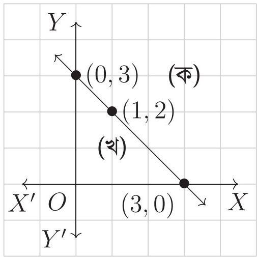
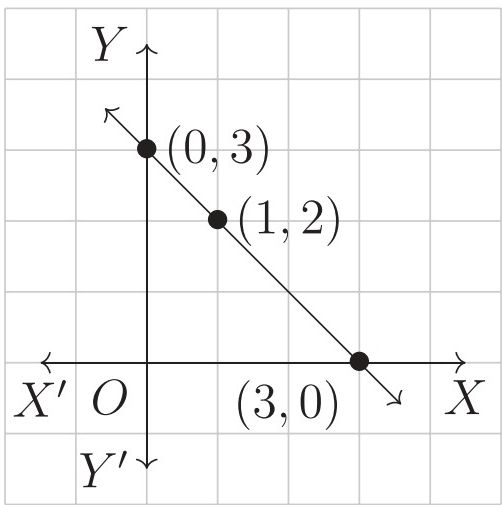
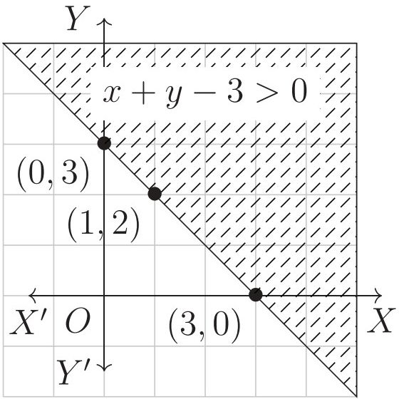
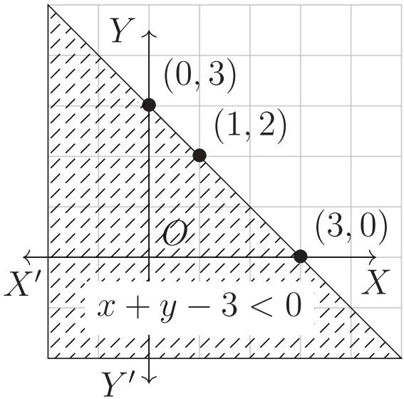
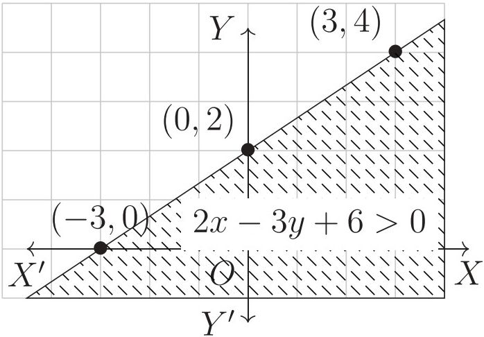
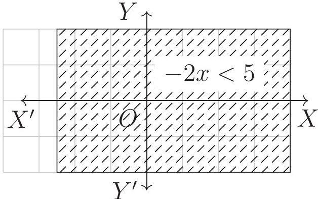
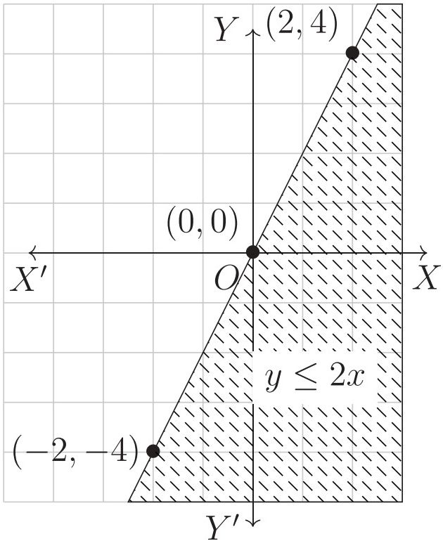

# 6. অসমতা

Source: Higher Math Bangla Version, printed pp. 123-135

## 6.0 ভূমিকা ও শিখনফল

<!-- higher-math-9-10-bn-c06-t6.0-p001 · text · p.123 -->
সমীকরণ বা সমতা সম্পর্কে আমাদের ধারণা হয়েছে। কিন্তু বাস্তব জীবনে অসমতারও একটা বিস্তৃত ও গুরুত্বপূর্ণ ভূমিকা রয়েছে।

<!-- higher-math-9-10-bn-c06-t6.0-p002 · text · p.123 -->
এ অধ্যায় শেষে শিক্ষার্থীরা -

<!-- higher-math-9-10-bn-c06-t6.0-p003 · text · p.123 -->
* এক ও দুই চলকের এক ঘাতবিশিষ্ট অসমতা ব্যাখ্যা করতে পারবে ;
* দুই চলকবিশিষ্ট সরল অসমতা গঠন ও সমাধান করতে পারবে ;
* বাস্তবভিত্তিক গাণিতিক সমস্যায় অসমতা ব্যবহার করে সমাধান করতে পারবে ;
* এক ও দুই চলকবিশিষ্ট অসমতাকে লেখাচিত্রের সাহায্যে সমাধান করতে পারবে।

### অসমতার ধারণা

<!-- higher-math-9-10-bn-c06-t6.0-p004 · text · p.123 · review: verify-formula -->
মনে করি একটি ক্লাসের ছাত্রসংখ্যা 200 জন। স্বাভাবিকভাবে দেখা যায় যে, ঐ ক্লাসে সবদিন সকলে উপস্থিত থাকে না, সকলে অনুপস্থিতও থাকে না। একটি নির্দিষ্ট দিনে উপস্থিত ছাত্র সংখ্যা $x$ হলে আমরা লিখতে পারি $0 < x < 200$। একইভাবে আমরা দেখি যে, কোনো নির্মিত অনুষ্ঠানেই সবাই উপস্থিত হয় না। পোশাক-পরিচ্ছদ ও অন্যান্য অনেক ভোগ্যপণ্য তৈরিতে পরিকারভাবে অসমতার ধারণা প্রয়োজন হয়। দালান তৈরির ক্ষেত্রে, পুস্তক মুদ্রণের ক্ষেত্রে এবং এরকম আরও অনেক ক্ষেত্রে উপাদানগুলো সঠিক পরিমাণে নির্ণয় করা যায় না বিধায় প্রথম পর্যায়ে অনুমানের ভিত্তিতে উপাদানগুলো কয় বা সংগ্রহ করতে হয়। অতএব দেখা যাচ্ছে যে, আমাদের দৈনন্দিন জীবনে অসমতার ধারণাটা খুবই গুরুত্বপূর্ণ।

### বাস্তব সংখ্যার ক্ষেত্রে

<!-- higher-math-9-10-bn-c06-t6.0-p005 · text · p.123 · review: verify-formula -->
$a > b$ যদি ও কেবল যদি $(a - b)$ ধনাত্মক অর্থাৎ $(a - b) > 0$

<!-- higher-math-9-10-bn-c06-t6.0-p006 · text · p.123 · review: verify-formula -->
$a < b$ যদি ও কেবল যদি $(a - b)$ ঋণাত্মক অর্থাৎ $(a - b) < 0$

### অসমতার কয়েকটি বিধি:

<!-- higher-math-9-10-bn-c06-t6.0-p007 · text · p.123 · review: verify-formula -->
ক) $a < b \iff b > a$

<!-- higher-math-9-10-bn-c06-t6.0-p008 · text · p.123 · review: verify-formula -->
খ) $a > b$ হলে যেকোনো $c$ এর জন্য

<!-- higher-math-9-10-bn-c06-t6.0-p009 · formula · p.124 · review: verify-formula -->
$$a + c > b + c  এবং  a - c > b - c$$

<!-- higher-math-9-10-bn-c06-t6.0-p010 · text · p.124 · review: verify-formula -->
গ) $a > b$ হলে যেকোনো $c$ এর জন্য

<!-- higher-math-9-10-bn-c06-t6.0-p011 · formula · p.124 · review: latin-junk,verify-formula -->
$$ac > bc  এবং  \frac{a}{c} > \frac{b}{c}  যখন  c > 0$$

<!-- higher-math-9-10-bn-c06-t6.0-p012 · formula · p.124 · review: latin-junk,verify-formula -->
$$ac < bc  এবং  \frac{a}{c} < \frac{b}{c}  যখন  c < 0$$

<!-- higher-math-9-10-bn-c06-t6.0-p013 · text · p.124 · review: verify-formula -->
**উদাহরণ ১.** $x < 2$ হলে

<!-- higher-math-9-10-bn-c06-t6.0-p014 · text · p.124 · review: verify-formula -->
ক) $x + 2 < 4$ [উভয়পক্ষে ২ যোগ করে]

<!-- higher-math-9-10-bn-c06-t6.0-p015 · text · p.124 · review: verify-formula -->
খ) $x - 2 < 0$ [উভয়পক্ষে ২ বিয়োগ করে]

<!-- higher-math-9-10-bn-c06-t6.0-p016 · text · p.124 · review: verify-formula -->
গ) $2x < 4$ [উভয়পক্ষকে ২ দ্বারা গুণ করে]

<!-- higher-math-9-10-bn-c06-t6.0-p017 · text · p.124 · review: verify-formula -->
ঘ) $-3x > -6$ [উভয়পক্ষকে $-3$ দ্বারা গুণ করে]

<!-- higher-math-9-10-bn-c06-t6.0-p018 · text · p.124 -->
এখানে উল্লেখ্য যে,

<!-- higher-math-9-10-bn-c06-t6.0-p019 · text · p.124 · review: verify-formula -->
$a \ge b$ এর অর্থ $a > b$ অথবা $a = b$

<!-- higher-math-9-10-bn-c06-t6.0-p020 · text · p.124 · review: verify-formula -->
$a \le b$ এর অর্থ $a < b$ অথবা $a = b$

<!-- higher-math-9-10-bn-c06-t6.0-p021 · text · p.124 · review: verify-formula -->
$a < b < c$ এর অর্থ $a < b$ এবং $b < c$ যার অর্থ $a < c$

<!-- higher-math-9-10-bn-c06-t6.0-p022 · text · p.124 · review: verify-formula -->
**উদাহরণ ২.** $3 \ge 1$ সত্য যেহেতু $3 > 1$

<!-- higher-math-9-10-bn-c06-t6.0-p023 · text · p.124 · review: verify-formula -->
$2 \le 4$ সত্য যেহেতু $2 < 4$

<!-- higher-math-9-10-bn-c06-t6.0-p024 · text · p.124 · review: verify-formula -->
$2 < 3 < 4$ সত্য যেহেতু $2 < 3$ এবং $3 < 4$

<!-- higher-math-9-10-bn-c06-t6.0-p025 · text · p.124 -->
**কাজ:**

<!-- higher-math-9-10-bn-c06-t6.0-p026 · text · p.124 -->
ক) তোমাদের শ্রেণির যে সকল ছাত্র-ছাত্রীর উচ্চতা ৫ ফুটের চেয়ে বেশি এবং ৫ ফুটের চেয়ে কম তাদের উচ্চতা অসমতার মাধ্যমে প্রকাশ করো।

<!-- higher-math-9-10-bn-c06-t6.0-p027 · text · p.124 -->
খ) কোনো পরীক্ষার মোট নম্বর 1000 হলে, একজন পরীক্ষার্থীর প্রাপ্ত নম্বর অসমতার মাধ্যমে প্রকাশ করো।

<!-- higher-math-9-10-bn-c06-t6.0-p028 · text · p.124 · review: verify-formula -->
**উদাহরণ ৩.** সমাধান করো ও সমাধান সেটটি সংখ্যারেখায় দেখাও: $4x + 4 > 16$

<!-- higher-math-9-10-bn-c06-t6.0-p029 · text · p.124 · review: verify-formula -->
**সমাধান:** দেওয়া আছে, $4x + 4 > 16$

<!-- higher-math-9-10-bn-c06-t6.0-p030 · text · p.124 · review: verify-formula -->
বা, $4x + 4 - 4 > 16 - 4$ [উভয়পক্ষ থেকে ৪ বিয়োগ করে]

<!-- higher-math-9-10-bn-c06-t6.0-p031 · text · p.124 · review: verify-formula -->
বা, $4x > 12$

<!-- higher-math-9-10-bn-c06-t6.0-p032 · text · p.124 · review: verify-formula -->
বা, $\frac{4x}{4} > \frac{12}{4}$ [উভয়পক্ষকে ৪ দ্বারা ভাগ করে] বা, $x > 3$

<!-- higher-math-9-10-bn-c06-t6.0-p033 · text · p.125 · review: known-confusable-corrected,verify-formula -->
$\therefore$ নির্ণেয় সমাধান $x > 3$

<!-- higher-math-9-10-bn-c06-t6.0-p034 · text · p.125 · review: verify-formula -->
এখানে সমাধান সেট, $S = \{x \in R : x > 3\}$

<!-- higher-math-9-10-bn-c06-t6.0-p035 · text · p.125 -->
সমাধান সেটটি নিচে অঙ্কিত সংখ্যারেখায় দেখানো হলো।

<!-- higher-math-9-10-bn-c06-t6.0-p036 · figure · p.125 -->
drawing: number line showing the solution set x > 3

<!-- higher-math-9-10-bn-c06-t6.0-p037 · text · p.125 · review: verify-formula -->
**উদাহরণ ৪.** সমাধান করো এবং সমাধান সেট সংখ্যারেখায় দেখাও: $x - 9 > 3x + 1$

<!-- higher-math-9-10-bn-c06-t6.0-p038 · text · p.125 · review: verify-formula -->
**সমাধান:** দেওয়া আছে, $x - 9 > 3x + 1$

<!-- higher-math-9-10-bn-c06-t6.0-p039 · text · p.125 · review: verify-formula -->
বা, $x - 9 + 9 > 3x + 1 + 9$

<!-- higher-math-9-10-bn-c06-t6.0-p040 · text · p.125 · review: verify-formula -->
বা, $x > 3x + 10$

<!-- higher-math-9-10-bn-c06-t6.0-p041 · text · p.125 · review: verify-formula -->
বা, $x - 3x > 3x + 10 - 3x$

<!-- higher-math-9-10-bn-c06-t6.0-p042 · text · p.125 · review: verify-formula -->
বা, $-2x > 10$

<!-- higher-math-9-10-bn-c06-t6.0-p043 · text · p.125 · review: verify-formula -->
বা, $\frac{-2x}{-2} < \frac{10}{-2}$ [উভয়পক্ষকে $-2$ দ্বারা ভাগ করায় অসমতার দিক পাল্টে গেছে]

<!-- higher-math-9-10-bn-c06-t6.0-p044 · text · p.125 · review: verify-formula -->
বা, $x < -5$

<!-- higher-math-9-10-bn-c06-t6.0-p045 · text · p.125 · review: known-confusable-corrected,verify-formula -->
$\therefore$ নির্ণেয় সমাধান $x < -5$

<!-- higher-math-9-10-bn-c06-t6.0-p046 · text · p.125 -->
সমাধান সেটটি নিচে অঙ্কিত সংখ্যা রেখায় দেখানো হলো।

<!-- higher-math-9-10-bn-c06-t6.0-p047 · figure · p.125 -->
drawing: number line showing the solution set x < -5

<!-- higher-math-9-10-bn-c06-t6.0-p048 · text · p.125 -->
**বিশেষ দ্রষ্টব্য:** সমীকরণের সমাধান যেমন একটি সমীকরণ (সমতা) দ্বারা প্রকাশ পায়, তেমনি অসমতার সমাধান একটি অসমতা দ্বারা প্রকাশ পায়। অসমতার সমাধান সেট (সাধারণত) বাস্তব সংখ্যার অসীম উপসেট।

<!-- higher-math-9-10-bn-c06-t6.0-p049 · text · p.125 · review: verify-formula -->
**উদাহরণ ৫.** সমাধান করো: $a(x + b) < c, [a \neq 0]$

<!-- higher-math-9-10-bn-c06-t6.0-p050 · text · p.125 · review: verify-formula -->
**সমাধান:** $a$ ধনাত্মক হলে, $\frac{a(x + b)}{a} < \frac{c}{a}$ [উভয়পক্ষকে $a$ দ্বারা ভাগ করে]

<!-- higher-math-9-10-bn-c06-t6.0-p051 · text · p.125 · review: verify-formula -->
বা, $x + b < \frac{c}{a}$ বা, $x < \frac{c}{a} - b$

<!-- higher-math-9-10-bn-c06-t6.0-p052 · text · p.125 · review: verify-formula -->
$a$ ঋণাত্মক হলে একই প্রক্রিয়ায় পাই, $\frac{a(x + b)}{a} > \frac{c}{a}$

<!-- higher-math-9-10-bn-c06-t6.0-p053 · text · p.125 · review: verify-formula -->
বা, $x + b > \frac{c}{a}$ বা, $x > \frac{c}{a} - b$

<!-- higher-math-9-10-bn-c06-t6.0-p054 · text · p.125 · review: known-confusable-corrected,verify-formula -->
$\therefore$ নির্ণেয় সমাধান: $(i) x < \frac{c}{a} - b$ যদি $a > 0$ হয়, $(ii) x > \frac{c}{a} - b$ যদি $a < 0$ হয়।

<!-- higher-math-9-10-bn-c06-t6.0-p055 · text · p.126 · review: verify-formula -->
বিশেষ দ্রষ্টব্য: $a$ যদি শূন্য এবং $c$ যদি ধনাত্মক হয়, তবে $x$ এর যেকোনো মানের জন্য অসমতাটি সত্য হবে। কিন্তু $a$ যদি শূন্য এবং $c$ ঋণাত্মক হয়, তবে অসমতাটির কোনো সমাধান থাকবে না।

## 6.ex অনুশীলনী ৬.১

<!-- higher-math-9-10-bn-c06-t6.ex-p001 · exercise · p.126 -->
অসমতাগুলো সমাধান করো এবং সংখ্যারেখায় সমাধান সেট দেখাও:

<!-- higher-math-9-10-bn-c06-t6.ex-p002 · exercise · p.126 · review: verify-formula -->
১. $y - 3 < 5$
২. $3(x - 2) < 6$
৩. $3x - 2 > 2x - 1$
৪. $z \le \frac{1}{2}z + 3$
৫. $8 \ge 2 - 2x$
৬. $x \le \frac{x}{3} + 4$
৭. $5(3 - 2t) \le 3(4 - 3t)$
৮. $\frac{x}{3} + \frac{x}{4} + \frac{x}{5} > \frac{47}{60}$

### অনুশীলনী ৬.২

<!-- higher-math-9-10-bn-c06-t6.ex-p003 · exercise · p.127 · review: verify-formula -->
১-৫ পর্যন্ত সমস্যাগুলো অসমতার মাধ্যমে প্রকাশ করো এবং $x$ এর সম্ভাব্য মান নির্ণয় করো।

<!-- higher-math-9-10-bn-c06-t6.ex-p004 · exercise · p.127 · review: verify-formula -->
১. এক বালক ঘণ্টায় $x$ কি.মি. বেগে ৩ ঘণ্টা হাঁটল এবং ঘণ্টায় $(x + 2)$ কি.মি. বেগে $\frac{1}{2}$ ঘণ্টা দৌড়াল এবং তার অতিক্রান্ত পথ 29 কি.মি. এর কম।

<!-- higher-math-9-10-bn-c06-t6.ex-p005 · exercise · p.127 · review: verify-formula -->
২. একটি বোর্ডিংয়ে রোজ $4x$ কেজি চাল এবং $(x - 3)$ কেজি ডাল লাগে এবং চাল ও ডাল মিলে 40 কেজির বেশি লাগে না।

<!-- higher-math-9-10-bn-c06-t6.ex-p006 · exercise · p.127 · review: verify-formula -->
৩. সোহরাব সাহেব 70 টাকা কেজি দরে $x$ কেজি আম কিনলেন। তিনি বিক্রিতাকে 500 টাকার একখানা নোট দিলেন। বিক্রিতা 20 টাকার $x$ খানা নোটসহ বাকি টাকা ফেরত দিলেন।

<!-- higher-math-9-10-bn-c06-t6.ex-p007 · exercise · p.127 · review: verify-formula -->
৪. একটি গাড়ি ৪ ঘণ্টায় যায় $x$ কি.মি. এবং ৫ ঘণ্টায় যায় $(x + 120)$ কি.মি.। গাড়িটির গড় গতিবেগ ঘণ্টায় 100 কি.মি. এর বেশি নয়।

<!-- higher-math-9-10-bn-c06-t6.ex-p008 · exercise · p.127 · review: verify-formula -->
৫. এক টুকরা কাগজের ক্ষেত্রফল 40 বর্গ সে.মি.। তা থেকে $x$ সে.মি. দীর্ঘ এবং ৫ সে.মি. প্রস্থ বিশিষ্ট আয়তাকার কাগজ কেটে নেওয়া হলো।

<!-- higher-math-9-10-bn-c06-t6.ex-p009 · exercise · p.127 -->
৬. পুত্রের বয়স মাতার বয়সের এক-তৃতীয়াংশ। পিতা মাতার চেয়ে ৬ বছরের বড়ো। তিনজনের বয়সের সমষ্টি অনূর্ধ্ব 90 বছর। পিতার বয়স অসমতার মাধ্যমে প্রকাশ করো।

<!-- higher-math-9-10-bn-c06-t6.ex-p010 · exercise · p.127 -->
৭. জেনি 14 বছর বয়সে জুনিয়র বৃত্তি পরীক্ষা দিয়েছিল। 17 বছর বয়সে সে এস.এস.সি. পরীক্ষা দিবে। তার বর্তমান বয়স অসমতায় প্রকাশ করো।

<!-- higher-math-9-10-bn-c06-t6.ex-p011 · exercise · p.127 -->
৮. একখানি জেট প্লেনের গতি প্রতি সেকেন্ডে সর্বাধিক 300 মিটার। প্লেনটি 15 কি.মি. যাওয়ার প্রয়োজনীয় সময় অসমতায় প্রকাশ করো।

<!-- higher-math-9-10-bn-c06-t6.ex-p012 · exercise · p.127 -->
৯. ঢাকা থেকে সিঙ্গাপুর বিমানপথে দূরত্ব 2900 কি.মি.। জেট বিমানের সর্বোচ্চ গতিবেগ ঘণ্টায় 900 কি.মি.। কিন্তু ঢাকা থেকে সিঙ্গাপুর যাবার পথে প্রতিকূল দিকে ঘণ্টায় 100 কি.মি. বেগ বায়ু প্রবাহের সম্মুখীন হতে হয়। ঢাকা থেকে সিঙ্গাপুর বিরতিহীন উড্ডয়নের প্রয়োজনীয় সময় একটি অসমতার মাধ্যমে প্রকাশ করো।

<!-- higher-math-9-10-bn-c06-t6.ex-p013 · exercise · p.128 -->
১০. পূর্ববর্তী প্রশ্নের সূত্র ধরে, সিঙ্গাপুর থেকে ঢাকা ফেরার পথে উডডয়নের প্রয়োজনীয় সময় একটি অসমতার মাধ্যমে প্রকাশ করো।

<!-- higher-math-9-10-bn-c06-t6.ex-p014 · exercise · p.128 -->
১১. কোনো ধনাত্মক পূর্ণ সংখ্যার ৫ গুণ, সংখ্যাটির দ্বিগুণ এবং ১৫ এর সমষ্টি অপেক্ষা ছোটো। সংখ্যাটির সন্ন্য মান অসমতায় প্রকাশ করো।

### অনুশীলনী ৬.৩

<!-- higher-math-9-10-bn-c06-t6.ex-p015 · exercise · p.133 · review: verify-formula -->
১. $5x + 5 > 25$ অসমতাটির সমাধান সেট কোনটি?
ক) $S = \{x \in R : x > 4\}$
গ) $S = \{x \in R : x \le 4\}$
খ) $S = \{x \in R : x < 4\}$
ঘ) $S = \{x \in R : x \ge 4\}$

<!-- higher-math-9-10-bn-c06-t6.ex-p016 · exercise · p.133 · review: verify-formula -->
২. $x + y = -2$ সমীকরণটিতে $x$ এর কোন মানের জন্য $y = 0$ হবে?
ক) 2
খ) 0
গ) 4
ঘ) -2

<!-- higher-math-9-10-bn-c06-t6.ex-p017 · exercise · p.133 · review: verify-formula -->
৩. নিচের প্রত্যেক অসমতার সমাধান সেটের লেখচিত্র অঙ্কন **করো:**
ক) $x - y > -10$
গ) $3x - y \ge 0$
ঙ) $y < -2$
ছ) $y > x + 2$
ঝ) $y \ge 2x$
খ) $2x - y < 6$
ঘ) $3x - 2y \le 12$
চ) $x \ge 4$
জ) $y < x + 2$
এও) $x + 3y < 0$

<!-- higher-math-9-10-bn-c06-t6.ex-p018 · exercise · p.133 -->
৪. দুটি সংখ্যার ১ম সংখ্যাটির ৩ গুণ থেকে ২য় সংখ্যাটির ৫ গুণ বিয়োগ করলে ৫ অপেক্ষা বৃহত্তর হয়। আবার ১ম সংখ্যা থেকে ২য় সংখ্যার ৩ গুণ বিয়োগ করলে অনূর্ধ্ব ৯ হয়।
ক) উদ্দীপকের সমস্যাগুলোকে অসমতায় দেখাও।
খ) ১ম সংখ্যাটির ৫ গুণ, ১ম সংখ্যার দ্বিগুণ এবং ১৫ এর সমষ্টি অপেক্ষা ছোটো হলে সংখ্যাটির সন্ন্যায় মান অসমতায় প্রকাশ **করো**।
গ) ক) এ প্রাপ্ত অসমতা যুগলের সমাধান সেটের লেখচিত্র অঙ্কন **করো**।

<!-- higher-math-9-10-bn-c06-t6.ex-p019 · exercise · p.133 -->
৫. একটি কলম, একটি রাবার ও একটি খাতার মূল্য 100 টাকা। খাতার মূল্য দুটি কলমের মূল্যের থেকে বেশি। তিনটি কলমের মূল্য চারটি রাবারের থেকে বেশি এবং তিনটি রাবারের মূল্য একটি খাতার মূল্যের থেকে বেশি। যদি সকল মূল্যই পূর্ণ টাকায় হয় তাহলে প্রত্যেকটির মূল্য কত?

<!-- higher-math-9-10-bn-c06-t6.ex-p020 · exercise · p.133 -->
৬. তিনটি পূর্ণসংখ্যার গুণফল 720 হলে সবচেয়ে ছোটো সংখ্যাটি কত বড়ো হতে পারে?

<!-- higher-math-9-10-bn-c06-t6.ex-p021 · exercise · p.133 · review: known-confusable-corrected -->
৭. একটি সমদ্বিবাহু ত্রিভুজের কোনো একটি কোণের সমদ্বিখণ্ডক দিয়ে ত্রিভুজকে দুটি সমদ্বিবাহু ত্রিভুজে বিভক্ত করা হলো। প্রথম সমদ্বিবাহু ত্রিভুজের একটি কোণ কত বড়ো হতে পারে? প্রথম সমদ্বিবাহু ত্রিভুজের একটি কোণ কত ছোটো হতে পারে?

<!-- higher-math-9-10-bn-c06-t6.ex-p022 · exercise · p.134 -->
৮. একটি আয়তাকার ঘরে এক বর্গ মিটার ক্ষেত্রফলের ৭ টি টেবিল বসানো যায়। ঘরের পরিসীমা ১৬ মিটার। তার দৈর্ঘ্য ও প্রস্থ কত হতে পারে?

<!-- higher-math-9-10-bn-c06-t6.ex-p023 · exercise · p.134 -->
৯. এমন কোনো ত্রিভুজ আছে কি যার কোনো শীর্ষ থেকে অঙ্কিত উচ্চতাই ১ সে.মি. এর বেশি নয় কিন্তু ক্ষেত্রফল ১০০ বর্গ সে.মি.?

<!-- higher-math-9-10-bn-c06-t6.ex-p024 · exercise · p.134 -->
১০. সতেজ ও সজীব জমজ ভাই। তাদের দৌড়ানোর বেগ সমান এবং হাঁটার বেগও সমান। একদিন স্কুলে যেতে সতেজ অর্ধেক পথ হাঁটিল আর বাকি অর্ধেক দৌড়াল। কিন্তু সজীব অর্ধেক সময় হাঁটিল আর বাকি অর্ধেক সময় দৌড়াল। স্কুলে যেতে কি তাদের সমান সময় লাগবে?

### বহুনির্বাচনি প্রশ্ন

<!-- higher-math-9-10-bn-c06-t6.ex-p025 · exercise · p.134 · review: verify-formula -->
১. $2xy + y = 3$ সমীকরণটির সঠিক স্থানাংক কোনগুলো?
ক) $(1, -1), (2, -1)$
খ) $(1, 1), (-1, -3)$
গ) $(1, 1), (-2, 1)$
ঘ) $(-1, 1), (2, -1)$

<!-- higher-math-9-10-bn-c06-t6.ex-p026 · exercise · p.134 · review: verify-formula -->
২. $a, b$ ও $c$ তিনটি বাস্তব সংখ্যা। $a > b$ এবং $c \neq 0$ হলে
(i) $ac > bc$ যখন $c > 0$
(ii) $ac < bc$ যখন $c < 0$
(iii) $\frac{a}{c} > \frac{b}{c}$ যখন $c > 0$
নিচের কোনটি সঠিক?
ক) $i, ii$
খ) $i, iii$
গ) $ii, iii$
ঘ) $i, ii$ ও $iii$

<!-- higher-math-9-10-bn-c06-t6.ex-p027 · exercise · p.134 · review: verify-formula -->
নিম্নোক্ত অসমতাটি থেকে ৩ ও ৪ নম্বর প্রশ্নের উত্তর দাও:
$$x \leq \frac{x}{4} + 3$$

<!-- higher-math-9-10-bn-c06-t6.ex-p028 · exercise · p.134 · review: verify-formula -->
৩. অসমতাটির সমাধান সেট কোনটি?
ক) $S = \{x \in R : x > 4\}$
খ) $S = \{x \in R : x < 4\}$
গ) $S = \{x \in R : x \leq 4\}$
ঘ) $S = \{x \in R : x \geq 4\}$

<!-- higher-math-9-10-bn-c06-t6.ex-p029 · exercise · p.134 -->
৪. অসমতাটির সমাধান সেটের সংখ্যা রেখা কোনটি?

<!-- higher-math-9-10-bn-c06-t6.ex-p030 · exercise · p.134 · review: latin-junk -->
ক) drawing: number line with open circle at 4

<!-- higher-math-9-10-bn-c06-t6.ex-p031 · exercise · p.134 · review: latin-junk -->
খ) drawing: number line with closed circle at 4

<!-- higher-math-9-10-bn-c06-t6.ex-p032 · exercise · p.135 · review: latin-junk -->
গ) drawing: number line with a solid circle at 4 and an arrow pointing left

<!-- higher-math-9-10-bn-c06-t6.ex-p033 · exercise · p.135 · review: latin-junk -->
ঘ) drawing: number line with a hollow circle at 4 and an arrow pointing right

### সৃজনশীল প্রশ্ন

<!-- higher-math-9-10-bn-c06-t6.ex-p034 · exercise · p.135 · review: known-confusable-corrected -->
৫. হজরত শাহজালাল বিমানবন্দর থেকে সিঙ্গাপুর বিমানবন্দরের দূরত্ব ২৯০০ কি.মি.। বাংলাদেশ বিমানের সর্বোচ্চ গতিবেগ ৫০০ কি.মি./ঘণ্টা। কিন্তু হজরত শাহজালাল বিমানবন্দর থেকে সিঙ্গাপুর যাবার পথে প্রতিকূলে ৬০ কি.মি./ঘণ্টা বেগে বায়ুপ্রবাহের সম্মুখীন হয়।

<!-- higher-math-9-10-bn-c06-t6.ex-p035 · exercise · p.135 · review: known-confusable-corrected,verify-formula -->
ক) $10(3 - 2x) \ge 6(4 - 3x)$ অসমতাটি সমাধান করে সংখ্যারেখায় সমাধান সেট দেখাও।

<!-- higher-math-9-10-bn-c06-t6.ex-p036 · exercise · p.135 · review: known-confusable-corrected -->
খ) হজরত শাহজালাল বিমানবন্দর থেকে সিঙ্গাপুর বিমানবন্দর পর্যন্ত বিরতিহীন উড্ডয়নের প্রয়োজনীয় সময় ১০ক তে বর্ণিত অসমতা থেকে নির্ণয় কর এবং সংখ্যা রেখায় দেখাও।

<!-- higher-math-9-10-bn-c06-t6.ex-p037 · exercise · p.135 · review: known-confusable-corrected,verify-formula -->
গ) সিঙ্গাপুর থেকে হজরত শাহজালাল বিমানবন্দরে ফেরার পথে বিরতিহীন উড্ডয়নের প্রয়োজনীয় সময়কে $x$ ধরে সমস্যাকে অসমতার মাধ্যমে প্রকাশ করে লেখাচিত্রের সাহায্যে সমাধান <mark>করো।</mark>

### সংক্ষিপ্ত-উত্তর প্রশ্ন

<!-- higher-math-9-10-bn-c06-t6.ex-p038 · exercise · p.135 · review: verify-formula -->
৬. (ক) $y < 3$ অসমতার সমাধান সেটের লেখাচিত্র অঙ্কন <mark>করো।</mark>

<!-- higher-math-9-10-bn-c06-t6.ex-p039 · exercise · p.135 · review: verify-formula -->
(খ) রিতা, মিতা ও বীথির বয়স যথাক্রমে $x$ বছর, $2x$ বছর, $3x$ বছর এবং তাদের তিনজনের বয়সের সমষ্টি অনুধাব ৫৪ বছর হলে, মিতার বয়স সর্বোচ্চ কত হতে পারে নির্ণয় <mark>করো।</mark>

<!-- higher-math-9-10-bn-c06-t6.ex-p040 · exercise · p.135 · review: verify-formula -->
(গ) এক টুকরা কাগজের ক্ষেত্রফল ৪৮ বর্গসেমি এবং তা থেকে $x$ সেমি দৈর্ঘ্য এবং ৬ সেমি প্রস্থ বিশিষ্ট একটি আয়তাকার কাগজ কেটে নেওয়া হলে, $x$ এর সন্ন্যব্য মান নির্ণয় <mark>করো।</mark>

<!-- higher-math-9-10-bn-c06-t6.ex-p041 · exercise · p.135 -->
(ঘ) কোনো স্বাভাবিক সংখ্যার ৫ গুণ, সংখ্যাটির তিনগুণ এবং ১২এর সমষ্টি অপেক্ষা ছোট। সংখ্যাটির সন্ন্যব্য মানগুলো নির্ণয় <mark>করো।</mark>

## 6.1 অসমতার ব্যবহার

<!-- higher-math-9-10-bn-c06-t6.1-p001 · text · p.126 -->
সমীকরণের সাহায্যে তোমরা সমস্যা সমাধান করতে শিখেছ। একই পদ্ধতিতে অসমতা সম্পর্কিত সমস্যার সমাধান করতে পারবে।

<!-- higher-math-9-10-bn-c06-t6.1-p002 · text · p.126 · review: verify-formula -->
**উদাহরণ ৬.** কোনো পরীক্ষায় বাংলা ১ম ও ২য় পত্র রমা পেয়েছে যথাক্রমে $5x$ এবং $6x$ নম্বর এবং কুমকুম পেয়েছে $4x$ এবং ৮৪ নম্বর। কোনো পত্র কেউ ৪০ এর নিচে পায়নি। বাংলা বিষয়ে কুমকুম হয়েছে প্রথম এবং রমা হয়েছে দ্বিতীয়। $x$ এর মান সন্বায় অসমতার মাধ্যমে প্রকাশ করো।

<!-- higher-math-9-10-bn-c06-t6.1-p003 · text · p.126 · review: verify-formula -->
**সমাধান:** রমা পেয়েছে মোট $5x + 6x$ নম্বর এবং কুমকুম পেয়েছে মোট $4x + 84$ নম্বর।

<!-- higher-math-9-10-bn-c06-t6.1-p004 · text · p.126 · review: verify-formula -->
প্রশ্নমতে, $5x + 6x < 4x + 84$

<!-- higher-math-9-10-bn-c06-t6.1-p005 · text · p.126 · review: verify-formula -->
বা, $5x + 6x - 4x < 84$ বা, $7x < 84$

<!-- higher-math-9-10-bn-c06-t6.1-p006 · text · p.126 · review: verify-formula -->
বা, $x < \frac{84}{7}$ বা, $x < 12$

<!-- higher-math-9-10-bn-c06-t6.1-p007 · text · p.126 · review: verify-formula -->
কিন্তু, $4x \ge 40$ [প্রাপ্ত সর্বনিম্ন নম্বর ৪০] বা, $x \ge 10$ বা, $10 \le x$

<!-- higher-math-9-10-bn-c06-t6.1-p008 · formula · p.126 · review: verify-formula -->
$\therefore 10 \le x < 12$

<!-- higher-math-9-10-bn-c06-t6.1-p009 · text · p.126 · review: verify-formula -->
**উদাহরণ ৭.** একজন ছাত্র ৫ টাকা দরে $x$ টি পেনসিল এবং ৪ টাকা দরে $(x + 4)$ টি খাতা কিনেছে। মোট মূল্য অনুযায়ী ৯৭ টাকা হলে, সর্বাধিক কয়টি পেনসিল কিনেছে?

<!-- higher-math-9-10-bn-c06-t6.1-p010 · text · p.126 · review: verify-formula -->
**সমাধান:** $x$ টি পেনসিলের দাম $5x$ টাকা এবং $x + 4$ টি খাতার দাম $8(x + 4)$ টাকা।

<!-- higher-math-9-10-bn-c06-t6.1-p011 · text · p.126 · review: verify-formula -->
প্রশ্নমতে, $5x + 8(x + 4) \le 97$

<!-- higher-math-9-10-bn-c06-t6.1-p012 · text · p.126 · review: verify-formula -->
বা, $5x + 8x + 32 \le 97$

<!-- higher-math-9-10-bn-c06-t6.1-p013 · text · p.126 · review: verify-formula -->
বা, $13x \le 65$ বা, $x \le \frac{65}{13}$

<!-- higher-math-9-10-bn-c06-t6.1-p014 · text · p.127 · review: verify-formula -->
বা, $x \le 5$

<!-- higher-math-9-10-bn-c06-t6.1-p015 · text · p.127 · review: verify-formula -->
$\therefore$ ছাত্রটি সর্বাধিক ৫ টি পেনসিল কিনেছে।

<!-- higher-math-9-10-bn-c06-t6.1-p016 · text · p.127 · review: verify-formula -->
**কাজ:** 140 টাকা কেজি দরে জনাব ডেভিড $x$ কেজি আপেল কিনলেন। তিনি বিক্রিতাকে 1000 টাকার একখানা নোট দিলেন। বিক্রিতা 50 টাকার $x$ খানা নোটসহ বাকি টাকা ফেরত দিলেন। সমস্যাটিকে অসমতার মাধ্যমে প্রকাশ করো এবং $x$ এর সম্ভাব্য মান নির্ণয় করো।

## 6.2 দুই চলকবিশিষ্ট সরল একঘাত অসমতা

<!-- higher-math-9-10-bn-c06-t6.2-p001 · text · p.128 · review: verify-formula -->
আমরা দুই চলকবিশিষ্ট $y = mx + c$ (যার সাধারণ আকার $ax + by + c = 0$) আকারের সরল সমীকরণের লেখচিত্র অঙ্কন করতে শিখেছি (অষ্টম ও নবম-দশম শ্রেণিতে)। আমরা দেখেছি যে, এ রকম প্রত্যেক লেখচিত্রই একটি সরলরেখা। স্থানাঙ্কায়িত $XY$ সমতলে $ax + by + c = 0$ সমীকরণের লেখচিত্রের যেকোনো বিন্দুর স্থানাঙ্ক সমীকরণটিকে সিদ্ধ করে অর্থাৎ সমীকরণটির বামপক্ষে $x$ ও $y$ এর পরিবর্তে যথাক্রমে ঐ বিন্দুর ভুজ ও কোটি বসালে এর মান শূন্য হয়। অন্যদিকে, লেখস্থিত নয় এমন কোনো বিন্দুর স্থানাঙ্ক সমীকরণটিকে সিদ্ধ করে না অর্থাৎ ঐ বিন্দুর ভুজ ও কোটির জন্য $ax + by + c$ এর মান শূন্য অপেক্ষা বড়ো বা ছোটো হয়। সমতলস্থ কোনো বিন্দু $P$ এর ভুজ ও কোটি দ্বারা $ax + by + c$ রাশির $x$ ও $y$ কে যথাক্রমে প্রতিস্থাপন করলে রাশিটির যে মান হয়, তাকে $P$ বিন্দুতে রাশিটির মান বলা হয় এবং উক্ত মানকে সাধারণত $f(P)$ দ্বারা নির্দেশ করা হয়। $P$ বিন্দু লেখস্থিত হলে $f(P) = 0$, $P$ বিন্দু লেখচিত্রের বাহিঃস্থ হলে $f(P) > 0$ অথবা $f(P) < 0$।

<!-- higher-math-9-10-bn-c06-t6.2-p002 · text · p.128 · review: verify-formula -->
বাস্তবে লেখচিত্রের বাহিঃস্থ সকল বিন্দু লেখ দ্বারা দুইটি অর্ধতলে বিভক্ত হয়; একটি অর্ধতলের প্রত্যেক বিন্দু $P$ এর জন্য $f(P) > 0$; অপর অর্ধতলের প্রত্যেক বিন্দু $P$ এর জন্য $f(P) < 0$। বলা বাহুল্য, লেখের উপর অবস্থিত প্রত্যেক বিন্দু $P$ এর জন্য $f(P) = 0$।

<!-- higher-math-9-10-bn-c06-t6.2-p003 · text · p.128 · review: verify-formula -->
**উদাহরণ ৮.** $x + y - 3 = 0$ সমীকরণটি বিবেচনা করি।

<!-- higher-math-9-10-bn-c06-t6.2-p004 · text · p.128 · review: verify-formula -->
সমীকরণটি থেকে পাওয়া যায়: $y = 3 - x$

<!-- higher-math-9-10-bn-c06-t6.2-p005 · table · p.128 · review: verify-table -->
<table><tr><td><em>x</em></td><td>0</td><td>3</td><td>1</td></tr>
<tr><td><em>y</em></td><td>3</td><td>0</td><td>2</td></tr></table>

<!-- higher-math-9-10-bn-c06-t6.2-p006 · text · p.128 · review: verify-formula -->
$(x, y)$ সমতলে ছক কাগজে ছোটো বর্গক্ষেত্রের বাহুর দৈর্ঘ্যকে একক ধরে সমীকরণটির লেখচিত্রটি নিম্নরূপ হয়:

<!-- higher-math-9-10-bn-c06-t6.2-p007 · figure · p.129 -->

<!-- higher-math-9-10-bn-c06-t6.2-p008 · text · p.129 -->
এই লেখচিত্র রেখা সমগ্র তলাটিকে তিনটি অংশে পৃথক করে। যথা:

<!-- higher-math-9-10-bn-c06-t6.2-p009 · text · p.129 -->
১. রেখার (ক) চিহ্নিত পাশের বিন্দুসমূহ
২. রেখার (খ) চিহ্নিত পাশের বিন্দুসমূহ এবং
৩. রেখাস্থিত বিন্দুসমূহ

<!-- higher-math-9-10-bn-c06-t6.2-p010 · text · p.129 -->
এখানে (ক) চিহ্নিত অংশকে লেখরেখার উপরের অংশ ও (খ) চিহ্নিত অংশকে লেখরেখার নিচের অংশ বলা যায়।

<!-- higher-math-9-10-bn-c06-t6.2-p011 · text · p.129 · review: verify-formula -->
(ক) চিহ্নিত পাশে তিনটি বিন্দু $(3, 3), (4, 1), (6, -1)$ নিহি। এই বিন্দুগুলোতে $x + y - 3$ এর মান যথাক্রমে $3, 2, 2$ যাদের সবকটিই ধনাত্মক।

<!-- higher-math-9-10-bn-c06-t6.2-p012 · text · p.129 · review: verify-formula -->
(খ) চিহ্নিত পাশে তিনটি বিন্দু $(0, 0), (1, 1), (-1, -1)$ নিহি। এই বিন্দুগুলোতে $x + y - 3$ এর মান যথাক্রমে $-3, -1, -5$ যাদের সবকটিই ঋণাত্মক।

<!-- higher-math-9-10-bn-c06-t6.2-p013 · text · p.129 · review: verify-formula -->
**বিশেষ দ্রষ্টব্য:** $ax + by + c = 0$ লেখরেখার এক পাশে একটি বিন্দু নিয়ে সেখানে $ax + by + c$ এর মান নির্ণয় করে রেখাটির দুই পাশ (ধনাত্মক ও ঋণাত্মক) নির্ণয় করা যায়।

## 6.3 দুই চলকবিশিষ্ট অসমতার লেখচিত্র

<!-- higher-math-9-10-bn-c06-t6.3-p001 · text · p.129 · review: verify-formula -->
**উদাহরণ ৯.** $x + y - 3 > 0$ অথবা $x + y - 3 < 0$ অসমতার লেখচিত্র অঙ্কন **করো**।

<!-- higher-math-9-10-bn-c06-t6.3-p002 · text · p.129 · review: verify-formula -->
**সমাধান:** উপরোক্ত অসমতাদ্বয়ের লেখচিত্র অঙ্কন করতে প্রথমেই ছক কাগজে $x + y - 3 = 0$ সমীকরণটির লেখচিত্র অঙ্কন করি।

<!-- higher-math-9-10-bn-c06-t6.3-p003 · text · p.129 · review: verify-formula -->
$x + y - 3 = 0$ সমীকরণ থেকে পাই

<!-- higher-math-9-10-bn-c06-t6.3-p004 · table · p.129 · review: verify-table -->
<table><tr><td><em>x</em></td><td>0</td><td>3</td><td>1</td></tr>
<tr><td><em>y</em></td><td>3</td><td>0</td><td>2</td></tr></table>

<!-- higher-math-9-10-bn-c06-t6.3-p005 · figure · p.130 -->

<!-- higher-math-9-10-bn-c06-t6.3-p006 · text · p.130 · review: verify-formula -->
$x + y - 3 > 0$ অসমতার লেখচিত্র অঙ্কনের জন্য উক্ত অসমতায় মূলবিন্দু $(0,0)$ বসালে আমরা পাই $-3 > 0$ যা সত্য নয়। কাজেই, অসমতার ছায়াচিত্র হবে $x + y - 3 = 0$ রেখার যে পাশে মূলবিন্দু রয়েছে তার বিপরীত পাশে।

<!-- higher-math-9-10-bn-c06-t6.3-p007 · figure · p.130 -->

<!-- higher-math-9-10-bn-c06-t6.3-p008 · text · p.130 · review: verify-formula -->
$x + y - 3 < 0$ অসমতার লেখচিত্র অঙ্কনের জন্য উক্ত অসমতায় মূলবিন্দু $(0,0)$ বসালে পাওয়া যায় $-3 < 0$ যা অসমতাকে সিদ্ধ করে বা মান সত্য। কাজেই, এ অবস্থায় অসমতার ছায়াচিত্র হবে রেখাটির যে পাশে মূলবিন্দু রয়েছে সে পাশে।

<!-- higher-math-9-10-bn-c06-t6.3-p009 · figure · p.130 -->

<!-- higher-math-9-10-bn-c06-t6.3-p010 · text · p.130 · review: verify-formula -->
**উদাহরণ ১০.** $2x - 3y + 6 \ge 0$ অসমতার সমাধান সেটের বর্ণনা দাও ও চিত্রিত **করো**।

<!-- higher-math-9-10-bn-c06-t6.3-p011 · text · p.130 · review: verify-formula -->
**সমাধান:** আমরা প্রথমে $2x - 3y + 6 = 0$ সমীকরণের লেখচিত্র অঙ্কন করি।

<!-- higher-math-9-10-bn-c06-t6.3-p012 · text · p.130 -->
সমীকরণটি থেকে পাওয়া যায়:

<!-- higher-math-9-10-bn-c06-t6.3-p013 · text · p.131 · review: verify-formula -->
$2x - 3y + 6 = 0$ বা, $y = \frac{2x}{3} + 2$

<!-- higher-math-9-10-bn-c06-t6.3-p014 · text · p.131 -->
এ লেখচিত্রস্থিত কয়েকটি বিন্দুর স্থানাঙ্ক:

<!-- higher-math-9-10-bn-c06-t6.3-p015 · table · p.131 · review: verify-table -->
<table><tr><td><em>x</em></td><td>0</td><td>-3</td><td>3</td></tr>
<tr><td><em>y</em></td><td>2</td><td>0</td><td>4</td></tr></table>

<!-- higher-math-9-10-bn-c06-t6.3-p016 · text · p.131 · review: known-confusable-corrected,verify-formula -->
স্থানাঙ্কায়িত ছক কাগজে ক্ষুদ্রতম বর্গের বাহুর দৈর্ঘ্যকে একক ধরে $(0, 2)$, $(-3, 0)$, $(3, 4)$ বিন্দুগুলো স্থাপন করে সমীকরণটির লেখচিত্র অঙ্কন করি।

<!-- higher-math-9-10-bn-c06-t6.3-p017 · figure · p.131 -->

<!-- higher-math-9-10-bn-c06-t6.3-p018 · text · p.131 · review: verify-formula -->
এখন মূলবিন্দু $(0, 0)$ তে $2x - 3y + 6$ রাশির মান $6$, যা ধনাত্মক। সুতরাং লেখচিত্র রেখাটির যে পাশে মূলবিন্দু রয়েছে সেই পাশের সকল বিন্দুর জন্যই $2x - 3y + 6 > 0$

<!-- higher-math-9-10-bn-c06-t6.3-p019 · text · p.131 · review: verify-formula -->
অতএব, $2x - 3y + 6 \geq 0$ অসমতার সমাধান সেট $2x - 3y + 6 = 0$ সমীকরণের লেখচিত্রস্থিত সকল বিন্দুর এবং লেখচিত্রের যে পাশে মূলবিন্দু অবস্থিত সেই পাশের সকল বিন্দুর স্থানাঙ্ক সম্বন্ধে গঠিত।

<!-- higher-math-9-10-bn-c06-t6.3-p020 · text · p.131 -->
এই সমাধান সেটের লেখচিত্র উপরের চিত্রের চিহ্নিত অংশটুকু যার মধ্যে লেখচিত্র রেখাটিও অন্তর্ভুক্ত।

<!-- higher-math-9-10-bn-c06-t6.3-p021 · text · p.131 · review: verify-formula -->
**উদাহরণ ১১.** $XY$ সমতলে $-2x < 5$ অসমতার লেখচিত্র অঙ্কন করো।

<!-- higher-math-9-10-bn-c06-t6.3-p022 · text · p.131 · review: verify-formula -->
**সমাধান:** $-2x < 5$ অসমতাটিকে এভাবে লেখা যায়।

<!-- higher-math-9-10-bn-c06-t6.3-p023 · text · p.131 · review: verify-formula -->
$2x + 5 > 0$ বা, $2x > -5$ বা, $x > -\frac{5}{2}$

<!-- higher-math-9-10-bn-c06-t6.3-p024 · text · p.131 · review: known-confusable-corrected,verify-formula -->
এখন স্থানাঙ্কায়িত $XY$ সমতলে $x = -\frac{5}{2}$ সমীকরণের লেখচিত্র অঙ্কন করি। ছক কাগজের ক্ষুদ্রতম বর্গের বাহুর দৈর্ঘ্যকে একক ধরে $\left(-\frac{5}{2}, 0\right)$ বিন্দু দিয়ে $Y$ অক্ষের সমান্তরাল করে লেখচিত্র রেখাটি অঙ্কন করা হলো।

<!-- higher-math-9-10-bn-c06-t6.3-p025 · figure · p.132 -->

<!-- higher-math-9-10-bn-c06-t6.3-p026 · text · p.132 · review: verify-formula -->
এই লেখচিত্র রেখার ডান পাশে মূলবিন্দু অবস্থিত এবং মূলবিন্দুতে $x = 0$ যা $> -\frac{5}{2}$

<!-- higher-math-9-10-bn-c06-t6.3-p027 · text · p.132 -->
সুতরাং লেখচিত্র রেখার ডান পাশের সকল বিন্দুর স্থানাঙ্কই প্রদত্ত অসমতার সমাধান (লেখচিত্র রেখার বিন্দুগুলো বিবেচ্য নয়)। সমাধান সেটের লেখচিত্র উপরের চিত্রের চিহ্নিত অংশটুকু (যার মধ্যে লেখচিত্র রেখাটি অন্তর্ভুক্ত নয়)।

<!-- higher-math-9-10-bn-c06-t6.3-p028 · text · p.132 · review: verify-formula -->
**উদাহরণ ১২.** $y \le 2x$ অসমতার লেখচিত্র অঙ্কন **করো**।

<!-- higher-math-9-10-bn-c06-t6.3-p029 · text · p.132 · review: verify-formula -->
**সমাধান:** $y \le 2x$ অসমতাটিকে $y - 2x \le 0$ আকারে লেখা যায়।

<!-- higher-math-9-10-bn-c06-t6.3-p030 · text · p.132 · review: verify-formula -->
এখন $y - 2x = 0$ অর্থাৎ $y = 2x$ সমীকরণের লেখচিত্র অঙ্কন করি। সমীকরণটি থেকে পাই,

<!-- higher-math-9-10-bn-c06-t6.3-p031 · table · p.132 · review: verify-table -->
<table><tr><td><em>x</em></td><td>0</td><td>2</td><td>-2</td></tr>
<tr><td><em>y</em></td><td>0</td><td>4</td><td>-4</td></tr></table>

<!-- higher-math-9-10-bn-c06-t6.3-p032 · text · p.132 · review: known-confusable-corrected,verify-formula -->
স্থানাঙ্কায়িত ছক কাগজের ক্ষুদ্রতম বর্গের দৈর্ঘ্যকে একক ধরে $(0, 0), (2, 4), (-2, -4)$ বিন্দুগুলোকে স্থাপন করে লেখচিত্র রেখাটি অঙ্কন **করো** হলো।

<!-- higher-math-9-10-bn-c06-t6.3-p033 · figure · p.132 -->

<!-- higher-math-9-10-bn-c06-t6.3-p034 · text · p.132 · review: verify-formula -->
$(1, 0)$ বিন্দুটি লেখচিত্র রেখার ডানের অংশে আছে। এই বিন্দুতে $y - 2x = 0 - 2 \times 1 = -2 < 0$

<!-- higher-math-9-10-bn-c06-t6.3-p035 · text · p.132 · review: known-confusable-corrected,verify-formula -->
সুতরাং লেখচিত্র রেখাটি ও তার ডানের অংশ [অর্থাৎ যে অংশে $(1, 0)$ বিন্দুটি অবস্থিত] সমন্বয়ে গঠিত সমতলের অংশটুকুই প্রদত্ত অসমতার লেখচিত্র।
