# 8. ত্রিকোণমিতি

Source: Higher Math Bangla Version, printed pp. 146-192

## 8.0 ভূমিকা ও শিখনফল

<!-- higher-math-9-10-bn-c08-t8.0-p001 · text · p.146 -->
ত্রিকোণমিতি শব্দটি বিশ্লেষণ করলে পাওয়া যায় ‘ত্রিকোণ’ এবং ‘মিতি’। ত্রিকোণ বলতে তিনটি কোণ এবং মিতি বলতে পরিমাণ বুঝায়। ইংরেজিতে ত্রিকোণমিতিকে ‘Trigonometry’ লেখা হয়। এটি বিশ্লেষণেও পাওয়া যায় ‘Trigon’ এবং ‘Metry’। ‘Trigon’ গ্রিক শব্দ দ্বারা ত্রিভুজ এবং ‘Metry’ দ্বারা পরিমাণ বুঝায়। সাধারণভাবে ত্রিকোণমিতি বলতে ত্রিভুজের তিনটি কোণের পরিমাণ বুঝায়। ব্যবহারিক প্রয়োজনে ত্রিভুজের তিনটি কোণ ও তিনটি বাহুর পরিমাণ এবং এদের সাথে সম্পর্কিত বিষয়ের আলোচনা থেকেই ত্রিকোণমিতির সূত্রপাত হয়। যেমন, একটি গাছের ছায়ার সাহায্যে গাছটির উচ্চতা, নদীর একপারে দাঁড়িয়ে নদীর বিস্তার নির্ণয়, কোণাকার জমির ক্ষেত্রফল নির্ণয় ইত্যাদি ক্ষেত্রে ত্রিকোণমিতির ব্যবহার অতিপ্রাচীন ও জনপ্রিয়। এ ছাড়া, গণিতের বা বিজ্ঞানের প্রতিটি শাখায় ত্রিকোণমিতির ব্যাপক ব্যবহার রয়েছে। তাই ত্রিকোণমিতির আলোচনা গণিতের একটি অতিব গুরুত্বপূর্ণ বিষয় হিসেবে সুপ্রতিষ্ঠিত। ত্রিকোণমিতির আলোচনা দুইটি শাখায় বিভক্ত। একটি সমতলীয় ত্রিকোণমিতি (Plane Trigonometry) এবং অন্যটি গোলকীয় ত্রিকোণমিতি (Spherical Trigonometry)। বর্তমান আলোচনা শুধুমাত্র সমতলীয় ত্রিকোণমিতির মধ্যে সীমাবদ্ধ থাকবে।

<!-- higher-math-9-10-bn-c08-t8.0-p002 · text · p.146 -->
এ অধ্যায় শেষে শিক্ষার্থীরা -

<!-- higher-math-9-10-bn-c08-t8.0-p003 · text · p.146 · review: verify-formula -->
* রেডিয়ান পরিমাপের ধারণা ব্যাখ্যা করতে পারবে;
* রেডিয়ান পরিমাণ ও ডিগ্রি পরিমাপের পারস্পরিক সম্পর্ক নির্ণয় করতে পারবে;
* চারটি চতুর্ভাগে ত্রিকোণমিতিক অনুপাতসমূহের চিহ্ন নির্দেশ করতে পারবে;
* অনূর্ধ্ব $2\pi$ কোণের ত্রিকোণমিতিক অনুপাত নির্ণয় করতে পারবে;
* $-\theta$ কোণের ত্রিকোণমিতিক অনুপাত নির্ণয় করতে পারবে;
* পূর্ণসংখ্যা $n \le 4$ এর জন্য $\frac{n\pi}{2} \pm \theta$ কোণের ত্রিকোণমিতিক অনুপাত নির্ণয় ও প্রয়োগ করতে পারবে;
* সহজ ত্রিকোণমিতিক সমীকরণের সমাধান করতে পারবে।

### জ্যামিতিক কোণ ও ত্রিকোণমিতিক কোণ

<!-- higher-math-9-10-bn-c08-t8.0-p004 · text · p.146 · review: verify-formula -->
জ্যামিতিক কোণ এবং ত্রিকোণমিতিক কোণের আলোচনার সুবিধার্থে আমরা $XY$ সমতলে পরস্পর সমকোণে ছেদ করে এরূপ একজোড়া সরলরেখা $XOX'$ এবং $YOY'$ অঙ্কন করি। নিচের চিত্রে রেখাদ্বয় $O$ বিন্দুতে ছেদ করায় যে চারটি সমকোণ উৎপন্ন হয়েছে তাদের প্রত্যেকটির অভ্যন্তরকে একটি চতুর্ভাগ (Quadrant) বলা হয়। $OX$ রেখা থেকে ঘড়ির কাঁটার বিপরীত দিকে ঘুরতে থাকলে প্রথম সমকোণের ($\angle XOY$ এক সমকোণ) অভ্যন্তরকে প্রথম চতুর্ভাগ (First quadrant) এবং একইভাবে ঘুরতে থাকলে দ্বিতীয় ($\angle YOX'$), তৃতীয় ($\angle X'OY'$) এবং চতুর্থ ($\angle XOY'$) সমকোণের অভ্যন্তরসমূহকে যথাক্রমে দ্বিতীয়, তৃতীয় ও চতুর্থ চতুর্ভাগ বলা হয় (নিচের চিত্র)।

<!-- higher-math-9-10-bn-c08-t8.0-p005 · figure · p.147 · review: latin-junk -->
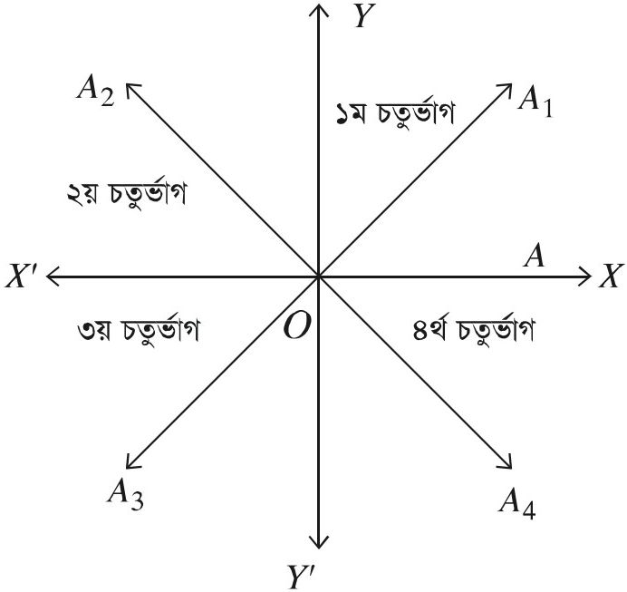

<!-- higher-math-9-10-bn-c08-t8.0-p006 · text · p.147 · review: verify-formula -->
জ্যামিতিক ধারণা অনুসারে দুটি ভিন্ন রশ্মি একটি বিন্দুতে মিলিত হলে ঐ বিন্দুতে একটি কোণ উৎপন্ন হয়েছে বলে ধরা হয়। কিন্তু ত্রিকোণমিতিতে একটি স্থির রশ্মির সাপেক্ষে অপর একটি ঘূর্ণায়মান রশ্মির বিভিন্ন অবস্থানে বিভিন্ন কোণ বিবেচনা করা হয়। মনে করি, $OA$ একটি ঘূর্ণায়মান রশ্মি এবং এটি শুরুতে $OX$ স্থির রশ্মির অবস্থান থেকে ঘড়ির কাঁটা যেদিকে ঘুরে তার বিপরীত (anticlockwise) দিকে ঘুরছে। $OA$ রশ্মি প্রথমে $OA_1$ অবস্থানে এসে $\angle XOA_1$ সূক্ষ্মকোণ উৎপন্ন করে এবং প্রথম চতুর্ভাগে থাকে এবং পরে যখন $OX$ এর সাথে লম্বভাবে $OY$ অবস্থানে আসে তখন $\angle XOY$ কোণের পরিমাণ $90^\circ$ বা এক সমকোণ হয়। $OA$ রশ্মিটি একই দিকে আরও কিছু ঘুরে যখন $OA_2$ অবস্থানে আসে তখন $\angle XOA_2$ কোণটি স্তূলকোণ। একইভাবে ঘুরে যখন $OA$ রশ্মি $OX$ এর ঠিক বিপরীত দিকে $OX'$ অবস্থানে থাকে, তখন উৎপন্ন কোণ $\angle XOX'$ একটি সরলকোণ বা দুই সমকোণ। $OA$ রশ্মি যখন সম্পূর্ণরূপে ঘুরে ঠিক আগের অবস্থানে আসে অর্থাৎ $OX$ এর সাথে মিলিত হয় তখন মোট উৎপন্ন কোণের পরিমাণ দুই সরলকোণ বা চার সমকোণ হয়।

<!-- higher-math-9-10-bn-c08-t8.0-p007 · text · p.147 · review: verify-formula -->
জ্যামিতিতে কোণের আলোচনা দুই সরলকোণ পর্যন্ত সীমিত রাখা হয় এবং এরূপ জ্যামিতিক ও ত্রিকোণমিতিক কোণের মধ্যে কোনো পার্থক্য নেই। কিন্তু যদি মনে করা হয় যে, $OA$ রশ্মিটি সম্পূর্ণরূপে একবার ঘুরার পর আরও কিছু বেশি ঘুরে $OA_1$ অবস্থানে গেল, তখন উৎপন্ন $\angle XOA_1$ কোণের পরিমাণ চার সমকোণ অপেক্ষা বৃহত্তর। এরূপ ঘূর্ণনের ফলে ত্রিকোণমিতিতে আরও বৃহত্তর কোণ উৎপন্ন হতে পারে। কিন্তু সমতল জ্যামিতিতে চার সমকোণের চেয়ে বেশি ধারণা করা যায় না। $OA$ রশ্মির আদি অবস্থান $\angle XOX$ কোণকে জ্যামিতিতে কোণ বলে গণ্য করা হয় না, কিন্তু ত্রিকোণমিতিতে $\angle XOX$ কোণের পরিমাণ শূন্য ধরা হয়।

## 8.1 ধনাত্মক ও ঋণাত্মক কোণ

<!-- higher-math-9-10-bn-c08-t8.1-p001 · text · p.148 · review: verify-formula -->
উপরের আলোচনায় আমরা $OA$ রশ্মিকে (আগের পৃষ্ঠার চিত্রে) ঘড়ির ক্যারার বিপরীত দিকে ঘুরিয়েছি এবং $OA$ রশ্মি দ্বারা বিভিন্ন চতুর্ভাগে উৎপন্ন কোণসমূহকে ধনাত্মক কোণ হিসেবে বিবেচনা করেছি। কোনো রশ্মিকে ঘড়ির ক্যারার বিপরীত দিকে (anticlockwise) ঘুরালে উৎপন্ন কোণকে ধনাত্মক (positive) কোণ বলা হয় এবং কোনো রশ্মিকে ঘড়ির ক্যারার দিকে (clockwise) ঘুরালে উৎপন্ন কোণকে ঋণাত্মক (negative) কোণ বলা হয়।

<!-- higher-math-9-10-bn-c08-t8.1-p002 · text · p.148 · review: verify-formula -->
তাই, উপরের আলোচনা থেকে বলা যায় একটি ধনাত্মক কোণের পরিমাণ $90^\circ$ অপেক্ষা কম হলে ১ম চতুর্ভাগে থাকবে। আবার $360^\circ$ ও $450^\circ$ এর মধ্যে থাকলেও কোণটি ১ম চতুর্ভাগেই থাকবে। একইভাবে কোনো ধনাত্মক কোণের মান $180^\circ$ ও $270^\circ$ এর মধ্যে থাকলে কোণটি ৩য় চতুর্ভাগে, $90^\circ$ থেকে $180^\circ$ এর মধ্যে থাকলে ২য় চতুর্ভাগে এবং $270^\circ$ ও $360^\circ$ এর মধ্যে থাকলে ৪র্থ চতুর্ভাগে থাকে। অনুরূপভাবে একটি ঋণাত্মক কোণের পরিমাণ $-90^\circ$ থেকে $0^\circ$ এর মধ্যে থাকলে ৪র্থ চতুর্ভাগে, $-180^\circ$ থেকে $-90^\circ$ এর মধ্যে ৩য় চতুর্ভাগে, $-270^\circ$ থেকে $-180^\circ$ এর মধ্যে ২য় চতুর্ভাগে ও $-360^\circ$ থেকে $-270^\circ$ এর মধ্যে হলে ১ম চতুর্ভাগে থাকবে। $180^\circ$ ও $360^\circ$ বা এর যেকোনো পূর্ণসাংখ্যিক গুণিতক $XOX'$ রেখার এবং $90^\circ$ ও $270^\circ$ বা এদের যেকোনো পূর্ণসাংখ্যিক বিজোড় গুণিতক $YOY'$ রেখার (আগের পৃষ্ঠার চিত্রে) উপর অবস্থান করবে। $\angle AOA_1$ ১ম চতুর্ভাগে, $\angle AOA_2$ ২য় চতুর্ভাগে, $\angle AOA_3$ ৩য় চতুর্ভাগে এবং $\angle AOA_4$ ৪র্থ চতুর্ভাগে অবস্থান করে।

<!-- higher-math-9-10-bn-c08-t8.1-p003 · text · p.148 · review: verify-formula -->
**উদাহরণ ১.** ক) $430^\circ$ ও খ) $545^\circ$ কোণদ্বয়ের অবস্থান কোন চতুর্ভাগে নির্ণয় করো।

<!-- higher-math-9-10-bn-c08-t8.1-p004 · text · p.148 · review: verify-formula -->
ক) $430^\circ = 360^\circ + 70^\circ = 4 \times 90^\circ + 70^\circ$। $430^\circ$ কোণটি ধনাত্মক কোণ এবং ৪ সমকোণ অপেক্ষা বড়ো কিন্তু ৫ সমকোণ অপেক্ষা ছোটো। সুতরাং $430^\circ$ কোণটি উৎপন্ন করার জন্য কোনো রশ্মিকে ৪ সমকোণ বা একবার সম্পূর্ণ ঘুরার পর আরও $70^\circ$ ঘুরতে হয়েছে (নিচের বামের চিত্র)। তাই $430^\circ$ কোণটি ১ম চতুর্ভাগে অবস্থান করে।

<!-- higher-math-9-10-bn-c08-t8.1-p005 · figure · p.148 -->
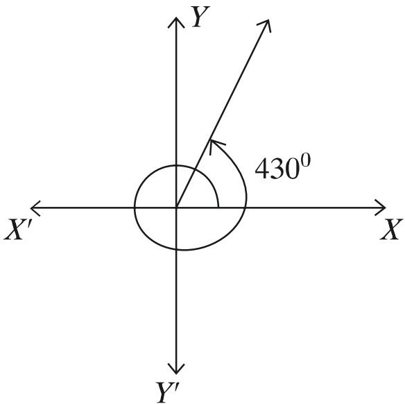

<!-- higher-math-9-10-bn-c08-t8.1-p006 · text · p.148 · review: verify-formula -->
খ) $545^\circ = 540^\circ + 5^\circ = 6 \times 90^\circ + 5^\circ$। $545^\circ$ কোণটি ধনাত্মক এবং ৬ সমকোণ অপেক্ষা বৃহত্তর কিন্তু ৭ সমকোণ অপেক্ষা ক্ষুদ্রতর। $545^\circ$ কোণটি উৎপন্ন করতে ঘড়ির ক্যারার বিপরীত দিকে কোনো রশ্মিকে ৬ সমকোণের চেয়ে $5^\circ$ বেশি বা একবার সম্পূর্ণ ঘুরে আদি অবস্থানে আসার পর আরও দুই সমকোণের চেয়ে $5^\circ$ বেশি ঘুরতে হয়েছে (উপরের ডানের চিত্র)। তাই $545^\circ$ কোণটি তৃতীয় চতুর্ভাগে অবস্থান করে।

<!-- higher-math-9-10-bn-c08-t8.1-p007 · figure · p.148 -->
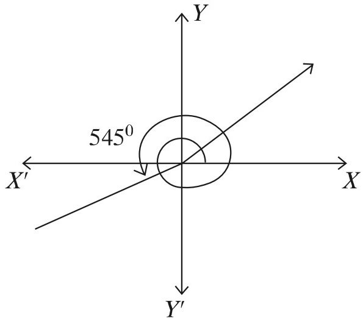

<!-- higher-math-9-10-bn-c08-t8.1-p008 · text · p.149 -->
**কাজ:** 330°, 535°, 777° ও 1045° কোণসমূহ কোন চতুর্ভাগে অবস্থান করে তা চিত্রসহ দেখাও।

<!-- higher-math-9-10-bn-c08-t8.1-p009 · text · p.149 -->
**উদাহরণ ২. ক) -520° ও খ) -750° কোণদ্বয় কোন চতুর্ভাগে আছে নির্ণয় কর।**

<!-- higher-math-9-10-bn-c08-t8.1-p010 · figure · p.149 -->
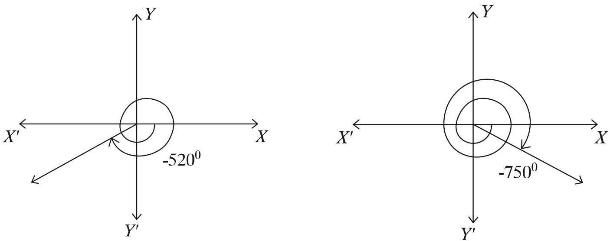

<!-- higher-math-9-10-bn-c08-t8.1-p011 · text · p.149 · review: verify-formula -->
ক) $-520^\circ = -450^\circ - 70^\circ = -5 \times 90^\circ - 70^\circ$। $-520^\circ$ একটি ঋণাত্মক কোণ এবং $-520^\circ$ কোণটি উৎপন্ন করতে কোনো রশ্মিকে ঘড়ির কাঁটার দিকে একবার সম্পূর্ণ ঘুরে একই দিকে আরো এক সমকোণ বা $90^\circ$ এবং $70^\circ$ ঘুরে তৃতীয় চতুর্ভাগে আসতে হয়েছে (উপরের বামের চিত্র)। সুতরাং, $-540^\circ$ কোণটি তৃতীয় চতুর্ভাগে অবস্থান করেছে।

<!-- higher-math-9-10-bn-c08-t8.1-p012 · text · p.149 · review: verify-formula -->
খ) $-750^\circ = -720^\circ - 30^\circ = -8 \times 90^\circ - 30^\circ$। $-750^\circ$ কোণটি ঋণাত্মক কোণ এবং ঘড়ির কাঁটার দিকে দুইবার সম্পূর্ণ (৪ সমকোণ) ঘুরার পর একই দিকে আরও $30^\circ$ ঘুরতে হয়েছে (উপরের ডানের চিত্র)। সুতরাং $-750^\circ$ কোণটির অবস্থান চতুর্থ চতুর্ভাগে।

<!-- higher-math-9-10-bn-c08-t8.1-p013 · text · p.149 · review: verify-formula -->
**কাজ:** $-100^\circ$, $-365^\circ$, $-720^\circ$ ও $1320^\circ$ কোণসমূহ কোন চতুর্ভাগে আছে, চিত্রসহ নির্ণয় করো।

## 8.2 কোণ পরিমাপের একক

<!-- higher-math-9-10-bn-c08-t8.2-p001 · text · p.149 -->
কোনো কোণের পরিমাণ নির্ণয়ে সাধারণত দুই প্রকার পদ্ধতি ব্যবহার করা হয়:

<!-- higher-math-9-10-bn-c08-t8.2-p002 · text · p.149 -->
ক) ষাটমূলক পদ্ধতি (Sexagesimal System) ও
খ) বৃত্তীয় পদ্ধতি (Circular System)

<!-- higher-math-9-10-bn-c08-t8.2-p003 · text · p.149 · review: verify-formula -->
**ষাটমূলক পদ্ধতি:** ষাটমূলক পদ্ধতিতে সমকোণকে কোণ পরিমাপের একক ধরা হয়। এই পদ্ধতিতে এক সমকোণকে সমান 90 ভাগে বিভক্ত করে প্রতি ভাগকে এক ডিগ্রি ($1^\circ$ = one degree) ধরা হয়।

<!-- higher-math-9-10-bn-c08-t8.2-p004 · text · p.149 · review: verify-formula -->
এক ডিগ্রিকে সমান 60 ভাগ করে প্রতিভাগকে এক মিনিট ($1'$ = one minute) এবং এক মিনিটকে সমান 60 ভাগ করে প্রতি ভাগকে এক সেকেন্ড ($1''$ = one second) ধরা হয়।

<!-- higher-math-9-10-bn-c08-t8.2-p005 · text · p.150 · review: verify-formula -->
অর্থাৎ, $60''$ (সেকেন্ড) $= 1'$ (মিনিট)

<!-- higher-math-9-10-bn-c08-t8.2-p006 · text · p.150 · review: verify-formula -->
$60'$ (মিনিট) $= 1^\circ$ (ডিগ্রি)

<!-- higher-math-9-10-bn-c08-t8.2-p007 · text · p.150 · review: verify-formula -->
$90^\circ$ (ডিগ্রি) $= 1$ সমকোণ

<!-- higher-math-9-10-bn-c08-t8.2-p008 · text · p.150 -->
বৃত্তীয় পদ্ধতি সম্পর্কে জানার পূর্বে রেডিয়ান সম্পর্কে জানা দরকার।

<!-- higher-math-9-10-bn-c08-t8.2-p009 · text · p.150 -->
**রেডিয়ান:** কোনো বৃত্তের ব্যাসার্ধের সমান চাপ ঐ বৃত্তের কেন্দ্রে যে কোণ উৎপন্ন করে সেই কোণকে এক রেডিয়ান বলে।

<!-- higher-math-9-10-bn-c08-t8.2-p010 · figure · p.150 -->
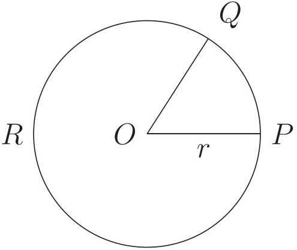

<!-- higher-math-9-10-bn-c08-t8.2-p011 · text · p.150 · review: verify-formula -->
চিত্রে $PQR$ বৃত্তের কেন্দ্র $O$, বৃত্তের ব্যাসার্ধ $OP = r$ এবং ব্যাসার্ধের সমান চাপ $PQ$। $PQ$ চাপ কেন্দ্র $O$ তে $\angle POQ$ উৎপন্ন করেছে। উক্ত কোণের পরিমাণই এক রেডিয়ান। অর্থাৎ $\angle POQ$ এক রেডিয়ান।

<!-- higher-math-9-10-bn-c08-t8.2-p012 · text · p.150 -->
**বৃত্তীয় পদ্ধতি:** বৃত্তীয় পদ্ধতিতে এক রেডিয়ান (radian) কোণকে কোণ পরিমাপের একক ধরা হয়। কোণের ডিগ্রি পরিমাণ ও রেডিয়ান পরিমাপের সম্পর্ক নির্ণয়ের জন্য নিম্নোক্ত প্রতিজ্ঞাসমূহ এবং কোণের বৃত্তীয় পরিমাণ সম্পর্কে জানা প্রয়োজন।

<!-- higher-math-9-10-bn-c08-t8.2-p013 · text · p.150 -->
**প্রতিজ্ঞা ১.** যেকোনো দুটি বৃত্তের স্ব-স্ব পরিধি ও ব্যাসের অনুপাত সমান।

<!-- higher-math-9-10-bn-c08-t8.2-p014 · text · p.150 · review: verify-formula -->
**প্রমাণ:** মনে করি, প্রদত্ত বৃত্ত দুটি সমকেন্দ্রিক এবং উভয়ের কেন্দ্র $O$। বৃহত্তর বৃত্তটির পরিধি $P$ ও ব্যাসার্ধ $R$ এবং ক্ষুদ্রতর বৃত্তটির পরিধি $p$ ও ব্যাসার্ধ $r$ (নিচের চিত্র)। এখন বৃহত্তর বৃত্তটিকে $n$ সংখ্যক $(n > 1)$ সমান ভাগে বিভক্ত করি। কেন্দ্রের সাথে বিভক্ত বিন্দুগুলো যোগ করলে ক্ষুদ্রতর বৃত্তটিও $n$ সংখ্যক সমান ভাগে বিভক্ত হবে। উভয় বৃত্তে বিভক্ত বিন্দুগুলো পরস্পর সংযুক্ত করি। ফলে প্রত্যেক বৃত্তে $n$ সংখ্যক বাহুবিশিষ্ট একটি সুসম বহুভুজ অন্তর্লিখিত হল (বৃহত্তর বৃত্তে $ABCD...$ ও ক্ষুদ্রতর বৃত্তে $abcd...$)।

<!-- higher-math-9-10-bn-c08-t8.2-p015 · text · p.151 · review: verify-formula -->
এখন $\triangle OAB$ এবং $\triangle Oab$ সদৃশ, কারণ, $\angle AOB$ এবং $\angle aOb$ [সাধারণ কোণ] এবং উভয় ত্রিভুজ সমদ্বিভুজ বলে বাহু সংলগ্ন কোণগুলো সমান।

<!-- higher-math-9-10-bn-c08-t8.2-p016 · figure · p.151 -->
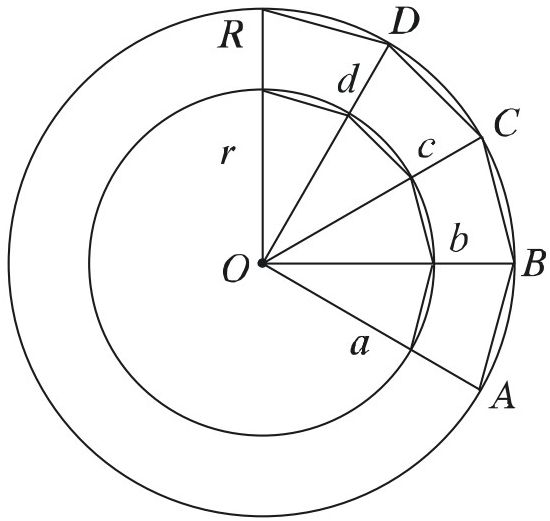

<!-- higher-math-9-10-bn-c08-t8.2-p017 · formula · p.151 · review: verify-formula -->
$$\therefore \frac{AB}{ab} = \frac{OA}{Oa} = \frac{OB}{Ob} = \frac{R}{r}$$

<!-- higher-math-9-10-bn-c08-t8.2-p018 · text · p.151 -->
অনুরূপভাবে,

<!-- higher-math-9-10-bn-c08-t8.2-p019 · formula · p.151 · review: latin-junk,verify-formula -->
$$\frac{BC}{bc} = \frac{R}{r}, \frac{CD}{cd} = \frac{R}{r}  ইত্যাদি।$$

<!-- higher-math-9-10-bn-c08-t8.2-p020 · formula · p.151 · review: verify-formula -->
$$\therefore \frac{AB}{ab} = \frac{BC}{bc} = \frac{CD}{cd} = \dots = \frac{R}{r}$$

<!-- higher-math-9-10-bn-c08-t8.2-p021 · formula · p.151 · review: verify-formula -->
$$\therefore \frac{AB + BC + CD + \dots}{ab + bc + cd + \dots} = \frac{R + R + R + \dots}{r + r + r + \dots} = \frac{nR}{nr} = \frac{R}{r} = \frac{2R}{2r} \dots (1)$$

<!-- higher-math-9-10-bn-c08-t8.2-p022 · text · p.151 · review: verify-formula -->
$n$ যদি যথেষ্ট বড়ো হয় ($n \to \infty$) তাহলে $AB, BC, CD, \dots$ রেখাংশসমূহ অত্যন্ত ক্ষুদ্র হবে এবং মনে হবে সবাই বৃত্তের ছোটো ছোটো চাপ।

<!-- higher-math-9-10-bn-c08-t8.2-p023 · text · p.151 · review: verify-formula -->
সুতরাং এক্ষেত্রে, $AB + BC + CD + \dots \approx$ বৃহত্তর বৃত্তের পরিধি $P$ এবং

<!-- higher-math-9-10-bn-c08-t8.2-p024 · text · p.151 · review: verify-formula -->
$ab + bc + cd + \dots \approx$ ক্ষুদ্রতর বৃত্তের পরিধি $p$

<!-- higher-math-9-10-bn-c08-t8.2-p025 · text · p.151 · review: verify-formula -->
$\therefore$ সমীকরণ (1) হতে পাই,

<!-- higher-math-9-10-bn-c08-t8.2-p026 · formula · p.151 · review: verify-formula -->
$$\frac{P}{p} = \frac{2R}{2r}$$

<!-- higher-math-9-10-bn-c08-t8.2-p027 · text · p.151 · review: verify-formula -->
অর্থাৎ, $\frac{P}{2R} = \frac{p}{2r}$

<!-- higher-math-9-10-bn-c08-t8.2-p028 · text · p.151 · review: verify-formula -->
অর্থাৎ, $\frac{বৃহত্তর বৃত্তের পরিধি}{বৃহত্তর বৃত্তের ব্যাস} = \frac{ক্ষুদ্রতর বৃত্তের পরিধি}{ক্ষুদ্রতর বৃত্তের ব্যাস}$

<!-- higher-math-9-10-bn-c08-t8.2-p029 · text · p.151 · review: verify-formula -->
$\therefore$ যেকোনো দুটি বৃত্তের পরিধি ও ব্যাসের অনুপাত সমান।

### প্রতিজ্ঞা ১ এর আলোকে মন্তব্য ও অনুসিদ্ধান্ত:

<!-- higher-math-9-10-bn-c08-t8.2-p030 · text · p.151 · review: verify-formula -->
**মন্তব্য:** যেকোনো বৃত্তের পরিধি ও ব্যাসের অনুপাত সবসময় সমান ও একই ধ্রুব সংখ্যা। এ ধ্রুব সংখ্যাটিকে ত্রিক বর্ণ $\pi$ (পাই) দ্বারা প্রকাশ করা হয়। $\pi$ একটি অমূলদ সংখ্যা এবং দশমিকে প্রকাশ করলে এটি একটি অসীম দশমিক ভগ্নাংশ সংখ্যা ($\pi = 3.1415926535897932 \dots$).

<!-- higher-math-9-10-bn-c08-t8.2-p031 · text · p.151 · review: verify-formula -->
**মন্তব্য:** সাধারণত চার দশমিক স্থান পর্যন্ত $\pi$ এর আসন্ন মান $\pi = 3.1416$ ব্যবহার করা হয়। কম্পিউটারের সাহায্যে $\pi$ এর মান এক লক্ষ কোটি দশমিক স্থান পর্যন্ত নির্ণীত হয়েছে। যেহেতু $\pi$ এর আসন্ন মান ব্যবহার করা হয় সেহেতু উত্তরও হবে আসন্ন। তাই উত্তরের পাশে ‘প্রায়’ লেখা অবশ্যই কর্তব্য। পরবর্তী সমস্ত কাজে অন্য কোনোরূপ বলা না থাকলে চার দশমিক স্থান পর্যন্ত $\pi$ এর আসন্ন মান 3.1416 ব্যবহার করা হবে।

<!-- higher-math-9-10-bn-c08-t8.2-p032 · text · p.152 · review: verify-formula -->
**অনুসিদ্ধান্ত ২.** বৃত্তের ব্যাসার্ধ $r$ হলে, পরিধি হবে $2\pi r$.

<!-- higher-math-9-10-bn-c08-t8.2-p033 · text · p.152 -->
**প্রমাণ:** প্রতিজ্ঞা ১ এর আলোকে আমরা জানি,

<!-- higher-math-9-10-bn-c08-t8.2-p034 · formula · p.152 · review: latin-junk,verify-formula -->
$$\frac{পরিধি}{ব্যাস} = \pi$$

<!-- higher-math-9-10-bn-c08-t8.2-p035 · text · p.152 · review: verify-formula -->
বা, পরিধি $= \pi \times ব্যাস$

<!-- higher-math-9-10-bn-c08-t8.2-p036 · formula · p.152 · review: latin-junk,verify-formula -->
$$= \pi \times 2r  [ব্যাস = 2r]$$

<!-- higher-math-9-10-bn-c08-t8.2-p037 · formula · p.152 · review: verify-formula -->
$$= 2\pi r$$

<!-- higher-math-9-10-bn-c08-t8.2-p038 · text · p.152 · review: verify-formula -->
$\therefore r$ ব্যাসার্ধ বিশিষ্ট যেকোনো বৃত্তের পরিধি $2\pi r$.

<!-- higher-math-9-10-bn-c08-t8.2-p039 · text · p.152 -->
**প্রতিজ্ঞা ২.** বৃত্তের কোনো চাপের উপর দন্ডায়মান কেন্দ্রস্থ কোণ ঐ বৃত্তচাপের সমানুপাতিক।

<!-- higher-math-9-10-bn-c08-t8.2-p040 · figure · p.152 -->
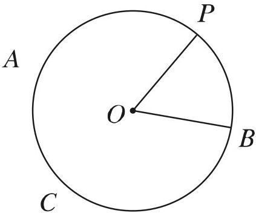

<!-- higher-math-9-10-bn-c08-t8.2-p041 · text · p.152 · review: verify-formula -->
মনে করি, $ABC$ বৃত্তের কেন্দ্র $O$ এবং ব্যাসার্ধ $OB$। $P$ বৃত্তের উপর অন্য একটি বিন্দু। ফলে $BP$ বৃত্তের একটি চাপ এবং $\angle POB$ বৃত্তের একটি কেন্দ্রস্থ কোণ। তাহলে, কেন্দ্রস্থ $\angle POB$, চাপ $BP$ এর সমানুপাতিক হবে।
অর্থাৎ, কেন্দ্রস্থ $\angle POB \propto$ চাপ $BP$.

<!-- higher-math-9-10-bn-c08-t8.2-p042 · text · p.152 -->
**প্রতিজ্ঞা ৩.** রেডিয়ান কোণ একটি ধ্রুব কোণ।

<!-- higher-math-9-10-bn-c08-t8.2-p043 · text · p.152 · review: verify-formula -->
**বিশেষ নির্বাচন:** মনে করি, $O$ কেন্দ্রবিশিষ্ট $ABC$ বৃত্তে $\angle POB$ এক রেডিয়ান কোণ। প্রমাণ করতে হবে যে, $\angle POB$ একটি ধ্রুব কোণ।

<!-- higher-math-9-10-bn-c08-t8.2-p044 · text · p.152 · review: verify-formula -->
**অঙ্কন:** $OB$ রেখাংশের (ব্যাসার্ধের) উপর $OA$ লম্ব আঁকি।

<!-- higher-math-9-10-bn-c08-t8.2-p045 · text · p.152 -->
**প্রমাণ:**

<!-- higher-math-9-10-bn-c08-t8.2-p046 · figure · p.152 -->
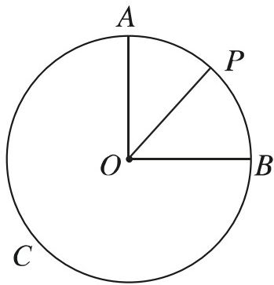

<!-- higher-math-9-10-bn-c08-t8.2-p047 · text · p.152 · review: verify-formula -->
$OA$ লম্ব বৃত্তের পরিধিকে $A$ বিন্দুতে ছেদ করে।

<!-- higher-math-9-10-bn-c08-t8.2-p048 · text · p.152 · review: verify-formula -->
চাপ $AB = পরিধির এক-চতুর্থাংশ = \frac{1}{4} \times 2\pi r = \frac{\pi r}{2}$

<!-- higher-math-9-10-bn-c08-t8.2-p049 · text · p.152 · review: verify-formula -->
এবং চাপ $PB = ব্যাসার্ধ  r   [\angle POB = 1  রেডিয়ান]$

<!-- higher-math-9-10-bn-c08-t8.2-p050 · text · p.152 -->
প্রতিজ্ঞা ২ থেকে পাই,

<!-- higher-math-9-10-bn-c08-t8.2-p051 · formula · p.152 · review: latin-junk,verify-formula -->
$$\frac{\angle POB}{\angle AOB} = \frac{চাপ  PB}{চাপ  AB}$$

<!-- higher-math-9-10-bn-c08-t8.2-p052 · formula · p.152 · review: latin-junk,verify-formula -->
$$\therefore \angle POB = \frac{চাপ  PB}{চাপ  AB} \times \angle AOB = \frac{r}{\pi r} \times \frac{1}{2}  এক সমকোণ  [OA  ব্যাসার্ধ এবং  OB  এর উপর লম্ব]$$

<!-- higher-math-9-10-bn-c08-t8.2-p053 · formula · p.153 · review: latin-junk,verify-formula -->
$$= \frac{2}{\pi}  সমকোণ।$$

<!-- higher-math-9-10-bn-c08-t8.2-p054 · text · p.153 · review: verify-formula -->
যেহেতু সমকোণ ও $\pi$ ধ্রুবক সেহেতু $\angle POB$ একটি ধ্রুব কোণ।

## 8.3 কোণের বৃত্তীয় পরিমাপ

<!-- higher-math-9-10-bn-c08-t8.3-p001 · definition · p.153 -->
**সংজ্ঞা ১.** বৃত্তীয় পদ্ধতিতে (circular system) অর্থাৎ, রেডিয়ান এককে কোনো কোণের পরিমাপকে তার বৃত্তীয় পরিমাপ (circular measure) বলা হয়।

<!-- higher-math-9-10-bn-c08-t8.3-p002 · text · p.153 · review: verify-formula -->
মনে করি, $\angle MON$ যেকোনো একটি কোণ যার বৃত্তীয় পরিমাপ নির্ণয় করতে হবে। $O$ বিন্দুকে কেন্দ্র করে $OA = r$ ব্যাসার্ধ নিয়ে একটি বৃত্ত অঙ্কন করি। বৃত্তটি $OM$ ও $ON$ কে যথাক্রমে $A$ ও $B$ বিন্দুতে ছেদ করে। তাহলে $AB$ চাপ দ্বারা উৎপন্ন কেন্দ্রস্থ কোণ $\angle AOB$। ব্যাসার্ধ $r$ এর সমান করে $AP$ চাপ নিই (চাপ ও ব্যাসার্ধ একই এককে হতে হবে)।

<!-- higher-math-9-10-bn-c08-t8.3-p003 · figure · p.153 -->
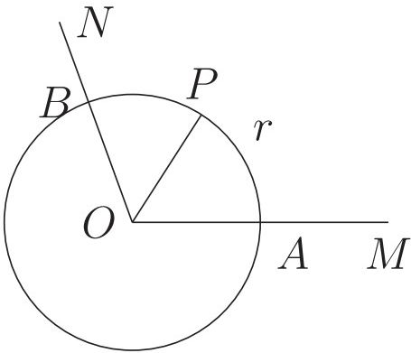

<!-- higher-math-9-10-bn-c08-t8.3-p004 · text · p.153 · review: verify-formula -->
তাহলে, $\angle AOP = 1$ রেডিয়ান।

<!-- higher-math-9-10-bn-c08-t8.3-p005 · text · p.153 · review: verify-formula -->
ধরি চাপ $AB = s$।

<!-- higher-math-9-10-bn-c08-t8.3-p006 · text · p.153 -->
**প্রতিজ্ঞা ২** অনুযায়ী,

<!-- higher-math-9-10-bn-c08-t8.3-p007 · formula · p.153 · review: latin-junk,verify-formula -->
$$\frac{\angle MON}{\angle AOP} = \frac{চাপ  AB}{চাপ  AP} = \frac{চাপ  AB}{ব্যাসার্ধ  OA} = \frac{s}{r}$$

<!-- higher-math-9-10-bn-c08-t8.3-p008 · formula · p.153 · review: verify-formula -->
$$\therefore \angle MON = \frac{s}{r} \times \angle AOP$$

<!-- higher-math-9-10-bn-c08-t8.3-p009 · formula · p.153 · review: latin-junk,verify-formula -->
$$= \frac{s}{r} \times 1  রেডিয়ান = \frac{s}{r}  রেডিয়ান$$

<!-- higher-math-9-10-bn-c08-t8.3-p010 · text · p.153 · review: verify-formula -->
$\therefore \angle MON$ এর বৃত্তীয় পরিমাপ $\frac{s}{r}$, যেখানে কোণটি তার শীর্ষবিন্দুকে কেন্দ্র করে এবং $r$ ব্যাসার্ধ নিয়ে অঙ্কিত বৃত্তে $s$ পরিমাণ চাপ খণ্ডিত করে।

<!-- higher-math-9-10-bn-c08-t8.3-p011 · text · p.153 · review: verify-formula -->
**প্রতিজ্ঞা ৪.** $r$ ব্যাসার্ধের কোনো বৃত্তে $s$ দৈর্ঘ্যের কোনো চাপ কেন্দ্রে $\theta$ পরিমাণ কোণ উৎপন্ন করলে $s = r\theta$ হবে।

<!-- higher-math-9-10-bn-c08-t8.3-p012 · figure · p.154 -->
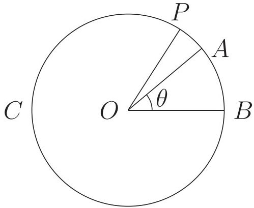

<!-- higher-math-9-10-bn-c08-t8.3-p013 · text · p.154 · review: verify-formula -->
**বিশেষ নির্বাচন:** মনে করি, $O$ কেন্দ্রবিশিষ্ট $ABC$ বৃত্তের ব্যাসার্ধ $OB = r$ একক, চাপ $AB = s$ একক এবং $AB$ চাপ দ্বারা উৎপন্ন কেন্দ্রস্থ $\angle AOB = \theta^c$। প্রমাণ করতে হবে যে, $s = r\theta$.

<!-- higher-math-9-10-bn-c08-t8.3-p014 · text · p.154 · review: verify-formula -->
**অঙ্কন:** $B$ বিন্দুকে কেন্দ্র করে $OB$ এর সমান ব্যাসার্ধ বিশিষ্ট $BP$ চাপ আঁকি যেন তা $ABC$ বৃত্তের পরিধিকে $P$ বিন্দুতে ছেদ করে। $O, P$ যোগ করি।

<!-- higher-math-9-10-bn-c08-t8.3-p015 · text · p.154 · review: verify-formula -->
**প্রমাণ:** অঙ্কন অনুসারে $\angle POB = 1^c$

<!-- higher-math-9-10-bn-c08-t8.3-p016 · text · p.154 -->
আমরা জানি, কোনো বৃত্তচাপ দ্বারা উৎপন্ন কেন্দ্রস্থ কোণ ঐ বৃত্তচাপের সমানুপাতিক।

<!-- higher-math-9-10-bn-c08-t8.3-p017 · formula · p.154 · review: latin-junk,verify-formula -->
$$\frac{চাপ  AB}{চাপ  PB} = \frac{\angle AOB}{\angle POB}$$

<!-- higher-math-9-10-bn-c08-t8.3-p018 · text · p.154 · review: verify-formula -->
বা, $\frac{s  একক}{r  একক} = \frac{\theta^c}{1^c}$

<!-- higher-math-9-10-bn-c08-t8.3-p019 · text · p.154 · review: verify-formula -->
বা, $\frac{s}{r} = \theta$

<!-- higher-math-9-10-bn-c08-t8.3-p020 · text · p.154 · review: verify-formula -->
$\therefore s = r\theta$ (প্রমাণিত)

## 8.4 কোণের ডিগ্রি পরিমাণ ও রেডিয়ান (বৃত্তীয়) পরিমাণের সম্পর্ক

<!-- higher-math-9-10-bn-c08-t8.4-p001 · text · p.154 -->
প্রতিজ্ঞা ও থেকে আমরা পাই,

<!-- higher-math-9-10-bn-c08-t8.4-p002 · formula · p.154 · review: latin-junk,verify-formula -->
$$1  রেডিয়ান = \frac{2}{\pi}  সমকোণ$$

<!-- higher-math-9-10-bn-c08-t8.4-p003 · text · p.154 · review: verify-formula -->
অর্থাৎ, $1^c = \frac{2}{\pi}  সমকোণ$। [1 রেডিয়ান = $1^c$]

<!-- higher-math-9-10-bn-c08-t8.4-p004 · formula · p.154 · review: latin-junk,verify-formula -->
$$\therefore 1  সমকোণ = \left(\frac{\pi}{2}\right)^c$$

<!-- higher-math-9-10-bn-c08-t8.4-p005 · text · p.154 · review: verify-formula -->
বা, $90^\circ = \left(\frac{\pi}{2}\right)^c$

<!-- higher-math-9-10-bn-c08-t8.4-p006 · formula · p.154 · review: latin-junk,verify-formula -->
$$\therefore 1^\circ = \left(\frac{\pi}{180}\right)^c  এবং  1^c = \left(\frac{180}{\pi}\right)^\circ$$

<!-- higher-math-9-10-bn-c08-t8.4-p007 · text · p.155 · review: verify-formula -->
**প্রতিজ্ঞা ৫.** $1^\circ = \left( \frac{\pi}{180} \right)^c$ এবং $1^c = \left( \frac{180}{\pi} \right)^\circ$

<!-- higher-math-9-10-bn-c08-t8.4-p008 · text · p.155 -->
**লক্ষণীয়:**

<!-- higher-math-9-10-bn-c08-t8.4-p009 · text · p.155 · review: verify-formula -->
(i) $90^\circ = 1$ সমকোণ $= \frac{\pi}{2}$ রেডিয়ান $= \left( \frac{\pi}{2} \right)^c$
অর্থাৎ, $180^\circ = 2$ সমকোণ $= \pi$ রেডিয়ান $= \pi^c$.

<!-- higher-math-9-10-bn-c08-t8.4-p010 · text · p.155 · review: verify-formula -->
(ii) যাত্মুলক ও বৃত্তীয় পদ্ধতিতে একটি কোণের পরিমাণ যথাক্রমে $D^\circ$ ও $R^c$ হলে
$$D^\circ = \left( D \times \frac{\pi}{180} \right)^c = R^c$$
অর্থাৎ, $D \times \frac{\pi}{180} = R$
বা, $\frac{D}{180} = \frac{R}{\pi}$

<!-- higher-math-9-10-bn-c08-t8.4-p011 · text · p.155 -->
উপরিউক্ত আলোচনা থেকে বহুল ব্যবহৃত কোণসমূহের ডিগ্রি ও রেডিয়ানের সম্পর্ক দেওয়া হলো:

<!-- higher-math-9-10-bn-c08-t8.4-p012 · text · p.155 · review: verify-formula -->
(i) $1^\circ = \left( \frac{\pi}{180} \right)^c$

<!-- higher-math-9-10-bn-c08-t8.4-p013 · text · p.155 · review: verify-formula -->
(ii) $30^\circ = \left( 30 \times \frac{\pi}{180} \right)^c = \left( \frac{\pi}{6} \right)^c$

<!-- higher-math-9-10-bn-c08-t8.4-p014 · text · p.155 · review: verify-formula -->
(iii) $45^\circ = \left( 45 \times \frac{\pi}{180} \right)^c = \left( \frac{\pi}{4} \right)^c$

<!-- higher-math-9-10-bn-c08-t8.4-p015 · text · p.155 · review: verify-formula -->
(iv) $60^\circ = \left( 60 \times \frac{\pi}{180} \right)^c = \left( \frac{\pi}{3} \right)^c$

<!-- higher-math-9-10-bn-c08-t8.4-p016 · text · p.155 · review: verify-formula -->
(v) $90^\circ = \left( 90 \times \frac{\pi}{180} \right)^c = \left( \frac{\pi}{2} \right)^c$

<!-- higher-math-9-10-bn-c08-t8.4-p017 · text · p.155 · review: verify-formula -->
(vi) $180^\circ = \left( 180 \times \frac{\pi}{180} \right)^c = \pi^c$

<!-- higher-math-9-10-bn-c08-t8.4-p018 · text · p.155 · review: verify-formula -->
(vii) $360^\circ = \left( 360 \times \frac{\pi}{180} \right)^c = (2\pi)^c$

<!-- higher-math-9-10-bn-c08-t8.4-p019 · text · p.155 · review: verify-formula -->
ব্যবহারিক ক্ষেত্রে রেডিয়ান প্রতীক $(c)$ সাধারণত লেখা হয় না। সংক্ষেপে (রেডিয়ান প্রতীক উহ্য রেখে)

<!-- higher-math-9-10-bn-c08-t8.4-p020 · text · p.155 · review: verify-formula -->
$1^\circ = \frac{\pi}{180}, 30^\circ = \frac{\pi}{6}, 45^\circ = \frac{\pi}{4}, 60^\circ = \frac{\pi}{3}, 90^\circ = \frac{\pi}{2}, 180^\circ = \pi, 360^\circ = 2\pi$ ইত্যাদি।

<!-- higher-math-9-10-bn-c08-t8.4-p021 · text · p.155 · review: verify-formula -->
**দ্রষ্টব্য:** $1^\circ = \left( \frac{\pi}{180} \right)^c = 0.01745^c$ (আসন্ন পাঁচ দশমিক স্থান পর্যন্ত)

<!-- higher-math-9-10-bn-c08-t8.4-p022 · text · p.155 · review: verify-formula -->
$1^c = \left( \frac{180}{\pi} \right)^\circ = 57.29578^\circ$ (আসন্ন পাঁচ দশমিক স্থান পর্যন্ত) $= 57^\circ 17' 44.81''$.

<!-- higher-math-9-10-bn-c08-t8.4-p023 · text · p.155 · review: verify-formula -->
এক্ষেত্রে $\pi$ এর আসন্ন মান 3.1416 ব্যবহার করা হয়েছে।

<!-- higher-math-9-10-bn-c08-t8.4-p024 · text · p.156 · review: verify-formula -->
**দ্রষ্টব্য:** নিচের সমস্ত উদাহরণ এবং সমস্ত সমস্যায় $\pi$ এর আসন্ন মান চার দশমিক স্থান ($\pi = 3.1416$) পর্যন্ত ব্যবহার করা হবে। $\pi$ এর আসন্ন মান ব্যবহৃত হলে উত্তরে অবশ্যই ‘প্রায়’ কথাটি লিখতে হবে।

<!-- higher-math-9-10-bn-c08-t8.4-p025 · text · p.156 · review: verify-formula -->
**উদাহরণ ৩.** ক) $30^\circ 12' 36''$ কে রেডিয়ানে প্রকাশ করো। খ) $\frac{3\pi}{13}$ কে ডিগ্রি, মিনিট ও সেকেন্ডে প্রকাশ করো।

<!-- higher-math-9-10-bn-c08-t8.4-p026 · text · p.156 -->
**সমাধান:**

<!-- higher-math-9-10-bn-c08-t8.4-p027 · text · p.156 · review: verify-formula -->
ক) $30^\circ 12' 36'' = 30^\circ \left( 12 \frac{36}{60} \right)' = 30^\circ \left( 12 \frac{3}{5} \right)' = 30^\circ \left( \frac{63}{5} \right)'$

<!-- higher-math-9-10-bn-c08-t8.4-p028 · formula · p.156 · review: verify-formula -->
$$= \left( 30 \frac{63}{5 \times 60} \right)^\circ = \left( 30 \frac{21}{100} \right)^\circ = \left( \frac{3021}{100} \right)^\circ$$

<!-- higher-math-9-10-bn-c08-t8.4-p029 · formula · p.156 · review: latin-junk,verify-formula -->
$$= \frac{3021}{100} \times \frac{\pi}{180}  রেডিয়ান  [\because 1^\circ = \frac{\pi^c}{180}]$$

<!-- higher-math-9-10-bn-c08-t8.4-p030 · formula · p.156 · review: latin-junk,verify-formula -->
$$= \frac{3021\pi}{18000} = .5273  রেডিয়ান (প্রায়)$$

<!-- higher-math-9-10-bn-c08-t8.4-p031 · formula · p.156 · review: verify-formula -->
$\therefore 30^\circ 12' 36'' = .5273^c  (প্রায়)$

<!-- higher-math-9-10-bn-c08-t8.4-p032 · text · p.156 · review: verify-formula -->
খ) $\frac{3\pi}{13} = \frac{3\pi}{13} \times \frac{180}{\pi}  ডিগ্রি  [\because 1^c = \left( \frac{180}{\pi} \right)^\circ]$

<!-- higher-math-9-10-bn-c08-t8.4-p033 · formula · p.156 · review: latin-junk,verify-formula -->
$$= \frac{540}{13}  ডিগ্রি = 41^\circ 32' 18 \cdot 46''.$$

<!-- higher-math-9-10-bn-c08-t8.4-p034 · formula · p.156 · review: verify-formula -->
$\therefore \frac{3\pi}{13}  রেডিয়ান = 41^\circ 32' 18 \cdot 46''$

<!-- higher-math-9-10-bn-c08-t8.4-p035 · text · p.156 · review: verify-formula -->
**উদাহরণ ৪.** একটি ত্রিভুজের তিনটি কোণের অনুপাত $3 : 4 : 5$, কোণ তিনটির বৃত্তীয় মান কত?

<!-- higher-math-9-10-bn-c08-t8.4-p036 · text · p.156 · review: verify-formula -->
**সমাধান:** ধরি, কোণ তিনটি যথাক্রমে $3x^c, 4x^c$ ও $5x^c$.

<!-- higher-math-9-10-bn-c08-t8.4-p037 · text · p.156 · review: verify-formula -->
প্রশ্নমতে, $3x^c + 4x^c + 5x^c = \pi^c$ [ত্রিভুজের তিন কোণের সমষ্টি $2$ সমকোণ $= \pi^c$]

<!-- higher-math-9-10-bn-c08-t8.4-p038 · text · p.156 · review: verify-formula -->
বা, $12x^c = \pi^c$

<!-- higher-math-9-10-bn-c08-t8.4-p039 · text · p.156 · review: verify-formula -->
বা, $x = \frac{\pi}{12}$

<!-- higher-math-9-10-bn-c08-t8.4-p040 · text · p.156 · review: verify-formula -->
$\therefore$ কোণ তিনটি যথাক্রমে

<!-- higher-math-9-10-bn-c08-t8.4-p041 · formula · p.156 · review: verify-formula -->
$$3x^c = \left( \frac{3\pi}{12} \right)^c = \left( \frac{\pi}{4} \right)^c = \frac{\pi}{4}$$

<!-- higher-math-9-10-bn-c08-t8.4-p042 · formula · p.156 · review: verify-formula -->
$$4x^c = \left( \frac{4\pi}{12} \right)^c = \left( \frac{\pi}{3} \right)^c = \frac{\pi}{3}$$

<!-- higher-math-9-10-bn-c08-t8.4-p043 · formula · p.157 · review: verify-formula -->
$$5x^c = \left( \frac{5\pi}{12} \right)^c = \frac{5\pi}{12}$$

<!-- higher-math-9-10-bn-c08-t8.4-p044 · text · p.157 · review: verify-formula -->
নির্গেয় কোণ তিনটির বৃত্তীয় মান: $\frac{\pi}{4}$, $\frac{\pi}{3}$ ও $\frac{5\pi}{12}$

<!-- higher-math-9-10-bn-c08-t8.4-p045 · text · p.157 -->
**উদাহরণ ৫.** একটি চাকা 1.75 কিলোমিটার পথ যেতে 40 বার ঘুরে। চাকাটির ব্যাসার্ধ কত?

<!-- higher-math-9-10-bn-c08-t8.4-p046 · text · p.157 · review: verify-formula -->
**সমাধান:** ধরি, চাকার ব্যাসার্ধ $r$ মিটার।

<!-- higher-math-9-10-bn-c08-t8.4-p047 · text · p.157 · review: verify-formula -->
$\therefore$ চাকার পরিধি $= 2\pi r$ মিটার $[\pi = 3.1416]$

<!-- higher-math-9-10-bn-c08-t8.4-p048 · text · p.157 -->
আমরা জানি, চাকাটি একবার ঘুরলে তার পরিধির সমান দূরত্ব অতিক্রম করে।

<!-- higher-math-9-10-bn-c08-t8.4-p049 · text · p.157 · review: verify-formula -->
$\therefore$ 40 বার ঘুরায় চাকাটির মোট অতিক্রান্ত দূরত্ব $= 40 \times 2\pi r$ মি. $= 80\pi r$ মিটার

<!-- higher-math-9-10-bn-c08-t8.4-p050 · text · p.157 · review: verify-formula -->
প্রশ্নমতে, $80\pi r = 1750$ [1 কি.মি. $= 1000$ মিটার]

<!-- higher-math-9-10-bn-c08-t8.4-p051 · text · p.157 · review: verify-formula -->
বা, $r = \frac{1750}{80\pi} = \frac{1750}{80 \times 3.1416}$ মিটার

<!-- higher-math-9-10-bn-c08-t8.4-p052 · text · p.157 · review: verify-formula -->
$= 6.963$ মিটার (প্রায়)।

<!-- higher-math-9-10-bn-c08-t8.4-p053 · text · p.157 · review: verify-formula -->
$\therefore$ চাকার ব্যাসার্ধ 6.963 মিটার (প্রায়)।

<!-- higher-math-9-10-bn-c08-t8.4-p054 · text · p.157 · review: verify-formula -->
**উদাহরণ ৬.** পৃথিবীর ব্যাসার্ধ 6440 কিলোমিটার। ঢাকা ও জামালপুর পৃথিবীর কেন্দ্রে $2^\circ$ কোণ উৎপন্ন করলে ঢাকা ও জামালপুরের দূরত্ব নির্ণয় করো।

<!-- higher-math-9-10-bn-c08-t8.4-p055 · text · p.157 · review: verify-formula -->
**সমাধান:** ব্যাসার্ধ $= r = 6440$ কি.মি.

<!-- higher-math-9-10-bn-c08-t8.4-p056 · text · p.157 · review: verify-formula -->
পৃথিবীর কেন্দ্রে উৎপন্ন কোণ $\theta = 2^\circ = 2 \times \frac{\pi}{180} = \frac{\pi}{90}$ রেডিয়ান।

<!-- higher-math-9-10-bn-c08-t8.4-p057 · text · p.157 · review: verify-formula -->
$\therefore s =$ চাপের দৈর্ঘ্য $=$ ঢাকা ও জামালপুরের দূরত্ব $= r\theta = 6440 \times \frac{\pi}{90}$ কি.মি.

<!-- higher-math-9-10-bn-c08-t8.4-p058 · text · p.157 · review: verify-formula -->
$= \frac{644\pi}{9}$ কি.মি

<!-- higher-math-9-10-bn-c08-t8.4-p059 · text · p.157 · review: verify-formula -->
$= 224.8$ কি.মি. (প্রায়)

<!-- higher-math-9-10-bn-c08-t8.4-p060 · text · p.157 -->
নির্গেয় দূরত্ব: 224.8 কি.মি. (প্রায়)।

<!-- higher-math-9-10-bn-c08-t8.4-p061 · text · p.157 -->
**উদাহরণ ৭.** কোনো বৃত্তের ব্যাসার্ধ 7 সে.মি.। বৃত্তের 11 সে.মি. দীর্ঘ চাপের কেন্দ্রস্থ কোণের পরিমাণ নির্ণয় করো।

<!-- higher-math-9-10-bn-c08-t8.4-p062 · text · p.157 · review: verify-formula -->
**সমাধান:** ধরি, $ABC$ বৃত্তের ব্যাসার্ধ $OB = 7$ সে.মি. এবং চাপ $AB = 11$ সে.মি.। $AB$ চাপের কেন্দ্রস্থ কোণের পরিমাণ $\theta$ নির্ণয় করতে হবে।

<!-- higher-math-9-10-bn-c08-t8.4-p063 · text · p.158 · review: verify-formula -->
আমরা জানি, $s = r\theta$

<!-- higher-math-9-10-bn-c08-t8.4-p064 · figure · p.158 · review: latin-junk -->
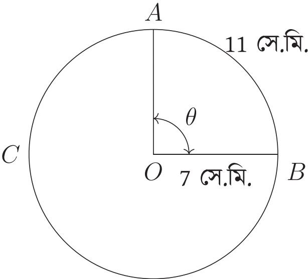

<!-- higher-math-9-10-bn-c08-t8.4-p065 · text · p.158 · review: verify-formula -->
বা, $\theta = \frac{s}{r} = \frac{11  সে.মি.}{7  সে.মি.}$

<!-- higher-math-9-10-bn-c08-t8.4-p066 · text · p.158 · review: verify-formula -->
$= 1.57$ রেডিয়ান (প্রায়)

<!-- higher-math-9-10-bn-c08-t8.4-p067 · text · p.158 · review: verify-formula -->
নির্নয়ে কোণের পরিমাণ: $1.57$ রেডিয়ান (প্রায়)।

<!-- higher-math-9-10-bn-c08-t8.4-p068 · text · p.158 · review: known-confusable-corrected,verify-formula -->
**উদাহরণ ৮.** এহসান সাইকেলে চড়ে বৃত্তাকার পথে 10 সেকেন্ডে একটি বৃন্তচাপ অতিক্রম করে। যদি চাপটি কেন্দ্রে $28^\circ$ কোণ উৎপন্ন করে এবং বৃন্তের ব্যাস 180 মিটার হয়, তবে এহসানের গতিবেগ নির্ণয় করো।

<!-- higher-math-9-10-bn-c08-t8.4-p069 · text · p.158 · review: verify-formula -->
**সমাধান:** ধরি, এহসান $ABC$ বৃন্তের $B$ বিন্দু থেকে যাত্রা করে 10 সেকেন্ড পরে পরিধির উপর $A$ বিন্দুতে আসে।

<!-- higher-math-9-10-bn-c08-t8.4-p070 · text · p.158 · review: verify-formula -->
তাহলে $AB$ চাপ দ্বারা উৎপন্ন কেন্দ্রস্থ কোণ $\angle AOB = 28^\circ$

<!-- higher-math-9-10-bn-c08-t8.4-p071 · figure · p.158 · review: latin-junk -->
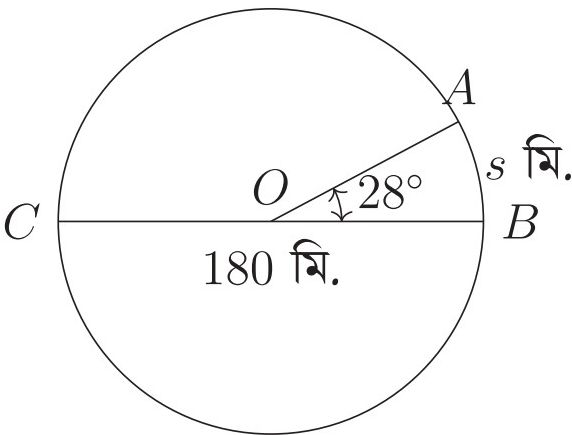

<!-- higher-math-9-10-bn-c08-t8.4-p072 · formula · p.158 · review: verify-formula -->
$OB = ব্যাসার্ধ = \frac{180}{2}  মিটার = 90  মিটার$

<!-- higher-math-9-10-bn-c08-t8.4-p073 · text · p.158 · review: verify-formula -->
ধরি, চাপ $AB = s$ মিটার

<!-- higher-math-9-10-bn-c08-t8.4-p074 · text · p.158 -->
আমরা জানি,

<!-- higher-math-9-10-bn-c08-t8.4-p075 · formula · p.158 · review: verify-formula -->
$s = r\theta$

<!-- higher-math-9-10-bn-c08-t8.4-p076 · formula · p.158 · review: verify-formula -->
$= 90 \times 28 \times \frac{\pi}{180}  মিটার$

<!-- higher-math-9-10-bn-c08-t8.4-p077 · formula · p.158 · review: verify-formula -->
$= 14\pi  মিটার$

<!-- higher-math-9-10-bn-c08-t8.4-p078 · formula · p.158 · review: verify-formula -->
$= 14 \times 3.1416  মিটার (প্রায়)$

<!-- higher-math-9-10-bn-c08-t8.4-p079 · formula · p.158 · review: verify-formula -->
$= 43.98  মিটার (প্রায়)$

<!-- higher-math-9-10-bn-c08-t8.4-p080 · text · p.158 · review: verify-formula -->
$\therefore$ এহসানের গতিবেগ $= \frac{43.98}{10}  মিটার/সেকেন্ড = 4.398  মিটার/সেকেন্ড = 4.4  মিটার/সেকেন্ড (প্রায়)$

<!-- higher-math-9-10-bn-c08-t8.4-p081 · text · p.158 · review: verify-formula -->
নির্নয়ে গতিবেগ: $4.4  মিটার/সেকেন্ড (প্রায়)$

<!-- higher-math-9-10-bn-c08-t8.4-p082 · text · p.158 · review: verify-formula -->
**উদাহরণ ৯.** 540 কিলোমিটার দূরে একটি বিন্দুতে কোনো পাহাড় $7^\circ$ কোণ উৎপন্ন করে। পাহাড়টির উচ্চতা নির্ণয় করো।

<!-- higher-math-9-10-bn-c08-t8.4-p083 · text · p.159 · review: verify-formula -->
**সমাধান:** মনে করি, $AB$ পাহাড়টির পাদবিন্দু $A$ থেকে 540 কি.মি. দূরে $O$ বিন্দুতে পাহাড়টি $7'$ কোণ উৎপন্ন করে।

<!-- higher-math-9-10-bn-c08-t8.4-p084 · text · p.159 · review: verify-formula -->
তাহলে $AO = r =$ ব্যাসার্ধ $= 540$ কি.মি.

<!-- higher-math-9-10-bn-c08-t8.4-p085 · text · p.159 · review: verify-formula -->
কেন্দ্রস্থ কোণ $\angle AOB = 7' = \left( \frac{7}{60} \right)^\circ = \frac{7\pi}{60 \times 180}$ রেডিয়ান।

<!-- higher-math-9-10-bn-c08-t8.4-p086 · text · p.159 · review: verify-formula -->
পাহাড়ের উচ্চতা $\approx$ চাপ $= s$ কি.মি.

<!-- higher-math-9-10-bn-c08-t8.4-p087 · figure · p.159 -->
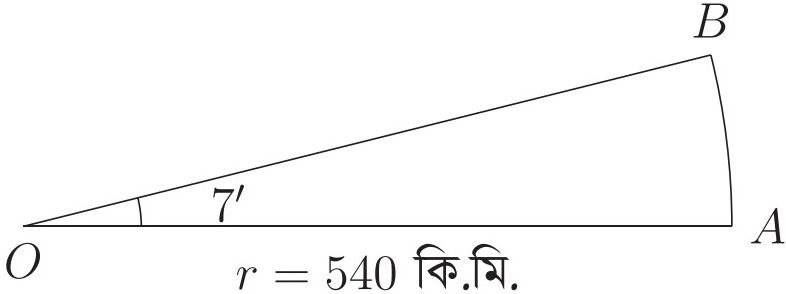

<!-- higher-math-9-10-bn-c08-t8.4-p088 · text · p.159 -->
আমরা জানি,

<!-- higher-math-9-10-bn-c08-t8.4-p089 · formula · p.159 · review: latin-junk,verify-formula -->
$$s = r\theta = 540 \times \frac{7\pi}{60 \times 180}  কি.মি.$$

<!-- higher-math-9-10-bn-c08-t8.4-p090 · formula · p.159 · review: latin-junk,verify-formula -->
$$= \frac{7 \times 3.1416}{20}  কি.মি. (প্রায়)$$

<!-- higher-math-9-10-bn-c08-t8.4-p091 · formula · p.159 · review: verify-formula -->
$$= 1.1  কি.মি. (প্রায়)$$

<!-- higher-math-9-10-bn-c08-t8.4-p092 · text · p.159 · review: verify-formula -->
$\therefore$ পাহাড়টির উচ্চতা 1.1 কি.মি. (প্রায়) বা 1100 মিটার (প্রায়)।

## 8.ex অনুশীলনী ৮.১

<!-- higher-math-9-10-bn-c08-t8.ex-p001 · exercise · p.159 · review: verify-formula -->
ক্যালকুলেটর ব্যবহার করে নিম্নের সমস্যাগুলোর সমাধান নির্ণয় করো। সমস্ত ক্ষেত্রে $\pi$ এর আসন্ন মান চার দশমিক স্থান পর্যন্ত ব্যবহার করো ($\pi = 3.1416$).

<!-- higher-math-9-10-bn-c08-t8.ex-p002 · exercise · p.159 · review: verify-formula -->
১. ক) রেডিয়ানে প্রকাশ করো:
    (i) $75^\circ 30'$
    (ii) $55^\circ 54' 53''$
    (iii) $33^\circ 22' 11''$

<!-- higher-math-9-10-bn-c08-t8.ex-p003 · exercise · p.159 · review: verify-formula -->
খ) ডিগ্রিতে প্রকাশ করো:
    (i) $\frac{8\pi}{13}$ রেডিয়ান
    (ii) 1.3177 রেডিয়ান
    (iii) 0.9759 রেডিয়ান

<!-- higher-math-9-10-bn-c08-t8.ex-p004 · exercise · p.159 · review: verify-formula -->
২. একটি কোণকে যাটমূলক ও বৃত্তীয় পদ্ধতিতে যথাক্রমে $D^\circ$ ও $R^c$ দ্বারা প্রকাশ করা হলে, প্রমাণ করো যে, $\frac{D}{180} = \frac{R}{\pi}$।

<!-- higher-math-9-10-bn-c08-t8.ex-p005 · exercise · p.159 -->
৩. একটি চাকার ব্যাসার্ধ 2 মিটার 3 সে.মি. হলে, চাকার পরিধির আসন্ন মান চার দশমিক স্থান পর্যন্ত নির্ণয় করো।

<!-- higher-math-9-10-bn-c08-t8.ex-p006 · exercise · p.160 -->
৪. একটি গাড়ির চাকার ব্যাস 0.84 মিটার এবং চাকাটি প্রতি সেকেন্ডে ৬ বার ঘুরে। গাড়িটির গতিবেগ নির্ণয় করো।

<!-- higher-math-9-10-bn-c08-t8.ex-p007 · exercise · p.160 -->
৫. কোনো ত্রিভুজের কোণ তিনটির অনুপাত ২ : ৫ : ৩ হলে সূত্রতম ও বৃহত্তম কোণের বৃত্তীয় মান কত?

<!-- higher-math-9-10-bn-c08-t8.ex-p008 · exercise · p.160 -->
৬. একটি ত্রিভুজের কোণগুলো সমানতর শ্রেণিভুক্ত এবং বৃহত্তম কোণটি সূত্রতম কোণের দ্বিগুণ। কোণগুলোর রেডিয়ান পরিমাণ কত?

<!-- higher-math-9-10-bn-c08-t8.ex-p009 · exercise · p.160 -->
৭. পৃথিবীর ব্যাসার্ধ 6440 কি.মি.। ঢাকা ও চট্টগ্রাম পৃথিবীর কেন্দ্রে ৫° কোণ উৎপন্ন করে। ঢাকা ও চট্টগ্রামের দূরত্ব কত?

<!-- higher-math-9-10-bn-c08-t8.ex-p010 · exercise · p.160 -->
৮. পৃথিবীর ব্যাসার্ধ 6440 কি.মি.। টেকনাফ ও তেতুলিয়া পৃথিবীর কেন্দ্রে 10°6'3" কোণ উৎপন্ন করে। টেকনাফ ও তেতুলিয়ার মধ্যবর্তী দূরত্ব কত?

<!-- higher-math-9-10-bn-c08-t8.ex-p011 · exercise · p.160 -->
৯. শাহেদ একটি সাইকেলে চড়ে বৃত্তাকার পথে 11 সেকেন্ডে একটি বৃত্তচাপ অতিক্রম করে। যদি চাপটি কেন্দ্রে 30° কোণ উৎপন্ন করে এবং বৃত্তের ব্যাস 201 মিটার হয়, তবে শাহেদের গতিবেগ কত?

<!-- higher-math-9-10-bn-c08-t8.ex-p012 · exercise · p.160 -->
১০. পৃথিবীর ব্যাসার্ধ 6440 কি.মি.। পৃথিবীর উপরের যে দুটি স্থান কেন্দ্রে 32" কোণ উৎপন্ন করে তাদের দূরত্ব কত?

<!-- higher-math-9-10-bn-c08-t8.ex-p013 · exercise · p.160 · review: verify-formula -->
১১. সকাল 9 : 30 টায় ঘড়ির ঘণ্টার কঁাটা ও মিনিটের কঁাটার অন্তর্গত কোণকে রেডিয়ানে প্রকাশ কর। [সংকেত: এক ঘর কেন্দ্রে $\frac{360^\circ}{60} = 6^\circ$ কোণ উৎপন্ন করে। 9 : 30 টায় ঘড়ির ঘণ্টার কঁাটা ও মিনিটের কঁাটার মধ্যে ব্যবধান $\left(15 + 2\frac{1}{2}\right)$ বা $17\frac{1}{2}$ ঘর]

<!-- higher-math-9-10-bn-c08-t8.ex-p014 · exercise · p.160 -->
১২. এক ব্যক্তি বৃত্তাকার পথে ঘণ্টায় ৬ কি.মি. বেগে দৌড়ে 36 সেকেন্ডে যে বৃত্তচাপ অতিক্রম করে তা কেন্দ্রে 60° কোণ উৎপন্ন করে। বৃত্তের ব্যাস নির্ণয় করো।

<!-- higher-math-9-10-bn-c08-t8.ex-p015 · exercise · p.160 -->
১৩. 750 কিলোমিটার দূরে একটি বিন্দুতে কোনো পাহাড় 8' কোণ উৎপন্ন করে। পাহাড়টির উচ্চতা নির্ণয় করো।

### অনুশীলনী ৮.২

<!-- higher-math-9-10-bn-c08-t8.ex-p016 · exercise · p.175 -->
১. ক্যালকুলেটর ব্যবহার না করে মান নির্ণয় করো:

<!-- higher-math-9-10-bn-c08-t8.ex-p017 · exercise · p.175 · review: verify-formula -->
ক) $\frac{\cos \frac{\pi}{4}}{\cos \frac{\pi}{6} + \sin \frac{\pi}{3}}$

<!-- higher-math-9-10-bn-c08-t8.ex-p018 · exercise · p.175 · review: verify-formula -->
খ) $\tan \frac{\pi}{4} + \tan \frac{\pi}{6} \cdot \tan \frac{\pi}{3}$

<!-- higher-math-9-10-bn-c08-t8.ex-p019 · exercise · p.175 · review: verify-formula -->
২. $\cos \theta = -\frac{4}{5}$ এবং $\pi < \theta < \frac{3\pi}{2}$ হলে $\tan \theta$ এবং $\sin \theta$ এর মান নির্ণয় করো।

<!-- higher-math-9-10-bn-c08-t8.ex-p020 · exercise · p.175 · review: verify-formula -->
৩. $\sin A = \frac{2}{\sqrt{5}}$ এবং $\frac{\pi}{2} < A < \pi$ এর ক্ষেত্রে $\cos A$ এবং $\tan A$ এর মান কত?

<!-- higher-math-9-10-bn-c08-t8.ex-p021 · exercise · p.175 · review: verify-formula -->
৪. দেওয়া আছে, $\cos A = \frac{1}{2}$ এবং $\cos A$ ও $\sin A$ একই চিহ্নবিশিষ্ট। $\sin A$ ও $\tan A$ এর মান কত?

<!-- higher-math-9-10-bn-c08-t8.ex-p022 · exercise · p.175 · review: verify-formula -->
৫. দেওয়া আছে, $\tan A = -\frac{5}{12}$ এবং $\tan A$ ও $\cos A$ বিপরীত চিহ্নবিশিষ্ট। $\sin A$ ও $\cos A$ এর মান নির্ণয় করো।

<!-- higher-math-9-10-bn-c08-t8.ex-p023 · exercise · p.175 -->
৬. নিম্নলিখিত অভেদসমূহ প্রমাণ করো:

<!-- higher-math-9-10-bn-c08-t8.ex-p024 · exercise · p.175 · review: verify-formula -->
ক) $\tan A + \cot A = \sec A cosec A$

<!-- higher-math-9-10-bn-c08-t8.ex-p025 · exercise · p.175 · review: verify-formula -->
খ) $\sqrt{\frac{1 + \cos \theta}{1 - \cos \theta}} = cosec \theta + \cot \theta = \sqrt{\frac{\sec \theta + 1}{\sec \theta - 1}}$

<!-- higher-math-9-10-bn-c08-t8.ex-p026 · exercise · p.175 · review: verify-formula -->
গ) $\sqrt{\frac{1 - \sin A}{1 + \sin A}} = \sec A - \tan A$

<!-- higher-math-9-10-bn-c08-t8.ex-p027 · exercise · p.175 · review: verify-formula -->
ঘ) $\sec^4 \theta - \sec^2 \theta = \tan^4 \theta + \tan^2 \theta$

<!-- higher-math-9-10-bn-c08-t8.ex-p028 · exercise · p.175 · review: verify-formula -->
ঙ) $(\sec \theta - \cos \theta)(cosec \theta - \sin \theta)(\tan \theta + \cot \theta) = 1$

<!-- higher-math-9-10-bn-c08-t8.ex-p029 · exercise · p.175 · review: verify-formula -->
চ) $\frac{\tan \theta + \sec \theta - 1}{\tan \theta - \sec \theta + 1} = \tan \theta + \sec \theta$

<!-- higher-math-9-10-bn-c08-t8.ex-p030 · exercise · p.175 · review: verify-formula -->
৭. যদি $cosec A = \frac{a}{b}$ হয়, যেখানে $a > b > 0$, তবে প্রমাণ করো যে, $\tan A = \frac{\pm b}{\sqrt{a^2 - b^2}}$

<!-- higher-math-9-10-bn-c08-t8.ex-p031 · exercise · p.175 · review: verify-formula -->
৮. যদি $\cos \theta - \sin \theta = \sqrt{2} \sin \theta$ হয়, তবে দেখাও যে, $\cos \theta + \sin \theta = \sqrt{2} \cos \theta$

<!-- higher-math-9-10-bn-c08-t8.ex-p032 · exercise · p.175 · review: verify-formula -->
৯. $\tan \theta = \frac{x}{y}, x \neq y$ হলে, $\frac{x \sin \theta + y \cos \theta}{x \sin \theta - y \cos \theta}$ এর মান নির্ণয় করো।

<!-- higher-math-9-10-bn-c08-t8.ex-p033 · exercise · p.175 · review: verify-formula -->
১০. $\tan \theta + \sec \theta = x$ হলে, দেখাও যে, $\sin \theta = \frac{x^2 - 1}{x^2 + 1}$

### ১১. মান নির্ণয় করো:

<!-- higher-math-9-10-bn-c08-t8.ex-p034 · exercise · p.176 · review: verify-formula -->
ক) $\sin^2 \frac{\pi}{6} + \cos^2 \frac{\pi}{4} + \tan^2 \frac{\pi}{3} + \cot^2 \frac{\pi}{6}$

<!-- higher-math-9-10-bn-c08-t8.ex-p035 · exercise · p.176 · review: verify-formula -->
খ) $3\tan^2 \frac{\pi}{4} - \sin^2 \frac{\pi}{3} - \frac{1}{2}\cot^2 \frac{\pi}{6} + \frac{1}{3}\sec^2 \frac{\pi}{4}$

<!-- higher-math-9-10-bn-c08-t8.ex-p036 · exercise · p.176 · review: verify-formula -->
গ) $\tan^2 \frac{\pi}{4} - \sin^2 \frac{\pi}{3} \tan^2 \frac{\pi}{6} \tan^2 \frac{\pi}{3} \cos^2 \frac{\pi}{4}$

<!-- higher-math-9-10-bn-c08-t8.ex-p037 · exercise · p.176 · review: verify-formula -->
ঘ) $\frac{\tan \frac{\pi}{3} - \tan \frac{\pi}{6}}{1 + \tan \frac{\pi}{3} \tan \frac{\pi}{6}} + \cos \frac{\pi}{3} \cos \frac{\pi}{6} + \sin \frac{\pi}{3} \sin \frac{\pi}{6}$

### ১২. সরল করো:

<!-- higher-math-9-10-bn-c08-t8.ex-p038 · formula · p.176 · review: verify-formula -->
$$\frac{1 - \sin^2 \frac{\pi}{6}}{1 + \sin^2 \frac{\pi}{4}} \times \frac{\cos^2 \frac{\pi}{3} + \cos^2 \frac{\pi}{6}}{\csc^2 \frac{\pi}{2} - \cot^2 \frac{\pi}{2}} \div \left( \sin \frac{\pi}{3} \tan \frac{\pi}{6} \right) + \left( \sec^2 \frac{\pi}{6} - \tan^2 \frac{\pi}{6} \right)$$

### অনুশীলনী ৮.৩

<!-- higher-math-9-10-bn-c08-t8.ex-p039 · exercise · p.189 · review: verify-formula -->
১. $\sin A = \frac{1}{\sqrt{2}}$ হলে $\sin 2A$ এর মান কত?
ক) $\frac{1}{\sqrt{2}}$ খ) $\frac{1}{2}$ গ) $1$ ঘ) $\sqrt{2}$

<!-- higher-math-9-10-bn-c08-t8.ex-p040 · exercise · p.189 · review: verify-formula -->
২. $\sin\theta + \cos\theta = 1$ হলে $\theta$ এর মান হবে-
(i) $0^\circ$ (ii) $30^\circ$ (iii) $90^\circ$
নিচের কোনটি সঠিক?
ক) $i$ খ) $ii$ গ) $i$ ও $ii$ ঘ) $i$ ও $iii$

<!-- higher-math-9-10-bn-c08-t8.ex-p041 · exercise · p.189 · review: verify-formula -->
৩. মান নির্ণয় করো:
ক) $\sin 7\pi$ খ) $\cos \frac{11\pi}{2}$ গ) $\cot 11\pi$
ঘ) $\tan\left(-\frac{23\pi}{6}\right)$ ঙ) $\csc \frac{19\pi}{3}$ চ) $\sec\left(-\frac{25\pi}{2}\right)$
ছ) $\sin \frac{31\pi}{6}$ জ) $\cos\left(-\frac{25\pi}{6}\right)$

<!-- higher-math-9-10-bn-c08-t8.ex-p042 · exercise · p.189 · review: verify-formula -->
৪. প্রমাণ করো: যে,
ক) $\cos \frac{17\pi}{10} + \cos \frac{13\pi}{10} + \cos \frac{9\pi}{10} + \cos \frac{\pi}{10} = 0$
খ) $\sin^2 \frac{\pi}{7} + \sin^2 \frac{5\pi}{14} + \sin^2 \frac{8\pi}{7} + \sin^2 \frac{9\pi}{14} = 2$

<!-- higher-math-9-10-bn-c08-t8.ex-p043 · exercise · p.190 · review: verify-formula -->
গ) $\sin \frac{7\pi}{3} \cos \frac{13\pi}{6} - \cos \frac{5\pi}{3} \sin \frac{11\pi}{6} = 1$

<!-- higher-math-9-10-bn-c08-t8.ex-p044 · exercise · p.190 · review: verify-formula -->
ঘ) $\sin \frac{13\pi}{3} \cos \frac{13\pi}{6} - \sin \frac{11\pi}{6} \cos \left( -\frac{5\pi}{3} \right) = 1$

<!-- higher-math-9-10-bn-c08-t8.ex-p045 · exercise · p.190 · review: verify-formula -->
ঙ) $\tan \theta = \frac{3}{4}$ এবং $\sin \theta$ ঋণাত্মক হলে দেখাও যে, $\frac{\sin \theta + \cos \theta}{\sec \theta + \tan \theta} = \frac{14}{5}$

### ৫. মান নির্ণয় করো:

<!-- higher-math-9-10-bn-c08-t8.ex-p046 · exercise · p.190 · review: verify-formula -->
ক) $\cos \frac{9\pi}{4} + \cos \frac{5\pi}{4} + \sin \frac{31\pi}{36} - \sin \frac{5\pi}{36}$

<!-- higher-math-9-10-bn-c08-t8.ex-p047 · exercise · p.190 · review: verify-formula -->
খ) $\cot \frac{\pi}{20} \cot \frac{3\pi}{20} \cot \frac{5\pi}{20} \cot \frac{7\pi}{20} \cot \frac{9\pi}{20}$

<!-- higher-math-9-10-bn-c08-t8.ex-p048 · exercise · p.190 · review: verify-formula -->
গ) $\sin^2 \frac{\pi}{4} + \sin^2 \frac{3\pi}{4} + \sin^2 \frac{5\pi}{4} + \sin^2 \frac{7\pi}{4}$

<!-- higher-math-9-10-bn-c08-t8.ex-p049 · exercise · p.190 · review: verify-formula -->
ঘ) $\cos^2 \frac{\pi}{8} + \cos^2 \frac{3\pi}{8} + \cos^2 \frac{5\pi}{8} + \cos^2 \frac{7\pi}{8}$

<!-- higher-math-9-10-bn-c08-t8.ex-p050 · exercise · p.190 · review: verify-formula -->
ঙ) $\sin^2 \frac{17\pi}{18} + \sin^2 \frac{5\pi}{8} + \cos^2 \frac{37\pi}{18} + \cos^2 \frac{3\pi}{8}$

### ৬. $\theta = \frac{\pi}{3}$ হলে নিম্নকু অভেদসমূহ যাচাই করো:

<!-- higher-math-9-10-bn-c08-t8.ex-p051 · exercise · p.190 · review: verify-formula -->
ক) $\sin 2\theta = 2 \sin \theta \cos \theta = \frac{2 \tan \theta}{1 + \tan^2 \theta}$

<!-- higher-math-9-10-bn-c08-t8.ex-p052 · exercise · p.190 · review: verify-formula -->
গ) $\cos 3\theta = 4 \cos^3 \theta - 3 \cos \theta$

<!-- higher-math-9-10-bn-c08-t8.ex-p053 · exercise · p.190 · review: verify-formula -->
খ) $\sin 3\theta = 3 \sin \theta - 4 \sin^3 \theta$

<!-- higher-math-9-10-bn-c08-t8.ex-p054 · exercise · p.190 · review: verify-formula -->
ঘ) $\tan 2\theta = \frac{2 \tan \theta}{1 - \tan^2 \theta}$

### ৭. প্রদত্ত শর্ত পূরণ করে $\alpha$ (আলফা) এর মান নির্ণয় করো:

<!-- higher-math-9-10-bn-c08-t8.ex-p055 · exercise · p.190 · review: verify-formula -->
ক) $\cot \alpha = -\sqrt{3}, \frac{3\pi}{2} < \alpha < 2\pi$

<!-- higher-math-9-10-bn-c08-t8.ex-p056 · exercise · p.190 · review: verify-formula -->
গ) $\sin \alpha = -\frac{\sqrt{3}}{2}, \frac{\pi}{2} < \alpha < \frac{3\pi}{2}$

<!-- higher-math-9-10-bn-c08-t8.ex-p057 · exercise · p.190 · review: verify-formula -->
খ) $\cos \alpha = -\frac{1}{2}, \frac{\pi}{2} < \alpha < \frac{3\pi}{2}$

<!-- higher-math-9-10-bn-c08-t8.ex-p058 · exercise · p.190 · review: verify-formula -->
ঘ) $\cot \alpha = -1, \pi < \alpha < 2\pi$

### বহুনির্বাচনি প্রশ্ন

<!-- higher-math-9-10-bn-c08-t8.ex-p059 · exercise · p.191 · review: verify-formula -->
১. $-300^\circ$ কোণটি কোন চতুর্ভাগে থাকবে?
ক) প্রথম          খ) দ্বিতীয়          গ) তৃতীয়          ঘ) চতুর্থ

<!-- higher-math-9-10-bn-c08-t8.ex-p060 · exercise · p.191 -->
২. পাশের চিত্র অনুসারে

<!-- higher-math-9-10-bn-c08-t8.ex-p061 · exercise · p.191 · review: verify-formula -->
(i) $\tan\theta = \frac{4}{3}$

<!-- higher-math-9-10-bn-c08-t8.ex-p062 · exercise · p.191 · review: verify-formula -->
(ii) $\sin\theta = \frac{5}{3}$

<!-- higher-math-9-10-bn-c08-t8.ex-p063 · exercise · p.191 · review: verify-formula -->
(iii) $\cos^2\theta = \frac{9}{25}$

<!-- higher-math-9-10-bn-c08-t8.ex-p064 · exercise · p.191 -->
নিচের কোনটি সঠিক?

<!-- higher-math-9-10-bn-c08-t8.ex-p065 · exercise · p.191 · review: verify-formula -->
ক) $i$ ও $ii$          খ) $i$ ও $iii$          গ) $ii$ ও $iii$          ঘ) $i, ii$ ও $iii$

<!-- higher-math-9-10-bn-c08-t8.ex-p066 · figure · p.191 -->
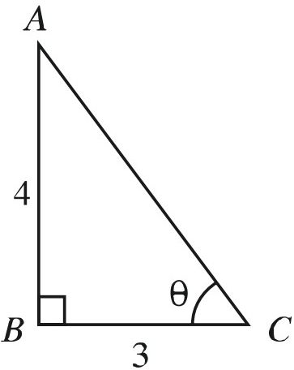

<!-- higher-math-9-10-bn-c08-t8.ex-p067 · exercise · p.192 -->
নিচের চিহ্নের আলোকে ৩ ও ৪ নং প্রশ্নের উত্তর দাও:

<!-- higher-math-9-10-bn-c08-t8.ex-p068 · figure · p.192 -->
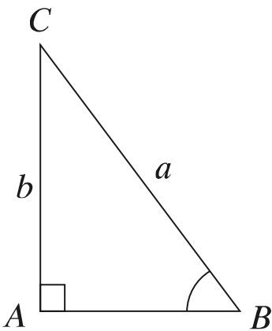

<!-- higher-math-9-10-bn-c08-t8.ex-p069 · exercise · p.192 · review: verify-formula -->
৩. $\sin B + \cos C =$ কত?

<!-- higher-math-9-10-bn-c08-t8.ex-p070 · exercise · p.192 · review: verify-formula -->
ক) $\frac{2b}{a}$
খ) $\frac{2a}{b}$
গ) $\frac{a^2 + b^2}{ab}$
ঘ) $\frac{ab}{a^2 + b^2}$

<!-- higher-math-9-10-bn-c08-t8.ex-p071 · exercise · p.192 · review: verify-formula -->
৪. $\tan B$ এর মান কোনটি?

<!-- higher-math-9-10-bn-c08-t8.ex-p072 · exercise · p.192 · review: verify-formula -->
ক) $\frac{a}{a^2 - b^2}$
খ) $\frac{b}{a^2 - b^2}$
গ) $\frac{a}{\sqrt{a^2 - b^2}}$
ঘ) $\frac{b}{\sqrt{a^2 - b^2}}$

### সৃজনশীল প্রশ্ন

<!-- higher-math-9-10-bn-c08-t8.ex-p073 · exercise · p.192 · review: known-confusable-corrected,verify-formula -->
৫. $a \cos \theta - b \sin \theta = p$

<!-- higher-math-9-10-bn-c08-t8.ex-p074 · exercise · p.192 · review: known-confusable-corrected,verify-formula -->
(ক) $A = \frac{\pi}{3}$ হলে দেখাও যে, $\tan 2A = \frac{2 \tan A}{1 - \tan^2 A}$

<!-- higher-math-9-10-bn-c08-t8.ex-p075 · exercise · p.192 · review: known-confusable-corrected,verify-formula -->
(খ) প্রমাণ কর যে, $a \sin \theta + b \cos \theta = \pm \sqrt{a^2 + b^2 - p^2}$

<!-- higher-math-9-10-bn-c08-t8.ex-p076 · exercise · p.192 · review: known-confusable-corrected,verify-formula -->
(গ) $a = \sqrt{3}, b = 1$ এবং $p = 2$ হলে, উদ্দীপকের সমীকরণটি সমাধান করো। যেখানে, $0 < \theta < 2\pi$

<!-- higher-math-9-10-bn-c08-t8.ex-p077 · exercise · p.192 · review: known-confusable-corrected,verify-formula -->
৬. $p = \tan \theta, q = \cot \theta$

<!-- higher-math-9-10-bn-c08-t8.ex-p078 · exercise · p.192 · review: known-confusable-corrected -->
ক) ৯ টা ১৫ মিনিটের সময় ঘণ্টা ও মিনিটের কাঁটার মধ্যবর্তী কোণের পরিমাণ নির্ণয় করো।

<!-- higher-math-9-10-bn-c08-t8.ex-p079 · exercise · p.192 · review: known-confusable-corrected,verify-formula -->
খ) $p + q = 2$ হলে দেখাও যে, $p^n + q^n = 2$

<!-- higher-math-9-10-bn-c08-t8.ex-p080 · exercise · p.192 · review: known-confusable-corrected,verify-formula -->
গ) $q = \frac{3}{4}$ এবং $\pi < \theta < \frac{3\pi}{2}$ হলে, $\frac{\cot(-\theta) + \csc \theta}{\cos \theta + \sin(-\theta)}$ এর মান নির্ণয় করো।

### সংক্ষিপ্ত-উত্তর প্রশ্ন

<!-- higher-math-9-10-bn-c08-t8.ex-p081 · exercise · p.192 -->
৭. ক) ০.৯৭৯৫ রেডিয়ানকে স্কেচমূলক পদ্ধতিতে প্রকাশ করো।

<!-- higher-math-9-10-bn-c08-t8.ex-p082 · exercise · p.192 · review: verify-formula -->
খ) $\sec \left( -\frac{21\pi}{2} \right)$ এর মান নির্ণয় করো।

<!-- higher-math-9-10-bn-c08-t8.ex-p083 · exercise · p.192 · review: verify-formula -->
গ) $\tan \frac{\pi}{12} \tan \frac{5\pi}{12} \tan \frac{7\pi}{12} \tan \frac{11\pi}{12}$ এর মান নির্ণয় করো।

<!-- higher-math-9-10-bn-c08-t8.ex-p084 · exercise · p.192 · review: verify-formula -->
ঘ) $\sin \alpha = -\frac{1}{2}, \frac{\pi}{2} < \alpha < \frac{3\pi}{2}$ হলে, $\alpha$ এর মান নির্ণয় করো।

## 8.5 ত্রিকোণমিতিক অনুপাতসমূহ (Trigonometric Ratios)

<!-- higher-math-9-10-bn-c08-t8.5-p001 · text · p.160 -->
ত্রিকোণমিতির এই অংশে প্রথমে সূক্ষ্মকোণের ক্ষেত্রে ত্রিকোণমিতিক অনুপাতসমূহ (sine, cosine, tangent, secant, cosecant, cotangent) সম্পর্কে আলোচনা করা হবে। সূক্ষ্মকোণের অনুপাতসমূহের মাধ্যমে যেকোনো কোণের ত্রিকোণমিতিক অনুপাতসমূহ নির্ণয়ের কৌশল আলোচনা করা হবে। অনুপাতসমূহের পারস্পরিক সম্পর্ক এবং বিভিন্ন চতুর্ভাগে এদের চিহ্ন কি হবে সে সম্পর্কে ব্যাখ্যা করা হবে। ত্রিকোণমিতিক অনুপাত সংক্রান্ত কতিপয় অভেদ সম্পর্কে ধারণা দেওয়া হবে।

<!-- higher-math-9-10-bn-c08-t8.5-p002 · text · p.161 · review: verify-formula -->
এছাড়াও আদর্শ কোণসমূহের $(0, \frac{\pi}{6}, \frac{\pi}{4}, \frac{\pi}{3}, \frac{\pi}{2})$ ত্রিকোণমিতিক অনুপাত এবং অনুপাতসমূহের সর্বোচ্চ বা সর্বনিম্নমান অর্থাৎ মানের পরিধি সম্পর্কে আলোচনাও এই অংশে অন্তর্ভুক্ত থাকবে।

### (ক) সূক্ষ্মকোণের ত্রিকোণমিতিক অনুপাতসমূহ (Trigonometric Ratios of Acute Angles):

<!-- higher-math-9-10-bn-c08-t8.5-p003 · text · p.161 · review: verify-formula -->
সূক্ষ্মকোণের ত্রিকোণমিতিক অনুপাতসমূহ নির্ণয় করার জন্য আমরা একটি সমকোণী ত্রিভুজ $\triangle OPQ$ বিবেচনা করি। $\triangle OPQ$ এ $\angle OQP$ সমকোণ। $\angle POQ$ এর সাপেক্ষে $OP$ ত্রিভুজের অতিভুজ (hypotenuse), $OQ$ ভূমি (adjacent side), $PQ$ লম্ব (opposite side) এবং $\angle POQ = \theta$ (সূক্ষ্মকোণ)। $OPQ$ সমকোণী ত্রিভুজে সূক্ষ্মকোণ $\theta$ এর জন্য ছয়টি ত্রিকোণমিতিক অনুপাত (sine, cosine, tangent, secant, cosecant, cotangent) নিম্নেুক্তভাবে সংজ্ঞায়িত করা হয়:

<!-- higher-math-9-10-bn-c08-t8.5-p004 · figure · p.161 · review: latin-junk -->
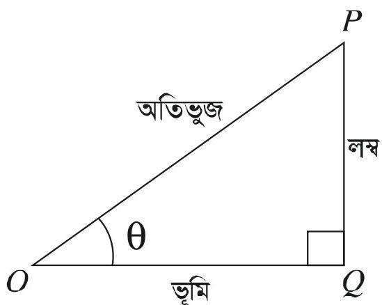

<!-- higher-math-9-10-bn-c08-t8.5-p005 · formula · p.161 · review: latin-junk,verify-formula -->
$$\sin \theta = \frac{PQ}{OP} = \frac{লম্ব}{অতিভুজ}$$

<!-- higher-math-9-10-bn-c08-t8.5-p006 · formula · p.161 · review: latin-junk,verify-formula -->
$$\cos \theta = \frac{OQ}{OP} = \frac{ভূমি}{অতিভুজ}$$

<!-- higher-math-9-10-bn-c08-t8.5-p007 · formula · p.161 · review: latin-junk,verify-formula -->
$$\tan \theta = \frac{PQ}{OQ} = \frac{লম্ব}{ভূমি}$$

<!-- higher-math-9-10-bn-c08-t8.5-p008 · formula · p.161 · review: latin-junk,verify-formula -->
$$\csc \theta = \frac{OP}{PQ} = \frac{অতিভুজ}{লম্ব}$$

<!-- higher-math-9-10-bn-c08-t8.5-p009 · formula · p.161 · review: latin-junk,verify-formula -->
$$\sec \theta = \frac{OP}{OQ} = \frac{অতিভুজ}{ভূমি}$$

<!-- higher-math-9-10-bn-c08-t8.5-p010 · formula · p.161 · review: latin-junk,verify-formula -->
$$\cot \theta = \frac{OQ}{PQ} = \frac{ভূমি}{লম্ব}$$

<!-- higher-math-9-10-bn-c08-t8.5-p011 · text · p.161 · review: verify-formula -->
**উদাহরণ ১০.** একটি সমকোণী ত্রিভুজের ক্ষেত্রে $\tan \theta = 3$ হলে অন্য ত্রিকোণমিতিক অনুপাতসমূহ নির্ণয় কর।

<!-- higher-math-9-10-bn-c08-t8.5-p012 · text · p.161 · review: verify-formula -->
**সমাধান:** ধরি, $ABC$ একটি সমকোণী ত্রিভুজ যেখানে অতিভুজ $= AC$, ভূমি $= AB$, লম্ব $= BC$ এবং $\angle BAC = \theta$

<!-- higher-math-9-10-bn-c08-t8.5-p013 · text · p.161 · review: verify-formula -->
দেওয়া আছে $\tan \theta = 3$

<!-- higher-math-9-10-bn-c08-t8.5-p014 · text · p.161 · review: verify-formula -->
বা, $\tan \theta = \frac{লম্ব}{ভূমি} = \frac{3}{1}$

<!-- higher-math-9-10-bn-c08-t8.5-p015 · text · p.161 · review: verify-formula -->
$\therefore$ লম্ব $BC = 3$ একক এবং ভূমি $AB = 1$ একক।

<!-- higher-math-9-10-bn-c08-t8.5-p016 · figure · p.161 -->
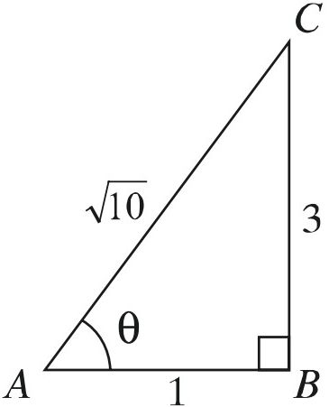

<!-- higher-math-9-10-bn-c08-t8.5-p017 · text · p.161 · review: verify-formula -->
পিথাগোরাসের উপপাদ্য অনুযায়ী
অতিভুজ $AC = \sqrt{AB^2 + BC^2} = \sqrt{1^2 + 3^2} = \sqrt{10}$ একক

<!-- higher-math-9-10-bn-c08-t8.5-p018 · text · p.161 · review: verify-formula -->
$\therefore$ অন্য ত্রিকোণমিতিক অনুপাতসমূহ

<!-- higher-math-9-10-bn-c08-t8.5-p019 · formula · p.161 · review: latin-junk,verify-formula -->
$$\sin \theta = \frac{লম্ব}{অতিভুজ} = \frac{3}{\sqrt{10}}$$

<!-- higher-math-9-10-bn-c08-t8.5-p020 · formula · p.161 · review: latin-junk,verify-formula -->
$$\csc \theta = \frac{অতিভুজ}{লম্ব} = \frac{\sqrt{10}}{3}$$

<!-- higher-math-9-10-bn-c08-t8.5-p021 · formula · p.162 · review: latin-junk,verify-formula -->
$$\cos\theta = \frac{ভূমি}{অতিভুজ} = \frac{1}{\sqrt{10}}$$

<!-- higher-math-9-10-bn-c08-t8.5-p022 · formula · p.162 · review: latin-junk,verify-formula -->
$$\sec\theta = \frac{অতিভুজ}{ভূমি} = \frac{\sqrt{10}}{1} = \sqrt{10}$$

<!-- higher-math-9-10-bn-c08-t8.5-p023 · text · p.162 · review: verify-formula -->
এবং $\cot\theta = \frac{ভূমি}{লম্ব} = \frac{1}{3}$

<!-- higher-math-9-10-bn-c08-t8.5-p024 · text · p.162 · review: latin-junk -->
**লক্ষণীয়:** যেহেতু অনুপাতের কোনো একক থাকে না এবং sine, cosine, tangent, secant, cosecant, cotangent এই ছয়টি ত্রিকোণমিতিক অনুপাত, তাই এদের কোনো একক নেই।

<!-- higher-math-9-10-bn-c08-t8.5-p025 · text · p.162 · review: verify-formula -->
**কাজ:** $ABC$ একটি সমকোণী ত্রিভুজ এবং $\sin\theta = \frac{2}{\sqrt{5}}$। অন্য ত্রিকোণমিতিক অনুপাতসমূহ নির্ণয় করো।

<!-- higher-math-9-10-bn-c08-t8.5-p026 · text · p.162 -->
**দ্রষ্টব্য:** ত্রিকোণমিতিক অনুপাতসমূহকে সংক্ষেপে লেখা হয়। যেমন:

<!-- higher-math-9-10-bn-c08-t8.5-p027 · text · p.162 · review: verify-formula -->
$$\sin\theta = \sin\theta, \quad \cos\theta = \cos\theta, \quad \tan\theta = \tan\theta,$$
$$\sec\theta = \sec\theta, \quad \csc\theta = \csc\theta, \quad \cot\theta = \cot\theta$$

<!-- higher-math-9-10-bn-c08-t8.5-p028 · text · p.162 · review: verify-formula -->
(খ) যেকোনো কোণের জন্য ত্রিকোণমিতিক অনুপাতসমূহ: এই অংশে আমরা যেকোনো কোণের জন্য ত্রিকোণমিতিক অনুপাতসমূহ নির্ণয় করব। সে জন্য আমাদের কোনটির প্রমিত বা আদর্শ অবস্থান (Standard position) জানা দরকার। কাতেরসীয় সমতলে মূলবিন্দু থেকে ডানদিকে অর্থাৎ ধনাত্মক $x$-অক্ষকে আদি রশ্মি ধরে কোনটি অঙ্কন করলেই এর আদর্শ অবস্থান পাওয়া যায়। এখানে $\theta$ কে আমরা ত্রিকোণমিতিক কোণ হিসেবে বিবেচনা করব অর্থাৎ $\theta$ কোণের পরিমাণ নির্দিষ্ট সীমার মধ্যে থাকবে না।

<!-- higher-math-9-10-bn-c08-t8.5-p029 · text · p.162 · review: verify-formula -->
মনে করি, কাতেরসীয় তলে $X'OX$ রেখা $x$-অক্ষ, $Y'OY$ রেখা $y$-অক্ষ এবং $O$ বিন্দু মূলবিন্দু। ঘূর্ণায়মান রশ্মি $OA$ ধনাত্মক $x$-অক্ষ অর্থাৎ $OX$ রশ্মি থেকে শুরু করে ঘড়ির কাঁটার বিপরীত দিকে (anticlockwise) ঘুরে $OA$ অবস্থানে $\theta$ কোণ উৎপন্ন করেছে (নিচের চিত্র)।

<!-- higher-math-9-10-bn-c08-t8.5-p030 · figure · p.162 -->
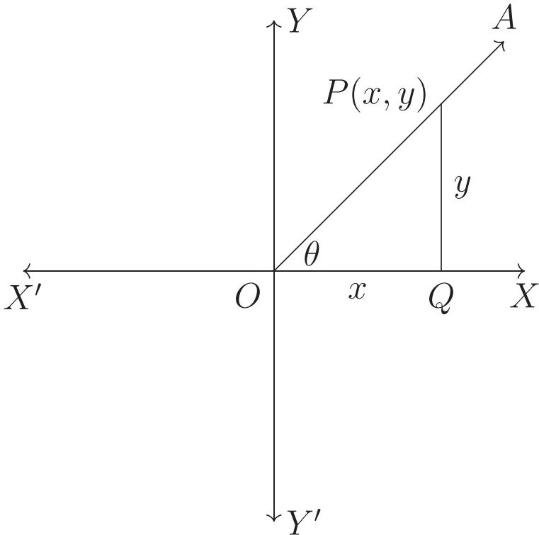

<!-- higher-math-9-10-bn-c08-t8.5-p031 · text · p.163 · review: verify-formula -->
$OX$ কে $\theta$ কোণের আদিবাহু (initial side) এবং $OA$ কে প্রান্তিকবাহু (terminal side) বলা হয়। $OA$ প্রান্তিক বাহুর উপর $O$ বিন্দু ভিন্ন $P(x, y)$ একটি বিন্দু নিই। তাহলে $OX$ থেকে বিন্দুটির লম্ব দূরত্ব $y$, $OY$ থেকে এর লম্ব দূরত্ব $x$ এবং $\angle OQP$ সমকোণ (আগের পৃষ্ঠার চিত্র)।

<!-- higher-math-9-10-bn-c08-t8.5-p032 · text · p.163 · review: verify-formula -->
সুতরাং পীথাগোরাসের সূত্র অনুসারে অতিভুজ $|OP| = r = \sqrt{x^2 + y^2}$। তাহলে যে কোনো কোণ $\theta$ এর জন্য ত্রিকোণমিতিক অনুপাতসমূহ হবে:

<!-- higher-math-9-10-bn-c08-t8.5-p033 · formula · p.163 · review: latin-junk,verify-formula -->
$$\sin \theta = \frac{লম্ব}{অতিভুজ} = \frac{y}{r}$$

<!-- higher-math-9-10-bn-c08-t8.5-p034 · formula · p.163 · review: latin-junk,verify-formula -->
$$\cos \theta = \frac{ভূমি}{অতিভুজ} = \frac{x}{r}$$

<!-- higher-math-9-10-bn-c08-t8.5-p035 · formula · p.163 · review: latin-junk,verify-formula -->
$$\tan \theta = \frac{লম্ব}{ভূমি} = \frac{y}{x} \quad [x \neq 0]$$

<!-- higher-math-9-10-bn-c08-t8.5-p036 · formula · p.163 · review: latin-junk,verify-formula -->
$$\sec \theta = \frac{অতিভুজ}{ভূমি} = \frac{r}{x} \quad [x \neq 0]$$

<!-- higher-math-9-10-bn-c08-t8.5-p037 · formula · p.163 · review: latin-junk,verify-formula -->
$$\csc \theta = \frac{অতিভুজ}{লম্ব} = \frac{r}{y} \quad [y \neq 0]$$

<!-- higher-math-9-10-bn-c08-t8.5-p038 · formula · p.163 · review: latin-junk,verify-formula -->
$$\cot \theta = \frac{ভূমি}{লম্ব} = \frac{x}{y} \quad [y \neq 0]$$

<!-- higher-math-9-10-bn-c08-t8.5-p039 · text · p.163 · review: verify-formula -->
**লক্ষণীয় ১:** $P$ এবং $O$ বিন্দু ভিন্ন হওয়ায় $r = |OP| > 0$ এবং $\sin \theta$ ও $\cos \theta$ সবসময়ই অর্থবহ। $OA$ প্রান্তিক বাহু $x$-অক্ষের উপর থাকলে $y = 0$ হয় বলে এরূপ কোণের জন্য $\csc \theta$ ও $\cot \theta$ সংজ্ঞায়িত নয়।

<!-- higher-math-9-10-bn-c08-t8.5-p040 · text · p.163 · review: verify-formula -->
অনুরূপভাবে, $OA$ প্রান্তিক বাহু $y$-অক্ষের উপর থাকলে $x = 0$ হয় এবং এরূপ কোণের জন্য $\sec \theta$ ও $\tan \theta$ সংজ্ঞায়িত হয় না।

<!-- higher-math-9-10-bn-c08-t8.5-p041 · text · p.163 · review: verify-formula -->
**লক্ষণীয় ২:** প্রান্তিক বাহু $OA$ এর উপর $P(x, y)$ বিন্দু ভিন্ন অন্য কোনো বিন্দু $P_1(x_1, y_1)$ নিই (নিচের বামের চিত্র ও ডানের চিত্র)। $P(x, y)$ ও $P_1(x_1, y_1)$ বিন্দুদ্বয় থেকে $x$-অক্ষের উপর $PM$ ও $P_1M_1$ লম্ব আঁকি। তাহলে $\triangle OPM$ এবং $\triangle OP_1M_1$ সদৃশ।

<!-- higher-math-9-10-bn-c08-t8.5-p042 · figure · p.163 -->
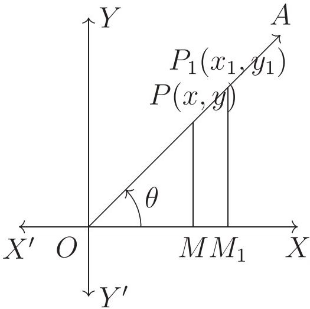

<!-- higher-math-9-10-bn-c08-t8.5-p043 · figure · p.163 -->
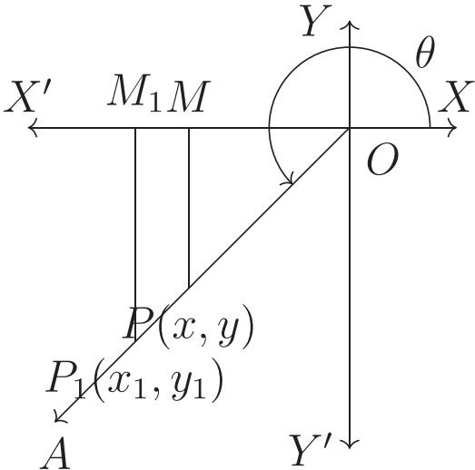

<!-- higher-math-9-10-bn-c08-t8.5-p044 · text · p.164 · review: verify-formula -->
অর্থাৎ $\frac{|x|}{|x_1|} = \frac{|y|}{|y_1|} = \frac{|OP|}{|OP_1|} = \frac{r}{r_1}$

<!-- higher-math-9-10-bn-c08-t8.5-p045 · text · p.164 · review: verify-formula -->
এখানে, $OP = r$, $OP_1 = r_1$, $x$ ও $x_1$ এবং $y$ ও $y_1$ একই চিহ্নযুক্ত।

<!-- higher-math-9-10-bn-c08-t8.5-p046 · text · p.164 · review: verify-formula -->
$\therefore \frac{x}{x_1} = \frac{y}{y_1} = \frac{r}{r_1}$ অর্থাৎ, $\frac{x}{r} = \frac{x_1}{r_1}$ এবং $\frac{y}{r} = \frac{y_1}{r_1}$

<!-- higher-math-9-10-bn-c08-t8.5-p047 · text · p.164 · review: verify-formula -->
সুতরাং $\sin\theta = \frac{y}{r} = \frac{y_1}{r_1}$

<!-- higher-math-9-10-bn-c08-t8.5-p048 · formula · p.164 · review: latin-junk,verify-formula -->
$$\cos\theta = \frac{x}{r} = \frac{x_1}{r_1} \quad \quad \tan\theta = \frac{y}{x} = \frac{y_1}{x_1}  ইত্যাদি।$$

<!-- higher-math-9-10-bn-c08-t8.5-p049 · text · p.164 · review: verify-formula -->
**সিদ্ধান্ত:** ত্রিকোণমিতিক অনুপাতসমূহের মান প্রান্তিক রশ্মি $OA$ এর উপর নির্বাচিত বিন্দু $P$ এর উপর নির্ভর করে না।

<!-- higher-math-9-10-bn-c08-t8.5-p050 · text · p.164 · review: verify-formula -->
**লক্ষণীয় ৩:** $\theta$ সূক্ষ্মকোণ হলে প্রমিত বা আদর্শ অবস্থানে এর প্রান্তিক বাহু $OA$ প্রথম চতুর্ভাগে থাকে এবং $\theta = \angle XOA$ হয় (পাশের চিত্র)। $OA$ বাহুতে যেকোনো বিন্দু $P(x, y)$ নিয়ে এবং $P$ থেকে $OX$ এর উপর $PM$ লম্ব টেনে দেখা যায় যে, $OM = x$, $PM = y$ এবং $OP = r$ ধরে পূর্ববর্তী আলোচনার (ক) ও (খ) থেকে $\theta$ কোণের অনুপাতগুলোর একই মান পাওয়া যায়।

<!-- higher-math-9-10-bn-c08-t8.5-p051 · figure · p.164 -->
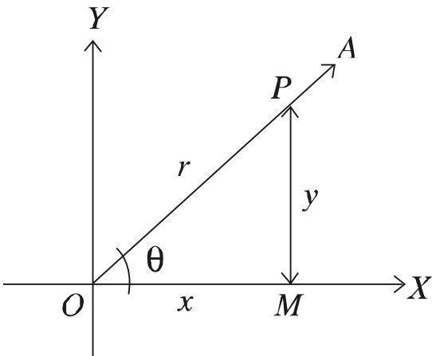

<!-- higher-math-9-10-bn-c08-t8.5-p052 · text · p.164 -->
**(গ) ত্রিকোণমিতিক অনুপাতগুলোর পারস্পরিক সম্পর্ক:** ত্রিকোণমিতিক অনুপাতসমূহের সংজ্ঞা থেকে আমরা লক্ষ্য করি যে,

<!-- higher-math-9-10-bn-c08-t8.5-p053 · formula · p.164 · review: latin-junk,verify-formula -->
$$\sin\theta = \frac{লম্ব}{অতিভুজ},  cosec\theta = \frac{অতিভুজ}{লম্ব} = \frac{1}{\frac{লম্ব}{অতিভুজ}} = \frac{1}{\sin\theta}$$

<!-- higher-math-9-10-bn-c08-t8.5-p054 · formula · p.164 · review: latin-junk,verify-formula -->
$$\therefore \sin\theta = \frac{1}{cosec\theta}  এবং cosec\theta = \frac{1}{\sin\theta}$$

<!-- higher-math-9-10-bn-c08-t8.5-p055 · figure · p.164 -->
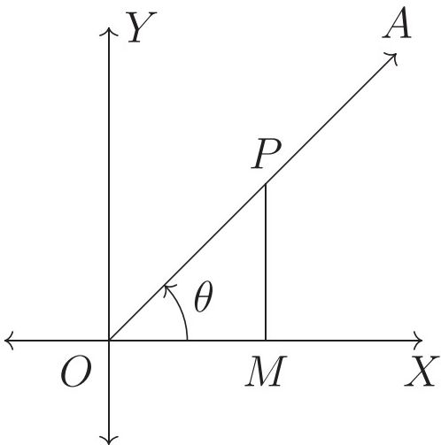

<!-- higher-math-9-10-bn-c08-t8.5-p056 · text · p.164 · review: verify-formula -->
অনুরূপভাবে, $\cos\theta = \frac{ভূমি}{অতিভুজ}, \sec\theta = \frac{অতিভুজ}{ভূমি} = \frac{1}{\frac{ভূমি}{অতিভুজ}} = \frac{1}{\cos\theta}$ অর্থাৎ $\cos\theta = \frac{1}{\sec\theta}$ এবং $\sec\theta = \frac{1}{\cos\theta}$

<!-- higher-math-9-10-bn-c08-t8.5-p057 · text · p.165 · review: verify-formula -->
একইভাবে, $\tan\theta = \frac{1}{\cot\theta}$ এবং $\cot\theta = \frac{1}{\tan\theta}$

### ত্রিকোণমিতিক অনুপাতসংক্রান্ত কতিপয় সহজ অভেদাবলি (Identities):

<!-- higher-math-9-10-bn-c08-t8.5-p058 · text · p.165 · review: verify-formula -->
(i) $\sin^2\theta + \cos^2\theta = 1$

<!-- higher-math-9-10-bn-c08-t8.5-p059 · text · p.165 -->
**প্রমাণ:** পাশের চিত্র থেকে আমরা দেখি,

<!-- higher-math-9-10-bn-c08-t8.5-p060 · figure · p.165 -->
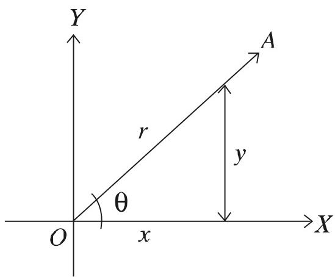

<!-- higher-math-9-10-bn-c08-t8.5-p061 · formula · p.165 · review: latin-junk,verify-formula -->
$$\cos\theta = \frac{ভূমি}{অতিভুজ} = \frac{x}{r}$$

<!-- higher-math-9-10-bn-c08-t8.5-p062 · formula · p.165 · review: latin-junk,verify-formula -->
$$\sin\theta = \frac{লম্ব}{অতিভুজ} = \frac{y}{r}$$

<!-- higher-math-9-10-bn-c08-t8.5-p063 · text · p.165 · review: verify-formula -->
এবং $r^2 = x^2 + y^2$

<!-- higher-math-9-10-bn-c08-t8.5-p064 · formula · p.165 · review: verify-formula -->
$$\therefore \sin^2\theta + \cos^2\theta = \frac{x^2}{r^2} + \frac{y^2}{r^2} = \frac{x^2 + y^2}{r^2} = \frac{r^2}{r^2} = 1$$

<!-- higher-math-9-10-bn-c08-t8.5-p065 · formula · p.165 · review: verify-formula -->
$$\therefore \sin^2\theta + \cos^2\theta = 1  (প্রমাণিত)।$$

<!-- higher-math-9-10-bn-c08-t8.5-p066 · text · p.165 · review: verify-formula -->
(i) নং সূত্র থেকে আমরা পাই, $\sin^2\theta = 1 - \cos^2\theta$ বা, $\cos^2\theta = 1 - \sin^2\theta$

<!-- higher-math-9-10-bn-c08-t8.5-p067 · text · p.165 -->
অনুরূপভাবে প্রমাণ করা যায় যে,

<!-- higher-math-9-10-bn-c08-t8.5-p068 · text · p.165 · review: verify-formula -->
(ii) $1 + \tan^2\theta = \sec^2\theta$ বা, $\sec^2\theta - 1 = \tan^2\theta$

<!-- higher-math-9-10-bn-c08-t8.5-p069 · text · p.165 · review: verify-formula -->
(iii) $1 + \cot^2\theta = \csc^2\theta$ বা, $\csc^2\theta - 1 = \cot^2\theta$

<!-- higher-math-9-10-bn-c08-t8.5-p070 · text · p.165 -->
**কাজ:** প্রমাণ করো যে, (চিত্রের সাহায্যে)

<!-- higher-math-9-10-bn-c08-t8.5-p071 · text · p.165 · review: verify-formula -->
ক) $\sec^2\theta - \tan^2\theta = 1$ খ) $\csc^2\theta - \cot^2\theta = 1$

## 8.6 বিভিন্ন চতুর্ভাগে ত্রিকোণমিতিক অনুপাতসমূহের চিহ্ন

<!-- higher-math-9-10-bn-c08-t8.6-p001 · text · p.165 · review: verify-formula -->
পাশের চিত্রে কার্তেসীয় তলকে $X'OX$ এবং $Y'OY$ অক্ষদ্বয় দ্বারা চারটি চতুর্ভাগ (Quadrant) যথাক্রমে $XOY$ (১ম চতুর্ভাগ), $YOX'$ (২য় চতুর্ভাগ), $X'OY'$ (৩য় চতুর্ভাগ) এবং $Y'OX$ (৪র্থ চতুর্ভাগ) এ বিভক্ত করা হয়েছে।

<!-- higher-math-9-10-bn-c08-t8.6-p002 · text · p.165 · review: verify-formula -->
আদি অবস্থান $OX$ থেকে একটি রশ্মি $OA$, যড়ির কঁটার বিপরীত দিকে ঘূর্ণনের ফলে $OA$ এর প্রান্তিক অবস্থানের উপর নির্ভর করে বিভিন্ন কোণ উৎপন্ন হবে। ঘূর্ণায়মান রশ্মি $OA$ এর উপর যেকোনো বিন্দু $P(x, y)$ নিই। তাহলে $|OP| = r$. প্রান্তিক রশ্মি $OA$ এবং $P$ বিন্দুর বিভিন্ন চতুর্ভাগে অবস্থানের সজ্জা সজ্জো $x$ ও $y$ এর চিহ্ন পরিবর্তন হবে কিন্তু $r$ সবসময় ধনাত্মক থাকবে।

<!-- higher-math-9-10-bn-c08-t8.6-p003 · figure · p.165 · review: latin-junk -->
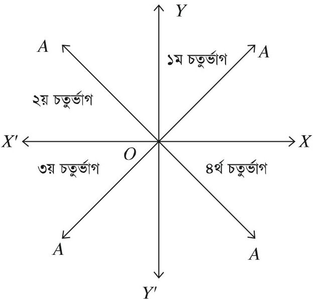

<!-- higher-math-9-10-bn-c08-t8.6-p004 · text · p.166 · review: verify-formula -->
$OA$ রশ্মি যখন প্রথম চতুর্ভাগে থাকে, তখন $x$ ও $y$ এর মান ধনাত্মক। তাই প্রথম চতুর্ভাগে সকল ত্রিকোণমিতিক অনুপাত ধনাত্মক। $OA$ রশ্মি যখন দ্বিতীয় চতুর্ভাগে থাকে তখন $P$ বিন্দুর ভুজ $x$ ঋণাত্মক এবং কোটি $y$ ধনাত্মক। এজন্য দ্বিতীয় চতুর্ভাগে $\sin \left( \sin \theta = \frac{y}{r} \right)$ এবং $\csc \left( \csc \theta = \frac{r}{y} \right)$ অনুপাত দুটি ধনাত্মক। অন্যসব অনুপাত ঋণাত্মক। একইভাবে তৃতীয় চতুর্ভাগে $P$ বিন্দুর ভুজ $x$ ও কোটি $y$ উভয়ই ঋণাত্মক এবং $\tan \left( \tan \theta = \frac{-y}{-x} = \frac{y}{x} \right)$ ও $\cot \left( \cot \theta = \frac{-x}{-y} = \frac{x}{y} \right)$ ধনাত্মক। অন্য অনুপাতসমূহ ঋণাত্মক। চতুর্থ চতুর্ভাগে $OA$ রশ্মির উপর $P$ বিন্দুর ভুজ $x$ ধনাত্মক এবং কোটি $y$ ঋণাত্মক বলে $\cos \left( \cos \theta = \frac{x}{r} \right)$ এবং $\sec \left( \sec \theta = \frac{r}{x} \right)$ ধনাত্মক এবং অন্যসব ত্রিকোণমিতিক অনুপাত ঋণাত্মক।

<!-- higher-math-9-10-bn-c08-t8.6-p005 · text · p.166 · review: verify-formula -->
আবার, $x$-অক্ষের যেকোনো অবস্থানে $y$ এর মান শূন্য বলে $\csc \left( \csc \theta = \frac{r}{y} \right)$ এবং $\cot \left( \cot \theta = \frac{x}{y} \right)$ অনুপাত দুটি সংজ্ঞায়িত নয়।

<!-- higher-math-9-10-bn-c08-t8.6-p006 · text · p.166 · review: verify-formula -->
অনুরূপভাবে, $y$-অক্ষের যেকোনো অবস্থানে $x$ এর মান শূন্য। তাই $y$-অক্ষের উপর $\sec \left( \sec \theta = \frac{r}{x} \right)$ এবং $\tan \left( \tan \theta = \frac{y}{x} \right)$ সংজ্ঞায়িত নয়। $\sin \left( \sin \theta = \frac{y}{r} \right)$ এবং $\cos \left( \cos \theta = \frac{x}{r} \right)$ অনুপাত দুটি $P$ বিন্দুর যেকোনো অবস্থানেই সংজ্ঞায়িত এবং বাস্তব মান আছে।

<!-- higher-math-9-10-bn-c08-t8.6-p007 · text · p.166 -->
উপরিউক্ত আলোচনার সারাংশ নিম্নের চিত্রে দেখানো হলো। উক্ত চিত্রের সাহায্যে যেকোনো কোণের প্রান্তিক রশ্মির অবস্থানের উপর নির্ভর করে উক্ত কোণের সকল ত্রিকোণমিতিক অনুপাতের চিহ্ন নির্ণয় সহজ হবে।

<!-- higher-math-9-10-bn-c08-t8.6-p008 · figure · p.166 -->
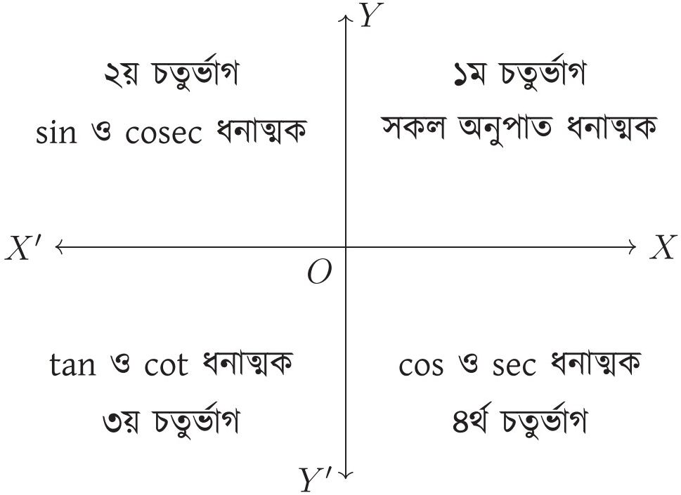

## 8.7 ত্রিকোণমিতিক অনুপাতসমূহ

<!-- higher-math-9-10-bn-c08-t8.7-p001 · text · p.167 -->
নবম-দশম শ্রেণির গণিতে সূক্ষ্মকোণের ত্রিকোণমিতিক অনুপাত সম্পর্কে আলোচনা করা হয়েছে। আমরা এখানে যেকোনো কোণের ত্রিকোণমিতিক অনুপাত সমূহ বর্ণনা করব।

<!-- higher-math-9-10-bn-c08-t8.7-p002 · text · p.167 · review: verify-formula -->
কোণের প্রমিত অবস্থান (Standard Position): কাতেরসীয় তলে মূল বিন্দু $O$ তে ধনাত্মক $x$-অক্ষকে আদি রশ্মি ধরে কোণ অঙ্কন করলে কোণটির প্রমিত অবস্থান পাওয়া যায়।

## 8.8 অনুপাতসমূহের সংজ্ঞা

<!-- higher-math-9-10-bn-c08-t8.8-p001 · text · p.167 · review: verify-formula -->
$\theta$ যেকোনো কোণ। এর প্রমিত অবস্থানে ঘূর্ণয়মান রশ্মি $OZ$ এর উপর বিন্দু $P(x, y)$ নিই যেখানে $OP = r (> 0)$। তাহলে $\theta$ কোণের

<!-- higher-math-9-10-bn-c08-t8.8-p002 · text · p.167 · review: latin-junk,verify-formula -->
sine অনুপাত, $\sin\theta = \frac{y}{r}$

<!-- higher-math-9-10-bn-c08-t8.8-p003 · text · p.167 · review: latin-junk,verify-formula -->
cosine অনুপাত, $\cos\theta = \frac{x}{r}$

<!-- higher-math-9-10-bn-c08-t8.8-p004 · text · p.167 · review: latin-junk,verify-formula -->
tangent অনুপাত, $\tan\theta = \frac{y}{x}$ [যখন $x \neq 0$]

<!-- higher-math-9-10-bn-c08-t8.8-p005 · text · p.167 · review: latin-junk,verify-formula -->
cotangent অনুপাত, $\cot\theta = \frac{x}{y}$ [যখন $y \neq 0$]

<!-- higher-math-9-10-bn-c08-t8.8-p006 · text · p.167 · review: latin-junk,verify-formula -->
secant অনুপাত, $\sec\theta = \frac{r}{x}$ [যখন $x \neq 0$]

<!-- higher-math-9-10-bn-c08-t8.8-p007 · text · p.167 · review: latin-junk,verify-formula -->
cosecant অনুপাত, $\csc\theta = \frac{r}{y}$ [যখন $y \neq 0$]

<!-- higher-math-9-10-bn-c08-t8.8-p008 · figure · p.167 -->
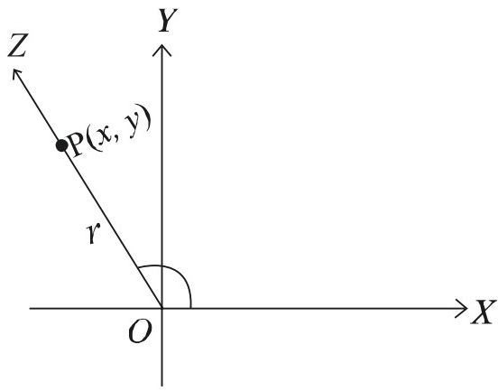

<!-- higher-math-9-10-bn-c08-t8.8-p009 · text · p.167 · review: verify-formula -->
লক্ষণীয় যে, রশ্মি $OZ$ এর ওপর $P(x, y), P'(x', y')$ দুইটি বিন্দু যেখানে $OP = r (> 0), OP' = r' (> 0)$; $x, x'$ এবং $y, y'$ একই চিহ্নযুক্ত। ফলে $\triangle OPM$ ও $\triangle OP'M'$ হতে পাই।

<!-- higher-math-9-10-bn-c08-t8.8-p010 · text · p.167 · review: verify-formula -->
$\frac{x}{r} = \frac{x'}{r'}, \frac{y}{r} = \frac{y'}{r'}$ ইত্যাদি।

<!-- higher-math-9-10-bn-c08-t8.8-p011 · text · p.167 · review: verify-formula -->
ফলে $\theta$ কোণের অনুপাত সমূহের মান $OZ$ রশ্মিতে $P$ বিন্দুর অবস্থানের উপর নির্ভর করে না।

<!-- higher-math-9-10-bn-c08-t8.8-p012 · text · p.167 · review: known-confusable-corrected,verify-formula -->
$\theta$ সূক্ষ্মকোণ হলে $\triangle OPM$ সমকোণী ত্রিভুজে অতিভুজ $OP = r$, সন্নিহিত বাহু $OM = x$, বিপরীত বাহু $PM = y$. সুতরাং,

<!-- higher-math-9-10-bn-c08-t8.8-p013 · figure · p.167 -->
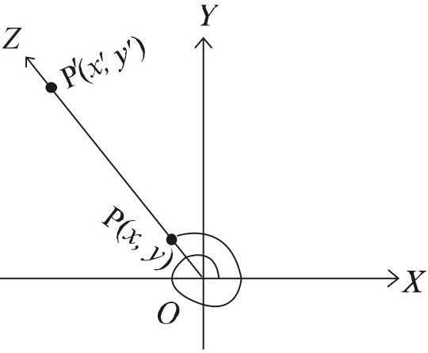

<!-- higher-math-9-10-bn-c08-t8.8-p014 · formula · p.167 · review: latin-junk,verify-formula -->
$$\sin\theta = \frac{y}{r} = \frac{বিপরীত বাহু}{অতিভুজ}$$

<!-- higher-math-9-10-bn-c08-t8.8-p015 · formula · p.167 · review: latin-junk,known-confusable-corrected,verify-formula -->
$$\cos\theta = \frac{x}{r} = \frac{সন্নিহিত বাহু}{অতিভুজ}$$

<!-- higher-math-9-10-bn-c08-t8.8-p016 · formula · p.167 · review: latin-junk,known-confusable-corrected,verify-formula -->
$$\tan\theta = \frac{y}{x} = \frac{বিপরীত বাহু}{সন্নিহিত বাহু},  ইত্যাদি।$$

<!-- higher-math-9-10-bn-c08-t8.8-p017 · text · p.167 -->
সুতরাং সূক্ষ্মকোণের ক্ষেত্রে ত্রিকোণমিতিক অনুপাতের স্থানাঙ্ক ভিত্তিক সংজ্ঞা ও নবম-দশম শ্রেণির গণিত বইয়ের প্রদত্ত সমকোণী ত্রিভুজভিত্তিক সংজ্ঞা একই।

<!-- higher-math-9-10-bn-c08-t8.8-p018 · text · p.168 · review: verify-formula -->
$0^\circ$ এবং $90^\circ$ কোণের অনুপাতসমূহ: $0^\circ$ কোণের ক্ষেত্রে ঘূর্ণায়মান রশ্মি $OX$ রেখার ওপর থাকে। সুতরাং $P(x, 0)$ এবং $r = OP = x$. অতএব,

<!-- higher-math-9-10-bn-c08-t8.8-p019 · formula · p.168 · review: verify-formula -->
$$\sin 0^\circ = \frac{y}{r} = \frac{0}{r} = 0$$

<!-- higher-math-9-10-bn-c08-t8.8-p020 · formula · p.168 · review: verify-formula -->
$$\cos 0^\circ = \frac{x}{r} = \frac{x}{x} = 1$$

<!-- higher-math-9-10-bn-c08-t8.8-p021 · text · p.168 · review: verify-formula -->
$90^\circ$ কোণের ক্ষেত্রে ঘূর্ণায়মান রশ্মি $OY$ রেখার ওপর থাকে। সুতরাং $P(0, y)$ এবং $r = OP = y$.

<!-- higher-math-9-10-bn-c08-t8.8-p022 · formula · p.168 · review: verify-formula -->
$$\sin 90^\circ = \frac{y}{r} = \frac{y}{y} = 1$$

<!-- higher-math-9-10-bn-c08-t8.8-p023 · formula · p.168 · review: verify-formula -->
$$\cos 90^\circ = \frac{x}{r} = \frac{0}{r} = 0$$

<!-- higher-math-9-10-bn-c08-t8.8-p024 · definition · p.168 · review: verify-formula -->
সংজ্ঞা থেকে সহজেই দেখা যায়, যেকোনো $\theta$ কোণের জন্য ত্রিকোণমিতিক অনুপাতের নিম্নকৃত ধর্মাবলি প্রযোজ্য।

<!-- higher-math-9-10-bn-c08-t8.8-p025 · text · p.168 · review: verify-formula -->
১. $\sin^2\theta + \cos^2\theta = 1$

<!-- higher-math-9-10-bn-c08-t8.8-p026 · text · p.168 · review: verify-formula -->
**প্রমাণ:** $\sin\theta = \frac{y}{r}$, $\cos\theta = \frac{x}{r}$, $r^2 = x^2 + y^2$

<!-- higher-math-9-10-bn-c08-t8.8-p027 · formula · p.168 · review: verify-formula -->
$$\therefore \sin^2\theta + \cos^2\theta = \frac{x^2 + y^2}{r^2} = \frac{r^2}{r^2} = 1$$

<!-- higher-math-9-10-bn-c08-t8.8-p028 · text · p.168 · review: verify-formula -->
২. $\tan\theta = \frac{\sin\theta}{\cos\theta}$, $\cot\theta = \frac{\cos\theta}{\sin\theta}$

<!-- higher-math-9-10-bn-c08-t8.8-p029 · formula · p.168 · review: verify-formula -->
$$\sec\theta = \frac{1}{\cos\theta}, cosec\theta = \frac{1}{\sin\theta}$$

<!-- higher-math-9-10-bn-c08-t8.8-p030 · text · p.168 -->
যেখানে অনুপাতগুলো সংজ্ঞায়িত।

<!-- higher-math-9-10-bn-c08-t8.8-p031 · figure · p.168 -->
drawing: coordinate plane quadrants

<!-- higher-math-9-10-bn-c08-t8.8-p032 · table · p.168 · review: verify-table -->
<table><tr><td>II (-, +)</td><td>I (+, +)</td></tr>
<tr><td>III (-, -)</td><td>IV (+, -)</td></tr></table>

<!-- higher-math-9-10-bn-c08-t8.8-p033 · text · p.168 -->
৩. উপরের চিত্রে প্রদত্ত স্থানাঙ্ক চিহ্ন বিবেচনা করে দেখা যায় যে

<!-- higher-math-9-10-bn-c08-t8.8-p034 · table · p.169 · review: verify-table -->
<table><tr><th>II</th><th>I</th></tr>
<tr><td>sin, cosec ধনাত্মক</td><td>সকল অনুপাত ধনাত্মক</td></tr>
<tr><td>III</td><td>IV</td></tr>
<tr><td>tan, cot ধনাত্মক</td><td>cos, sec ধনাত্মক</td></tr></table>

<!-- higher-math-9-10-bn-c08-t8.8-p035 · text · p.169 · review: verify-formula -->
8. $|\sin\theta| \le 1, |\cos\theta| \le 1$

<!-- higher-math-9-10-bn-c08-t8.8-p036 · text · p.169 · review: verify-formula -->
**প্রমাণ:** আমরা জানি, $\sin^2\theta + \cos^2\theta = 1$

<!-- higher-math-9-10-bn-c08-t8.8-p037 · formula · p.169 · review: verify-formula -->
$\sin^2\theta \le 1, \cos^2\theta \le 1$

<!-- higher-math-9-10-bn-c08-t8.8-p038 · text · p.169 · review: verify-formula -->
অর্থাৎ $|\sin\theta| \le 1, |\cos\theta| \le 1$

<!-- higher-math-9-10-bn-c08-t8.8-p039 · text · p.169 · review: verify-formula -->
৫. $\theta$ এর বিভিন্ন মানের জন্য $\sin\theta, \cos\theta$ এবং $\tan\theta$ এর মান নিম্নরূপ:

<!-- higher-math-9-10-bn-c08-t8.8-p040 · table · p.169 · review: verify-formula,verify-table -->
<table><tr><th></th><th>0°</th><th>$\frac{\pi}{6} = 30°$</th><th>$\frac{\pi}{4} = 45°$</th><th>$\frac{\pi}{3} = 60°$</th><th>$\frac{\pi}{2} = 90°$</th></tr>
<tr><td>$\sin\theta$</td><td>0</td><td>$\frac{1}{2}$</td><td>$\frac{1}{\sqrt{2}}$</td><td>$\frac{\sqrt{3}}{2}$</td><td>1</td></tr>
<tr><td>$\cos\theta$</td><td>1</td><td>$\frac{\sqrt{3}}{2}$</td><td>$\frac{1}{\sqrt{2}}$</td><td>$\frac{1}{2}$</td><td>0</td></tr>
<tr><td>$\tan\theta$</td><td>0</td><td>$\frac{1}{\sqrt{3}}$</td><td>1</td><td>$\sqrt{3}$</td><td>অসংজ্ঞায়িত</td></tr></table>

<!-- higher-math-9-10-bn-c08-t8.8-p041 · text · p.169 · review: verify-formula -->
**উদাহরণ ১১.** $\theta$ সূক্ষ্মকোণ $\left(0 < \theta < \frac{\pi}{2}\right)$ এবং $\cos\theta = \frac{4}{5}$ হলে, অপর ত্রিকোণমিতিক অনুপাতসমূহের মান নির্ণয় করো।

<!-- higher-math-9-10-bn-c08-t8.8-p042 · text · p.169 -->
**সমাধান:** ত্রিকোণমিতিক অভেদ (Identities) ব্যবহার করে।

<!-- higher-math-9-10-bn-c08-t8.8-p043 · text · p.169 · review: verify-formula -->
আমরা জানি, $\sin^2\theta + \cos^2\theta = 1$

<!-- higher-math-9-10-bn-c08-t8.8-p044 · text · p.169 · review: verify-formula -->
বা, $\sin^2\theta = 1 - \cos^2\theta = 1 - \left(\frac{4}{5}\right)^2 = 1 - \frac{16}{25} = \frac{25 - 16}{25} = \frac{9}{25}$

<!-- higher-math-9-10-bn-c08-t8.8-p045 · formula · p.169 · review: verify-formula -->
$\therefore \sin\theta = \pm\sqrt{\frac{9}{25}} = \pm\frac{3}{5}$

<!-- higher-math-9-10-bn-c08-t8.8-p046 · text · p.170 · review: verify-formula -->
যেহেতু $\theta$ সূক্ষ্মকোণ, তাই $\theta$ প্রথম চতুর্ভাগে অবস্থিত এবং সকল ত্রিকোণমিতিক অনুপাত ধনাত্মক।

<!-- higher-math-9-10-bn-c08-t8.8-p047 · figure · p.170 -->
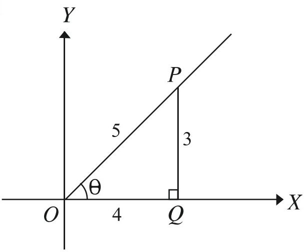

<!-- higher-math-9-10-bn-c08-t8.8-p048 · formula · p.170 · review: verify-formula -->
$\therefore \sin\theta = \frac{3}{5}$

<!-- higher-math-9-10-bn-c08-t8.8-p049 · text · p.170 · review: verify-formula -->
এখন, $\sec\theta = \frac{1}{\cos\theta} = \frac{1}{\frac{4}{5}} = \frac{5}{4}$

<!-- higher-math-9-10-bn-c08-t8.8-p050 · formula · p.170 · review: verify-formula -->
$cosec\theta = \frac{1}{\sin\theta} = \frac{1}{\frac{3}{5}} = \frac{5}{3}$

<!-- higher-math-9-10-bn-c08-t8.8-p051 · text · p.170 · review: verify-formula -->
এখন $\triangle POQ$ সমকোণী ত্রিভুজ থেকে পাই,

<!-- higher-math-9-10-bn-c08-t8.8-p052 · formula · p.170 · review: latin-junk,verify-formula -->
$$\tan\theta = \frac{লম্ব}{ভূমি} = \frac{লম্ব/অতিভুজ}{ভূমি/অতিভুজ} = \frac{PQ/OP}{OQ/OP}$$

<!-- higher-math-9-10-bn-c08-t8.8-p053 · formula · p.170 · review: verify-formula -->
$$= \frac{\sin\theta}{\cos\theta} = \frac{3/5}{4/5} = \frac{3}{4}$$

<!-- higher-math-9-10-bn-c08-t8.8-p054 · formula · p.170 · review: latin-junk,verify-formula -->
$$\cot\theta = \frac{ভূমি}{লম্ব} = \frac{ভূমি/অতিভুজ}{লম্ব/অতিভুজ} = \frac{OQ/OP}{PQ/OP}$$

<!-- higher-math-9-10-bn-c08-t8.8-p055 · formula · p.170 · review: verify-formula -->
$$= \frac{\cos\theta}{\sin\theta} = \frac{4/5}{3/5} = \frac{4}{3}$$

<!-- higher-math-9-10-bn-c08-t8.8-p056 · text · p.170 · review: verify-formula -->
বি.দ্র: $\tan\theta = \frac{\sin\theta}{\cos\theta}, \cot\theta = \frac{\cos\theta}{\sin\theta}$

<!-- higher-math-9-10-bn-c08-t8.8-p057 · text · p.170 · review: verify-formula -->
ত্রিকোণমিতিক অভেদের সাহায্যে, $\sec^2\theta - \tan^2\theta = 1$

<!-- higher-math-9-10-bn-c08-t8.8-p058 · text · p.170 · review: verify-formula -->
বা, $\tan^2\theta = \sec^2\theta - 1 = \left(\frac{5}{4}\right)^2 - 1 = \frac{25}{16} - 1 = \frac{9}{16}$

<!-- higher-math-9-10-bn-c08-t8.8-p059 · formula · p.170 · review: verify-formula -->
$\therefore \tan\theta = \sqrt{\frac{9}{16}} = \frac{3}{4}$

<!-- higher-math-9-10-bn-c08-t8.8-p060 · text · p.170 · review: verify-formula -->
আবার, $cosec^2\theta - \cot^2\theta = 1$

<!-- higher-math-9-10-bn-c08-t8.8-p061 · text · p.170 · review: verify-formula -->
বা, $\cot^2\theta = cosec^2\theta - 1 = \left(\frac{5}{3}\right)^2 - 1 = \frac{25}{9} - 1 = \frac{16}{9}$

<!-- higher-math-9-10-bn-c08-t8.8-p062 · formula · p.170 · review: verify-formula -->
$\therefore \cot\theta = \sqrt{\frac{16}{9}} = \frac{4}{3}$

<!-- higher-math-9-10-bn-c08-t8.8-p063 · text · p.171 · review: verify-formula -->
বিকল্প: আমরা জানি, $\cos\theta = \frac{ভূমি}{অতিভুজ} = \frac{4}{5}$ [দেওয়া আছে]

<!-- higher-math-9-10-bn-c08-t8.8-p064 · figure · p.171 -->

<!-- higher-math-9-10-bn-c08-t8.8-p065 · text · p.171 · review: verify-formula -->
পাশের চিত্রে সমকোণী ত্রিভুজ $POQ$ থেকে পাই,

<!-- higher-math-9-10-bn-c08-t8.8-p066 · text · p.171 · review: latin-junk,verify-formula -->
$$PQ = \sqrt{OP^2 - OQ^2} = \sqrt{5^2 - 4^2}$$
$$= \sqrt{25 - 16} = \sqrt{9} = 3  একক$$

<!-- higher-math-9-10-bn-c08-t8.8-p067 · formula · p.171 · review: latin-junk,verify-formula -->
$$\sin\theta = \frac{লম্ব}{অতিভুজ} = \frac{PQ}{OP} = \frac{3}{5}$$

<!-- higher-math-9-10-bn-c08-t8.8-p068 · formula · p.171 · review: latin-junk,verify-formula -->
$$\tan\theta = \frac{লম্ব}{ভূমি} = \frac{PQ}{OQ} = \frac{3}{4}$$

<!-- higher-math-9-10-bn-c08-t8.8-p069 · formula · p.171 · review: latin-junk,verify-formula -->
$$\sec\theta = \frac{অতিভুজ}{ভূমি} = \frac{OP}{OQ} = \frac{5}{4}$$

<!-- higher-math-9-10-bn-c08-t8.8-p070 · formula · p.171 · review: latin-junk,verify-formula -->
$$\csc\theta = \frac{অতিভুজ}{লম্ব} = \frac{OP}{PQ} = \frac{5}{3}$$

<!-- higher-math-9-10-bn-c08-t8.8-p071 · formula · p.171 · review: latin-junk,verify-formula -->
$$\cot\theta = \frac{ভূমি}{লম্ব} = \frac{OQ}{PQ} = \frac{4}{3}$$

<!-- higher-math-9-10-bn-c08-t8.8-p072 · text · p.171 · review: verify-formula -->
**কাজ:** $\theta$ স্তূলকোণ $\left( \frac{\pi}{2} < \theta < \pi \right)$ এবং $\tan\theta = -\frac{1}{2}$ হলে, অপর ত্রিকোণমিতিক অনুপাতসমূহ সমকোণী ত্রিভুজ এবং ত্রিকোণমিতিক অভেদ এর সাহায্যে নির্ণয় করো।

<!-- higher-math-9-10-bn-c08-t8.8-p073 · text · p.171 · review: verify-formula -->
**উদাহরণ ১২.** $\cos A = \frac{4}{5}$, $\sin B = \frac{12}{13}$ এবং $A$ ও $B$ উভয়ই সূক্ষ্মকোণ হলে $\frac{\tan B - \tan A}{1 + \tan B \cdot \tan A}$ এর মান নির্ণয় করো।

<!-- higher-math-9-10-bn-c08-t8.8-p074 · text · p.171 · review: verify-formula -->
**সমাধান:** দেওয়া আছে, $\cos A = \frac{4}{5}$

<!-- higher-math-9-10-bn-c08-t8.8-p075 · text · p.171 · review: verify-formula -->
আমরা জানি, $\sin^2 A + \cos^2 A = 1$

<!-- higher-math-9-10-bn-c08-t8.8-p076 · text · p.171 · review: verify-formula -->
বা, $\sin^2 A = 1 - \cos^2 A = 1 - \frac{16}{25} = \frac{9}{25}$

<!-- higher-math-9-10-bn-c08-t8.8-p077 · text · p.171 · review: verify-formula -->
$\therefore \sin A = \sqrt{\frac{9}{25}} = \frac{3}{5}$ [$A$ সূক্ষ্মকোণ]

<!-- higher-math-9-10-bn-c08-t8.8-p078 · figure · p.171 -->
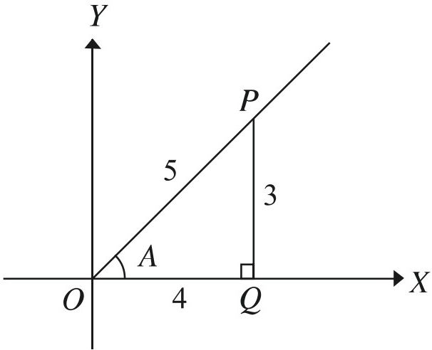

<!-- higher-math-9-10-bn-c08-t8.8-p079 · formula · p.171 · review: verify-formula -->
$$\tan A = \frac{\sin A}{\cos A} = \frac{\frac{3}{5}}{\frac{4}{5}} = \frac{3}{4}$$

<!-- higher-math-9-10-bn-c08-t8.8-p080 · text · p.172 · review: verify-formula -->
আবার, $\sin B = \frac{12}{13}$

<!-- higher-math-9-10-bn-c08-t8.8-p081 · figure · p.172 -->
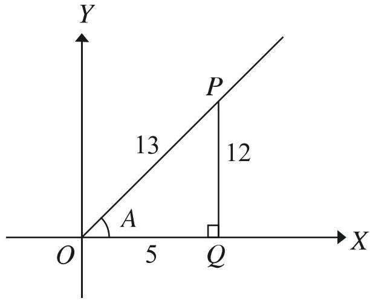

<!-- higher-math-9-10-bn-c08-t8.8-p082 · formula · p.172 · review: verify-formula -->
$\therefore \cos B = \sqrt{1 - \sin^2 B} = \sqrt{1 - \frac{144}{169}} = \sqrt{\frac{25}{169}}$

<!-- higher-math-9-10-bn-c08-t8.8-p083 · formula · p.172 · review: verify-formula -->
$\therefore \cos B = \frac{5}{13}$

<!-- higher-math-9-10-bn-c08-t8.8-p084 · formula · p.172 · review: verify-formula -->
$\therefore \tan B = \frac{\sin B}{\cos B} = \frac{12/13}{5/13} = \frac{12}{5}$

<!-- higher-math-9-10-bn-c08-t8.8-p085 · text · p.172 · review: verify-formula -->
এখন, $\frac{\tan B - \tan A}{1 + \tan B \cdot \tan A} = \frac{\frac{12}{5} - \frac{3}{4}}{1 + \frac{12}{5} \cdot \frac{3}{4}}$

<!-- higher-math-9-10-bn-c08-t8.8-p086 · formula · p.172 · review: verify-formula -->
$$= \frac{\frac{48 - 15}{20}}{1 + \frac{36}{20}} = \frac{\frac{33}{20}}{\frac{20 + 36}{20}} = \frac{33}{56}$$

<!-- higher-math-9-10-bn-c08-t8.8-p087 · formula · p.172 · review: verify-formula -->
$\therefore \frac{\tan B - \tan A}{1 + \tan B \cdot \tan A} = \frac{33}{56}$

<!-- higher-math-9-10-bn-c08-t8.8-p088 · text · p.172 · review: verify-formula -->
**উদাহরণ ১৩.** মান নির্ণয় করো: $\sin^2 \frac{\pi}{6} + \cos^2 \frac{\pi}{4} + \tan^2 \frac{\pi}{3} + \cot^2 \frac{\pi}{2}$

<!-- higher-math-9-10-bn-c08-t8.8-p089 · text · p.172 · review: verify-formula -->
**সমাধান:** আমরা জানি, $\sin \frac{\pi}{6} = \frac{1}{2}$, $\cos \frac{\pi}{4} = \frac{1}{\sqrt{2}}$, $\tan \frac{\pi}{3} = \sqrt{3}$ এবং $\cot \frac{\pi}{2} = 0$

<!-- higher-math-9-10-bn-c08-t8.8-p090 · formula · p.172 · review: verify-formula -->
$\therefore \sin^2 \frac{\pi}{6} + \cos^2 \frac{\pi}{4} + \tan^2 \frac{\pi}{3} + \cot^2 \frac{\pi}{2}$

<!-- higher-math-9-10-bn-c08-t8.8-p091 · formula · p.172 · review: verify-formula -->
$$= \left( \frac{1}{2} \right)^2 + \left( \frac{1}{\sqrt{2}} \right)^2 + (\sqrt{3})^2 + (0)^2$$

<!-- higher-math-9-10-bn-c08-t8.8-p092 · formula · p.172 · review: verify-formula -->
$$= \frac{1}{4} + \frac{1}{2} + 3 = 3 \frac{3}{4}$$

<!-- higher-math-9-10-bn-c08-t8.8-p093 · text · p.172 -->
**কাজ:**

<!-- higher-math-9-10-bn-c08-t8.8-p094 · text · p.172 · review: verify-formula -->
ক) $\sin^2 \frac{\pi}{4} \cos^2 \frac{\pi}{3} + \tan^2 \frac{\pi}{6} \sec^2 \frac{\pi}{3} + \cot^2 \frac{\pi}{3} \csc^2 \frac{\pi}{4}$ এর মান নির্ণয় করো।

<!-- higher-math-9-10-bn-c08-t8.8-p095 · text · p.172 · review: verify-formula -->
খ) সরল করো: $\frac{\sin^2 \frac{\pi}{3} + \sin \frac{\pi}{3} \cos \frac{\pi}{3} + \cos^2 \frac{\pi}{3}}{\sin \frac{\pi}{3} + \cos \frac{\pi}{3}} - \frac{\sin^2 \frac{\pi}{3} - \sin \frac{\pi}{3} \cos \frac{\pi}{3} + \cos^2 \frac{\pi}{3}}{\sin \frac{\pi}{3} - \cos \frac{\pi}{3}}$

<!-- higher-math-9-10-bn-c08-t8.8-p096 · text · p.172 · review: verify-formula -->
**উদাহরণ ১৪.** $7 \sin^2 \theta + 3 \cos^2 \theta = 4$ হলে, প্রমাণ করো যে, $\tan \theta = \pm \frac{1}{\sqrt{3}}$

<!-- higher-math-9-10-bn-c08-t8.8-p097 · text · p.173 · review: verify-formula -->
**সমাধান:** দেওয়া আছে, $7\sin^2\theta + 3\cos^2\theta = 4$

<!-- higher-math-9-10-bn-c08-t8.8-p098 · text · p.173 · review: verify-formula -->
বা, $7\sin^2\theta + 3(1 - \sin^2\theta) = 4$ [$\because \sin^2\theta + \cos^2\theta = 1$]

<!-- higher-math-9-10-bn-c08-t8.8-p099 · text · p.173 · review: verify-formula -->
বা, $7\sin^2\theta + 3 - 3\sin^2\theta = 4 \implies 4\sin^2\theta = 1 \implies \sin^2\theta = \frac{1}{4}$

<!-- higher-math-9-10-bn-c08-t8.8-p100 · text · p.173 · review: verify-formula -->
আবার, $\cos^2\theta = 1 - \sin^2\theta = 1 - \frac{1}{4} = \frac{3}{4}$

<!-- higher-math-9-10-bn-c08-t8.8-p101 · formula · p.173 · review: verify-formula -->
$\therefore \tan^2\theta = \frac{\sin^2\theta}{\cos^2\theta} = \frac{\frac{1}{4}}{\frac{3}{4}} = \frac{1}{3}$

<!-- higher-math-9-10-bn-c08-t8.8-p102 · text · p.173 · review: verify-formula -->
$\therefore \tan\theta = \pm \frac{1}{\sqrt{3}}$ (প্রমাণিত)।

<!-- higher-math-9-10-bn-c08-t8.8-p103 · text · p.173 · review: verify-formula -->
**উদাহরণ ১৫.** $15\cos^2\theta + 2\sin\theta = 7$ এবং $-\frac{\pi}{2} < \theta < \frac{\pi}{2}$ হলে $\cot\theta$ এর মান নির্ণয় করো।

<!-- higher-math-9-10-bn-c08-t8.8-p104 · text · p.173 · review: verify-formula -->
**সমাধান:** দেওয়া আছে, $15\cos^2\theta + 2\sin\theta = 7$

<!-- higher-math-9-10-bn-c08-t8.8-p105 · text · p.173 · review: verify-formula -->
বা, $15(1 - \sin^2\theta) + 2\sin\theta = 7$ [$\because \sin^2\theta + \cos^2\theta = 1$]

<!-- higher-math-9-10-bn-c08-t8.8-p106 · text · p.173 · review: verify-formula -->
বা, $15 - 15\sin^2\theta + 2\sin\theta = 7 \implies 15\sin^2\theta - 2\sin\theta - 8 = 0$

<!-- higher-math-9-10-bn-c08-t8.8-p107 · text · p.173 · review: verify-formula -->
বা, $15\sin^2\theta - 12\sin\theta + 10\sin\theta - 8 = 0 \implies (3\sin\theta + 2)(5\sin\theta - 4) = 0$

<!-- higher-math-9-10-bn-c08-t8.8-p108 · text · p.173 · review: verify-formula -->
$\therefore \sin\theta = -\frac{2}{3}$ বা, $\sin\theta = \frac{4}{5}$

<!-- higher-math-9-10-bn-c08-t8.8-p109 · text · p.173 · review: verify-formula -->
$\sin\theta$ এর উভয় মান গ্রহণযোগ্য। কেননা $-\frac{\pi}{2} < \theta < \frac{\pi}{2}$

<!-- higher-math-9-10-bn-c08-t8.8-p110 · text · p.173 · review: verify-formula -->
$\sin\theta = -\frac{2}{3}$ হলে $\cos\theta = \sqrt{1 - \sin^2\theta} = \sqrt{1 - \frac{4}{9}} = \frac{\sqrt{5}}{3}$

<!-- higher-math-9-10-bn-c08-t8.8-p111 · text · p.173 · review: verify-formula -->
$\sin\theta = \frac{4}{5}$ হলে $\cos\theta = \sqrt{1 - \sin^2\theta} = \sqrt{1 - \frac{16}{25}} = \frac{3}{5}$

<!-- higher-math-9-10-bn-c08-t8.8-p112 · text · p.173 · review: verify-formula -->
$\therefore \cot\theta = \frac{\cos\theta}{\sin\theta} = \frac{\frac{\sqrt{5}}{3}}{-\frac{2}{3}} = -\frac{\sqrt{5}}{2}$ [যখন $\sin\theta = -\frac{2}{3}$]

<!-- higher-math-9-10-bn-c08-t8.8-p113 · text · p.173 · review: verify-formula -->
অথবা $\cot\theta = \frac{\cos\theta}{\sin\theta} = \frac{\frac{3}{5}}{\frac{4}{5}} = \frac{3}{4}$ [যখন $\sin\theta = \frac{4}{5}$]

<!-- higher-math-9-10-bn-c08-t8.8-p114 · text · p.173 · review: verify-formula -->
নির্ণেয় মান $-\frac{\sqrt{5}}{2}$ বা, $\frac{3}{4}$

<!-- higher-math-9-10-bn-c08-t8.8-p115 · text · p.174 · review: verify-formula -->
**উদাহরণ ১৬.** $A = \frac{\pi}{3}$ ও $B = \frac{\pi}{6}$ হলে প্রমাণ করো যে,

<!-- higher-math-9-10-bn-c08-t8.8-p116 · text · p.174 · review: verify-formula -->
ক) $\sin(A + B) = \sin A \cos B + \cos A \sin B$

<!-- higher-math-9-10-bn-c08-t8.8-p117 · text · p.174 · review: verify-formula -->
খ) $\tan(A - B) = \frac{\tan A - \tan B}{1 + \tan A \tan B}$

<!-- higher-math-9-10-bn-c08-t8.8-p118 · text · p.174 -->
**সমাধান:**

<!-- higher-math-9-10-bn-c08-t8.8-p119 · text · p.174 · review: verify-formula -->
ক) বামপক্ষ $= \sin(A + B) = \sin(\frac{\pi}{3} + \frac{\pi}{6}) = \sin \frac{\pi}{2} = 1$

<!-- higher-math-9-10-bn-c08-t8.8-p120 · text · p.174 · review: verify-formula -->
ডানপক্ষ $= \sin A \cos B + \cos A \sin B = \sin \frac{\pi}{3} \cos \frac{\pi}{6} + \cos \frac{\pi}{3} \sin \frac{\pi}{6}$

<!-- higher-math-9-10-bn-c08-t8.8-p121 · formula · p.174 · review: verify-formula -->
$$= \frac{\sqrt{3}}{2} \cdot \frac{\sqrt{3}}{2} + \frac{1}{2} \cdot \frac{1}{2} = \frac{3}{4} + \frac{1}{4} = 1$$

<!-- higher-math-9-10-bn-c08-t8.8-p122 · text · p.174 · review: verify-formula -->
$\therefore$ বামপক্ষ $=$ ডানপক্ষ (প্রমাণিত)।

<!-- higher-math-9-10-bn-c08-t8.8-p123 · text · p.174 · review: verify-formula -->
খ) বামপক্ষ $= \tan(A - B) = \tan(\frac{\pi}{3} - \frac{\pi}{6}) = \tan \frac{\pi}{6} = \frac{1}{\sqrt{3}}$

<!-- higher-math-9-10-bn-c08-t8.8-p124 · text · p.174 · review: verify-formula -->
ডানপক্ষ $= \frac{\tan A - \tan B}{1 + \tan A \tan B} = \frac{\tan \frac{\pi}{3} - \tan \frac{\pi}{6}}{1 + \tan \frac{\pi}{3} \tan \frac{\pi}{6}}$

<!-- higher-math-9-10-bn-c08-t8.8-p125 · formula · p.174 · review: verify-formula -->
$$= \frac{\sqrt{3} - \frac{1}{\sqrt{3}}}{1 + \sqrt{3} \cdot \frac{1}{\sqrt{3}}} = \frac{2}{\sqrt{3}} \times \frac{1}{2} = \frac{1}{\sqrt{3}}$$

<!-- higher-math-9-10-bn-c08-t8.8-p126 · text · p.174 · review: verify-formula -->
$\therefore$ বামপক্ষ $=$ ডানপক্ষ (প্রমাণিত)।

<!-- higher-math-9-10-bn-c08-t8.8-p127 · text · p.174 · review: verify-formula -->
**কাজ:** $A = \frac{\pi}{3}$ ও $B = \frac{\pi}{6}$ এর জন্য নিম্নকণ্ট অভেদসমূহ প্রমাণ করো:

<!-- higher-math-9-10-bn-c08-t8.8-p128 · text · p.174 · review: verify-formula -->
ক) $\sin(A - B) = \sin A \cos B - \cos A \sin B$

<!-- higher-math-9-10-bn-c08-t8.8-p129 · text · p.174 · review: verify-formula -->
খ) $\cos(A + B) = \cos A \cos B - \sin A \sin B$

<!-- higher-math-9-10-bn-c08-t8.8-p130 · text · p.174 · review: verify-formula -->
গ) $\cos(A - B) = \cos A \cos B + \sin A \sin B$

<!-- higher-math-9-10-bn-c08-t8.8-p131 · text · p.174 · review: verify-formula -->
ঘ) $\tan 2B = \frac{2 \tan B}{1 - \tan^2 B}$

## 8.9 বিভিন্ন কোণের ত্রিকোণমিতিক অনুপাতসমূহ

<!-- higher-math-9-10-bn-c08-t8.9-p001 · text · p.176 · review: verify-formula -->
ত্রিকোণমিতিক আলোচনার দ্বিতীয় অংশে আমরা সূক্ষ্মকোণের $\left( 0 < \theta < \frac{\pi}{2} \right)$ অনুপাতসমূহ নির্ণয়ের কৌশল আলোচনা করেছি। অনুপাতসমূহের পারস্পরিক সম্পর্ক এবং এতদসংক্রান্ত কয়েকটি সহজ অভেদ প্রমাণ করা হয়েছে। বিভিন্ন চতুর্ভাগে অনুপাতসমূহের চিত্র নির্ধারণ, আদর্শ কোণসমূহের ত্রিকোণমিতিক অনুপাত এবং অনুপাতসমূহের সর্বনিম্ন ও সর্বোচ্চ মানের ধারণাও দেওয়া হয়েছে। আলোচনার এই অংশে প্রথমে ঋণাত্মক কোণ $(-\theta)$ এর অনুপাতসমূহ নির্ণয় করা হবে। এর উপর ভিত্তি করে ধারাবাহিকভাবে $\frac{\pi}{2} - \theta, \frac{\pi}{2} + \theta, \pi + \theta, \pi - \theta, \frac{3\pi}{2} + \theta, \frac{3\pi}{2} - \theta, 2\pi + \theta, 2\pi - \theta$ এবং $\frac{n\pi}{2} + \theta$ ও $\frac{n\pi}{2} - \theta$ [যেখানে $n$ ধনাত্মক পূর্ণসংখ্যা এবং $0 < \theta < \frac{\pi}{2}$] কোণসমূহের ত্রিকোণমিতিক আলোচনা অন্তর্ভুক্ত থাকবে।

<!-- higher-math-9-10-bn-c08-t8.9-p002 · text · p.176 · review: verify-formula -->
$(-\theta)$ কোণের ত্রিকোণমিতিক অনুপাতসমূহ $\left( 0 < \theta < \frac{\pi}{2} \right)$:

<!-- higher-math-9-10-bn-c08-t8.9-p003 · text · p.176 · review: verify-formula -->
মনে করি ঘূর্ণায়মান রশ্মি $OA$ এর আদি অবস্থান $OX$ থেকে ঘড়ির কাঁটার বিপরীত দিকে ঘুরে প্রথম চতুর্ভাগে $\angle XOA = \theta$ এবং ঘড়ির কাঁটার দিকে একই দূরত্ব ঘুরে চতুর্থ চতুর্ভাগে $\angle XOA' = -\theta$ কোণ উৎপন্ন করে (নিচের চিত্র)। $OA$ রশ্মির উপর যেকোনো বিন্দু $P(x, y)$ নিই। এখন $P(x, y)$ বিন্দু থেকে $OX$ এর ওপর $PN$ লম্ব ঝাকি এবং $PN$ কে বর্ধিত করায় তা $OA'$ কে $Q$ বিন্দুতে ছেদ করে। তাহলে $QN$ রেখা $OX$ এর ওপর লম্ব। যেহেতু $P(x, y)$ বিন্দুর অবস্থান প্রথম চতুর্ভাগে সেহেতু $x > 0, y > 0$ এবং $ON = x, PN = y$.

<!-- higher-math-9-10-bn-c08-t8.9-p004 · figure · p.177 -->
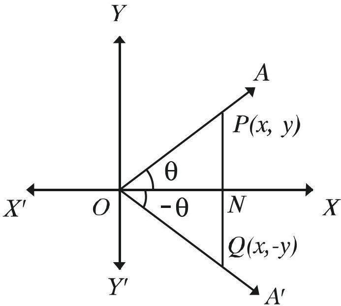

<!-- higher-math-9-10-bn-c08-t8.9-p005 · text · p.177 · review: verify-formula -->
এখন $\triangle OPN$ ও $\triangle OQN$ সমকোণী ত্রিভুজদ্বয়ের $\angle PON = \angle QON$, $\angle ONP = \angle ONQ$ এবং $ON$ উভয় ত্রিভুজের সাধারণ বাহু। সুতরাং ত্রিভুজদ্বয় সর্বসম।

<!-- higher-math-9-10-bn-c08-t8.9-p006 · text · p.177 · review: verify-formula -->
$\therefore PN = QN$ এবং $OP = OQ$.

<!-- higher-math-9-10-bn-c08-t8.9-p007 · text · p.177 · review: verify-formula -->
$Q$ বিন্দুর অবস্থান চতুর্থ চতুর্ভাগে হওয়ায় এর কোটি ঋণাত্মক। সুতরাং $Q$ বিন্দুর স্থানাঙ্ক $Q(x, -y)$. $\triangle OQN$ সমকোণী ত্রিভুজের ক্ষেত্রে $ON = ভূমি$, $QN = লম্ব$ এবং $OQ = অতিভুজ = r$ (ধরি)।

<!-- higher-math-9-10-bn-c08-t8.9-p008 · text · p.177 -->
তাহলে পূর্ববর্তী আলোচনা থেকে আমরা পাই,

<!-- higher-math-9-10-bn-c08-t8.9-p009 · formula · p.177 · review: latin-junk,verify-formula -->
$$\sin(-\theta) = \frac{লম্ব}{অতিভুজ} = \frac{QN}{OQ} = \frac{-y}{r} = -\frac{PN}{OP} = -\sin\theta$$

<!-- higher-math-9-10-bn-c08-t8.9-p010 · formula · p.177 · review: latin-junk,verify-formula -->
$$\cos(-\theta) = \frac{ভূমি}{অতিভুজ} = \frac{ON}{OQ} = \frac{x}{r} = \frac{ON}{OP} = \cos\theta$$

<!-- higher-math-9-10-bn-c08-t8.9-p011 · formula · p.177 · review: latin-junk,verify-formula -->
$$\tan(-\theta) = \frac{লম্ব}{ভূমি} = \frac{QN}{ON} = \frac{-y}{x} = -\frac{PN}{ON} = -\tan\theta$$

<!-- higher-math-9-10-bn-c08-t8.9-p012 · text · p.177 · review: verify-formula -->
একইভাবে, $cosec(-\theta) = -cosec\theta$, $\sec(-\theta) = \sec\theta$, $\cot(-\theta) = -\cot\theta$

<!-- higher-math-9-10-bn-c08-t8.9-p013 · text · p.177 · review: verify-formula -->
**মন্তব্য:** যেকোনো কোণ $\theta$ এর জন্য উপরিসূত্র সম্পর্কগুলো প্রযোজ্য।

<!-- higher-math-9-10-bn-c08-t8.9-p014 · text · p.177 -->
**উদাহরণ ১৭.**

<!-- higher-math-9-10-bn-c08-t8.9-p015 · formula · p.177 · review: verify-formula -->
$$\sin \left(-\frac{\pi}{6}\right) = -\sin \left(\frac{\pi}{6}\right), \cos \left(-\frac{\pi}{4}\right) = \cos \left(\frac{\pi}{4}\right), \tan \left(-\frac{\pi}{4}\right) = -\tan \left(\frac{\pi}{4}\right),$$

<!-- higher-math-9-10-bn-c08-t8.9-p016 · formula · p.177 · review: verify-formula -->
$$cosec \left(-\frac{\pi}{3}\right) = -cosec \left(\frac{\pi}{3}\right), \sec \left(-\frac{\pi}{3}\right) = \sec \left(\frac{\pi}{3}\right), \cot \left(-\frac{\pi}{6}\right) = -\cot \left(\frac{\pi}{6}\right).$$

<!-- higher-math-9-10-bn-c08-t8.9-p017 · text · p.177 · review: verify-formula -->
$\left(\frac{\pi}{2} - \theta\right)$ কোণ বা পূরক কোণের ত্রিকোণমিতিক অনুপাতসমূহ $\left(0 < \theta < \frac{\pi}{2}\right)$:

<!-- higher-math-9-10-bn-c08-t8.9-p018 · text · p.177 · review: verify-formula -->
ধরি, কোনো ঘূর্ণায়মান রশ্মি $OA$ তার আদি অবস্থান $OX$ থেকে ঘড়ির ক্যারি বিপরীত দিকে ঘুরে প্রথম চতুর্ভাগে $\angle XOA = \theta$ কোণ উৎপন্ন করে। আবার অপর একটি রশ্মি $OA'$ আদি অবস্থান $OX$ থেকে একইদিকে ঘুরে $\angle XOY = \frac{\pi}{2}$ কোণ উৎপন্ন করার পর $OY$ অবস্থান থেকে ঘড়ির ক্যারি দিকে ঘুরে $\angle YOA' = -\theta$ কোণ উৎপন্ন করে (নিচের চিত্র)।

<!-- higher-math-9-10-bn-c08-t8.9-p019 · figure · p.178 -->
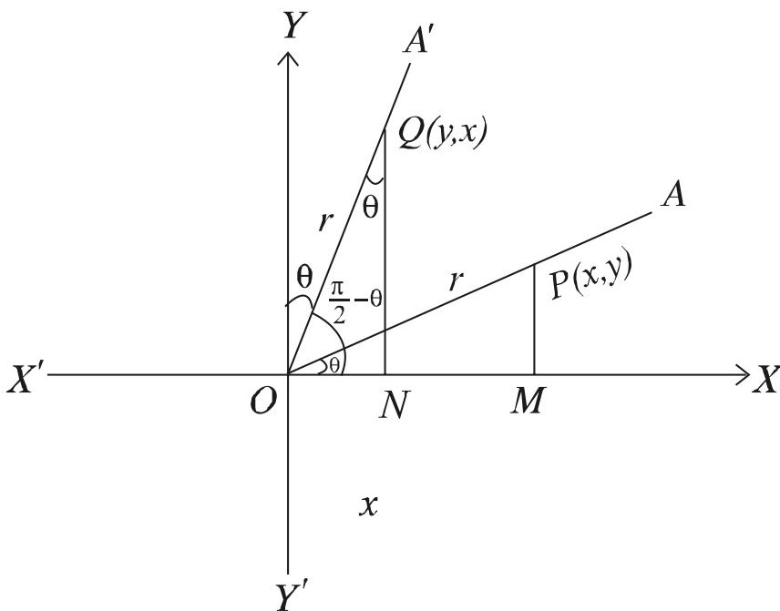

<!-- higher-math-9-10-bn-c08-t8.9-p020 · text · p.178 · review: verify-formula -->
তাহলে, $\angle XOA' = \frac{\pi}{2} + (-\theta) = \frac{\pi}{2} - \theta$

<!-- higher-math-9-10-bn-c08-t8.9-p021 · text · p.178 · review: verify-formula -->
$OP$ এবং $OQ$ সমান দূরত্ব ধরে $P$ ও $Q$ বিন্দুদ্বয় থেকে $OX$ এর উপর $PM$ ও $QN$ লম্বদ্বয় আঁকি। এখন $\triangle POM$ ও $\triangle QON$ সমকোণী ত্রিভুজদ্বয়ের $\angle OMP = \angle ONQ$, $\angle POM = \angle OQN$ এবং $OP = OQ$.

<!-- higher-math-9-10-bn-c08-t8.9-p022 · text · p.178 · review: verify-formula -->
$\therefore$ ত্রিভুজদ্বয় সর্বসম।

<!-- higher-math-9-10-bn-c08-t8.9-p023 · text · p.178 · review: verify-formula -->
$\therefore ON = PM$ এবং $QN = OM$

<!-- higher-math-9-10-bn-c08-t8.9-p024 · text · p.178 · review: verify-formula -->
এখন $P$ বিন্দুর স্থানাঙ্ক $(x, y)$ হলে

<!-- higher-math-9-10-bn-c08-t8.9-p025 · formula · p.178 · review: verify-formula -->
$OM = x, PM = y$

<!-- higher-math-9-10-bn-c08-t8.9-p026 · formula · p.178 · review: verify-formula -->
$\therefore ON = y, QN = x$

<!-- higher-math-9-10-bn-c08-t8.9-p027 · text · p.178 · review: verify-formula -->
$\therefore Q$ বিন্দুর স্থানাঙ্ক $(y, x)$

<!-- higher-math-9-10-bn-c08-t8.9-p028 · text · p.178 · review: verify-formula -->
তাহলে $\triangle NOQ$ এর ক্ষেত্রে আমরা পাই,

<!-- higher-math-9-10-bn-c08-t8.9-p029 · formula · p.178 · review: verify-formula -->
$$\sin \left( \frac{\pi}{2} - \theta \right) = \frac{x}{r} = \cos \theta, \quad \cos \left( \frac{\pi}{2} - \theta \right) = \frac{y}{r} = \sin \theta$$

<!-- higher-math-9-10-bn-c08-t8.9-p030 · formula · p.178 · review: verify-formula -->
$$\tan \left( \frac{\pi}{2} - \theta \right) = \frac{x}{y} = \cot \theta$$

<!-- higher-math-9-10-bn-c08-t8.9-p031 · text · p.178 · review: verify-formula -->
একইভাবে, $cosec \left( \frac{\pi}{2} - \theta \right) = \sec \theta, \quad \sec \left( \frac{\pi}{2} - \theta \right) = cosec \theta$

<!-- higher-math-9-10-bn-c08-t8.9-p032 · formula · p.178 · review: verify-formula -->
$$\cot \left( \frac{\pi}{2} - \theta \right) = \tan \theta$$

<!-- higher-math-9-10-bn-c08-t8.9-p033 · text · p.178 · review: verify-formula -->
**মন্তব্য:** যেকোনো কোণ $\theta$ এর জন্য উপরিসূত্র সম্পর্কগুলো প্রযোজ্য।

<!-- higher-math-9-10-bn-c08-t8.9-p034 · text · p.178 · review: verify-formula -->
**উদাহরণ ১৮.** $\sin \left( \frac{\pi}{3} \right) = \sin \left( \frac{\pi}{2} - \frac{\pi}{6} \right) = \cos \frac{\pi}{6}$

<!-- higher-math-9-10-bn-c08-t8.9-p035 · formula · p.178 · review: verify-formula -->
$$\tan \left( \frac{\pi}{6} \right) = \tan \left( \frac{\pi}{2} - \frac{\pi}{3} \right) = \cot \frac{\pi}{3}, \quad \sec \left( \frac{\pi}{4} \right) = \sec \left( \frac{\pi}{2} - \frac{\pi}{4} \right) = cosec \frac{\pi}{4}$$

<!-- higher-math-9-10-bn-c08-t8.9-p036 · text · p.178 · review: latin-junk,verify-formula -->
**লাক্ষণীয়:** $\theta$ এবং $\left( \frac{\pi}{2} - \theta \right)$ কোণ দুটি পরস্পর পূরক (Complement Angle)। এদের একটির sine অপরের cosine, একটির tangent অপরের cotangent এবং একটির secant অপরের cosecant এর সমান।

<!-- higher-math-9-10-bn-c08-t8.9-p037 · text · p.178 · review: verify-formula -->
$\left( \frac{\pi}{2} + \theta \right)$ কোণের ত্রিকোণমিতিক অনুপাতসমূহ $\left( 0 < \theta < \frac{\pi}{2} \right)$:

<!-- higher-math-9-10-bn-c08-t8.9-p038 · text · p.178 · review: verify-formula -->
ধরি, ঘূর্ণায়মান রশ্মি $OA$ এর আদি অবস্থান $OX$ থেকে ঘড়ির কাঁটার বিপরীত দিকে ঘুরে প্রথম চতুর্ভাগে $\angle XOA = \theta$ এবং একই দিকে আরও ঘুরে $\angle AOA' = \frac{\pi}{2}$ কোণ উৎপন্ন করে (নিচের চিত্র)।

<!-- higher-math-9-10-bn-c08-t8.9-p039 · text · p.179 · review: verify-formula -->
তাহলে, $\angle XOA = \angle YOA' = \theta$ এবং $\angle XOA' = \frac{\pi}{2} + \theta$.

<!-- higher-math-9-10-bn-c08-t8.9-p040 · text · p.179 · review: verify-formula -->
মনে করি, $OA$ রশ্মির উপর $P(x, y)$ যেকোনো বিন্দু। $OA'$ এর উপর $Q$ বিন্দুটি এমনভাবে নিই যেন $OP = OQ$ হয়। $P$ ও $Q$ বিন্দু থেকে $x$-অক্ষের উপর $PM$ ও $QN$ লম্ব টানি।

<!-- higher-math-9-10-bn-c08-t8.9-p041 · figure · p.179 -->
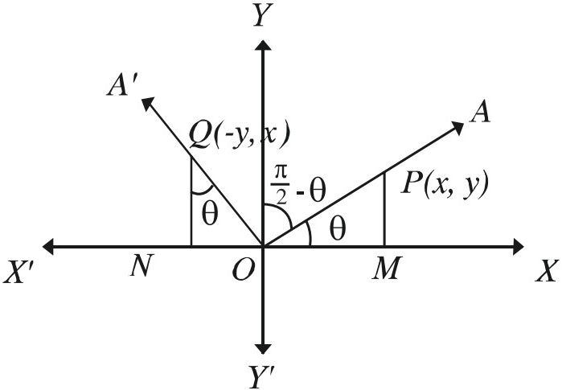

<!-- higher-math-9-10-bn-c08-t8.9-p042 · formula · p.179 · review: verify-formula -->
$\therefore \angle NQO = \angle YOQ = \angle POM = \theta$

<!-- higher-math-9-10-bn-c08-t8.9-p043 · text · p.179 · review: verify-formula -->
এখন সমকোণী ত্রিভুজ $\triangle POM$ ও $\triangle QON$ এর মধ্যে $\angle POM = \angle NQO$, $\angle PMO = \angle QNO$ এবং $OP = OQ = r$

<!-- higher-math-9-10-bn-c08-t8.9-p044 · text · p.179 · review: verify-formula -->
$\therefore \triangle POM$ ও $\triangle QON$ সর্বসম।

<!-- higher-math-9-10-bn-c08-t8.9-p045 · formula · p.179 · review: verify-formula -->
$\therefore ON = PM, QN = OM$

<!-- higher-math-9-10-bn-c08-t8.9-p046 · text · p.179 · review: verify-formula -->
এখন $P$ বিন্দুর স্থানাঙ্ক $(x, y)$ হলে, $ON = -PM = -y$ এবং $QN = OM = x$

<!-- higher-math-9-10-bn-c08-t8.9-p047 · text · p.179 · review: verify-formula -->
$\therefore Q$ বিন্দুর স্থানাঙ্ক $Q(-y, x)$

<!-- higher-math-9-10-bn-c08-t8.9-p048 · text · p.179 -->
তাহলে আমরা পাই,

<!-- higher-math-9-10-bn-c08-t8.9-p049 · formula · p.179 · review: verify-formula -->
$$\sin \left( \frac{\pi}{2} + \theta \right) = \frac{x}{r} = \cos \theta, \quad \cos \left( \frac{\pi}{2} + \theta \right) = \frac{-y}{r} = -\frac{y}{r} = -\sin \theta$$

<!-- higher-math-9-10-bn-c08-t8.9-p050 · formula · p.179 · review: verify-formula -->
$$\tan \left( \frac{\pi}{2} + \theta \right) = \frac{x}{-y} = -\frac{x}{y} = -\cot \theta$$

<!-- higher-math-9-10-bn-c08-t8.9-p051 · text · p.179 · review: verify-formula -->
একইভাবে, $cosec \left( \frac{\pi}{2} + \theta \right) = \sec \theta, \quad \sec \left( \frac{\pi}{2} + \theta \right) = -cosec \theta$

<!-- higher-math-9-10-bn-c08-t8.9-p052 · formula · p.179 · review: verify-formula -->
$$\cot \left( \frac{\pi}{2} + \theta \right) = -\tan \theta$$

<!-- higher-math-9-10-bn-c08-t8.9-p053 · text · p.179 · review: verify-formula -->
**মন্তব্য:** যেকোনো কোণ $\theta$ এর জন্য উপরিউক্ত সূত্রকগুলো প্রযোজ্য।

<!-- higher-math-9-10-bn-c08-t8.9-p054 · text · p.179 · review: verify-formula -->
**উদাহরণ ১৯.** $\sin \left( \frac{2\pi}{3} \right) = \sin \left( \frac{\pi}{2} + \frac{\pi}{6} \right) = \cos \frac{\pi}{6} = \frac{\sqrt{3}}{2}$

<!-- higher-math-9-10-bn-c08-t8.9-p055 · formula · p.179 · review: verify-formula -->
$$\cos \left( \frac{3\pi}{4} \right) = \cos \left( \frac{\pi}{2} + \frac{\pi}{4} \right) = -\sin \frac{\pi}{4} = -\frac{1}{\sqrt{2}}$$

<!-- higher-math-9-10-bn-c08-t8.9-p056 · formula · p.179 · review: verify-formula -->
$$\tan \left( \frac{5\pi}{6} \right) = \tan \left( \frac{\pi}{2} + \frac{\pi}{3} \right) = -\cot \frac{\pi}{3} = -\frac{1}{\sqrt{3}}$$

<!-- higher-math-9-10-bn-c08-t8.9-p057 · text · p.179 · review: verify-formula -->
**কাজ:** $\sec \left( \frac{3\pi}{4} \right)$, $cosec \left( \frac{5\pi}{6} \right)$ এবং $\cot \left( \frac{2\pi}{3} \right)$ এর মান নির্ণয় করো।

<!-- higher-math-9-10-bn-c08-t8.9-p058 · text · p.180 · review: verify-formula -->
$(\pi + \theta)$ কোণের ত্রিকোণমিতিক অনুপাতসমূহ $\left(0 < \theta < \frac{\pi}{2}\right)$:

<!-- higher-math-9-10-bn-c08-t8.9-p059 · text · p.180 · review: verify-formula -->
ধরি ঘূর্ণায়মান রশ্মি $OA$ আদি অবস্থান $OX$ থেকে ঘড়ির কাটার বিপরীত দিকে ঘুরে প্রথম চতুর্ভাগে $\angle XOA = \theta$ এবং একই দিকে আরও ঘুরে তৃতীয় চতুর্ভাগে $\angle AOA' = \pi$ কোণ উৎপন্ন করে (নিচের চিত্র)। তাহলে $\angle XOA' = (\pi + \theta)$.

<!-- higher-math-9-10-bn-c08-t8.9-p060 · text · p.180 · review: verify-formula -->
এখন $OA$ রশ্মির উপর যেকোনো বিন্দু $P$ এবং $OA'$ এর উপর $Q$ বিন্দুটি এমনভাবে নিই যেন, $OP = OQ = r$ হয়। $P$ ও $Q$ হতে $x$-অক্ষের উপর $PM$ ও $QN$ লম্ব টানি।

<!-- higher-math-9-10-bn-c08-t8.9-p061 · figure · p.180 -->
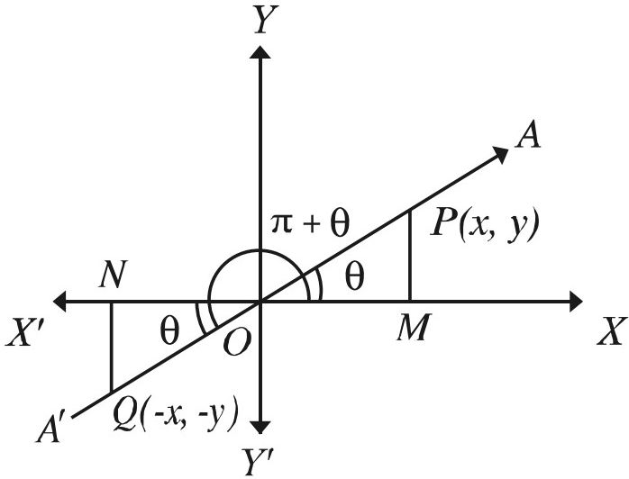

<!-- higher-math-9-10-bn-c08-t8.9-p062 · text · p.180 · review: verify-formula -->
$\triangle POM$ ও $\triangle QON$ সমকোণী ত্রিভুজদ্বয়ের মধ্যে $\angle OMP = \angle ONQ$, $\angle POM = \angle QON$ এবং $OP = OQ = r$. সুতরাং ত্রিভুজদ্বয় সর্বসম।

<!-- higher-math-9-10-bn-c08-t8.9-p063 · text · p.180 · review: verify-formula -->
$\therefore PM = QN$ এবং $OM = ON$

<!-- higher-math-9-10-bn-c08-t8.9-p064 · text · p.180 · review: verify-formula -->
এখন $P$ বিন্দুর স্থানাঙ্ক $(x, y)$ হলে, $ON = -x, NQ = -y$

<!-- higher-math-9-10-bn-c08-t8.9-p065 · text · p.180 · review: verify-formula -->
$\therefore Q$ বিন্দুর স্থানাঙ্ক $(-x, -y)$

<!-- higher-math-9-10-bn-c08-t8.9-p066 · text · p.180 · review: verify-formula -->
অর্থাৎ, $\sin(\pi + \theta) = \frac{-y}{r} = -\frac{y}{r} = -\sin\theta$

<!-- higher-math-9-10-bn-c08-t8.9-p067 · formula · p.180 · review: verify-formula -->
$\cos(\pi + \theta) = \frac{-x}{r} = -\frac{x}{r} = -\cos\theta, \tan(\pi + \theta) = \frac{-y}{-x} = \frac{y}{x} = \tan\theta$

<!-- higher-math-9-10-bn-c08-t8.9-p068 · text · p.180 · review: verify-formula -->
অনুরূপভাবে, $\csc(\pi + \theta) = -\csc\theta$

<!-- higher-math-9-10-bn-c08-t8.9-p069 · formula · p.180 · review: verify-formula -->
$\sec(\pi + \theta) = -\sec\theta, \cot(\pi + \theta) = \cot\theta$

<!-- higher-math-9-10-bn-c08-t8.9-p070 · text · p.180 · review: verify-formula -->
**মন্তব্য:** যেকোনো কোণ $\theta$ এর জন্য উপরিউক্ত সম্পর্কগুলো প্রযোজ্য।

<!-- higher-math-9-10-bn-c08-t8.9-p071 · text · p.180 · review: verify-formula -->
**উদাহরণ ২০.** $\sin \left(\frac{4\pi}{3}\right) = \sin \left(\pi + \frac{\pi}{3}\right) = -\sin \left(\frac{\pi}{3}\right) = -\frac{\sqrt{3}}{2}$

<!-- higher-math-9-10-bn-c08-t8.9-p072 · formula · p.180 · review: verify-formula -->
$\cos \left(\frac{5\pi}{4}\right) = \cos \left(\pi + \frac{\pi}{4}\right) = -\cos \left(\frac{\pi}{4}\right) = -\frac{1}{\sqrt{2}}$

<!-- higher-math-9-10-bn-c08-t8.9-p073 · formula · p.180 · review: verify-formula -->
$\tan \left(\frac{7\pi}{6}\right) = \tan \left(\pi + \frac{\pi}{6}\right) = \tan \left(\frac{\pi}{6}\right) = \frac{1}{\sqrt{3}}$

<!-- higher-math-9-10-bn-c08-t8.9-p074 · text · p.180 · review: verify-formula -->
**কাজ:** $\sec \left(\frac{4\pi}{3}\right), \csc \left(\frac{5\pi}{4}\right), \cot \left(\frac{7\pi}{6}\right)$ এর মান নির্ণয় করো।

<!-- higher-math-9-10-bn-c08-t8.9-p075 · text · p.181 · review: verify-formula -->
$(\pi - \theta)$ কোণের ত্রিকোণমিতিক অনুপাতসমূহ $\left(0 < \theta < \frac{\pi}{2}\right)$:

<!-- higher-math-9-10-bn-c08-t8.9-p076 · text · p.181 · review: verify-formula -->
ধরি ঘূর্ণায়মান রশ্মি $OA$ আদি অবস্থান $OX$ থেকে ঘড়ির কাঁটার বিপরীত দিকে ঘুরে $\angle XOA = \theta$ কোণ উৎপন্ন করে। রশ্মিটি একই দিকে আরও ঘুরে $\angle XOX' = \pi$ কোণ উৎপন্ন করার পর $OX'$ থেকে ঘড়ির কাঁটার দিকে ঘুরে $\angle X'OA' = -\theta$ কোণ উৎপন্ন করে (নিচের চিত্র)। তাহলে $\angle XOA' = \pi + (-\theta) = \pi - \theta$.

<!-- higher-math-9-10-bn-c08-t8.9-p077 · text · p.181 · review: verify-formula -->
$OA$ রশ্মির উপর $P$ যেকোনো বিন্দু এবং $OA'$ এর উপর $Q$ যেকোনো বিন্দু নিই যেন, $OP = OQ = r$ হয়।

<!-- higher-math-9-10-bn-c08-t8.9-p078 · text · p.181 · review: verify-formula -->
এখন $\triangle OMP$ ও $\triangle ONQ$ সমকোণী ত্রিভুজগুলির মধ্যে $\angle OMP = \angle ONQ$, $\angle POM = \angle QON$ এবং $OP = OQ = r$. সুতরাং ত্রিভুজগুলি সর্বসম এবং $ON = OM$, $QN = PM$.

<!-- higher-math-9-10-bn-c08-t8.9-p079 · figure · p.181 -->
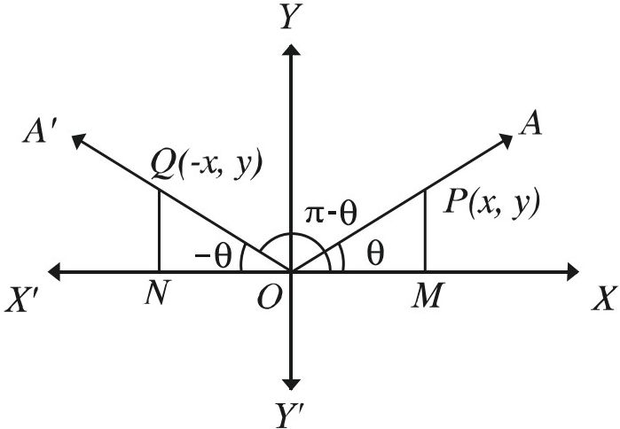

<!-- higher-math-9-10-bn-c08-t8.9-p080 · text · p.181 · review: verify-formula -->
এখন $P$ বিন্দুর স্থানাঙ্ক $(x, y)$ হলে $OM = x$, $PM = y$
$\therefore ON = -x$, $NQ = y$
$\therefore Q$ বিন্দুর স্থানাঙ্ক $Q(-x, y)$

<!-- higher-math-9-10-bn-c08-t8.9-p081 · text · p.181 · review: verify-formula -->
তাহলে, $\sin(\pi - \theta) = \frac{y}{r} = \sin\theta$, $\cos(\pi - \theta) = \frac{-x}{r} = -\frac{x}{r} = -\cos\theta$

<!-- higher-math-9-10-bn-c08-t8.9-p082 · formula · p.181 · review: verify-formula -->
$\tan(\pi - \theta) = \frac{y}{-x} = -\frac{y}{x} = -\tan\theta$

<!-- higher-math-9-10-bn-c08-t8.9-p083 · text · p.181 · review: verify-formula -->
অনুরূপভাবে, $\csc(\pi - \theta) = \csc\theta$

<!-- higher-math-9-10-bn-c08-t8.9-p084 · text · p.181 · review: verify-formula -->
$\sec(\pi - \theta) = -\sec\theta$, $\cot(\pi - \theta) = -\cot\theta$

<!-- higher-math-9-10-bn-c08-t8.9-p085 · text · p.181 · review: known-confusable-corrected,verify-formula -->
**মন্তব্য:** যেকোনো কোণ $\theta$ এর জন্য উপরিসূত্র সক্ষরকগুলো প্রযোজ্য।

<!-- higher-math-9-10-bn-c08-t8.9-p086 · text · p.181 · review: verify-formula -->
**উদাহরণ ২১.** $\sin \left( \frac{2\pi}{3} \right) = \sin \left( \pi - \frac{\pi}{3} \right) = \sin \left( \frac{\pi}{3} \right) = \frac{\sqrt{3}}{2}$

<!-- higher-math-9-10-bn-c08-t8.9-p087 · formula · p.181 · review: verify-formula -->
$\cos \left( \frac{3\pi}{4} \right) = \cos \left( \pi - \frac{\pi}{4} \right) = -\cos \left( \frac{\pi}{4} \right) = -\frac{1}{\sqrt{2}}$

<!-- higher-math-9-10-bn-c08-t8.9-p088 · formula · p.181 · review: verify-formula -->
$\tan \left( \frac{5\pi}{6} \right) = \tan \left( \pi - \frac{\pi}{6} \right) = -\tan \left( \frac{\pi}{6} \right) = -\frac{1}{\sqrt{3}}$

<!-- higher-math-9-10-bn-c08-t8.9-p089 · text · p.181 · review: verify-formula -->
**কাজ:** $\csc \left( \frac{3\pi}{4} \right)$, $\sec \left( \frac{5\pi}{6} \right)$, $\cot \left( \frac{2\pi}{3} \right)$ এর মান নির্ণয় করো।

<!-- higher-math-9-10-bn-c08-t8.9-p090 · text · p.181 · review: latin-junk,verify-formula -->
**লক্ষণীয়:** $\theta$ এবং $(\pi - \theta)$ কোণ দুটি পরস্পর সমপূরক। সমপূরক কোণের sine ও cosecant সমান ও একই চিহ্নবিশিষ্ট। কিন্তু cosine, secant, tangent ও cotangent সমান ও বিপরীত চিহ্নবিশিষ্ট।

<!-- higher-math-9-10-bn-c08-t8.9-p091 · text · p.182 · review: verify-formula -->
$\left( \frac{3\pi}{2} - \theta \right)$ কোণের ত্রিকোণমিতিক অনুপাতসমূহ $\left( 0 < \theta < \frac{\pi}{2} \right)$:

<!-- higher-math-9-10-bn-c08-t8.9-p092 · text · p.182 -->
পূর্ববর্তী আলোচনার সাপেক্ষে পাওয়া যায়:

<!-- higher-math-9-10-bn-c08-t8.9-p093 · formula · p.182 · review: verify-formula -->
$$\sin \left( \frac{3\pi}{2} - \theta \right) = \sin \left\{ \pi + \left( \frac{\pi}{2} - \theta \right) \right\} = -\sin \left( \frac{\pi}{2} - \theta \right) = -\cos \theta$$

<!-- higher-math-9-10-bn-c08-t8.9-p094 · formula · p.182 · review: verify-formula -->
$$\cos \left( \frac{3\pi}{2} - \theta \right) = \cos \left\{ \pi + \left( \frac{\pi}{2} - \theta \right) \right\} = -\cos \left( \frac{\pi}{2} - \theta \right) = -\sin \theta$$

<!-- higher-math-9-10-bn-c08-t8.9-p095 · formula · p.182 · review: verify-formula -->
$$\tan \left( \frac{3\pi}{2} - \theta \right) = \tan \left\{ \pi + \left( \frac{\pi}{2} - \theta \right) \right\} = \tan \left( \frac{\pi}{2} - \theta \right) = \cot \theta$$

<!-- higher-math-9-10-bn-c08-t8.9-p096 · text · p.182 · review: verify-formula -->
অনুরূপভাবে, $\csc \left( \frac{3\pi}{2} - \theta \right) = -\sec \theta$

<!-- higher-math-9-10-bn-c08-t8.9-p097 · formula · p.182 · review: verify-formula -->
$$\sec \left( \frac{3\pi}{2} - \theta \right) = -\csc \theta, \cot \left( \frac{3\pi}{2} - \theta \right) = \tan \theta.$$

<!-- higher-math-9-10-bn-c08-t8.9-p098 · text · p.182 · review: verify-formula -->
**মন্তব্য:** যেকোনো কোণ $\theta$ এর জন্য উপরিউক্ত সম্পর্কগুলো প্রযোজ্য।

<!-- higher-math-9-10-bn-c08-t8.9-p099 · text · p.182 · review: verify-formula -->
$(2\pi - \theta)$ কোণের ত্রিকোণমিতিক অনুপাতসমূহ $\left( 0 < \theta < \frac{\pi}{2} \right)$:

<!-- higher-math-9-10-bn-c08-t8.9-p100 · text · p.182 · review: verify-formula -->
প্রমিত বা আদর্শ অবস্থানে $(2\pi - \theta)$ কোণের অবস্থান চতুর্থ চতুর্ভাগে থাকে এবং $(-\theta)$ কোণের সাথে মিলে যায়। তাই $(-\theta)$ ও $(2\pi - \theta)$ কোণের ত্রিকোণমিতিক অনুপাত সমান।

<!-- higher-math-9-10-bn-c08-t8.9-p101 · formula · p.182 · review: verify-formula -->
$$\therefore \sin(2\pi - \theta) = \sin(-\theta) = -\sin\theta, \cos(2\pi - \theta) = \cos(-\theta) = \cos\theta$$

<!-- higher-math-9-10-bn-c08-t8.9-p102 · formula · p.182 · review: verify-formula -->
$$\tan(2\pi - \theta) = \tan(-\theta) = -\tan\theta, \csc(2\pi - \theta) = \csc(-\theta) = -\csc\theta$$

<!-- higher-math-9-10-bn-c08-t8.9-p103 · formula · p.182 · review: latin-junk,verify-formula -->
$$\sec(2\pi - \theta) = \sec(-\theta) = \sec\theta  এবং  \cot(2\pi - \theta) = \cot(-\theta) = -\cot\theta$$

<!-- higher-math-9-10-bn-c08-t8.9-p104 · text · p.182 · review: verify-formula -->
**মন্তব্য:** যেকোনো কোণ $\theta$ এর জন্য উপরিউক্ত সম্পর্কগুলো প্রযোজ্য।

<!-- higher-math-9-10-bn-c08-t8.9-p105 · text · p.182 · review: verify-formula -->
$(2\pi + \theta)$ কোণের ত্রিকোণমিতিক অনুপাতসমূহ $\left( 0 < \theta < \frac{\pi}{2} \right)$:

<!-- higher-math-9-10-bn-c08-t8.9-p106 · text · p.182 · review: verify-formula -->
প্রমিত বা আদর্শ অবস্থানে $(2\pi + \theta)$ কোণের অবস্থান প্রথম চতুর্ভাগে থাকায় $\theta$ কোণের ও $(2\pi + \theta)$ কোণের অনুপাতসমূহ একই হবে।

<!-- higher-math-9-10-bn-c08-t8.9-p107 · formula · p.182 · review: verify-formula -->
$$\therefore \sin(2\pi + \theta) = \sin\theta, \cos(2\pi + \theta) = \cos\theta$$

<!-- higher-math-9-10-bn-c08-t8.9-p108 · formula · p.182 · review: verify-formula -->
$$\tan(2\pi + \theta) = \tan\theta, \csc(2\pi + \theta) = \csc\theta$$

<!-- higher-math-9-10-bn-c08-t8.9-p109 · formula · p.182 · review: verify-formula -->
$$\sec(2\pi + \theta) = \sec\theta, \cot(2\pi + \theta) = \cot\theta.$$

<!-- higher-math-9-10-bn-c08-t8.9-p110 · text · p.182 · review: verify-formula -->
**মন্তব্য:** যেকোনো কোণ $\theta$ এর জন্য উপরিউক্ত সম্পর্কগুলো প্রযোজ্য।

<!-- higher-math-9-10-bn-c08-t8.9-p111 · text · p.183 · review: verify-formula -->
$\left( \frac{3\pi}{2} + \theta \right)$ কোণের ত্রিকোণমিতিক অনুপাতসমূহ $\left( 0 < \theta < \frac{\pi}{2} \right)$:

<!-- higher-math-9-10-bn-c08-t8.9-p112 · text · p.183 · review: verify-formula -->
$\left( \frac{3\pi}{2} + \theta \right)$ কোণের জন্য $\frac{3\pi}{2} + \theta = 2\pi - \left( \frac{\pi}{2} - \theta \right)$

<!-- higher-math-9-10-bn-c08-t8.9-p113 · formula · p.183 · review: verify-formula -->
$\therefore \sin \left( \frac{3\pi}{2} + \theta \right) = \sin \left\{ 2\pi - \left( \frac{\pi}{2} - \theta \right) \right\} = -\sin \left( \frac{\pi}{2} - \theta \right) = -\cos \theta$

<!-- higher-math-9-10-bn-c08-t8.9-p114 · formula · p.183 · review: verify-formula -->
$\cos \left( \frac{3\pi}{2} + \theta \right) = \cos \left( \frac{\pi}{2} - \theta \right) = \sin \theta$

<!-- higher-math-9-10-bn-c08-t8.9-p115 · formula · p.183 · review: verify-formula -->
$\tan \left( \frac{3\pi}{2} + \theta \right) = -\tan \left( \frac{\pi}{2} - \theta \right) = -\cot \theta$

<!-- higher-math-9-10-bn-c08-t8.9-p116 · text · p.183 · review: verify-formula -->
অনুরূপভাবে, $\csc \left( \frac{3\pi}{2} + \theta \right) = -\sec \theta$

<!-- higher-math-9-10-bn-c08-t8.9-p117 · formula · p.183 · review: verify-formula -->
$\sec \left( \frac{3\pi}{2} + \theta \right) = \csc \theta, \cot \left( \frac{3\pi}{2} + \theta \right) = -\tan \theta$

<!-- higher-math-9-10-bn-c08-t8.9-p118 · text · p.183 · review: verify-formula -->
**মন্তব্য:** যেকোনো কোণ $\theta$ এর জন্য উপরিউক্ত সমসর্কগুলো প্রযোজ্য।

<!-- higher-math-9-10-bn-c08-t8.9-p119 · text · p.183 · review: verify-formula -->
যেকোনো কোণের অর্থাৎ, $\left( n \times \frac{\pi}{2} \pm \theta \right)$ কোণের ত্রিকোণমিতিক অনুপাতসমূহ নির্ণয়ের পদ্ধতি $\left( 0 < \theta < \frac{\pi}{2} \right)$:

<!-- higher-math-9-10-bn-c08-t8.9-p120 · text · p.183 -->
নিম্নোক্ত পদ্ধতিতে যেকোনো ত্রিকোণমিতিক কোণের অনুপাতসমূহ নির্ণয় করা যায়।

<!-- higher-math-9-10-bn-c08-t8.9-p121 · text · p.183 · review: verify-formula -->
**ধাপ ১.** প্রথমে প্রদত্ত কোণকে দুইভাগে ভাগ করতে হবে যার একটি অংশ $\frac{\pi}{2}$ বা $\frac{\pi}{2}$ এর $n$ গুণিতক এবং অপরটি সূক্ষ্মকোণ। অর্থাৎ প্রদত্ত কোণকে $\left( n \times \frac{\pi}{2} \pm \theta \right)$ আকারে প্রকাশ করতে হবে।

<!-- higher-math-9-10-bn-c08-t8.9-p122 · text · p.183 · review: latin-junk,verify-formula -->
**ধাপ ২.** $n$ জোড় সংখ্যা হলে অনুপাতের ধরন একই থাকবে অর্থাৎ sine অনুপাত sine থাকবে, cosine অনুপাত cosine থাকবে ইত্যাদি।

<!-- higher-math-9-10-bn-c08-t8.9-p123 · text · p.183 · review: latin-junk,verify-formula -->
$n$ বিজোড় সংখ্যা হলে sine, tangent ও secant অনুপাতগুলো যথাক্রমে cosine, cotangent ও cosecant এ পরিবর্তিত হবে। একইভাবে, cosine, cotangent ও cosecant যথাক্রমে sine, tangent ও secant এ পরিবর্তিত হবে।

<!-- higher-math-9-10-bn-c08-t8.9-p124 · text · p.183 · review: verify-formula -->
**ধাপ ৩.** $\left( n \times \frac{\pi}{2} \pm \theta \right)$ কোণের অবস্থান কোন চতুর্ভাগে সেটা জানার পর ঐ চতুর্ভাগে প্রদত্ত অনুপাতের যে চিহ্ন সেই চিহ্ন ধাপ ২ থেকে নির্গত অনুপাতের পূর্বে বসাতে হবে।

<!-- higher-math-9-10-bn-c08-t8.9-p125 · text · p.183 -->
**বিশেষ দ্রষ্টব্য:** এখানে বর্ণিত পদ্ধতির সাহায্যে যেকোনো ত্রিকোণমিতিক অনুপাত নির্ণয় সম্ভব বলে শিক্ষার্থীদের এই পদ্ধতিতে ত্রিকোণমিতিক অনুপাত নির্ণয়ের জন্য উপদেশ দেওয়া হলো।

<!-- higher-math-9-10-bn-c08-t8.9-p126 · text · p.184 · review: verify-formula -->
**উদাহরণ ২২.** $\sin \left( \frac{9\pi}{2} + \theta \right)$ কোণের ক্ষেত্রে $n = 9$ একটি বিজোড় সংখ্যা তাই $\sin$ পরিবর্তিত হয়ে $\cos$ হবে। আবার, $\left( \frac{9\pi}{2} + \theta \right)$ দশম বা দ্বিতীয় চতুর্ভাগে থাকে ফলে $\sin$ এর চিহ্ন ধনাত্মক।

<!-- higher-math-9-10-bn-c08-t8.9-p127 · formula · p.184 · review: verify-formula -->
$$\therefore \sin \left( \frac{9\pi}{2} + \theta \right) = \cos \theta$$

<!-- higher-math-9-10-bn-c08-t8.9-p128 · text · p.184 · review: verify-formula -->
$\sin \left( \frac{9\pi}{2} - \theta \right)$ এর ক্ষেত্রে $n = 9$ বিজোড় এবং $\left( \frac{9\pi}{2} - \theta \right)$ নবম বা প্রথম চতুর্ভাগে থাকায় $\sin$ এর চিহ্ন ধনাত্মক।

<!-- higher-math-9-10-bn-c08-t8.9-p129 · formula · p.184 · review: verify-formula -->
$$\therefore \sin \left( \frac{9\pi}{2} - \theta \right) = \cos \theta$$

<!-- higher-math-9-10-bn-c08-t8.9-p130 · text · p.184 · review: verify-formula -->
$\tan \left( \frac{9\pi}{2} + \theta \right)$ এর ক্ষেত্রে $n = 9$ বিজোড় বলে $\tan$ হবে $\cot$ এবং $\left( \frac{9\pi}{2} + \theta \right)$ দশম বা দ্বিতীয় চতুর্ভাগে থাকায় $\tan$ এর চিহ্ন ঋণাত্মক।

<!-- higher-math-9-10-bn-c08-t8.9-p131 · formula · p.184 · review: verify-formula -->
$$\therefore \tan \left( \frac{9\pi}{2} + \theta \right) = -\cot \theta$$

<!-- higher-math-9-10-bn-c08-t8.9-p132 · text · p.184 · review: verify-formula -->
একইভাবে, $\tan \left( \frac{9\pi}{2} - \theta \right) = \cot \theta$

<!-- higher-math-9-10-bn-c08-t8.9-p133 · text · p.184 · review: verify-formula -->
**কাজ:** $\sin \left( \frac{11\pi}{2} \pm \theta \right)$, $\cos (11\pi \pm \theta)$, $\tan \left( \frac{17\pi}{2} \pm \theta \right)$, $\cot (18\pi \pm \theta)$, $\sec \left( \frac{19\pi}{2} \pm \theta \right)$ এবং $\csc (8\pi \pm \theta)$ অনুপাতসমূহকে $\theta$ কোণের অনুপাতে প্রকাশ করো।

<!-- higher-math-9-10-bn-c08-t8.9-p134 · text · p.184 -->
**উদাহরণ ২৩.** মান নির্ণয় করো।

<!-- higher-math-9-10-bn-c08-t8.9-p135 · text · p.184 · review: verify-formula -->
ক) $\sin(10\pi + \theta)$
খ) $\cos \left( \frac{19\pi}{3} \right)$
গ) $\tan \left( \frac{11\pi}{6} \right)$
ঘ) $\cot \left( \theta - \frac{9\pi}{2} \right)$
ঙ) $\sec \left( -\frac{17\pi}{2} \right)$

<!-- higher-math-9-10-bn-c08-t8.9-p136 · text · p.184 -->
**সমাধান:**

<!-- higher-math-9-10-bn-c08-t8.9-p137 · text · p.184 · review: verify-formula -->
ক) $\sin(10\pi + \theta) = \sin(20 \times \frac{\pi}{2} + \theta)$

<!-- higher-math-9-10-bn-c08-t8.9-p138 · text · p.184 · review: verify-formula -->
এখানে $n = 20$ এবং $\sin(20 \times \frac{\pi}{2} + \theta)$ কোণটি 21 তম বা প্রথম চতুর্ভাগে অবস্থিত।

<!-- higher-math-9-10-bn-c08-t8.9-p139 · formula · p.184 · review: verify-formula -->
$$\therefore \sin(10\pi + \theta) = \sin \theta$$

<!-- higher-math-9-10-bn-c08-t8.9-p140 · text · p.185 · review: verify-formula -->
খ) $\cos \left( \frac{19\pi}{3} \right) = \cos \left( 6\pi + \frac{\pi}{3} \right) = \cos \left( 12 \times \frac{\pi}{2} + \frac{\pi}{3} \right)$

<!-- higher-math-9-10-bn-c08-t8.9-p141 · text · p.185 · review: verify-formula -->
এখানে $n = 12$ এবং $\frac{19\pi}{3}$ প্রথম চতুর্ভাগে অবস্থিত।

<!-- higher-math-9-10-bn-c08-t8.9-p142 · formula · p.185 · review: verify-formula -->
$\therefore \cos \left( \frac{19\pi}{3} \right) = \cos \frac{\pi}{3} = \frac{1}{2}$

<!-- higher-math-9-10-bn-c08-t8.9-p143 · text · p.185 · review: verify-formula -->
গ) $\tan \left( \frac{11\pi}{6} \right) = \tan \left( 2\pi - \frac{\pi}{6} \right) = \tan \left( 4 \times \frac{\pi}{2} - \frac{\pi}{6} \right)$

<!-- higher-math-9-10-bn-c08-t8.9-p144 · text · p.185 · review: verify-formula -->
এখানে $n = 4$ এবং $\frac{11\pi}{6}$ চতুর্থ চতুর্ভাগে অবস্থিত।

<!-- higher-math-9-10-bn-c08-t8.9-p145 · formula · p.185 · review: verify-formula -->
$\therefore \tan \left( \frac{11\pi}{6} \right) = -\tan \frac{\pi}{6} = -\frac{1}{\sqrt{3}}$

<!-- higher-math-9-10-bn-c08-t8.9-p146 · text · p.185 · review: verify-formula -->
ঘ) $\cot \left( \theta - \frac{9\pi}{2} \right) = \cot \left\{ - \left( \frac{9\pi}{2} - \theta \right) \right\} = -\cot \left( 9 \times \frac{\pi}{2} - \theta \right)$

<!-- higher-math-9-10-bn-c08-t8.9-p147 · text · p.185 · review: verify-formula -->
এখানে $n = 9$ এবং $\frac{9\pi}{2} - \theta$ প্রথম চতুর্ভাগে অবস্থিত।

<!-- higher-math-9-10-bn-c08-t8.9-p148 · formula · p.185 · review: verify-formula -->
$\therefore \cot \left( \theta - \frac{9\pi}{2} \right) = -(\tan \theta) = -\tan \theta$

<!-- higher-math-9-10-bn-c08-t8.9-p149 · text · p.185 · review: verify-formula -->
ঙ) $\sec \left( -\frac{17\pi}{2} \right) = \sec \left( \frac{17\pi}{2} \right) [\because \sec(-\theta) = \sec \theta]$

<!-- higher-math-9-10-bn-c08-t8.9-p150 · formula · p.185 · review: verify-formula -->
$= \sec \left( 17 \times \frac{\pi}{2} + 0 \right)$

<!-- higher-math-9-10-bn-c08-t8.9-p151 · text · p.185 · review: verify-formula -->
এখানে $n = 17$ এবং $\frac{17\pi}{2}$, $y$ অক্ষের উপরে অবস্থিত।

<!-- higher-math-9-10-bn-c08-t8.9-p152 · formula · p.185 · review: verify-formula -->
$\therefore \sec \left( -\frac{17\pi}{2} \right) = cosec  0,  অসংজ্ঞায়িত$

### উদাহরণ ২৪. মান নির্ণয় করো:

<!-- higher-math-9-10-bn-c08-t8.9-p153 · formula · p.185 · review: verify-formula -->
$$\sin \frac{11}{90}\pi + \cos \frac{1}{30}\pi + \sin \frac{101}{90}\pi + \cos \frac{31}{30}\pi + \cos \frac{5}{3}\pi$$

### সমাধান:

<!-- higher-math-9-10-bn-c08-t8.9-p154 · formula · p.185 · review: verify-formula -->
$$\sin \frac{11}{90}\pi + \cos \frac{1}{30}\pi + \sin \frac{101}{90}\pi + \cos \frac{31}{30}\pi + \cos \frac{5}{3}\pi$$

<!-- higher-math-9-10-bn-c08-t8.9-p155 · formula · p.185 · review: verify-formula -->
$$= \sin \frac{22}{180}\pi + \cos \frac{6}{180}\pi + \sin \frac{202}{180}\pi + \cos \frac{186}{180}\pi + \cos \frac{300}{180}\pi$$

<!-- higher-math-9-10-bn-c08-t8.9-p156 · formula · p.185 · review: verify-formula -->
$$= \sin \frac{22}{180}\pi + \cos \frac{6}{180}\pi + \sin(\pi + \frac{22}{180}\pi) + \cos(\pi + \frac{6}{180}\pi) + \cos(2\pi - \frac{60}{180}\pi)$$

<!-- higher-math-9-10-bn-c08-t8.9-p157 · formula · p.186 · review: verify-formula -->
$$= \sin \frac{22}{180}\pi + \cos \frac{6}{180}\pi - \sin \frac{22}{180}\pi - \cos \frac{6}{180}\pi + \cos \frac{60}{180}\pi$$

<!-- higher-math-9-10-bn-c08-t8.9-p158 · formula · p.186 · review: verify-formula -->
$$= \cos \frac{\pi}{3}$$

<!-- higher-math-9-10-bn-c08-t8.9-p159 · formula · p.186 · review: verify-formula -->
$$= \frac{1}{2}$$

<!-- higher-math-9-10-bn-c08-t8.9-p160 · text · p.186 -->
**কাজ: মান নির্ণয় করো:**

<!-- higher-math-9-10-bn-c08-t8.9-p161 · formula · p.186 · review: verify-formula -->
$$\cos^2 \frac{\pi}{15} + \cos^2 \frac{13\pi}{30} + \cos^2 \frac{16\pi}{15} + \cos^2 \frac{47\pi}{30}$$

<!-- higher-math-9-10-bn-c08-t8.9-p162 · text · p.186 · review: verify-formula -->
**উদাহরণ ২৫.** $\tan \theta = \frac{5}{12}$ এবং $\cos \theta$ ঋণাত্মক হলে, প্রমাণ করো যে, $\frac{\sin \theta + \cos(-\theta)}{\sec(-\theta) + \tan \theta} = \frac{51}{26}$

<!-- higher-math-9-10-bn-c08-t8.9-p163 · text · p.186 · review: verify-formula -->
**সমাধান:** $\tan \theta = \frac{5}{12}$ এবং $\cos \theta$ ঋণাত্মক হওয়ায় $\theta$ কোণের অবস্থান তৃতীয় চতুর্ভাগে।

<!-- higher-math-9-10-bn-c08-t8.9-p164 · text · p.186 · review: verify-formula -->
অর্থাৎ, $\tan \theta = \frac{5}{12} = \frac{y}{x}$

<!-- higher-math-9-10-bn-c08-t8.9-p165 · formula · p.186 · review: verify-formula -->
$\therefore x = 12, y = 5$

<!-- higher-math-9-10-bn-c08-t8.9-p166 · formula · p.186 · review: verify-formula -->
$\therefore r = \sqrt{(12)^2 + (5)^2} = \sqrt{144 + 25} = \sqrt{169} = 13$

<!-- higher-math-9-10-bn-c08-t8.9-p167 · text · p.186 · review: verify-formula -->
$\therefore \sin \theta = \frac{-y}{r} = -\frac{5}{13}, \cos \theta = \frac{-x}{r} = \frac{-12}{13}$ এবং $\sec \theta = \frac{1}{\cos \theta} = -\frac{13}{12}$

<!-- higher-math-9-10-bn-c08-t8.9-p168 · formula · p.186 · review: verify-formula -->
$$\therefore \frac{\sin \theta + \cos(-\theta)}{\sec(-\theta) + \tan \theta} = \frac{\sin \theta + \cos \theta}{\sec \theta + \tan \theta} \quad [\because \cos(-\theta) = \cos \theta, \sec(-\theta) = \sec \theta]$$

<!-- higher-math-9-10-bn-c08-t8.9-p169 · formula · p.186 · review: latin-junk,verify-formula -->
$$= \frac{\frac{5}{13} - \frac{12}{13}}{\frac{-12}{13} + \frac{5}{12}} = \frac{-\frac{13}{13}}{-\frac{8}{12}} = \frac{17}{13} \times \frac{12}{8} = \frac{51}{26} \quad [প্রমাণিত]$$

<!-- higher-math-9-10-bn-c08-t8.9-p170 · text · p.186 · review: verify-formula -->
**উদাহরণ ২৬.** $\tan \theta = -\sqrt{3}, \frac{\pi}{2} < \theta < 2\pi$ হলে $\theta$ এর মান কত?

<!-- higher-math-9-10-bn-c08-t8.9-p171 · text · p.186 · review: verify-formula -->
**সমাধান:** $\tan \theta$ ঋণাত্মক হওয়ায় $\theta$ এর অবস্থান দ্বিতীয় বা চতুর্থ চতুর্ভাগে থাকবে।

<!-- higher-math-9-10-bn-c08-t8.9-p172 · text · p.186 · review: verify-formula -->
দ্বিতীয় চতুর্ভাগে $\tan \theta = -\sqrt{3} = \tan \left( \pi - \frac{\pi}{3} \right) = \tan \frac{2\pi}{3}$

<!-- higher-math-9-10-bn-c08-t8.9-p173 · formula · p.186 · review: verify-formula -->
$\therefore \theta = \frac{2\pi}{3}$

<!-- higher-math-9-10-bn-c08-t8.9-p174 · text · p.186 · review: verify-formula -->
এটি গ্রহণযোগ্য মান। কারণ $\frac{\pi}{2} < \theta < 2\pi$

<!-- higher-math-9-10-bn-c08-t8.9-p175 · text · p.186 · review: verify-formula -->
আবার, চতুর্থ চতুর্ভাগে $\tan \theta = -\sqrt{3} = \tan \left( 2\pi - \frac{\pi}{3} \right) = \tan \frac{5\pi}{3}$

<!-- higher-math-9-10-bn-c08-t8.9-p176 · formula · p.187 · review: verify-formula -->
$$\therefore \theta = \frac{5\pi}{3}$$

<!-- higher-math-9-10-bn-c08-t8.9-p177 · text · p.187 · review: verify-formula -->
এটিও গ্রহণযোগ্য মান। কারণ $\frac{\pi}{2} < \theta < 2\pi$

<!-- higher-math-9-10-bn-c08-t8.9-p178 · formula · p.187 · review: latin-junk,verify-formula -->
$$\therefore \theta  এর মান  \frac{2\pi}{3}  ও  \frac{5\pi}{3}$$

<!-- higher-math-9-10-bn-c08-t8.9-p179 · text · p.187 · review: verify-formula -->
**উদাহরণ ২৭.** সমাধান করো: $0 < \theta < \frac{\pi}{2}$ হলে $\sin\theta + \cos\theta = \sqrt{2}$

<!-- higher-math-9-10-bn-c08-t8.9-p180 · text · p.187 · review: verify-formula -->
**সমাধান:** $\sin\theta + \cos\theta = \sqrt{2}$

<!-- higher-math-9-10-bn-c08-t8.9-p181 · text · p.187 · review: verify-formula -->
বা, $\sin\theta = \sqrt{2} - \cos\theta \implies \sin^2\theta = 2 - 2\sqrt{2}\cos\theta + \cos^2\theta$

<!-- higher-math-9-10-bn-c08-t8.9-p182 · text · p.187 · review: verify-formula -->
বা, $1 - \cos^2\theta = 2 - 2\sqrt{2}\cos\theta + \cos^2\theta$

<!-- higher-math-9-10-bn-c08-t8.9-p183 · text · p.187 · review: verify-formula -->
বা, $2\cos^2\theta - 2\sqrt{2}\cos\theta + 1 = 0 \implies (\sqrt{2}\cos\theta - 1)^2 = 0$

<!-- higher-math-9-10-bn-c08-t8.9-p184 · text · p.187 · review: verify-formula -->
বা, $\sqrt{2}\cos\theta - 1 = 0$

<!-- higher-math-9-10-bn-c08-t8.9-p185 · text · p.187 · review: verify-formula -->
বা, $\cos\theta = \frac{1}{\sqrt{2}} = \cos\frac{\pi}{4}$

<!-- higher-math-9-10-bn-c08-t8.9-p186 · formula · p.187 · review: verify-formula -->
$$\therefore \theta = \frac{\pi}{4}$$

<!-- higher-math-9-10-bn-c08-t8.9-p187 · text · p.187 · review: verify-formula -->
নির্দেশ সমাধান: $\theta = \frac{\pi}{4}$

<!-- higher-math-9-10-bn-c08-t8.9-p188 · text · p.187 · review: verify-formula -->
**উদাহরণ ২৮.** $0 < \theta < 2\pi$ ব্যবধিতে সমীকরণটির সমাধান করো: $\sin^2\theta - \cos^2\theta = \cos\theta$

<!-- higher-math-9-10-bn-c08-t8.9-p189 · text · p.187 · review: verify-formula -->
**সমাধান:** $\sin^2\theta - \cos^2\theta = \cos\theta$

<!-- higher-math-9-10-bn-c08-t8.9-p190 · text · p.187 · review: verify-formula -->
বা, $1 - \cos^2\theta - \cos^2\theta = \cos\theta$

<!-- higher-math-9-10-bn-c08-t8.9-p191 · text · p.187 · review: verify-formula -->
বা, $1 - 2\cos^2\theta - \cos\theta = 0 \implies 2\cos^2\theta + \cos\theta - 1 = 0$

<!-- higher-math-9-10-bn-c08-t8.9-p192 · text · p.187 · review: verify-formula -->
বা, $(2\cos\theta - 1)(\cos\theta + 1) = 0$

<!-- higher-math-9-10-bn-c08-t8.9-p193 · formula · p.187 · review: latin-junk,verify-formula -->
$$\therefore 2\cos\theta - 1 = 0  অথবা  \cos\theta + 1 = 0$$

<!-- higher-math-9-10-bn-c08-t8.9-p194 · text · p.187 · review: verify-formula -->
অর্থাৎ, $\cos\theta = \frac{1}{2}$ অথবা $\cos\theta = -1$

<!-- higher-math-9-10-bn-c08-t8.9-p195 · text · p.187 · review: verify-formula -->
অর্থাৎ, $\cos\theta = \cos\frac{\pi}{3}$ অথবা $\cos\theta = \cos\pi$

<!-- higher-math-9-10-bn-c08-t8.9-p196 · formula · p.187 · review: verify-formula -->
$$\therefore \theta = \frac{\pi}{3}, \pi, \frac{5\pi}{3}$$

<!-- higher-math-9-10-bn-c08-t8.9-p197 · text · p.187 · review: verify-formula -->
নির্দেশ সমাধান: $\theta = \frac{\pi}{3}, \pi, \frac{5\pi}{3}$

<!-- higher-math-9-10-bn-c08-t8.9-p198 · text · p.188 · review: verify-formula -->
**কাজ:** $2 (\sin\theta\cos\theta + \sqrt{3}) = \sqrt{3}\cos\theta + 4\sin\theta$ সমীকরণটি সমাধান করো,
যেখানে $0 < \theta < 2\pi$

<!-- higher-math-9-10-bn-c08-t8.9-p199 · text · p.188 · review: verify-formula -->
**উদাহরণ ২৯.** $A = \frac{\cot\theta + \csc\theta - 1}{\cot\theta - \csc\theta + 1}$ এবং $B = \cot\theta + \csc\theta$

<!-- higher-math-9-10-bn-c08-t8.9-p200 · text · p.188 · review: verify-formula -->
ক) $\theta = \frac{\pi}{3}$ হলে দেখাও যে, $B = \sqrt{3}$

<!-- higher-math-9-10-bn-c08-t8.9-p201 · text · p.188 · review: verify-formula -->
খ) প্রমাণ করো যে, $A^2 - B^2 = 0$

<!-- higher-math-9-10-bn-c08-t8.9-p202 · text · p.188 · review: verify-formula -->
গ) $B = \frac{1}{\sqrt{3}}$ এবং $0 < \theta \le 2\pi$ হলে $\theta$ এর সম্ভাব্য মান নির্ণয় করো।

<!-- higher-math-9-10-bn-c08-t8.9-p203 · text · p.188 -->
**সমাধান:**

<!-- higher-math-9-10-bn-c08-t8.9-p204 · text · p.188 · review: verify-formula -->
ক) $B = \cot\theta + \csc\theta = \cot\frac{\pi}{3} + \csc\frac{\pi}{3}$ $[\because \theta = \frac{\pi}{3}]$
$$= \frac{1}{\sqrt{3}} + \frac{2}{\sqrt{3}} = \frac{3}{\sqrt{3}} = \sqrt{3}$$

<!-- higher-math-9-10-bn-c08-t8.9-p205 · text · p.188 · review: verify-formula -->
খ) $A = \frac{\cot\theta + \csc\theta - 1}{\cot\theta - \csc\theta + 1}$
$$= \frac{\cot\theta + \csc\theta - (\csc^2\theta - \cot^2\theta)}{\cot\theta - \csc\theta + 1} \quad [\because \csc^2\theta - \cot^2\theta = 1]$$
$$= \frac{\cot\theta + \csc\theta - (\csc\theta + \cot\theta)(\csc\theta - \cot\theta)}{\cot\theta - \csc\theta + 1}$$
$$= \frac{(\cot\theta + \csc\theta)(1 - \csc\theta + \cot\theta)}{\cot\theta - \csc\theta + 1} = \cot\theta + \csc\theta = B$$
$\therefore A^2 = B^2$
$\therefore A^2 - B^2 = 0$

<!-- higher-math-9-10-bn-c08-t8.9-p206 · text · p.188 · review: verify-formula -->
গ) $B = \frac{1}{\sqrt{3}}$

<!-- higher-math-9-10-bn-c08-t8.9-p207 · text · p.188 · review: verify-formula -->
বা, $\cot\theta + \csc\theta = \frac{1}{\sqrt{3}} \implies \frac{\cos\theta}{\sin\theta} + \frac{1}{\sin\theta} = \frac{1}{\sqrt{3}}$

<!-- higher-math-9-10-bn-c08-t8.9-p208 · text · p.188 · review: verify-formula -->
বা, $\frac{\cos\theta + 1}{\sin\theta} = \frac{1}{\sqrt{3}} \implies \sqrt{3}(\cos\theta + 1) = \sin\theta$

<!-- higher-math-9-10-bn-c08-t8.9-p209 · text · p.188 · review: verify-formula -->
বা, $3(\cos^2\theta + 2\cos\theta + 1) = \sin^2\theta$ [বর্গ করে]

<!-- higher-math-9-10-bn-c08-t8.9-p210 · text · p.188 · review: verify-formula -->
বা, $3\cos^2\theta + 6\cos\theta + 3 = 1 - \cos^2\theta$

<!-- higher-math-9-10-bn-c08-t8.9-p211 · text · p.188 · review: verify-formula -->
বা, $4\cos^2\theta + 6\cos\theta + 2 = 0 \implies 2\cos^2\theta + 3\cos\theta + 1 = 0$

<!-- higher-math-9-10-bn-c08-t8.9-p212 · text · p.188 · review: verify-formula -->
বা, $2\cos^2\theta + 2\cos\theta + \cos\theta + 1 = 0$ বা, $2\cos\theta(\cos\theta + 1) + 1(\cos\theta + 1) = 0 \implies (\cos\theta + 1)(2\cos\theta + 1) = 0$

<!-- higher-math-9-10-bn-c08-t8.9-p213 · text · p.189 · review: verify-formula -->
$\therefore \cos\theta + 1 = 0$ অথবা, $2\cos\theta + 1 = 0$

<!-- higher-math-9-10-bn-c08-t8.9-p214 · text · p.189 · review: verify-formula -->
অর্থাৎ, $\cos\theta = -1$ অথবা, $\cos\theta = -\frac{1}{2}$

<!-- higher-math-9-10-bn-c08-t8.9-p215 · text · p.189 · review: verify-formula -->
অর্থাৎ, $\cos\theta = \cos\pi$ অথবা, $\cos\theta = \cos\left(\pi - \frac{\pi}{3}\right), \cos\left(\pi + \frac{\pi}{3}\right)$

<!-- higher-math-9-10-bn-c08-t8.9-p216 · text · p.189 · review: verify-formula -->
অর্থাৎ, $\theta = \pi$ অথবা, $\frac{2\pi}{3}, \frac{4\pi}{3}$; কিন্তু $\theta = \pi, \frac{4\pi}{3}$ দ্বারা সমীকরণটি সিদ্ধ হয় না।

<!-- higher-math-9-10-bn-c08-t8.9-p217 · formula · p.189 · review: verify-formula -->
$\therefore \theta = \frac{2\pi}{3}$

<!-- higher-math-9-10-bn-c08-t8.9-p218 · text · p.189 · review: known-confusable-corrected,verify-formula -->
নির্ণেয় সমাধান: $\theta = \frac{2\pi}{3}$

## 8.10 ৮. সমাধান করো: (যখন $0 < \theta < \frac{\pi}{2}$)

<!-- higher-math-9-10-bn-c08-t8.10-p001 · text · p.190 · review: verify-formula -->
ক) $2 \cos^2 \theta = 1 + 2 \sin^2 \theta$

<!-- higher-math-9-10-bn-c08-t8.10-p002 · text · p.190 · review: verify-formula -->
গ) $6 \sin^2 \theta - 11 \sin \theta + 4 = 0$

<!-- higher-math-9-10-bn-c08-t8.10-p003 · text · p.190 · review: verify-formula -->
ঙ) $2 \sin^2 \theta + 3 \cos \theta = 3$

<!-- higher-math-9-10-bn-c08-t8.10-p004 · text · p.190 · review: verify-formula -->
খ) $2 \sin^2 \theta - 3 \cos \theta = 0$

<!-- higher-math-9-10-bn-c08-t8.10-p005 · text · p.190 · review: verify-formula -->
ঘ) $\tan \theta + \cot \theta = \frac{4}{\sqrt{3}}$

## 8.11 ৯. সমাধান করো: (যখন $0 < \theta < 2\pi$)

<!-- higher-math-9-10-bn-c08-t8.11-p001 · text · p.190 · review: verify-formula -->
ক) $2 \sin^2 \theta + 3 \cos \theta = 0$

<!-- higher-math-9-10-bn-c08-t8.11-p002 · text · p.190 · review: verify-formula -->
গ) $\cot^2 \theta + \csc^2 \theta = 3$

<!-- higher-math-9-10-bn-c08-t8.11-p003 · text · p.190 · review: verify-formula -->
খ) $4(\cos^2 \theta + \sin \theta) = 5$

<!-- higher-math-9-10-bn-c08-t8.11-p004 · text · p.190 · review: verify-formula -->
ঘ) $\tan^2 \theta + \cot^2 \theta = 2$ ঙ) $\sec^2\theta + \tan^2\theta = \frac{5}{3}$

<!-- higher-math-9-10-bn-c08-t8.11-p005 · text · p.191 · review: verify-formula -->
ছ) $2\sin x \cos x = \sin x$ ($0 \le x \le 2\pi$)

<!-- higher-math-9-10-bn-c08-t8.11-p006 · text · p.191 · review: verify-formula -->
চ) $5\csc^2\theta - 7\cot\theta\csc\theta - 2 = 0$

<!-- higher-math-9-10-bn-c08-t8.11-p007 · text · p.191 · review: verify-formula -->
১০. পৃথিবীর ব্যাসার্ধ ৬৪৪০ কিলোমিটার। ঢাকা ও পঞ্চগড় পৃথিবীর কেন্দ্রে $3.5^\circ$ কোণ উৎপন্ন করে। শীতকালে একজন মানুষ পঞ্চগড়ের অপরূপ নৈসর্গিক দৃশ্য দেখতে চায়। সে ০.৮৪ মিটার ব্যাস বিশিষ্ট চাকাওয়ালা একটি গাড়ি নিয়ে গেল।

<!-- higher-math-9-10-bn-c08-t8.11-p008 · text · p.191 -->
ক) পৃথিবীর কেন্দ্রে ঢাকা ও পঞ্চগড়ের থেকে অঙ্কিত ব্যাসার্ধ কত রেডিয়ান কোণ উৎপন্ন করে?

<!-- higher-math-9-10-bn-c08-t8.11-p009 · text · p.191 -->
খ) ঢাকা এবং পঞ্চগড়ের দূরত্ব নির্ণয় করো।

<!-- higher-math-9-10-bn-c08-t8.11-p010 · text · p.191 -->
গ) ঢাকা হতে পঞ্চগড় আসা যাওয়ার ক্ষেত্রে গাড়ির প্রতিটি চাকা কতবার ঘুরবে?

<!-- higher-math-9-10-bn-c08-t8.11-p011 · text · p.191 · review: verify-formula -->
১১. একটি সমকোণী ত্রিভুজের সবচেয়ে ছোটো বাহুর দৈর্ঘ্য ৭ সেমি এবং সবচেয়ে ছোট কোণের পরিমাণ $15^\circ$ হলে তার অতিভুজের দৈর্ঘ্য কত?
