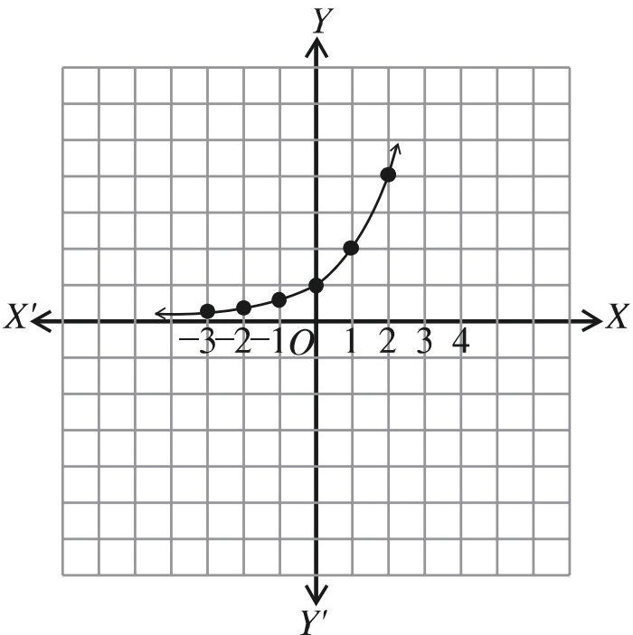
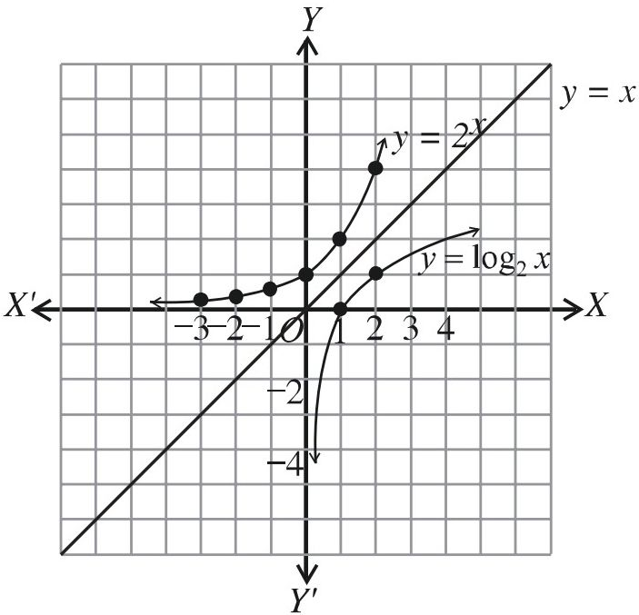
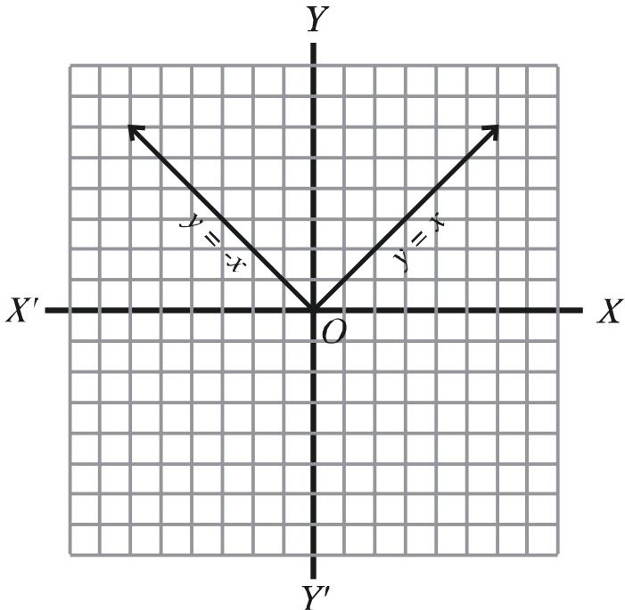
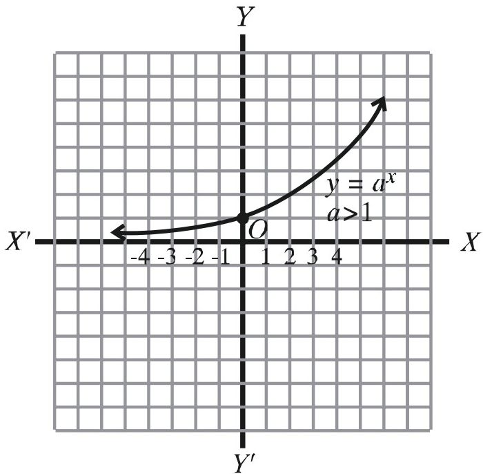
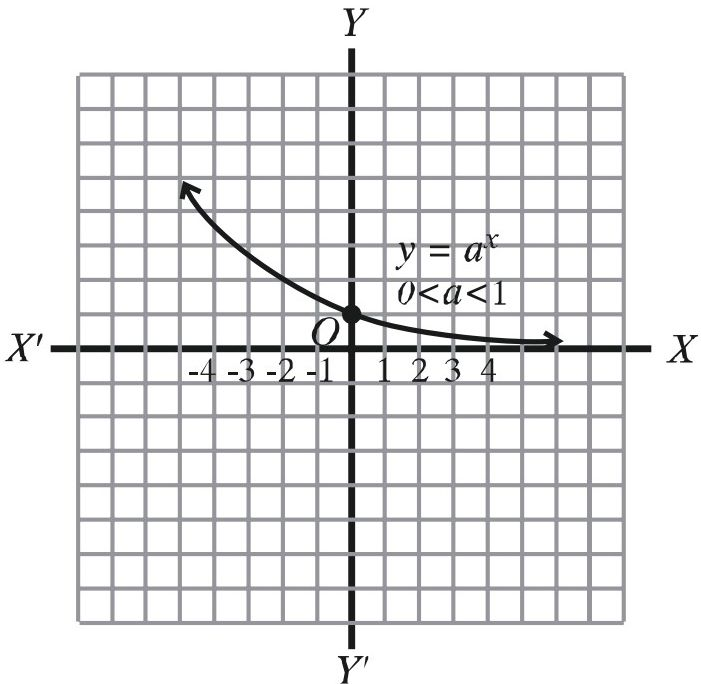
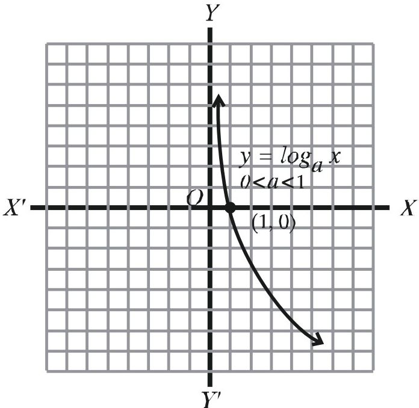
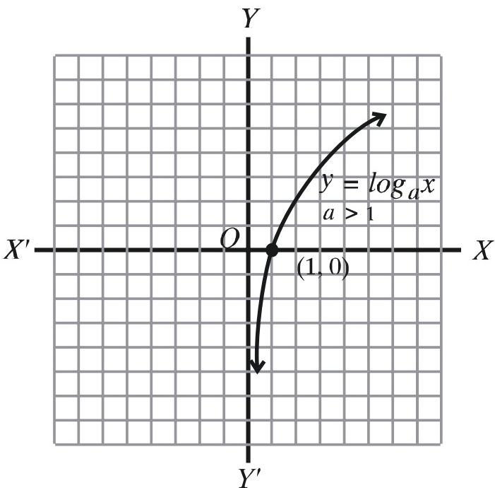
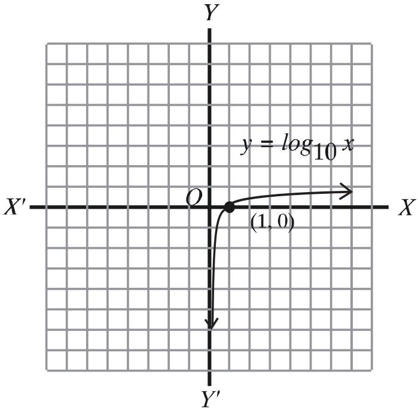
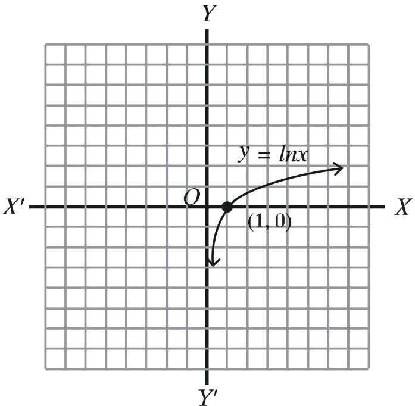

# 9. সূচকীয় ও লগারিদমীয় ফাংশন

Source: Higher Math Bangla Version, printed pp. 193-222

## 9.0 ভূমিকা ও শিখনফল

<!-- higher-math-9-10-bn-c09-t9.0-p001 · text · p.193 -->
সমসাময়িক বাস্তবতায় সূচকীয় ও লগারিদমীয় ফাংশনের অনেক প্রয়োগ বিদায় এর চর্চা অব্যাহত রয়েছে। যেমন জনসংখ্যা বৃদ্ধি, চক্রবৃদ্ধি মুনাফা ইত্যাদিতে উভয় ফাংশনের প্রয়োগ বিদ্যমান।

<!-- higher-math-9-10-bn-c09-t9.0-p002 · text · p.193 -->
এ অধ্যায় শেষে শিক্ষার্থীরা -

<!-- higher-math-9-10-bn-c09-t9.0-p003 · text · p.193 -->
* মূলদ সূচক ও অমূলদ সূচক ব্যাখ্যা করতে পারবে;
* মূলদ ও অমূলদ সূচকের জন্য বিভিন্ন সূত্র প্রমাণ ও প্রয়োগ করতে পারবে;
* সূচক ও লগারিদমের পারস্পরিক সম্পর্ক ব্যাখ্যা করতে পারবে;
* লগারিদমের বিভিন্ন সূত্র প্রমাণ ও প্রয়োগ করতে পারবে;
* লগারিদমের ভিত্তি পরিবর্তন করতে পারবে;
* সূচকীয়, লগারিদমীয় ও পরমমান ফাংশনের ধারণা ব্যাখ্যা করতে পারবে এবং গাণিতিক সমস্যা সমাধান করতে পারবে;
* ফাংশনসমূহের লেখচিত্র অঙ্কনে আগ্রহী হবে;
* সূচকীয়, লগারিদমীয় ও পরমমান ফাংশনসমূহকে লেখচিত্রের সাহায্যে উপস্থাপন করতে পারবে;
* ক্যালকুলেটরের সাহায্যে লগ ও প্রতিলগ নির্ণয় করতে পারবে।

### মূলদ ও অমূলদ সূচক

<!-- higher-math-9-10-bn-c09-t9.0-p004 · text · p.193 -->
নবম-দশম শ্রেণির গণিতে আলোচিত কিছু বিষয় যা এ অধ্যায়ের আলোচনার স্বার্থে উল্লেখ করা হলো:

<!-- higher-math-9-10-bn-c09-t9.0-p005 · text · p.193 · review: verify-formula -->
$R$ সকল বাস্তব সংখ্যার সেট

<!-- higher-math-9-10-bn-c09-t9.0-p006 · text · p.193 · review: verify-formula -->
$N$ সকল স্বাভাবিক সংখ্যার সেট

<!-- higher-math-9-10-bn-c09-t9.0-p007 · text · p.193 · review: verify-formula -->
$Z$ সকল পূর্ণ সংখ্যার সেট

<!-- higher-math-9-10-bn-c09-t9.0-p008 · text · p.193 · review: verify-formula -->
$Q$ সকল মূলদ সংখ্যার সেট নির্দেশ করে।

<!-- higher-math-9-10-bn-c09-t9.0-p009 · text · p.194 · review: verify-formula -->
ধরি $a$ একটি পূর্ণ সংখ্যা বা ভগ্নাংশ বা ধনাত্মক বা ঋণাত্মক হতে পারে এবং $n$ একটি ধনাত্মক পূর্ণসংখ্যা। তাহলে $a$ কে $n$ বার গুণ করলে গুণফলটিকে লিখা হয় $a^n = a \cdot a \cdot a \cdots$ ($n$ বার) এবং $a^n$ কে বলা হয় $a$ এর $n$ ঘাত। এরূপ ক্ষেত্রে $a$ কে বলা হয় নিধান বা ভিত্তি (base) এবং $n$ কে বলা হয় $a$ এর ঘাত বা সূচক (exponent)।

<!-- higher-math-9-10-bn-c09-t9.0-p010 · text · p.194 · review: verify-formula -->
সুতরাং $3^4$ এর ক্ষেত্রে ভিত্তি 3 এবং সূচক 4।

<!-- higher-math-9-10-bn-c09-t9.0-p011 · text · p.194 · review: verify-formula -->
আবার $\left(\frac{2}{3}\right)^4$ এর ক্ষেত্রে ভিত্তি $\frac{2}{3}$ এর সূচক 4।

<!-- higher-math-9-10-bn-c09-t9.0-p012 · definition · p.194 · review: verify-formula -->
**সংজ্ঞা:** সকল $a \in R$ এর জন্য

<!-- higher-math-9-10-bn-c09-t9.0-p013 · text · p.194 · review: verify-formula -->
১. $a^1 = a$

<!-- higher-math-9-10-bn-c09-t9.0-p014 · text · p.194 · review: verify-formula -->
২. $a^n = a \cdot a \cdot a \cdots a$ ($n$ সংখ্যক উৎপাদক), যেখানে $n \in N, n > 1$

## 9.1 অমূলদ সূচক

<!-- higher-math-9-10-bn-c09-t9.1-p001 · text · p.194 · review: verify-formula -->
অমূলদ সূচকের ক্ষেত্রে $a^x$ ($a > 0$) এর মান এমনভাবে নির্দিষ্ট করা হয় যে, $x$ এর মূলদ আসন্ন মান $p$ এর জন্য $a^p$ এর মান $a^x$ এর মানের আসন্ন হয়। উদাহরণস্বরূপ $3^{\sqrt{5}}$ সংখ্যাটি বিবেচনা করি। আমরা জানি, $\sqrt{5}$ একটি অমূলদ সংখ্যা এবং $\sqrt{5} = 2.236067977 \cdots$ (এই মান ক্যালকুলেটর ব্যবহার করে পাওয়া গিয়েছে এবং দশমিক বিস্তার যে অনন্ত তা $\cdots$ দ্বারা নির্দেশ করা হয়েছে)। $\sqrt{5}$ এর মান হিসেবে

<!-- higher-math-9-10-bn-c09-t9.1-p002 · text · p.194 · review: verify-formula -->
$$p_1 = 2.23 \quad p_2 = 2.236 \quad p_3 = 2.2360 \quad p_4 = 2.23606 \quad p_5 = 2.236067$$
$$p_6 = 2.2360679 \quad p_7 = 2.23606797$$

<!-- higher-math-9-10-bn-c09-t9.1-p003 · text · p.194 · review: verify-formula -->
বিবেচনা করে $3^{\sqrt{5}}$ এর মান হিসেবে

<!-- higher-math-9-10-bn-c09-t9.1-p004 · text · p.194 · review: verify-formula -->
$$q_1 = 3^{2.23} = 11.5872505 \quad q_2 = 3^{2.236} = 11.6638822 \quad q_3 = 3^{2.2360} = 11.6638822$$
$$q_4 = 3^{2.23606} = 11.66465109 \quad q_5 = 3^{2.236067} = 11.6647407$$
$$q_6 = 3^{2.2360679} = 11.6647523 \quad q_7 = 3^{2.23606797} = 11.6647532$$

<!-- higher-math-9-10-bn-c09-t9.1-p005 · text · p.194 -->
পাওয়া যায় (এই মানগুলোও ক্যালকুলেটর ব্যবহার করে পাওয়া গিয়েছে)।

<!-- higher-math-9-10-bn-c09-t9.1-p006 · text · p.194 · review: verify-formula -->
বাস্তবিক পক্ষে, $3^{\sqrt{5}} = 11.6647533 \cdots$

## 9.2 সূচক সম্পর্কিত সূত্র

<!-- higher-math-9-10-bn-c09-t9.2-p001 · text · p.194 · review: verify-formula -->
**সূত্র ১.** $a \in R$ এবং $n \in N$ হলে $a^1 = a, a^{n+1} = a^n \cdot a$.

<!-- higher-math-9-10-bn-c09-t9.2-p002 · text · p.194 · review: verify-formula -->
**প্রমাণ:** সংজ্ঞানুযায়ী $a^1 = a$ এবং $n \in N$ এর জন্য $a^{n+1} = \underbrace{a \cdot a \cdot a \cdots a}_{n  সংখ্যক} \cdot a = a^n \cdot a$

<!-- higher-math-9-10-bn-c09-t9.2-p003 · text · p.195 · review: verify-formula -->
**দ্রষ্টব্য:** $N$ সকল স্বাভাবিক সংখ্যার সেট

<!-- higher-math-9-10-bn-c09-t9.2-p004 · text · p.195 · review: verify-formula -->
**সূত্র ২.** $a \in R$ এবং $m, n \in N$ হলে $a^m \cdot a^n = a^{m+n}$

<!-- higher-math-9-10-bn-c09-t9.2-p005 · text · p.195 · review: verify-formula -->
**প্রমাণ:** যেকোনো $m \in N$ নির্দিষ্ট করে এবং $n$ কে চলক ধরে খোলা বাক্য $a^m \cdot a^n = a^{m+n} \dots (1)$ বিবেচনা করি।

<!-- higher-math-9-10-bn-c09-t9.2-p006 · text · p.195 · review: verify-formula -->
(1) এ $n = 1$ বসিয়ে পাই,

<!-- higher-math-9-10-bn-c09-t9.2-p007 · text · p.195 · review: verify-formula -->
বামপক্ষ $= a^m \cdot a^1 = a^m \cdot a = a^{m+1} =$ ডানপক্ষ [সূত্র ১]

<!-- higher-math-9-10-bn-c09-t9.2-p008 · text · p.195 · review: verify-formula -->
$\therefore n = 1$ এর জন্য (1) সত্য।

<!-- higher-math-9-10-bn-c09-t9.2-p009 · text · p.195 · review: verify-formula -->
এখন ধরি, $n = k$ এর জন্য (1) সত্য। অর্থাৎ, $a^m \cdot a^k = a^{m+k}$

<!-- higher-math-9-10-bn-c09-t9.2-p010 · text · p.195 · review: latin-junk,verify-formula -->
তাহলে, $a^m \cdot a^{k+1} = a^m(a^k \cdot a)$ [সূত্র ১]
$$= (a^m \cdot a^k) \cdot a  [গুণের সহযোগন]$$
$$= a^{m+k} \cdot a  [আরোহ কল্পনা]$$
$$= a^{m+k+1}  [সূত্র ১]$$

<!-- higher-math-9-10-bn-c09-t9.2-p011 · text · p.195 · review: verify-formula -->
অর্থাৎ, $n = k + 1$ এর জন্য (1) সত্য।

<!-- higher-math-9-10-bn-c09-t9.2-p012 · text · p.195 · review: verify-formula -->
সুতরাং গাণিতিক আরোহ পদ্ধতি অনুযায়ী সকল $n \in N$ এর জন্য (1) সত্য।

<!-- higher-math-9-10-bn-c09-t9.2-p013 · text · p.195 · review: verify-formula -->
$\therefore$ যেকোনো $m, n \in N$ এর জন্য $a^m \cdot a^n = a^{m+n}$ $\square$

<!-- higher-math-9-10-bn-c09-t9.2-p014 · text · p.195 · review: verify-formula -->
> $a^m \cdot a^n = a^{m+n}$

<!-- higher-math-9-10-bn-c09-t9.2-p015 · text · p.195 -->
বর্ণিত সূত্রটিকে সূচকের মৌলিক সূত্র বলা হয়।

<!-- higher-math-9-10-bn-c09-t9.2-p016 · text · p.195 · review: verify-formula -->
**সূত্র ৩.** $a \in R, a \neq 0$ এবং $m, n \in N, m \neq n$ হলে $\frac{a^m}{a^n} = \begin{cases} a^{m-n}, & যখন  m > n \\ \frac{1}{a^{n-m}}, & যখন  m < n \end{cases}$

<!-- higher-math-9-10-bn-c09-t9.2-p017 · text · p.195 -->
**প্রমাণ:**

<!-- higher-math-9-10-bn-c09-t9.2-p018 · text · p.195 · review: latin-junk,verify-formula -->
১. মনে করি, $m > n$ তাহলে $m - n \in N$
$$\therefore a^{m-n} \cdot a^n = a^{(m-n)+n} = a^m  [সূত্র ২]$$
$$\therefore \frac{a^m}{a^n} = a^{m-n}  [ভাগের সংজ্ঞা]$$

<!-- higher-math-9-10-bn-c09-t9.2-p019 · text · p.195 · review: latin-junk,verify-formula -->
২. মনে করি, $m < n$ তাহলে $n - m \in N$
$$\therefore a^{n-m} \cdot a^m = a^{(n-m)+m} = a^n  [সূত্র ২]$$
$$\therefore \frac{a^m}{a^n} = \frac{1}{a^{n-m}}  [ভাগের সংজ্ঞা]$$

<!-- higher-math-9-10-bn-c09-t9.2-p020 · text · p.196 -->
**দ্রষ্টব্য:** সূত্রটি গাণিতিক আরোহ পদ্ধতিতে প্রমাণ করো [সূত্র ২ এর অনুরূপ]

<!-- higher-math-9-10-bn-c09-t9.2-p021 · text · p.196 · review: verify-formula -->
**সূত্র ৪.** $a \in R$ এবং $m, n \in N$ হলে $(a^m)^n = a^{mn}$

<!-- higher-math-9-10-bn-c09-t9.2-p022 · text · p.196 · review: verify-formula -->
**সূত্র ৫.** $a, b \in R$ এবং $n \in N$ হলে $(a \cdot b)^n = a^n \cdot b^n$

<!-- higher-math-9-10-bn-c09-t9.2-p023 · text · p.196 -->
[সূত্রদয় আরোহ পদ্ধতিতে প্রমাণ করো ]

<!-- higher-math-9-10-bn-c09-t9.2-p024 · text · p.196 -->
**শূন্য ও ঋণাত্মক পূর্ণ সাংখ্যিক সূচক:**

<!-- higher-math-9-10-bn-c09-t9.2-p025 · definition · p.196 · review: verify-formula -->
**সংজ্ঞা:** $a \in R, a \neq 0$ হলে,

<!-- higher-math-9-10-bn-c09-t9.2-p026 · text · p.196 · review: verify-formula -->
৩. $a^0 = 1$

<!-- higher-math-9-10-bn-c09-t9.2-p027 · text · p.196 · review: verify-formula -->
৪. $a^{-n} = \frac{1}{a^n}$, যেখানে $n \in N$

<!-- higher-math-9-10-bn-c09-t9.2-p028 · text · p.196 · review: known-confusable-corrected,verify-formula -->
**মন্তব্য:** সূচকের ধারণা সম্প্রসারণের সময় লক্ষ রাখা হয়, যেন সূচকের মৌলিক সূত্র $a^m \cdot a^n = a^{m+n}$ সকল ক্ষেত্রেই বৈধ থাকে।

<!-- higher-math-9-10-bn-c09-t9.2-p029 · text · p.196 · review: verify-formula -->
সূত্রটি যদি $m = 0$ এর জন্য সত্য হয়, তবে $a^0 \cdot a^n = a^{0+n}$ অর্থাৎ, $a^0 = \frac{a^n}{a^n} = 1$ হতে হবে।

<!-- higher-math-9-10-bn-c09-t9.2-p030 · text · p.196 · review: verify-formula -->
একইভাবে, সূত্রটি যদি $m = -n$ ($n \in N$) এর জন্য সত্য হতে হয়,

<!-- higher-math-9-10-bn-c09-t9.2-p031 · text · p.196 · review: verify-formula -->
তবে $a^{-n} \cdot a^n = a^{-n+n} = a^0 = 1$ অর্থাৎ, $a^{-n} = \frac{1}{a^n}$ হতে হবে। এদিকে লক্ষ রেখেই উপরের সংজ্ঞা বর্ণনা করা হয়েছে।

<!-- higher-math-9-10-bn-c09-t9.2-p032 · text · p.196 · review: verify-formula -->
**উদাহরণ ১.** ক) $2^5 \cdot 2^6 = 2^{5+6} = 2^{11}$

<!-- higher-math-9-10-bn-c09-t9.2-p033 · text · p.196 · review: verify-formula -->
খ) $\frac{3^5}{3^3} = 3^{5-3} = 3^2$

<!-- higher-math-9-10-bn-c09-t9.2-p034 · text · p.196 · review: verify-formula -->
গ) $\frac{3^3}{3^5} = \frac{1}{3^{5-3}} = \frac{1}{3^2}$

<!-- higher-math-9-10-bn-c09-t9.2-p035 · text · p.196 · review: verify-formula -->
ঘ) $\left(\frac{5}{4}\right)^3 = \frac{5}{4} \times \frac{5}{4} \times \frac{5}{4} = \frac{5 \times 5 \times 5}{4 \times 4 \times 4} = \frac{5^3}{4^3}$

<!-- higher-math-9-10-bn-c09-t9.2-p036 · text · p.196 · review: verify-formula -->
ঙ) $(4^2)^7 = 4^{2 \times 7} = 4^{14}$

<!-- higher-math-9-10-bn-c09-t9.2-p037 · text · p.196 · review: verify-formula -->
চ) $(a^2b^3)^5 = (a^2)^5 \cdot (b^3)^5 = a^{2 \times 5} \cdot b^{3 \times 5} = a^{10}b^{15}$

<!-- higher-math-9-10-bn-c09-t9.2-p038 · text · p.196 · review: verify-formula -->
**উদাহরণ ২.** ক) $6^0 = 1$

<!-- higher-math-9-10-bn-c09-t9.2-p039 · text · p.196 · review: verify-formula -->
খ) $(-6)^0 = 1$

<!-- higher-math-9-10-bn-c09-t9.2-p040 · text · p.196 · review: verify-formula -->
গ) $7^{-1} = \frac{1}{7}$

<!-- higher-math-9-10-bn-c09-t9.2-p041 · text · p.196 · review: verify-formula -->
ঘ) $7^{-2} = \frac{1}{7^2} = \frac{1}{49}$ ৬) $10^{-1} = \frac{1}{10} = 0.1$

<!-- higher-math-9-10-bn-c09-t9.2-p042 · text · p.197 · review: verify-formula -->
৮) $10^{-2} = \frac{1}{10^2} = \frac{1}{100}$

<!-- higher-math-9-10-bn-c09-t9.2-p043 · text · p.197 · review: verify-formula -->
**উদাহরণ ৩.** $m, n \in N$ হলে $(a^m)^n = a^{mn}$ সূত্রটির সত্যতা স্বীকার করে নিয়ে দেখাও যে, $(a^m)^n = a^{mn}$ যেখানে $a \neq 0$ এবং $m \in N$ এবং $n \in Z$

<!-- higher-math-9-10-bn-c09-t9.2-p044 · text · p.197 · review: verify-formula -->
**সমাধান:** প্রমাণ করতে হবে, $(a^m)^n = a^{mn} \dots (1)$

<!-- higher-math-9-10-bn-c09-t9.2-p045 · text · p.197 · review: verify-formula -->
যেখানে, $a \neq 0$ এবং $m \in N$ এবং $n \in Z$

<!-- higher-math-9-10-bn-c09-t9.2-p046 · text · p.197 · review: verify-formula -->
**ধাপ ১.** প্রথমে মনে করি, $n > 0$, এক্ষেত্রে (1) এর সত্যতা স্বীকার করে নেওয়া হয়েছে।

<!-- higher-math-9-10-bn-c09-t9.2-p047 · text · p.197 · review: verify-formula -->
**ধাপ ২.** এখন মনে করি, $n = 0$ এক্ষেত্রে $(a^m)^n = (a^m)^0 = 1$

<!-- higher-math-9-10-bn-c09-t9.2-p048 · text · p.197 · review: verify-formula -->
এবং, $a^{mn} = a^0 = 1 [\because n = 0]$

<!-- higher-math-9-10-bn-c09-t9.2-p049 · text · p.197 · review: verify-formula -->
$\therefore$ (1) সত্য।

<!-- higher-math-9-10-bn-c09-t9.2-p050 · text · p.197 · review: verify-formula -->
**ধাপ ৩.** সবশেষে মনে করি, $n < 0$ এবং $n = -k$, যেখানে $k \in N$

<!-- higher-math-9-10-bn-c09-t9.2-p051 · text · p.197 · review: verify-formula -->
এক্ষেত্রে $(a^m)^n = (a^m)^{-k} = \frac{1}{(a^m)^k} = a^{-mk} = a^{m(-k)} = a^{mn}$

<!-- higher-math-9-10-bn-c09-t9.2-p052 · text · p.197 · review: verify-formula -->
**উদাহরণ ৪.** দেখাও যে, সকল $m, n \in N$ এর জন্য $\frac{a^m}{a^n} = a^{m-n}$, যেখানে $a \neq 0$

<!-- higher-math-9-10-bn-c09-t9.2-p053 · text · p.197 · review: verify-formula -->
**সমাধান:** $m > n$ হলে, $\frac{a^m}{a^n} = a^{m-n}$ [সূত্র ৩]

<!-- higher-math-9-10-bn-c09-t9.2-p054 · text · p.197 · review: verify-formula -->
$m < n$ হলে, $\frac{a^m}{a^n} = \frac{1}{a^{n-m}}$ [সূত্র ৩]

<!-- higher-math-9-10-bn-c09-t9.2-p055 · text · p.197 · review: verify-formula -->
$\therefore \frac{a^m}{a^n} = a^{-(n-m)}$ [সংজ্ঞা ৪]

<!-- higher-math-9-10-bn-c09-t9.2-p056 · formula · p.197 · review: verify-formula -->
$= a^{m-n}$

<!-- higher-math-9-10-bn-c09-t9.2-p057 · text · p.197 · review: verify-formula -->
$m = n$ হলে, $\frac{a^m}{a^n} = \frac{a^n}{a^n} = 1 = a^0$ [সংজ্ঞা ৩]

<!-- higher-math-9-10-bn-c09-t9.2-p058 · formula · p.197 · review: verify-formula -->
$= a^{m-m} = a^{m-n}$

<!-- higher-math-9-10-bn-c09-t9.2-p059 · text · p.197 · review: verify-formula -->
**দ্রষ্টব্য:** উপরে বর্ণিত সূচকের সংজ্ঞাগুলো থেকে যেকোনো $m \in Z$ এর জন্য $a^m$ এর ব্যাখ্যা পাওয়া যায়, যেখানে $a \neq 0$। সূচক ধনাত্মক অথবা শূন্য অথবা ঋণাত্মক ধরে সাধারণভাবে সকল পূর্ণ সাংখ্যিক সূচকের জন্য নিম্নোক্ত সূত্রটি প্রমাণ করা যায়।

<!-- higher-math-9-10-bn-c09-t9.2-p060 · text · p.197 · review: verify-formula -->
**সূত্র ৬.** $a \neq 0, b \neq 0$ এবং $m, n \in Z$ হলে,

<!-- higher-math-9-10-bn-c09-t9.2-p061 · text · p.197 · review: verify-formula -->
১. $a^m \cdot a^n = a^{m+n}$

<!-- higher-math-9-10-bn-c09-t9.2-p062 · text · p.197 · review: verify-formula -->
২. $\frac{a^m}{a^n} = a^{m-n}$

<!-- higher-math-9-10-bn-c09-t9.2-p063 · text · p.198 · review: verify-formula -->
৩. $(a^m)^n = a^{mn}$

<!-- higher-math-9-10-bn-c09-t9.2-p064 · text · p.198 · review: verify-formula -->
৪. $(ab)^n = a^n b^n$

<!-- higher-math-9-10-bn-c09-t9.2-p065 · text · p.198 · review: verify-formula -->
৫. $\left(\frac{a}{b}\right)^n = \frac{a^n}{b^n}$

<!-- higher-math-9-10-bn-c09-t9.2-p066 · text · p.198 -->
**কাজ:**

<!-- higher-math-9-10-bn-c09-t9.2-p067 · text · p.198 · review: verify-formula -->
ক) গাণিতিক আরোহ পদ্ধতিতে দেখাও যে, $(a^m)^n = a^{mn}$, যেখানে $a \in R$ এবং $n \in N$

<!-- higher-math-9-10-bn-c09-t9.2-p068 · text · p.198 · review: verify-formula -->
খ) গাণিতিক আরোহ পদ্ধতিতে দেখাও যে, $(a \cdot b)^n = a^n \cdot b^n$, যেখানে $a, b \in R$ এবং $n \in N$

<!-- higher-math-9-10-bn-c09-t9.2-p069 · text · p.198 · review: verify-formula -->
গ) গাণিতিক আরোহ পদ্ধতিতে দেখাও যে, $\left(\frac{1}{a}\right)^n = \frac{1}{a^n}$ যেখানে, $a > 0$ এবং $n \in N$

<!-- higher-math-9-10-bn-c09-t9.2-p070 · text · p.198 · review: verify-formula -->
অতঃপর $(ab)^n = a^n b^n$ সূত্র ব্যবহার করে দেখাও যে, $\left(\frac{a}{b}\right)^n = \frac{a^n}{b^n}$, যেখানে $a, b \in R, b > 0$ এবং $n \in N$

<!-- higher-math-9-10-bn-c09-t9.2-p071 · text · p.198 · review: verify-formula -->
ঘ) $a \neq 0$ এবং $m, n \in Z$ ধনাত্মক পূর্ণ সাংখ্যিক সূচকের জন্য $a^m \cdot a^n = a^{m+n}$ সূত্রটির সত্যতা স্বীকার করে দেখাও যে, $a^m \cdot a^n = a^{m+n}$ যখন (১) $m > 0$ এবং $n < 0$ (২) $m < 0$ এবং $n < 0$।

## 9.3 মূল এর ব্যাখ্যা

<!-- higher-math-9-10-bn-c09-t9.3-p001 · definition · p.198 · review: verify-formula -->
**সংজ্ঞা:** $n \in N, n > 1$ এবং $a \in R$ হলে, যদি এমন $x \in R$ থাকে যেন $x^n = a$ হয়, তবে সেই $x$ কে $a$ এর একটি $n$তম মূল বলা হয়। $n = 2$ হলে মূলকে বর্গমূল এবং $n = 3$ হলে মূলকে ঘনমূল বলা হয়।

<!-- higher-math-9-10-bn-c09-t9.3-p002 · text · p.198 · review: verify-formula -->
**উদাহরণ ৫.** ক) ২ এবং $-2$ উভয়ই ১৬-এর ৪তম মূল, কারণ $(2)^4 = 16$ এবং $(-2)^4 = 16$

<!-- higher-math-9-10-bn-c09-t9.3-p003 · text · p.198 · review: verify-formula -->
খ) $-27$ এর ঘনমূল $-3$, কারণ $(-3)^3 = -27$

<!-- higher-math-9-10-bn-c09-t9.3-p004 · text · p.198 · review: verify-formula -->
গ) ০ এর $n$তম মূল ০, কারণ সকল $n \in N, n > 1$ এর জন্য $0^n = 0$

<!-- higher-math-9-10-bn-c09-t9.3-p005 · text · p.198 · review: verify-formula -->
ঘ) $-9$ এর কোনো বর্গমূল নেই, কারণ যে কোনো বাস্তব সংখ্যার বর্গ অঋণাত্মক।

<!-- higher-math-9-10-bn-c09-t9.3-p006 · text · p.198 -->
এখানে উল্লেখ্য যে,

<!-- higher-math-9-10-bn-c09-t9.3-p007 · text · p.198 · review: known-confusable-corrected,verify-formula -->
(i) যদি $a > 0$ এবং $n \in N, n > 1$ হয়, তবে $a$ এর একটি অনন্য ধনাত্মক, $n$ তম মূল আছে। এই ধনাত্মক মূলকে $\sqrt[n]{a}$ দ্বারা সূচিত করা হয় ($\sqrt[2]{a}$ এর স্থলে $\sqrt{a}$ লেখা হয়) এবং একে $a$ এর মুখ্য $n$তম মূল বলা হয়। $n$ জোড় সংখ্যা হলে এরূপ $a$ এর আর একটি $n$ তম মূল আছে এবং তা হলো $-\sqrt[n]{a}$ $(ii)$ যদি $a < 0$ এবং $n \in N, n > 1$ বিজোড় সংখ্যা হয়, তবে $a$ এর একটি মাত্র $n$ তম মূল আছে যা ঋণাত্মক। এই মূলকে $-\sqrt[n]{a}$ দ্বারা সূচিত করা হয়। $n$ জোড় হলে এবং $a$ ঋণাত্মক হলে $a$ এর কোন $n$তম মূল নেই।

<!-- higher-math-9-10-bn-c09-t9.3-p008 · text · p.199 · review: verify-formula -->
$(iii)$ ০ এর $n$তম মূল $\sqrt[n]{0} = 0$

<!-- higher-math-9-10-bn-c09-t9.3-p009 · text · p.199 -->
**দৃষ্টব্য:**

<!-- higher-math-9-10-bn-c09-t9.3-p010 · text · p.199 · review: verify-formula -->
১. $a > 0$ হলে $\sqrt[n]{a} > 0$

<!-- higher-math-9-10-bn-c09-t9.3-p011 · text · p.199 · review: verify-formula -->
২. $a < 0$ এবং $n$ বিজোড় হলে, $\sqrt[n]{a} = -\sqrt[n]{|a|} < 0$ [যেখানে $|a|$ হচ্ছে $a$ এর পরমমান]

<!-- higher-math-9-10-bn-c09-t9.3-p012 · text · p.199 · review: verify-formula -->
**উদাহরণ ৬.** $\sqrt{4} = 2, (\sqrt{4} \neq -2), \sqrt[3]{-8} = -2 = -\sqrt[3]{8},$

<!-- higher-math-9-10-bn-c09-t9.3-p013 · formula · p.199 · review: latin-junk,verify-formula -->
$$\sqrt{a^2} = |a| = \begin{cases} a, & যখন  a \geq 0 \\ -a, & যখন  a < 0 \end{cases}$$

<!-- higher-math-9-10-bn-c09-t9.3-p014 · text · p.199 · review: verify-formula -->
**সূত্র ৭.** $a < 0, n \in N, n > 1$ এবং $n$ বিজোড় হলে দেখাও যে, $\sqrt[n]{a} = -\sqrt[n]{|a|}$

<!-- higher-math-9-10-bn-c09-t9.3-p015 · text · p.199 -->
**প্রমাণ:**

<!-- higher-math-9-10-bn-c09-t9.3-p016 · formula · p.199 · review: latin-junk,verify-formula -->
$$\begin{aligned}
\sqrt[n]{a} &= \sqrt[n]{-|a|} \quad [\because a < 0] \\
&= \sqrt[n]{(-1)^n |a|} \quad [\because n  বিজোড়] \\
&= -\sqrt[n]{|a|}
\end{aligned}$$

<!-- higher-math-9-10-bn-c09-t9.3-p017 · text · p.199 · review: verify-formula -->
সুতরাং, $\sqrt[n]{a} = -\sqrt[n]{|a|}$

<!-- higher-math-9-10-bn-c09-t9.3-p018 · text · p.199 · review: verify-formula -->
**উদাহরণ ৭.** $-\sqrt[3]{27}$ এর মান নির্ণয় করো।

<!-- higher-math-9-10-bn-c09-t9.3-p019 · text · p.199 · review: verify-formula -->
**সমাধান:** $-\sqrt[3]{27} = -\sqrt[3]{(3)^3} = -3$

<!-- higher-math-9-10-bn-c09-t9.3-p020 · text · p.199 · review: verify-formula -->
**সূত্র ৮.** $a > 0, m \in Z$ এবং $n \in N, n > 1$ হলে, $(\sqrt[n]{a})^m = \sqrt[n]{a^m}$

<!-- higher-math-9-10-bn-c09-t9.3-p021 · text · p.199 · review: verify-formula -->
**প্রমাণ:** মনে করি, $\sqrt[n]{a} = x$ এবং $\sqrt[n]{a^m} = y$

<!-- higher-math-9-10-bn-c09-t9.3-p022 · text · p.199 · review: verify-formula -->
তাহলে, $x^n = a$ এবং $y^n = a^m$

<!-- higher-math-9-10-bn-c09-t9.3-p023 · text · p.199 · review: verify-formula -->
বা, $y^n = a^m = (x^n)^m = (x^m)^n$

<!-- higher-math-9-10-bn-c09-t9.3-p024 · text · p.199 · review: verify-formula -->
যেহেতু $y > 0, x^m > 0$, সুতরাং মুখ্য $n$তম মূল বিবেচনা করে পাই, $y = x^m$

<!-- higher-math-9-10-bn-c09-t9.3-p025 · text · p.199 · review: verify-formula -->
বা, $\sqrt[n]{a^m} = (\sqrt[n]{a})^m$

<!-- higher-math-9-10-bn-c09-t9.3-p026 · text · p.199 · review: verify-formula -->
অর্থাৎ, $(\sqrt[n]{a})^m = \sqrt[n]{a^m}$

<!-- higher-math-9-10-bn-c09-t9.3-p027 · text · p.199 · review: verify-formula -->
**সূত্র ৯.** যদি $a > 0$ এবং $\frac{m}{n} = \frac{p}{q}$ হয়, যেখানে $m, p \in Z$ এবং $n, q \in N, n > 1, q > 1$ তবে,

<!-- higher-math-9-10-bn-c09-t9.3-p028 · formula · p.199 · review: verify-formula -->
$$\sqrt[n]{a^m} = \sqrt[q]{a^p}$$

<!-- higher-math-9-10-bn-c09-t9.3-p029 · text · p.200 · review: verify-formula -->
প্রমাণ: এখানে, $qm = pn$

<!-- higher-math-9-10-bn-c09-t9.3-p030 · text · p.200 · review: verify-formula -->
মনে করি, $\sqrt[n]{a^m} = x$ তাহলে, $x^n = a^m$

<!-- higher-math-9-10-bn-c09-t9.3-p031 · text · p.200 · review: verify-formula -->
বা, $(x^n)^q = (a^m)^q$

<!-- higher-math-9-10-bn-c09-t9.3-p032 · text · p.200 · review: verify-formula -->
বা, $x^{nq} = a^{mq} = a^{pn}$

<!-- higher-math-9-10-bn-c09-t9.3-p033 · text · p.200 · review: verify-formula -->
বা, $(x^q)^n = (a^p)^n$

<!-- higher-math-9-10-bn-c09-t9.3-p034 · text · p.200 · review: verify-formula -->
বা, $x^q = a^p$ [মুখ্য $n$তম মূল বিবেচনা করে]

<!-- higher-math-9-10-bn-c09-t9.3-p035 · text · p.200 · review: verify-formula -->
বা, $x = \sqrt[q]{a^p}$

<!-- higher-math-9-10-bn-c09-t9.3-p036 · text · p.200 · review: verify-formula -->
অর্থাৎ, $\sqrt[n]{a^m} = \sqrt[q]{a^p}$

<!-- higher-math-9-10-bn-c09-t9.3-p037 · text · p.200 · review: verify-formula -->
**অনুসিদ্ধান্ত ১.** যদি $a > 0$ এবং $n, k \in N, n > 1$ হয়, তবে, $\sqrt[n]{a} = \sqrt[nk]{a^k}$

## 9.4 মূলদ ভগ্নাংশ সূচক

<!-- higher-math-9-10-bn-c09-t9.4-p001 · definition · p.200 · review: verify-formula -->
**সংজ্ঞা ৫:** $a \in R$ এবং $n \in N, n > 1$ হলে, $a^{\frac{1}{n}} = \sqrt[n]{a}$ যখন $a > 0$ অথবা $a < 0$ এবং $n$ বিজোড়।

<!-- higher-math-9-10-bn-c09-t9.4-p002 · text · p.200 · review: verify-formula -->
**মন্তব্য:** সূচক নিয়ম $(a^m)^n = a^{mn}$ [সূত্র ৬]

<!-- higher-math-9-10-bn-c09-t9.4-p003 · text · p.200 · review: verify-formula -->
যদি সকল ক্ষেত্রে সত্য হতে হয়, তবে $\left(a^{\frac{1}{n}}\right)^n = a^{\frac{n}{n}} = a^1 = a$ হতে হবে, অর্থাৎ $a^{\frac{1}{n}}$ এর $n$ তম মূল হতে হবে। এজন্য একাধিক মূলের ক্ষেত্রে দ্বার্তা পরিহারের লক্ষ্যে উপরের সংজ্ঞা বর্ণনা করা হয়েছে।

<!-- higher-math-9-10-bn-c09-t9.4-p004 · text · p.200 · review: verify-formula -->
**মন্তব্য:** $a < 0$ এবং $n \in N, n > 1$ বিজোড় হলে সূত্র ৭ থেকে দেখা যায় যে

<!-- higher-math-9-10-bn-c09-t9.4-p005 · formula · p.200 · review: verify-formula -->
$$a^{\frac{1}{n}} = \sqrt[n]{a} = -\sqrt[n]{|a|} = -|a|^{\frac{1}{n}}$$

<!-- higher-math-9-10-bn-c09-t9.4-p006 · text · p.200 · review: verify-formula -->
এরূপ ক্ষেত্রে এই সূত্রের সাহায্যেই $a^{\frac{1}{n}}$ এর মান নির্ণয় করা হয়।

<!-- higher-math-9-10-bn-c09-t9.4-p007 · text · p.200 · review: verify-formula -->
**মন্তব্য:** $a$ মূলদ সংখ্যা হলেও অধিকাংশ ক্ষেত্রে $a^{\frac{1}{n}}$ অমূলদ সংখ্যা হয়। এরূপ ক্ষেত্রে $a^{\frac{1}{n}}$ এর আসন্ন মান ব্যবহার করা হয়।

<!-- higher-math-9-10-bn-c09-t9.4-p008 · definition · p.200 · review: verify-formula -->
**সংজ্ঞা ৬:** $a > 0, m \in Z$ এবং $n \in N, n > 1$ হলে $a^{\frac{m}{n}} = (a^{\frac{1}{n}})^m$

<!-- higher-math-9-10-bn-c09-t9.4-p009 · text · p.200 -->
**দ্রষ্টব্য:** সংজ্ঞা ৫ ও ৬ এবং সূত্র ৮ থেকে দেখা যায় যে,

<!-- higher-math-9-10-bn-c09-t9.4-p010 · formula · p.200 · review: latin-junk,verify-formula -->
$$a^{\frac{m}{n}} = (\sqrt[n]{a})^m = \sqrt[n]{a^m}  যেখানে,  a > 0, m \in Z  এবং,  n \in N, n > 1$$

<!-- higher-math-9-10-bn-c09-t9.4-p011 · text · p.200 · review: verify-formula -->
সুতরাং, $p \in Z$ এবং $q \in Z, n > 1$ যদি এমন হয় যে, $\frac{m}{n} = \frac{p}{q}$ হয়, তবে সূত্র ৯ থেকে দেখা যায় যে, $a^{\frac{m}{n}} = a^{\frac{p}{q}}$

<!-- higher-math-9-10-bn-c09-t9.4-p012 · text · p.201 · review: verify-formula -->
**দ্রষ্টব্য:** পূর্ণসংখ্যক সূচক ও মূলদ ভগ্নাংশ সূচকের সংজ্ঞা থেকে $a^r$ এর ব্যাখ্যা পাওয়া যায়, যেখানে $a > 0$ এবং $r \in Q$। উপরের আলোচনা থেকে দেখা যায় যে, $a > 0$ হলে, $r$ কে বিভিন্ন সমতুল ভগ্নাংশ আকারে প্রকাশ করা হলেও $a^r$ এর মানের কোনো তারতম্য হয় না।

<!-- higher-math-9-10-bn-c09-t9.4-p013 · text · p.201 -->
**দ্রষ্টব্য:** সূত্র ৬ এ বর্ণিত সূচক নিয়মগুলো সাধারণভাবে যেকোনো সূচকের জন্য সত্য হয়।

<!-- higher-math-9-10-bn-c09-t9.4-p014 · text · p.201 · review: verify-formula -->
**সূত্র ১০.** $a > 0, b > 0$ এবং $r, s \in Q$ হলে

<!-- higher-math-9-10-bn-c09-t9.4-p015 · text · p.201 · review: verify-formula -->
ক) $a^r \cdot a^s = a^{r+s}$

<!-- higher-math-9-10-bn-c09-t9.4-p016 · text · p.201 · review: verify-formula -->
খ) $\frac{a^r}{a^s} = a^{r-s}$

<!-- higher-math-9-10-bn-c09-t9.4-p017 · text · p.201 · review: verify-formula -->
গ) $(a^r)^s = a^{rs}$

<!-- higher-math-9-10-bn-c09-t9.4-p018 · text · p.201 · review: verify-formula -->
ঘ) $(ab)^r = a^r b^r$

<!-- higher-math-9-10-bn-c09-t9.4-p019 · text · p.201 · review: verify-formula -->
ঙ) $\left(\frac{a}{b}\right)^r = \frac{a^r}{b^r}$

<!-- higher-math-9-10-bn-c09-t9.4-p020 · text · p.201 -->
(ক) ও (ঘ) এর পুনঃপুন প্রয়োগের মাধ্যমে দেখা যায় যে,

<!-- higher-math-9-10-bn-c09-t9.4-p021 · text · p.201 · review: verify-formula -->
**অনুসিদ্ধান্ত ২.** ক) $a > 0$ এবং $r_1, r_2, \dots, r_k \in Q$ হলে,

<!-- higher-math-9-10-bn-c09-t9.4-p022 · formula · p.201 · review: verify-formula -->
$$a^{r_1} \cdot a^{r_2} \cdot a^{r_3} \dots a^{r_k} = a^{r_1+r_2+r_3+\dots+r_k}.$$

<!-- higher-math-9-10-bn-c09-t9.4-p023 · text · p.201 · review: verify-formula -->
খ) $a_1 > 0, a_2 > 0, \dots, a_n > 0$ এবং $r \in Q$ হলে $(a_1 \cdot a_2 \dots a_n)^r = a_1^r \cdot a_2^r \dots a_n^r$.

<!-- higher-math-9-10-bn-c09-t9.4-p024 · text · p.201 · review: verify-formula -->
**উদাহরণ ৮.** দেখাও যে, $a^{\frac{m}{n}} \cdot a^{\frac{p}{q}} = a^{\frac{m}{n} + \frac{p}{q}}$

<!-- higher-math-9-10-bn-c09-t9.4-p025 · text · p.201 · review: verify-formula -->
যেখানে, $a > 0; m, p \in Z; n, q \in N, n > 1, q > 1$.

<!-- higher-math-9-10-bn-c09-t9.4-p026 · text · p.201 · review: verify-formula -->
**সমাধান:** $\frac{m}{n}$ ও $\frac{p}{q}$ কে সমহরবিশিষ্ট ভগ্নাংশে পরিণত করে দেখা যায় যে,

<!-- higher-math-9-10-bn-c09-t9.4-p027 · formula · p.201 · review: latin-junk,verify-formula -->
$$a^{\frac{m}{n}} \cdot a^{\frac{p}{q}} = a^{\frac{mq}{nq}} \cdot a^{\frac{np}{nq}} = (a^{\frac{1}{nq}})^{mq} (a^{\frac{1}{nq}})^{np}  [সংজ্ঞা ৬ ব্যবহার করে]$$

<!-- higher-math-9-10-bn-c09-t9.4-p028 · formula · p.201 · review: latin-junk,verify-formula -->
$$= (a^{\frac{1}{nq}})^{mq+np}  [সূত্র ৬]$$

<!-- higher-math-9-10-bn-c09-t9.4-p029 · formula · p.201 · review: verify-formula -->
$$= a^{\frac{mq+np}{nq}}$$

<!-- higher-math-9-10-bn-c09-t9.4-p030 · formula · p.201 · review: verify-formula -->
$$= a^{\frac{mq}{nq} + \frac{np}{nq}}$$

<!-- higher-math-9-10-bn-c09-t9.4-p031 · formula · p.201 · review: verify-formula -->
$$= a^{\frac{m}{n} + \frac{p}{q}}$$

<!-- higher-math-9-10-bn-c09-t9.4-p032 · text · p.201 -->
**কয়েকটি প্রয়োজনীয় তথ্য:**

<!-- higher-math-9-10-bn-c09-t9.4-p033 · text · p.201 · review: verify-formula -->
(i) যদি $a^x = 1$ হয়, যেখানে $a > 0$ এবং $a \neq 1$, তাহলে $x = 0$

<!-- higher-math-9-10-bn-c09-t9.4-p034 · text · p.201 · review: verify-formula -->
(ii) যদি $a^x = 1$ হয়, যেখানে $a > 0$ এবং $x \neq 0$, তাহলে $a = 1$

<!-- higher-math-9-10-bn-c09-t9.4-p035 · text · p.201 · review: verify-formula -->
(iii) যদি $a^x = a^y$ হয়, যেখানে $a > 0$ এবং $a \neq 1$, তাহলে $x = y$

<!-- higher-math-9-10-bn-c09-t9.4-p036 · text · p.201 · review: verify-formula -->
(iv) যদি $a^x = b^x$ হয়, যেখানে $\frac{a}{b} > 0$ এবং $x \neq 0$, তাহলে $a = b$

<!-- higher-math-9-10-bn-c09-t9.4-p037 · text · p.202 · review: verify-formula -->
**উদাহরণ ৯.** যদি $a^x = b, b^y = c$ এবং $c^z = a$ হয়, তবে দেখাও যে, $xyz = 1$.

<!-- higher-math-9-10-bn-c09-t9.4-p038 · text · p.202 · review: verify-formula -->
**সমাধান:** প্রদত্ত শর্ত হতে, $b = a^x, c = b^y$ এবং $a = c^z$

<!-- higher-math-9-10-bn-c09-t9.4-p039 · text · p.202 · review: verify-formula -->
এখন, $b = a^x = (c^z)^x = c^{zx} = (b^y)^{zx} = b^{xyz}$

<!-- higher-math-9-10-bn-c09-t9.4-p040 · text · p.202 · review: verify-formula -->
বা, $b = b^{xyz}$ বা, $b^1 = b^{xyz}$

<!-- higher-math-9-10-bn-c09-t9.4-p041 · formula · p.202 · review: verify-formula -->
$\therefore xyz = 1$

<!-- higher-math-9-10-bn-c09-t9.4-p042 · text · p.202 · review: verify-formula -->
**উদাহরণ ১০.** যদি $a^b = b^a$ হয়, তবে দেখাও যে, $\left(\frac{a}{b}\right)^{\frac{a}{b}} = a^{\frac{a}{b}-1}$ এবং এ থেকে প্রমাণ করো যে, $a = 2b$ হলে, $b = 2$

<!-- higher-math-9-10-bn-c09-t9.4-p043 · text · p.202 · review: verify-formula -->
**সমাধান:** দেওয়া আছে, $a^b = b^a$

<!-- higher-math-9-10-bn-c09-t9.4-p044 · formula · p.202 · review: verify-formula -->
$\therefore b = (a^b)^{\frac{1}{a}} = (a)^{\frac{b}{a}}$

<!-- higher-math-9-10-bn-c09-t9.4-p045 · text · p.202 · review: verify-formula -->
বামপক্ষ $= \left(\frac{a}{b}\right)^{\frac{a}{b}} = \left(\frac{a}{a^{\frac{b}{a}}}\right)^{\frac{a}{b}} = \left(a^1 \cdot a^{-\frac{b}{a}}\right)^{\frac{a}{b}}$

<!-- higher-math-9-10-bn-c09-t9.4-p046 · text · p.202 · review: verify-formula -->
$= a^{\frac{a}{b}} \cdot a^{-1} = a^{\frac{a}{b}-1} =$ ডানপক্ষ (প্রমাণিত)

<!-- higher-math-9-10-bn-c09-t9.4-p047 · text · p.202 · review: verify-formula -->
পুনরায়, $a = 2b$ হলে

<!-- higher-math-9-10-bn-c09-t9.4-p048 · formula · p.202 · review: verify-formula -->
$\left(\frac{2b}{b}\right)^{\frac{2b}{b}} = (2b)^{\frac{2b}{b}-1}$

<!-- higher-math-9-10-bn-c09-t9.4-p049 · text · p.202 · review: verify-formula -->
বা, $(2)^2 = (2b)^{2-1}$ বা, $4 = 2b$

<!-- higher-math-9-10-bn-c09-t9.4-p050 · text · p.202 · review: verify-formula -->
$\therefore b = 2$ (প্রমাণিত)

<!-- higher-math-9-10-bn-c09-t9.4-p051 · text · p.202 · review: verify-formula -->
**উদাহরণ ১১.** যদি $x^{x\sqrt{x}} = (x\sqrt{x})^x$ হয়, তবে $x$ এর মান নির্ণয় করো।

<!-- higher-math-9-10-bn-c09-t9.4-p052 · text · p.202 · review: verify-formula -->
**সমাধান:** দেওয়া আছে, $x^{x\sqrt{x}} = (x\sqrt{x})^x$

<!-- higher-math-9-10-bn-c09-t9.4-p053 · text · p.202 · review: verify-formula -->
বা, $(x^x)^{\sqrt{x}} = \left(x \cdot x^{\frac{1}{2}}\right)^x = \left(x^{1+\frac{1}{2}}\right)^x = \left(x^{\frac{3}{2}}\right)^x = (x^x)^{\frac{3}{2}}$

<!-- higher-math-9-10-bn-c09-t9.4-p054 · formula · p.202 · review: verify-formula -->
$\therefore (x^x)^{\sqrt{x}} = (x^x)^{\frac{3}{2}}$

<!-- higher-math-9-10-bn-c09-t9.4-p055 · text · p.202 · review: verify-formula -->
বা, $\sqrt{x} = \frac{3}{2}$ বা, $x = \left(\frac{3}{2}\right)^2 = \frac{9}{4}$

<!-- higher-math-9-10-bn-c09-t9.4-p056 · formula · p.202 · review: verify-formula -->
$\therefore x = \frac{9}{4}$

<!-- higher-math-9-10-bn-c09-t9.4-p057 · text · p.202 · review: verify-formula -->
**উদাহরণ ১২.** যদি $a^x = b^y = c^z$ এবং $b^2 = ac$ হয়, তবে প্রমাণ করো যে, $\frac{1}{x} + \frac{1}{z} = \frac{2}{y}$

<!-- higher-math-9-10-bn-c09-t9.4-p058 · text · p.202 · review: verify-formula -->
**সমাধান:** দেওয়া আছে, $a^x = b^y$ বা, $a = b^{\frac{y}{x}}$

<!-- higher-math-9-10-bn-c09-t9.4-p059 · text · p.202 · review: verify-formula -->
আবার, $c^z = b^y$ বা, $c = b^{\frac{y}{z}}$ এখন, $b^2 = ac$ বা, $b^2 = b^{\frac{y}{x}} \cdot b^{\frac{y}{z}} = b^{\frac{y}{x} + \frac{y}{z}}$

<!-- higher-math-9-10-bn-c09-t9.4-p060 · text · p.203 · review: verify-formula -->
বা, $2 = \frac{y}{x} + \frac{y}{z}$

<!-- higher-math-9-10-bn-c09-t9.4-p061 · text · p.203 · review: verify-formula -->
বা, $\frac{2}{y} = \frac{1}{x} + \frac{1}{z}$ [উভয়পক্ষকে $y$ দ্বারা ভাগ করে]

<!-- higher-math-9-10-bn-c09-t9.4-p062 · text · p.203 · review: verify-formula -->
$\therefore \frac{1}{x} + \frac{1}{z} = \frac{2}{y}$ (প্রমাণিত)

<!-- higher-math-9-10-bn-c09-t9.4-p063 · text · p.203 · review: verify-formula -->
**উদাহরণ ১৩.** প্রমাণ করো যে, $\left( \frac{x^b}{x^c} \right)^{b+c} \times \left( \frac{x^c}{x^a} \right)^{c+a} \times \left( \frac{x^a}{x^b} \right)^{a+b} = 1$.

<!-- higher-math-9-10-bn-c09-t9.4-p064 · text · p.203 · review: verify-formula -->
**সমাধান:** বামপক্ষ $= \left( \frac{x^b}{x^c} \right)^{b+c} \times \left( \frac{x^c}{x^a} \right)^{c+a} \times \left( \frac{x^a}{x^b} \right)^{a+b}$

<!-- higher-math-9-10-bn-c09-t9.4-p065 · formula · p.203 · review: verify-formula -->
$= (x^{b-c})^{b+c} \times (x^{c-a})^{c+a} \times (x^{a-b})^{a+b}$

<!-- higher-math-9-10-bn-c09-t9.4-p066 · formula · p.203 · review: verify-formula -->
$= x^{b^2-c^2} \times x^{c^2-a^2} \times x^{a^2-b^2}$

<!-- higher-math-9-10-bn-c09-t9.4-p067 · formula · p.203 · review: verify-formula -->
$= x^{b^2-c^2+c^2-a^2+a^2-b^2}$

<!-- higher-math-9-10-bn-c09-t9.4-p068 · text · p.203 · review: verify-formula -->
$= x^0 = 1 =$ ডানপক্ষ

<!-- higher-math-9-10-bn-c09-t9.4-p069 · text · p.203 · review: verify-formula -->
**উদাহরণ ১৪.** যদি $a^{\frac{1}{x}} = b^{\frac{1}{y}} = c^{\frac{1}{z}}$ এবং $abc = 1$ হয়, তবে দেখাও যে, $x + y + z = 0$.

<!-- higher-math-9-10-bn-c09-t9.4-p070 · text · p.203 · review: verify-formula -->
**সমাধান:** ধরি, $a^{\frac{1}{x}} = b^{\frac{1}{y}} = c^{\frac{1}{z}} = k$

<!-- higher-math-9-10-bn-c09-t9.4-p071 · text · p.203 · review: verify-formula -->
তাহলে পাই, $a = k^x, b = k^y, c = k^z$

<!-- higher-math-9-10-bn-c09-t9.4-p072 · formula · p.203 · review: verify-formula -->
$\therefore abc = k^x \cdot k^y \cdot k^z = k^{x+y+z}$

<!-- higher-math-9-10-bn-c09-t9.4-p073 · text · p.203 · review: verify-formula -->
দেওয়া আছে, $abc = 1$

<!-- higher-math-9-10-bn-c09-t9.4-p074 · formula · p.203 · review: verify-formula -->
$\therefore k^{x+y+z} = 1 = k^0$

<!-- higher-math-9-10-bn-c09-t9.4-p075 · formula · p.203 · review: verify-formula -->
$\therefore x + y + z = 0$

<!-- higher-math-9-10-bn-c09-t9.4-p076 · text · p.203 · review: verify-formula -->
**উদাহরণ ১৫.** সরল করো $\frac{1}{1 + a^{y-z} + a^{y-x}} + \frac{1}{1 + a^{z-x} + a^{z-y}} + \frac{1}{1 + a^{x-y} + a^{x-z}}$

<!-- higher-math-9-10-bn-c09-t9.4-p077 · text · p.203 · review: verify-formula -->
**সমাধান:** এখানে, $\frac{1}{1 + a^{y-z} + a^{y-x}} = \frac{a^{-y}}{a^{-y}(1 + a^{y-z} + a^{y-x})} = \frac{a^{-y}}{a^{-y} + a^{-z} + a^{-x}}$

<!-- higher-math-9-10-bn-c09-t9.4-p078 · text · p.203 · review: verify-formula -->
একইভাবে, $\frac{1}{1 + a^{z-x} + a^{z-y}} = \frac{a^{-z}}{a^{-z}(1 + a^{z-x} + a^{z-y})} = \frac{a^{-z}}{a^{-z} + a^{-x} + a^{-y}}$

<!-- higher-math-9-10-bn-c09-t9.4-p079 · text · p.203 · review: verify-formula -->
এবং $\frac{1}{1 + a^{x-y} + a^{x-z}} = \frac{a^{-x}}{a^{-x} + a^{-y} + a^{-z}}$ সুতরাং প্রদত্ত রাশি $= \frac{1}{1 + a^{y-z} + a^{y-x}} + \frac{1}{1 + a^{z-x} + a^{z-y}} + \frac{1}{1 + a^{x-y} + a^{x-z}}$

<!-- higher-math-9-10-bn-c09-t9.4-p080 · formula · p.204 · review: verify-formula -->
$= \frac{a^{-y}}{a^{-y} + a^{-z} + a^{-x}} + \frac{a^{-z}}{a^{-z} + a^{-x} + a^{-y}} + \frac{a^{-x}}{a^{-x} + a^{-y} + a^{-z}}$

<!-- higher-math-9-10-bn-c09-t9.4-p081 · formula · p.204 · review: verify-formula -->
$= \frac{a^{-x} + a^{-y} + a^{-z}}{a^{-x} + a^{-y} + a^{-z}} = 1$

<!-- higher-math-9-10-bn-c09-t9.4-p082 · text · p.204 · review: verify-formula -->
**উদাহরণ ১৬.** যদি $a = 2 + 2^{\frac{2}{3}} + 2^{\frac{1}{3}}$ হয়, তবে দেখাও যে, $a^3 - 6a^2 + 6a - 2 = 0$

<!-- higher-math-9-10-bn-c09-t9.4-p083 · text · p.204 · review: verify-formula -->
**সমাধান:** দেওয়া আছে, $a = 2 + 2^{\frac{2}{3}} + 2^{\frac{1}{3}}$

<!-- higher-math-9-10-bn-c09-t9.4-p084 · formula · p.204 · review: verify-formula -->
$\therefore a - 2 = 2^{\frac{2}{3}} + 2^{\frac{1}{3}}$

<!-- higher-math-9-10-bn-c09-t9.4-p085 · text · p.204 · review: verify-formula -->
বা, $(a - 2)^3 = (2^{\frac{2}{3}} + 2^{\frac{1}{3}})^3 = 2^2 + 2 + 3 \cdot 2^{\frac{2}{3}} \cdot 2^{\frac{1}{3}} (2^{\frac{2}{3}} + 2^{\frac{1}{3}}) = 6 + 6(a - 2) [\because 2^{\frac{2}{3}} + 2^{\frac{1}{3}} = a - 2]$

<!-- higher-math-9-10-bn-c09-t9.4-p086 · text · p.204 · review: verify-formula -->
বা, $a^3 - 3a^2 \cdot 2 + 3a \cdot 2^2 - 2^3 = 6 + 6a - 12$

<!-- higher-math-9-10-bn-c09-t9.4-p087 · text · p.204 · review: verify-formula -->
বা, $a^3 - 6a^2 + 12a - 8 = 6a - 6$

<!-- higher-math-9-10-bn-c09-t9.4-p088 · formula · p.204 · review: verify-formula -->
$\therefore a^3 - 6a^2 + 6a - 2 = 0$

<!-- higher-math-9-10-bn-c09-t9.4-p089 · text · p.204 · review: verify-formula -->
**উদাহরণ ১৭.** সমাধান করো: $4^x - 3 \cdot 2^{x+2} + 2^5 = 0$

<!-- higher-math-9-10-bn-c09-t9.4-p090 · text · p.204 · review: verify-formula -->
**সমাধান:** $4^x - 3 \cdot 2^{x+2} + 2^5 = 0$

<!-- higher-math-9-10-bn-c09-t9.4-p091 · text · p.204 · review: verify-formula -->
বা, $(2^2)^x - 3 \cdot 2^x \cdot 2^2 + 32 = 0$

<!-- higher-math-9-10-bn-c09-t9.4-p092 · text · p.204 · review: verify-formula -->
বা, $(2^x)^2 - 12 \cdot 2^x + 32 = 0$

<!-- higher-math-9-10-bn-c09-t9.4-p093 · text · p.204 · review: verify-formula -->
বা, $y^2 - 12y + 32 = 0$ [মনে করি $2^x = y$]

<!-- higher-math-9-10-bn-c09-t9.4-p094 · text · p.204 · review: verify-formula -->
বা, $y^2 - 4y - 8y + 32 = 0$ বা, $y(y - 4) - 8(y - 4) = 0$

<!-- higher-math-9-10-bn-c09-t9.4-p095 · text · p.204 · review: verify-formula -->
বা, $(y - 4)(y - 8) = 0$

<!-- higher-math-9-10-bn-c09-t9.4-p096 · text · p.204 · review: verify-formula -->
সুতরাং $y - 4 = 0$ অথবা, $y - 8 = 0$

<!-- higher-math-9-10-bn-c09-t9.4-p097 · text · p.204 · review: verify-formula -->
বা, $2^x - 4 = 0 [\because 2^x = y]$ অথবা, $2^x - 8 = 0 [\because 2^x = y]$

<!-- higher-math-9-10-bn-c09-t9.4-p098 · text · p.204 · review: verify-formula -->
বা, $2^x = 4 = 2^2$ অথবা, $2^x = 8 = 2^3$

<!-- higher-math-9-10-bn-c09-t9.4-p099 · text · p.204 · review: verify-formula -->
$\therefore x = 2$ অথবা, $x = 3$

<!-- higher-math-9-10-bn-c09-t9.4-p100 · text · p.204 · review: verify-formula -->
$\therefore$ নির্ণেয় সমাধান $x = 2, 3$

### ক) মান নির্ণয় করো:

<!-- higher-math-9-10-bn-c09-t9.4-p101 · text · p.205 · review: verify-formula -->
(১) $\frac{5^{n+2} + 35 \times 5^{n-1}}{4 \times 5^n}$

<!-- higher-math-9-10-bn-c09-t9.4-p102 · text · p.205 · review: verify-formula -->
(২) $\frac{3^4 \cdot 3^8}{3^{14}}$

### খ) দেখাও যে,

<!-- higher-math-9-10-bn-c09-t9.4-p103 · formula · p.205 · review: verify-formula -->
$$\left( \frac{p^a}{p^b} \right)^{a^2+ab+b^2} \times \left( \frac{p^b}{p^c} \right)^{b^2+bc+c^2} \times \left( \frac{p^c}{p^a} \right)^{c^2+ca+a^2} = 1$$

### গ) যদি $a = xy^{p-1}$, $b = xy^{q-1}$ এবং $c = xy^{r-1}$ হয়, তবে দেখাও যে

<!-- higher-math-9-10-bn-c09-t9.4-p104 · formula · p.205 · review: verify-formula -->
$$a^{q-r} \cdot b^{r-p} \cdot c^{p-q} = 1$$

### ঘ) সমাধান করো:

<!-- higher-math-9-10-bn-c09-t9.4-p105 · text · p.205 · review: verify-formula -->
(১) $4^x - 3^{x-\frac{1}{2}} = 3^{x+\frac{1}{2}} - 2^{2x-1}$

<!-- higher-math-9-10-bn-c09-t9.4-p106 · text · p.205 · review: verify-formula -->
(২) $9^{2x} = 3^{x+1}$

<!-- higher-math-9-10-bn-c09-t9.4-p107 · text · p.205 · review: verify-formula -->
(৩) $2^{x+3} + 2^{x+1} = 320$

### ঙ) সরল করো:

<!-- higher-math-9-10-bn-c09-t9.4-p108 · text · p.205 · review: verify-formula -->
(১) $\sqrt[12]{(a^8)\sqrt{(a^6)\sqrt{a^4}}}$

<!-- higher-math-9-10-bn-c09-t9.4-p109 · text · p.205 · review: verify-formula -->
(২) $\left[ 1 - 1\{ 1 - (1 - x^3)^{-1} \}^{-1} \right]^{-1}$

## 9.ex অনুশীলনী ৯.১

<!-- higher-math-9-10-bn-c09-t9.ex-p001 · exercise · p.205 · review: verify-formula -->
১. প্রমাণ করো যে, $\left( a^{\frac{m}{n}} \right)^p = a^{\frac{mp}{n}}$, যেখানে $m, p \in Z$ এবং $n \in N$

<!-- higher-math-9-10-bn-c09-t9.ex-p002 · exercise · p.205 · review: verify-formula -->
২. প্রমাণ করো যে, $\left( a^{\frac{1}{m}} \right)^{\frac{1}{n}} = a^{\frac{1}{mn}}$, যেখানে $m, n \in Z, m \neq 0, n \neq 0$

<!-- higher-math-9-10-bn-c09-t9.ex-p003 · exercise · p.205 · review: verify-formula -->
৩. প্রমাণ করো যে, $(ab)^{\frac{m}{n}} = (a)^{\frac{m}{n}} (b)^{\frac{m}{n}}$ যেখানে $m \in Z, n \in N$

<!-- higher-math-9-10-bn-c09-t9.ex-p004 · exercise · p.205 -->
৪. দেখাও যে,

<!-- higher-math-9-10-bn-c09-t9.ex-p005 · exercise · p.205 · review: verify-formula -->
ক) $\left( a^{\frac{1}{3}} - b^{\frac{1}{3}} \right) \left( a^{\frac{2}{3}} + a^{\frac{1}{3}}b^{\frac{1}{3}} + b^{\frac{2}{3}} \right) = a - b$

<!-- higher-math-9-10-bn-c09-t9.ex-p006 · formula · p.206 · review: verify-formula -->
$$I = \frac{I + q_{-x} + v_x}{I} + \frac{I + v_{-x} + v_x}{I} + \frac{I + v_{-x} + q_x}{I}$$

<!-- higher-math-9-10-bn-c09-t9.ex-p007 · exercise · p.206 -->
'ᱳ ᱰᱳᱰᱰ ᱳᱰᱰ 'ᱳᱰᱰ 0 = v + q + v ᱳᱳᱳ (᱑)

<!-- higher-math-9-10-bn-c09-t9.ex-p008 · exercise · p.206 · review: verify-formula -->
0 = v - qv - vq - vq 'ᱳ ᱰᱳᱰᱰ ᱳᱰᱰ 'ᱳᱰᱰ $\frac{v}{I}v + \frac{v}{v}v + I = q$ ᱳᱳᱳ (᱒)

<!-- higher-math-9-10-bn-c09-t9.ex-p009 · exercise · p.206 · review: verify-formula -->
$\frac{v}{I} - q + \frac{v}{I}v = \frac{v}{v} \left( \frac{v}{q} \right) + \frac{v}{v} \left( \frac{q}{v} \right)$ 'ᱳ ᱰᱳᱰᱰ ᱳᱰᱰ 'ᱳᱰᱰ $vq = v^v$ ᱳᱳᱳ (᱓)

<!-- higher-math-9-10-bn-c09-t9.ex-p010 · exercise · p.206 · review: verify-formula -->
8 = v6 + vqv 'ᱳ ᱰᱳᱰᱰ ᱳᱰᱰ 'ᱳᱰᱰ 0 $\overline{=} v$ ᱳᱳᱳ $\frac{v}{v}v + \frac{v}{v}v = v + v^v$ ᱳᱳᱳ (᱔)

<!-- higher-math-9-10-bn-c09-t9.ex-p011 · formula · p.206 · review: verify-formula -->
$$0 = v\overline{z} - x\overline{z}v - v^x$$

<!-- higher-math-9-10-bn-c09-t9.ex-p012 · exercise · p.206 · review: verify-formula -->
'ᱳ ᱰᱳᱰᱰ ᱳᱰᱰ 'ᱳᱰᱰ $v^{\overline{z}} = v\overline{z} - v^v$ ᱳᱳᱳ $\frac{v}{I}(q - v) + \frac{v}{I}(q + v) = x$ ᱳᱳᱳ (᱕)

<!-- higher-math-9-10-bn-c09-t9.ex-p013 · formula · p.206 · review: verify-formula -->
$$zhxv\overline{z} = v^z\overline{z} + v^h\overline{q} + v^x\overline{v}$$

<!-- higher-math-9-10-bn-c09-t9.ex-p014 · exercise · p.206 · review: verify-formula -->
'ᱳ ᱰᱳᱰᱰ ᱳᱰᱰ 'ᱳᱰᱰ $vq = v^v$ ᱳᱳᱳ 0 = $v\sqrt{v}z + q\sqrt{v}h + v\sqrt{v}x$ ᱳᱳᱳ (᱖)

<!-- higher-math-9-10-bn-c09-t9.ex-p015 · formula · p.206 · review: verify-formula -->
$$I = zhx \quad ᱳᱰᱰ \quad 'ᱳᱰᱰ \quad z(x^b\overline{h}d) = v^v \quad ᱳᱳᱳ \quad b = \overline{h}^v \quad 'd = x^v \quad ᱳᱳᱳ \quad (᱗)$$

<!-- higher-math-9-10-bn-c09-t9.ex-p016 · formula · p.206 · review: verify-formula -->
$$I = .bd \quad ᱳᱰᱰ \quad 'ᱳᱰᱰ \quad v = .x \quad ᱳᱳᱳ \quad v = b\overline{q} \quad 'q = d^v \quad ᱳᱳᱳ \quad (᱘)$$

<!-- higher-math-9-10-bn-c09-t9.ex-p017 · formula · p.206 · review: verify-formula -->
$$I = \overline{b-d}z \cdot \overline{d-x}h \cdot \overline{x-b}x \quad ᱳᱰᱰ \quad 'ᱳᱰᱰ \quad .q\overline{b+d}v = z \quad 'bq\overline{d+x}v = h \quad 'dq\overline{x+b}v = x \quad ᱳᱳᱳ \quad (᱙)$$

<!-- higher-math-9-10-bn-c09-t9.ex-p018 · exercise · p.206 -->
'ᱳ ᱰᱳᱰᱰ ᱰᱳᱳ

<!-- higher-math-9-10-bn-c09-t9.ex-p019 · exercise · p.206 · review: verify-formula -->
$$\frac{q-v(I-v+q)_q(v-v-vq)}{v-q(I-q-v)_v(v-q-v^v)}$$ (᱑)

<!-- higher-math-9-10-bn-c09-t9.ex-p020 · exercise · p.206 · review: verify-formula -->
$$\underbrace{\frac{\frac{v}{q}x}{\frac{q}{v}x} \int_{qv}} \times \underbrace{\frac{\frac{v}{v}x}{\frac{v}{v}x} \int_{v\overline{v}}}_{\frac{v}{v}x} \times \underbrace{\frac{\frac{q}{v}x}{\frac{v}{q}x} \int_{vq}}$$ (᱒)

<!-- higher-math-9-10-bn-c09-t9.ex-p021 · exercise · p.206 · review: verify-formula -->
$$\frac{uq\overline{d-v} + uv\overline{d-v} + I}{I} + \frac{uv\overline{u-q} + dv\overline{u-q} + I}{I} + \frac{d\overline{v}u-v + uq\overline{u-v} + I}{I}$$ (᱓)

<!-- higher-math-9-10-bn-c09-t9.ex-p022 · exercise · p.206 · review: verify-formula -->
$$\frac{q-v\sqrt{\phantom{x}}}{v\sqrt{\phantom{x}}} - \frac{vq - qv}{qv + \frac{v}{v}v}$$ (᱔)

<!-- higher-math-9-10-bn-c09-t9.ex-p023 · exercise · p.206 · review: verify-formula -->
$$\frac{\frac{q-v}{q} \left( \frac{v}{q-v} \right) \times \frac{q-v}{q} \left( \frac{q}{q+v} \right)}{\frac{q-v}{v} \left( \frac{v}{q-v} \right) \times \frac{q-v}{v} \left( \frac{q}{q+v} \right)}$$ (᱕)

<!-- higher-math-9-10-bn-c09-t9.ex-p024 · exercise · p.206 -->
'ᱳᱰᱰ ᱳᱰᱰ ᱰᱳᱳ

<!-- higher-math-9-10-bn-c09-t9.ex-p025 · exercise · p.206 · review: verify-formula -->
$$I - \frac{v}{v-v}v + \frac{v}{v}v = \frac{I + \frac{v}{v-v}v + \frac{v}{v}v}{I + \frac{v}{v-v}v + \frac{v}{v}v}$$ (᱖)

<!-- higher-math-9-10-bn-c09-t9.ex-p026 · exercise · p.207 · review: verify-formula -->
৮. ক) যদি $a^x = b$, $b^y = c$ এবং $c^z = 1$ হয়, তবে $xyz$ এর মান নির্ণয় করো।

<!-- higher-math-9-10-bn-c09-t9.ex-p027 · exercise · p.207 · review: verify-formula -->
খ) যদি $x^a = y^b = z^c$ এবং $xyz = 1$ হয়, তবে $ab + bc + ca$ এর মান নির্ণয় করো।

<!-- higher-math-9-10-bn-c09-t9.ex-p028 · exercise · p.207 · review: verify-formula -->
গ) যদি $9^x = 27^y$ হয়, তবে $\frac{x}{y}$ এর মান নির্ণয় করো।

<!-- higher-math-9-10-bn-c09-t9.ex-p029 · exercise · p.207 -->
৯. সমাধান করো:

<!-- higher-math-9-10-bn-c09-t9.ex-p030 · exercise · p.207 · review: verify-formula -->
ক) $3^{2x+2} + 27^{x+1} = 36$

<!-- higher-math-9-10-bn-c09-t9.ex-p031 · exercise · p.207 · review: verify-formula -->
গ) $4^{3y-2} = 16^{x+y}$, $3^{x+2y} = 9^{2x+1}$

<!-- higher-math-9-10-bn-c09-t9.ex-p032 · exercise · p.207 · review: verify-formula -->
খ) $5^x + 3^y = 8$, $5^{x-1} + 3^{y-1} = 2$

<!-- higher-math-9-10-bn-c09-t9.ex-p033 · exercise · p.207 · review: verify-formula -->
ঘ) $2^{2x+1} \cdot 2^{3y+1} = 8$, $2^{x+2} \cdot 2^{y+2} = 16$

### অনুশীলনী ৯.২

<!-- higher-math-9-10-bn-c09-t9.ex-p034 · exercise · p.220 -->
১. দেখাও যে,

<!-- higher-math-9-10-bn-c09-t9.ex-p035 · exercise · p.220 · review: verify-formula -->
ক) $\log_k(ab)\log_k \left(\frac{a}{b}\right) + \log_k(bc)\log_k \left(\frac{b}{c}\right) + \log_k(ca)\log_k \left(\frac{c}{a}\right) = 0$

<!-- higher-math-9-10-bn-c09-t9.ex-p036 · exercise · p.220 · review: verify-formula -->
খ) $\log_{\sqrt{a}}b \times \log_{\sqrt{b}}c \times \log_{\sqrt{c}}a = 8$

<!-- higher-math-9-10-bn-c09-t9.ex-p037 · exercise · p.220 · review: verify-formula -->
গ) $\log_a \log_a \log_a \left(a^{a^{a^b}}\right) = b$

<!-- higher-math-9-10-bn-c09-t9.ex-p038 · exercise · p.220 · review: verify-formula -->
২. ক) যদি $\frac{\log_k a}{b - c} = \frac{\log_k b}{c - a} = \frac{\log_k c}{a - b}$ হয়, তবে দেখাও যে, $a^a b^b c^c = 1$

<!-- higher-math-9-10-bn-c09-t9.ex-p039 · exercise · p.220 · review: verify-formula -->
খ) যদি $\frac{\log_k a}{y - z} = \frac{\log_k b}{z - x} = \frac{\log_k c}{x - y}$ হয়, তবে দেখাও যে,

<!-- higher-math-9-10-bn-c09-t9.ex-p040 · exercise · p.220 · review: verify-formula -->
(১) $a^{y+z} b^{z+x} c^{x+y} = 1$

<!-- higher-math-9-10-bn-c09-t9.ex-p041 · exercise · p.220 · review: verify-formula -->
(২) $a^{y^2+yz+z^2} \cdot b^{z^2+zx+x^2} \cdot c^{x^2+xy+y^2} = 1$

<!-- higher-math-9-10-bn-c09-t9.ex-p042 · exercise · p.220 · review: verify-formula -->
গ) যদি $\frac{\log_k(1 + x)}{\log_k x} = 2$ হয়, তবে দেখাও যে, $x = \frac{1 + \sqrt{5}}{2}$

<!-- higher-math-9-10-bn-c09-t9.ex-p043 · exercise · p.220 · review: verify-formula -->
ঘ) দেখাও যে, $\log_k \frac{x - \sqrt{x^2 - 1}}{x + \sqrt{x^2 - 1}} = 2 \log_k (x - \sqrt{x^2 - 1})$

<!-- higher-math-9-10-bn-c09-t9.ex-p044 · exercise · p.220 · review: verify-formula -->
ঙ) যদি $a^{3-x} b^{5x} = a^{5+x} b^{3x}$ হয়, তবে দেখাও যে, $x \log_k \left(\frac{b}{a}\right) = \log_k a$

<!-- higher-math-9-10-bn-c09-t9.ex-p045 · exercise · p.221 · review: verify-formula -->
চ) যদি $xy^{a-1} = p, xy^{b-1} = q, xy^{c-1} = r$ হয়, তবে দেখাও যে,
$$(b - c)\log_k p + (c - a)\log_k q + (a - b)\log_k r = 0$$

<!-- higher-math-9-10-bn-c09-t9.ex-p046 · exercise · p.221 · review: verify-formula -->
ছ) যদি $\frac{ab \log_k(ab)}{a + b} = \frac{bc \log_k(bc)}{b + c} = \frac{ca \log_k(ca)}{c + a}$ হয়, তবে দেখাও যে,
$$a^a = b^b = c^c$$

<!-- higher-math-9-10-bn-c09-t9.ex-p047 · exercise · p.221 · review: verify-formula -->
জ) যদি $\frac{x(y + z - x)}{\log_k x} = \frac{y(z + x - y)}{\log_k y} = \frac{z(x + y - z)}{\log_k z}$ হয়, তবে দেখাও যে,
$$x^y y^x = y^z z^y = z^x x^z$$

### বহুনির্বাচনি প্রশ্ন

<!-- higher-math-9-10-bn-c09-t9.ex-p048 · exercise · p.222 · review: verify-formula -->
১. $\left\{ \left( x^{\frac{1}{a}} \right)^{\frac{a^2 - b^2}{a - b}} \right\}^{\frac{a}{a + b}}$ এর সরল মান কোনটি?
ক) 0                      খ) 1                      গ) $a$                      ঘ) $x$

<!-- higher-math-9-10-bn-c09-t9.ex-p049 · exercise · p.222 · review: verify-formula -->
২. যদি $a, b, p > 0$ এবং $a \neq 1, b \neq 1$ হয়, তবে
(i) $\log_a P = \log_b P \times \log_a b$
(ii) $\log_a \sqrt{a} \times \log_b \sqrt{b} \times \log_c \sqrt{c} = 2$
(iii) $x^{\log_a y} = y^{\log_a x}$

<!-- higher-math-9-10-bn-c09-t9.ex-p050 · exercise · p.222 · review: verify-formula -->
উপরের তথ্যের আলোকে নিচের কোনটি সঠিক?
ক) $i$ ও $ii$                      খ) $ii$ ও $iii$                      গ) $i$ ও $iii$                      ঘ) $i, ii$ ও $iii$

<!-- higher-math-9-10-bn-c09-t9.ex-p051 · exercise · p.222 · review: verify-formula -->
৩ ও ৪ নং প্রশ্নের উত্তর দাও যখন $x, y, z \neq 0$ এবং $a^x = b^y = c^z$

<!-- higher-math-9-10-bn-c09-t9.ex-p052 · exercise · p.222 · review: verify-formula -->
৩. কোনটি সঠিক?
ক) $a = b^{\frac{y}{z}}$                      খ) $a = c^{\frac{z}{y}}$                      গ) $a = c^{\frac{z}{x}}$                      ঘ) $a \neq \frac{b^2}{c}$

<!-- higher-math-9-10-bn-c09-t9.ex-p053 · exercise · p.222 · review: verify-formula -->
৪. $b^2 = ac$ হলে নিচের কোনটি সঠিক?
ক) $\frac{1}{x} + \frac{1}{z} = \frac{2}{y}$                      খ) $\frac{1}{x} + \frac{1}{y} = \frac{2}{z}$                      গ) $\frac{1}{y} + \frac{1}{z} = \frac{2}{x}$                      ঘ) $\frac{1}{x} + \frac{1}{y} = \frac{z}{2}$

### সৃজনশীল প্রশ্ন

<!-- higher-math-9-10-bn-c09-t9.ex-p054 · exercise · p.222 · review: known-confusable-corrected,verify-formula -->
৫. $f(x) = 3^{2x+2}$ এবং $g(x) = 27^{x+1}$
ক) $f(x)$ এর ডোমেন নির্ণয় করো।
খ) $f(x) + g(x) = 36$ হলে, $x$ এর মান নির্ণয় করো।
গ) $q(x) = \frac{g(x)}{f(x)}$ হলে, $q(x)$ এর লেখচিত্র অঙ্কন করে লেখচিত্র থেকে ডোমেন এবং রেঞ্জ নির্ণয় করো।

### সংক্ষিপ্ত-উত্তর প্রশ্ন

<!-- higher-math-9-10-bn-c09-t9.ex-p055 · exercise · p.222 · review: verify-formula -->
৬. ক) $\sqrt[16]{(m^{12})\sqrt{(m^5)\sqrt{m^6}}}$ এর মান নির্ণয় করো।
খ) যদি $a = 2^{\frac{1}{3}} + 2^{-\frac{1}{3}}$ হয়, তবে দেখাও যে, $2a^3 - 6a = 5$
গ) $f(x) = \ln (x - 2)$ ফাংশনের ডোমেন $D_f$ এবং রেঞ্জ $R_f$ নির্ণয় করো।

## 9.5 লগারিদম (Logarithm)

<!-- higher-math-9-10-bn-c09-t9.5-p001 · text · p.207 · review: latin-junk -->
Logos এবং arithmos নামক দুটি গ্রিক শব্দ হতে Logarithm শব্দটির উৎপত্তি। Logos অর্থ আলোচনা এবং arithmos অর্থ সংখ্যা। সুতরাং Logarithm শব্দটির অর্থ সংখ্যা নিয়ে আলোচনা।

<!-- higher-math-9-10-bn-c09-t9.5-p002 · definition · p.207 · review: verify-formula -->
**সংজ্ঞা:** যদি $a^x = b$ হয়, যেখানে $a > 0$, $a \neq 1$ এবং $b > 0$ তবে $x$ কে $b$ এর $a$ ভিত্তিক লগারিদম বলা হয় যেখানে $x = \log_a b$

<!-- higher-math-9-10-bn-c09-t9.5-p003 · text · p.207 · review: verify-formula -->
অতএব, যদি $a^x = b$ হয়, তবে $x = \log_a b$

<!-- higher-math-9-10-bn-c09-t9.5-p004 · text · p.207 · review: verify-formula -->
বিপরীতক্রমে, যদি $x = \log_a b$ হয়, তবে $a^x = b$

<!-- higher-math-9-10-bn-c09-t9.5-p005 · text · p.207 · review: verify-formula -->
এক্ষেত্রে $b$ সংখ্যাটিকে $a$ এর সাপেক্ষে $x$ এর প্রতিলগ (antilogarithm) বলে এবং আমরা লিখি, $b = antilog_a x$

<!-- higher-math-9-10-bn-c09-t9.5-p006 · text · p.207 · review: verify-formula -->
অনেক সময় $\log$ ও প্রতি $\log$ এর ভিত্তি উহু রাখা হয়।

<!-- higher-math-9-10-bn-c09-t9.5-p007 · text · p.207 · review: verify-formula -->
**উদাহরণ ১৮.** $antilog 2.82679 = 671.1042668$

<!-- higher-math-9-10-bn-c09-t9.5-p008 · formula · p.207 · review: verify-formula -->
$antilog(9.82672 - 10) = 0.671$

<!-- higher-math-9-10-bn-c09-t9.5-p009 · text · p.207 · review: verify-formula -->
এবং $antilog(6.74429 - 10) = 0.000555$

<!-- higher-math-9-10-bn-c09-t9.5-p010 · text · p.207 -->
**দ্রষ্টব্য:** বৈজ্ঞানিক ক্যালকুলেটর ব্যবহার করে কোনো ধনাত্মক সংখ্যার লগারিদমের আসন্ন মান নির্ণয় করা যায় (এ সম্পর্কে নবম-দশম শ্রেণির গণিত বইতে বিস্তারিত বর্ণনা দেওয়া আছে)

<!-- higher-math-9-10-bn-c09-t9.5-p011 · definition · p.207 -->
সংজ্ঞানুসারে, আমরা পাই,

<!-- higher-math-9-10-bn-c09-t9.5-p012 · text · p.207 · review: verify-formula -->
$\log_2 64 = 6$ যেহেতু $2^6 = 64$ এবং $\log_8 64 = 2$ যেহেতু $8^2 = 64$

<!-- higher-math-9-10-bn-c09-t9.5-p013 · text · p.207 -->
সুতরাং, একই সংখ্যার লগারিদম ভিন্ন ভিন্ন ভিত্তির পরিপ্রেক্ষিতে ভিন্ন হয়। ধনাত্মক কিন্তু 1 নয় এমন যেকোনো সংখ্যাকে ভিত্তি ধরে একই সংখ্যার ভিন্ন ভিন্ন লগারিদম নির্ণয় করা যায়। যেকোনো ধনাত্মক সংখ্যাকে লগারিদমের ভিত্তি হিসাবে গণ্য করা যায়। শূন্য বা কোনো ঋণাত্মক সংখ্যার লগারিদম নির্ণয় করা যায় না।

<!-- higher-math-9-10-bn-c09-t9.5-p014 · text · p.208 · review: verify-formula -->
**দৃষ্টব্য:** $a > 0, a \neq 1$ এবং $b > 0$ হলে $b$ এর অনন্য $a$ ভিত্তিক লগারিদমকে $\log_a b$ দ্বারা সূচিত করা হয়।

<!-- higher-math-9-10-bn-c09-t9.5-p015 · text · p.208 -->
সুতরাং,

<!-- higher-math-9-10-bn-c09-t9.5-p016 · text · p.208 · review: verify-formula -->
ক) $\log_a b = x$ যদি এবং কেবল যদি $a^x = b$ হয়। (ক) থেকে দেখা যায় যে,

<!-- higher-math-9-10-bn-c09-t9.5-p017 · text · p.208 · review: verify-formula -->
খ) $\log_a (a^x) = x$

<!-- higher-math-9-10-bn-c09-t9.5-p018 · text · p.208 · review: verify-formula -->
গ) $a^{\log_a b} = b$

<!-- higher-math-9-10-bn-c09-t9.5-p019 · text · p.208 · review: verify-formula -->
**উদাহরণ ১৯.** ক) $4^2 = 16 \implies \log_4(16) = 2$

<!-- higher-math-9-10-bn-c09-t9.5-p020 · text · p.208 · review: verify-formula -->
খ) $5^{-2} = \frac{1}{5^2} = \frac{1}{25} \implies \log_5(\frac{1}{25}) = -2$

<!-- higher-math-9-10-bn-c09-t9.5-p021 · text · p.208 · review: verify-formula -->
গ) $10^3 = 1000 \implies \log_{10}(1000) = 3$

<!-- higher-math-9-10-bn-c09-t9.5-p022 · text · p.208 · review: verify-formula -->
ঘ) $7^{\log_7 9} = 9 \quad [\because a^{\log_a b} = b]$

<!-- higher-math-9-10-bn-c09-t9.5-p023 · text · p.208 · review: verify-formula -->
ঙ) $18 = \log_2(2^{18}) \quad [\because \log_a (a^x) = x]$

## 9.6 লগারিদমের সূত্রাবলি

<!-- higher-math-9-10-bn-c09-t9.6-p001 · text · p.208 -->
নবম-দশম শ্রেণির গণিতে প্রমাণ দেওয়া হয়েছে বিধায় এখানে শুধু সূত্রগুলো দেখানো হলো।

<!-- higher-math-9-10-bn-c09-t9.6-p002 · text · p.208 · review: verify-formula -->
১. $\log_a a = 1$ এবং $\log_a 1 = 0$

<!-- higher-math-9-10-bn-c09-t9.6-p003 · text · p.208 · review: verify-formula -->
২. $\log_a (M \times N) = \log_a M + \log_a N$

<!-- higher-math-9-10-bn-c09-t9.6-p004 · text · p.208 · review: verify-formula -->
৩. $\log_a \left( \frac{M}{N} \right) = \log_a M - \log_a N$

<!-- higher-math-9-10-bn-c09-t9.6-p005 · text · p.208 · review: verify-formula -->
৪. $\log_a (M^N) = N \log_a M$

<!-- higher-math-9-10-bn-c09-t9.6-p006 · text · p.208 · review: verify-formula -->
৫. $\log_a M = \log_b M \times \log_a b$ [ভিত্তি পরিবর্তনের সূত্র]

<!-- higher-math-9-10-bn-c09-t9.6-p007 · text · p.208 · review: verify-formula -->
**উদাহরণ ২০.** $\log_2 5 + \log_2 7 + \log_2 3 = \log_2(5 \cdot 7 \cdot 3) = \log_2 105$

<!-- higher-math-9-10-bn-c09-t9.6-p008 · text · p.208 · review: verify-formula -->
**উদাহরণ ২১.** $\log_3 20 - \log_3 5 = \log_3 \frac{20}{5} = \log_3 4$

<!-- higher-math-9-10-bn-c09-t9.6-p009 · text · p.208 · review: verify-formula -->
**উদাহরণ ২২.** $\log_5 64 = \log_5 2^6 = 6 \log_5 2$

<!-- higher-math-9-10-bn-c09-t9.6-p010 · text · p.208 -->
**দৃষ্টব্য:**

<!-- higher-math-9-10-bn-c09-t9.6-p011 · text · p.208 · review: verify-formula -->
(i) যদি $x > 0, y > 0, a > 0$ এবং $a \neq 1$ হয় তবে $x = y$ হবে যদি এবং কেবল যদি $\log_a x = \log_a y$

<!-- higher-math-9-10-bn-c09-t9.6-p012 · text · p.208 · review: verify-formula -->
(ii) যদি $a > 1$ এবং $x > 1$ হয় তবে $\log_a x > 0$ $(iii)$ যদি $0 < a < 1$ এবং $0 < x < 1$ হয় তবে $\log_a x > 0$

<!-- higher-math-9-10-bn-c09-t9.6-p013 · text · p.209 · review: verify-formula -->
$(iv)$ যদি $a > 1$ এবং $0 < x < 1$ তবে $\log_a x < 0$

<!-- higher-math-9-10-bn-c09-t9.6-p014 · text · p.209 · review: verify-formula -->
**উদাহরণ ২৩.** $x$ এর মান নির্ণয় করো যখন

<!-- higher-math-9-10-bn-c09-t9.6-p015 · text · p.209 · review: verify-formula -->
ক) $\log_{\sqrt{8}} x = 3\frac{1}{3}$

<!-- higher-math-9-10-bn-c09-t9.6-p016 · text · p.209 · review: verify-formula -->
খ) $\log_{10} [98 + \sqrt{x^2 - 12x + 36}] = 2$

<!-- higher-math-9-10-bn-c09-t9.6-p017 · text · p.209 -->
**সমাধান:**

<!-- higher-math-9-10-bn-c09-t9.6-p018 · text · p.209 · review: verify-formula -->
ক) $\log_{\sqrt{8}} x = 3\frac{1}{3} = \frac{10}{3}$

<!-- higher-math-9-10-bn-c09-t9.6-p019 · text · p.209 · review: verify-formula -->
বা, $x = (\sqrt{8})^{\frac{10}{3}} = (\sqrt{2^3})^{\frac{10}{3}}$

<!-- higher-math-9-10-bn-c09-t9.6-p020 · text · p.209 · review: verify-formula -->
বা, $x = 2^{\frac{3}{2} \cdot \frac{10}{3}} = 2^5 = 32$

<!-- higher-math-9-10-bn-c09-t9.6-p021 · formula · p.209 · review: verify-formula -->
$\therefore x = 32$

<!-- higher-math-9-10-bn-c09-t9.6-p022 · text · p.209 · review: verify-formula -->
খ) যেহেতু $\log_{10} [98 + \sqrt{x^2 - 12x + 36}] = 2$

<!-- higher-math-9-10-bn-c09-t9.6-p023 · text · p.209 · review: verify-formula -->
বা, $98 + \sqrt{x^2 - 12x + 36} = 10^2 = 100$

<!-- higher-math-9-10-bn-c09-t9.6-p024 · text · p.209 · review: verify-formula -->
বা, $\sqrt{x^2 - 12x + 36} = 2$

<!-- higher-math-9-10-bn-c09-t9.6-p025 · text · p.209 · review: verify-formula -->
বা, $x^2 - 12x + 36 = 4$

<!-- higher-math-9-10-bn-c09-t9.6-p026 · text · p.209 · review: verify-formula -->
বা, $x^2 - 12x + 32 = 0$

<!-- higher-math-9-10-bn-c09-t9.6-p027 · text · p.209 · review: verify-formula -->
বা, $(x - 4)(x - 8) = 0$

<!-- higher-math-9-10-bn-c09-t9.6-p028 · text · p.209 · review: verify-formula -->
$\therefore x = 4$ বা $x = 8$

<!-- higher-math-9-10-bn-c09-t9.6-p029 · text · p.209 · review: verify-formula -->
**উদাহরণ ২৪.** দেখাও যে, $a^{\log_k b - \log_k c} \times b^{\log_k c - \log_k a} \times c^{\log_k a - \log_k b} = 1$

<!-- higher-math-9-10-bn-c09-t9.6-p030 · text · p.209 · review: verify-formula -->
**সমাধান:** ধরি, $p = a^{\log_k b - \log_k c} \times b^{\log_k c - \log_k a} \times c^{\log_k a - \log_k b}$

<!-- higher-math-9-10-bn-c09-t9.6-p031 · text · p.209 · review: verify-formula -->
তাহলে, $\log_k p = (\log_k b - \log_k c) \log_k a + (\log_k c - \log_k a) \log_k b + (\log_k a - \log_k b) \log_k c$

<!-- higher-math-9-10-bn-c09-t9.6-p032 · text · p.209 · review: verify-formula -->
বা $\log_k p = 0$ বা $p = k^0 = 1$

<!-- higher-math-9-10-bn-c09-t9.6-p033 · formula · p.209 · review: verify-formula -->
$\therefore a^{\log_k b - \log_k c} \times b^{\log_k c - \log_k a} \times c^{\log_k a - \log_k b} = 1$

<!-- higher-math-9-10-bn-c09-t9.6-p034 · text · p.209 · review: verify-formula -->
**উদাহরণ ২৫.** দেখাও যে, $x^{\log_a y} = y^{\log_a x}$

<!-- higher-math-9-10-bn-c09-t9.6-p035 · text · p.209 · review: verify-formula -->
**সমাধান:** ধরি $p = \log_a y$, $q = \log_a x$

<!-- higher-math-9-10-bn-c09-t9.6-p036 · text · p.209 · review: verify-formula -->
সুতরাং $a^p = y$, $a^q = x$

<!-- higher-math-9-10-bn-c09-t9.6-p037 · text · p.209 · review: verify-formula -->
$\therefore (a^p)^q = y^q$ বা $y^q = a^{pq}$ এবং $(a^q)^p = x^p$ বা $x^p = a^{pq}$

<!-- higher-math-9-10-bn-c09-t9.6-p038 · text · p.210 · review: verify-formula -->
$\therefore x^p = y^q$ বা $x^{\log_a y} = y^{\log_a x}$

<!-- higher-math-9-10-bn-c09-t9.6-p039 · text · p.210 · review: verify-formula -->
**উদাহরণ ২৬.** দেখাও যে, $\log_a p \times \log_p q \times \log_q r \times \log_r b = \log_a b$

<!-- higher-math-9-10-bn-c09-t9.6-p040 · text · p.210 · review: verify-formula -->
**সমাধান:** বামপক্ষ $= \log_a p \times \log_p q \times \log_q r \times \log_r b$

<!-- higher-math-9-10-bn-c09-t9.6-p041 · formula · p.210 · review: verify-formula -->
$= (\log_a p \times \log_p q) \times (\log_q r \times \log_r b)$

<!-- higher-math-9-10-bn-c09-t9.6-p042 · text · p.210 · review: verify-formula -->
$= \log_a q \times \log_q b = \log_a b =$ ডানপক্ষ

<!-- higher-math-9-10-bn-c09-t9.6-p043 · text · p.210 · review: verify-formula -->
**উদাহরণ ২৭.** দেখাও যে, $\frac{1}{\log_a(abc)} + \frac{1}{\log_b(abc)} + \frac{1}{\log_c(abc)} = 1$

<!-- higher-math-9-10-bn-c09-t9.6-p044 · text · p.210 · review: verify-formula -->
**সমাধান:** ধরি, $\log_a(abc) = x, \log_b(abc) = y, \log_c(abc) = z$

<!-- higher-math-9-10-bn-c09-t9.6-p045 · text · p.210 · review: verify-formula -->
সুতরাং, $a^x = abc, b^y = abc, c^z = abc$

<!-- higher-math-9-10-bn-c09-t9.6-p046 · formula · p.210 · review: verify-formula -->
$\therefore a = (abc)^{\frac{1}{x}}, b = (abc)^{\frac{1}{y}}, c = (abc)^{\frac{1}{z}}$

<!-- higher-math-9-10-bn-c09-t9.6-p047 · text · p.210 · review: verify-formula -->
এখন, $(abc)^1 = abc = (abc)^{\frac{1}{x}}(abc)^{\frac{1}{y}}(abc)^{\frac{1}{z}} = (abc)^{\frac{1}{x} + \frac{1}{y} + \frac{1}{z}}$

<!-- higher-math-9-10-bn-c09-t9.6-p048 · formula · p.210 · review: verify-formula -->
$\therefore \frac{1}{x} + \frac{1}{y} + \frac{1}{z} = 1$

<!-- higher-math-9-10-bn-c09-t9.6-p049 · text · p.210 · review: verify-formula -->
অর্থাৎ $\frac{1}{\log_a(abc)} + \frac{1}{\log_b(abc)} + \frac{1}{\log_c(abc)} = 1$

<!-- higher-math-9-10-bn-c09-t9.6-p050 · text · p.210 · review: verify-formula -->
**উদাহরণ ২৮.** যদি $p = \log_a(bc), q = \log_b(ca), r = \log_c(ab)$ হয় তবে দেখাও যে,

<!-- higher-math-9-10-bn-c09-t9.6-p051 · formula · p.210 · review: verify-formula -->
$$\frac{1}{p+1} + \frac{1}{q+1} + \frac{1}{r+1} = 1$$

<!-- higher-math-9-10-bn-c09-t9.6-p052 · text · p.210 · review: verify-formula -->
**সমাধান:** $1 + p = 1 + \log_a(bc) = \log_a a + \log_a(bc) = \log_a(abc)$

<!-- higher-math-9-10-bn-c09-t9.6-p053 · text · p.210 · review: verify-formula -->
একইভাবে $1 + q = \log_b(abc)$ এবং $1 + r = \log_c(abc)$

<!-- higher-math-9-10-bn-c09-t9.6-p054 · text · p.210 · review: verify-formula -->
পূর্ববর্তী উদাহরণে আমরা প্রমাণ করেছি, $\frac{1}{\log_a(abc)} + \frac{1}{\log_b(abc)} + \frac{1}{\log_c(abc)} = 1$

<!-- higher-math-9-10-bn-c09-t9.6-p055 · formula · p.210 · review: verify-formula -->
$\therefore \frac{1}{p+1} + \frac{1}{q+1} + \frac{1}{r+1} = 1$

<!-- higher-math-9-10-bn-c09-t9.6-p056 · text · p.210 · review: verify-formula -->
**উদাহরণ ২৯.** যদি $\frac{\log a}{y-z} = \frac{\log b}{z-x} = \frac{\log c}{x-y}$ হয় তবে দেখাও যে, $a^x b^y c^z = 1$

<!-- higher-math-9-10-bn-c09-t9.6-p057 · text · p.210 · review: verify-formula -->
**সমাধান:** ধরি, $\frac{\log a}{y-z} = \frac{\log b}{z-x} = \frac{\log c}{x-y} = k$

<!-- higher-math-9-10-bn-c09-t9.6-p058 · text · p.210 · review: verify-formula -->
তাহলে, $\log a = k(y-z), \log b = k(z-x), \log c = k(x-y)$

<!-- higher-math-9-10-bn-c09-t9.6-p059 · formula · p.211 · review: verify-formula -->
$$\therefore x \log a + y \log b + z \log c = k(xy - zx + yz - xy + zx - yz) = 0$$

<!-- higher-math-9-10-bn-c09-t9.6-p060 · text · p.211 · review: verify-formula -->
বা, $\log a^x + \log b^y + \log c^z = 0$

<!-- higher-math-9-10-bn-c09-t9.6-p061 · text · p.211 · review: verify-formula -->
বা, $\log(a^x b^y c^z) = 0$

<!-- higher-math-9-10-bn-c09-t9.6-p062 · text · p.211 · review: verify-formula -->
বা, $\log(a^x b^y c^z) = \log 1$ [$\because \log 1 = 0$]

<!-- higher-math-9-10-bn-c09-t9.6-p063 · formula · p.211 · review: verify-formula -->
$$\therefore a^x b^y c^z = 1$$

<!-- higher-math-9-10-bn-c09-t9.6-p064 · text · p.211 -->
**কাজ:**

<!-- higher-math-9-10-bn-c09-t9.6-p065 · text · p.211 · review: verify-formula -->
ক) যদি $\frac{\log a}{b - c} = \frac{\log b}{c - a} = \frac{\log c}{a - b}$ হয়, তাহলে $a^a \cdot b^b \cdot c^c$ এর মান নির্ণয় করো।

<!-- higher-math-9-10-bn-c09-t9.6-p066 · text · p.211 · review: verify-formula -->
খ) যদি $a, b, c$ পরপর তিনটি ধনাত্মক অখণ্ড সংখ্যা হয়, তবে প্রমাণ করো যে,
$\log(1 + ac) = 2 \log b$

<!-- higher-math-9-10-bn-c09-t9.6-p067 · text · p.211 · review: verify-formula -->
গ) যদি $a^2 + b^2 = 7ab$ হয়, তবে দেখাও যে,
$\log\left(\frac{a + b}{3}\right) = \frac{1}{2} \log(ab) = \frac{1}{2}(\log a + \log b)$

<!-- higher-math-9-10-bn-c09-t9.6-p068 · text · p.211 · review: verify-formula -->
ঘ) যদি $\log\left(\frac{x + y}{3}\right) = \frac{1}{2}(\log x + \log y)$ হয়, তবে দেখাও যে, $\frac{x}{y} + \frac{y}{x} = 7$

<!-- higher-math-9-10-bn-c09-t9.6-p069 · text · p.211 · review: verify-formula -->
ঙ) যদি $x = 1 + \log_a(bc), y = 1 + \log_b(ca)$ এবং $z = 1 + \log_c(ab)$ হয়, তবে প্রমাণ করো যে, $xyz = xy + yz + zx$

<!-- higher-math-9-10-bn-c09-t9.6-p070 · text · p.211 · review: verify-formula -->
চ) যদি $2 \log_8(A) = p, 2 \log_2(2A) = q$ এবং $q - p = 4$ হয়, তবে $A$ এর মান নির্ণয় করো।

## 9.7 সূচকীয়, লগারিদমীয় ও পরমমান ফাংশন

<!-- higher-math-9-10-bn-c09-t9.7-p001 · text · p.211 -->
প্রথম অধ্যায়ে আমরা ফাংশন সম্পর্কে বিস্তারিত জেনেছি। এখানে সূচকীয়, লগারিদমীয় ও পরমমান ফাংশন সম্পর্কে আলোচনা করা হলো:

### সূচকীয় ফাংশন

<!-- higher-math-9-10-bn-c09-t9.7-p002 · text · p.211 · review: verify-formula -->
নিচের তিনটি সারণিতে বর্ণিত $(x, y)$ ক্রমজোড়ের মানগুলো লক্ষ্য করি:

<!-- higher-math-9-10-bn-c09-t9.7-p003 · text · p.211 -->
**সারণি ১**

<!-- higher-math-9-10-bn-c09-t9.7-p004 · table · p.211 · review: verify-table -->
<table><tr><td><em>x</em></td><td>-2</td><td>-1</td><td>0</td><td>1</td><td>2</td><td>3</td></tr>
<tr><td><em>y</em></td><td>-4</td><td>-2</td><td>0</td><td>2</td><td>4</td><td>6</td></tr></table>

<!-- higher-math-9-10-bn-c09-t9.7-p005 · text · p.211 -->
**সারণি ২**

<!-- higher-math-9-10-bn-c09-t9.7-p006 · table · p.211 · review: verify-table -->
<table><tr><td><em>x</em></td><td>0</td><td>1</td><td>2</td><td>3</td><td>4</td><td>5</td></tr>
<tr><td><em>y</em></td><td>0</td><td>1</td><td>4</td><td>9</td><td>16</td><td>25</td></tr></table>

## 9.8 সারণি ৩

<!-- higher-math-9-10-bn-c09-t9.8-p001 · table · p.212 · review: verify-table -->
<table><tr><th><em>x</em></th><th>0</th><th>1</th><th>2</th><th>3</th><th>4</th><th>5</th><th>6</th><th>7</th><th>8</th><th>9</th><th>10</th></tr>
<tr><th><em>x</em></th><th>1</th><th>2</th><th>4</th><th>8</th><th>16</th><th>32</th><th>64</th><th>128</th><th>256</th><th>512</th><th>1024</th></tr></table>

<!-- higher-math-9-10-bn-c09-t9.8-p002 · text · p.212 · review: verify-formula -->
সারণি ১ এ বর্ণিত $x$ এর ভিন্ন ভিন্ন মানের জন্য $y$ এর মানগুলোর অন্তর সমান যা দ্বারা $y = 2x$ ফাংশানটি বর্ণিত হয়েছে। এটা একটি সরলরেখার সমীকরণ।

<!-- higher-math-9-10-bn-c09-t9.8-p003 · text · p.212 · review: verify-formula -->
সারণি ২ এ বর্ণিত $(x,y)$ ক্রমজোড়ের মানগুলো দ্বারা দ্বিঘাত সমীকরণ $y = x^2$ ফাংশানটি বর্ণিত হয়েছে।

<!-- higher-math-9-10-bn-c09-t9.8-p004 · text · p.212 · review: verify-formula -->
সারণি ৩ এ বর্ণিত $(x,y)$ ক্রমজোড়ের মানগুলো $y = 2^x$ দ্বারা বর্ণনা করা যায়। এখানে ২ একটি নির্দিষ্ট বাস্তব সংখ্যা এবং $x$ এর ভিন্ন ভিন্ন মানের জন্য $y$ এর বর্ণিত মানগুলো পাওয়া যায়।

<!-- higher-math-9-10-bn-c09-t9.8-p005 · text · p.212 · review: verify-formula -->
সূচক ফাংশন $f(x) = a^x$ সকল বাস্তব সংখ্যা $x$ এর জন্য সংজ্ঞায়িত, যেখানে $a > 0$ এবং $a \neq 1$। যেমন $y = 2^x, 10^x, x^x, e^x$ ইত্যাদি সূচক ফাংশান।

<!-- higher-math-9-10-bn-c09-t9.8-p006 · text · p.212 · review: verify-formula -->
**দ্রষ্টব্য:** সূচক ফাংশন $f(x) = a^x$ এর ডোমেন $(-\infty, \infty)$ এবং রেঞ্জ $= (0, \infty)$

### কাজ:

<!-- higher-math-9-10-bn-c09-t9.8-p007 · text · p.212 -->
ক) নিচের ছকে বর্ণিত সূচক ফাংশান লেখো:

<!-- higher-math-9-10-bn-c09-t9.8-p008 · table · p.212 · review: verify-table -->
<table><tr><th><em>x</em></th><th>-2</th><th>-1</th><th>0</th><th>1</th><th>2</th></tr>
<tr><th><em>y</em></th><th>1/4</th><th>1/2</th><th>1</th><th>2</th><th>4</th></tr></table>

<!-- higher-math-9-10-bn-c09-t9.8-p009 · table · p.212 · review: verify-table -->
<table><tr><th><em>x</em></th><th>-1</th><th>0</th><th>1</th><th>2</th><th>3</th></tr>
<tr><th><em>y</em></th><th>-3</th><th>0</th><th>3</th><th>6</th><th>9</th></tr></table>

<!-- higher-math-9-10-bn-c09-t9.8-p010 · table · p.212 · review: verify-table -->
<table><tr><th><em>x</em></th><th>1</th><th>2</th><th>3</th><th>4</th><th>5</th></tr>
<tr><th><em>y</em></th><th>4</th><th>16</th><th>64</th><th>256</th><th>1024</th></tr></table>

<!-- higher-math-9-10-bn-c09-t9.8-p011 · table · p.212 · review: verify-table -->
<table><tr><th><em>x</em></th><th>-3</th><th>-2</th><th>-1</th><th>0</th><th>1</th></tr>
<tr><th><em>y</em></th><th>0</th><th>1</th><th>2</th><th>3</th><th>4</th></tr></table>

<!-- higher-math-9-10-bn-c09-t9.8-p012 · table · p.212 · review: verify-table -->
<table><tr><th><em>x</em></th><th>-2</th><th>-1</th><th>0</th><th>1</th><th>2</th></tr>
<tr><th><em>y</em></th><th>1/25</th><th>1/5</th><th>1</th><th>5</th><th>25</th></tr></table>

<!-- higher-math-9-10-bn-c09-t9.8-p013 · table · p.212 · review: verify-table -->
<table><tr><th><em>x</em></th><th>1</th><th>2</th><th>3</th><th>4</th><th>5</th></tr>
<tr><th><em>y</em></th><th>5</th><th>10</th><th>15</th><th>20</th><th>25</th></tr></table>

<!-- higher-math-9-10-bn-c09-t9.8-p014 · text · p.212 -->
খ) নিচের কোনটি সূচক ফাংশান নির্দেশ করে:

<!-- higher-math-9-10-bn-c09-t9.8-p015 · table · p.212 · review: verify-formula,verify-table -->
<table><tr><td>(১) $y = -3^x$</td><td>(২) $y = 3x$</td><td>(৩) $y = -2x - 3$</td></tr>
<tr><td>(৪) $y = 5 - x$</td><td>(৫) $y = x^2 + 1$</td><td>(৬) $y = 3x^2$</td></tr></table>

<!-- higher-math-9-10-bn-c09-t9.8-p016 · text · p.213 · review: verify-formula -->
$f(x) = 2^x$ এর লেখচিত্র অঙ্কন

<!-- higher-math-9-10-bn-c09-t9.8-p017 · text · p.213 · review: verify-formula -->
$y = 2^x$ ধরে $x$ এর কয়েকটি মানের জন্য $y$ এর সংশ্লিষ্ট মানগুলোর তালিকা প্রস্তুত করি।

<!-- higher-math-9-10-bn-c09-t9.8-p018 · table · p.213 · review: verify-table -->
<table><tr><th><em>x</em></th><th>-3</th><th>-2</th><th>-1</th><th>0</th><th>1</th><th>2</th></tr>
<tr><td><em>y</em></td><td>1/8</td><td>1/4</td><td>1/2</td><td>1</td><td>2</td><td>4</td></tr></table>

<!-- higher-math-9-10-bn-c09-t9.8-p019 · text · p.213 · review: verify-formula -->
ছক কাগজে $(x, y)$ এর মানগুলো স্থাপন করলে পাশের লেখচিত্র পাওয়া যায়।

<!-- higher-math-9-10-bn-c09-t9.8-p020 · figure · p.213 -->

<!-- higher-math-9-10-bn-c09-t9.8-p021 · text · p.213 · review: verify-formula -->
চিত্র লক্ষ্য করি:
(i) $x$ ঋণাত্মক এবং $|x|$ যথেষ্ট বড়ো হলে $y$ এর মান 0 (শূন্য) এর কাছাকাছি হয় যদিও কখনো শূন্য হয় না অর্থাৎ, $x \to -\infty$ হলে $y \to 0$ হয়
(ii) $x$ ধনাত্মক এবং $x$ যথেষ্ট বড়ো হলে $y$ এর মান যথেষ্ট বড়ো হয়। অর্থাৎ $x \to \infty$ হলে $y \to \infty$।

<!-- higher-math-9-10-bn-c09-t9.8-p022 · text · p.213 · review: verify-formula -->
এ থেকে বুঝা যায় $f(x) = 2^x$ ফাংশনের রেঞ্জ $(0, \infty)$।

<!-- higher-math-9-10-bn-c09-t9.8-p023 · text · p.213 · review: verify-formula -->
**কাজ:** লেখচিত্র অঙ্কন করো, যেখানে $-3 \le x \le 3$

<!-- higher-math-9-10-bn-c09-t9.8-p024 · text · p.213 · review: verify-formula -->
ক) $y = 2^{-x}$
খ) $y = 4^x$
গ) $y = 2^{\frac{x}{2}}$
ঘ) $y = \left(\frac{3}{2}\right)^x$

## 9.9 লগারিদমীয় ফাংশন

<!-- higher-math-9-10-bn-c09-t9.9-p001 · text · p.213 -->
যেহেতু সূচক ফাংশন একটি এক-এক ও সার্বিক ফাংশন। সুতরাং এর বিপরীত ফাংশন আছে।

<!-- higher-math-9-10-bn-c09-t9.9-p002 · text · p.213 · review: verify-formula -->
$f(x) = y = a^x$ এর বিপরীত ফাংশন $f^{-1}(y) = x = \log_a y$

<!-- higher-math-9-10-bn-c09-t9.9-p003 · text · p.213 · review: verify-formula -->
অর্থাৎ $x$ হলো $y$ এর $a$ ভিত্তিক লগারিদম।

<!-- higher-math-9-10-bn-c09-t9.9-p004 · definition · p.213 · review: verify-formula -->
**সংজ্ঞা:** লগারিদমিক ফাংশন $f(x) = \log_a x$ দ্বারা সংজ্ঞায়িত, যেখানে $a > 0, a \neq 1$ এবং $x > 0$

<!-- higher-math-9-10-bn-c09-t9.9-p005 · text · p.213 · review: verify-formula -->
যেমন, $f(x) = \log_3 x, \log_e x, \log_{10} x$ ইত্যাদি লগারিদমীয় ফাংশন।

## 9.10 $y = \log_2 x$ এর লেখচিত্র অঙ্কন

<!-- higher-math-9-10-bn-c09-t9.10-p001 · text · p.214 · review: verify-formula -->
যেহেতু $y = \log_2 x$ ফলে $y = 2^x$ এর বিপরীত ফাংশন। $y = x$ রেখার সাপেক্ষে সূচক ফাংশনের প্রতিফলন লগারিদমীয় ফাংশন নির্ণয় করা হয়েছে যাহা $y = x$ রেখার সাপেক্ষে প্রতিসম।

<!-- higher-math-9-10-bn-c09-t9.10-p002 · text · p.214 · review: verify-formula -->
এখানে ডোমেন $R = (0, \infty)$ এবং রেঞ্জ $D = (-\infty, \infty)$

<!-- higher-math-9-10-bn-c09-t9.10-p003 · figure · p.214 -->

<!-- higher-math-9-10-bn-c09-t9.10-p004 · text · p.214 -->
**কাজ:** নিচের ফাংশনগুলোর লেখচিত্র অঙ্কন করো এবং এদের বিপরীত ফাংশন নির্ণয় করো।

<!-- higher-math-9-10-bn-c09-t9.10-p005 · text · p.214 · review: verify-formula -->
ক) $y = 3x + 2$
ঘ) $y = \frac{4}{x}$
ছ) $y = 2^{-x}$

<!-- higher-math-9-10-bn-c09-t9.10-p006 · text · p.214 · review: verify-formula -->
খ) $y = x^2 + 3, x \ge 0$
ঙ) $y = 3x$
জ) $y = 4^x$

<!-- higher-math-9-10-bn-c09-t9.10-p007 · text · p.214 · review: verify-formula -->
গ) $y = x^3 - 1$
চ) $y = \frac{2x + 1}{x - 1}$

<!-- higher-math-9-10-bn-c09-t9.10-p008 · text · p.214 · review: verify-formula -->
**উদাহরণ ৩০.** $f(x) = \frac{x}{|x|}$, ফাংশনটির ডোমেন এবং রেঞ্জ নির্ণয় করো।

<!-- higher-math-9-10-bn-c09-t9.10-p009 · text · p.214 · review: verify-formula -->
**সমাধান:** $f(0) = \frac{0}{|0|} = \frac{0}{0}$ যা অসংজ্ঞায়িত।

<!-- higher-math-9-10-bn-c09-t9.10-p010 · text · p.214 · review: verify-formula -->
$\therefore x = 0$ বিন্দুতে প্রদত্ত ফাংশনটি বিদ্যমান নয়। শূন্য ব্যতীত $x$ এর অন্য বাস্তব মানের জন্য প্রদত্ত ফাংশনটি বিদ্যমান।

<!-- higher-math-9-10-bn-c09-t9.10-p011 · text · p.214 · review: verify-formula -->
$\therefore$ ফাংশনের ডোমেন $D_f = R - \{0\}$

<!-- higher-math-9-10-bn-c09-t9.10-p012 · formula · p.214 · review: latin-junk,verify-formula -->
$$f(x) = \frac{x}{|x|} = \begin{cases} \frac{x}{x} = 1, & যখন  x > 0 \\ \frac{x}{-x} = -1, & যখন  x < 0 \end{cases}$$

<!-- higher-math-9-10-bn-c09-t9.10-p013 · text · p.214 · review: verify-formula -->
$\therefore$ ফাংশনের রেঞ্জ $R_f = \{-1, 1\}$

<!-- higher-math-9-10-bn-c09-t9.10-p014 · text · p.214 · review: verify-formula -->
**উদাহরণ ৩১.** $y = f(x) = \ln \frac{a + x}{a - x}$, $a > 0$ এবং পূর্ণসংখ্যা, ফাংশনটির ডোমেন ও রেঞ্জ নির্ণয় করো।

<!-- higher-math-9-10-bn-c09-t9.10-p015 · text · p.214 -->
**সমাধান:** যেহেতু লগারিদম শুধুমাত্র ধনাত্মক বাস্তব সংখ্যার জন্য সংজ্ঞায়িত হয়

<!-- higher-math-9-10-bn-c09-t9.10-p016 · text · p.214 · review: verify-formula -->
$\therefore \frac{a + x}{a - x} > 0$ যদি

<!-- higher-math-9-10-bn-c09-t9.10-p017 · figure · p.214 -->
drawing: A number line diagram showing a closed interval between -a and a.

<!-- higher-math-9-10-bn-c09-t9.10-p018 · text · p.214 · review: latin-junk,verify-formula -->
(i) $a + x > 0$ এবং $a - x > 0$ হয় অথবা
(ii) $a + x < 0$ এবং $a - x < 0$ হয় $(i) \implies x > -a$ এবং $a > x$
$$\implies -a < x  এবং  x < a$$
$\therefore$ ডোমেন $= \{x : -a < x\} \cap \{x : x < a\}$
$$= (-a, \infty) \cap (-\infty, a) = (-a, a)$$

<!-- higher-math-9-10-bn-c09-t9.10-p019 · text · p.215 · review: verify-formula -->
$(ii) \implies x < -a$ এবং $a < x$
$$\implies x < -a  এবং  x > a$$
$\therefore$ ডোমেন $= \{x : x < -a\} \cap \{x : x > a\} = \varnothing$

<!-- higher-math-9-10-bn-c09-t9.10-p020 · text · p.215 · review: verify-formula -->
$\therefore$ প্রদত্ত ফাংশনের ডোমেন $D_f = (i)  ও  (ii)  থেকে প্রাপ্ত ডোমেনের সংযোগ  (-a, a) \cup \varnothing = (-a, a)$

<!-- higher-math-9-10-bn-c09-t9.10-p021 · text · p.215 · review: verify-formula -->
**রেঞ্জ:** $y = f(x) = \ln \frac{a + x}{a - x} \implies e^y = \frac{a + x}{a - x}$
$$\implies a + x = ae^y - xe^y$$
$$\implies x + xe^y = ae^y - a$$
$$\implies (1 + e^y)x = a(e^y - 1)$$
$$\implies x = \frac{a(e^y - 1)}{e^y + 1}$$

<!-- higher-math-9-10-bn-c09-t9.10-p022 · text · p.215 · review: verify-formula -->
$y$ এর সকল বাস্তব মানের জন্য $x$ এর মান বাস্তব হয়।
$\therefore$ প্রদত্ত ফাংশনের রেঞ্জ $R_f = R$

<!-- higher-math-9-10-bn-c09-t9.10-p023 · text · p.215 -->
**কাজ:** নিচের ফাংশনের ডোমেন ও রেঞ্জ নির্ণয় করো।

<!-- higher-math-9-10-bn-c09-t9.10-p024 · text · p.215 · review: verify-formula -->
ক) $y = \ln \frac{2 + x}{2 - x}$
খ) $y = \ln \frac{3 + x}{3 - x}$
গ) $y = \ln \frac{4 + x}{4 - x}$
ঘ) $y = \ln \frac{5 + x}{5 - x}$

## 9.11 পরমমান

<!-- higher-math-9-10-bn-c09-t9.11-p001 · text · p.215 · review: known-confusable-corrected -->
নবম-দশম শ্রেণির গণিতে এ সম্পর্কে বিস্তারিত বর্ণনা করা হয়েছে। এখানে শুধুমাত্র পরমমানের সংজ্ঞা দেওয়া হলো।

<!-- higher-math-9-10-bn-c09-t9.11-p002 · text · p.215 · review: verify-formula -->
যেকোনো বাস্তব সংখ্যা $x$ এর মান শূন্য, ধনাত্মক বা ঋণাত্মক। কিন্তু $x$ এর পরমমান সবসময়ই শূন্য বা ধনাত্মক। $x$ এর পরমমানকে $|x|$ দ্বারা প্রকাশ করা হয় এবং পরমমান নিম্নলিখিতভাবে সংজ্ঞায়িত করা হয়।

<!-- higher-math-9-10-bn-c09-t9.11-p003 · formula · p.216 · review: latin-junk,verify-formula -->
$$|x| = \begin{cases} x, & যখন  x \ge 0 \\ -x, & যখন  x < 0 \end{cases}$$

<!-- higher-math-9-10-bn-c09-t9.11-p004 · text · p.216 · review: verify-formula -->
**উদাহরণ ৩২.** $|0| = 0, |3| = 3, |-3| = -(-3) = 3$

<!-- higher-math-9-10-bn-c09-t9.11-p005 · figure · p.216 -->

<!-- higher-math-9-10-bn-c09-t9.11-p006 · text · p.216 · review: latin-junk,verify-formula -->
**পরমমমান ফাংশন (Absolute Value Function)**
যদি $x \in R$ হয় তবে
$$y = f(x) = |x| = \begin{cases} x & যখন  x \ge 0 \\ -x & যখন  x < 0 \end{cases}$$
কে পরমমমান ফাংশন বলা হয়।
$\therefore$ ডোমেন $D_f = R$ এবং রেঞ্জ $R_f = [0, \infty)$

<!-- higher-math-9-10-bn-c09-t9.11-p007 · text · p.216 · review: verify-formula -->
**উদাহরণ ৩৩.** $f(x) = e^{\frac{-|x|}{2}}$ যখন $-1 < x < 0$। এর ডোমেন ও রেঞ্জ নির্ণয় করো।

<!-- higher-math-9-10-bn-c09-t9.11-p008 · text · p.216 · review: verify-formula -->
**সমাধান:** $f(x) = e^{\frac{-|x|}{2}}, -1 < x < 0$

<!-- higher-math-9-10-bn-c09-t9.11-p009 · text · p.216 · review: verify-formula -->
$x$ এর মান যেহেতু $-1$ থেকে $0$ এর মধ্যে নির্দিষ্ট।

<!-- higher-math-9-10-bn-c09-t9.11-p010 · text · p.216 · review: verify-formula -->
সুতরাং ডোমেন $D_f = (-1, 0)$

<!-- higher-math-9-10-bn-c09-t9.11-p011 · text · p.216 · review: verify-formula -->
আবার $-1 < x < 0$ ব্যবধিতে $f(x) \in (e^{\frac{-1}{2}}, 1)$

<!-- higher-math-9-10-bn-c09-t9.11-p012 · text · p.216 · review: verify-formula -->
সুতরাং রেঞ্জ $f = (e^{\frac{-1}{2}}, 1)$

## 9.12 ফাংশনের লেখচিত্র

<!-- higher-math-9-10-bn-c09-t9.12-p001 · text · p.216 -->
কোনো সমতলে কোনো ফাংশনকে জ্যামিতিকভাবে উপস্থাপন করা গেলে ঐ ফাংশনকে চেনা যায়। ফাংশনের জ্যামিতিকভাবে এই উপস্থাপনকে ফাংশনের লেখচিত্র অঙ্কন করা হয়েছে বলা হয়। এখানে সূচক, লগারিদম ও পরমমান ফাংশনের লেখচিত্রের অঙ্কন পদ্ধতি নিয়ে আলোচনা করা হলো।

<!-- higher-math-9-10-bn-c09-t9.12-p002 · text · p.216 · review: verify-formula -->
(1) $y = f(x) = a^x$ এর লেখচিত্র অঙ্কন করো:

<!-- higher-math-9-10-bn-c09-t9.12-p003 · text · p.216 · review: verify-formula -->
$(i)$ যখন $a > 1$ এবং $x$ যেকোনো ধনাত্মক বা ঋণাত্মক পূর্ণসংখ্যা তখন ফাংশন $f(x) = a^x$ সর্বদা ধনাত্মক।

<!-- higher-math-9-10-bn-c09-t9.12-p004 · text · p.217 · review: verify-formula -->
ধাপ ১. $x$ এর ধনাত্মক মানের জন্য $x$ এর মান বৃদ্ধির সাথে সাথে $f(x)$ এর মান বৃদ্ধি পায়।

<!-- higher-math-9-10-bn-c09-t9.12-p005 · text · p.217 · review: verify-formula -->
ধাপ ২. যখন $x = 0$ তখন $y = a^0 = 1$, সুতরাং $(0, 1)$ রেখার উপর একটি বিন্দু।

<!-- higher-math-9-10-bn-c09-t9.12-p006 · text · p.217 · review: verify-formula -->
ধাপ ৩. $x$ এর ঋণাত্মক মানের জন্য $x$ এর মান ক্রমাগত বৃদ্ধির সাথে সাথে $f(x)$ এর মান ক্রমাগত হ্রাস পাবে। অর্থাৎ $x \to -\infty$ হলে $y \to 0$ হবে।

<!-- higher-math-9-10-bn-c09-t9.12-p007 · text · p.217 · review: verify-formula -->
এখানে $y = a^x, a > 1$ ফাংশনের লেখচিত্র পাশের চিত্রে দেখানো হলো। এখানে $D_f = (-\infty, \infty)$ এবং $R_f = (0, \infty)$।

<!-- higher-math-9-10-bn-c09-t9.12-p008 · figure · p.217 -->

<!-- higher-math-9-10-bn-c09-t9.12-p009 · text · p.217 · review: verify-formula -->
$(ii)$ যখন $0 < a < 1$, $x$ এর মান ধনাত্মক বা ঋণাত্মক তখন $y = f(x) = a^x$ সবদাই ধনাত্মক।

<!-- higher-math-9-10-bn-c09-t9.12-p010 · text · p.217 · review: verify-formula -->
ধাপ ১. লক্ষ্য করি, মূল বিন্দুর ডানদিকে $x$ এর মান ক্রমাগত বৃদ্ধি পেতে থাকলে অর্থাৎ $x \to \infty$ হলে $y \to 0$ হবে।

<!-- higher-math-9-10-bn-c09-t9.12-p011 · text · p.217 · review: verify-formula -->
ধাপ ২. যখন $x = 0$ তখন $y = a^0 = 1$ সুতরাং $(0, 1)$ বিন্দু রেখার উপর পড়ে।

<!-- higher-math-9-10-bn-c09-t9.12-p012 · text · p.217 · review: verify-formula -->
ধাপ ৩. যখন $a < 1$ এবং $x$ ঋণাত্মক তখন $x$ এর মান মূল বিন্দুর বামদিকে ক্রমাগত বৃদ্ধির সাথে সাথে $y$ এর মান ক্রমাগত বৃদ্ধি পাবে অর্থাৎ $y \to \infty$।

<!-- higher-math-9-10-bn-c09-t9.12-p013 · text · p.217 · review: verify-formula -->
ধরি $a = \frac{1}{2} < 1$, $x = -2, -3, \dots, -n$ তখন

<!-- higher-math-9-10-bn-c09-t9.12-p014 · text · p.217 · review: verify-formula -->
$y = f(x) = a^x = (\frac{1}{2})^{-2} = 2^2, y = 2^3, \dots, y = 2^n$. যখন $n \to \infty$ তখন $y \to \infty$।

<!-- higher-math-9-10-bn-c09-t9.12-p015 · text · p.217 · review: verify-formula -->
$y = f(x) = a^x$ এর লেখচিত্র পাশের চিত্রে দেখানো হলো।

<!-- higher-math-9-10-bn-c09-t9.12-p016 · text · p.217 · review: verify-formula -->
এখানে $D_f = (-\infty, \infty)$ এবং $R_f = (0, \infty)$।

<!-- higher-math-9-10-bn-c09-t9.12-p017 · figure · p.217 -->

<!-- higher-math-9-10-bn-c09-t9.12-p018 · text · p.217 -->
**কাজ:** নিচের ফাংশনগুলোর লেখচিত্র অঙ্কন কর এবং ডোমেন ও রেঞ্জ নির্ণয় করো।

<!-- higher-math-9-10-bn-c09-t9.12-p019 · text · p.217 · review: verify-formula -->
ক) $f(x) = 2^x$
খ) $f(x) = \left(\frac{1}{2}\right)^x$
গ) $f(x) = e^x, 2 < e < 3$
ঘ) $f(x) = e^{-x}, 2 < e < 3$
ঙ) $f(x) = 3^x$

<!-- higher-math-9-10-bn-c09-t9.12-p020 · text · p.217 · review: verify-formula -->
(2) $f(x) = \log_a x$ এর লেখচিত্র অঙ্কন করো।

<!-- higher-math-9-10-bn-c09-t9.12-p021 · text · p.217 · review: verify-formula -->
$(i)$ ধরি, $y = f(x) = \log_a x$ যখন $0 < a < 1$। ফাংশনটিকে লেখা যায় $x = a^y$

<!-- higher-math-9-10-bn-c09-t9.12-p022 · text · p.217 · review: verify-formula -->
ফর্মা-২৮, উচ্চতর গণিত, ৯ম-১০ম শ্রেণি ধাপ ১. যখন $y$ এর ধনাত্মক মান ক্রমাগত বৃদ্ধি পেতে থাকে অর্থাৎ, $y \to \infty$ হয় তখন $x$ এর মান শূন্যের দিকে ধাবিত হয় অর্থাৎ $x \to 0$

<!-- higher-math-9-10-bn-c09-t9.12-p023 · text · p.218 · review: verify-formula -->
ধাপ ২. যেহেতু $a^0 = 1$ কাজেই $y = \log_a 1 = 0$, সুতরাং রেখাটি $(1, 0)$ বিন্দুগামী।

<!-- higher-math-9-10-bn-c09-t9.12-p024 · text · p.218 · review: verify-formula -->
ধাপ ৩. $y$ এর ঋণাত্মক মান অর্থাৎ $y$ এর মান মূলবিন্দুর নিচে দিকে ক্রমাগত বৃদ্ধি পেতে থাকে অর্থাৎ $y \to -\infty$ হয় তাহলে $x$ এর মান ক্রমাগত বৃদ্ধি পেতে থাকে অর্থাৎ $x \to \infty$

<!-- higher-math-9-10-bn-c09-t9.12-p025 · text · p.218 · review: verify-formula -->
এখন পাশের চিত্রে $y = \log_a x, 0 < a < 1$ দেখানো হলো। এখানে $D_f = (0, \infty)$ এবং $R_f = (-\infty, \infty)$

<!-- higher-math-9-10-bn-c09-t9.12-p026 · figure · p.218 -->

<!-- higher-math-9-10-bn-c09-t9.12-p027 · text · p.218 · review: verify-formula -->
$(ii)$ যখন $y = \log_a x, a > 1$ তখন

<!-- higher-math-9-10-bn-c09-t9.12-p028 · text · p.218 · review: verify-formula -->
ধাপ ১. যখন $a > 1, y$ এর সকল মানের জন্য $x$ এর মান ধনাত্মক এবং $y$ এর মানের ক্রমাগত বৃদ্ধির সাথে সাথে $x$ এর মান বৃদ্ধিপ্রাপ্ত হয়। অর্থাৎ $y \to \infty$ হলে $x \to \infty$

<!-- higher-math-9-10-bn-c09-t9.12-p029 · text · p.218 · review: verify-formula -->
ধাপ ২. যেহেতু $a^0 = 1$ কাজেই $y = \log 1 = 0$ সুতরাং, রেখাটি $(1, 0)$ বিন্দুগামী।

<!-- higher-math-9-10-bn-c09-t9.12-p030 · text · p.218 · review: verify-formula -->
ধাপ ৩. $y$ এর ঋণাত্মক মানের জন্য $y$ এর মান ক্রমাগত বৃদ্ধি পেলে অর্থাৎ, $y \to -\infty$ হলে $x$ এর মান ক্রমাগত শূন্যের দিকে ধাবিত হয় অর্থাৎ $x \to 0$।

<!-- higher-math-9-10-bn-c09-t9.12-p031 · text · p.218 · review: verify-formula -->
এখন $f(x) = \log_a x, a > 1$ এর লেখচিত্র পাশের চিত্রে দেখানো হলো। এখানে $D_f = (0, \infty)$ এবং $R_f = (-\infty, \infty)$

<!-- higher-math-9-10-bn-c09-t9.12-p032 · figure · p.218 -->

### উদাহরণ ৩৪. $f(x) = \log_{10} x$ এর লেখচিত্র অঙ্কন করো।

<!-- higher-math-9-10-bn-c09-t9.12-p033 · figure · p.218 -->

<!-- higher-math-9-10-bn-c09-t9.12-p034 · example · p.218 · review: verify-formula -->
**সমাধান:** ধরি $y = f(x) = \log_{10} x$

<!-- higher-math-9-10-bn-c09-t9.12-p035 · text · p.218 · review: verify-formula -->
যেহেতু $10^0 = 1$ কাজেই $y = \log_{10} 1 = 0$ সুতরাং, রেখাটি $(1, 0)$ বিন্দুগামী। যখন $x \to 0$ তখন $y \to -\infty$। যখন $x \to \infty$ তখন $y \to \infty$।

<!-- higher-math-9-10-bn-c09-t9.12-p036 · text · p.218 · review: verify-formula -->
$\therefore y = \log_{10} x$ রেখাটি উর্ধ্বগামী।

<!-- higher-math-9-10-bn-c09-t9.12-p037 · text · p.218 -->
নিচে রেখাটির লেখচিত্র অঙ্কন করা হলো।

<!-- higher-math-9-10-bn-c09-t9.12-p038 · text · p.218 · review: verify-formula -->
এখানে $D_f = (0, \infty)$ এবং $R_f = (-\infty, \infty)$.

<!-- higher-math-9-10-bn-c09-t9.12-p039 · text · p.219 · review: verify-formula -->
**উদাহরণ ৩৫.** $f(x) = \ln x$ এর লেখচিত্র অঙ্কন করো।

<!-- higher-math-9-10-bn-c09-t9.12-p040 · text · p.219 · review: verify-formula -->
**সমাধান:** ধরি $y = f(x) = \ln x$
যেহেতু $e^0 = 1$ কাজেই $y = \ln 1 = 0$ সুতরাং, রেখাটি $(1, 0)$ বিন্দুগামী। যখন $x \to 0$ তখন $y \to -\infty$। যখন $x \to \infty$ তখন $y \to \infty$।
$\therefore y = \ln x$ রেখাটি উধ্বর্গামী।
পাশে রেখাটির লেখচিত্র অঙ্কন করা হলো।
এখানে $D_f = (0, \infty)$ এবং $R_f = (-\infty, \infty)$।

<!-- higher-math-9-10-bn-c09-t9.12-p041 · figure · p.219 -->

<!-- higher-math-9-10-bn-c09-t9.12-p042 · text · p.219 · review: verify-formula -->
**উদাহরণ ৩৬.** $y = \frac{4 - x}{4 + x}$ একটি ফাংশন।

<!-- higher-math-9-10-bn-c09-t9.12-p043 · text · p.219 · review: verify-formula -->
ক) ফাংশনটির ডোমেন নির্ণয় করো।
খ) ফাংশনটির বিপরীত ফাংশন নির্ণয় করো।
গ) $g(x) = \ln y$ হলে, $g(x)$ এর ডোমেন নির্ণয় করো।

<!-- higher-math-9-10-bn-c09-t9.12-p044 · text · p.219 -->
**সমাধান:**

<!-- higher-math-9-10-bn-c09-t9.12-p045 · text · p.219 · review: verify-formula -->
ক) দেওয়া আছে, $y = \frac{4 - x}{4 + x}$
এখানে $4 + x = 0$ অর্থাৎ $x = -4$ হলে $y$ অসংজ্ঞায়িত হয়।
$\therefore x \neq -4$
$\therefore$ ফাংশনটির ডোমেন $= R - \{-4\}$

<!-- higher-math-9-10-bn-c09-t9.12-p046 · text · p.219 · review: verify-formula -->
খ) দেওয়া আছে, $y = \frac{4 - x}{4 + x}$
ধরি, $f(x) = y \therefore x = f^{-1}(y)$
এখন, $y = \frac{4 - x}{4 + x}$
বা, $4y + xy = 4 - x$
বা, $xy + x = 4 - 4y$
বা, $x(y + 1) = 4(1 - y)$
বা, $x = \frac{4(1 - y)}{1 + y}$
বা, $f^{-1}(y) = \frac{4(1 - y)}{1 + y}$ [$\because x = f^{-1}(y)$]
$\therefore f^{-1}(x) = \frac{4(1 - x)}{(1 + x)}$ [চলক পরিবর্তন করে]

<!-- higher-math-9-10-bn-c09-t9.12-p047 · text · p.219 · review: verify-formula -->
গ) দেওয়া আছে, $g(x) = \ln(y)$
$\therefore g(x) = \ln \frac{4 - x}{4 + x}$ [$\because y = \frac{4 - x}{4 + x}$]
$\therefore g(x) \in R$ হবে যদি $\frac{4 - x}{4 + x} > 0$ হয়।
এখন $\frac{4 - x}{4 + x} > 0$ হবে যদি
$(i)$ $4 - x > 0$ এবং $4 + x > 0$ হয়, অথবা $(ii)$ $4 - x < 0$ এবং $4 + x < 0$ হয়।

<!-- higher-math-9-10-bn-c09-t9.12-p048 · text · p.220 · review: verify-formula -->
এখন $(i) \implies x < 4$ এবং $x > -4$

<!-- higher-math-9-10-bn-c09-t9.12-p049 · text · p.220 · review: verify-formula -->
$\therefore$ ডোমেন $= \{x \in R : x < 4\} \cap \{x \in R : x > -4\} = (-\infty, 4) \cap (-4, \infty) = (-4, 4)$

<!-- higher-math-9-10-bn-c09-t9.12-p050 · text · p.220 · review: verify-formula -->
আবার, $(ii) \implies x > 4$ এবং $x < -4$

<!-- higher-math-9-10-bn-c09-t9.12-p051 · text · p.220 · review: verify-formula -->
$\therefore$ ডোমেন $= \{x \in R : x > 4\} \cap \{x \in R : x < -4\} = (4, \infty) \cap (-\infty, 4) = \varnothing$

<!-- higher-math-9-10-bn-c09-t9.12-p052 · text · p.220 · review: verify-formula -->
$\therefore$ প্রদত্ত ফাংশনের ডোমেন $= (-4, 4) \cup \varnothing = (-4, 4)$

<!-- higher-math-9-10-bn-c09-t9.12-p053 · text · p.220 -->
**কাজ:**

<!-- higher-math-9-10-bn-c09-t9.12-p054 · text · p.220 · review: verify-formula -->
ক) টেবিলে উল্লেখিত $x$ ও $y$ এর মান নিয়ে $y = \log_{10}x$ এর লেখচিত্র অঙ্কন করো।

<!-- higher-math-9-10-bn-c09-t9.12-p055 · table · p.220 · review: verify-table -->
<table><tr><td><em>x</em></td><td>0.5</td><td>1</td><td>2</td><td>3</td><td>4</td><td>5</td><td>10</td><td>12</td></tr>
<tr><td><em>y</em></td><td>-0.3</td><td>0</td><td>0.3</td><td>0.5</td><td>0.6</td><td>0.7</td><td>1</td><td>1.07</td></tr></table>

<!-- higher-math-9-10-bn-c09-t9.12-p056 · text · p.220 · review: verify-formula -->
খ) $y = \log_e x$ এর লেখচিত্র অঙ্কনের জন্য (ক) এর ন্যায় $x$ ও $y$ এর মান নিয়ে টেবিল তৈরি করো ও লেখচিত্র আঁকো।

## 9.13 ৩. লেখচিত্র অঙ্কন করো।

<!-- higher-math-9-10-bn-c09-t9.13-p001 · text · p.221 · review: verify-formula -->
ক) $y = 3^x$
খ) $y = -3^x$
গ) $y = 3^{x+1}$
ঘ) $y = -3^{x+1}$
ঙ) $y = 3^{-x+1}$
চ) $y = 3^{x-1}$

### ৪. নিচের ফাংশনের বিপরীত ফাংশন লেখো এবং লেখচিত্র অঙ্কন করে ডোমেন ও রেঞ্জ নির্ণয় করো।

<!-- higher-math-9-10-bn-c09-t9.13-p002 · text · p.221 · review: verify-formula -->
ক) $y = 1 - 2^x$
খ) $y = \log_{10} x$
গ) $y = x^2, x > 0$

## 9.15 ৬. ডোমেন এবং রেঞ্জ উল্লেখসহ লেখচিত্র অঙ্কন করো।

<!-- higher-math-9-10-bn-c09-t9.15-p001 · text · p.221 · review: verify-formula -->
ক) $f(x) = |x|$, যখন $-5 \le x \le 5$
খ) $f(x) = x + |x|$, যখন $-2 \le x \le 2$
গ) $f(x) = \begin{cases} \frac{|x|}{x}, & যখন  x \neq 0 \\ 0, & যখন  x = 0 \end{cases}$

### ৭. দেওয়া আছে, $2^{2x} \cdot 2^{y-1} = 64 \dots (i)$ এবং $6^x \cdot \frac{6^{y-2}}{3} = 72 \dots (ii)$

<!-- higher-math-9-10-bn-c09-t9.15-p002 · text · p.221 · review: verify-formula -->
ক) $(i)$ ও $(ii)$ কে $x$ ও $y$ চলক বিশিষ্ট সরল সমীকরণে পরিণত করো।
খ) সমীকরণদ্বয় সমাধান করে শূদ্ধতা যাচাই করো।
গ) $x$ ও $y$ এর মান যদি কোনো চতুর্ভুজের সম্বিহিত বাহুর দৈর্ঘ্য হয় (যেখানে বাহুদ্বয়ের অন্তর্ভুক্ত কোণ $90^\circ$) তবে চতুর্ভুজটি আয়ত না বর্গ উল্লেখ কর এবং এর ক্ষেত্রফল ও কর্ণের দৈর্ঘ্য নির্ণয় করো।

## 9.16 ৮. দেওয়া আছে, $y = 2^x$

<!-- higher-math-9-10-bn-c09-t9.16-p001 · text · p.221 -->
ক) প্রদত্ত ফাংশনটির ডোমেন এবং রেঞ্জ নির্ণয় করো।
খ) ফাংশনটির লেখচিত্র অঙ্কন কর এবং এর বৈশিষ্ট্যগুলি লেখো।
গ) ফাংশনটির বিপরীত ফাংশন নির্ণয় করে এটি এক-এক কিনা তা নির্ধারণ কর এবং বিপরীত ফাংশনটির লেখচিত্র আঁকো।
