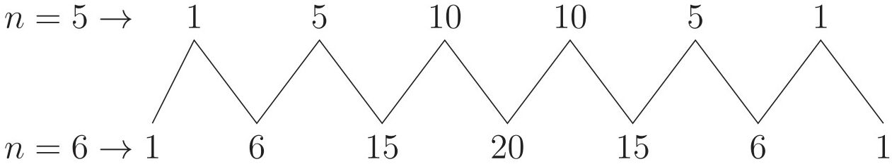

# 10. দ্বিপদী বিস্তৃতি

Source: Higher Math Bangla Version, printed pp. 223-238

## 10.0 ভূমিকা ও শিখনফল

<!-- higher-math-9-10-bn-c10-t10.0-p001 · text · p.223 · review: verify-formula -->
বীজগণিতীয় রাশির (একপদী, দ্বিপদী, বহুপদী) যোগ, বিয়োগ, গুণ, ভাগ, বর্গ এবং ঘনসংকুচিত আলোচনা পূর্ববর্তী শ্রেণিতে করা হয়েছে। দ্বিপদী রাশি বা বহুপদী রাশির ঘাত বা শক্তি তিন এর বেশি হলে সেই সমস্ত ক্ষেত্রে মান নির্ণয় যথেষ্ট শ্রমসাধ্য ও সময়সাপেক্ষ হয়ে পড়ে। এই অধ্যায়ে দ্বিপদী রাশির ঘাত বা শক্তি তিন এর বেশি হলে কি প্রক্রিয়ায় কাজটি সম্পন্ন করা যায়, তা উপস্থাপন করা হবে। সাধারণভাবে ঘাত বা শক্তি এর জন্য সূত্র প্রতিপাদন করা হবে, যার মাধ্যমে যেকোনো অঙ্কগাত্মক পূর্ণসংখ্যিক ঘাতের দ্বিপদী রাশির মান নির্ণয় করা সম্ভব হবে। তবে এই পর্যায়ে এর মান একটি নির্দিষ্ট সীমা ($n \le 8$) অতিক্রম করবে না। বিষয়টি যাতে শিক্ষার্থীরা সহজে বুঝতে ও ব্যবহার করতে পারে সে জন্য একটি ত্রিভুজ ব্যবহার করা হবে যেটি প্যাসকেলের ত্রিভুজ (Pascal’s triangle) বলে পরিচিত। দ্বিপদী রাশির ঘাত ধনাত্মক বা ঋণাত্মক পূর্ণসংখ্যা

<!-- higher-math-9-10-bn-c10-t10.0-p002 · text · p.223 -->
এ অধ্যায় শেষে শিক্ষার্থীরা -

<!-- higher-math-9-10-bn-c10-t10.0-p003 · text · p.223 · review: verify-formula -->
* দ্বিপদী বিস্তৃতি বর্ণনা করতে পারবে;
* প্যাসকেল ত্রিভুজ বর্ণনা করতে পারবে;
* স্বাভাবিক সংখ্যার ঘাতের জন্য দ্বিপদী বিস্তৃতি বর্ণনা করতে পারবে;
* $n!$ ও $^nC_r$ এর মান নির্ণয় করতে পারবে;
* দ্বিপদী বিস্তৃতি ব্যবহার করে গাণিতিক সমস্যা সমাধান করতে পারবে।

### দ্বিপদী $(1 + y)^n$ এর বিস্তৃতি

<!-- higher-math-9-10-bn-c10-t10.0-p004 · text · p.223 · review: verify-formula -->
দুটি পদের সমষ্ণয়ে গঠিত বীজগণিতীয় রাশিকে দ্বিপদী রাশি (Binomials) বলা হয়। $a + b$, $x - y$, $1 + x$, $1 - x^2$, $a^2 - b^2$ ইত্যাদি দ্বিপদী রাশি। আমরা প্রথমেই একটি দ্বিপদী রাশি $(1 + y)$ চিন্তিত করি। এখন $(1 + y)$ কে যদি ক্রমাগত $(1 + y)$ দ্বারা গুণ করতে থাকি তাহলে আমরা পাব $(1 + y)^2$, $(1 + y)^3$, $(1 + y)^4$, $(1 + y)^5$, $\dots$ ইত্যাদি। আমরা জানি,

<!-- higher-math-9-10-bn-c10-t10.0-p005 · formula · p.223 · review: verify-formula -->
$$\begin{aligned}
(1 + y)^2 &= (1 + y)(1 + y) = 1 + 2y + y^2 \\
(1 + y)^3 &= (1 + y)(1 + y)^2 = (1 + y)(1 + 2y + y^2) = 1 + 3y + 3y^2 + y^3
\end{aligned}$$

<!-- higher-math-9-10-bn-c10-t10.0-p006 · text · p.224 · review: verify-formula -->
অনুরূপভাবে দীর্ঘ গুণন প্রক্রিয়ার মাধ্যমে $(1 + y)^4$, $(1 + y)^5$, $\dots$ ইত্যাদি গুণফল নির্ণয় সম্ভব। কিন্তু $(1 + y)$ এর ঘাত বা শক্তি যত বাড়তে থাকবে গুণফল তত দীর্ঘ ও সময়সাপেক্ষ হবে। তাই এমন একটি সহজ পদ্ধতি বের করতে হবে যাতে $(1 + y)$ এর যেকোনো ঘাত (ধরি $n$) বা শক্তির জন্য $(1 + y)^n$ এর বিস্তৃতি সহজেই নির্ণয় করা সম্ভব হবে। $n$ এর মান 0, 1, 2, 3, 4, $\dots$ অর্থাৎ অঙ্কগাত্ৰিক মানের জন্য এই অংশে আলোচনা সীমাবদ্ধ থাকবে। এখন প্রক্রিয়াটি আমরা ভালভাবে লক্ষ্য করি।

<!-- higher-math-9-10-bn-c10-t10.0-p007 · table · p.224 · review: verify-table -->
<table><tr><th><em>n</em> এর মান</th><th></th><th>প্যাসকেল ত্রিভুজ</th><th>পদসংখ্যা</th></tr>
<tr><td><em>n</em> = 0</td><td>(1 + <em>y</em>)<sup>0</sup> =</td><td>1</td><td>1</td></tr>
<tr><td><em>n</em> = 1</td><td>(1 + <em>y</em>)<sup>1</sup> =</td><td>1 + <em>y</em></td><td>2</td></tr>
<tr><td><em>n</em> = 2</td><td>(1 + <em>y</em>)<sup>2</sup> =</td><td>1 + 2<em>y</em> + <em>y</em><sup>2</sup></td><td>3</td></tr>
<tr><td><em>n</em> = 3</td><td>(1 + <em>y</em>)<sup>3</sup> =</td><td>1 + 3<em>y</em> + 3<em>y</em><sup>2</sup> + <em>y</em><sup>3</sup></td><td>4</td></tr>
<tr><td><em>n</em> = 4</td><td>(1 + <em>y</em>)<sup>4</sup> =</td><td>1 + 4<em>y</em> + 6<em>y</em><sup>2</sup> + 4<em>y</em><sup>3</sup> + <em>y</em><sup>4</sup></td><td>5</td></tr>
<tr><td><em>n</em> = 5</td><td>(1 + <em>y</em>)<sup>5</sup> =</td><td>1 + 5<em>y</em> + 10<em>y</em><sup>2</sup> + 10<em>y</em><sup>3</sup> + 5<em>y</em><sup>4</sup> + <em>y</em><sup>5</sup></td><td>6</td></tr></table>

<!-- higher-math-9-10-bn-c10-t10.0-p008 · text · p.224 · review: verify-formula -->
উপরের বিস্তৃতিসমূহকে ভিত্তি করে আমরা $(1 + y)^n$ এর বিস্তৃতি সম্পর্কে নিম্নোক্ত সিদ্ধান্তে আসতে পারি।

<!-- higher-math-9-10-bn-c10-t10.0-p009 · text · p.224 · review: verify-formula -->
ক) $(1 + y)^n$ এর বিস্তৃতিতে $(n + 1)$ সংখ্যক পদ আছে। অর্থাৎ ঘাত বা শক্তির চেয়ে পদসংখ্যা একটি বেশি।

<!-- higher-math-9-10-bn-c10-t10.0-p010 · text · p.224 · review: verify-formula -->
খ) $y$ এর ঘাত শূন্য থেকে শুরু হয়ে 1, 2, 3, $\dots, n$ পর্যন্ত বৃদ্ধি পাবে। অর্থাৎ $y$ এর ঘাত ক্রমশয়ে বৃদ্ধি পেয়ে $n$ পর্যন্ত পৌঁছাবে।

## 10.1 দ্বিপদী সহগ

<!-- higher-math-9-10-bn-c10-t10.1-p001 · text · p.224 · review: verify-formula -->
উপরের প্রত্যেক দ্বিপদী বিস্তৃতিতে $y$ এর বিভিন্ন ঘাতের সহগকে দ্বিপদী সহগ (coefficient) বলা হয়। 1 কে $y$ এর সহগ বিবেচনা করতে হবে। উপরের বিস্তৃতির সহগগুলোকে সাজালে আমরা পাই,

<!-- higher-math-9-10-bn-c10-t10.1-p002 · table · p.224 · review: verify-table -->
<table><tr><td><em>n</em> = 0</td><td>1</td></tr>
<tr><td><em>n</em> = 1</td><td>1 1</td></tr>
<tr><td><em>n</em> = 2</td><td>1 2 1</td></tr>
<tr><td><em>n</em> = 3</td><td>1 3 3 1</td></tr>
<tr><td><em>n</em> = 4</td><td>1 4 6 4 1</td></tr>
<tr><td><em>n</em> = 5</td><td>1 5 10 10 5 1</td></tr></table>

<!-- higher-math-9-10-bn-c10-t10.1-p003 · text · p.224 -->
লক্ষ্য করলে দেখব সহগগুলো একটি ত্রিভুজের আকার ধারণ করেছে। দ্বিপদী বিস্তৃতির সহগ নির্ণয়ের এই কৌশল Blaise Pascal প্রথম ব্যবহার করেন। তাই এই ত্রিভুজকে প্যাসকেলের ত্রিভুজ (Pascal’s triangle) বলা হয়। প্যাসকেলের ত্রিভুজের সাহায্যে আমরা সহজেই দ্বিপদী রাশির বিস্তৃতিতে সহগসমূহ নির্ণয় করতে পারি।

## 10.2 প্যাসকেলের ত্রিভুজের ব্যবহার

<!-- higher-math-9-10-bn-c10-t10.2-p001 · text · p.225 -->
প্যাসকেলের ত্রিভুজ থেকে আমরা দেখতে পাই এর বাম ও ডান দিকে ১ আছে। ত্রিভুজের মাঝখানের সংখ্যাগুলোর প্রত্যেকটি ঠিক উপরের দুটি সংখ্যার যোগফল। নিম্নের উদাহরণটি লক্ষ্য করলে বিষয়টি খুব সহজেই বুঝা যাবে।

<!-- higher-math-9-10-bn-c10-t10.2-p002 · text · p.225 · review: verify-formula -->
$n = 5$ ও $n = 6$ এর জন্য দ্বিপদী সহগগুলো হবে নিম্নরূপ:

<!-- higher-math-9-10-bn-c10-t10.2-p003 · figure · p.225 -->


<!-- higher-math-9-10-bn-c10-t10.2-p004 · formula · p.225 · review: verify-formula -->
$$\begin{array}{ccccccc}
n = 5 \rightarrow & & & 1 & & 5 & & 10 \\
& & & \nearrow & & \nearrow & & \nearrow \\
& & & & & 10 & & 10 \\
& & & \searrow & & \searrow & & \searrow \\
n = 6 \rightarrow & 1 & & 6 & & 15 & & 20 \\
& & & \nearrow & & \nearrow & & \nearrow \\
& & & & & 15 & & 15 \\
& & & \searrow & & \searrow & & \searrow \\
& & & & & 6 & & 6 \\
& & & & & & & 1
\end{array}$$

<!-- higher-math-9-10-bn-c10-t10.2-p005 · formula · p.225 · review: verify-formula -->
$$\therefore (1 + y)^5 = 1 + 5y + 10y^2 + 10y^3 + 5y^4 + y^5$$

<!-- higher-math-9-10-bn-c10-t10.2-p006 · formula · p.225 · review: verify-formula -->
$$\therefore (1 + y)^6 = 1 + 6y + 15y^2 + 20y^3 + 15y^4 + 6y^5 + y^6$$

<!-- higher-math-9-10-bn-c10-t10.2-p007 · text · p.225 · review: verify-formula -->
এবং $(1 + y)^7 = 1 + 7y + 21y^2 + 35y^3 + 35y^4 + 21y^5 + 7y^6 + y^7$

<!-- higher-math-9-10-bn-c10-t10.2-p008 · text · p.225 -->
**কাজ:** নিম্নোক্ত বিস্তৃতিসমূহ নির্ণয় করো (উপরের বিস্তৃতিসমূহের সাহায্য নাও):

<!-- higher-math-9-10-bn-c10-t10.2-p009 · formula · p.225 · review: verify-formula -->
$$(1 + y)^8 =$$

<!-- higher-math-9-10-bn-c10-t10.2-p010 · formula · p.225 · review: verify-formula -->
$$(1 + y)^9 =$$

<!-- higher-math-9-10-bn-c10-t10.2-p011 · formula · p.225 · review: verify-formula -->
$$(1 + y)^{10} =$$

<!-- higher-math-9-10-bn-c10-t10.2-p012 · text · p.225 · review: verify-formula -->
আমরা যদি ভালভাবে খেয়াল করি তাহলে বুঝতে পারব এই পদ্ধতির একটি বিশেষ দূর্বলতা আছে। যেমন আমরা যদি $(1 + y)^5$ এর বিস্তৃতি জানতে চাই তাহলে $(1 + y)^4$ এর বিস্তৃতি জানা দরকার। আবার যেকোনো দ্বিপদী সহগ জানার জন্য তার ঠিক উপরের পূর্ববর্তী দুটি সহগ জানা প্রয়োজন। এই অবস্থা থেকে উত্তরনের জন্য আমরা সরাসরি দ্বিপদী সহগ নির্ণয়ের কৌশল বের করতে চাই। প্যাসকেলের ত্রিভুজ থেকে আমরা দেখতে পাই দ্বিপদী বিস্তৃতির সহগগুলো যাত $n$ এবং পদটি কোন অবস্থানে আছে তার উপর নির্ভরশীল। আমরা একটি নতুন সাংকেতিক চিহ্ন $\binom{n}{r}$ বিবেচনা করি যেখানে $n$ যাত এবং $r$ পদের অবস্থানের সাথে সম্পর্কিত। উদাহরণস্বরূপ যদি $n = 4$ হয় তবে পদসংখ্যা হবে 5 টি। আমরা পদগুলি নিম্নোক্ত উপায়ে লিখি।

<!-- higher-math-9-10-bn-c10-t10.2-p013 · text · p.225 · review: verify-formula -->
যখন $n = 4$, পদসংখ্যা 5 টি: $T_1, T_2, T_3, T_4, T_5$

<!-- higher-math-9-10-bn-c10-t10.2-p014 · text · p.225 -->
তাদের সহগগুলি হলো: 1, 4, 6, 4, 1

<!-- higher-math-9-10-bn-c10-t10.2-p015 · text · p.225 · review: verify-formula -->
নতুন চিহ্ন ব্যবহার করে সহগ: $\binom{4}{0}, \binom{4}{1}, \binom{4}{2}, \binom{4}{3}, \binom{4}{4}$ এখানে, $\binom{4}{0} = 1$, $\binom{4}{1} = \frac{4}{1} = 4$, $\binom{4}{2} = \frac{4 \times 3}{1 \times 2} = 6$, $\binom{4}{3} = \frac{4 \times 3 \times 2}{1 \times 2 \times 3} = 4$, এবং
$\binom{4}{4} = \frac{4 \times 3 \times 2 \times 1}{1 \times 2 \times 3 \times 4} = 1$

<!-- higher-math-9-10-bn-c10-t10.2-p016 · text · p.226 -->
[প্যাসকেলের ত্রিভুজ থেকে সহজেই বুঝতে পারবে]

<!-- higher-math-9-10-bn-c10-t10.2-p017 · text · p.226 · review: verify-formula -->
উল্লিখিত নতুন চিহ্নের সাহায্যে $(n = 1, 2, 3, \dots)$ প্যাসকেলের ত্রিভুজ হবে নিচের টেবিলের অনুরূপ:

<!-- higher-math-9-10-bn-c10-t10.2-p018 · table · p.226 · review: verify-table -->
<table><tr><td><em>n</em> = 1</td><td></td><td><sup>1</sup><br />0</td><td><sup>1</sup><br />1</td><td></td></tr>
<tr><td><em>n</em> = 2</td><td></td><td><sup>2</sup><br />0</td><td><sup>2</sup><br />1</td><td><sup>2</sup><br />2</td></tr>
<tr><td><em>n</em> = 3</td><td></td><td><sup>3</sup><br />0</td><td><sup>3</sup><br />1</td><td><sup>3</sup><br />2</td><td><sup>3</sup><br />3</td></tr>
<tr><td><em>n</em> = 4</td><td></td><td><sup>4</sup><br />0</td><td><sup>4</sup><br />1</td><td><sup>4</sup><br />2</td><td><sup>4</sup><br />3</td><td><sup>4</sup><br />4</td></tr>
<tr><td><em>n</em> = 5</td><td></td><td><sup>5</sup><br />0</td><td><sup>5</sup><br />1</td><td><sup>5</sup><br />2</td><td><sup>5</sup><br />3</td><td><sup>5</sup><br />4</td><td><sup>5</sup><br />5</td></tr></table>

<!-- higher-math-9-10-bn-c10-t10.2-p019 · text · p.226 · review: verify-formula -->
সুতরাং উপরের ত্রিভুজ থেকে আমরা খুব সহজেই বলতে পারি $(1 + y)^4$ এর বিস্তৃতির তৃতীয় ($T_{2+1}$) পদের সহগ $\binom{4}{2}$ এবং $(1 + y)^5$ এর বিস্তৃতির তৃতীয় ($T_{2+1}$) ও চতুর্থ ($T_{3+1}$) পদের সহগ যথাক্রমে $\binom{5}{2}$ এবং $\binom{5}{3}$। সাধারণভাবে $(1 + y)^n$ এর বিস্তৃতির $(r + 1)$ তম পদ ($T_{r+1}$) এর সহগ $\binom{n}{r}$।

<!-- higher-math-9-10-bn-c10-t10.2-p020 · text · p.226 · review: verify-formula -->
এখন, $\binom{n}{r}$ এর মান কত তা জানার জন্য আবারো প্যাসকেলের ত্রিভুজ লক্ষ্য করি। প্যাসকেলের ত্রিভুজের দুটি হেলানো পার্শ্ব থেকে আমরা দেখতে পাই,

<!-- higher-math-9-10-bn-c10-t10.2-p021 · formula · p.226 · review: verify-formula -->
$$\binom{1}{0} = 1, \binom{2}{0} = 1, \binom{3}{0} = 1, \dots, \binom{n}{0} = 1$$

<!-- higher-math-9-10-bn-c10-t10.2-p022 · formula · p.226 · review: verify-formula -->
$$\binom{1}{1} = 1, \binom{2}{1} = 2, \binom{3}{1} = 3, \dots, \binom{n}{1} = n$$

<!-- higher-math-9-10-bn-c10-t10.2-p023 · text · p.226 · review: verify-formula -->
আমরা $n = 5$ ধরে পাই

<!-- higher-math-9-10-bn-c10-t10.2-p024 · formula · p.226 · review: verify-formula -->
$$\binom{5}{0} = 1, \binom{5}{1} = 5, \binom{5}{2} = \frac{5 \times 4}{1 \times 2} = 10$$

<!-- higher-math-9-10-bn-c10-t10.2-p025 · formula · p.226 · review: verify-formula -->
$$\binom{5}{3} = \frac{5 \times 4 \times 3}{1 \times 2 \times 3} = 10, \binom{5}{4} = \frac{5 \times 4 \times 3 \times 2}{1 \times 2 \times 3 \times 4} = 5$$

<!-- higher-math-9-10-bn-c10-t10.2-p026 · text · p.227 · review: verify-formula -->
এবং $\binom{5}{5} = \frac{5 \times 4 \times 3 \times 2 \times 1}{1 \times 2 \times 3 \times 4 \times 5} = 1$

<!-- higher-math-9-10-bn-c10-t10.2-p027 · text · p.227 · review: verify-formula -->
সুতরাং $\binom{5}{3}$ এর মানের ক্ষেত্রে বলা যায়, $\binom{5}{3} = \frac{5 \times (5 - 1) \times (5 - 2)}{1 \times 2 \times 3}$ এবং

<!-- higher-math-9-10-bn-c10-t10.2-p028 · formula · p.227 · review: verify-formula -->
$\binom{6}{4} = \frac{6 \times (6 - 1) \times (6 - 2) \times (6 - 3)}{1 \times 2 \times 3 \times 4}$

<!-- higher-math-9-10-bn-c10-t10.2-p029 · text · p.227 -->
সাধারণভাবে আমরা লিখতে পারি,

<!-- higher-math-9-10-bn-c10-t10.2-p030 · formula · p.227 · review: verify-formula -->
$\binom{n}{0} = 1, \binom{n}{n} = 1$

<!-- higher-math-9-10-bn-c10-t10.2-p031 · formula · p.227 · review: verify-formula -->
$\binom{n}{r} = \frac{n \times (n - 1) \times (n - 2) \cdots (n - r + 1)}{1 \times 2 \times 3 \times 4 \cdots \times r}$

<!-- higher-math-9-10-bn-c10-t10.2-p032 · text · p.227 -->
উপরোক্ত চিহ্ন ব্যবহার করে পাই,

<!-- higher-math-9-10-bn-c10-t10.2-p033 · text · p.227 · review: verify-formula -->
$(1 + y)^4 = \binom{4}{0}y^0 + \binom{4}{1}y^1 + \binom{4}{2}y^2 + \binom{4}{3}y^3 + \binom{4}{4}y^4$
$= 1 + 4y + 6y^2 + 4y^3 + y^4$

<!-- higher-math-9-10-bn-c10-t10.2-p034 · text · p.227 · review: verify-formula -->
$(1 + y)^5 = \binom{5}{0}y^0 + \binom{5}{1}y^1 + \binom{5}{2}y^2 + \binom{5}{3}y^3 + \binom{5}{4}y^4 + \binom{5}{5}y^5$
$= 1 + 5y + 10y^2 + 10y^3 + 5y^4 + y^5$

<!-- higher-math-9-10-bn-c10-t10.2-p035 · text · p.227 · review: verify-formula -->
এবং $(1 + y)^n$ এর বিস্তৃতি

<!-- higher-math-9-10-bn-c10-t10.2-p036 · text · p.227 · review: verify-formula -->
$(1 + y)^n = \binom{n}{0}y^0 + \binom{n}{1}y^1 + \binom{n}{2}y^2 + \binom{n}{3}y^3 + \cdots + \binom{n}{n}y^n$
$= 1 \cdot y^0 + ny^1 + \frac{n(n - 1)}{1 \cdot 2}y^2 + \frac{n(n - 1)(n - 2)}{1 \cdot 2 \cdot 3}y^3 + \cdots + 1 \cdot y^n$

<!-- higher-math-9-10-bn-c10-t10.2-p037 · formula · p.227 · review: verify-formula -->
$\therefore (1 + y)^n = 1 + ny + \frac{n(n - 1)}{1 \cdot 2}y^2 + \frac{n(n - 1)(n - 2)}{1 \cdot 2 \cdot 3}y^3 + \cdots + y^n$

<!-- higher-math-9-10-bn-c10-t10.2-p038 · text · p.227 · review: verify-formula -->
**উদাহরণ ১.** $(1 + 3x)^5$ কে বিস্তৃত করো।

<!-- higher-math-9-10-bn-c10-t10.2-p039 · text · p.227 -->
**সমাধান:** প্যাসকেলের ত্রিভুজের সাহায্যে -

<!-- higher-math-9-10-bn-c10-t10.2-p040 · text · p.227 · review: verify-formula -->
```text
                  1
                1     1
              1     2     1
            1     3     3     1
          1     4     6     4     1
        1     5    10    10     5     1
``` $$(1 + 3x)^5 = 1 + 5(3x) + 10(3x)^2 + 10(3x)^3 + 5(3x)^4 + 1(3x)^5$$
$$= 1 + 15x + 90x^2 + 270x^3 + 405x^4 + 243x^5$$

<!-- higher-math-9-10-bn-c10-t10.2-p041 · text · p.228 -->
দ্বিপদী উপপাদ্যের সাহায্যে -

<!-- higher-math-9-10-bn-c10-t10.2-p042 · text · p.228 · review: verify-formula -->
$$(1 + 3x)^5 = \binom{5}{0}(3x)^0 + \binom{5}{1}(3x)^1 + \binom{5}{2}(3x)^2 + \binom{5}{3}(3x)^3 + \binom{5}{4}(3x)^4$$
$$+ \binom{5}{5}(3x)^5$$

<!-- higher-math-9-10-bn-c10-t10.2-p043 · text · p.228 · review: verify-formula -->
বা, $(1 + 3x)^5 = 1 + \frac{5}{1}(3x) + \frac{5 \cdot 4}{1 \cdot 2}(3x)^2 + \frac{5 \cdot 4 \cdot 3}{1 \cdot 2 \cdot 3}(3x)^3 + \frac{5 \cdot 4 \cdot 3 \cdot 2}{1 \cdot 2 \cdot 3 \cdot 4}(3x)^4 + 1 \cdot (3x)^5$
$$= 1 + 15x + 90x^2 + 270x^3 + 405x^4 + 243x^5$$

<!-- higher-math-9-10-bn-c10-t10.2-p044 · text · p.228 · review: verify-formula -->
**উদাহরণ ২.** $(1 - 3x)^5$ কে বিস্তৃত করো।

<!-- higher-math-9-10-bn-c10-t10.2-p045 · text · p.228 -->
**সমাধান:** প্যাসকেলের ত্রিভুজের সাহায্যে -

<!-- higher-math-9-10-bn-c10-t10.2-p046 · figure · p.228 -->
image: Pascal's triangle

<!-- higher-math-9-10-bn-c10-t10.2-p047 · text · p.228 · review: verify-formula -->
$$(1 - 3x)^5 = 1 + 5(-3x) + 10(-3x)^2 + 10(-3x)^3 + 5(-3x)^4 + 1(-3x)^5$$
$$= 1 - 15x + 90x^2 - 270x^3 + 405x^4 - 243x^5$$

<!-- higher-math-9-10-bn-c10-t10.2-p048 · text · p.228 -->
দ্বিপদী বিস্তৃতির সাহায্যে -

<!-- higher-math-9-10-bn-c10-t10.2-p049 · text · p.228 · review: verify-formula -->
$$(1 - 3x)^5 = \binom{5}{0}(-3x)^0 + \binom{5}{1}(-3x)^1 + \binom{5}{2}(-3x)^2 + \binom{5}{3}(-3x)^3 + \binom{5}{4}(-3x)^4$$
$$+ \binom{5}{5}(-3x)^5$$

<!-- higher-math-9-10-bn-c10-t10.2-p050 · text · p.228 · review: verify-formula -->
$$= 1 + \frac{5}{1}(-3x) + \frac{5 \cdot 4}{1 \cdot 2}(-3x)^2 + \frac{5 \cdot 4 \cdot 3}{1 \cdot 2 \cdot 3}(-3x)^3 + \frac{5 \cdot 4 \cdot 3 \cdot 2}{1 \cdot 2 \cdot 3 \cdot 4}(-3x)^4 + 1 \cdot (-3x)^5$$
$$= 1 - 15x + 90x^2 - 270x^3 + 405x^4 - 243x^5$$

<!-- higher-math-9-10-bn-c10-t10.2-p051 · text · p.228 · review: verify-formula -->
**মন্তব্য:** $(1 + 3x)^5$ এবং $(1 - 3x)^5$ এর বিস্তৃতি থেকে দেখা যাচ্ছে যে, উভয় বিস্তৃতি একই। শুধুমাত্র সহগের চিহ্ন পরিবর্তন করে, অর্থাৎ $+$, $-$, $+$, $\dots$ এর মাধ্যমে একটি থেকে অন্যটি পাওয়া সম্ভব।

<!-- higher-math-9-10-bn-c10-t10.2-p052 · text · p.228 · review: verify-formula -->
**কাজ:** $(1 + 2x^2)^7$ এবং $(1 - 2x^2)^7$ কে বিস্তৃত করো।

<!-- higher-math-9-10-bn-c10-t10.2-p053 · text · p.229 · review: verify-formula -->
**উদাহরণ ৩.** $(1 + \frac{2}{x})^8$ কে পঞ্চম পদ পর্যন্ত বিস্তৃত করো।

<!-- higher-math-9-10-bn-c10-t10.2-p054 · text · p.229 -->
**সমাধান:**

<!-- higher-math-9-10-bn-c10-t10.2-p055 · text · p.229 · review: verify-formula -->
দ্বিপদী বিস্তৃতি ব্যবহার করে $(1 + \frac{2}{x})^8$ এর পঞ্চম পদ পর্যন্ত বিস্তৃতি নিম্নরূপ:

<!-- higher-math-9-10-bn-c10-t10.2-p056 · formula · p.229 · review: verify-formula -->
$$(1 + \frac{2}{x})^8 = \binom{8}{0}(\frac{2}{x})^0 + \binom{8}{1}(\frac{2}{x})^1 + \binom{8}{2}(\frac{2}{x})^2 + \binom{8}{3}(\frac{2}{x})^3 + \binom{8}{4}(\frac{2}{x})^4$$

<!-- higher-math-9-10-bn-c10-t10.2-p057 · formula · p.229 · review: verify-formula -->
$$= 1 \cdot 1 + \frac{8}{1} \cdot \frac{2}{x} + \frac{8 \cdot 7}{1 \cdot 2} \cdot \frac{4}{x^2} + \frac{8 \cdot 7 \cdot 6}{1 \cdot 2 \cdot 3} \cdot \frac{8}{x^3} + \frac{8 \cdot 7 \cdot 6 \cdot 5}{1 \cdot 2 \cdot 3 \cdot 4} \cdot \frac{16}{x^4}$$

<!-- higher-math-9-10-bn-c10-t10.2-p058 · formula · p.229 · review: verify-formula -->
$$= 1 + \frac{16}{x} + \frac{112}{x^2} + \frac{448}{x^3} + \frac{1120}{x^4}$$

<!-- higher-math-9-10-bn-c10-t10.2-p059 · formula · p.229 · review: latin-junk,verify-formula -->
$$\therefore (1 + \frac{2}{x})^8 = 1 + \frac{16}{x} + \frac{112}{x^2} + \frac{448}{x^3} + \frac{1120}{x^4}  [পঞ্চম পদ পর্যন্ত বিস্তৃতি]$$

<!-- higher-math-9-10-bn-c10-t10.2-p060 · text · p.229 -->
[প্যাসকেলের ত্রিভুজের সাহায্যে নিজে করো।]

<!-- higher-math-9-10-bn-c10-t10.2-p061 · text · p.229 · review: verify-formula -->
**উদাহরণ ৪.** $(1 - \frac{x^2}{4})^8$ এর বিস্তৃতির $x^3$ ও $x^6$ এর সহগ নির্ণয় করো।

<!-- higher-math-9-10-bn-c10-t10.2-p062 · text · p.229 -->
**সমাধান:** দ্বিপদী বিস্তৃতির সাহায্যে পাই,

<!-- higher-math-9-10-bn-c10-t10.2-p063 · text · p.229 · review: verify-formula -->
$$(1 - \frac{x^2}{4})^8 = \binom{8}{0}(-\frac{x^2}{4})^0 + \binom{8}{1}(-\frac{x^2}{4})^1 + \binom{8}{2}(-\frac{x^2}{4})^2 + \binom{8}{3}(-\frac{x^2}{4})^3$$
$$+ \binom{8}{4}(-\frac{x^2}{4})^4 + \dots$$

<!-- higher-math-9-10-bn-c10-t10.2-p064 · formula · p.229 · review: verify-formula -->
$$= 1 \cdot 1 + \frac{8}{1} \cdot (-\frac{x^2}{4}) + \frac{8 \cdot 7}{1 \cdot 2} \cdot (\frac{x^4}{16}) + \frac{8 \cdot 7 \cdot 6}{1 \cdot 2 \cdot 3} \cdot (-\frac{x^6}{64}) + \frac{8 \cdot 7 \cdot 6 \cdot 5}{1 \cdot 2 \cdot 3 \cdot 4} \cdot (\frac{x^8}{256}) + \dots$$

<!-- higher-math-9-10-bn-c10-t10.2-p065 · formula · p.229 · review: verify-formula -->
$$= 1 - 2x^2 + \frac{7}{4}x^4 - \frac{7}{8}x^6 + \dots$$

<!-- higher-math-9-10-bn-c10-t10.2-p066 · text · p.229 · review: verify-formula -->
$(1 - \frac{x^2}{4})^8$ এর বিস্তৃতিতে দেখা যাচ্ছে $x^3$ বর্তমান নয়। অর্থাৎ $x^3$ এর সহগ ০ এবং $x^6$ এর সহগ $-\frac{7}{8}$

<!-- higher-math-9-10-bn-c10-t10.2-p067 · text · p.229 · review: verify-formula -->
$\therefore x^3$ এর সহগ ০ এবং $x^6$ এর সহগ $-\frac{7}{8}$

<!-- higher-math-9-10-bn-c10-t10.2-p068 · text · p.229 -->
**কাজ:** প্যাসকেলের ত্রিভুজের সাহায্যে সত্যতা যাচাই করো।

## 10.ex অনুশীলনী ১০.১

<!-- higher-math-9-10-bn-c10-t10.ex-p001 · exercise · p.230 · review: verify-formula -->
১. প্যাসকেলের ত্রিভুজ বা দ্বিপদী বিস্তৃতি ব্যবহার করে $(1 + y)^5$ এর বিস্তৃতি নির্ণয় করো। উক্ত বিস্তৃতির সাহায্যে ক) $(1 - y)^5$ এবং খ) $(1 + 2x)^5$ এর বিস্তৃতি নির্ণয় করো।

<!-- higher-math-9-10-bn-c10-t10.ex-p002 · exercise · p.230 · review: verify-formula -->
২. $x$ এর ঘাতের উর্ধ্বক্রম অনুসারে ক) $(1 + 4x)^6$ এবং খ) $(1 - 3x)^7$ এর প্রথম চার পদ পর্যন্ত বিস্তৃত করো।

<!-- higher-math-9-10-bn-c10-t10.ex-p003 · exercise · p.230 · review: verify-formula -->
৩. $(1 + x^2)^8$ এর বিস্তৃতির প্রথম চারটি পদ নির্ণয় করো। উক্ত ফলাফল ব্যবহার করে $(1.01)^8$ এর মান নির্ণয় করো।

<!-- higher-math-9-10-bn-c10-t10.ex-p004 · exercise · p.230 · review: verify-formula -->
৪. $x$ এর উর্ধ্বক্রম অনুসারে নিম্নোক্ত দ্বিপদীসমূহের প্রথম তিনটি পদ নির্ণয় করো।

<!-- higher-math-9-10-bn-c10-t10.ex-p005 · exercise · p.230 · review: verify-formula -->
ক) $(1 - 2x)^5$ খ) $(1 + 3x)^9$

<!-- higher-math-9-10-bn-c10-t10.ex-p006 · exercise · p.230 -->
৫. নিম্নোক্ত বিস্তৃতিসমূহের প্রথম চারটি পদ নির্ণয় করো। [দ্বিপদী বিস্তৃতি বা প্যাসক্যাল ত্রিভুজ এর যেকোনো একটি ব্যবহার করে]

<!-- higher-math-9-10-bn-c10-t10.ex-p007 · exercise · p.230 · review: verify-formula -->
ক) $(1 - 2x^2)^7$ খ) $\left(1 + \frac{2}{x}\right)^4$ গ) $\left(1 - \frac{1}{2x}\right)^7$

<!-- higher-math-9-10-bn-c10-t10.ex-p008 · exercise · p.230 · review: verify-formula -->
৬. $x^3$ পর্যন্ত ক) $(1 - x)^6$ এবং খ) $(1 + 2x)^6$ বিস্তৃত করো।

### অনুশীলনী ১০.২

<!-- higher-math-9-10-bn-c10-t10.ex-p009 · exercise · p.236 · review: verify-formula -->
১. $(x + y)^5$ -এর বিস্তৃতিতে দ্বিপদী সহগগুলি হলো:
ক) 5, 10, 10, 5
গ) 10, 5, 5, 10
খ) 1, 5, 10, 10, 5, 1
ঘ) 1, 2, 3, 3, 2, 1

<!-- higher-math-9-10-bn-c10-t10.ex-p010 · exercise · p.236 · review: verify-formula -->
২. $\left(x^2 + \frac{1}{x^2}\right)^4$ -এর বিস্তৃতিতে $x$ মুক্ত পদ কত?
ক) 4
খ) 6
গ) 8
ঘ) 0

<!-- higher-math-9-10-bn-c10-t10.ex-p011 · exercise · p.236 · review: verify-formula -->
৩. $(x + y)^4$ বিস্তৃতির সহগগুলি সাজালে আমরা পাই-

<!-- higher-math-9-10-bn-c10-t10.ex-p012 · table · p.236 · review: verify-table -->
<table><tr><td></td><td></td><td>4</td><td></td></tr>
<tr><td>ক)</td><td>1</td><td>4</td><td>1</td><td></td><td></td><td>1</td><td></td></tr>
<tr><td></td><td>1</td><td>4</td><td>1</td><td></td><td></td><td>1</td><td>1</td></tr>
<tr><td></td><td>1</td><td>5</td><td>5</td><td>1</td><td></td><td>1</td><td>2</td><td>1</td></tr>
<tr><td></td><td>1</td><td>6</td><td>10</td><td>6</td><td>1</td><td></td><td>1</td><td>3</td><td>3</td><td>1</td></tr>
<tr><td></td><td></td><td>2</td><td></td><td></td><td></td><td>1</td><td>4</td><td>6</td><td>4</td><td>1</td></tr>
<tr><td></td><td></td><td>2</td><td>3</td><td>2</td><td></td><td></td><td></td><td>6</td><td></td><td></td></tr>
<tr><td>গ)</td><td>1</td><td>5</td><td>5</td><td>2</td><td></td><td></td><td></td><td>6</td><td>12</td><td>6</td></tr>
<tr><td></td><td>2</td><td>7</td><td>10</td><td>7</td><td>2</td><td></td><td></td><td>6</td><td>18</td><td>18</td><td>6</td></tr>
<tr><td></td><td></td><td></td><td></td><td></td><td></td><td></td><td>6</td><td>24</td><td>36</td><td>24</td><td>6</td></tr></table>

<!-- higher-math-9-10-bn-c10-t10.ex-p013 · exercise · p.236 · review: verify-formula -->
৪. নিম্নকণ্ঠ প্রতিটি ক্ষেত্রে বিস্তৃত করো:
ক) $(2 + x^2)^5$
খ) $\left(2 - \frac{1}{2x}\right)^6$

<!-- higher-math-9-10-bn-c10-t10.ex-p014 · exercise · p.237 · review: verify-formula -->
৫. নিম্নে দ্বিপদী বিস্তৃতিসমূহের প্রথম চারটি পদ নির্ণয় করো।
ক) $(2 + 3x)^6$ খ) $\left(4 - \frac{1}{2x}\right)^5$

<!-- higher-math-9-10-bn-c10-t10.ex-p015 · exercise · p.237 · review: verify-formula -->
৬. $\left(p - \frac{1}{2}x\right)^6 = r - 96x + sx^2 + \dots$ হলে, $p$, $r$ এবং $s$ এর মান নির্ণয় করো।

<!-- higher-math-9-10-bn-c10-t10.ex-p016 · exercise · p.237 · review: verify-formula -->
৭. $x$ এর ঘাতের উর্ধ্বক্রম অনুসারে $\left(2 + \frac{x}{4}\right)^6$ কে $x^3$ পর্যন্ত বিস্তৃত করো। উহার সাহায্যে $(1.9975)^6$ এর আসন্ন মান চার দশমিক স্থান পর্যন্ত নির্ণয় করো।

<!-- higher-math-9-10-bn-c10-t10.ex-p017 · exercise · p.237 · review: verify-formula -->
৮. দ্বিপদী উপপাদ্য ব্যবহার করে $(1.99)^5$ এর মান চার দশমিক স্থান পর্যন্ত নির্ণয় করো।

<!-- higher-math-9-10-bn-c10-t10.ex-p018 · exercise · p.237 · review: verify-formula -->
৯. $\left(1 + \frac{x}{4}\right)^n$ এর বিস্তৃতির তৃতীয় পদের সহগ চতুর্থ পদের সহগের দ্বিগুণ। $n$ এর মান নির্ণয় করো। বিস্তৃতির পদসংখ্যা ও মধ্যপদ নির্ণয় করো।

<!-- higher-math-9-10-bn-c10-t10.ex-p019 · exercise · p.237 · review: verify-formula -->
১০. $\left(x^2 + \frac{k}{x}\right)^6$ এর বিস্তৃতিতে $x^3$ এর সহগ 160 হলে $k$ এর মান নির্ণয় করো।

<!-- higher-math-9-10-bn-c10-t10.ex-p020 · exercise · p.237 · review: verify-formula -->
১১. $(A + Bx)^n$ একটি বীজগাণিতিক রাশি।
ক) $A = 1$, $B = 2$ এবং $n = 5$ হলে প্যাসকেলের ত্রিভুজ ব্যবহার করে রাশিটির বিস্তৃতি নির্ণয় করো।
খ) $B = 3$ এবং $n = 7$ হলে রাশিটির বিস্তৃতির $x^4$ এর সহগ 22680 হয়। $A$ এর মান নির্ণয় করো।
গ) $A = 2$ এবং $B = 1$ হলে রাশিটির বিস্তৃতির পঞ্চম ও ষষ্ঠ পদের সহগ সমান হয়। $n$ এর মান নির্ণয় করো।

<!-- higher-math-9-10-bn-c10-t10.ex-p021 · exercise · p.237 · review: verify-formula -->
১২. $a_1, a_2, a_3, a_4$ যদি $(1 + x)^n$ এর বিস্তৃতির চারটি ক্রমিক পদের সহগ হয়ে থাকে তাহলে প্রমাণ করো যে $\frac{a_1}{a_1 + a_2} + \frac{a_3}{a_3 + a_4} = \frac{2a_2}{a_2 + a_3}$

<!-- higher-math-9-10-bn-c10-t10.ex-p022 · exercise · p.237 · review: verify-formula -->
১৩. কোনটি বড় $99^{50} + 100^{50}$ না $101^{50}$?

### বহুনির্বাচনি প্রশ্ন

<!-- higher-math-9-10-bn-c10-t10.ex-p023 · exercise · p.237 · review: verify-formula -->
১. $(1 - x) \left(1 + \frac{x}{2}\right)^8$ -এর বিস্তৃতিতে $x$ এর সহগ
ক) $-1$ খ) $\frac{1}{2}$ গ) $3$ ঘ) $-\frac{1}{2}$

<!-- higher-math-9-10-bn-c10-t10.ex-p024 · exercise · p.238 · review: verify-formula -->
২. $(1 + 2x + x^2)^3$ এর বিস্তৃতিতে-
    (i) পদসংখ্যা 7                      (ii) ২য় পদ $6x$                      (iii) শেষ পদ $x^6$

<!-- higher-math-9-10-bn-c10-t10.ex-p025 · exercise · p.238 · review: verify-formula -->
নিচের কোনটি সঠিক?
    ক) $i, ii$                      খ) $i, iii$                      গ) $ii, iii$                      ঘ) $i, ii$ ও $iii$

<!-- higher-math-9-10-bn-c10-t10.ex-p026 · exercise · p.238 · review: verify-formula -->
$\left(x + \frac{1}{x}\right)^n$, যেখানে $n$ জোড় সংখ্যা। এই তথ্য থেকে ৩ ও ৪ নং প্রশ্নের উত্তর দাও।

<!-- higher-math-9-10-bn-c10-t10.ex-p027 · exercise · p.238 · review: verify-formula -->
৩. $(r + 1)$ তম পদটি $x$ বর্জিত হলে $r$ এর মান কত?
    ক) 0                      খ) $\frac{n}{2}$                      গ) $n$                      ঘ) $2n$

<!-- higher-math-9-10-bn-c10-t10.ex-p028 · exercise · p.238 · review: verify-formula -->
৪. $n = 4$ হলে, চতুর্থ পদ কত?
    ক) 4                      খ) $4x$                      গ) $\frac{4}{x}$                      ঘ) $\frac{4}{x^2}$

### সৃজনশীল প্রশ্ন

<!-- higher-math-9-10-bn-c10-t10.ex-p029 · exercise · p.238 · review: known-confusable-corrected,verify-formula -->
৫. $A = (1 + x)^7$ এবং $B = (1 - x)^8$

<!-- higher-math-9-10-bn-c10-t10.ex-p030 · exercise · p.238 · review: known-confusable-corrected,verify-formula -->
ক) প্যাসকেলের ত্রিভুজ ব্যবহার করে $A$ এর বিস্তৃতি নির্ণয় করো।
    খ) $B$ এর বিস্তৃতির চার পদ পর্যন্ত নির্ণয় করে উক্ত ফলাফল ব্যবহার করে $(0.99)^8$ এর মান চার দশমিক স্থান পর্যন্ত নির্ণয় করো।
    গ) $AB$ এর বিস্তৃতির $x^7$ এর সহগ নির্ণয় করো।

<!-- higher-math-9-10-bn-c10-t10.ex-p031 · exercise · p.238 · review: known-confusable-corrected,verify-formula -->
৬. $A = \left(2x^2 - \frac{1}{2x^3}\right)^{10}$ এবং $B = \left(3k - \frac{2x}{3}\right)^5$

<!-- higher-math-9-10-bn-c10-t10.ex-p032 · exercise · p.238 · review: known-confusable-corrected,verify-formula -->
ক) $A$ এর বিস্তৃতিতে মধ্যপদের মান নির্ণয় করো।
    খ) $A$ এর বিস্তৃতিতে $x$ মুক্ত পদের মান নির্ণয় করো।
    গ) $B$ এর বিস্তৃতিতে $k^3$ এর সহগ 30 হলে, $x$ এর মান নির্ণয় করো।

### সংক্ষিপ্ত-উত্তর প্রশ্ন

<!-- higher-math-9-10-bn-c10-t10.ex-p033 · exercise · p.238 · review: verify-formula -->
৭. ক) প্যাসক্যাল এর ত্রিভুজ বিধির সাহায্যে $(1 - 2x^2)^5$ এর বিস্তৃতি নির্ণয় করো।

<!-- higher-math-9-10-bn-c10-t10.ex-p034 · exercise · p.238 · review: verify-formula -->
খ) $\left(1 + \frac{x}{2}\right)^8$ এর বিস্তৃতির $x^3$ এর সহগ নির্ণয় করো।

<!-- higher-math-9-10-bn-c10-t10.ex-p035 · exercise · p.238 · review: verify-formula -->
গ) $\left(2k - \frac{x}{2}\right)^5$ এর বিস্তৃতিতে $k^3$ এর সহগ 720 হলে $x$ এর মান নির্ণয় করো।

<!-- higher-math-9-10-bn-c10-t10.ex-p036 · exercise · p.238 · review: verify-formula -->
ঘ) $\binom{n}{5} = \binom{n}{7}$ হলে, $n$ এর মান নির্ণয় করো।

## 10.3 $(x + y)^n$ দ্বিপদী এর বিস্তৃতি

<!-- higher-math-9-10-bn-c10-t10.3-p001 · text · p.230 · review: verify-formula -->
আমরা এ পর্যন্ত $(1 + y)^n$ এর বিস্তৃতি নিয়ে আলোচনা করেছি। এই পর্যায়ে আমরা দ্বিপদী বিস্তৃতির সাধারণ আকার $(x + y)^n$ নিয়ে আলোচনা করব যেখানে $n$ ধনাত্মক পূর্ণসংখ্যা। $(x + y)^n$ এর বিস্তৃতি সাধারণভাবে দ্বিপদী উপপাদ্য নামে পরিচিত।

<!-- higher-math-9-10-bn-c10-t10.3-p002 · text · p.230 -->
আমরা জানি,

<!-- higher-math-9-10-bn-c10-t10.3-p003 · formula · p.230 · review: verify-formula -->
$$(1 + y)^n = 1 + \binom{n}{1}y + \binom{n}{2}y^2 + \binom{n}{3}y^3 + \dots + \binom{n}{r}y^r + \dots + \binom{n}{n}y^n$$

<!-- higher-math-9-10-bn-c10-t10.3-p004 · text · p.230 · review: verify-formula -->
এখন, $(x + y)^n = \left[x\left(1 + \frac{y}{x}\right)\right]^n = x^n\left(1 + \frac{y}{x}\right)^n$

<!-- higher-math-9-10-bn-c10-t10.3-p005 · formula · p.230 · review: verify-formula -->
$$\therefore (x + y)^n = x^n \left[ 1 + \binom{n}{1} \left( \frac{y}{x} \right) + \binom{n}{2} \left( \frac{y}{x} \right)^2 + \binom{n}{3} \left( \frac{y}{x} \right)^3 + \dots + \binom{n}{n} \left( \frac{y}{x} \right)^n \right]$$

<!-- higher-math-9-10-bn-c10-t10.3-p006 · formula · p.230 · review: verify-formula -->
$$\therefore (x + y)^n = x^n \left[ 1 + \binom{n}{1} \frac{y}{x} + \binom{n}{2} \frac{y^2}{x^2} + \binom{n}{3} \frac{y^3}{x^3} + \dots + \frac{y^n}{x^n} \right] \quad [\because \binom{n}{n} = 1]$$

<!-- higher-math-9-10-bn-c10-t10.3-p007 · formula · p.230 · review: verify-formula -->
$$= x^n + \binom{n}{1} \left( x^n \cdot \frac{y}{x} \right) + \binom{n}{2} \left( x^n \cdot \frac{y^2}{x^2} \right) + \binom{n}{3} \left( x^n \cdot \frac{y^3}{x^3} \right) + \dots + x^n \cdot \frac{y^n}{x^n}$$

<!-- higher-math-9-10-bn-c10-t10.3-p008 · formula · p.231 · review: verify-formula -->
$$(x + y)^n = x^n + \binom{n}{1}x^{n-1}y + \binom{n}{2}x^{n-2}y^2 + \binom{n}{3}x^{n-3}y^3 + \dots + y^n$$

<!-- higher-math-9-10-bn-c10-t10.3-p009 · text · p.231 · review: verify-formula -->
এটিই হচ্ছে দ্বিপদী উপপাদ্যের সাধারণ আকার। লক্ষণীয় এই বিস্তৃতি $(1 + y)^n$ এর অনুরূপ। এখানে $x$ এর ঘাত $n$ থেকে ০ পর্যন্ত যোগ করা হয়েছে। আরো লক্ষণীয়, প্রতি পদে $x$ ও $y$ এর ঘাতের যোগফল দ্বিপদীর ঘাতের সমান। প্রথম পদে $x$ এর ঘাত $n$ থেকে শুরু হয়ে সর্বশেষ পদে শূন্য। ঠিক বিপরীতভাবে $y$ এর ঘাত প্রথম পদে শূন্য থেকে শুরু হয়ে শেষ পদে $n$ হয়েছে।

<!-- higher-math-9-10-bn-c10-t10.3-p010 · text · p.231 · review: verify-formula -->
**উদাহরণ ৫.** $(x + y)^5$ কে বিস্তৃত কর এবং উহা হইতে $(3 + 2x)^5$ এর বিস্তৃতি নির্ণয় করো।

<!-- higher-math-9-10-bn-c10-t10.3-p011 · text · p.231 · review: verify-formula -->
**সমাধান:** $(x + y)^5 = x^5 + \binom{5}{1}x^4y + \binom{5}{2}x^3y^2 + \binom{5}{3}x^2y^3 + \binom{5}{4}xy^4 + y^5$

<!-- higher-math-9-10-bn-c10-t10.3-p012 · formula · p.231 · review: verify-formula -->
$$= x^5 + 5x^4y + \frac{5 \cdot 4}{1 \cdot 2}x^3y^2 + \frac{5 \cdot 4 \cdot 3}{1 \cdot 2 \cdot 3}x^2y^3 + \frac{5 \cdot 4 \cdot 3 \cdot 2}{1 \cdot 2 \cdot 3 \cdot 4}xy^4 + y^5$$

<!-- higher-math-9-10-bn-c10-t10.3-p013 · formula · p.231 · review: verify-formula -->
$$= x^5 + 5x^4y + 10x^3y^2 + 10x^2y^3 + 5xy^4 + y^5$$

<!-- higher-math-9-10-bn-c10-t10.3-p014 · text · p.231 · review: verify-formula -->
$\therefore$ নির্ণেয় বিস্তৃতি $(x + y)^5 = x^5 + 5x^4y + 10x^3y^2 + 10x^2y^3 + 5xy^4 + y^5$

<!-- higher-math-9-10-bn-c10-t10.3-p015 · text · p.231 · review: verify-formula -->
এখন $x = 3$ এবং $y = 2x$ বসাই

<!-- higher-math-9-10-bn-c10-t10.3-p016 · formula · p.231 · review: verify-formula -->
$$(3 + 2x)^5 = 3^5 + 5 \cdot 3^4(2x) + 10 \cdot 3^3(2x)^2 + 10 \cdot 3^2(2x)^3 + 5 \cdot 3(2x)^4 + (2x)^5$$

<!-- higher-math-9-10-bn-c10-t10.3-p017 · formula · p.231 · review: verify-formula -->
$$= 243 + 810x + 1080x^2 + 720x^3 + 240x^4 + 32x^5$$

<!-- higher-math-9-10-bn-c10-t10.3-p018 · formula · p.231 · review: verify-formula -->
$\therefore (3 + 2x)^5 = 243 + 810x + 1080x^2 + 720x^3 + 240x^4 + 32x^5$

<!-- higher-math-9-10-bn-c10-t10.3-p019 · text · p.231 · review: verify-formula -->
**উদাহরণ ৬.** $\left(x + \frac{1}{x^2}\right)^6$ কে $x$ এর ঘাতের অধঃক্রম অনুসারে চতুর্থ পদ পর্যন্ত বিস্তৃত করো এবং $x$ মুক্ত পদটি শনাক্ত করো।

<!-- higher-math-9-10-bn-c10-t10.3-p020 · text · p.231 -->
**সমাধান:** দ্বিপদী উপপাদ্য অনুসারে পাই,

<!-- higher-math-9-10-bn-c10-t10.3-p021 · formula · p.231 · review: verify-formula -->
$$\left(x + \frac{1}{x^2}\right)^6 = x^6 + \binom{6}{1}x^5 \left(\frac{1}{x^2}\right) + \binom{6}{2}x^4 \left(\frac{1}{x^2}\right)^2 + \binom{6}{3}x^3 \left(\frac{1}{x^2}\right)^3 + \dots$$

<!-- higher-math-9-10-bn-c10-t10.3-p022 · formula · p.231 · review: verify-formula -->
$$= x^6 + 6x^3 + \frac{6 \cdot 5}{1 \cdot 2}x^4 \frac{1}{x^4} + \frac{6 \cdot 5 \cdot 4}{1 \cdot 2 \cdot 3}x^3 \frac{1}{x^6} + \dots$$

<!-- higher-math-9-10-bn-c10-t10.3-p023 · formula · p.231 · review: verify-formula -->
$$= x^6 + 6x^3 + 15 + 20 \frac{1}{x^3} + \dots$$

<!-- higher-math-9-10-bn-c10-t10.3-p024 · text · p.231 · review: verify-formula -->
$\therefore$ নির্ণেয় বিস্তৃতি $x^6 + 6x^3 + 15 + 20 \frac{1}{x^3} + \dots$ এবং $x$ মুক্ত পদ 15

<!-- higher-math-9-10-bn-c10-t10.3-p025 · text · p.231 · review: verify-formula -->
**উদাহরণ ৭.** $x$ এর ঘাতের উর্ধ্বক্রম অনুসারে $\left(2 - \frac{x}{2}\right)^7$ এর বিস্তৃতির প্রথম চারটি পদ নির্ণয় করো। উক্ত বিস্তৃতির সাহায্যে $(1.995)^7$ এর মান চার দশমিক স্থান পর্যন্ত নির্ণয় করো।

<!-- higher-math-9-10-bn-c10-t10.3-p026 · text · p.232 · review: verify-formula -->
**সমাধান:** $\left(2 - \frac{x}{2}\right)^7 = 2^7 + \binom{7}{1} 2^6 \left(-\frac{x}{2}\right) + \binom{7}{2} 2^5 \left(-\frac{x}{2}\right)^2 + \binom{7}{3} 2^4 \left(-\frac{x}{2}\right)^3 + \dots$

<!-- higher-math-9-10-bn-c10-t10.3-p027 · formula · p.232 · review: verify-formula -->
$$= 128 + 7 \cdot 64 \left(-\frac{x}{2}\right) + \frac{7 \cdot 6}{1 \cdot 2} \cdot 32 \left(\frac{x^2}{4}\right) + \frac{7 \cdot 6 \cdot 5}{1 \cdot 2 \cdot 3} \cdot 16 \left(-\frac{x^3}{8}\right) + \dots$$

<!-- higher-math-9-10-bn-c10-t10.3-p028 · formula · p.232 · review: verify-formula -->
$$\therefore \left(2 - \frac{x}{2}\right)^7 = 128 - 224x + 168x^2 - 70x^3 + \dots$$

<!-- higher-math-9-10-bn-c10-t10.3-p029 · text · p.232 · review: verify-formula -->
$\therefore$ নির্ণেয় বিস্তৃতি $\left(2 - \frac{x}{2}\right)^7 = 128 - 224x + 168x^2 - 70x^3 + \dots$

<!-- higher-math-9-10-bn-c10-t10.3-p030 · text · p.232 · review: verify-formula -->
এখন, $2 - \frac{x}{2} = 1.995$ বা, $\frac{x}{2} = 2 - 1.995$ সুতরাং $x = 0.01$

<!-- higher-math-9-10-bn-c10-t10.3-p031 · text · p.232 · review: verify-formula -->
এখন $x = 0.01$ বসিয়ে পাই

<!-- higher-math-9-10-bn-c10-t10.3-p032 · formula · p.232 · review: verify-formula -->
$$\left(2 - \frac{0.01}{2}\right)^7 = 128 - 224 \times (0.01) + 168 \times (0.01)^2 - 70 \times (0.01)^3 + \dots$$

<!-- higher-math-9-10-bn-c10-t10.3-p033 · text · p.232 · review: verify-formula -->
বা, $(1.995)^7 = 125.7767$ (চার দশমিক স্থান পর্যন্ত)

<!-- higher-math-9-10-bn-c10-t10.3-p034 · text · p.232 · review: verify-formula -->
নির্ণেয় মান $(1.995)^7 = 125.7767$

<!-- higher-math-9-10-bn-c10-t10.3-p035 · text · p.232 · review: verify-formula -->
$n!$ এবং $^nC_r$ এর মান নির্ণয়

<!-- higher-math-9-10-bn-c10-t10.3-p036 · text · p.232 -->
নিচের উদাহরণগুলো লক্ষ্য করি:

<!-- higher-math-9-10-bn-c10-t10.3-p037 · text · p.232 · review: verify-formula -->
$2 = 2 \cdot 1$, $6 = 3 \cdot 2 \cdot 1$, $24 = 4 \cdot 3 \cdot 2 \cdot 1$, $120 = 5 \cdot 4 \cdot 3 \cdot 2 \cdot 1$, $\dots$

<!-- higher-math-9-10-bn-c10-t10.3-p038 · text · p.232 -->
ডানদিকের গুণফলসমূহকে আমরা এখন সংক্ষেপে একটি সাংকৈতিক চিহ্নের মাধ্যমে প্রকাশ করতে পারি।

<!-- higher-math-9-10-bn-c10-t10.3-p039 · text · p.232 · review: verify-formula -->
$2 = 2 \cdot 1 = 2!$, $6 = 3 \cdot 2 \cdot 1 = 3!$, $24 = 4 \cdot 3 \cdot 2 \cdot 1 = 4!$, $120 = 5 \cdot 4 \cdot 3 \cdot 2 \cdot 1 = 5!$, $\dots$

<!-- higher-math-9-10-bn-c10-t10.3-p040 · text · p.232 -->
এখন লক্ষ্য করি:

<!-- higher-math-9-10-bn-c10-t10.3-p041 · formula · p.232 · review: verify-formula -->
$4! = 4 \cdot 3 \cdot 2 \cdot 1 = 4 \cdot (4 - 1) \cdot (4 - 2) \cdot (4 - 3)$

<!-- higher-math-9-10-bn-c10-t10.3-p042 · formula · p.232 · review: verify-formula -->
$5! = 5 \cdot 4 \cdot 3 \cdot 2 \cdot 1 = 5 \cdot (5 - 1) \cdot (5 - 2) \cdot (5 - 3) \cdot (5 - 4)$

<!-- higher-math-9-10-bn-c10-t10.3-p043 · text · p.232 · review: verify-formula -->
$\therefore$ সাধারণভাবে লিখতে পারি, $n! = n(n - 1)(n - 2)(n - 3) \dots 3 \cdot 2 \cdot 1$ এবং $n!$ কে ফ্যাক্টোরিয়াল (Factorial) $n$ বলা হয়। তদ্রুপ $3!$ কে ফ্যাক্টোরিয়াল তিন, $4!$ কে ফ্যাক্টোরিয়াল চার ইত্যাদি পড়া হয়।

<!-- higher-math-9-10-bn-c10-t10.3-p044 · text · p.232 -->
আবার লক্ষ্য করি:

<!-- higher-math-9-10-bn-c10-t10.3-p045 · formula · p.232 · review: verify-formula -->
$$\binom{5}{3} = \frac{5 \cdot 4 \cdot 3}{1 \cdot 2 \cdot 3} = \frac{5 \cdot 4 \cdot 3 \cdot 2 \cdot 1}{(1 \cdot 2 \cdot 3) \cdot (2 \cdot 1)} = \frac{5!}{3! \times 2!} = \frac{5!}{3! \times (5 - 3)!}$$

<!-- higher-math-9-10-bn-c10-t10.3-p046 · formula · p.233 · review: verify-formula -->
$$\binom{7}{4} = \frac{7 \cdot 6 \cdot 5 \cdot 4}{1 \cdot 2 \cdot 3 \cdot 4} = \frac{7 \cdot 6 \cdot 5 \cdot 4 \cdot 3 \cdot 2 \cdot 1}{(1 \cdot 2 \cdot 3 \cdot 4) \cdot (3 \cdot 2 \cdot 1)} = \frac{7!}{4! \times 3!} = \frac{7!}{4! \times (7 - 4)!}$$

<!-- higher-math-9-10-bn-c10-t10.3-p047 · text · p.233 · review: verify-formula -->
$\therefore$ সাধারণভাবে আমরা বলতে পারি $\binom{n}{r} = \frac{n!}{r!(n - r)!}$

<!-- higher-math-9-10-bn-c10-t10.3-p048 · text · p.233 -->
ডান পাশের ফ্যাক্টোরিয়ালসমূহকে যে প্রতীক দ্বারা প্রকাশ করা হয় তা হলো,

<!-- higher-math-9-10-bn-c10-t10.3-p049 · formula · p.233 · review: verify-formula -->
$$\binom{n}{r} = \frac{n!}{r!(n - r)!} = {}^nC_r$$

<!-- higher-math-9-10-bn-c10-t10.3-p050 · text · p.233 · review: verify-formula -->
$\therefore \binom{7}{4} = \frac{7!}{4!(7 - 4)!} = {}^7C_4$ এবং $\binom{5}{3} = \frac{5!}{3!(5 - 3)!} = {}^5C_3$

<!-- higher-math-9-10-bn-c10-t10.3-p051 · text · p.233 · review: verify-formula -->
সুতরাং, $\binom{n}{r} = {}^nC_r$, অর্থাৎ, $\binom{n}{r}$ ও ${}^nC_r$ এর মান এক।

<!-- higher-math-9-10-bn-c10-t10.3-p052 · formula · p.233 · review: verify-formula -->
$\therefore \binom{n}{1} = {}^nC_1, \binom{n}{2} = {}^nC_2, \binom{n}{3} = {}^nC_3, \dots, \binom{n}{n} = {}^nC_n$

<!-- higher-math-9-10-bn-c10-t10.3-p053 · text · p.233 · review: verify-formula -->
আমরা জানি $\binom{n}{n} = {}^nC_n = \frac{n!}{n!(n - n)!} = \frac{n!}{n!(0)!} = \frac{1}{0!}$

<!-- higher-math-9-10-bn-c10-t10.3-p054 · text · p.233 · review: verify-formula -->
$\therefore 1 = \frac{1}{0!}$, অর্থাৎ $0! = 1$

<!-- higher-math-9-10-bn-c10-t10.3-p055 · text · p.233 -->
মনে রাখতে হবে

<!-- higher-math-9-10-bn-c10-t10.3-p056 · formula · p.233 · review: verify-formula -->
$$n! = n(n - 1)(n - 2) \cdots 3 \cdot 2 \cdot 1$$

<!-- higher-math-9-10-bn-c10-t10.3-p057 · formula · p.233 · review: verify-formula -->
$$\binom{n}{r} = {}^nC_r, \quad {}^nC_n = 1$$

<!-- higher-math-9-10-bn-c10-t10.3-p058 · formula · p.233 · review: verify-formula -->
$$\binom{n}{r} = {}^nC_r = \frac{n!}{r!(n - r)!}, \quad \binom{n}{0} = {}^nC_0 = 1$$

<!-- higher-math-9-10-bn-c10-t10.3-p059 · formula · p.233 · review: verify-formula -->
$$\binom{n}{n} = {}^nC_n = 1, \quad 0! = 1$$

<!-- higher-math-9-10-bn-c10-t10.3-p060 · text · p.233 · review: verify-formula -->
এখন দ্বিপদী উপপাদ্যে আমরা $\binom{n}{r}$ কে ${}^nC_r$ দ্বারা প্রকাশ করব।

<!-- higher-math-9-10-bn-c10-t10.3-p061 · formula · p.233 · review: verify-formula -->
$$(1 + y)^n = 1 + {}^nC_1y + {}^nC_2y^2 + {}^nC_3y^3 + \dots + {}^nC_r y^r + \dots + {}^nC_n y^n$$

<!-- higher-math-9-10-bn-c10-t10.3-p062 · text · p.233 · review: verify-formula -->
বা, $(1 + y)^n = 1 + ny + \frac{n(n - 1)}{2!}y^2 + \frac{n(n - 1)(n - 2)}{3!}y^3 + \dots + y^n$

<!-- higher-math-9-10-bn-c10-t10.3-p063 · formula · p.234 · review: verify-formula -->
$$(1 + y)^n = 1 + ny + \frac{n(n - 1)}{1 \cdot 2}y^2 + \frac{n(n - 1)(n - 2)}{1 \cdot 2 \cdot 3}y^3 + \dots + y^n$$

<!-- higher-math-9-10-bn-c10-t10.3-p064 · text · p.234 -->
এবং অনুরূপভাবে,

<!-- higher-math-9-10-bn-c10-t10.3-p065 · text · p.234 · review: verify-formula -->
$$(x + y)^n = x^n + \binom{n}{1}x^{n-1}y + \binom{n}{2}x^{n-2}y^2 + \binom{n}{3}x^{n-3}y^3 + \dots + \binom{n}{r}x^{n-r}y^r$$
$$+ \dots + \binom{n}{n}y^n$$

<!-- higher-math-9-10-bn-c10-t10.3-p066 · text · p.234 · review: verify-formula -->
বা $(x + y)^n = x^n + nx^{n-1}y + \frac{n(n - 1)}{2!}x^{n-2}y^2 + \frac{n(n - 1)(n - 2)}{3!}x^{n-3}y^3 + \dots + y^n$

<!-- higher-math-9-10-bn-c10-t10.3-p067 · formula · p.234 · review: verify-formula -->
$$(x + y)^n = x^n + nx^{n-1}y + \frac{n(n - 1)}{1 \cdot 2}x^{n-2}y^2 + \frac{n(n - 1)(n - 2)}{1 \cdot 2 \cdot 3}x^{n-3}y^3 + \dots + y^n$$

<!-- higher-math-9-10-bn-c10-t10.3-p068 · text · p.234 · review: verify-formula -->
**লক্ষণীয়:** ধনাত্মক পূর্ণসংখ্যা $n$ এর জন্য

<!-- higher-math-9-10-bn-c10-t10.3-p069 · text · p.234 · review: verify-formula -->
দ্বিপদী বিস্তৃতি $(1 + y)^n$ এর সাধারণ পদ বা $(r + 1)$ তম পদ $T_{r+1} = \binom{n}{r}y^r$ বা, $\binom{n}{r}y^r$

<!-- higher-math-9-10-bn-c10-t10.3-p070 · text · p.234 · review: verify-formula -->
এখানে, $\binom{n}{r}$ বা $\binom{n}{r}$ দ্বিপদী সহগ।

<!-- higher-math-9-10-bn-c10-t10.3-p071 · formula · p.234 · review: verify-formula -->
$$(x + y)^n = x^n + \binom{n}{1}x^{n-1}y + \binom{n}{2}x^{n-2}y^2 + \binom{n}{3}x^{n-3}y^3 + \dots + \binom{n}{n}y^n$$

<!-- higher-math-9-10-bn-c10-t10.3-p072 · text · p.234 · review: verify-formula -->
বা $(x + y)^n = x^n + nx^{n-1}y + \frac{n(n - 1)}{2!}x^{n-2}y^2 + \frac{n(n - 1)(n - 2)}{3!}x^{n-3}y^3 + \dots + y^n$

<!-- higher-math-9-10-bn-c10-t10.3-p073 · text · p.234 · review: verify-formula -->
সাধারণ পদ বা $(r + 1)$ তম পদ $T_{r+1} = \binom{n}{r}x^{n-r}y^r$ বা $\binom{n}{r}x^{n-r}y^r$ যেখানে $\binom{n}{r}$ বা $\binom{n}{r}$ দ্বিপদী সহগ।

<!-- higher-math-9-10-bn-c10-t10.3-p074 · text · p.234 · review: verify-formula -->
**উদাহরণ ৮.** $\left(x - \frac{1}{x^2}\right)^5$ কে বিস্তৃত করো।

<!-- higher-math-9-10-bn-c10-t10.3-p075 · text · p.234 -->
**সমাধান:** দ্বিপদী উপপাদ্য ব্যবহার করে

<!-- higher-math-9-10-bn-c10-t10.3-p076 · text · p.234 · review: verify-formula -->
$$\left(x - \frac{1}{x^2}\right)^5 = x^5 + \binom{5}{1}x^{5-1}\left(-\frac{1}{x^2}\right) + \binom{5}{2}x^{5-2}\left(-\frac{1}{x^2}\right)^2 + \binom{5}{3}x^{5-3}\left(-\frac{1}{x^2}\right)^3$$
$$+ \binom{5}{4}x^{5-4}\left(-\frac{1}{x^2}\right)^4 + \left(-\frac{1}{x^2}\right)^5$$

<!-- higher-math-9-10-bn-c10-t10.3-p077 · formula · p.234 · review: verify-formula -->
$$= x^5 - 5x^4 \cdot \frac{1}{x^2} + \frac{5 \cdot 4}{1 \cdot 2}x^3 \frac{1}{x^4} - \frac{5 \cdot 4 \cdot 3}{1 \cdot 2 \cdot 3}x^2 \frac{1}{x^6} + \frac{5 \cdot 4 \cdot 3 \cdot 2}{1 \cdot 2 \cdot 3 \cdot 4}x \frac{1}{x^8} - \frac{1}{x^{10}}$$

<!-- higher-math-9-10-bn-c10-t10.3-p078 · formula · p.234 · review: verify-formula -->
$$= x^5 - 5x^2 + \frac{10}{x} - \frac{10}{x^4} + \frac{5}{x^7} - \frac{1}{x^{10}}$$

<!-- higher-math-9-10-bn-c10-t10.3-p079 · text · p.235 · review: verify-formula -->
**উদাহরণ ৯.** $\left(2x^2 - \frac{1}{x^2}\right)^8$ এর বিস্তৃতির প্রথম চারটি পদ নির্ণয় করো।

<!-- higher-math-9-10-bn-c10-t10.3-p080 · text · p.235 · review: verify-formula -->
**সমাধান:** দ্বিপদী উপপাদ্য ব্যবহার করে, $\left(2x^2 - \frac{1}{x^2}\right)^8$

<!-- higher-math-9-10-bn-c10-t10.3-p081 · text · p.235 · review: verify-formula -->
$$= (2x^2)^8 + {}^8C_1(2x^2)^7 \left(-\frac{1}{x^2}\right) + {}^8C_2(2x^2)^6 \left(-\frac{1}{x^2}\right)^2 + {}^8C_3(2x^2)^5 \left(-\frac{1}{x^2}\right)^3 +$$
$$\dots$$
$$= 2^8 \cdot x^{16} - 8 \cdot 2^7 \cdot x^{14} \cdot \frac{1}{x^2} + \frac{8 \cdot 7}{1 \cdot 2} \cdot 2^6 \cdot x^{12} \cdot \frac{1}{x^4} - \frac{8 \cdot 7 \cdot 6}{1 \cdot 2 \cdot 3} \cdot 2^5 \cdot x^{10} \cdot \frac{1}{x^6} + \dots$$
$$= 256x^{16} - 1024x^{12} + 1792x^8 - 1792x^4 + \dots$$

<!-- higher-math-9-10-bn-c10-t10.3-p082 · text · p.235 · review: verify-formula -->
**উদাহরণ ১০.** $\left(k - \frac{x}{3}\right)^7$ বিস্তৃতির $k^3$ এর সহগ 560

<!-- higher-math-9-10-bn-c10-t10.3-p083 · text · p.235 · review: verify-formula -->
ক) $k = 1$ হলে, চতুর্থ পদ পর্যন্ত বিস্তৃত করো।
খ) $x$ এর মান নির্ণয় করো।
গ) রাশিটির বিস্তৃতিতে $x^3$ এর সহগ $x^5$ এর সহগের 15 গুণ হলে $k$ এর মান নির্ণয় করো।

<!-- higher-math-9-10-bn-c10-t10.3-p084 · text · p.235 -->
**সমাধান:**

<!-- higher-math-9-10-bn-c10-t10.3-p085 · text · p.235 · review: verify-formula -->
ক) $k = 1$ হলে, বীজগাণিতিক রাশিটি $\left(1 - \frac{x}{3}\right)^7$

<!-- higher-math-9-10-bn-c10-t10.3-p086 · text · p.235 -->
দ্বিপদী উপপাদ্য অনুসারে পাই,

<!-- higher-math-9-10-bn-c10-t10.3-p087 · formula · p.235 · review: verify-formula -->
$$\left(1 - \frac{x}{3}\right)^7 = {}^7C_0 \left(-\frac{x}{3}\right)^0 + {}^7C_1 \left(-\frac{x}{3}\right)^1 + {}^7C_2 \left(-\frac{x}{3}\right)^2 + {}^7C_3 \left(-\frac{x}{3}\right)^3 + \dots$$

<!-- higher-math-9-10-bn-c10-t10.3-p088 · formula · p.235 · review: verify-formula -->
$$= 1 - 7 \cdot \frac{x}{3} + \frac{7 \cdot 6}{1 \cdot 2} \cdot \frac{x^2}{9} - \frac{7 \cdot 6 \cdot 5}{1 \cdot 2 \cdot 3} \cdot \frac{x^3}{27} + \dots$$

<!-- higher-math-9-10-bn-c10-t10.3-p089 · formula · p.235 · review: verify-formula -->
$$= 1 - \frac{7x}{3} + \frac{7x^2}{3} - \frac{35x^3}{27} + \dots$$

<!-- higher-math-9-10-bn-c10-t10.3-p090 · text · p.235 -->
খ) দ্বিপদী উপপাদ্য অনুসারে পাই,

<!-- higher-math-9-10-bn-c10-t10.3-p091 · text · p.235 · review: verify-formula -->
$$\left(k - \frac{x}{3}\right)^7 = k^7 + {}^7C_1 k^6 \left(-\frac{x}{3}\right) + {}^7C_2 k^5 \left(-\frac{x}{3}\right)^2 + {}^7C_3 k^4 \left(-\frac{x}{3}\right)^3$$
$$+ {}^7C_4 k^3 \left(-\frac{x}{3}\right)^4 + {}^7C_5 k^2 \left(-\frac{x}{3}\right)^5 + \dots$$

<!-- higher-math-9-10-bn-c10-t10.3-p092 · text · p.235 · review: verify-formula -->
$$= k^7 - 7k^6 \cdot \frac{x}{3} + \frac{7 \cdot 6}{1 \cdot 2} k^5 \cdot \frac{x^2}{9} - \frac{7 \cdot 6 \cdot 5}{1 \cdot 2 \cdot 3} k^4 \cdot \frac{x^3}{27}$$
$$+ \frac{7 \cdot 6 \cdot 5 \cdot 4}{1 \cdot 2 \cdot 3 \cdot 4} k^3 \cdot \frac{x^4}{81} - \frac{7 \cdot 6 \cdot 5 \cdot 4 \cdot 3}{1 \cdot 2 \cdot 3 \cdot 4 \cdot 5} k^2 \cdot \frac{x^5}{243} + \dots$$

<!-- higher-math-9-10-bn-c10-t10.3-p093 · formula · p.235 · review: verify-formula -->
$$= k^7 - \frac{7x}{3} \cdot k^6 + \frac{7x^2}{3} \cdot k^5 - \frac{35x^3}{27} \cdot k^4 + \frac{35x^4}{81} \cdot k^3 - \frac{7x^5}{81} \cdot k^2 + \dots$$

<!-- higher-math-9-10-bn-c10-t10.3-p094 · text · p.236 · review: verify-formula -->
এখানে $k^3$ এর সহগ $\frac{35x^4}{81}$

<!-- higher-math-9-10-bn-c10-t10.3-p095 · text · p.236 · review: verify-formula -->
শর্তমতে, $\frac{35x^4}{81} = 560$ বা, $x^4 = \frac{560 \times 81}{35}$ বা, $x^4 = 1296$

<!-- higher-math-9-10-bn-c10-t10.3-p096 · formula · p.236 · review: verify-formula -->
$\therefore x = 6$

<!-- higher-math-9-10-bn-c10-t10.3-p097 · text · p.236 · review: verify-formula -->
গ) ঠিক উপরের $\left(k - \frac{x}{3}\right)^7$ এর বিস্তৃতির ফলাফল থেকে পাই,

<!-- higher-math-9-10-bn-c10-t10.3-p098 · formula · p.236 · review: verify-formula -->
$$\left(k - \frac{x}{3}\right)^7 = k^7 - \frac{7x}{3} \cdot k^6 + \frac{7x^2}{3} \cdot k^5 - \frac{35x^3}{27} \cdot k^4 + \frac{35x^4}{81} \cdot k^3 - \frac{7x^5}{81} \cdot k^2 + \dots$$

<!-- higher-math-9-10-bn-c10-t10.3-p099 · text · p.236 · review: verify-formula -->
এখানে, $x^3$ এর সহগ $\frac{-35k^4}{27}$ এবং $x^5$ এর সহগ $\frac{-7k^2}{81}$

<!-- higher-math-9-10-bn-c10-t10.3-p100 · text · p.236 · review: verify-formula -->
শর্তমতে, $\frac{-35k^4}{27} = -\frac{7k^2}{81} \times 15$ বা, $\frac{k^4}{k^2} = \frac{27 \times 7 \times 15}{35 \times 81}$ বা, $k^2 = 1$

<!-- higher-math-9-10-bn-c10-t10.3-p101 · formula · p.236 · review: verify-formula -->
$\therefore k = 1$
