# 12. সমতলীয় ভেক্টর

Source: Higher Math Bangla Version, printed pp. 271-286

## 12.0 ভূমিকা ও শিখনফল

<!-- higher-math-9-10-bn-c12-t12.0-p001 · text · p.271 · review: verify-formula -->
পদার্থ বিজ্ঞানে আমরা দুই প্রকারের রাশি (quantities) সম্পর্কে জেনেছি। এক প্রকার রাশির বর্ণনায় শুধু পরিমাণ $[+(যোগ) বা -(বিয়োগ)]$ চিহ্ন সংযোজন করে পরিমাণ উল্লেখ করলেই চলে। অন্য প্রকারের রাশির বর্ণনায় পরিমাণ (magnitude) ও দিক (direction) উভয়ই উল্লেখ করতে হয়। প্রথম প্রকারের রাশিকে স্কেলার রাশি ও দ্বিতীয় প্রকারের রাশিকে ভেক্টর রাশি বলা হয়। এই অধ্যায়ে আমরা ভেক্টর রাশি সম্পর্কে আলোচনা করব।

<!-- higher-math-9-10-bn-c12-t12.0-p002 · text · p.271 -->
এই অধ্যায় শেষে শিক্ষার্থীরা ---

<!-- higher-math-9-10-bn-c12-t12.0-p003 · text · p.271 -->
* স্কেলার রাশি ও ভেক্টর রাশি বর্ণনা করতে পারবে;
* স্কেলার রাশি ও ভেক্টর রাশি প্রতীকের সাহায্যে ব্যাখ্যা করতে পারবে;
* সমান ভেক্টর, বিপরীত ভেক্টর ও অবস্থান ভেক্টর ব্যাখ্যা করতে পারবে;
* ভেক্টরের যোগ ও যোগবিধি ব্যাখ্যা করতে পারবে;
* ভেক্টরের বিয়োগবিধি ব্যাখ্যা করতে পারবে;
* ভেক্টরের স্কেলার গুণিতক ও একক ভেক্টর ব্যাখ্যা করতে পারবে;
* ভেক্টরের স্কেলার গুণিতক ও বর্গনবিধি ব্যাখ্যা করতে পারবে;
* ভেক্টরের সাহায্যে বিভিন্ন জ্যামিতিক সমস্যার সমাধান করতে পারবে।

### স্কেলার রাশি ও ভেক্টর রাশি

<!-- higher-math-9-10-bn-c12-t12.0-p004 · text · p.271 · review: known-confusable-corrected,verify-formula -->
দৈনদিন জীবনে প্রায় সবক্ষেত্রেই বস্তুর পরিমাপের প্রয়োজন হয়। ৫ সে.মি., ৩ মিনিট, ১২ টাকা, ৫ লিটার, $6^\circ C$ ইত্যাদি দ্বারা যথাক্রমে বস্তুর দৈর্ঘ্য, সময়ের পরিমাণ, টাকার পরিমাণ, আয়তনের পরিমাণ ও তাপমাত্রার পরিমাণ বুঝানো হয়। এসব পরিমাপের জন্য কেবলমাত্র এককসহ পরিমাণ উল্লেখ করলেই চলে। আবার যদি বলা হয় একটি লোক একবিন্দু থেকে যাত্রা করে প্রথমে ৪ মি. পরে ৫ মি. গেল, তাহলে যাত্রাবিন্দু থেকে তার দূরত্ব নির্ণয় করতে গেলে প্রথমে জানা দরকার লোকটির গতির দিক কী? গতির সঠিক দিক না জানা পর্যন্ত যাত্রাবিন্দু থেকে লোকটি কতদূর গিয়েছে তা সঠিকভাবে নির্ণয় সম্ভব নয়।

<!-- higher-math-9-10-bn-c12-t12.0-p005 · text · p.271 · review: verify-formula -->
যে রাশি কেবলমাত্র এককসহ পরিমাণ দ্বারা অথবা পরিমাণের পূর্বে $+$ বা $-$ চিহ্নযুক্ত করে সম্পূর্ণরূপে বুঝানো যায়, তাকে স্কেলার বা অদিক বা নির্দিষ্ট রাশি (scalar quantity) বলা হয়। দৈর্ঘ্য (length), ভর (mass), আয়তন (volume), দ্রুতি (speed), তাপমাত্রা (temperature) ইত্যাদি প্রত্যেকই স্কেলার রাশি।

<!-- higher-math-9-10-bn-c12-t12.0-p006 · text · p.272 -->
যে রাশিকে সম্পূর্ণরূপে প্রকাশ করার জন্য তার পরিমাণ ও দিক উভয়ের প্রয়োজন হয়, তাকে ভেক্টর বা সদিক রাশি (vector quantity) বলা হয়। সরণ (displacement), বেগ (velocity), ত্বরণ (acceleration), ওজন (weight), বল (force) ইত্যাদি প্রত্যেকই ভেক্টর রাশি।

### ভেক্টর রাশির জ্যামিতিক প্রতিরূপ: দিক নির্দেশক রেখাংশ

<!-- higher-math-9-10-bn-c12-t12.0-p007 · text · p.272 · review: verify-formula -->
কোনো রেখাংশের এক প্রান্তকে আদিবিন্দু (initial point) এবং অপর প্রান্তকে অন্তবিন্দু (terminal point) হিসেবে চিহ্নিত করলে ঐ রেখাংশকে একটি দিক নির্দেশক রেখাংশ বা সদিক রেখাংশ (directed line segment) বলা হয়। কোনো দিক নির্দেশক রেখাংশের আদি বিন্দু $A$ এবং অন্তবিন্দু $B$ হলে ঐ দিক নির্দেশক রেখাংশকে $\overrightarrow{AB}$ দ্বারা সূচিত করা হয়। প্রত্যেক দিক নির্দেশক রেখাংশ একটি ভেক্টর রাশি, যার পরিমাণ ঐ রেখাংশের দৈর্ঘ্য ($|\overrightarrow{AB}|$) বা সংক্ষিপে $AB$ দ্বারা সূচিত এবং যার দিক $A$ বিন্দু হতে $AB$ রেখা বরাবর $B$ বিন্দু নির্দেশকারী দিক।

<!-- higher-math-9-10-bn-c12-t12.0-p008 · text · p.272 -->
বিপরীতক্রমে যেকোনো ভেক্টর রাশিকে একটি দিক নির্দেশক রেখাংশ দ্বারা প্রকাশ করা যায়, যেখানে রেখাংশটির দৈর্ঘ্য রাশিটির পরিমাণ এবং রেখাংশটির আদিবিন্দু হতে অন্তবিন্দু নির্দেশকারী দিক প্রদত্ত ভেক্টর রাশির দিক। তাই, ভেক্টর রাশি ও দিক নির্দেশক রেখাংশ সমার্থক ধারণা। দিক নির্দেশক রেখাংশকে জ্যামিতিক ভেক্টর বলেও উল্লেখ করা হয়। আমাদের আলোচনা একই সমতলে অবস্থিত ভেক্টরের মধ্যে সীমাবদ্ধ থাকবে। আমরা এখানে ভেক্টর বলতে জ্যামিতিক ভেক্টরই বুঝব। এই প্রসঙ্গে স্কেলার রাশির নির্দেশক বাস্তব সংখ্যাকে স্কেলার বলব।

<!-- higher-math-9-10-bn-c12-t12.0-p009 · text · p.272 -->
কোনো ভেক্টর (দিক নির্দেশক রেখাংশ) যে অসীম সরলরেখার অংশ বিশেষ, তাকে ঐ ভেক্টরের ধারক রেখা বা শুধু ধারক (support) বলা হয়।

<!-- higher-math-9-10-bn-c12-t12.0-p010 · text · p.272 · review: verify-formula -->
সচরাচর একটি ভেক্টরকে একটি অক্ষর দিয়ে সূচিত করা হয়; যেমন $<u>u</u> = \overrightarrow{AB}$ ভেক্টর বুঝাতে ভেক্টরটির নিচে দাগ (underscore) দেওয়া হয় এবং এর নির্দেশকারী সদিক রেখাংশের উপরে $\rightarrow$ চিহ্ন দেওয়া হয়। $<u>u</u> = \overrightarrow{AB}$ এর অর্থ $<u>u</u>$ ভেক্টরের আদি বিন্দু $A$ ও প্রান্তবিন্দু $B$ এবং এর দিক $A$ এর দিক হতে $B$ এর দিকে এবং এর দৈর্ঘ্য $|<u>u</u>| = |\overrightarrow{AB}|$, $AB$ রেখাংশের দৈর্ঘ্য।

### কাজ:

<!-- higher-math-9-10-bn-c12-t12.0-p011 · text · p.272 -->
ক) তোমার বাড়ি হতে স্কুল সোজা দক্ষিণে ৩ কি.মি. দূরে অবস্থিত। বাড়ি হতে হুঁটে স্কুলে যেতে এক ঘণ্টা সময় লাগলে তোমার গতিবেগ কত?

<!-- higher-math-9-10-bn-c12-t12.0-p012 · text · p.272 -->
খ) স্কুল ছুটির পর সাইকেলে ২০ মিনিটে বাড়ি এলে এক্ষেত্রে তোমার গতিবেগ কত?

## 12.1 ভেক্টরের সমতা ও বিপরীত ভেক্টর

<!-- higher-math-9-10-bn-c12-t12.1-p001 · text · p.272 · review: verify-formula -->
**সমান ভেক্টর:** একটি ভেক্টর $<u>u</u>$ কে অপর একটি ভেক্টর $<u>v</u>$ এর সমান বলা হয় যদি

<!-- higher-math-9-10-bn-c12-t12.1-p002 · text · p.272 · review: verify-formula -->
ক) $|<u>u</u>| = |<u>v</u>|$ ($<u>u</u>$ এর দৈর্ঘ্য $<u>v</u>$ এর দৈর্ঘ্যের সমান)

<!-- higher-math-9-10-bn-c12-t12.1-p003 · text · p.273 · review: verify-formula -->
খ) $<u>u</u>$ এর ধারক, $<u>v</u>$ এর ধারকের সঙ্গে অভিন্ন অথবা সমান্তরাল হয়

<!-- higher-math-9-10-bn-c12-t12.1-p004 · text · p.273 · review: verify-formula -->
গ) $<u>u</u>$ এর দিক $<u>v</u>$ এর দিকের সঙ্গে একই মুখী হয়।

<!-- higher-math-9-10-bn-c12-t12.1-p005 · text · p.273 · review: verify-formula -->
$$A \xrightarrow{<u>u</u>} B \qquad C \xrightarrow{<u>u</u>} D \qquad C \xrightarrow{<u>v</u>} D$$
$$A \xrightarrow{<u>u</u>} B$$

<!-- higher-math-9-10-bn-c12-t12.1-p006 · text · p.273 -->
সমতার এই সংজ্ঞা যে নিচের নিয়মগুলো মনে চলে, তা সহজেই বুঝা যায়:

<!-- higher-math-9-10-bn-c12-t12.1-p007 · text · p.273 · review: verify-formula -->
ক) $<u>u</u> = <u>u</u>$

<!-- higher-math-9-10-bn-c12-t12.1-p008 · text · p.273 · review: verify-formula -->
খ) $<u>u</u> = <u>v</u>$ হলে $<u>v</u> = <u>u</u>$

<!-- higher-math-9-10-bn-c12-t12.1-p009 · text · p.273 · review: verify-formula -->
গ) $<u>u</u> = <u>v</u>$ এবং $<u>v</u> = <u>w</u>$ হলে $<u>u</u> = <u>w</u>$

<!-- higher-math-9-10-bn-c12-t12.1-p010 · text · p.273 · review: verify-formula -->
$<u>u</u>$ এর ধারক এবং $<u>v</u>$ এর ধারক রেখাদ্বয় অভিন্ন বা সমান্তরাল হলে, আমরা সংক্ষেপে বলব $<u>u</u>$ এবং $<u>v</u>$ সমান্তরাল ভেক্টর।

<!-- higher-math-9-10-bn-c12-t12.1-p011 · text · p.273 · review: verify-formula -->
**দ্রষ্টব্য:** যেকোনো বিন্দু থেকে প্রদত্ত যেকোনো ভেক্টরের সমান করে একটি ভেক্টর টানা যায়। কেননা, বিন্দু $P$ এবং ভেক্টর $<u>u</u>$ দেওয়া থাকলে, আমরা $P$ বিন্দু দিয়ে $<u>u</u>$ এর ধারকের সমান্তরাল করে একটি সরলরেখা টানি, তারপর $P$ বিন্দু থেকে $<u>u</u>$ এর দিক বরাবর $|<u>u</u>|$ এর সমান করে $PQ$ রেখাংশ কেটে নিই। তাহলে অঙ্কন অনুযায়ী $\vec{PQ} = <u>u</u>$ হয়।

<!-- higher-math-9-10-bn-c12-t12.1-p012 · text · p.273 · review: verify-formula -->
**বিপরীত ভেক্টর:** $<u>v</u>$ কে $<u>u</u>$ এর বিপরীত ভেক্টর বলা হয়, যদি

<!-- higher-math-9-10-bn-c12-t12.1-p013 · text · p.273 · review: verify-formula -->
ক) $|<u>v</u>| = |<u>u</u>|$

<!-- higher-math-9-10-bn-c12-t12.1-p014 · text · p.273 · review: verify-formula -->
খ) $<u>v</u>$ এর ধারক, $<u>u</u>$ এর ধারকের সঙ্গে অভিন্ন বা সমান্তরাল হয়

<!-- higher-math-9-10-bn-c12-t12.1-p015 · text · p.273 · review: verify-formula -->
গ) $<u>v</u>$ এর দিক $<u>u</u>$ এর দিকের বিপরীত হয়।

<!-- higher-math-9-10-bn-c12-t12.1-p016 · text · p.273 · review: verify-formula -->
$<u>v</u>$ যদি $<u>u</u>$ এর বিপরীত ভেক্টর হয়, তবে $<u>u</u>$ হবে $<u>v</u>$ এর বিপরীত ভেক্টর। সমতার সংজ্ঞা থেকে বুঝা যায় যে, $<u>v</u>$ এবং $<u>w</u>$ প্রত্যোকে $<u>u</u>$ এর বিপরীত ভেক্টর হলে $<u>v</u> = <u>w</u>$ হয়। $<u>u</u>$ এর বিপরীত ভেক্টর বুঝাতে $-<u>u</u>$ লেখা হয়। $<u>u</u> = \vec{AB}$ হলে $-<u>u</u> = \vec{BA}$।

## 12.2 ভেক্টরের যোগ

<!-- higher-math-9-10-bn-c12-t12.2-p001 · text · p.273 · review: known-confusable-corrected,verify-formula -->
কোনো $<u>u</u>$ ভেক্টরের প্রান্তবিন্দু থেকে অপর একটি ভেক্টর $<u>v</u>$ আঁকা হলে $<u>u</u> + <u>v</u>$ দ্বারা এরূপ ভেক্টর বুঝায় যার আদিবিন্দু $<u>u</u>$ এর আদিবিন্দু এবং যার প্রান্তবিন্দু $<u>v</u>$ এর প্রান্তবিন্দু। মনে করি $\vec{AB} = <u>u</u>, \vec{BC} = <u>v</u>$ এরূপ দুটি ভেক্টর যে, $<u>u</u>$ এর প্রান্তবিন্দু $<u>v</u>$ এর আদিবিন্দু। তাহলে $<u>u</u>$ এর আদিবিন্দু এবং $<u>v</u>$ এর প্রান্তবিন্দু সংযোজক $\vec{AC}$ ভেক্টরকে $<u>u</u>$ ও $<u>v</u>$ ভেক্টরদ্বয়ের সমষ্টি বলা হয় এবং $<u>u</u> + <u>v</u>$ দ্বারা সূচিত হয়।

<!-- higher-math-9-10-bn-c12-t12.2-p002 · text · p.274 -->
![drawing: A right-angled triangle with vertices A, B, and C. The side AB is labeled with vector <u>u</u>, the side BC is labeled with vector <u>v</u>, and the hypotenuse AC is labeled with vector <u>u</u> + <u>v</u>.</drawing>

<!-- higher-math-9-10-bn-c12-t12.2-p003 · text · p.274 -->
**ভেক্টর যোগের ত্রিভুজবিধি:** উপরের চিত্রে <u>u</u> ও <u>v</u> সমান্তরাল না হলে <u>u</u>, <u>v</u> এবং <u>u</u> + <u>v</u> ভেক্টরএয় দ্বারা ত্রিভুজ উৎপন্ন হয় বলে উপরিউক্ত যোগন পদ্ধতিকে ত্রিভুজবিধি বলা হয়।

<!-- higher-math-9-10-bn-c12-t12.2-p004 · text · p.274 -->
**ভেক্টর যোগের ত্রিভুজবিধির অনুসিদ্ধান্ত** হিসেবে ভেক্টর যোগের সামান্তরিক বিধি নিম্নরূপ:

<!-- higher-math-9-10-bn-c12-t12.2-p005 · text · p.274 -->
**ভেক্টর যোগের সামান্তরিক বিধি:** কোনো সামান্তরিকের দুটি সন্নিহিত বাহু দ্বারা দুইটি ভেক্টর <u>u</u> ও <u>v</u> এর মান ও দিক সূচিত হলে, ঐ সামান্তরিকের যে কর্ণ <u>u</u> ও <u>v</u> ভেক্টরদ্বয়ের ধারক রেখার ছেদবিন্দুগামী তা দ্বারা <u>u</u> + <u>v</u> ভেক্টরের মান ও দিক সূচিত হয়। নিচে আমরা এটার প্রমাণ দেখব।

<!-- higher-math-9-10-bn-c12-t12.2-p006 · figure · p.274 -->
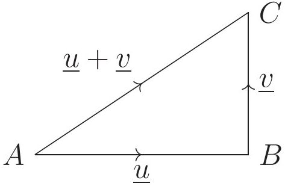

<!-- higher-math-9-10-bn-c12-t12.2-p007 · text · p.274 · review: verify-formula -->
**প্রমাণ:** মনে করি, যেকোনো বিন্দু থেকে অঙ্কিত <u>u</u> এবং <u>v</u> ভেক্টরদ্বয় $\overrightarrow{OA}$ এবং $\overrightarrow{OB}$ দ্বারা সূচিত হয়েছে। $OACB$ সামান্তরিক ও তার $OC$ কর্ণ অঙ্কন করি। তাহলে ঐ সামান্তরিকের $\overrightarrow{OC}$ কর্ণ দ্বারা <u>u</u> এবং <u>v</u> এর যোগফল সূচিত হবে। অর্থাৎ $\overrightarrow{OC} = <u>u</u> + <u>v</u>$।

<!-- higher-math-9-10-bn-c12-t12.2-p008 · text · p.274 · review: verify-formula -->
$OACB$ সামান্তরিকের $OB$ ও $AC$ সমান ও সমান্তরাল। $\therefore \overrightarrow{AC} = \overrightarrow{OB} = <u>v</u>$ [ভেক্টর স্থানান্তর]

<!-- higher-math-9-10-bn-c12-t12.2-p009 · text · p.274 · review: verify-formula -->
$\therefore$ ত্রিভুজবিধি কাজে লাগিয়ে $<u>u</u> + <u>v</u> = \overrightarrow{OA} + \overrightarrow{OB} = \overrightarrow{OA} + \overrightarrow{AC} = \overrightarrow{OC}$ [প্রমাণিত]

<!-- higher-math-9-10-bn-c12-t12.2-p010 · text · p.274 -->
**দ্রষ্টব্য:** ক) দুই বা ততোধিক ভেক্টরের যোগফলকে তাদের লক্ষ্যিও বলা হয়। বল বা বেগের লক্ষ্যি নির্ণয়ের ক্ষেত্রে ভেক্টর যোগের পদ্ধতি অনুসরণ করতে হয়। খ) দুটি ভেক্টর সমান্তরাল হলে তাদের যোগের ক্ষেত্রে সামান্তরিক বিধি প্রয়োজন্য নয়, কিন্তু ত্রিভুজবিধি সকল ক্ষেত্রে প্রয়োজন।

## 12.3 ভেক্টরের বিয়োগ

<!-- higher-math-9-10-bn-c12-t12.3-p001 · text · p.274 · review: verify-formula -->
<u>u</u> এবং <u>v</u> ভেক্টরদ্বয়ের বিয়োগফল <u>u</u> - <u>v</u> বলতে <u>u</u> এবং $-v$ (অর্থাৎ <u>v</u> এর বিপরীত ভেক্টর) ভেক্টরদ্বয়ের যোগফল <u>u</u> + ($-v$) বুঝায়।

<!-- higher-math-9-10-bn-c12-t12.3-p002 · figure · p.275 -->
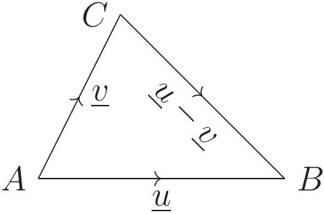

<!-- higher-math-9-10-bn-c12-t12.3-p003 · text · p.275 · review: verify-formula -->
ভেক্টর বিয়োগের ত্রিভুজবিধি: $<u>u</u>$ এবং $<u>v</u>$ এর আদিবিন্দু একই হলে $<u>u</u> - <u>v</u>$ সেই ভেক্টর, যার আদিবিন্দু হচ্ছে $<u>v</u>$ এর অন্তবিন্দু এবং যার অন্তবিন্দু হচ্ছে $<u>u</u>$ এর অন্তবিন্দু। সংক্ষেপে একই আদিবিন্দু বিশিষ্ট দুটি ভেক্টরের বিয়োগফল হচ্ছে অন্তবিন্দুদ্বয় দ্বারা বিপরীতক্রমে গঠিত ভেক্টর। সুতরাং $<u>u</u> = \overrightarrow{AB}$, $<u>v</u> = \overrightarrow{AC}$ হলে $<u>u</u> - <u>v</u> = \overrightarrow{CB}$, অর্থাৎ, $\overrightarrow{AB} - \overrightarrow{AC} = \overrightarrow{CB}$। নিচে আমরা এটা প্রমাণ করব।

<!-- higher-math-9-10-bn-c12-t12.3-p004 · figure · p.275 -->

<!-- higher-math-9-10-bn-c12-t12.3-p005 · text · p.275 · review: verify-formula -->
**প্রমাণ:** $CA$ রেখাংশকে এমনভাবে বর্ধিত করি যেন $AE = CA$ হয়। $AEFB$ সামান্তরিক গঠন করি। ভেক্টর যোগের সামান্তরিক বিধি অনুযায়ী, $\overrightarrow{AE} + \overrightarrow{AB} = \overrightarrow{AF}$।

<!-- higher-math-9-10-bn-c12-t12.3-p006 · text · p.275 · review: verify-formula -->
আবার $AFBC$ একটি সামান্তরিক, কেননা $BF = AE = CA$ এবং $BF \parallel AE$ বলে $BF \parallel CA$। $\therefore \overrightarrow{AF} = \overrightarrow{CB}$ (ভেক্টর স্থানান্তর), কিন্তু $\overrightarrow{AE} = -<u>v</u>$ এবং $\overrightarrow{AB} = <u>u</u>$।

<!-- higher-math-9-10-bn-c12-t12.3-p007 · text · p.275 · review: verify-formula -->
সুতরাং $<u>u</u> - <u>v</u> = \overrightarrow{CB}$ প্রমাণিত হলো।

## 12.4 শূন্য ভেক্টর

<!-- higher-math-9-10-bn-c12-t12.4-p001 · text · p.275 -->
যে ভেক্টরের মান শূন্য এবং যার দিক নির্ণয় করা যায় না তাকে শূন্য ভেক্টর বলে।

<!-- higher-math-9-10-bn-c12-t12.4-p002 · figure · p.275 -->
drawing: A line segment connecting points A and B, with a vector u pointing from A to B and a vector -u pointing from B to A.

<!-- higher-math-9-10-bn-c12-t12.4-p003 · text · p.275 · review: verify-formula -->
$<u>u</u>$ যেকোনো ভেক্টর হলে $<u>u</u> + (-<u>u</u>)$ কী হবে?

<!-- higher-math-9-10-bn-c12-t12.4-p004 · text · p.275 · review: verify-formula -->
ধরি, $<u>u</u> = \overrightarrow{AB}$ তখন $-<u>u</u> = \overrightarrow{BA}$,

<!-- higher-math-9-10-bn-c12-t12.4-p005 · text · p.275 · review: verify-formula -->
ফলে $<u>u</u> - <u>u</u> = \overrightarrow{AB} + \overrightarrow{BA} = \overrightarrow{AA}$ [ত্রিভুজবিধি অনুযায়ী]

<!-- higher-math-9-10-bn-c12-t12.4-p006 · text · p.275 · review: verify-formula -->
কিন্তু $\overrightarrow{AA}$ কী ধরনের ভেক্টর? এটি একটি বিন্দু ভেক্টর, অর্থাৎ এর আদিবিন্দু ও অন্তবিন্দু একই বিন্দু; সুতরাং দৈর্ঘ্য শূন্য। অর্থাৎ $\overrightarrow{AA}$ দ্বারা $A$ বিন্দুকেই বুঝতে হবে। দৈর্ঘ্য শূন্য এরূপ ভেক্টরকে শূন্য ভেক্টর বলা হয় এবং $<u>0</u>$ দ্বারা সূচিত করা হয়। এটি একমাত্র ভেক্টর যার কোনো নির্দিষ্ট দিক বা ধারক রেখা নেই।

<!-- higher-math-9-10-bn-c12-t12.4-p007 · text · p.276 · review: verify-formula -->
শূন্য ভেক্টরের অবতারণার ফলে আমরা বলতে পারি যে, $<u>u</u> + (-<u>u</u>) = <u>0</u>$ এবং $<u>u</u> + <u>0</u> = <u>0</u> + <u>u</u> = <u>u</u>$ বস্তুত শূন্য ভেক্টরের সঙ্গে শেখো অর্থাৎ নিহিত রয়েছে।

## 12.5 ভেক্টর যোগের বিধিসমূহ

<!-- higher-math-9-10-bn-c12-t12.5-p001 · text · p.276 -->
পাটিগণিতের যোগের মতোই ভেক্টরের যোগে বিনিময়, সংযোগ, ও বর্জন বিধি ব্যবহার করা যায়।

<!-- higher-math-9-10-bn-c12-t12.5-p002 · text · p.276 · review: verify-formula -->
**ভেক্টর যোগের বিনিময়বিধি (Commutative law):** যেকোনো $<u>u</u>$, $<u>v</u>$ ভেক্টরের জন্য $<u>u</u> + <u>v</u> = <u>v</u> + <u>u</u>$।

<!-- higher-math-9-10-bn-c12-t12.5-p003 · figure · p.276 -->
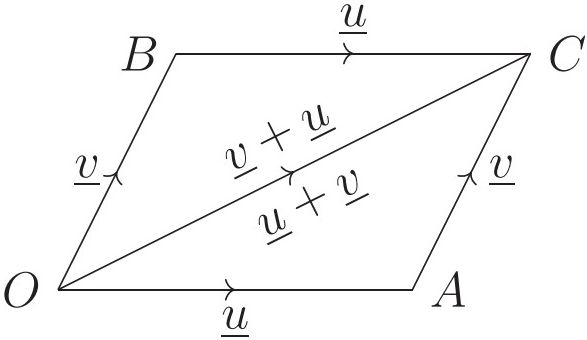

<!-- higher-math-9-10-bn-c12-t12.5-p004 · text · p.276 · review: verify-formula -->
**প্রমাণ:** মনে করি, $\overrightarrow{OA} = <u>u</u>$ এবং $\overrightarrow{OB} = <u>v</u>$। $OACB$ সামানত্রিক ও তার কর্ণ $OC$ অঙ্কন করি। $OA$ ও $BC$ সমান ও সমান্তরাল এবং $OB$ ও $AC$ সমান ও সমান্তরাল।

<!-- higher-math-9-10-bn-c12-t12.5-p005 · text · p.276 · review: verify-formula -->
$\therefore \overrightarrow{OC} = \overrightarrow{OA} + \overrightarrow{AC} = <u>u</u> + <u>v</u>$। আবার, $\overrightarrow{OC} = \overrightarrow{OB} + \overrightarrow{BC} = \overrightarrow{OB} + \overrightarrow{OA} = <u>v</u> + <u>u</u>$।

<!-- higher-math-9-10-bn-c12-t12.5-p006 · text · p.276 · review: verify-formula -->
$\therefore <u>u</u> + <u>v</u> = <u>v</u> + <u>u</u>$। সুতরাং ভেক্টর যোগ বিনিময়বিধি সিদ্ধ করে।

<!-- higher-math-9-10-bn-c12-t12.5-p007 · text · p.276 · review: verify-formula -->
**ভেক্টর যোগের সংযোগবিধি (Associative law):** যেকোনো $<u>u</u>$, $<u>v</u>$, $<u>w</u>$ ভেক্টরের জন্য

<!-- higher-math-9-10-bn-c12-t12.5-p008 · formula · p.276 · review: verify-formula -->
$$(<u>u</u> + <u>v</u>) + <u>w</u> = <u>u</u> + (<u>v</u> + <u>w</u>)$$

<!-- higher-math-9-10-bn-c12-t12.5-p009 · text · p.276 · review: verify-formula -->
**প্রমাণ:** মনে করি, $\overrightarrow{OA} = <u>u</u>$, $\overrightarrow{AB} = <u>v</u>$, $\overrightarrow{BC} = <u>w</u>$, অর্থাৎ $<u>u</u>$ এর প্রান্তবিন্দু থেকে $<u>v</u>$ এবং $<u>v</u>$ এর প্রান্তবিন্দু থেকে $<u>w</u>$ অঙ্কন করা হয়েছে। $O, C$; $O, B$ এবং $A, C$ যোগ করি।

<!-- higher-math-9-10-bn-c12-t12.5-p010 · figure · p.276 -->
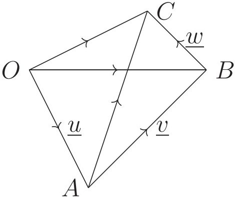

<!-- higher-math-9-10-bn-c12-t12.5-p011 · text · p.276 · review: verify-formula -->
তাহলে $(<u>u</u> + <u>v</u>) + <u>w</u> = (\overrightarrow{OA} + \overrightarrow{AB}) + \overrightarrow{BC} = \overrightarrow{OB} + \overrightarrow{BC} = \overrightarrow{OC}$

<!-- higher-math-9-10-bn-c12-t12.5-p012 · text · p.276 · review: verify-formula -->
আবার, $<u>u</u> + (<u>v</u> + <u>w</u>) = \overrightarrow{OA} + (\overrightarrow{AB} + \overrightarrow{BC}) = \overrightarrow{OA} + \overrightarrow{AC} = \overrightarrow{OC}$

<!-- higher-math-9-10-bn-c12-t12.5-p013 · text · p.276 · review: verify-formula -->
$\therefore (<u>u</u> + <u>v</u>) + <u>w</u> = <u>u</u> + (<u>v</u> + <u>w</u>)$। সুতরাং ভেক্টর যোগ সংযোগবিধি সিদ্ধ করে।

<!-- higher-math-9-10-bn-c12-t12.5-p014 · text · p.277 · review: verify-formula -->
অনুসিদ্ধান্ত ১. কোনো ত্রিভুজের তিনটি বাহুর একই ক্রম দ্বারা সূচিত ভেক্টরগুলির যোগফল শূন্য ভেক্টর। উপরের চিত্রে, $\overrightarrow{OB} + \overrightarrow{BA} + \overrightarrow{AO} = \overrightarrow{OA} + \overrightarrow{AO} = -\overrightarrow{AO} + \overrightarrow{AO} = <u>0</u>$।

<!-- higher-math-9-10-bn-c12-t12.5-p015 · text · p.277 · review: verify-formula -->
ভেক্টর যোগের বর্জনবিধি (Cancellation law): যেকোনো $<u>u</u>, <u>v</u>, <u>w</u>$ ভেক্টরের জন্য $<u>u</u> + <u>v</u> = <u>u</u> + <u>w</u>$ হলে $<u>v</u> = <u>w</u>$ হবে।

<!-- higher-math-9-10-bn-c12-t12.5-p016 · figure · p.277 -->
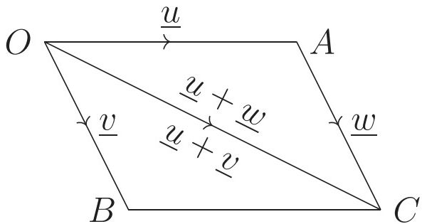

<!-- higher-math-9-10-bn-c12-t12.5-p017 · text · p.277 · review: verify-formula -->
**প্রমাণ:** যেহেতু $<u>u</u> + <u>v</u> = <u>u</u> + <u>w</u>$

<!-- higher-math-9-10-bn-c12-t12.5-p018 · text · p.277 · review: verify-formula -->
$\therefore <u>u</u> + <u>v</u> + (-<u>u</u>) = <u>u</u> + <u>w</u> + (-<u>u</u>)$ [উভয়পক্ষে $-<u>u</u>$ যোগ করে]

<!-- higher-math-9-10-bn-c12-t12.5-p019 · text · p.277 · review: verify-formula -->
বা, $<u>u</u> - <u>u</u> + <u>v</u> = <u>u</u> - <u>u</u> + <u>w</u>$ অর্থাৎ $<u>v</u> = <u>w</u>$

## 12.6 ভেক্টরের সংখ্যা গুণিতক বা স্কেলার গুণিতক (Scalar multiple of a vector)

<!-- higher-math-9-10-bn-c12-t12.6-p001 · text · p.277 · review: verify-formula -->
$<u>u</u>$ যেকোনো ভেক্টর এবং $m$ যেকোনো বাস্তব সংখ্যা হলে $m<u>u</u>$ দ্বারা কোন ভেক্টর বুঝায়, নিচে তা ব্যাখ্যা করা হলো।

<!-- higher-math-9-10-bn-c12-t12.6-p002 · text · p.277 · review: verify-formula -->
১. $m = 0$ হলে, $m<u>u</u> = <u>0</u>$ বা শূন্য ভেক্টর

<!-- higher-math-9-10-bn-c12-t12.6-p003 · text · p.277 · review: verify-formula -->
২. $m \neq 0$ হলে, $m<u>u</u>$ এর দৈর্ঘ্য $<u>u</u>$ এর দৈর্ঘ্যের $|m|$ গুণ হবে, $m<u>u</u>$ এর ধারক $<u>u</u>$ এর ধারকের সাথে অভিন্ন হবে, এবং

<!-- higher-math-9-10-bn-c12-t12.6-p004 · text · p.277 · review: verify-formula -->
ক) $m > 0$ হলে $m<u>u</u>$ এর দিক $<u>u</u>$ এর দিকের সঙ্গে একমুখী হবে

<!-- higher-math-9-10-bn-c12-t12.6-p005 · text · p.277 · review: verify-formula -->
খ) $m < 0$ হলে, $m<u>u</u>$ এর দিক $<u>u</u>$ এর দিকের বিপরীত হবে।

<!-- higher-math-9-10-bn-c12-t12.6-p006 · text · p.277 · review: verify-formula -->
**দৃষ্টব্য:** ক) $m = 0$ অথবা $<u>u</u> = <u>0</u>$ হলে $m<u>u</u> = <u>0</u>$ খ) $1<u>u</u> = <u>u</u>, (-1)<u>u</u> = -<u>u</u>$

<!-- higher-math-9-10-bn-c12-t12.6-p007 · text · p.277 · review: verify-formula -->
উপরোক্ত সংজ্ঞা হতে দেখা যায়, $m(n<u>u</u>) = n(m<u>u</u>) = (mn)(<u>u</u>)$

<!-- higher-math-9-10-bn-c12-t12.6-p008 · text · p.277 · review: known-confusable-corrected,verify-formula -->
$m, n$ উভয়ে $> 0$, উভয়ে $< 0$, একটি $> 0$ এবং অপরটি $< 0$, একটি বা উভয় $0$, এ সকল ক্ষেত্রেও পৃথক পৃথকভাবে বিবেচনা করে সহজেই সূত্রটির বাস্তবতা সম্পর্কে নিশ্চিত হওয়া যায়। নিচে এর একটি উদাহরণ দেওয়া হলো:

<!-- higher-math-9-10-bn-c12-t12.6-p009 · figure · p.277 -->
drawing: vector addition diagram on a line

<!-- higher-math-9-10-bn-c12-t12.6-p010 · text · p.277 · review: verify-formula -->
মনে করি, $\overrightarrow{AB} = \overrightarrow{BC} = <u>u</u>$

<!-- higher-math-9-10-bn-c12-t12.6-p011 · text · p.277 · review: verify-formula -->
$AC$ কে $G$ পর্যন্ত এরূপে বর্ধিত করি যেন $CD = DE = EF = FG = AB$ হয়।

<!-- higher-math-9-10-bn-c12-t12.6-p012 · text · p.277 · review: verify-formula -->
তখন $\overrightarrow{AG} = \overrightarrow{AB} + \overrightarrow{BC} + \overrightarrow{CD} + \overrightarrow{DE} + \overrightarrow{EF} + \overrightarrow{FG} = <u>u</u> + <u>u</u> + <u>u</u> + <u>u</u> + <u>u</u> + <u>u</u> = 6<u>u</u>$ অন্যদিকে $\overrightarrow{AG} = \overrightarrow{AC} + \overrightarrow{CE} + \overrightarrow{EG} = 2<u>u</u> + 2<u>u</u> + 2<u>u</u> = 3(2<u>u</u>)$

<!-- higher-math-9-10-bn-c12-t12.6-p013 · text · p.278 · review: verify-formula -->
এবং $\overrightarrow{AG} = \overrightarrow{AD} + \overrightarrow{DG} = 3<u>u</u> + 3<u>u</u> = 2(3<u>u</u>)$

<!-- higher-math-9-10-bn-c12-t12.6-p014 · formula · p.278 · review: verify-formula -->
$\therefore 2(3<u>u</u>) = 3(2<u>u</u>) = 2 \times 3(<u>u</u>)$

<!-- higher-math-9-10-bn-c12-t12.6-p015 · text · p.278 -->
**দ্রষ্টব্য:** দুটি ভেক্টরের ধারক রেখা অভিন্ন বা সমান্তরাল হলে, এদের একটিকে অপরের সংখ্যা গুণিতক আকারে প্রকাশ করা যায়।

<!-- higher-math-9-10-bn-c12-t12.6-p016 · text · p.278 · review: verify-formula -->
বাস্তবে $AB \parallel CD$ হলে, $\overrightarrow{AB} = m\overrightarrow{CD}$ যেখানে, $|m| = \frac{|\overrightarrow{AB}|}{|\overrightarrow{CD}|} = \frac{AB}{CD}$

<!-- higher-math-9-10-bn-c12-t12.6-p017 · text · p.278 · review: verify-formula -->
ক) $m > 0$ হলে $\overrightarrow{AB}$ ও $\overrightarrow{CD}$ সমমুখী হয়,

<!-- higher-math-9-10-bn-c12-t12.6-p018 · text · p.278 · review: verify-formula -->
খ) $m < 0$ হলে $\overrightarrow{AB}$ ও $\overrightarrow{CD}$ বিপরীতমুখী হয়।

## 12.7 ভেক্টরের সাংখ্যগুণিতক সংক্রান্ত বর্গটন সূত্র

<!-- higher-math-9-10-bn-c12-t12.7-p001 · text · p.278 · review: verify-formula -->
$m, n$ দুটি স্কেলার এবং $<u>u</u>, <u>v</u>$ দুটি ভেক্টর হলে,

<!-- higher-math-9-10-bn-c12-t12.7-p002 · text · p.278 · review: verify-formula -->
১. $(m + n)<u>u</u> = m<u>u</u> + n<u>u</u>$

<!-- higher-math-9-10-bn-c12-t12.7-p003 · text · p.278 · review: verify-formula -->
২. $m(<u>u</u> + <u>v</u>) = m<u>u</u> + m<u>v</u>$

<!-- higher-math-9-10-bn-c12-t12.7-p004 · text · p.278 · review: verify-formula -->
**সূত্র ১.** $(m + n)<u>u</u> = m<u>u</u> + n<u>u</u>$

<!-- higher-math-9-10-bn-c12-t12.7-p005 · figure · p.278 -->
drawing: vector addition diagram showing points A, B, and C on a line with vectors u, mu, and nu

<!-- higher-math-9-10-bn-c12-t12.7-p006 · text · p.278 · review: verify-formula -->
**প্রমাণ:** $m$ বা $n$ শূন্য হলে সূত্রটি অবশ্যই খাটে।

<!-- higher-math-9-10-bn-c12-t12.7-p007 · text · p.278 · review: verify-formula -->
মনে করি, $m, n$ উভয়ে ধনাত্মক এবং $\overrightarrow{AB} = m<u>u</u> \quad \therefore |\overrightarrow{AB}| = m|<u>u</u>|$

<!-- higher-math-9-10-bn-c12-t12.7-p008 · text · p.278 · review: verify-formula -->
$AB$ কে $C$ পর্যন্ত বর্ধিত করি যেন $|\overrightarrow{BC}| = n|<u>u</u>|$ হয় $\quad \therefore \overrightarrow{BC} = n<u>u</u>$

<!-- higher-math-9-10-bn-c12-t12.7-p009 · formula · p.278 · review: verify-formula -->
$|\overrightarrow{AC}| = |\overrightarrow{AB}| + |\overrightarrow{BC}| = m|<u>u</u>| + n|<u>u</u>| = (m + n)|<u>u</u>| \quad \therefore \overrightarrow{AC} = (m + n)<u>u</u>$

<!-- higher-math-9-10-bn-c12-t12.7-p010 · text · p.278 · review: verify-formula -->
কিন্তু $\overrightarrow{AC} = \overrightarrow{AB} + \overrightarrow{BC} \quad \therefore m<u>u</u> + n<u>u</u> = (m + n)<u>u</u>$

<!-- higher-math-9-10-bn-c12-t12.7-p011 · text · p.278 · review: verify-formula -->
$m, n$ উভয়ে ঋণাত্মক হলে $(m + n)<u>u</u>$ এর দৈর্ঘ্য হবে $|(m + n)||<u>u</u>|$ এবং দিক হবে $<u>u</u>$ এর দিকের বিপরীত দিক। তখন $m<u>u</u> + n<u>u</u>$ ভেক্টরটির দৈর্ঘ্য হবে $|m||<u>u</u>| + |n||<u>u</u>| = (|m| + |n|)|<u>u</u>|$ এবং দিক হবে $<u>u</u>$ এর বিপরীত দিক। কিন্তু $m < 0$ এবং $n < 0$ হলে $|m| + |n| = |m + n|$ হয়, সেহেতু এক্ষেত্রে $(m + n)<u>u</u> = m<u>u</u> + n<u>u</u>$ পাওয়া গেল।

<!-- higher-math-9-10-bn-c12-t12.7-p012 · text · p.278 · review: verify-formula -->
সর্বশেষ $m$ এবং $n$ এর মধ্যে একটি $> 0$ এবং অপরটি $< 0$ হলে $(m + n)<u>u</u>$ এর দৈর্ঘ্য হবে $||m| - |n||<u>u</u>|$ এবং দিক হবে $<u>u</u>$ এর দিকের সাথে একমুখী যখন $|m| > |n|$ এবং $<u>u</u>$ এর বিপরীত দিক যখন $|m| < |n|$। তখন $m<u>u</u> + n<u>u</u>$ ভেক্টরটিও দৈর্ঘ্য ও দিকে $(m + n)<u>u</u>$ এর সাথে একমুখী হবে।

<!-- higher-math-9-10-bn-c12-t12.7-p013 · text · p.279 · review: verify-formula -->
**দ্রষ্টব্য:** তিনটি বিন্দু $A, B, C$ সমরেখ হবে যদি এবং কেবল যদি $\overrightarrow{AC}, \overrightarrow{AB}$ এর সংখ্যা গুণিতক হয়।

<!-- higher-math-9-10-bn-c12-t12.7-p014 · text · p.279 -->
**মন্তব্য:** ক) দুটি ভেক্টরের ধারক রেখা অভিন্ন অথবা সমান্তরাল হলে এবং তাদের দিক একই হলে, তাদের সদৃশ (similar) ভেক্টর বলা হয়। খ) যে ভেক্টরের দৈর্ঘ্য ১ একক, তাকে (দিক নির্দেশক) একক ভেক্টর বলে।

## 12.8 সূত্র ২. $m(<u>u</u> + <u>v</u>) = m<u>u</u> + m<u>v</u>$

<!-- higher-math-9-10-bn-c12-t12.8-p001 · figure · p.279 -->
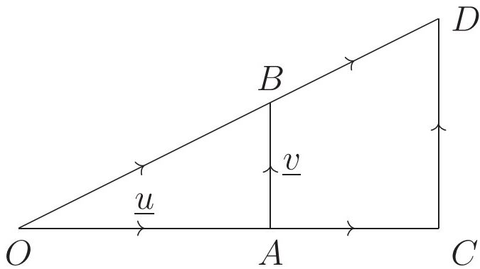

<!-- higher-math-9-10-bn-c12-t12.8-p002 · text · p.279 · review: verify-formula -->
**প্রমাণ:** মনে করি, $\overrightarrow{OA} = <u>u</u>, \overrightarrow{AB} = <u>v</u>$। তাহলে $\overrightarrow{OB} = \overrightarrow{OA} + \overrightarrow{AB} = <u>u</u> + <u>v</u>$

<!-- higher-math-9-10-bn-c12-t12.8-p003 · text · p.279 · review: verify-formula -->
$OA$ কে $C$ পর্যন্ত বর্ধিত করি যেন $OC = m \cdot OA$ হয়। উপরের বামের চিত্রে $m$ ধনাত্মক ও ডানের চিত্রে $m$ ঋণাত্মক। $C$ বিন্দু দিয়ে অঙ্কিত $AB$ এর সমান্তরাল $CD$ রেখা $OB$ এর বর্ধিতাংশকে $D$ বিন্দুতে ছেদ করে। যেহেতু $OAB$ এবং $OCD$ ত্রিভুজদ্বয় সদৃশ,

<!-- higher-math-9-10-bn-c12-t12.8-p004 · text · p.279 · review: verify-formula -->
সেহেতু $\frac{|\overrightarrow{OC}|}{|\overrightarrow{OA}|} = \frac{|\overrightarrow{CD}|}{|\overrightarrow{AB}|} = \frac{|\overrightarrow{OD}|}{|\overrightarrow{OB}|} = m$

<!-- higher-math-9-10-bn-c12-t12.8-p005 · formula · p.279 · review: verify-formula -->
$\therefore OC = m \cdot OA, CD = m \cdot AB, OD = m \cdot OB$

<!-- higher-math-9-10-bn-c12-t12.8-p006 · formula · p.279 · review: verify-formula -->
$\therefore \overrightarrow{CD} = m\overrightarrow{AB} = m<u>v</u>$

<!-- higher-math-9-10-bn-c12-t12.8-p007 · text · p.279 · review: verify-formula -->
এখানে, $\overrightarrow{OC} + \overrightarrow{CD} = \overrightarrow{OD}$

<!-- higher-math-9-10-bn-c12-t12.8-p008 · text · p.279 · review: verify-formula -->
বা, $m(\overrightarrow{OA}) + m(\overrightarrow{AB}) = m(\overrightarrow{OB})$

<!-- higher-math-9-10-bn-c12-t12.8-p009 · formula · p.279 · review: verify-formula -->
$\therefore m<u>u</u> + m<u>v</u> = m(<u>u</u> + <u>v</u>)$

<!-- higher-math-9-10-bn-c12-t12.8-p010 · text · p.279 · review: verify-formula -->
**দ্রষ্টব্য:** $m$ এর সকল মানের জন্য উপরোক্ত সূত্র সত্য।

<!-- higher-math-9-10-bn-c12-t12.8-p011 · text · p.279 -->
ব্যবহারের সুবিধার্থে ভেক্টর সম্পর্কিত নিয়মগুলো নিচে একত্রে লেখা হলো:

<!-- higher-math-9-10-bn-c12-t12.8-p012 · text · p.279 · review: verify-formula -->
১. $<u>u</u> + <u>v</u> = <u>v</u> + <u>u</u>$

<!-- higher-math-9-10-bn-c12-t12.8-p013 · text · p.279 · review: verify-formula -->
২. $(<u>u</u> + <u>v</u>) + <u>w</u> = <u>u</u> + (<u>v</u> + <u>w</u>)$

<!-- higher-math-9-10-bn-c12-t12.8-p014 · text · p.279 · review: verify-formula -->
৩. $<u>u</u> + <u>0</u> = <u>0</u> + <u>u</u> = <u>u</u>$

<!-- higher-math-9-10-bn-c12-t12.8-p015 · text · p.279 · review: verify-formula -->
৪. $<u>u</u> + (-<u>u</u>) = (-<u>u</u>) + <u>u</u> = <u>0</u>$

<!-- higher-math-9-10-bn-c12-t12.8-p016 · text · p.279 · review: verify-formula -->
৫. $<u>u</u> + <u>v</u> = <u>u</u> + <u>w</u>$ হলে $<u>v</u> = <u>w</u>$

<!-- higher-math-9-10-bn-c12-t12.8-p017 · text · p.280 · review: verify-formula -->
৬. $m(<u>nu</u>) = n(<u>mu</u>) = (<u>mn</u>)(<u>u</u>)$

<!-- higher-math-9-10-bn-c12-t12.8-p018 · text · p.280 · review: verify-formula -->
৭. $0<u>u</u> = <u>0</u>$

<!-- higher-math-9-10-bn-c12-t12.8-p019 · text · p.280 · review: verify-formula -->
৮. $1<u>u</u> = <u>u</u>$

<!-- higher-math-9-10-bn-c12-t12.8-p020 · text · p.280 · review: verify-formula -->
৯. $(-1)<u>u</u> = -<u>u</u>$

<!-- higher-math-9-10-bn-c12-t12.8-p021 · text · p.280 · review: verify-formula -->
১০. $(m + n)<u>u</u> = <u>mu</u> + <u>nu</u>$

<!-- higher-math-9-10-bn-c12-t12.8-p022 · text · p.280 · review: verify-formula -->
**কাজ:** $m$ ও $n$ এর বিভিন্ন প্রকার সাংখ্যিক মান নিয়ে $<u>u</u>$ ভেক্টরের জন্য $(m + n)<u>u</u> = <u>mu</u> + <u>nu</u>$ সূত্রটি যাচাই করো।

## 12.9 অবস্থান ভেক্টর

<!-- higher-math-9-10-bn-c12-t12.9-p001 · text · p.280 · review: verify-formula -->
সমতলস্থ কোনো নির্দিষ্ট বিন্দু $O$ সাপেক্ষে ঐ সমতলের যেকোনো $P$ বিন্দুর অবস্থান $\overrightarrow{OP}$ দ্বারা নির্দেশ করা যায়। $\overrightarrow{OP}$ কে $O$ বিন্দু সাপেক্ষে $P$ বিন্দুর অবস্থান ভেক্টর বলা হয় এবং $O$ বিন্দুকে ভেক্টর মূলবিন্দু (origin) বলা হয়।

<!-- higher-math-9-10-bn-c12-t12.9-p002 · figure · p.280 -->
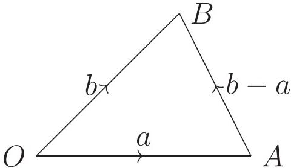

<!-- higher-math-9-10-bn-c12-t12.9-p003 · text · p.280 · review: verify-formula -->
মনে করি, কোনো সমতলে $O$ একটি নির্দিষ্ট বিন্দু এবং একই সমতলে $A$ অপর একটি বিন্দু। $O, A$ যোগ করলে উৎপন্ন $\overrightarrow{OA}$ ভেক্টর $O$ বিন্দুর প্রতিপক্ষিতে $A$ বিন্দুর অবস্থান ভেক্টর বলা হয়। অনুরূপভাবে, একই $O$ বিন্দুর প্রেক্ষিতে একই সমতলে অপর $B$ বিন্দুর অবস্থান ভেক্টর $\overrightarrow{OB}$।

<!-- higher-math-9-10-bn-c12-t12.9-p004 · figure · p.280 -->
drawing: triangle OAB with vectors a, b, and b-a

<!-- higher-math-9-10-bn-c12-t12.9-p005 · text · p.280 · review: verify-formula -->
$A, B$ যোগ করি। মনে করি, $\overrightarrow{OA} = <u>a</u>, \overrightarrow{OB} = <u>b</u>$
তাহলে $\overrightarrow{OA} + \overrightarrow{AB} = \overrightarrow{OB}$ অর্থাৎ $<u>a</u> + \overrightarrow{AB} = <u>b</u>$
$\therefore \overrightarrow{AB} = <u>b</u> - <u>a</u>$

<!-- higher-math-9-10-bn-c12-t12.9-p006 · text · p.280 -->
সুতরাং, দুটি বিন্দুর অবস্থান ভেক্টর জানা থাকলে তাদের সংযোজক রেখাংশ দ্বারা সূচিত ভেক্টর ঐ ভেক্টরদ্বয়ের প্রান্তবিন্দুর অবস্থান ভেক্টর বিয়োগ করে পাওয়া যাবে।

<!-- higher-math-9-10-bn-c12-t12.9-p007 · text · p.280 -->
**দ্রষ্টব্য:** মূলবিন্দু ভিন্ন ভিন্ন অবস্থানে থাকলে একই বিন্দুর অবস্থান ভেক্টর ভিন্ন ভিন্ন হতে পারে। কোনো নির্দিষ্ট প্রতিপাদ্য বিষয়ের সমাধানে এ বিষয়ের বিবেচনায়ীন সকল বিন্দুর অবস্থান ভেক্টর একই মূলবিন্দুর সাপেক্ষে ধরা হয়।

<!-- higher-math-9-10-bn-c12-t12.9-p008 · text · p.281 · review: verify-formula -->
**কাজ:** তোমার খাতায় একটি বিন্দুকে মূলবিন্দু $O$ ধরে বিভিন্ন অবস্থানে আরও পাঁচটি বিন্দু নিয়ে $O$ বিন্দুর সাপেক্ষে এগুলোর অবস্থান ভেক্টর চিহ্নিত করো।

## 12.10 কতিপয় উদাহরণ

<!-- higher-math-9-10-bn-c12-t12.10-p001 · text · p.281 -->
**উদাহরণ ১.** দেখাও যে,

<!-- higher-math-9-10-bn-c12-t12.10-p002 · text · p.281 · review: verify-formula -->
ক) $-(-<u>a</u>) = <u>a</u>$

<!-- higher-math-9-10-bn-c12-t12.10-p003 · text · p.281 · review: verify-formula -->
খ) $-m(<u>a</u>) = m(-<u>a</u>) = -(m<u>a</u>)$ যেখানে $m$ একটি স্কেলার।

<!-- higher-math-9-10-bn-c12-t12.10-p004 · text · p.281 · review: verify-formula -->
গ) $\frac{1}{|<u>a</u>|}<u>a</u>$ একটি একক ভেক্টর যার দিক ও $<u>a</u>$ এর দিক একই

### সমাধান:

<!-- higher-math-9-10-bn-c12-t12.10-p005 · text · p.281 · review: verify-formula -->
ক) বিপরীত ভেক্টরের ধর্ম অনুযায়ী $<u>a</u> + (-<u>a</u>) = <u>0</u>$

<!-- higher-math-9-10-bn-c12-t12.10-p006 · text · p.281 · review: verify-formula -->
আবার $(-<u>a</u>) + (-(-<u>a</u>)) = <u>0</u>$

<!-- higher-math-9-10-bn-c12-t12.10-p007 · formula · p.281 · review: verify-formula -->
$\therefore (-<u>a</u>) + (-(-<u>a</u>)) = <u>a</u> + (-<u>a</u>)$

<!-- higher-math-9-10-bn-c12-t12.10-p008 · text · p.281 · review: verify-formula -->
$\therefore (-(-<u>a</u>)) = <u>a</u>$ [ভেক্টর যোগের বর্জনবিধি]

<!-- higher-math-9-10-bn-c12-t12.10-p009 · text · p.281 · review: verify-formula -->
খ) $m<u>a</u> + (-m)<u>a</u> = [m + (-m)]<u>a</u> = 0<u>a</u> = <u>0</u>$

<!-- higher-math-9-10-bn-c12-t12.10-p010 · formula · p.281 · review: verify-formula -->
$\therefore (-m)<u>a</u> = -m<u>a</u> \dots \dots \dots (1)$

<!-- higher-math-9-10-bn-c12-t12.10-p011 · text · p.281 · review: verify-formula -->
আবার $m<u>a</u> + m(-<u>a</u>) = m[<u>a</u> + (-<u>a</u>)] = m<u>0</u> = <u>0</u>$

<!-- higher-math-9-10-bn-c12-t12.10-p012 · formula · p.281 · review: verify-formula -->
$\therefore m(-<u>a</u>) = -m<u>a</u> \dots \dots \dots (2)$

<!-- higher-math-9-10-bn-c12-t12.10-p013 · text · p.281 · review: verify-formula -->
(1) এবং (2) থেকে $(-m)<u>a</u> = m(-<u>a</u>) = -m<u>a</u>$

<!-- higher-math-9-10-bn-c12-t12.10-p014 · text · p.281 · review: verify-formula -->
গ) $<u>a</u> \neq <u>0</u>$ হওয়ায় $|<u>a</u>| \neq 0$

<!-- higher-math-9-10-bn-c12-t12.10-p015 · text · p.281 · review: verify-formula -->
মনে করি, $\widehat{a} = \frac{1}{|<u>a</u>|}<u>a</u>$

<!-- higher-math-9-10-bn-c12-t12.10-p016 · text · p.281 · review: verify-formula -->
তাহলে $|\widehat{a}| = \frac{1}{|<u>a</u>|}|<u>a</u>| = 1$ এবং $\widehat{a}$ এর দিক ও $<u>a</u>$ এর দিক একই। সুতরাং $\widehat{a}$ একটি একক ভেক্টর যার দিক $<u>a</u>$ মূখী।

<!-- higher-math-9-10-bn-c12-t12.10-p017 · text · p.281 · review: verify-formula -->
**উদাহরণ ২.** $ABCD$ একটি সামান্তরিক যার কর্ণদ্বয় $AC$ ও $BD$।

<!-- higher-math-9-10-bn-c12-t12.10-p018 · text · p.281 · review: verify-formula -->
ক) $\overrightarrow{AC}$ এবং $\overrightarrow{BD}$ ভেক্টরদ্বয়কে $\overrightarrow{AB}$ এবং $\overrightarrow{AD}$ ভেক্টরদ্বয়ের মাধ্যমে প্রকাশ করো।

<!-- higher-math-9-10-bn-c12-t12.10-p019 · text · p.281 · review: verify-formula -->
খ) $\overrightarrow{AB}$ এবং $\overrightarrow{AD}$ ভেক্টরদ্বয়কে $\overrightarrow{AC}$ এবং $\overrightarrow{BD}$ ভেক্টরদ্বয়ের মাধ্যমে প্রকাশ করো।

<!-- higher-math-9-10-bn-c12-t12.10-p020 · figure · p.282 -->
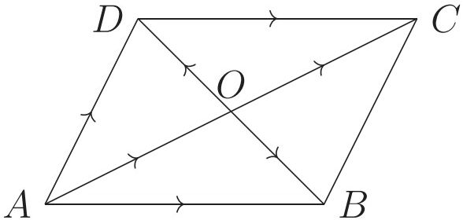

<!-- higher-math-9-10-bn-c12-t12.10-p021 · text · p.282 · review: verify-formula -->
ক) $\overrightarrow{AC} = \overrightarrow{AD} + \overrightarrow{DC} = \overrightarrow{AD} + \overrightarrow{AB}$
আবার, $\overrightarrow{AB} + \overrightarrow{BD} = \overrightarrow{AD}$ বা, $\overrightarrow{BD} = \overrightarrow{AD} - \overrightarrow{AB}$

<!-- higher-math-9-10-bn-c12-t12.10-p022 · text · p.282 · review: verify-formula -->
খ) যেহেতু সমান্তরিকের কর্ণদ্বয় পরস্পর সমদ্বিখণ্ডিত হয়,
$\overrightarrow{AB} = \overrightarrow{AO} + \overrightarrow{OB} = \frac{1}{2}\overrightarrow{AC} + \frac{1}{2}\overrightarrow{DB} = \frac{1}{2}\overrightarrow{AC} - \frac{1}{2}\overrightarrow{BD}$
এবং $\overrightarrow{AD} = \overrightarrow{AO} + \overrightarrow{OD} = \frac{1}{2}\overrightarrow{AC} + \frac{1}{2}\overrightarrow{BD}$

<!-- higher-math-9-10-bn-c12-t12.10-p023 · text · p.282 -->
**উদাহরণ ৩.** ভেক্টরের সাহায্যে প্রমাণ করো যে, ত্রিভুজের যেকোনো দুই বাহুর মধ্যবিন্দুদ্বয়ের সংযোজক রেখাংশ ঐ ত্রিভুজের তৃতীয় বাহুর সমান্তরাল ও তার অর্ধেক।

<!-- higher-math-9-10-bn-c12-t12.10-p024 · text · p.282 · review: verify-formula -->
**সমাধান:** মনে করি, $ABC$ ত্রিভুজের $AB$ ও $AC$ বাহুদ্বয়ের মধ্যবিন্দু যথাক্রমে $D$ ও $E$। $D$ ও $E$ যোগ করি। প্রমাণ করতে হবে যে, $DE \parallel BC$ এবং $DE = \frac{1}{2}BC$।

<!-- higher-math-9-10-bn-c12-t12.10-p025 · figure · p.282 -->
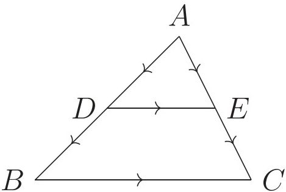

<!-- higher-math-9-10-bn-c12-t12.10-p026 · text · p.282 · review: verify-formula -->
ভেক্টর বিয়োগের ত্রিভুজবিধি অনুসারে, $\overrightarrow{AE} - \overrightarrow{AD} = \overrightarrow{DE}$ (1)
এবং $\overrightarrow{AC} - \overrightarrow{AB} = \overrightarrow{BC}$
কিন্তু $\overrightarrow{AC} = 2\overrightarrow{AE}$, $\overrightarrow{AB} = 2\overrightarrow{AD}$ [$\because D, E$ বিন্দু যথাক্রমে $AB$ ও $AC$ এর মধ্যবিন্দু]
$\therefore \overrightarrow{AC} - \overrightarrow{AB} = \overrightarrow{BC}$ থেকে পাই
$2\overrightarrow{AE} - 2\overrightarrow{AD} = \overrightarrow{BC}$, অর্থাৎ $2(\overrightarrow{AE} - \overrightarrow{AD}) = \overrightarrow{BC}$
$\therefore 2\overrightarrow{DE} = \overrightarrow{BC}$ [(1) হতে]
$\therefore \overrightarrow{DE} = \frac{1}{2}\overrightarrow{BC}$
এবং $|\overrightarrow{DE}| = \frac{1}{2}|\overrightarrow{BC}|$ বা $DE = \frac{1}{2}BC$ সুতরাং $\overrightarrow{DE}$ ও $\overrightarrow{BC}$ ভেক্টরদ্বয়ের ধারক রেখা একই বা সমান্তরাল। কিন্তু এখানে ধারক রেখা এক নয়। সুতরাং $\overrightarrow{DE}$ ও $\overrightarrow{BC}$ ভেক্টরদ্বয়ের ধারক রেখাদ্বয় অর্থাৎ $DE$ এবং $BC$ সমান্তরাল।

<!-- higher-math-9-10-bn-c12-t12.10-p027 · text · p.283 -->
**উদাহরণ ৪.** ভেক্টর পদ্ধতিতে প্রমাণ করো যে, সামান্তরিকের কর্ণদ্বয় পরস্পরকে সমদ্বিখণ্ডিত করে।

<!-- higher-math-9-10-bn-c12-t12.10-p028 · text · p.283 · review: verify-formula -->
**সমাধান:** মনে করি, $ABCD$ সামান্তরিকের কর্ণদ্বয় $AC$ ও $BD$ পরস্পর $O$ বিন্দুতে ছেদ করেছে।

<!-- higher-math-9-10-bn-c12-t12.10-p029 · figure · p.283 -->
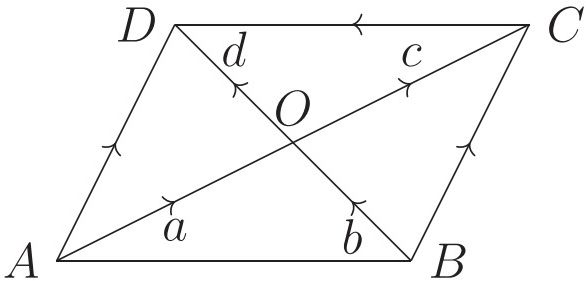

<!-- higher-math-9-10-bn-c12-t12.10-p030 · text · p.283 · review: verify-formula -->
মনে করি, $\overrightarrow{AO} = <u>a</u>$, $\overrightarrow{BO} = <u>b</u>$, $\overrightarrow{OC} = <u>c</u>$, $\overrightarrow{OD} = <u>d</u>$

<!-- higher-math-9-10-bn-c12-t12.10-p031 · text · p.283 · review: verify-formula -->
প্রমাণ করতে হবে যে, $|<u>a</u>| = |<u>c</u>|$, $|<u>b</u>| = |<u>d</u>|$

<!-- higher-math-9-10-bn-c12-t12.10-p032 · text · p.283 · review: verify-formula -->
$\overrightarrow{AO} + \overrightarrow{OD} = \overrightarrow{AD}$ এবং $\overrightarrow{BO} + \overrightarrow{OC} = \overrightarrow{BC}$

<!-- higher-math-9-10-bn-c12-t12.10-p033 · text · p.283 · review: verify-formula -->
যেহেতু সামান্তরিকের বিপরীত বাহুদ্বয় পরস্পর সমান ও সমান্তরাল, $\overrightarrow{AD} = \overrightarrow{BC}$

<!-- higher-math-9-10-bn-c12-t12.10-p034 · text · p.283 · review: verify-formula -->
অর্থাৎ $\overrightarrow{AO} + \overrightarrow{OD} = \overrightarrow{BO} + \overrightarrow{OC}$

<!-- higher-math-9-10-bn-c12-t12.10-p035 · text · p.283 · review: verify-formula -->
বা, $<u>a</u> + <u>d</u> = <u>b</u> + <u>c</u>$

<!-- higher-math-9-10-bn-c12-t12.10-p036 · text · p.283 · review: verify-formula -->
বা, $<u>a</u> - <u>c</u> = <u>b</u> - <u>d</u>$ [উভয় পক্ষে $-c - d$ যোগ করে]

<!-- higher-math-9-10-bn-c12-t12.10-p037 · text · p.283 · review: verify-formula -->
এখানে $<u>a</u>$ ও $<u>c</u>$ এর ধারক $AC$, $\therefore <u>a</u> - <u>c</u>$ এর ধারক $AC$।

<!-- higher-math-9-10-bn-c12-t12.10-p038 · text · p.283 · review: verify-formula -->
$<u>b</u>$ ও $<u>d</u>$ এর ধারক $BD$, $\therefore <u>b</u> - <u>d</u>$ এর ধারক $BD$।

<!-- higher-math-9-10-bn-c12-t12.10-p039 · text · p.283 · review: verify-formula -->
$<u>a</u> - <u>c</u>$ ও $<u>b</u> - <u>d</u>$ দুটি সমান অশূন্য ভেক্টর হলে তাদের ধারক রেখা একই অথবা সমান্তরাল হবে। কিন্তু $AC, BD$ দুইটি পরস্পরচ্ছেদী অসমান্তরাল সরলরেখা। সুতরাং $<u>a</u> - <u>c</u>$ ও $<u>b</u> - <u>d</u>$ ভেক্টরদ্বয় অশূন্য হতে পারে না বিধায় এদের মান শূন্য হবে।

<!-- higher-math-9-10-bn-c12-t12.10-p040 · text · p.283 · review: verify-formula -->
$\therefore <u>a</u> - <u>c</u> = <u>0</u>$ বা $<u>a</u> = <u>c</u>$ এবং $<u>b</u> - <u>d</u> = <u>0</u>$ বা $<u>b</u> = <u>d</u>$

<!-- higher-math-9-10-bn-c12-t12.10-p041 · text · p.283 · review: verify-formula -->
$\therefore |<u>a</u>| = |<u>c</u>|$ এবং $|<u>b</u>| = |<u>d</u>|$

<!-- higher-math-9-10-bn-c12-t12.10-p042 · text · p.283 -->
অর্থাৎ, সামান্তরিকের কর্ণদ্বয় পরস্পরকে সমদ্বিখণ্ডিত করে।

<!-- higher-math-9-10-bn-c12-t12.10-p043 · text · p.283 -->
**উদাহরণ ৫.** ভেক্টর পদ্ধতিতে প্রমাণ করো যে, কোনো চতুর্ভুজের সন্নিহিত বাহুগুলোর মধ্যবিন্দুর সংযোজক রেখাসমূহ একটি সামান্তরিক উৎপন্ন করে।

<!-- higher-math-9-10-bn-c12-t12.10-p044 · text · p.283 · review: verify-formula -->
**সমাধান:** মনে করি, $ABCD$ চতুর্ভুজের বাহুগুলোর মধ্যবিন্দু $P, Q, R, S$। $P$ ও $Q$, $Q$ ও $R$, $R$ ও $S$, $S$ ও $P$ যোগ করি। প্রমাণ করতে হবে যে, $PQRS$ একটি সামান্তরিক।

<!-- higher-math-9-10-bn-c12-t12.10-p045 · figure · p.284 -->
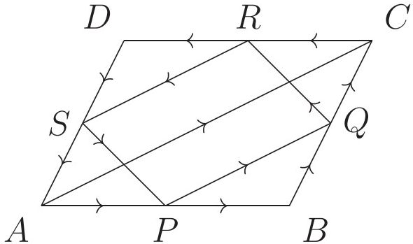

<!-- higher-math-9-10-bn-c12-t12.10-p046 · text · p.284 · review: verify-formula -->
মনে করি, $\overrightarrow{AB} = <u>a</u>$, $\overrightarrow{BC} = <u>b</u>$, $\overrightarrow{CD} = <u>c</u>$, $\overrightarrow{DA} = <u>d</u>$

<!-- higher-math-9-10-bn-c12-t12.10-p047 · text · p.284 · review: verify-formula -->
তাহলে, $\overrightarrow{PQ} = \overrightarrow{PB} + \overrightarrow{BQ} = \frac{1}{2}\overrightarrow{AB} + \frac{1}{2}\overrightarrow{BC} = \frac{1}{2}(<u>a</u> + <u>b</u>)$

<!-- higher-math-9-10-bn-c12-t12.10-p048 · text · p.284 · review: verify-formula -->
অনুরূপভাবে, $\overrightarrow{QR} = \frac{1}{2}(<u>b</u> + <u>c</u>)$, $\overrightarrow{RS} = \frac{1}{2}(<u>c</u> + <u>d</u>)$ এবং $\overrightarrow{SP} = \frac{1}{2}(<u>d</u> + <u>a</u>)$

<!-- higher-math-9-10-bn-c12-t12.10-p049 · text · p.284 · review: verify-formula -->
কিন্তু $(<u>a</u> + <u>b</u>) + (<u>c</u> + <u>d</u>) = \overrightarrow{AC} + \overrightarrow{CA} = \overrightarrow{AC} - \overrightarrow{AC} = <u>0</u>$

<!-- higher-math-9-10-bn-c12-t12.10-p050 · text · p.284 · review: verify-formula -->
অর্থাৎ $(<u>a</u> + <u>b</u>) = -(<u>c</u> + <u>d</u>)$

<!-- higher-math-9-10-bn-c12-t12.10-p051 · formula · p.284 · review: verify-formula -->
$\therefore \overrightarrow{PQ} = \frac{1}{2}(<u>a</u> + <u>b</u>) = -\frac{1}{2}(<u>c</u> + <u>d</u>) = -\overrightarrow{RS} = \overrightarrow{SR}$

<!-- higher-math-9-10-bn-c12-t12.10-p052 · text · p.284 · review: verify-formula -->
$\therefore PQ$ এবং $SR$ সমান ও সমান্তরাল।

<!-- higher-math-9-10-bn-c12-t12.10-p053 · text · p.284 · review: verify-formula -->
অনুরূপভাবে, $QR$ এবং $PS$ সমান ও সমান্তরাল।

<!-- higher-math-9-10-bn-c12-t12.10-p054 · text · p.284 · review: verify-formula -->
$\therefore PQRS$ একটি সমান্তরিক।

## 12.ex অনুশীলনী ১২

<!-- higher-math-9-10-bn-c12-t12.ex-p001 · exercise · p.284 · review: verify-formula -->
১. দুটি ভেক্টর সমান্তরাল হলে
    (i) এদের যোগের ক্ষেত্রে সমান্তরিক বিধি প্রযোজ্য
    (ii) এদের যোগের ক্ষেত্রে ত্রিভুজবিধি প্রযোজ্য
    (iii) এদের দৈর্ঘ্য সর্বদা সমান
ওপরের তথ্যের আলোকে নিচের কোনটি সঠিক?
ক) $i$                      খ) $ii$                      গ) $i$ ও $ii$                      ঘ) $i, ii$ ও $iii$

<!-- higher-math-9-10-bn-c12-t12.ex-p002 · exercise · p.284 · review: verify-formula -->
২. $AB = CD$ এবং $AB \parallel CD$ হলে নিচের কোনটি সঠিক?
ক) $\overrightarrow{AB} = \overrightarrow{CD}$                      খ) $\overrightarrow{AB} = m \cdot \overrightarrow{CD}$, যেখানে $m > 1$
গ) $\overrightarrow{AB} + \overrightarrow{DC} < <u>0</u>$                      ঘ) $\overrightarrow{AB} + m\overrightarrow{CD} = <u>0</u>$, যেখানে $m > 1$

<!-- higher-math-9-10-bn-c12-t12.ex-p003 · exercise · p.284 · review: verify-formula -->
৩. $\triangle ABC$ এর ক্ষেত্রে কোনটি সঠিক?
ক) $\overrightarrow{AB} + \overrightarrow{BC} = \overrightarrow{CA}$                      খ) $\overrightarrow{AB} + \overrightarrow{AC} = \overrightarrow{BC}$
গ) $\overrightarrow{CB} + \overrightarrow{BA} + \overrightarrow{CA} = <u>0</u>$                      ঘ) $\overrightarrow{AB} + \overrightarrow{BC} + \overrightarrow{CA} = <u>0</u>$

<!-- higher-math-9-10-bn-c12-t12.ex-p004 · exercise · p.285 · review: verify-formula -->
৪. $ABCD$ সামান্তরিকের কর্ণদ্বয় $\overrightarrow{AC}$ ও $\overrightarrow{BD}$ হলে $\overrightarrow{AB}$ ও $\overrightarrow{AC}$ ভেক্টরদ্বয়কে $\overrightarrow{AD}$ ও $\overrightarrow{BD}$ ভেক্টরদ্বয়ের মাধ্যমে প্রকাশ করো এবং দেখাও যে, $\overrightarrow{AC} + \overrightarrow{BD} = 2\overrightarrow{BC}$ এবং $\overrightarrow{AC} - \overrightarrow{BD} = 2\overrightarrow{AB}$।

<!-- higher-math-9-10-bn-c12-t12.ex-p005 · exercise · p.285 · review: verify-formula -->
৫. দেখাও যে,
ক) $-(<u>a</u> + <u>b</u>) = -<u>a</u> - <u>b</u>$ খ) $<u>a</u> + <u>b</u> = <u>c</u>$ হলে $<u>a</u> = <u>c</u> - <u>b</u>$

<!-- higher-math-9-10-bn-c12-t12.ex-p006 · exercise · p.285 · review: verify-formula -->
৬. দেখাও যে,
ক) $<u>a</u> + <u>a</u> = 2<u>a</u>$ খ) $(m - n)<u>a</u> = m<u>a</u> - n<u>a</u>$
গ) $m(<u>a</u> - <u>b</u>) = m<u>a</u> - m<u>b</u>$

<!-- higher-math-9-10-bn-c12-t12.ex-p007 · exercise · p.285 -->
৭. ভেক্টরের সাহায্যে প্রমাণ করো যে, ত্রিভুজের এক বাহুর মধ্যবিন্দু থেকে অঙ্কিত অপর বাহুর সমান্তরাল রেখা তৃতীয় বাহুর মধ্যবিন্দুগামী।

<!-- higher-math-9-10-bn-c12-t12.ex-p008 · exercise · p.285 -->
৮. প্রমাণ করো যে, কোনো চতুর্ভুজের কর্ণদ্বয় পরস্পরকে সমদ্বিখণ্ডিত করলে তা একটি সামান্তরিক হয়।

<!-- higher-math-9-10-bn-c12-t12.ex-p009 · exercise · p.285 -->
৯. ভেক্টরের সাহায্যে প্রমাণ কর যে, ট্রাপিজিয়ামের অসমান্তরাল বাহুদ্বয়ের মধ্যবিন্দুর সংযোজক সরলরেখা সমান্তরাল বাহুদ্বয়ের সমান্তরাল ও তাদের যোগফলের অর্ধেক।

<!-- higher-math-9-10-bn-c12-t12.ex-p010 · exercise · p.285 -->
১০. ভেক্টরের সাহায্যে প্রমাণ করো যে, ট্রাপিজিয়ামের কর্ণদ্বয়ের মধ্যবিন্দুর সংযোজক সরলরেখা সমান্তরাল বাহুদ্বয়ের সমান্তরাল এবং তাদের বিয়োগফলের অর্ধেক।

### বহুনির্বাচনি প্রশ্ন

<!-- higher-math-9-10-bn-c12-t12.ex-p011 · exercise · p.285 · review: verify-formula -->
১. $<u>a</u>, <u>b</u>$ অশূন্য অসমান্তরাল ভেক্টর এবং $m<u>a</u> + n<u>b</u> = <u>0</u>$ হলে, নিচের কোনটি সঠিক?

<!-- higher-math-9-10-bn-c12-t12.ex-p012 · exercise · p.285 · review: verify-formula -->
(ক) $m<u>a</u> = <u>0</u>$ (খ) $m<u>b</u> = <u>0</u>$

<!-- higher-math-9-10-bn-c12-t12.ex-p013 · exercise · p.285 · review: verify-formula -->
(গ) $m = n = 0$ (ঘ) $m = n \neq 0$

<!-- higher-math-9-10-bn-c12-t12.ex-p014 · exercise · p.285 · review: verify-formula -->
২. $AB \parallel DC$ হলে
    $(i) \overrightarrow{AB} = m \cdot \overrightarrow{DC}$ যেখানে $m$ একটি স্কেলার রাশি
    $(ii) \overrightarrow{AB} = \overrightarrow{DC}$
    $(iii) \overrightarrow{AB} = \overrightarrow{CD}$
ওপরের তথ্যের আলোকে নিচের কোনটি সঠিক?

<!-- higher-math-9-10-bn-c12-t12.ex-p015 · exercise · p.285 · review: verify-formula -->
ক) $i$ খ) $ii$
গ) $i$ ও $ii$ ঘ) $i, ii$ ও $iii$

<!-- higher-math-9-10-bn-c12-t12.ex-p016 · figure · p.286 -->
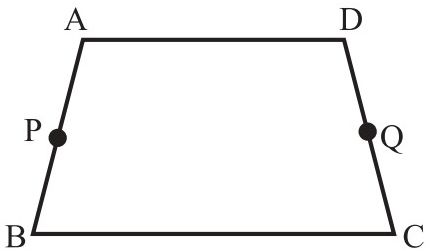

<!-- higher-math-9-10-bn-c12-t12.ex-p017 · exercise · p.286 · review: verify-formula -->
চিত্রে, $P$ ও $Q$ যথাক্রমে $AB$ ও $DC$ এর মধ্যবিন্দু এবং $AD \parallel BC$। $A, B, C$ ও $D$ বিন্দুর অবস্থান ভেক্টর যথাক্রমে $<u>a</u>, <u>b</u>, <u>c</u>$ এবং $<u>d</u>$।

<!-- higher-math-9-10-bn-c12-t12.ex-p018 · exercise · p.286 -->
উপরের তথ্যের আলোকে ৩ ও ৪ নং প্রশ্নের উত্তর দাও:

<!-- higher-math-9-10-bn-c12-t12.ex-p019 · exercise · p.286 · review: verify-formula -->
৩. $P$ বিন্দুর অবস্থান ভেক্টর কোনটি?

<!-- higher-math-9-10-bn-c12-t12.ex-p020 · exercise · p.286 · review: verify-formula -->
(ক) $\frac{<u>a</u> + <u>b</u> - <u>c</u>}{2}$                      (খ) $\frac{<u>a</u> - <u>b</u>}{2}$                      (গ) $\frac{<u>b</u> - <u>a</u>}{2}$                      (ঘ) $\frac{<u>a</u> + <u>b</u>}{2}$

<!-- higher-math-9-10-bn-c12-t12.ex-p021 · exercise · p.286 · review: verify-formula -->
৪. $\overrightarrow{PQ} =$ কত?

<!-- higher-math-9-10-bn-c12-t12.ex-p022 · exercise · p.286 · review: verify-formula -->
(ক) $\frac{1}{2}(\overrightarrow{AD} - \overrightarrow{BC})$                      (খ) $\frac{1}{2}(\overrightarrow{BC} + \overrightarrow{AD})$                      (গ) $(\overrightarrow{AD} - \overrightarrow{BC})$                      (ঘ) $(\overrightarrow{BC} + \overrightarrow{AD})$

### সৃজনশীল প্রশ্ন

<!-- higher-math-9-10-bn-c12-t12.ex-p023 · exercise · p.286 · review: known-confusable-corrected,verify-formula -->
৫. $\triangle ABC$ এর $AB$ ও $AC$ বাহুর মধ্যবিন্দু যথাক্রমে $D$ ও $E$।
ক) $(\overrightarrow{AD} + \overrightarrow{DE})$ কে $\overrightarrow{AC}$ ভেক্টরের মাধ্যমে প্রকাশ করো।
খ) ভেক্টরের সাহায্যে প্রমাণ করো যে, $BC \parallel DE$ এবং $DE = \frac{1}{2}BC$
গ) $BCED$ ট্রাপিজিয়ামের কর্ণদ্বয়ের মধ্যবিন্দু $M$ ও $N$ হলে ভেক্টরের সাহায্যে প্রমাণ করো যে, $MN \parallel DE \parallel BC$ এবং $MN = \frac{1}{2}(BC - DE)$

<!-- higher-math-9-10-bn-c12-t12.ex-p024 · exercise · p.286 · review: known-confusable-corrected,verify-formula -->
৬. $\triangle ABC$ এর $BC, CA$ ও $AB$ বাহুর মধ্যবিন্দু যথাক্রমে $D, E, F$।
ক) $\overrightarrow{AB}$ ভেক্টরকে $\overrightarrow{BE}$ ও $\overrightarrow{CF}$ ভেক্টরের মাধ্যমে প্রকাশ করো।
খ) প্রমাণ করো যে, $\overrightarrow{AD} + \overrightarrow{BE} + \overrightarrow{CF} = <u>0</u>$
গ) ভেক্টরের সাহায্যে প্রমাণ করো যে, $F$ বিন্দু দিয়ে অঙ্কিত $BC$ এর সমান্তরাল রেখা অবশ্যই $E$ বিন্দুগামী হবে।

### সংক্ষিপ্ত-উত্তর প্রশ্ন

<!-- higher-math-9-10-bn-c12-t12.ex-p025 · exercise · p.286 · review: verify-formula -->
৭. ক) দেখাও যে $<u>a</u>, <u>b</u>$ প্রত্যোকে অশূন্য ভেক্টর হলে, $<u>a</u> = m<u>b</u>$ হতে পারে কেবলমাত্র যদি $<u>a</u>, <u>b</u>$ এর সমান্তরাল হয়।
খ) $A, B, C, D$ বিন্দুগুলোর অবস্থান ভেক্টর যথাক্রমে $<u>a</u>, <u>b</u>, <u>c</u>, <u>d</u>$ হলে দেখাও যে, $ABCD$ সামান্তরিক হবে যদি এবং কেবল যদি $<u>b</u> - <u>a</u> = <u>c</u> - <u>d</u>$ হয়।
গ) $\triangle ABC$ এ $BC$ এর মধ্যবিন্দু $D$। দেখাও যে, $\overrightarrow{AB} + \overrightarrow{AC} = 2\overrightarrow{AD}$
ঘ) কোন কোন শর্তে $<u>u</u>$ এবং $<u>v</u>$ কে বিপরীত ভেক্টর বলা যাবে?
