# 13. ঘন জ্যামিতি

Source: Higher Math Bangla Version, printed pp. 287-305

## 13.0 ভূমিকা ও শিখনফল

<!-- higher-math-9-10-bn-c13-t13.0-p001 · text · p.287 -->
বাস্তব জীবনে আমাদের বিভিন্ন আকারের ঘনবস্তুর প্রয়োজন এবং আমরা সেগুলো সর্বদা ব্যবহারও করে থাকি। এর মধ্যে সুসম আকারের ঘনবস্তু যেমন আছে, তেমনি আছে বিষম আকারের ঘনবস্তুও। তবে এই অধ্যায়ে সুসম আকারের ঘনবস্তু এবং দুটি সুসম ঘনবস্তুর সমন্বয়ে গঠিত যৌগিক ঘনবস্তুর আয়তন ও পৃষ্ঠতলের ক্ষেত্রফল নির্ণয় পদ্ধতি আলোচনা করা হবে।

<!-- higher-math-9-10-bn-c13-t13.0-p002 · text · p.287 -->
এ অধ্যায় শেষে শিক্ষার্থীরা ---

<!-- higher-math-9-10-bn-c13-t13.0-p003 · text · p.287 -->
* ঘনবস্তুর প্রতীকীয় চিত্র অঙ্কন করতে পারবে;
* প্রিজম, পিরামিড আকৃতির বস্তু, গোলক ও সমবৃত্তভূমিক কোণকের আয়তন এবং পৃষ্ঠতলের ক্ষেত্রফল নির্ণয় করতে পারবে;
* ঘন জ্যামিতির ধারণা প্রয়োগ করে সমস্যা সমাধান করতে পারবে;
* যৌগিক ঘনবস্তুর আয়তন ও পৃষ্ঠতলের ক্ষেত্রফল পরিমাণ করতে পারবে;
* ঘন জ্যামিতির ধারণা ব্যবহারিক ক্ষেত্রে প্রয়োগ করতে পারবে।

### মৌলিক ধারণা

<!-- higher-math-9-10-bn-c13-t13.0-p004 · text · p.287 -->
মাধ্যমিক জ্যামিতিতে বিন্দু, রেখা ও তলের মৌলিক ধারণা আলোচিত হয়েছে। ঘন জ্যামিতিতেও বিন্দু, রেখা ও তলকে মৌলিক ধারণা হিসেবে গ্রহণ করা হয়।

<!-- higher-math-9-10-bn-c13-t13.0-p005 · text · p.287 -->
১. বস্তুর দৈর্ঘ্য, প্রস্তুত ও উচ্চতা প্রত্যেকটিকে ঐ বস্তুর মাত্রা (dimension) বলা হয়।

<!-- higher-math-9-10-bn-c13-t13.0-p006 · text · p.287 -->
২. বিন্দুর দৈর্ঘ্য, প্রস্তুত ও উচ্চতা নেই। এটি একটি ধারণা। বাস্তবে বিন্দু বুঝানোর জন্য আমরা একটি ডট (.) ব্যবহার করি। একে অবস্থানের প্রতিরূপ বলা যেতে পারে। সুতরাং বিন্দুর কোনো মাত্রা নেই। তাই বিন্দু শূন্য মাত্রিক।

<!-- higher-math-9-10-bn-c13-t13.0-p007 · text · p.287 · review: verify-formula -->
৩. রেখার কেবল দৈর্ঘ্য আছে, প্রস্তুত ও উচ্চতা নেই। তাই রেখা একমাত্রিক। যেমন, নিচের চিত্রে $AB$।

<!-- higher-math-9-10-bn-c13-t13.0-p008 · text · p.287 · review: verify-formula -->
৪. তলের দৈর্ঘ্য ও প্রস্তুত আছে, উচ্চতা নেই। তাই তল দ্বিমাত্রিক। যেমন, নিচের চিত্রে $ABGF$।

<!-- higher-math-9-10-bn-c13-t13.0-p009 · text · p.287 · review: verify-formula -->
৫. যে বস্তুর দৈর্ঘ্য, প্রস্তুত ও উচ্চতা আছে, তাকে ঘনবস্তু বলা হয়। সুতরাং ঘনবস্তু ত্রিমাত্রিক। যেমন, নিচের চিত্রে $ABCDEFG$।

<!-- higher-math-9-10-bn-c13-t13.0-p010 · text · p.287 -->
২০২

<!-- higher-math-9-10-bn-c13-t13.0-p011 · figure · p.288 -->
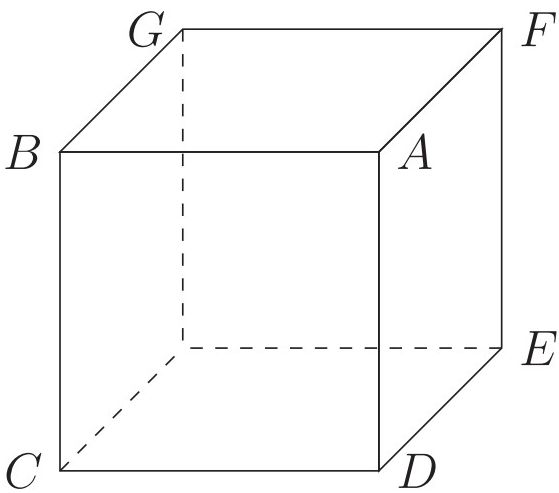

## 13.1 কতিপয় প্রাথমিক সংজ্ঞা

<!-- higher-math-9-10-bn-c13-t13.1-p001 · text · p.288 -->
সাধারণত ত্রিমাত্রিক বস্তুর ছবি দ্বিমাত্রিক কাগজ বা বোর্ডে অঙ্কন কিছুটা জটিল। তথাপিও শ্রেণিকক্ষে পাঠদানকালে প্রত্যেকটি সংজ্ঞার ব্যাখ্যার সঙ্গে তার একটি চিত্র অঙ্কন করে দেখিয়ে দিলে বিষয়টি শিক্ষার্থীদের পক্ষে বুঝা ও মনে রাখা সহজতর হবে।

<!-- higher-math-9-10-bn-c13-t13.1-p002 · text · p.288 · review: verify-formula -->
১. **সমতল (Plane surface):** কোনো তলের উপরস্থ যেকোনো দুটি বিন্দুর সংযোজক সরলরেখা সম্পূর্ণরূপে ঐ তলের উপর অবস্থিত হলে, ঐ তলকে সমতল বলা হয়। পুকুরের পানি স্থির থাকলে ঐ পানির উপরিভাগ একটি সমতল। সিমেন্ট দিয়ে নির্মিত বা মোজাইককৃত ঘরের মেঝেকে আমরা সমতল বলে থাকি। কিন্তু জ্যামিতিকভাবে তা সমতল নয়। ঘরের মেঝেতে কিছু উঁচু-নিচু থাকেই। উপরের চিত্রে $ABCD$, $ADEF$, $ABGF$ প্রতিটিই এক একটি সমতল।

<!-- higher-math-9-10-bn-c13-t13.1-p003 · text · p.288 -->
**দ্রষ্টব্য:** অন্য কিছু উল্লেখ না থাকলে ঘন জ্যামিতিতে রেখা বা দৈর্ঘ্য এবং তলের বিস্তার অসীম (infinite) বা অনির্দিষ্ট মনে করা হয়। সুতরাং তলের সংজ্ঞা থেকে অনুমান করা যায় যে, কোনো সরল রেখার একটি অংশ কোনো তলের উপর থাকলে ঐ সরল রেখার অপর কোনো অংশ ঐ তলের বাইরে থাকতে পারে না।

<!-- higher-math-9-10-bn-c13-t13.1-p004 · text · p.288 -->
২. **বক্রতল (Curved surface):** কোনো তলের উপর অবস্থিত যেকোনো দুইটি বিন্দুর সংযোজক সরলরেখা সম্পূর্ণরূপে ঐ তলের উপর অবস্থিত না হলে, ঐ তলকে বক্রতল বলা হয়। গোলকের পৃষ্ঠতল একটি বক্রতল।

<!-- higher-math-9-10-bn-c13-t13.1-p005 · text · p.288 -->
৩. **ঘন জ্যামিতি (Solid geometry):** গণিত শাস্ত্রের যে শাখার সাহায্যে ঘনবস্তু এবং তল, রেখা ও বিন্দুর ধর্ম জানা যায়, তাকে ঘন জ্যামিতি (geometry of space) বলা হয়। কখনও কখনও একে জাগতিক জ্যামিতি (geometry of space) বা ত্রিমাত্রিক জ্যামিতিও (geometry of three dimensions) বলা হয়।

<!-- higher-math-9-10-bn-c13-t13.1-p006 · text · p.288 · review: verify-formula -->
৪. **একতলীয় রেখা (Coplanar straight lines):** একাধিক সরলরেখা একই সমতলে অবস্থিত হলে, বা তাদের সকলের মধ্য দিয়ে একটি সমতল অঙ্কন সম্ভব হলে ঐ সরলরেখাগুলোকে একতলীয় রেখা বলা হয়। উপরের চিত্রে $AB$ ও $CD$ এক তলীয় রেখা, কিন্তু $EF$ তাদের সাথে একতলীয় নয়।

<!-- higher-math-9-10-bn-c13-t13.1-p007 · text · p.288 · review: verify-formula -->
৫. **নৈকতলীয় রেখা (Skew or non coplanar lines):** একাধিক সরলরেখা একই সমতলে অবস্থিত না হলে বা তাদের মধ্য দিয়ে একটি সমতল অঙ্কন করা সম্ভব না হলে এগুলোকে নৈকতলীয় সরলরেখা বলা হয়। উপরের চিত্রে $AB$ ও $EF$ নৈকতলীয় রেখা। দুটি পেনসিলকে একটির উপর আর একটি দিয়ে যোগ বা গুণচিহ্ন আকারের একটি বস্তু তৈরি করলেই দুইটি নৈকতলীয় সরলরেখা উৎপন্ন হবে।

<!-- higher-math-9-10-bn-c13-t13.1-p008 · text · p.289 · review: verify-formula -->
৬. **সমান্তরাল সরলরেখা (Parallel lines):** দুইটি একতলীয় সরলরেখা যদি পরস্পর ছেদ না করে অর্থাৎ যদি তাদের কোনো সাধারণ বিন্দু না থাকে, তবে তাদের সমান্তরাল সরলরেখা বলা হয়। উপরের চিত্রে $AB$ ও $CD$ সমান্তরাল সরলরেখা।

<!-- higher-math-9-10-bn-c13-t13.1-p009 · text · p.289 · review: verify-formula -->
৭. **সমান্তরাল তল (Parallel planes):** দুটি সমতল যদি পরস্পর ছেদ না করে অর্থাৎ যদি তাদের কোনো সাধারণ রেখা না থাকে তবে ঐ তলদ্বয়কে সমান্তরাল তল বলা হয়। আগের পৃষ্ঠার চিত্রে $ABCD$ ও তার বিপরীত পাশে থাকা $EFG$ সমতল দুটি পরস্পরের সমান্তরাল তল।

<!-- higher-math-9-10-bn-c13-t13.1-p010 · text · p.289 · review: verify-formula -->
৮. **সমতলের সমান্তরাল রেখা (Parallel to a plane):** একটি সরলরেখা ও একটি সমতলকে অনির্দিষ্টভাবে বর্ধিত করলেও যদি তারা পরস্পর ছেদ না করে, তবে ঐ সরলরেখাকে উক্ত তলের সমান্তরাল রেখা বলা হয়। উপরের চিত্রে $CD$ সরল রেখা $ABGF$ সমতলের সমান্তরাল রেখা।

<!-- higher-math-9-10-bn-c13-t13.1-p011 · text · p.289 · review: verify-formula -->
৯. **তলের লম্ব রেখা (Normal or perpendicular to a plane):** কোনো সরলরেখা একটি সমতলের উপরস্থ কোনো বিন্দু থেকে ঐ সমতলের উপর অঙ্কিত যেকোনো রেখার উপর লম্ব হলে, উক্ত সরলরেখাকে ঐ সমতলের উপর লম্ব বলা হয়। নিচের বামের চিত্রে $OP$ রেখা $QR$ সমতলের উপর লম্ব, কারণ $OP$ রেখা $QR$ সমতলে থাকা $AB, CD, EF$ প্রতিটি রেখার ওপরেই লম্ব।

<!-- higher-math-9-10-bn-c13-t13.1-p012 · figure · p.289 -->
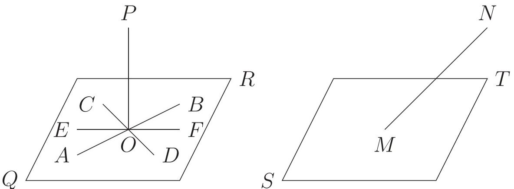

<!-- higher-math-9-10-bn-c13-t13.1-p013 · text · p.289 · review: verify-formula -->
১০. **তির্যক (Oblique) রেখা:** কোনো সরলরেখা একটি সমতলের সাথে সমান্তরাল বা লম্ব না হলে, ঐ সরলরেখাকে সমতলের তির্যক রেখা বলা হয়। উপরের ডানের চিত্রে $MN, ST$ এর তির্যক রেখা।

<!-- higher-math-9-10-bn-c13-t13.1-p014 · text · p.289 · review: verify-formula -->
১১. **উল্লম্ব (Vertical) রেখা বা তল:** স্থির অবস্থায় ঝুলন্ত ওলনের সুতার সঙ্গে সমান্তরাল কোনো রেখা বা তলকে খাড়া বা উল্লম্ব তল বলে। নিচের বামের চিত্রে $ABCD$ উল্লম্ব তল এবং $PR$ উল্লম্ব রেখা।

<!-- higher-math-9-10-bn-c13-t13.1-p015 · figure · p.290 -->
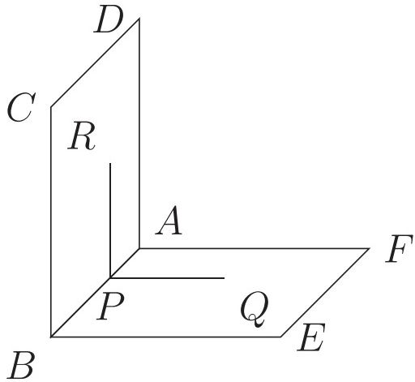

<!-- higher-math-9-10-bn-c13-t13.1-p016 · text · p.290 · review: verify-formula -->
১২. **অনুভূমিক (Horizontal) তল ও রেখা:** কোনো সমতল একটি খাড়া সরলরেখার সাথে লম্ব হলে, তাকে শয়ান বা অনুভূমিক তল বলা হয়। আবার কোনো অনুভূমিক তলে অবস্থিত যেকোনো সরলরেখাকে অনুভূমিক সরলরেখা বলা হয়। উপরের বামের চিত্রে $ABEF$ একটি অনুভূমিক সমতল এবং $PQ$ একটি অনুভূমিক সরলরেখা।

<!-- higher-math-9-10-bn-c13-t13.1-p017 · text · p.290 · review: verify-formula -->
১৩. **সমতল (Planar) ও নৈকতলীয় (Skew) চতুর্ভুজ:** কোনো চতুর্ভুজের বাহুগুলো সব একই তলে অবস্থিত হলে, তাকে সমতলীয় চতুর্ভুজ বলা হয়। আবার কোনো চতুর্ভুজের বাহুগুলো সকলে একই তলে অবস্থিত না হলে, ঐ চতুর্ভুজকে নৈকতলীয় চতুর্ভুজ বলা হয়। নৈকতলীয় চতুর্ভুজের দুটি সন্নিহিত বাহু একতলে এবং অপর দুটি অন্য তলে অবস্থিত। সুতরাং কোনো নৈকতলীয় চতুর্ভুজের বিপরীত বাহুদ্বয় নৈকতলীয়। উপরের ডানের চিত্রে $ABEF$ একটি সমতলীয় চতুর্ভুজ এবং $BCFE$ একটি নৈকতলীয় চতুর্ভুজ।

<!-- higher-math-9-10-bn-c13-t13.1-p018 · text · p.290 -->
১৪. **নৈকতলীয় রেখার (Skew lines) অন্তর্গত কোণ:** দুটি নৈকতলীয় রেখার অন্তর্গত কোণ তাদের যেকোনো একটি ও তার উপরস্থ কোনো বিন্দু থেকে অঙ্কিত অপরটির সমানতরাল রেখার অন্তর্গত কোণের সমান। আবার দুইটি নৈকতলীয় রেখার প্রত্যেকের সমানতরাল দুটি রেখা কোনো বিন্দুতে অঙ্কন করলে ঐ বিন্দুতে উৎপন্ন কোণের পরিমাণও নৈকতলীয় রেখাদ্বয়ের অন্তর্গত কোণের সমান।

<!-- higher-math-9-10-bn-c13-t13.1-p019 · figure · p.290 -->
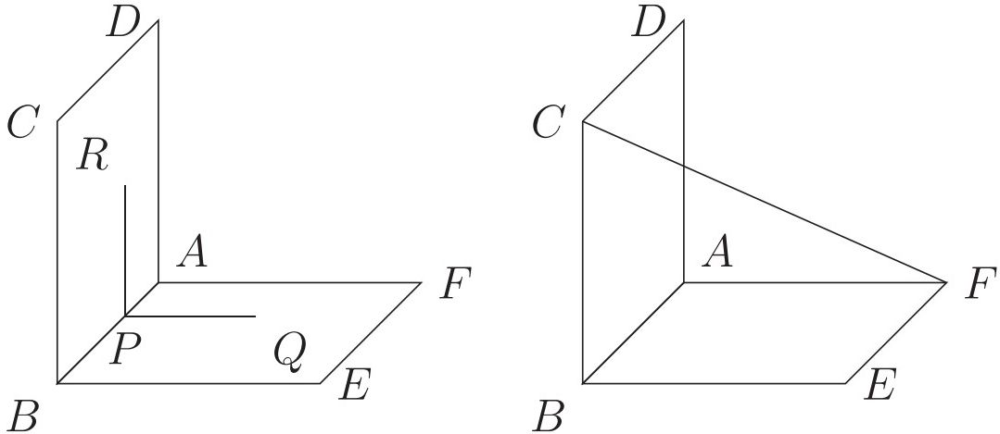

<!-- higher-math-9-10-bn-c13-t13.1-p020 · text · p.290 · review: verify-formula -->
মনে করি, $AB$ ও $CD$ দুটি নৈকতলীয় রেখা। যেকোনো $O$ বিন্দুতে $AB$ ও $CD$ এর সমানতরাল যথাক্রমে $OP$ এবং $OQ$ রেখাদ্বয় অঙ্কন করলে $\angle POQ$ ই $AB$ ও $CD$ এর অন্তর্গত কোণ নির্দেশ করবে। অন্য কথায় $\angle BRQ$ ও $AB$ ও $CD$ এর অন্তর্গত কোণ নির্দেশ করে যেখানে $R$ বিন্দুটি $AB$ এর ওপর অবস্থিত এবং $QR$ অবশ্যই $CD$ এর সমানতরাল।

<!-- higher-math-9-10-bn-c13-t13.1-p021 · text · p.290 -->
১৫. **দ্বিতল কোণ (Dihedral angle):** দুইটি সমতল সরলরেখায় ছেদ করলে তাদের ছেদ রেখাস্থ যেকোনো বিন্দু থেকে ঐ সমতলদ্বয়ের প্রত্যেকের উপর ঐ ছেদ রেখার সাথে লম্ব এরূপ একটি করে রেখা অঙ্কন করলে উৎপন্ন কোণই ঐ সমতলদ্বয়ের অন্তর্গত দ্বিতল কোণ।

<!-- higher-math-9-10-bn-c13-t13.1-p022 · figure · p.291 -->
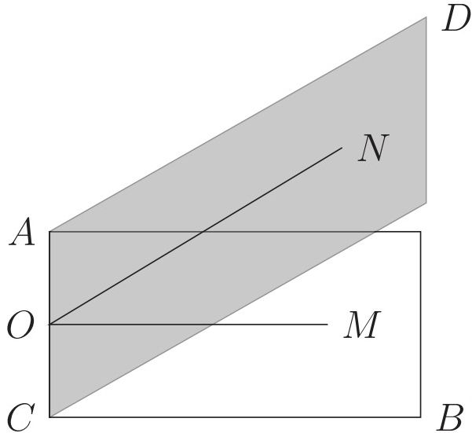

<!-- higher-math-9-10-bn-c13-t13.1-p023 · text · p.291 · review: verify-formula -->
$AB$ ও $CD$ সমতলদ্বয় $AC$ রেখায় পরস্পর ছেদ করেছে। $AC$ রেখাস্থ $O$ বিন্দুতে $AB$ সমতলে $OM$ এবং $CD$ সমতলে $ON$ এরূপ দুটি সরলরেখা অঙ্কন করা হলো যেন তারা উভয়ই $AC$ এর সঙ্গে $O$ বিন্দুতে লম্ব হয়। তাহলে $\angle MON$ ই $AB$ ও $CD$ সমতলদ্বয়ের অন্তর্গত দ্বিতল কোণ সূচিত করে। দুটি পরস্পরচ্ছেদী সমতলের অন্তর্গত দ্বিতল কোণের পরিমাণ এক সমকোণ হলে ঐ সমতলদ্বয় পরস্পর লম্ব।

<!-- higher-math-9-10-bn-c13-t13.1-p024 · text · p.291 · review: verify-formula -->
১৬. **অভিক্ষেপ (Projection):** কোনো বিন্দু থেকে একটি নির্দিষ্ট সরলরেখার উপর বা কোনো সমতলের উপর অঙ্কিত লম্বরেখার পাদবিন্দুকে ঐ রেখা বা সমতলের উপর উক্ত বিন্দুর পাতন বা অভিক্ষেপ (projection) বলা হয়। কোনো সরলরেখা বা বক্ররেখার সকল বিন্দু থেকে কোনো নির্দিষ্ট সমতলের উপর অঙ্কিত লম্বগুলোর পাদবিন্দুসমূহের সেটকে ঐ সমতলের উপর উক্ত সরলরেখা বা বক্ররেখার অভিক্ষেপ বলা হয়। এই অভিক্ষেপকে লম্ব অভিক্ষেপও (orthogonal projection) বলা হয়। চিত্রে $XY$ সমতলের উপর একটি বক্ররেখা $AB$ ও একটি সরলরেখা $CD$ এর অভিক্ষেপ যথাক্রমে বক্ররেখা $ab$ ও সরলরেখা $cd$ দেখানো হয়েছে।

<!-- higher-math-9-10-bn-c13-t13.1-p025 · figure · p.291 -->
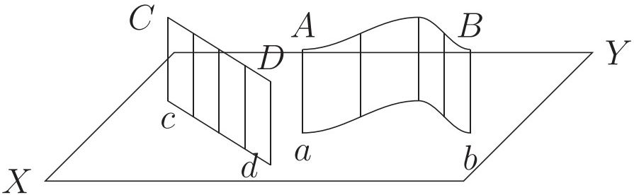

## 13.2 দুটি সরলরেখার মধ্যে সম্পর্ক

<!-- higher-math-9-10-bn-c13-t13.2-p001 · text · p.291 -->
ক) দুটি সরলরেখা একতলীয় হতে পারে, সেক্ষেত্রে তারা অবশ্যই সমান্তরাল হবে বা কোনো এক বিন্দুতে পরস্পর ছেদ করবে।

<!-- higher-math-9-10-bn-c13-t13.2-p002 · text · p.291 -->
খ) দুটি সরলরেখা নৈকতলীয় হতে পারে, সেক্ষেত্রে তারা সমান্তরালও হবে না কিংবা কোনো বিন্দুতে ছেদও করবে না।

## 13.3 স্বতঃসিদ্ধ

<!-- higher-math-9-10-bn-c13-t13.3-p001 · text · p.291 -->
ক) কোনো সমতলের উপরস্থ দুটি বিন্দুর সংযোজক সরলরেখাকে অনির্দিষ্টভাবে বর্ধিত করলেও তা সম্পূর্ণভাবে ঐ সমতলে অবস্থিত থাকবে। সুতরাং একটি সরলরেখা ও একটি সমতলের মধ্যে দুটি সাধারণ বিন্দু থাকলে, ঐ সরলরেখা বরাবর তাদের মধ্যে অসংখ্য সাধারণ বিন্দু থাকবে।

<!-- higher-math-9-10-bn-c13-t13.3-p002 · text · p.292 -->
খ) দুটি নির্দিষ্ট বিন্দু বা একটি সরলরেখার মধ্য দিয়ে অসংখ্য সমতল অঙ্কন করা যায়।

## 13.4 সরলরেখা ও সমতলের মধ্যে সম্পর্ক

<!-- higher-math-9-10-bn-c13-t13.4-p001 · text · p.292 -->
ক) কোনো সরলরেখা কোনো সমতলের সমান্তরাল হলে তাদের মধ্যে কোনো সাধারণ বিন্দু থাকবে না।

<!-- higher-math-9-10-bn-c13-t13.4-p002 · text · p.292 -->
খ) কোনো সরলরেখা কোনো সমতলকে ছেদ করলে তাদের মধ্যে মাত্র একটি সাধারণ বিন্দু থাকবে।

<!-- higher-math-9-10-bn-c13-t13.4-p003 · text · p.292 -->
গ) যদি কোনো সরলরেখা ও সমতলের দুটি সাধারণ বিন্দু থাকে, তাহলে সম্পূর্ণ সরলরেখাটি ঐ সমতলে অবস্থিত হবে।

## 13.5 দুটি সমতলের মধ্যে সম্পর্ক

<!-- higher-math-9-10-bn-c13-t13.5-p001 · text · p.292 -->
ক) দুটি সমতল পরস্পর সমান্তরাল হলে তাদের মধ্যে কোনো সাধারণ বিন্দু থাকবে না।

<!-- higher-math-9-10-bn-c13-t13.5-p002 · text · p.292 -->
খ) দুটি সমতল পরস্পরচ্ছেদী হলে তারা একটি সরলরেখায় ছেদ করবে এবং তাদের অসংখ্য সাধারণ বিন্দু থাকবে।

## 13.6 যনবস্তু

<!-- higher-math-9-10-bn-c13-t13.6-p001 · text · p.292 · review: known-confusable-corrected -->
আমরা জানি, একখানা বই বা একখানা ইট বা একটি বাক্স বা একটি গোলাকার বল সবই যনবস্তু। তারা প্রত্যেকেই কিছু পরিমাণ স্থান (space) দখল করে থাকে। আবার একখণ্ড পাথর বা কাঠ, ইটের একটি খণ্ড, কয়লার টুকরা, ঐটেল মাটির শুকনা খণ্ড ইত্যাদিও যনবস্তুর উদাহরণ। তবে এগুলো বিষম যনবস্তু।

<!-- higher-math-9-10-bn-c13-t13.6-p002 · text · p.292 · review: known-confusable-corrected -->
সমতল অথবা বক্রতল দ্বারা বেষ্টিত শূন্যের কিছুটা স্থান দখল করে থাকে এরূপ বস্তুকে যনবস্তু (solid) বলা হয়। সমতলস্থ কোনো স্থানকে বেষ্টিন করতে হলে যেমন কমপক্ষে তিনটি সরল রেখা দরকার তেমনি জাগতিক কোনো স্থানকে বেষ্টিন করতে হলে অন্তত চারটি সমতল দরকার। এই তলগুলো যনবস্তুর তল বা পৃষ্ঠতল (surface) এবং এদের দুটি সমতল যে রেখায় ছেদ করে, তাকে ঐ যনবস্তুর ধার (edge) বলা হয়। একটি বাক্সের বা একখানা ইটের ছয়টি পৃষ্ঠতল আছে এবং বারটি ধার আছে। একটি ক্রিকেট বল মাত্র একটি বক্রতল দ্বারা আবদ্ধ।

### কাজ:

<!-- higher-math-9-10-bn-c13-t13.6-p003 · text · p.292 · review: known-confusable-corrected -->
ক) তোমরা প্রত্যেকে একটি করে সুষম যনবস্তু ও বিষম যনবস্তুর নাম লেখো।

<!-- higher-math-9-10-bn-c13-t13.6-p004 · text · p.292 -->
খ) তোমার উল্লেখিত যনবস্তুগুলোর কয়েকটি ব্যবহার লেখো।

## 13.8 ১. আয়তিক ঘন বা আয়তাকার ঘনবস্তু (Rectangular Parallelopiped)

<!-- higher-math-9-10-bn-c13-t13.8-p001 · figure · p.293 -->
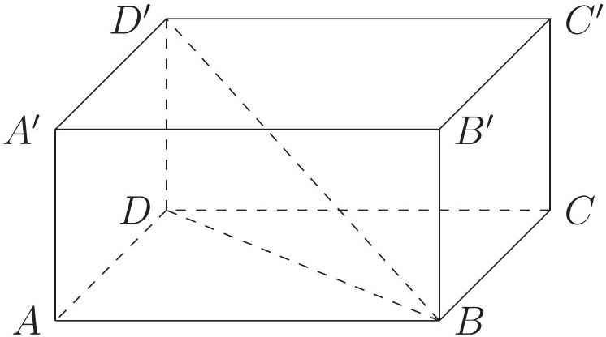

<!-- higher-math-9-10-bn-c13-t13.8-p002 · text · p.293 -->
তিনজোড়া সমান্তরাল সমতল দ্বারা আবদ্ধ ঘনবস্তুকে সামান্তরিক ঘনবস্তু বলা হয়। এই ছয়টি সমতলের প্রত্যেকটি একটি সামান্তরিক এবং বিপরীত পৃষ্ঠগুলো সর্বতোভাবে সমান। সামান্তরিক ঘনবস্তুর ছয়টি তলে বিভক্ত বারটি ধার আছে।

<!-- higher-math-9-10-bn-c13-t13.8-p003 · text · p.293 · review: verify-formula -->
যে সামান্তরিক ঘনবস্তুর পৃষ্ঠতলগুলো আয়তক্ষেত্র, তাকে আয়তাকার ঘনবস্তু বলা হয়। যে আয়তাকার ঘনবস্তুর পৃষ্ঠতলগুলো বর্গক্ষেত্র, তাকে ঘনক বলা হয়। উপরিউক্ত চিত্রে আয়তাকার ঘনবস্তুর এবং ঘনকের পৃষ্ঠগুলো $ABCD$, $A'B'C'D'$, $BCC'B'$, $ADD'A'$, $ABB'A'$, $DCC'D'$ এবং ধারগুলো $AB$, $A'B'$, $CD$, $C'D'$, $BC$, $B'C'$, $AD$, $A'D'$, $AA'$, $BB'$, $CC'$, $DD'$। তবে চিত্রে কেবল একটি কর্ণ $BD'$ দেখানো হয়েছে, অন্যগুলো অনুরূপভাবে আঁকতে হবে।

<!-- higher-math-9-10-bn-c13-t13.8-p004 · text · p.293 · review: verify-formula -->
মনে করি, আয়তাকার ঘনবস্তুর দৈর্ঘ্য, প্রস্থ ও উচ্চতা যথাক্রমে $AB = a$ একক, $AD = b$ একক এবং $AA' = c$ একক।

<!-- higher-math-9-10-bn-c13-t13.8-p005 · text · p.293 -->
**ক) আয়তাকার ঘনবস্তুর সমগ্র তলের ক্ষেত্রফল (Area of the whole surface)**

<!-- higher-math-9-10-bn-c13-t13.8-p006 · formula · p.293 · review: verify-formula -->
$$= ছয়টি পৃষ্ঠের ক্ষেত্রফলের সমষ্টি$$

<!-- higher-math-9-10-bn-c13-t13.8-p007 · formula · p.293 · review: verify-formula -->
$$= 2(ABCD  তলের ক্ষেত্রফল + ABB'A'  তলের ক্ষেত্রফল + ADD'A'  তলের ক্ষেত্রফল)$$

<!-- higher-math-9-10-bn-c13-t13.8-p008 · formula · p.293 · review: verify-formula -->
$$= 2(ab + ac + bc)  বর্গ একক = 2(ab + bc + ca)  বর্গ একক$$

<!-- higher-math-9-10-bn-c13-t13.8-p009 · text · p.293 · review: verify-formula -->
**খ) আয়তন (Volume) = $AB \times AD \times AA'$ ঘন একক = $abc$ ঘন একক**

<!-- higher-math-9-10-bn-c13-t13.8-p010 · text · p.293 · review: verify-formula -->
**গ) কর্ণ $BD' = \sqrt{BD^2 + DD'^2} = \sqrt{AB^2 + AD^2 + DD'^2} = \sqrt{a^2 + b^2 + c^2}$ একক**

### ২. ঘনক (Cube) আকৃতির ঘনবস্তু

<!-- higher-math-9-10-bn-c13-t13.8-p011 · text · p.293 · review: verify-formula -->
ঘনকের ক্ষেত্রে, $a = b = c$, অতএব

<!-- higher-math-9-10-bn-c13-t13.8-p012 · text · p.293 · review: verify-formula -->
**ক) সমগ্র তলের ক্ষেত্রফল = $2(a^2 + a^2 + a^2) = 6a^2$ বর্গ একক**

<!-- higher-math-9-10-bn-c13-t13.8-p013 · text · p.293 · review: verify-formula -->
**খ) আয়তন = $a \cdot a \cdot a = a^3$ ঘন একক** গ) কর্ণ $= \sqrt{a^2 + a^2 + a^2} = \sqrt{3}a$ একক।

<!-- higher-math-9-10-bn-c13-t13.8-p014 · text · p.294 · review: verify-formula -->
**উদাহরণ ১.** একটি আয়তাকার ঘনবস্তুর দৈর্ঘ্য, প্রস্থ ও উচ্চতার অনুপাত $4 : 3 : 2$ এবং তার সমগ্র তলের ক্ষেত্রফল 468 বর্গমিটার হলে, তার কর্ণ ও আয়তন নির্ণয় করো।

<!-- higher-math-9-10-bn-c13-t13.8-p015 · text · p.294 · review: verify-formula -->
**সমাধান:** মনে করি, দৈর্ঘ্য, প্রস্থ ও উচ্চতা যথাক্রমে $4x$, $3x$ ও $2x$ মিটার।

<!-- higher-math-9-10-bn-c13-t13.8-p016 · text · p.294 · review: verify-formula -->
তাহলে, $2(4x \cdot 3x + 3x \cdot 2x + 2x \cdot 4x) = 468$

<!-- higher-math-9-10-bn-c13-t13.8-p017 · text · p.294 · review: verify-formula -->
বা, $52x^2 = 468$ বা, $x^2 = 9$ $\therefore x = 3$

<!-- higher-math-9-10-bn-c13-t13.8-p018 · text · p.294 · review: verify-formula -->
$\therefore$ ঘনবস্তুর দৈর্ঘ্য 12 মিটার, প্রস্থ 9 মিটার এবং উচ্চতা 6 মিটার

<!-- higher-math-9-10-bn-c13-t13.8-p019 · text · p.294 · review: verify-formula -->
কর্ণের দৈর্ঘ্য $= \sqrt{12^2 + 9^2 + 6^2}$ মিটার $= \sqrt{144 + 81 + 36} = \sqrt{261}$ মিটার $\approx 16.16$ মিটার (প্রায়)

<!-- higher-math-9-10-bn-c13-t13.8-p020 · text · p.294 · review: verify-formula -->
এবং আয়তন $= 12 \times 9 \times 6 = 648$ ঘনমিটার।

<!-- higher-math-9-10-bn-c13-t13.8-p021 · text · p.294 -->
> **কাজ:** পিচবোর্ডের একটি ছোটো বাক্স (কর্টুন অথবা ঔষধের বোতলের প্যাকেট) এর দৈর্ঘ্য, প্রস্থ ও উচ্চতা মেপে তার আয়তন, ছয়টি তলের ক্ষেত্রফল ও কর্ণের দৈর্ঘ্য নির্ণয় করো।

## 13.9 ৩. প্রিজম (Prism)

<!-- higher-math-9-10-bn-c13-t13.9-p001 · text · p.294 · review: known-confusable-corrected -->
যে ঘনবস্তুর দুই প্রান্ত সর্বসম ও সমান্তরাল বহুভুজ দ্বারা আবদ্ধ এবং অন্য তলগুলো সামান্তরিক তাকে প্রিজম বলে। প্রিজমের দুই প্রান্তকে ইহার ভূমি এবং অন্য তলগুলোকে পার্শ্বতল বলে। সবগুলো পার্শ্বতল আয়তাকার হলে প্রিজমটিকে খাদা বা সমপ্রিজম এবং অন্যক্ষেত্রে প্রিজমটিকে তীর্ষক প্রিজম বলা হয়। বাস্তব ক্ষেত্রে খাদা প্রিজমই অধিক ব্যবহৃত হয়। ভূমির তলের নামের উপর নির্ভর করে কোনো প্রিজমের নামকরণ করা হয়। যেমন, ত্রিভুজাকার প্রিজম, চতুর্ভুজাকার প্রিজম, পঞ্চভুজাকার প্রিজম ইত্যাদি।

<!-- higher-math-9-10-bn-c13-t13.9-p002 · figure · p.294 · review: latin-junk -->
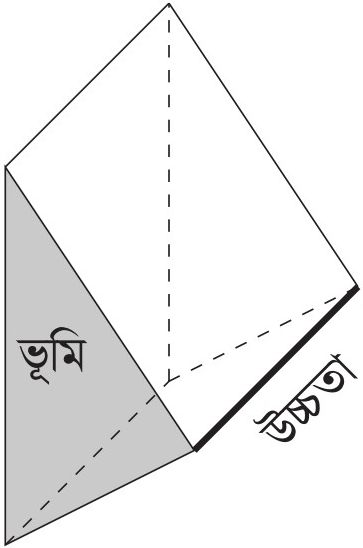

<!-- higher-math-9-10-bn-c13-t13.9-p003 · text · p.294 · review: known-confusable-corrected -->
ভূমি সুষম বহুভুজ হলে প্রিজমকে সুষম প্রিজম (regular prism) বলে। ভূমি সুষম না হলে ইহাকে বিযম প্রিজম (irregular prism) বলা হয়। সংজ্ঞানুসারে আয়তাকার ঘনবস্তু ও ঘনক উভয়কেই প্রিজম বলা হয়। কঁাচের তৈরি খাদা ত্রিভুজাকার প্রিজম আলোকরশ্মির বিচ্ছুরণের জন্য ব্যবহৃত হয়।

<!-- higher-math-9-10-bn-c13-t13.9-p004 · text · p.295 -->
ক) প্রিজমের সমগ্রতলের ক্ষেত্রফল

<!-- higher-math-9-10-bn-c13-t13.9-p005 · formula · p.295 · review: verify-formula -->
$$= 2 (ভূমির ক্ষেত্রফল) + পার্শ্বতলগুলোর ক্ষেত্রফল$$

<!-- higher-math-9-10-bn-c13-t13.9-p006 · formula · p.295 · review: latin-junk,verify-formula -->
$$= 2 (ভূমির ক্ষেত্রফল) + ভূমির পরিসীমা \times উচ্চতা$$

<!-- higher-math-9-10-bn-c13-t13.9-p007 · text · p.295 · review: verify-formula -->
খ) আয়তন $= ভূমির ক্ষেত্রফল \times উচ্চতা$

<!-- higher-math-9-10-bn-c13-t13.9-p008 · text · p.295 -->
**উদাহরণ ২.** একটি ত্রিভুজাকার প্রিজমের ভূমির বাহুগুলোর দৈর্ঘ্য যথাক্রমে ৩, ৪ ও ৫ সে.মি. এবং উচ্চতা ৪ সে.মি.। ইহার সমগ্রতলের ক্ষেত্রফল ও আয়তন নির্ণয় করো।

<!-- higher-math-9-10-bn-c13-t13.9-p009 · text · p.295 -->
**সমাধান:** প্রিজমের ভূমির বাহুগুলোর দৈর্ঘ্য যথাক্রমে ৩, ৪ ও ৫ সে.মি.।

<!-- higher-math-9-10-bn-c13-t13.9-p010 · text · p.295 · review: verify-formula -->
যেহেতু $3^2 + 4^2 = 5^2$, ইহার ভূমি একটি সমকোণী ত্রিভুজ যার ক্ষেত্রফল $= \frac{1}{2} \times 4 \times 3 = 6$ বর্গ সে.মি. সুতরাং, প্রিজমটির সমগ্রতলের ক্ষেত্রফল $= 2 \times 6 + (3 + 4 + 5) \times 8 = 12 + 96 = 108$ বর্গ সে.মি. এবং ইহার আয়তন $= 6 \times 8 = 48$ ঘন সে.মি.

<!-- higher-math-9-10-bn-c13-t13.9-p011 · text · p.295 -->
অতএব প্রিজমটির সমগ্রতলের ক্ষেত্রফল ১০৮ বর্গ সে.মি. এবং আয়তন ৪৮ ঘন সে.মি.।

## 13.10 ৪. পিরামিড (Pyramid)

<!-- higher-math-9-10-bn-c13-t13.10-p001 · text · p.295 -->
বহুভুজের উপর অবস্থিত যে ঘনবস্তুর একটি শীর্ষবিন্দু থাকে এবং যার পার্শ্বতলগুলোর প্রত্যেকটি ত্রিভুজাকার তাকে পিরামিড বলে।

<!-- higher-math-9-10-bn-c13-t13.10-p002 · figure · p.295 -->
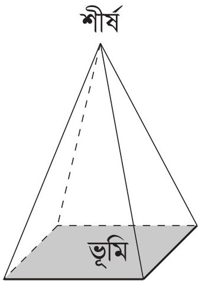

<!-- higher-math-9-10-bn-c13-t13.10-p003 · text · p.295 · review: known-confusable-corrected -->
পিরামিডের ভূমি যেকোনো আকারের বহুভুজ এবং তার পার্শ্বতলগুলোও যেকোনো ধরনের ত্রিভুজ হতে পারে। তবে ভূমি সুষম বহুভুজ এবং পার্শ্বতলগুলো সর্বসম ত্রিভুজ হলে তাকে সুষম পিরামিড বলা হয়। সুষম পিরামিডগুলো খুবই দৃষ্টিনন্দন। শীর্ষবিন্দু ও ভূমির যেকোনো কোণিক বিন্দুর সংযোজক রেখাকে পিরামিডের ধার বলে। শীর্ষ হতে ভূমির উপর অঙ্কিত লম্বদৈর্ঘ্যকে পিরামিডের উচ্চতা বলা হয়। তবে আমরা পিরামিড বলতে সচরাচর বর্গাকার ভূমির উপর অবস্থিত চারটি সর্বসম ত্রিভুজ দ্বারা বেষ্টিত ঘনবস্তুকেই বুঝি। এই ধরনের পিরামিডের বহুল ব্যবহার আছে।

<!-- higher-math-9-10-bn-c13-t13.10-p004 · text · p.295 · review: known-confusable-corrected,verify-formula -->
চারটি সমবাহু ত্রিভুজ দ্বারা বেষ্টিত ঘনবস্তুকে **সুষম চতুস্তলক** (regular tetrahedron) বলে যা একটি পিরামিড। এই পিরামিডের $3 + 3 = 6$ টি ধার ও ৪ টি কোণিক বিন্দু আছে। ইহার শীর্ষ হতে ভূমির উপর অঙ্কিত লম্ব ভূমির ভরকেন্দ্রে পতিত হয়।

<!-- higher-math-9-10-bn-c13-t13.10-p005 · text · p.295 · review: verify-formula -->
ক) পিরামিডের সমগ্রতলের ক্ষেত্রফল $= ভূমির ক্ষেত্রফল + পার্শ্বতলগুলোর ক্ষেত্রফল$ কিন্তু পার্শ্বতলগুলো সর্বসম ত্রিভুজ হলে,

<!-- higher-math-9-10-bn-c13-t13.10-p006 · text · p.296 · review: verify-formula -->
পিরামিডের সমগ্রতলের ক্ষেত্রফল = ভূমির ক্ষেত্রফল $+ \frac{1}{2}$ (ভূমির পরিধি $\times$ হেলানো উচ্চতা)

<!-- higher-math-9-10-bn-c13-t13.10-p007 · text · p.296 · review: verify-formula -->
কোনো পিরামিডের উচ্চতা $h$, ভূমিক্ষেত্রের অন্তর্বর্তের ব্যাসার্ধ $r$ এবং হেলানো উচ্চতা $l$ হলে, $l = \sqrt{h^2 + r^2}$

<!-- higher-math-9-10-bn-c13-t13.10-p008 · text · p.296 · review: verify-formula -->
খ) আয়তন $= \frac{1}{3} \times$ ভূমির ক্ষেত্রফল $\times$ উচ্চতা

<!-- higher-math-9-10-bn-c13-t13.10-p009 · text · p.296 -->
**উদাহরণ ৩.** 10 সে.মি. বাহুবিশিষ্ট বর্গাকার ভূমির উপর অবস্থিত একটি পিরামিডের উচ্চতা 12 সে.মি.। ইহার সমগ্রতলের ক্ষেত্রফল ও আয়তন নির্ণয় করো।

<!-- higher-math-9-10-bn-c13-t13.10-p010 · text · p.296 · review: verify-formula -->
**সমাধান:** পিরামিডের ভূমির কেন্দ্রবিন্দু হতে যেকোনো বাহুর লম্ব দূরত্ব $r = \frac{10}{2}$ সে.মি. $= 5$ সে.মি., পিরামিডের উচ্চতা 12 সে.মি.।

<!-- higher-math-9-10-bn-c13-t13.10-p011 · text · p.296 · review: verify-formula -->
অতএব ইহার যেকোনো পার্শ্বতলের হেলানো উচ্চতা $= \sqrt{h^2 + r^2} = \sqrt{12^2 + 5^2} = \sqrt{144 + 25} = \sqrt{169} = 13$ সে.মি.।

<!-- higher-math-9-10-bn-c13-t13.10-p012 · text · p.296 · review: verify-formula -->
$\therefore$ পিরামিডের সমগ্রতলের ক্ষেত্রফল $= [10 \times 10 + \frac{1}{2}(4 \times 10) \times 13]$ বর্গ সে.মি.
$= 100 + 260 = 360$ বর্গ সে.মি.

<!-- higher-math-9-10-bn-c13-t13.10-p013 · text · p.296 · review: verify-formula -->
এবং ইহার আয়তন $= \frac{1}{3} \times (10 \times 10) \times 12$ ঘন সে.মি. $= 10 \times 10 \times 4 = 400$ ঘন সে.মি.।

<!-- higher-math-9-10-bn-c13-t13.10-p014 · text · p.296 -->
অতএব পিরামিডটির সমগ্রতলের ক্ষেত্রফল 360 বর্গ সে.মি. এবং আয়তন 400 ঘন সে.মি.।

### কাজ:

<!-- higher-math-9-10-bn-c13-t13.10-p015 · text · p.296 · review: known-confusable-corrected -->
ক) প্রত্যেকে একটি করে সুষম ও একটি করে বিষম (১) প্রিজম ও (২) পিরামিড আঁকো।

<!-- higher-math-9-10-bn-c13-t13.10-p016 · text · p.296 -->
খ) যেক্ষেত্রে সন্নিব, তোমার আঁকিত ঘনবস্তুটির সমগ্রতলের ক্ষেত্রফল ও আয়তন নির্ণয় করো।

## 13.11 ৫. সমবৃত্তভূমিক কোণক (Right circular cone)

<!-- higher-math-9-10-bn-c13-t13.11-p001 · text · p.296 -->
কোনো সমকোণী ত্রিভুজের সমকোণ সংলগ্ন একটি বাহুকে অক্ষ (axis) ধরে তার চতুর্দিকে ত্রিভুজটিকে একবার ঘুরিয়ে আনলে যে ঘনবস্তু উৎপন্ন হয়, তাকে সমবৃত্তভূমিক কোণক বলা হয়।

<!-- higher-math-9-10-bn-c13-t13.11-p002 · figure · p.297 -->
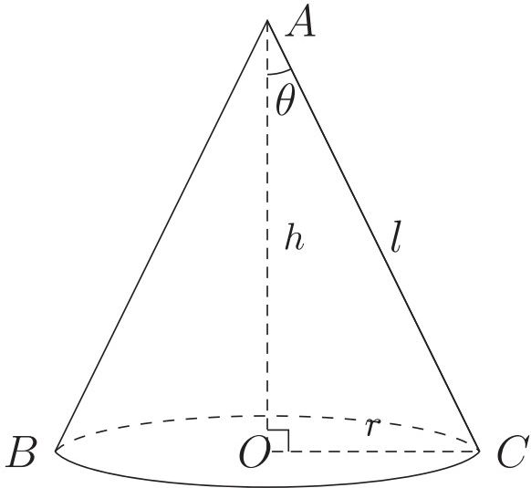

<!-- higher-math-9-10-bn-c13-t13.11-p003 · text · p.297 · review: verify-formula -->
চিহ্নে, $OAC$ সমকোণী ত্রিভুজকে $OA$ রেখার চতুর্দিকে ঘোরানোর ফলে $ABC$ সমবৃত্তভূমিকোণক উৎপন্ন হয়েছে। এক্ষেত্রে ত্রিভুজের শীর্ষকোণ $\angle OAC = \theta$ হলে, $\theta$ কে কোণকের অর্ধশীর্ষকোণ (semi vertical angle) বলা হয়।

<!-- higher-math-9-10-bn-c13-t13.11-p004 · text · p.297 · review: verify-formula -->
কোণকের উচ্চতা $OA = h$, ভূমির ব্যাসার্ধ $OC = r$ এবং হেলানো উচ্চতা $AC = l$ হলে

<!-- higher-math-9-10-bn-c13-t13.11-p005 · text · p.297 · review: latin-junk,verify-formula -->
ক) বক্রতলের ক্ষেত্রফল $= \frac{1}{2} \times$ ভূমির পরিধি $\times$ হেলানো উচ্চতা
$$= \frac{1}{2} \times 2\pi r \times l = \pi rl  বর্গ একক$$

<!-- higher-math-9-10-bn-c13-t13.11-p006 · text · p.297 · review: latin-junk,verify-formula -->
খ) সমগ্রতলের ক্ষেত্রফল $=$ বক্রতলের ক্ষেত্রফল $+$ ভূমিতলের ক্ষেত্রফল
$$= \pi rl + \pi r^2 = \pi r(r + l)  বর্গ একক$$

<!-- higher-math-9-10-bn-c13-t13.11-p007 · text · p.297 · review: latin-junk,known-confusable-corrected,verify-formula -->
গ) আয়তন $= \frac{1}{3} \times$ ভূমির ক্ষেত্রফল $\times$ উচ্চতা
$$= \frac{1}{3} \pi r^2 h  ঘন একক। [আয়তনের এই সূত্রটি নির্ণয় পদ্ধতি উচ্চতর শ্রেণিতে শেখানো হবে]$$

<!-- higher-math-9-10-bn-c13-t13.11-p008 · text · p.297 -->
**উদাহরণ ৪.** একটি সমবৃত্তভূমিক কোণকের উচ্চতা ১২ সে.মি. এবং ভূমির ব্যাস ১০ সে.মি. হলে তার হেলানো উচ্চতা, বক্রতলের ও সমগ্রতলের ক্ষেত্রফল এবং আয়তন নির্ণয় করো।

<!-- higher-math-9-10-bn-c13-t13.11-p009 · text · p.297 · review: verify-formula -->
**সমাধান:** ভূমির ব্যাসার্ধ $r = \frac{10}{2}  সে.মি. = 5  সে.মি.$

<!-- higher-math-9-10-bn-c13-t13.11-p010 · text · p.297 · review: verify-formula -->
হেলানো উচ্চতা $l = \sqrt{h^2 + r^2} = \sqrt{12^2 + 5^2} = 13  সে.মি.$

<!-- higher-math-9-10-bn-c13-t13.11-p011 · text · p.297 · review: verify-formula -->
বক্রতলের ক্ষেত্রফল $= \pi rl = \pi \times 5 \times 13 = 204.2035  বর্গ সে.মি. (প্রায়)$

<!-- higher-math-9-10-bn-c13-t13.11-p012 · text · p.297 · review: verify-formula -->
সমগ্রতলের ক্ষেত্রফল $= \pi r(l + r) = \pi \times 5 \times (13 + 5) = 282.7433  বর্গ সে.মি. (প্রায়)$

<!-- higher-math-9-10-bn-c13-t13.11-p013 · text · p.297 · review: known-confusable-corrected,verify-formula -->
আয়তন $= \frac{1}{3} \pi r^2 h = \frac{1}{3} \pi \times 5^2 \times 12 = 314.1593  ঘন সে.মি. (প্রায়)$।

<!-- higher-math-9-10-bn-c13-t13.11-p014 · text · p.297 -->
> **কাজ:** জন্মদিনে বা অন্যন্য আনন্দ উৎসবে ব্যবহৃত কোণক আকৃতির একটি কাঁপ সংগ্রহ করে তার বক্রতলের ক্ষেত্রফল ও আয়তন নির্ণয় করো।

## 13.12 ৬. গোলক (Sphere)

<!-- higher-math-9-10-bn-c13-t13.12-p001 · text · p.298 -->
কোনো অর্ধবৃত্ত ক্ষেত্রের ব্যাসকে অক্ষ ধরে ঐ ব্যাসের চতুর্দিকে অর্ধবৃত্ত ক্ষেত্রকে একবার ঘুরিয়ে আনলে যে ঘনবস্তু উৎপন্ন হয় তাকে গোলক বলে। অর্ধবৃত্তটির কেন্দ্রই গোলকের কেন্দ্র। এই ঘূর্ণনের ফলে অর্ধবৃত্ত যে তল উৎপন্ন করে তাই হল গোলকের তল।

<!-- higher-math-9-10-bn-c13-t13.12-p002 · figure · p.298 -->
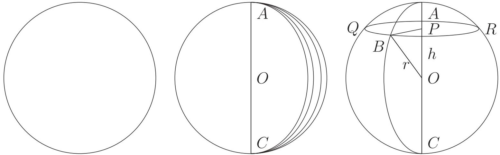

<!-- higher-math-9-10-bn-c13-t13.12-p003 · text · p.298 · review: verify-formula -->
$CQAR$ গোলকের কেন্দ্র $O$, ব্যাসার্ধ $OA = OB = OC$ এবং কেন্দ্র $O$ থেকে $h$ দূরত্বে $P$ বিন্দুর মধ্য দিয়ে $OA$ রেখার সাথে লম্ব হয় এরূপ একটি সমতল গোলকটিকে ছেদ করে একটি $QBR$ বৃত্ত উৎপন্ন করেছে। এই বৃত্তের কেন্দ্র $P$ এবং ব্যাসার্ধ $PB$।

<!-- higher-math-9-10-bn-c13-t13.12-p004 · formula · p.298 · review: verify-formula -->
$$\therefore OB^2 = OP^2 + PB^2$$

<!-- higher-math-9-10-bn-c13-t13.12-p005 · formula · p.298 · review: verify-formula -->
$$\therefore PB^2 = OB^2 - OP^2 = r^2 - h^2$$

<!-- higher-math-9-10-bn-c13-t13.12-p006 · text · p.298 · review: verify-formula -->
গোলকের ব্যাসার্ধ $r$ হলে,

<!-- higher-math-9-10-bn-c13-t13.12-p007 · text · p.298 · review: verify-formula -->
ক) গোলকের পৃষ্ঠতলের ক্ষেত্রফল $= 4\pi r^2$ বর্গ একক।

<!-- higher-math-9-10-bn-c13-t13.12-p008 · text · p.298 · review: verify-formula -->
খ) আয়তন $= \frac{4}{3}\pi r^3$ ঘন একক।

<!-- higher-math-9-10-bn-c13-t13.12-p009 · text · p.298 · review: verify-formula -->
গ) $h$ উচ্চতায় তলচ্ছেদে উৎপন্ন বৃত্তের ব্যাসার্ধ $= \sqrt{r^2 - h^2}$ একক।

<!-- higher-math-9-10-bn-c13-t13.12-p010 · text · p.298 -->
**কাজ:** একটি খেলনা বল বা ফুটবল নিয়ে তার ব্যাসার্ধ ও আয়তন নির্ণয় করো।

<!-- higher-math-9-10-bn-c13-t13.12-p011 · text · p.298 · review: verify-formula -->
**উদাহরণ ৫.** ৪ সে.মি. ব্যাসের একটি লৌহ গোলককে পিটিয়ে $\frac{2}{3}$ সে.মি. পুরু একটি বৃত্তাকার লৌহপাত প্রস্তুত করা হল। ঐ পাতের ব্যাসার্ধ কত?

<!-- higher-math-9-10-bn-c13-t13.12-p012 · text · p.298 · review: verify-formula -->
**সমাধান:** লৌহ গোলকের ব্যাসার্ধ $= \frac{4}{2} = 2$ সে.মি.।

<!-- higher-math-9-10-bn-c13-t13.12-p013 · text · p.298 · review: verify-formula -->
$\therefore$ তার আয়তন $= \frac{4}{3}\pi \times 2^3 = \frac{32}{3}\pi$ ঘন সে.মি.।

<!-- higher-math-9-10-bn-c13-t13.12-p014 · text · p.298 · review: verify-formula -->
মনে করি, পাতের ব্যাসার্ধ $= r$ সে.মি.। পাতটি $\frac{2}{3}$ সে.মি. পুরু।

<!-- higher-math-9-10-bn-c13-t13.12-p015 · text · p.298 · review: verify-formula -->
$\therefore$ পাতের আয়তন $= \pi r^2 \times \frac{2}{3}$ ঘন সে.মি. $= \frac{2}{3}\pi r^2$।

<!-- higher-math-9-10-bn-c13-t13.12-p016 · text · p.299 · review: verify-formula -->
শর্তানুসারে, $\frac{2}{3}\pi r^2 = \frac{32}{3}\pi$ বা, $r^2 = 16$ বা, $r = 4$

<!-- higher-math-9-10-bn-c13-t13.12-p017 · text · p.299 · review: verify-formula -->
$\therefore$ পাতের ব্যাসার্ধ $= 4$ সে.মি.

<!-- higher-math-9-10-bn-c13-t13.12-p018 · text · p.299 · review: verify-formula -->
**উদাহরণ ৬.** সমান উচ্চতা বিশিষ্ট একটি সমবৃত্তভূমিক কোণক, একটি অর্ধ গোলক ও একটি সিলিন্ডার সমান সমান ভূমির উপর অবস্থিত। দেখাও যে, তাদের আয়তনের অনুপাত $1 : 2 : 3$।

<!-- higher-math-9-10-bn-c13-t13.12-p019 · text · p.299 · review: verify-formula -->
**সমাধান:** মনে করি, সাধারণ উচ্চতা ও ভূমির ব্যাসার্ধ যথাক্রমে $h$ এবং $r$ একক। যেহেতু অর্ধ গোলকের উচ্চতা ও ব্যাসার্ধ সমান সুতরাং, $h = r$

<!-- higher-math-9-10-bn-c13-t13.12-p020 · text · p.299 · review: known-confusable-corrected,verify-formula -->
তাহলে কোণকের আয়তন $= \frac{1}{3}\pi r^2 h = \frac{1}{3}\pi r^3$ ঘন একক

<!-- higher-math-9-10-bn-c13-t13.12-p021 · text · p.299 · review: known-confusable-corrected,verify-formula -->
অর্ধ গোলকের আয়তন $= \frac{1}{2}(\frac{4}{3}\pi r^3) = \frac{2}{3}\pi r^3$ ঘন একক

<!-- higher-math-9-10-bn-c13-t13.12-p022 · text · p.299 · review: known-confusable-corrected,verify-formula -->
সিলিন্ডারের আয়তন $= \pi r^2 h = \pi r^3$ ঘন একক

<!-- higher-math-9-10-bn-c13-t13.12-p023 · text · p.299 · review: verify-formula -->
$\therefore$ নির্ণেয় অনুপাত $= \frac{1}{3}\pi r^3 : \frac{2}{3}\pi r^3 : \pi r^3 = \frac{1}{3} : \frac{2}{3} : 1 = 1 : 2 : 3$

<!-- higher-math-9-10-bn-c13-t13.12-p024 · text · p.299 · review: verify-formula -->
**উদাহরণ ৭.** একটি আয়তাকার লৌহফলকের দৈর্ঘ্য, প্রস্থ ও উচ্চতা যথাক্রমে $10, 8$ ও $5\frac{1}{2}$ সে.মি.। এই ফলকটিকে গলিয়ে $\frac{1}{2}$ সে.মি. ব্যাসার্ধ বিশিষ্ট কতগুলো গোলকার গুলি প্রস্তুত করা যাবে?

<!-- higher-math-9-10-bn-c13-t13.12-p025 · text · p.299 · review: known-confusable-corrected,verify-formula -->
**সমাধান:** লৌহফলকের আয়তন $= 10 \times 8 \times 5\frac{1}{2}$ ঘন সে.মি. $= 440$ ঘন সে.মি.

<!-- higher-math-9-10-bn-c13-t13.12-p026 · text · p.299 · review: verify-formula -->
মনে করি, গুলির সংখ্যা $= n$

<!-- higher-math-9-10-bn-c13-t13.12-p027 · text · p.299 · review: known-confusable-corrected,verify-formula -->
$\therefore n$ সংখ্যক গুলির আয়তন $= n \times \frac{4}{3}\pi(\frac{1}{2})^3 = \frac{n\pi}{6}$ ঘন সে.মি.

<!-- higher-math-9-10-bn-c13-t13.12-p028 · text · p.299 · review: verify-formula -->
প্রশ্নানুসারে, $\frac{n\pi}{6} = 440$ বা, $n = \frac{440 \times 6}{\pi} = 840.34$

<!-- higher-math-9-10-bn-c13-t13.12-p029 · text · p.299 · review: verify-formula -->
$\therefore$ নির্ণেয় গুলির সংখ্যা $840$ টি।

<!-- higher-math-9-10-bn-c13-t13.12-p030 · text · p.299 · review: verify-formula -->
**উদাহরণ ৮.** একটি সমবৃত্তভূমিক কোণকের আয়তন $V$, বক্রতলের ক্ষেত্রফল $S$, ভূমির ব্যাসার্ধ $r$, উচ্চতা $h$ এবং অর্ধ শীর্ষকোণ $\alpha$ হলে দেখাও যে,

<!-- higher-math-9-10-bn-c13-t13.12-p031 · text · p.299 · review: verify-formula -->
ক) $S = \frac{\pi h^2 \tan \alpha}{\cos \alpha} = \frac{\pi r^2}{\sin \alpha}$ বর্গ একক

<!-- higher-math-9-10-bn-c13-t13.12-p032 · text · p.299 · review: known-confusable-corrected,verify-formula -->
খ) $V = \frac{1}{3}\pi h^3 \tan^2 \alpha = \frac{\pi r^3}{3 \tan \alpha}$ ঘন একক

<!-- higher-math-9-10-bn-c13-t13.12-p033 · figure · p.300 -->
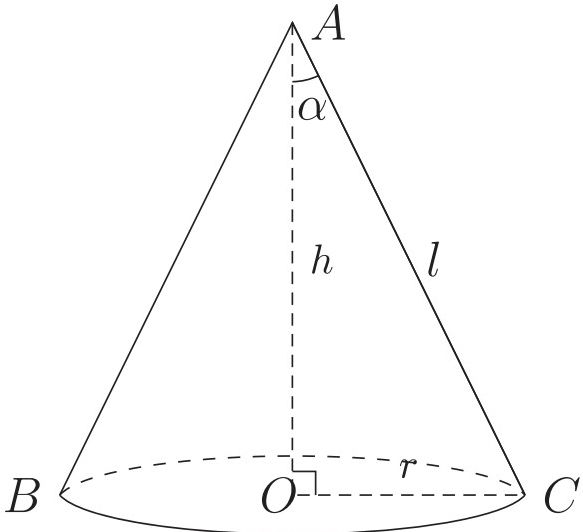

<!-- higher-math-9-10-bn-c13-t13.12-p034 · text · p.300 · review: verify-formula -->
**সমাধান:** উপরের চিত্রে, কোণকের উচ্চতা $OA = h$ হেলানো উচ্চতা $AC = l$, ভূমির ব্যাসার্ধ $OC = r$ এবং অর্ধ শীর্ষকোণ $\angle OAC = \alpha$। সুতরাং, হেলানো উচ্চতা $l = \sqrt{h^2 + r^2}$।

<!-- higher-math-9-10-bn-c13-t13.12-p035 · text · p.300 · review: verify-formula -->
চিত্র হতে দেখা যায় যে, $\tan \alpha = \frac{r}{h}$

<!-- higher-math-9-10-bn-c13-t13.12-p036 · text · p.300 · review: verify-formula -->
$\therefore r = h \tan \alpha$ বা, $h = \frac{r}{\tan \alpha} = r \cot \alpha$

<!-- higher-math-9-10-bn-c13-t13.12-p037 · text · p.300 · review: verify-formula -->
ক) $S = \pi r l = \pi r \sqrt{h^2 + h^2 \tan^2 \alpha} = \pi r h \sqrt{1 + \tan^2 \alpha} = \pi r h \sqrt{\sec^2 \alpha}$
$= \pi r h \sec \alpha = \pi (h \tan \alpha) h \sec \alpha = \frac{\pi h^2 \tan \alpha}{\cos \alpha}$ বর্গ একক

<!-- higher-math-9-10-bn-c13-t13.12-p038 · text · p.300 · review: verify-formula -->
আবার, $S = \pi r h \sec \alpha = \frac{\pi r}{\cos \alpha} r \cot \alpha = \frac{\pi r^2}{\cos \alpha} \frac{\cos \alpha}{\sin \alpha} = \frac{\pi r^2}{\sin \alpha}$ বর্গ একক

<!-- higher-math-9-10-bn-c13-t13.12-p039 · text · p.300 · review: verify-formula -->
খ) $V = \frac{1}{3} \pi r^2 h = \frac{1}{3} \pi (h \tan \alpha)^2 h = \frac{1}{3} \pi h^3 \tan^2 \alpha = \frac{1}{3} \pi \left( \frac{r}{\tan \alpha} \right)^3 \tan^2 \alpha$
$= \frac{\pi r^3}{3 \tan \alpha}$ ঘন একক

## 13.13 ৭. যৌগিক ঘনবস্তু (Compound solid)

<!-- higher-math-9-10-bn-c13-t13.13-p001 · text · p.300 · review: known-confusable-corrected -->
দুটি ঘনবস্তুর সমন্বয়ে গঠিত ঘনবস্তুকে যৌগিক ঘনবস্তু বলে। নিমে যৌগিক ঘনবস্তুর কিছু উদাহরণ দেওয়া হলো:

<!-- higher-math-9-10-bn-c13-t13.13-p002 · text · p.300 -->
ক) একটি আয়তাকার ঘনবস্তুর উপরের তল যদি একটি খাড়া প্রিজমের কোনো একটি তলের সমান হয় তবে ঘনবস্তুর উপর মিলিয়ে প্রিজমটি বসালে একটি যৌগিক ঘনবস্তু হয়।

<!-- higher-math-9-10-bn-c13-t13.13-p003 · text · p.300 -->
খ) একটি প্রিজমের ভূমি ও একটি চতুস্তলকের ভূমি সর্বসম হলে এবং চতুস্তলকটিকে প্রিজমের উপর বসালে একটি যৌগিক ঘনবস্তু হয়।

<!-- higher-math-9-10-bn-c13-t13.13-p004 · text · p.300 -->
গ) একটি অর্ধগোলকের ব্যাসার্ধ ও একটি সমবৃত্তভূমিক কোণকের ভূমির ব্যাসার্ধ সমান হলে এবং কোণকটিকে অর্ধগোলকের উপর বসালে একটি নতুন ঘনবস্তু সৃষ্টি হয়।

<!-- higher-math-9-10-bn-c13-t13.13-p005 · text · p.300 · review: known-confusable-corrected -->
ঘ) দুটি অর্ধগোলক ও একটি সমবৃত্তভূমিক সিলিন্ডারের সমন্বয়ে গঠিত যৌগিক ঘনবস্তুকে ক্যাপসুল বলা যেতে পারে।

<!-- higher-math-9-10-bn-c13-t13.13-p006 · text · p.301 · review: known-confusable-corrected -->
এভাবে দুই বা দুইয়ের অধিক ঘনবস্তু সমন্বয়ে বিভিন্ন প্রকারের যৌগিক ঘনবস্তু তৈরি করা যায়। অনেক দৃষ্টিদর্শন স্থাপনাও যৌগিক ঘনবস্তু। ব্যয়াম করার অনেক উপকরণও একাধিক ঘনবস্তু সমন্বয়ে তৈরি করা হয়।

<!-- higher-math-9-10-bn-c13-t13.13-p007 · figure · p.301 -->
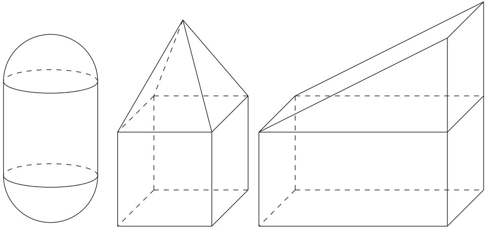

<!-- higher-math-9-10-bn-c13-t13.13-p008 · text · p.301 -->
**কাজ:** তোমরা প্রত্যেকে একটি করে যৌগিক ঘনবস্তু অঙ্কন কর ও ইহার বর্ণনা দাও। সমস্ত হলে এর তলসমূহের ক্ষেত্রফল ও আয়তন নির্ণয়ের সূত্র লেখো।

<!-- higher-math-9-10-bn-c13-t13.13-p009 · text · p.301 -->
**উদাহরণ ৯.** একটি ক্যাপসুলের দৈর্ঘ্য ১৫ সে.মি.। ইহার সিলিন্ডার আকৃতির অংশের ব্যাসার্ধ ৩ সে.মি. হলে, সমগ্রতলের ক্ষেত্রফল ও আয়তন নির্ণয় করো।

<!-- higher-math-9-10-bn-c13-t13.13-p010 · text · p.301 · review: verify-formula -->
**সমাধান:** ক্যাপসুলের সম্পূর্ণ দৈর্ঘ্য ১৫ সে.মি.। যেহেতু ক্যাপসুলের দুই প্রান্ত অর্ধগোলকাঙ্কতি, সেহেতু এর সিলিন্ডার আকৃতির অংশের দৈর্ঘ্য $l = 15 - (3 + 3) = 9$ সে.মি.।

<!-- higher-math-9-10-bn-c13-t13.13-p011 · text · p.301 -->
সুতরাং ক্যাপসুলের সমগ্রতলের ক্ষেত্রফল = দুই প্রান্তের অর্ধগোলকাঙ্কতি অংশের পৃষ্ঠতলের ক্ষেত্রফল + সিলিন্ডার আকৃতির অংশের পৃষ্ঠতলের ক্ষেত্রফল

<!-- higher-math-9-10-bn-c13-t13.13-p012 · formula · p.301 · review: latin-junk,verify-formula -->
$$= 2 \times \frac{1}{2} \times 4\pi r^2 + 2\pi rl = 4\pi(3)^2 + 2\pi \times 3 \times 9 = 90\pi = 282.74  বর্গ সে.মি. (প্রায়)$$

<!-- higher-math-9-10-bn-c13-t13.13-p013 · text · p.301 -->
এবং ক্যাপসুলটির আয়তন

<!-- higher-math-9-10-bn-c13-t13.13-p014 · formula · p.301 · review: latin-junk,verify-formula -->
$$= 2 \times \frac{1}{2} \times \frac{4}{3}\pi r^3 + \pi r^2 l = \frac{4}{3}\pi(3)^3 + \pi(3)^2 \times 9 = 117\pi = 367.57  ঘন সে.মি. (প্রায়)$$

<!-- higher-math-9-10-bn-c13-t13.13-p015 · text · p.301 -->
**উদাহরণ ১০.** একটি লোহার ফাঁপা গোলকের বাইরের ব্যাস ১৫ সে.মি. এবং বেধ ২ সে.মি.।

<!-- higher-math-9-10-bn-c13-t13.13-p016 · text · p.301 -->
ক) গোলকের ফাঁপা অংশের আয়তন নির্ণয় করো।

<!-- higher-math-9-10-bn-c13-t13.13-p017 · text · p.301 -->
খ) গোলকে ব্যবহৃত লোহা দিয়ে একটি নিরেট গোলক তৈরি করা হলো। নিরেট গোলকের পৃষ্ঠতলের ক্ষেত্রফল নির্ণয় করো।

<!-- higher-math-9-10-bn-c13-t13.13-p018 · text · p.301 -->
গ) নিরেট গোলকটি একটি ঘনক আকৃতির বাক্ষে ঠিকভাবে ঐটে গেল। বাক্ষটির অনধিকৃত অংশের আয়তন নির্ণয় করো।

### সমাধান:

<!-- higher-math-9-10-bn-c13-t13.13-p019 · text · p.302 -->
ক) দেওয়া আছে, গোলকের বাইরের ব্যাস 15 সে.মি.

<!-- higher-math-9-10-bn-c13-t13.13-p020 · text · p.302 · review: verify-formula -->
$\therefore$ গোলকের বাইরের ব্যাসার্ধ $= \frac{15}{2}$ সে.মি. $= 7.5$ সে.মি. এবং গোলকের বেধ 2 সে.মি.

<!-- higher-math-9-10-bn-c13-t13.13-p021 · text · p.302 · review: verify-formula -->
$\therefore$ গোলকের ফাঁপা অংশের ব্যাসার্ধ $= (7.5 - 2)$ সে.মি. $= 5.5$ সে.মি.

<!-- higher-math-9-10-bn-c13-t13.13-p022 · text · p.302 · review: verify-formula -->
$\therefore$ গোলকের ফাঁপা অংশের আয়তন $= \frac{4}{3}\pi r^3 = \frac{4}{3}\pi \times (5.5)^3 = 696.9116$ ঘন সে.মি.
(প্রায়)

<!-- higher-math-9-10-bn-c13-t13.13-p023 · text · p.302 -->
খ) এখানে, গোলকের ব্যাসার্ধ 7.5 সে.মি.

<!-- higher-math-9-10-bn-c13-t13.13-p024 · text · p.302 · review: verify-formula -->
$\therefore$ গোলকের আয়তন $= \frac{4}{3}\pi \times (7.5)^3 = 1767.15$ ঘন সে.মি. (প্রায়)

<!-- higher-math-9-10-bn-c13-t13.13-p025 · text · p.302 · review: verify-formula -->
$\therefore$ গোলকে ব্যবহৃত লোহার আয়তন $= (1767.15 - 696.9116) = 1070.2384$ ঘন সে.মি.
(প্রায়)

<!-- higher-math-9-10-bn-c13-t13.13-p026 · text · p.302 · review: verify-formula -->
মনে করি, নিরেট গোলকের ব্যাসার্ধ $r$ সে.মি.

<!-- higher-math-9-10-bn-c13-t13.13-p027 · text · p.302 · review: verify-formula -->
$\therefore$ নিরেট গোলকের আয়তন $= \frac{4}{3}\pi \times r^3$ ঘন সে.মি.

<!-- higher-math-9-10-bn-c13-t13.13-p028 · text · p.302 -->
যেহেতু ফাঁপা গোলকে ব্যবহৃত লোহা দিয়ে নিরেট গোলকটি তৈরি করা হয়েছে, সেহেতু লোহার আয়তন নিরেট গোলকের আয়তনের সমান।

<!-- higher-math-9-10-bn-c13-t13.13-p029 · text · p.302 · review: verify-formula -->
$\therefore \frac{4}{3}\pi \times r^3 = 1070.2384$ বা, $r^3 = 255.5$ বা, $r = 6.3454$ সে.মি.

<!-- higher-math-9-10-bn-c13-t13.13-p030 · text · p.302 · review: verify-formula -->
$\therefore$ নিরেট গোলকটির পৃষ্ঠতলের ক্ষেত্রফল $= 4\pi \times (6.3454)^2 = 505.9748$ বর্গ সে.মি. (প্রায়)

<!-- higher-math-9-10-bn-c13-t13.13-p031 · text · p.302 -->
গ) নিরেট গোলকের ব্যাসার্ধ 6.3454 সে.মি.

<!-- higher-math-9-10-bn-c13-t13.13-p032 · text · p.302 · review: verify-formula -->
$\therefore$ নিরেট গোলকের ব্যাস $= 2 \times 6.3454$ সে.মি. $= 12.6908$ সে.মি.

<!-- higher-math-9-10-bn-c13-t13.13-p033 · text · p.302 · review: verify-formula -->
যেহেতু নিরেট গোলকটি ঘনক আকৃতির বাক্ষে ঠিকভাবে ঐটে যায়, সেহেতু বাক্সটির দৈর্ঘ্য হবে নিরেট গোলকের ব্যাসের সমান। সুতরাং ঘনক আকৃতির বাক্সের দৈর্ঘ্য $= 12.6908$ সে.মি.

<!-- higher-math-9-10-bn-c13-t13.13-p034 · text · p.302 · review: verify-formula -->
$\therefore$ বাক্সটির আয়তন $= (12.6908)^3 = 2043.9346$ ঘন সে.মি. (প্রায়)

<!-- higher-math-9-10-bn-c13-t13.13-p035 · text · p.302 · review: verify-formula -->
নিরেট গোলকের আয়তন $=$ ফাঁপা গোলকে ব্যবহৃত লোহার আয়তন $= 1070.2384$ ঘন সে.মি.
(প্রায়)

<!-- higher-math-9-10-bn-c13-t13.13-p036 · text · p.302 · review: verify-formula -->
$\therefore$ বাক্সটির অনধিকৃত অংশের আয়তন $= (2043.9346 - 1070.2384) = 973.6962$ ঘন সে.মি. (প্রায়)

## 13.ex অনুশীলনী ১৩

<!-- higher-math-9-10-bn-c13-t13.ex-p001 · exercise · p.303 -->
১. একটি আয়তাকার ঘনবস্তুর দৈর্ঘ্য, প্রস্থ ও উচ্চতা যথাক্রমে 16 মি., 12 মি. ও 4.5 মি.। এর পৃষ্ঠতলের ক্ষেত্রফল, কর্ণের দৈর্ঘ্য এবং আয়তন নির্ণয় করো।

<!-- higher-math-9-10-bn-c13-t13.ex-p002 · exercise · p.303 -->
২. ভূমির উপর অবস্থিত 2.5 মি. দৈর্ঘ্য ও 1 মি. প্রস্থ বিশিষ্ট (অভ্যন্তরীণ পরিমাণ) একটি আয়তাকার জলাধারের উচ্চতা 0.4 মিটার হলে, এর আয়তন এবং অভ্যন্তরীণ তলের ক্ষেত্রফল নির্ণয় করো।

<!-- higher-math-9-10-bn-c13-t13.ex-p003 · exercise · p.303 -->
৩. 70জন ছাত্রের জন্য এরূপ একটি হোস্টেল নির্মাণ করতে হবে যাতে প্রত্যেক ছাত্রের জন্য 4.25 বর্গমিটার মেঝে ও 13.6 ঘনমিটার শূন্যস্থান থাকে। ঘরটি 34 মিটার লম্বা হলে, এর প্রস্থ ও উচ্চতা কত হবে?

<!-- higher-math-9-10-bn-c13-t13.ex-p004 · exercise · p.303 -->
৪. একটি সমবৃত্তভূমিক কোণকের উচ্চতা 24 সে.মি. এবং আয়তন 1232 ঘন সে.মি.। এর হেলানো উচ্চতা কত?

<!-- higher-math-9-10-bn-c13-t13.ex-p005 · exercise · p.303 -->
৫. কোনো সমকোণী ত্রিভুজের দুটি বাহুর দৈর্ঘ্য 5 সে.মি. এবং 3.5 সে.মি.। একে বৃহত্তর বাহুর চতুর্দিকে ঘোরালে যে ঘনবস্তু উৎপন্ন হয়, তার আয়তন নির্ণয় করো।

<!-- higher-math-9-10-bn-c13-t13.ex-p006 · exercise · p.303 · review: verify-formula -->
৬. 6, 8, $r$ সে.মি. ব্যাসার্ধবিশিষ্ট তিনটি কঠিন কাচের বল গলিয়ে 9 সে.মি. ব্যাসার্ধ বিশিষ্ট একটি কঠিন গোলকে পরিণত করা হলো। $r$ এর মান নির্ণয় করো।

<!-- higher-math-9-10-bn-c13-t13.ex-p007 · exercise · p.303 -->
৭. একটি ফাঁপা লোহার গোলকের বাইরের ব্যাস 13 সে.মি. এবং লোহার বেধ 2 সে.মি.। ঐ গোলকে ব্যবহৃত লোহ দিয়ে একটি নিরেট গোলক তৈরি করা হলো। তার ব্যাস কত হবে?

<!-- higher-math-9-10-bn-c13-t13.ex-p008 · exercise · p.303 -->
৮. 4 সে.মি. ব্যাসার্ধের একটি নিরেট গোলককে গলিয়ে 5 সে.মি. বহিব্যাসার্ধ বিশিষ্ট ও সমভাবে পুরু একটি ফাঁপা গোলক প্রস্তুত করা হলো। দ্বিতীয় গোলকটি কত পুরু?

<!-- higher-math-9-10-bn-c13-t13.ex-p009 · exercise · p.303 -->
৯. একটি লোহার নিরেট গোলকের ব্যাসার্ধ 6 সে.মি.। এর লোহ থেকে 4 সে.মি. দৈর্ঘ্য ও 6 সে.মি. ব্যাসের কয়টি নিরেট সিলিন্ডার প্রস্তুত করা যাবে?

<!-- higher-math-9-10-bn-c13-t13.ex-p010 · exercise · p.303 · review: verify-formula -->
১০. $\frac{22}{7}$ সে.মি. ব্যাসার্ধবিশিষ্ট একটি গোলক আকৃতির বল একটি ঘনক আকৃতির বাক্সে ঠিকভাবে $\frac{\pi}{6}$এটে যায়। বাক্সটির অনধিকৃত অংশের আয়তন নির্ণয় করো।

<!-- higher-math-9-10-bn-c13-t13.ex-p011 · exercise · p.303 -->
১১. 13 সে.মি. ব্যাসার্ধবিশিষ্ট একটি গোলকের কেন্দ্র থেকে 12 সে.মি. দূরবর্তী কোনো বিন্দুর মধ্য দিয়ে ব্যাসের উপর লম্ব সমতল গোলকটিকে ছেদ করে। উৎপন্ন তলটির ক্ষেত্রফল নির্ণয় করো।

<!-- higher-math-9-10-bn-c13-t13.ex-p012 · exercise · p.303 -->
১২. একটি ঢাকনায়ুক্ত কাঠের বাক্সের বাইরের দৈর্ঘ্য ও প্রস্থ যথাক্রমে 1.6 মি. ও 1.2 মি., উচ্চতা 0.8 মি. এবং এর কাঠ 3 সে.মি. পুরু। বাক্সটির ভিতরের তলের ক্ষেত্রফল কত? প্রতি বর্গমিটার 14.44 টাকা হিসেবে বাক্সের ভিতর রং করতে কত খরচ হবে?

<!-- higher-math-9-10-bn-c13-t13.ex-p013 · exercise · p.303 -->
১৩. 120 মি. দৈর্ঘ্য ও 90 মি. প্রস্থ (বহির্মাপ) বিশিষ্ট আয়তাকার বাগানের চতুর্দিকে 2 মি. উঁচু ও 25 সে.মি. পুরু প্রাচীর নির্মাণ করতে 25 সে.মি. দৈর্ঘ্য, 12.5 সে.মি. প্রস্থ এবং 4 সে.মি. বেধবিশিষ্ট কতগুলো ইট লাগবে?

<!-- higher-math-9-10-bn-c13-t13.ex-p014 · exercise · p.304 -->
১৪. একটি আয়তাকার ঘনবস্তুর দৈর্ঘ্য ও প্রস্থের অনুপাত ৪ : ৩ এবং এর আয়তন ২৩০৪ ঘন সে.মি.। প্রতি বর্গসেন্টিমিটারে ১০ টাকা হিসেবে ঐ বস্তুর তলায় সীসার প্রলেপ দিতে ১৯২০ টাকা খরচ হলে, ঐ বস্তুর মাত্রাগুলো নির্ণয় করো।

<!-- higher-math-9-10-bn-c13-t13.ex-p015 · exercise · p.304 -->
১৫. কোনক আকারের একটি তাঁবুর উচ্চতা ৭.৫ মিটার। এই তাঁবু দ্বারা ২০০০ বর্গমিটার জমি ঘিরতে চাইলে কি পরিমাণ ক্যানভাস লাগবে?

<!-- higher-math-9-10-bn-c13-t13.ex-p016 · exercise · p.304 -->
১৬. ৪ সে.মি. বাহুবিশিষ্ট একটি সুষম যড়ভুজাকার প্রিজমের উচ্চতা ৫ সে.মি.। ইহার সমগ্রতলের ক্ষেত্রফল ও আয়তন বের করো।

<!-- higher-math-9-10-bn-c13-t13.ex-p017 · exercise · p.304 -->
১৭. ৬ সে.মি. বাহুবিশিষ্ট সুষম যড়ভুজের উপর অবস্থিত একটি পিরামিডের উচ্চতা ১০ সে.মি.। ইহার সমগ্রতলের ক্ষেত্রফল ও আয়তন নির্ণয় করো।

<!-- higher-math-9-10-bn-c13-t13.ex-p018 · exercise · p.304 -->
১৮. একটি সুষম চতুস্তলকের যেকোনো ধারের দৈর্ঘ্য ৪ সে.মি. হলে, ইহার সমগ্রতলের ক্ষেত্রফল ও আয়তন নির্ণয় করো।

<!-- higher-math-9-10-bn-c13-t13.ex-p019 · exercise · p.304 -->
১৯. একটি স্থাপনার নিচের অংশ ৩ মি. উচ্চতাবিশিষ্ট আয়তাকার ঘনবস্তু ও উপরের অংশ সুষম পিরামিড। পিরামিডের ভূমির বাহুর দৈর্ঘ্য ২ মি. এবং উচ্চতা ৩ মি. হলে স্থাপনাটির সমগ্রতলের ক্ষেত্রফল ও আয়তন নির্ণয় করো।

<!-- higher-math-9-10-bn-c13-t13.ex-p020 · exercise · p.304 -->
২০. ২৫ মি. দৈর্ঘ্য ও ১৮ মি. প্রস্থ বিশিষ্ট ভূমির উপর অবস্থিত দোচালা গুদাম ঘরের দেয়ালের উচ্চতা ৫ মি.। প্রতিটি চালার প্রস্থ ১৪ মি. হলে গুদাম ঘরটির আয়তন নির্ণয় করো।

<!-- higher-math-9-10-bn-c13-t13.ex-p021 · exercise · p.304 -->
২১. একটি সমবৃত্তভূমিক কোণাকৃতির তাঁবুর উচ্চতা ৪ মিটার এবং এর ভূমির ব্যাস ৫০ মিটার।
ক) তাঁবুটির হেলানো উচ্চতা নির্ণয় করো।
খ) তাঁবুটি স্থাপন করতে কত বর্গমিটার জমির প্রয়োজন হবে? তাঁবুটির ভিতরের শূন্যস্থানের পরিমাণ নির্ণয় করো।
গ) তাঁবুটির প্রতি বর্গমিটার ক্যানভাসের মূল্য ১২৫ টাকা হলে ক্যানভাস ব্যবদ কত খরচ হবে?

### বহুনির্বাচনি প্রশ্ন

<!-- higher-math-9-10-bn-c13-t13.ex-p022 · exercise · p.304 · review: verify-formula -->
১. একটি আয়তাকার ঘনবস্তুর দৈর্ঘ্য ৫ সে.মি., প্রস্থ ৪ সে.মি. এবং উচ্চতা ৩ সে.মি.। এর কর্ণ কত?
ক) $5\sqrt{2}$ সে.মি. খ) ১২ সে.মি. গ) $2\sqrt{5}$ সে.মি. ঘ) ৫০ সে.মি.

<!-- higher-math-9-10-bn-c13-t13.ex-p023 · exercise · p.304 · review: verify-formula -->
২. কোনো সমকোণী ত্রিভুজের অতিভুজ ভিন অপর বাহুদ্বয়ের দৈর্ঘ্য ৪ সে.মি. এবং ৩ সে.মি.। ত্রিভুজটিকে বৃহত্তর বাহুর চতুর্দিকে ঘোরালে -
(i) উপপ্লস ঘনবস্তুটি একটি সমবৃত্তভূমিক কোণক হবে
(ii) ঘনবস্তুটি একটি সমবৃত্তভূমিক সিলিন্ডার হবে
(iii) উপপ্লস ঘনবস্তুটির ভূমির ক্ষেত্রফল হবে $9\pi$ বর্গ সে.মি.

<!-- higher-math-9-10-bn-c13-t13.ex-p024 · exercise · p.305 · review: verify-formula -->
ওপরের তথ্যের আলোকে নিচের কোনটি সঠিক?
ক) $i$                      খ) $ii$                      গ) $i$ ও $iii$                      ঘ) $ii$ ও $iii$

<!-- higher-math-9-10-bn-c13-t13.ex-p025 · exercise · p.305 -->
নিম্নের তথ্যের আলোকে ৩ ও ৪ নম্বর প্রশ্নের উত্তর দাও।

<!-- higher-math-9-10-bn-c13-t13.ex-p026 · exercise · p.305 -->
২ সে.মি. ব্যাসের একটি গোলক আকৃতির বল একটি সিলিন্ডার আকৃতির বাক্ষে ঠিকভাবে ঐটে যায়।

<!-- higher-math-9-10-bn-c13-t13.ex-p027 · exercise · p.305 · review: verify-formula -->
৩. সিলিন্ডারটির আয়তন কত?
ক) $2\pi$ ঘন সে.মি.      খ) $4\pi$ ঘন সে.মি.      গ) $6\pi$ ঘন সে.মি.      ঘ) $8\pi$ ঘন সে.মি.

<!-- higher-math-9-10-bn-c13-t13.ex-p028 · exercise · p.305 · review: verify-formula -->
৪. সিলিন্ডারটির অনধিকৃত অংশের আয়তন কত?
ক) $\frac{\pi}{3}$ ঘন সে.মি.      খ) $\frac{2\pi}{3}$ ঘন সে.মি.      গ) $\frac{4\pi}{3}$ ঘন সে.মি.      ঘ) $\frac{3\pi}{3}$ ঘন সে.মি.

### সৃজনশীল প্রশ্ন

<!-- higher-math-9-10-bn-c13-t13.ex-p029 · exercise · p.305 · review: latin-junk,known-confusable-corrected -->
৫.
drawing: A rectangular prism with vertices labeled A, B, C, D, A', B', C', D'. Dimensions are labeled: 8 সে.মি. at the bottom, ৩ সে.মি. at the right side, and ৩ সে.মি. at the top right.

<!-- higher-math-9-10-bn-c13-t13.ex-p030 · exercise · p.305 · review: known-confusable-corrected -->
ক) ঘনবস্তুটির সমগ্রতলের ক্ষেত্রফল নির্ণয় করো।

<!-- higher-math-9-10-bn-c13-t13.ex-p031 · exercise · p.305 · review: known-confusable-corrected -->
খ) ঘনবস্তুটির কর্ণের সমান ধারবিশিষ্ট একটি ধাতব ঘনককে গলিয়ে 1.8 সে.মি. ব্যাসবিশিষ্ট কতগুলো নিরেট গোলক উৎপন্ন করা যাবে তা নিকটতম পূর্ণসংখ্যায় নির্ণয় করো।

<!-- higher-math-9-10-bn-c13-t13.ex-p032 · exercise · p.305 · review: known-confusable-corrected -->
গ) একটি সমবৃৎভূমিক কোণকের উচ্চতা ও আয়তন যথাক্রমে ঘনবস্তুটির দৈর্ঘ্য ও আয়তনের সমান হলে, কোণকটির সমগ্রতলের ক্ষেত্রফল নির্ণয় করো।

<!-- higher-math-9-10-bn-c13-t13.ex-p033 · exercise · p.305 · review: known-confusable-corrected -->
৬. একটি লোহার নিরেট গোলকের ব্যাস 12 সেমি.। এর লোহা থেকে 8 সেমি. দৈর্ঘ্য ও 6 সেমি. ব্যাসের কয়েকটি নিরেট সমবৃৎভূমিক সিলিন্ডার প্রস্তুত করা হলো।
ক) লোহার নিরেট গোলকের পৃষ্ঠতলের ক্ষেত্রফল নির্ণয় করো।
খ) সিলিন্ডারের সংখ্যা নির্ণয় করো।
গ) নিরেট গোলকটি যদি একটি ঘনক আকৃতির বাক্ষে ঠিকভাবে ঐটে যায়, তবে বাক্সটির অনধিকৃত অংশের আয়তন নির্ণয় করো।

### সংক্ষিপ্ত-উত্তর প্রশ্ন

<!-- higher-math-9-10-bn-c13-t13.ex-p034 · exercise · p.305 -->
৭. ক) একটি আয়তাকার ঘনবস্তুর মাত্রাগুলো 5 সে.মি., 4 সে.মি. ও 3 সে.মি. হলে, এর কর্ণের সমান ধারবিশিষ্ট ঘনকের সমগ্রতলের ক্ষেত্রফল নির্ণয় করো।

<!-- higher-math-9-10-bn-c13-t13.ex-p035 · exercise · p.305 -->
খ) একটি সমবৃৎভূমিক কোণকের উচ্চতা 8 সে.মি. এবং ভূমির ব্যাসার্ধ 6 সে.মি. হলে, সমগ্রতলের ক্ষেত্রফল ও আয়তন নির্ণয় করো।

<!-- higher-math-9-10-bn-c13-t13.ex-p036 · exercise · p.305 -->
গ) একটি ত্রিভুজাকার প্রিজমের ভূমির বাহুগুলোর দৈর্ঘ্য যথাক্রমে 6, 8 ও 10 সেমি.। প্রিজমটির উচ্চতা 12 সেমি. হলে, এর আয়তন নির্ণয় করো।
