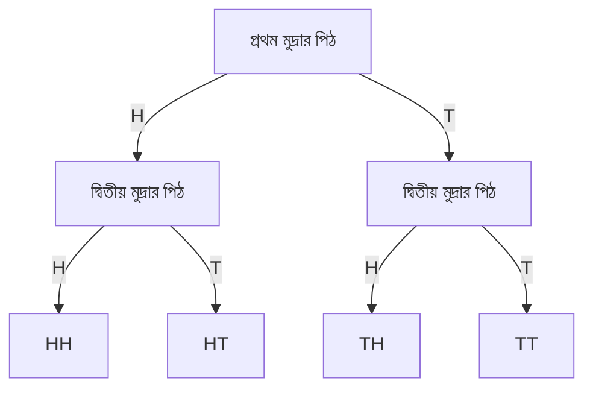
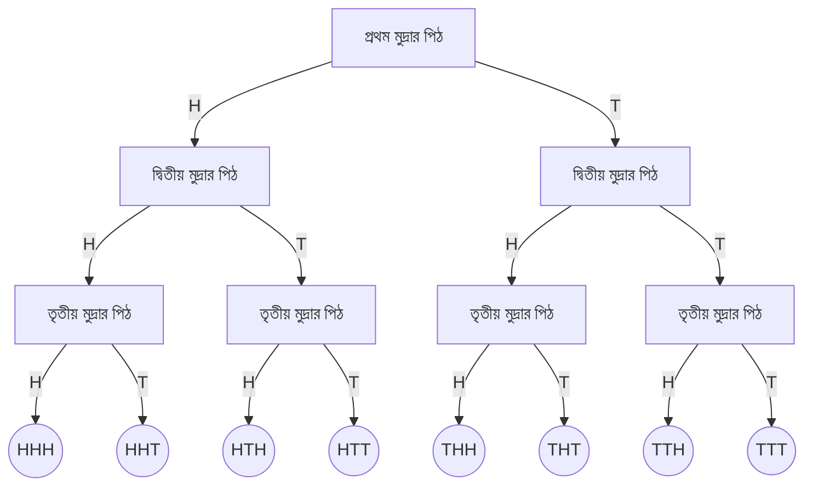
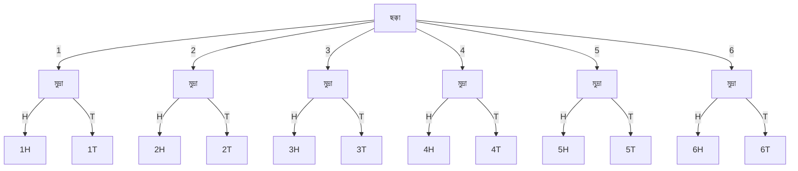

# 14. সম্ভাবনা

Source: Higher Math Bangla Version, printed pp. 306-327

## 14.0 ভূমিকা ও শিখনফল

<!-- higher-math-9-10-bn-c14-t14.0-p001 · text · p.306 -->
আমরা প্রতিনিয়ত ‘সম্ভাবনা’ শব্দটি ব্যবহার করে থাকি। যেমন এবার এস.এস.সি. পরীক্ষায় যাদবের পাশ করার সম্ভাবনা খুব কম, এশিয়া কাপ ক্রিকেটে বাংলাদেশের জয়ের সম্ভাবনা বেশি, আগামীকাল তাপমাত্রা বৃদ্ধি পাওয়ার সম্ভাবনা বেশি, আজ বৃষ্টি হওয়ার সম্ভাবনা কম ইত্যাদি। অর্থাৎ কোনো ঘটনা ঘটার ক্ষেত্রে অনিশ্চয়তা থাকলেই কেবল আমরা সম্ভাবনার কথা বলি। আর অনিশ্চয়তার মাত্রার উপরই ঘটনাটা ঘটার সম্ভাবনা কম বা বেশি হবে তা নির্ভর করে। কিন্তু কোনো সাংখ্যিক মান দিতে পারে না। এই অধ্যায়ে আমরা কোনো ঘটনা ঘটার সম্ভাবনার সাংখ্যিক মান নির্ণয়ের বিভিন্ন সূত্র এবং নির্ণয় প্রণালী সম্পর্কে জানব এবং নিশ্চিত ঘটনা, অসম্ভব ঘটনা ও সম্ভাব্য ঘটনা বর্ণনা করতে পারব।

<!-- higher-math-9-10-bn-c14-t14.0-p002 · text · p.306 -->
এই অধ্যায় শেষে শিক্ষার্থীরা ---

<!-- higher-math-9-10-bn-c14-t14.0-p003 · text · p.306 -->
* ▶ সম্ভাবনার ধারণা ব্যাখ্যা করতে পারবে;
* ▶ দৈনদিন বিভিন্ন উদাহরণের সাহায্যে নিশ্চিত ঘটনা, অসম্ভব ও সম্ভাব্য ঘটনার বর্ণনা করতে পারবে;
* ▶ একই ঘটনার পুনরাবৃত্তি ঘটলে সম্ভাব্য ফলাফল বর্ণনা করতে পারবে;
* ▶ একই ঘটনার পুনরাবৃত্তি ঘটলে সম্ভাবনা নির্ণয় করতে পারবে;
* ▶ সম্ভাবনার সহজ ও বাস্তবভিত্তিক সমস্যার সমাধান করতে পারবে।

### সম্ভাবনার সাথে জড়িত কিছু ধারণা

<!-- higher-math-9-10-bn-c14-t14.0-p004 · text · p.306 · review: known-confusable-corrected -->
**দৈব পরীক্ষা (Random Experiment):** যখন কোনো পরীক্ষার সম্ভাব্য সকল ফলাফল আগে থেকে জানা থাকে কিন্তু পরীক্ষাটিতে কোনো একটি নির্দিষ্ট চেষ্টায় কী ফলাফল আসবে তা নিশ্চিত করে বলা যায় না, একে দৈব পরীক্ষা বলে। যেমন একটা মুদ্রা নিক্ষেপ পরীক্ষার সম্ভাব্য ফলাফল কী হবে, তা আমরা আগে থেকেই জানি কিন্তু মুদ্রাটি নিক্ষেপের পূর্বে কোন ফলাফলটি ঘটবে তা আমরা নিশ্চিত করে বলতে পারি না। সুতরাং মুদ্রা নিক্ষেপ পরীক্ষা একটা দৈব পরীক্ষা।

<!-- higher-math-9-10-bn-c14-t14.0-p005 · text · p.306 · review: known-confusable-corrected -->
**ঘটনা (Event):** কোনো পরীক্ষার ফলাফল বা ফলাফলের সমাহারকে ঘটনা বলে। উদাহরণস্বরূপ, একটা ছক্কা নিক্ষেপ পরীক্ষায় ৩ পাওয়া একটি ঘটনা। আবার জোড় সংখ্যা পাওয়াও একটি ঘটনা।

<!-- higher-math-9-10-bn-c14-t14.0-p006 · text · p.306 · review: known-confusable-corrected -->
**সমসম্ভাব্য ঘটনাবলী (Equally Likely Events):** যদি কোনো পরীক্ষার ঘটনাগুলো ঘটার সম্ভাবনা সমান হয় অর্থাৎ একটি অপরটির চেয়ে বেশি বা কম সম্ভাব্য না হয় তবে ঘটনাগুলোকে সমসম্ভাব্য বলে। যেমন একটা নিরপেক্ষ মুদ্রা নিক্ষেপে হেড বা টেল আসার সম্ভাবনা সমান। সুতরাং হেড আসা ও টেল আসা ঘটনা দুটি সমসম্ভাব্য ঘটনা।

<!-- higher-math-9-10-bn-c14-t14.0-p007 · text · p.307 · review: known-confusable-corrected -->
**পরস্পর বিচ্ছিন্ন ঘটনাবলি (Mutually Exclusive Events):** কোনো পরীক্ষায় যদি একটা ঘটনা ঘটেলে অন্যটা অথবা অন্য ঘটনাগুলো না ঘটে পারে তবে উক্ত ঘটনাগুলোকে পরস্পর বিচ্ছিন্ন ঘটনা বলে। যেমন, একটা নিরপেক্ষ মুদ্রা নিক্ষেপ করলে হেড আসা বা টেল আসা দুটি বিচ্ছিন্ন ঘটনা। কেননা হেড আসলে টেল আসতে পারে না। আবার টেল আসলে হেড আসতে পারে না। অর্থাৎ হেড ও টেল একসাথে আসতে পারে না।

<!-- higher-math-9-10-bn-c14-t14.0-p008 · text · p.307 · review: known-confusable-corrected -->
**অনুকূল ফলাফল (Favourable Outcomes):** কোনো পরীক্ষায় একটা ঘটনার স্বপ্নের ফলাফল হলো ঘটনার অনুকূল ফলাফল। একটি ছক্কা নিক্ষেপ করলে বিজোড় সংখ্যা হওয়ার অনুকূল ফলাফল ৩ টি।

<!-- higher-math-9-10-bn-c14-t14.0-p009 · text · p.307 · review: known-confusable-corrected,verify-formula -->
**নমুনাক্ষেত্র (Sample Space) ও নমুনা বিন্দু (Sample Point):** কোনো দৈব পরীক্ষার সম্ভাব্য সকল ফলাফল নিয়ে গঠিত সেটকে নমুনাক্ষেত্র বলে। একটা মুদ্রা নিক্ষেপ করলে দুইটি সম্ভাব্য ফলাফল পাওয়া যায়, যথা হেড ও টেল। এখন $S$ দ্বারা এ পরীক্ষণের ফলাফলের সেটকে সূচিত করলে আমরা লিখতে পারি $S = \{H, T\}$। সুতরাং উক্ত পরীক্ষার নমুনাক্ষেত্র, $S = \{H, T\}$। মনে করা যাক দুটি মুদ্রা একসাথে নিক্ষেপ করা হলো। তাহলে নমুনাক্ষেত্রটি হবে $S = \{HH, HT, TH, TT\}$। নমুনাক্ষেত্রের প্রতিটি উপাদানকে ফলাফলের নমুনা বিন্দু বলে। একটা মুদ্রা একবার নিক্ষেপ পরীক্ষায় নমুনাক্ষেত্র $S = \{H, T\}$ এবং এখানে $H, T$ প্রত্যেকেই এক একটা নমুনা বিন্দু।

## 14.1 যুক্তিভিত্তিক সম্ভাবনা নির্ণয়

<!-- higher-math-9-10-bn-c14-t14.1-p001 · text · p.307 · review: known-confusable-corrected -->
**উদাহরণ ১.** মনে করি একটা নিরপেক্ষ ছক্কা নিক্ষেপ করা হলো। ৫ আসার সম্ভাবনা কত?

<!-- higher-math-9-10-bn-c14-t14.1-p002 · text · p.307 · review: known-confusable-corrected,verify-formula -->
**সমাধান:** একটা ছক্কা নিক্ষেপ করলে সম্ভাব্য ফলাফলগুলো হচ্ছে: 1, 2, 3, 4, 5, 6। ছক্কাটি নিরপেক্ষ হলে ফলাফলগুলো সমসম্ভাব্য হবে। অর্থাৎ যেকোনো ফলাফল আসার সম্ভাবনা সমান। অতএব যেকোনো একটা ফলাফল আসার সম্ভাবনা হয়ভাগের একভাগ। সুতরাং ৫ আসার সম্ভাবনা $\frac{1}{6}$। আমরা এটাকে $P(5) = \frac{1}{6}$ এভাবে লিখি।

<!-- higher-math-9-10-bn-c14-t14.1-p003 · text · p.307 · review: known-confusable-corrected -->
**উদাহরণ ২.** একটা নিরপেক্ষ ছক্কা নিক্ষেপে জোড় সংখ্যা আসার সম্ভাবনা কত?

<!-- higher-math-9-10-bn-c14-t14.1-p004 · text · p.307 · review: known-confusable-corrected,verify-formula -->
**সমাধান:** ছক্কা নিক্ষেপে সম্ভাব্য ফলাফলগুলো হচ্ছে 1, 2, 3, 4, 5, 6। এদের মধ্যে 2, 4, 6 এই ৩টি জোড় সংখ্যা। এই তিনটির যেকোনো একটা আসলে জোড় সংখ্যা হবে অর্থাৎ জোড় সংখ্যার অনুকূল ফলাফল ৩ টি। যেহেতু ফলাফলগুলো সমসম্ভাব্য, তাই জোড় সংখ্যা আসার সম্ভাবনা হবে $\frac{3}{6}$।

<!-- higher-math-9-10-bn-c14-t14.1-p005 · formula · p.307 · review: verify-formula -->
$$\therefore P(জোড়সংখ্যা) = \frac{3}{6}$$

<!-- higher-math-9-10-bn-c14-t14.1-p006 · text · p.308 · review: known-confusable-corrected -->
তাহলে সম্ভাবনাকে এভাবে সংজ্ঞায়িত করা যায়:

<!-- higher-math-9-10-bn-c14-t14.1-p007 · formula · p.308 · review: latin-junk,known-confusable-corrected,verify-formula -->
$$কোনো ঘটনা ঘটার সম্ভাবনা = \frac{উক্ত ঘটনার অনুকূল ফলাফল}{সমগ্র সম্ভাব্য ফলাফল}$$

<!-- higher-math-9-10-bn-c14-t14.1-p008 · text · p.308 · review: known-confusable-corrected,verify-formula -->
কোনো পরীক্ষণে কোনো ঘটনা ঘটার অনুকূল ফলাফল সর্বনিম্ন শূন্য এবং সর্বোচ্চ $n$ (সমগ্র সম্ভাব্য ঘটনাবলি) হতে পারে। যখন কোনো ঘটনার অনুকূল ফলাফলের মান শূন্য হয় তখন সম্ভাবনার মান শূন্য হয়। আর যখন অনুকূল ফলাফলের মান $n$ হয়, তখন সম্ভাবনার মান ১ হয়। এ কারণে সম্ভাবনার মান ০ হতে ১ এর মধ্যে থাকে।

## 14.2 দুইটি বিশেষ ধরনের ঘটনা

<!-- higher-math-9-10-bn-c14-t14.2-p001 · text · p.308 · review: known-confusable-corrected,verify-formula -->
**নিশ্চিত ঘটনা:** কোনো পরীক্ষায় যে ঘটনা অবশ্যই ঘটে একে নিশ্চিত ঘটনা বলে। নিশ্চিত ঘটনার ক্ষেত্রে সম্ভাবনার মান ১ হয়। যেমন, আগামীকাল সূর্য পূর্ব দিকে উঠার সম্ভাবনা ১, আজ সূর্য পশ্চিম দিকে অস্ত যাবে এর সম্ভাবনাও ১। রাতের বেলায় সূর্য দেখা যাবে না, এর সম্ভাবনা ১। একটা মুদ্রা নিক্ষেপ পরীক্ষায় $H$ অথবা $T$ আসার সম্ভাবনাও ১। একটা ছক্কা নিক্ষেপ পরীক্ষায় জোড় অথবা বিজোড় সংখ্যা আসার সম্ভাবনাও ১। এগুলোর প্রত্যেকই নিশ্চিত ঘটনা।

<!-- higher-math-9-10-bn-c14-t14.2-p002 · text · p.308 · review: known-confusable-corrected -->
**অসন্ন্যব ঘটনা :** কোনো পরীক্ষায় যে ঘটনা কখনো ঘটে না অর্থাৎ ঘটেতে পারে না একে অসন্ন্যব ঘটনা বলে। অসন্ন্যব ঘটনার সম্ভাবনা সব সময় শূন্য হয়। যেমন আগামীকাল সূর্য পশ্চিম দিক থেকে উঠবে অথবা পূর্বদিকে অস্ত যাবে এর সম্ভাবনা শূন্য। তেমনি রাত্রে সূর্য দেখা যাবে এর সম্ভাবনাও শূন্য। আবার একটা ছক্কা নিক্ষেপে ৭ আসার সম্ভাবনাও শূন্য। এখানে প্রত্যেকটি ঘটনাই অসন্ন্যব ঘটনা।

<!-- higher-math-9-10-bn-c14-t14.2-p003 · text · p.308 · review: known-confusable-corrected -->
**উদাহরণ ৩.** একটা থলেতে ৪টা লাল, ৫টা সাদা ও ৬টা কালো বল আছে। দৈবভাবে একটা বল নেয়া হলো। বলটি ক) লাল, খ) সাদা ও গ) কালো হওয়ার সম্ভাবনা কত?

<!-- higher-math-9-10-bn-c14-t14.2-p004 · text · p.308 · review: known-confusable-corrected -->
**সমাধান:** থলেতে মোট বলের সংখ্যা ১৫টি। দৈবভাবে একটা বল নেয়া হলে ১৫টি বলের যেকোনো একটি আসতে পারে। সুতরাং সমগ্র সম্ভাব্য ফলাফল = ১৫।

<!-- higher-math-9-10-bn-c14-t14.2-p005 · text · p.308 · review: verify-formula -->
ক) ধরি লাল বল হওয়ার ঘটনা $R$। থলেতে মোট ৪টি লাল বল আছে। এদের যেকোনো একটি আসলেই লাল বল হবে। সুতরাং লাল বলের অনুকূল ফলাফল = ৪।

<!-- higher-math-9-10-bn-c14-t14.2-p006 · formula · p.308 · review: latin-junk,known-confusable-corrected,verify-formula -->
$$\therefore P(R) = \frac{লাল বলের অনুকূল ফলাফল}{সমগ্র সম্ভাব্য ফলাফল} = \frac{4}{15}$$

<!-- higher-math-9-10-bn-c14-t14.2-p007 · text · p.308 · review: verify-formula -->
খ) ধরি সাদা বল হওয়ার ঘটনা $W$। থলেতে মোট ৫টি সাদা বল আছে। এদের যেকোনো একটি আসলেই সাদা বল হবে। সুতরাং সাদা বলের অনুকূল ফলাফল = ৫।

<!-- higher-math-9-10-bn-c14-t14.2-p008 · formula · p.308 · review: latin-junk,known-confusable-corrected,verify-formula -->
$$\therefore P(W) = \frac{সাদা বলের অনুকূল ফলাফল}{সমগ্র সম্ভাব্য ফলাফল} = \frac{5}{15} = \frac{1}{3}$$

<!-- higher-math-9-10-bn-c14-t14.2-p009 · text · p.308 · review: verify-formula -->
গ) ধরি কালো বল হওয়ার ঘটনা $B$। থলেতে মোট ৬টি কালো বল আছে। এদের যেকোনো একটি আসলেই কালো বল হবে। সুতরাং কালো বলের অনুকূল ফলাফল = ৬।

<!-- higher-math-9-10-bn-c14-t14.2-p010 · formula · p.308 · review: latin-junk,known-confusable-corrected,verify-formula -->
$$\therefore P(B) = \frac{কালো বলের অনুকূল ফলাফল}{সমগ্র সম্ভাব্য ফলাফল} = \frac{6}{15} = \frac{2}{5}$$

<!-- higher-math-9-10-bn-c14-t14.2-p011 · text · p.309 -->
**কাজ:**

<!-- higher-math-9-10-bn-c14-t14.2-p012 · text · p.309 · review: known-confusable-corrected -->
ক) একটি নিরপেক্ষ ছক্কা নিক্ষেপ করা হল। নিম্নলিখিত সম্ভাবনাগুলো বের করো।
(i) ৪ আসা (ii) বিজোড় সংখ্যা আসা (iii) ৪ অথবা ৪ এর বেশি সংখ্যা আসা (iv) ৫ এর কম সংখ্যা আসা।

<!-- higher-math-9-10-bn-c14-t14.2-p013 · text · p.309 · review: known-confusable-corrected -->
খ) একটি থলেতে একই ধরনের ৬টি কালো, ৫টি লাল, ৪টি সাদা মার্বেল আছে। থলে হতে একটি মার্বেল দৈবভাবে নির্বাচন করা হলো। নিম্নলিখিত সম্ভাবনাগুলো বের করো।
নির্বাচিত মার্বেলটি (i) লাল (ii) কালো (iii) সাদা (iv) কালো নয়।

## 14.3 তথ্যভিত্তিক সম্ভাবনা নির্ণয়

<!-- higher-math-9-10-bn-c14-t14.3-p001 · text · p.309 · review: known-confusable-corrected -->
যুক্তিভিত্তিক সম্ভাবনা নির্ণয়ে ফলাফলগুলো সমসম্ভাব্য হতে হয়। বাস্তবে সকল ক্ষেত্রে ফলাফলগুলো সমসম্ভাব্য হয় না। তাছাড়া অনেক ক্ষেত্রে সম্ভাবনার যুক্তিভিত্তিক সংজ্ঞার মতো কিছু গণনা করা যায় না। যেমন আবহাওয়ার পূর্বাভাসে বলা হচ্ছে আজ বৃষ্টি হবার সম্ভাবনা 30%, বিশ্বকাপ ফুটবলে ব্রাজিলের জয়ী হওয়ার সম্ভাবনা 40%, এশিয়া কাপ ক্রিকেটে বাংলাদেশের জয়ী হওয়ার সম্ভাবনা 60%। এসব সিদ্ধান্ত নেওয়া হয় অতীতের পরিসংখ্যান হতে এবং এটাই হচ্ছে তথ্যভিত্তিক সম্ভাবনার ধারণা।

<!-- higher-math-9-10-bn-c14-t14.3-p002 · text · p.309 · review: known-confusable-corrected,verify-formula -->
ধরা যাক, একটা মুদ্রা 1000 বার নিক্ষেপ করায় 523 বার হেড পাওয়া গেল। এ ক্ষেত্রে হেডের আপেক্ষিক গণসংখ্যা $\frac{523}{1000} = 0.523$। ধরা যাক মুদ্রাটিকে 2000 বার নিক্ষেপ করাতে 1030 বার হেড আসে। তাহলে 2000 বারের মধ্যে $H$ এর আপেক্ষিক গণসংখ্যা $\frac{1030}{2000} = 0.515$। এখান থেকে বুঝা যায় যে, পরীক্ষাটি ক্রমাগত চালিয়ে গেলে (পরীক্ষাটি যতবেশি বার করা যাবে) আপেক্ষিক গণসংখ্যার মানটি এমন একটি সংখ্যার কাছাকাছি হবে যাকে মুদ্রাটি একবার নিক্ষেপ করলে হেড আসার সম্ভাবনা হবে। একেই তথ্যভিত্তিক সম্ভাবনা বলা হয়।

<!-- higher-math-9-10-bn-c14-t14.3-p003 · text · p.309 · review: known-confusable-corrected -->
**উদাহরণ ৪.** আবহাওয়া দপ্তর থেকে পাওয়া রিপোর্ট অনুযায়ী জুলাই মাসে ঢাকা শহরে 21দিন বৃষ্টি হয়েছে। তাহলে 8জুলাই বৃষ্টি হওয়ার সম্ভাবনা কত?

<!-- higher-math-9-10-bn-c14-t14.3-p004 · text · p.309 · review: known-confusable-corrected,verify-formula -->
**সমাধান:** যেহেতু জুলাই মাস 31দিন এবং জুলাই মাসে 21দিন বৃষ্টি হয়েছে। তাহলে যেকোনো একদিন বৃষ্টি হওয়ার সম্ভাবনা $\frac{21}{31}$। অতএব 8জুলাই বৃষ্টি হওয়ার সম্ভাবনা $\frac{21}{31}$।

<!-- higher-math-9-10-bn-c14-t14.3-p005 · text · p.309 · review: known-confusable-corrected -->
**উদাহরণ ৫.** কোনো একটি নির্দিষ্ট এলাকায় জরিপে দেখা গেল 65জন প্রথম আলো, 40জন ভোরের কাগজ, 45জন জনকণ্ঠ, 52জন যুগান্তর পত্রিকা পড়ে। এদের মধ্যে হতে একজনকে দৈবভাবে নির্বাচন করলে তিনি যুগান্তর পত্রিকা পড়েন এর সম্ভাবনা কত? তিনি প্রথম আলো পড়েন না এর সম্ভাবনাও কত?

<!-- higher-math-9-10-bn-c14-t14.3-p006 · text · p.309 · review: verify-formula -->
**সমাধান:** এখানে পত্রিকা পড়েন মোট $(65 + 40 + 45 + 52) = 202$ জন।

<!-- higher-math-9-10-bn-c14-t14.3-p007 · text · p.309 · review: known-confusable-corrected,verify-formula -->
যুগান্তর পত্রিকা পড়েন 52জন। সুতরাং, ঐ ব্যক্তির যুগান্তর পত্রিকা পড়ার সম্ভাবনা $\frac{52}{202}$।

<!-- higher-math-9-10-bn-c14-t14.3-p008 · text · p.310 · review: verify-formula -->
প্রথম আলো পত্রিকা পড়েন ৬৫ জন। প্রথম আলো পত্রিকা পড়েন না $(202 - 65) = 137$ জন। সুতরাং, প্রথম আলো পত্রিকা পড়েন না এর সম্ভাবনা $= \frac{137}{202}$

<!-- higher-math-9-10-bn-c14-t14.3-p009 · text · p.310 -->
**কাজ:** একটি জরিপে দেখা গেল কোন বিশ্ববিদ্যালয়ে প্রথম বর্ষে 284জন ছাত্র অর্থনীতিতে, 106জন ছাত্র ইতিহাসে, 253জন ছাত্র সমাজবিজ্ঞানে, 169জন ছাত্র ইংরেজিতে ভর্তি হয়েছে। এদের একজন ছাত্রকে দৈবভাবে নির্বাচিত করলে নির্বাচিত ছাত্রটি সমাজবিজ্ঞানের হবে না এর সম্ভাবনা কত?

## 14.4 নমুনাক্ষেত্র এবং Probability Tree দ্বারা সম্ভাবনা নির্ণয়

<!-- higher-math-9-10-bn-c14-t14.4-p001 · text · p.310 · review: latin-junk -->
আগেই বলা হয়েছে, কোনো পরীক্ষায় সম্ভাব্য ফলাফলগুলো নিয়ে যে ক্ষেত্র তৈরি হয় তাকে নমুনাক্ষেত্র বলে। অনেক পরীক্ষায় নমুনাক্ষেত্রের আকার বেশ বড় হয়। এসব ক্ষেত্রে নমুনা বিন্দু গণনা করা ও নমুনাক্ষেত্র তৈরি করা সময় সাপেক্ষ এমন কি ভুল হওয়ার সম্ভাবনাও থাকে। সেক্ষেত্রে আমরা probability tree এর সাহায্যে নমুনাক্ষেত্র তৈরি করতে পারি ও বিভিন্ন ঘটনার সম্ভাবনাও বের করতে পারি।

<!-- higher-math-9-10-bn-c14-t14.4-p002 · text · p.310 · review: known-confusable-corrected,verify-formula -->
**উদাহরণ ৬.** মনে করি, দুটি নিরপেক্ষ মুদ্রা একসাথে একবার নিক্ষেপ করা হলো। নমুনাক্ষেত্রটি তৈরি কর। প্রথম মুদ্রায় $H$ এবং দ্বিতীয় মুদ্রায় $T$ আসার সম্ভাবনা নির্ণয় করো।

<!-- higher-math-9-10-bn-c14-t14.4-p003 · text · p.310 · review: latin-junk,known-confusable-corrected,verify-formula -->
**সমাধান:** দুটি মুদ্রা নিক্ষেপ পরীক্ষাকে দুই ধাপ হিসেবে বিবেচনা করা যায়। প্রথম ধাপে একটা মুদ্রা নিক্ষেপে 2টি ফলাফল $H$ অথবা $T$ আসতে পারে। দ্বিতীয় ধাপে অপর মুদ্রা নিক্ষেপেও 2টি ফলাফল $H$ অথবা $T$ আসতে পারে। পরীক্ষার মোট ফলাফলকে probability tree এর সাহায্যে নিম্নভাবে দেখানো হয়।

<!-- higher-math-9-10-bn-c14-t14.4-p004 · text · p.310 -->


<!-- higher-math-9-10-bn-c14-t14.4-p005 · text · p.310 · review: verify-formula -->
সম্ভাব্য নমুনা বিন্দুগুলো $HH, HT, TH, TT$। তাহলে নমুনাক্ষেত্রটি হবে $\{HH, HT, TH, TT\}$। এখানে নমুনা বিন্দুর সংখ্যা 4 এবং প্রতিটি নমুনা বিন্দুর আসার সম্ভাবনা $\frac{1}{4}$। তাই প্রথম মুদ্রায় $H$ ও দ্বিতীয় মুদ্রায় $T$ আসার সম্ভাবনা হবে, $P(HT) = \frac{1}{4}$।

<!-- higher-math-9-10-bn-c14-t14.4-p006 · text · p.310 · review: latin-junk,known-confusable-corrected -->
**উদাহরণ ৭.** মনে করি, তিনটি মুদ্রা একবার নিক্ষেপ করা হলো। তিনটি নিরপেক্ষ মুদ্রা একসাথে একবার নিক্ষেপ করা হলে, probability tree তৈরি করে নমুনাক্ষেত্রটি দেখাও এবং নিচের ঘটনাগুলোর সম্ভাবনা নির্ণয় করো ক) কেবল একটা টেল, খ) তিনটাই হেড, গ) কমপক্ষে একটা টেল পাওয়ার সম্ভাবনা বের করো।

<!-- higher-math-9-10-bn-c14-t14.4-p007 · text · p.311 · review: latin-junk,verify-formula -->
**সমাধান:** প্রথমে মুদ্রা তিনটিকে তিন ধাপ হিসেবে বিবেচনা করি এবং প্রতি ধাপে ২টি ফলাফল $H$ অথবা $T$ আসতে পারে। মোট ফলাফলকে probability tree এর সাহায্যে নিম্নভাবে দেখানো যায়:

<!-- higher-math-9-10-bn-c14-t14.4-p008 · text · p.311 -->


<!-- higher-math-9-10-bn-c14-t14.4-p009 · text · p.311 · review: verify-formula -->
তাহলে নমুনাক্ষেত্রটি হবে: $\{HHH, HHT, HTH, HTT, THH, THT, TTH, TTT\}$

<!-- higher-math-9-10-bn-c14-t14.4-p010 · text · p.311 · review: verify-formula -->
এখানে মোট নমুনা বিন্দু ৪টি এবং এদের যেকোনো একটি ঘটনা ঘটার সম্ভাবনা $\frac{1}{8}$।

<!-- higher-math-9-10-bn-c14-t14.4-p011 · text · p.311 · review: verify-formula -->
ক) একটি টেল পাওয়ার অনুকূল ঘটনাগুলো $\{THH, HHT, HTH\} = 3$টি।
$\therefore P(1T) = \frac{3}{8}$ (কেননা প্রতিটি নমুনা বিন্দুর ঘটার সম্ভাবনা $\frac{1}{8}$)

<!-- higher-math-9-10-bn-c14-t14.4-p012 · text · p.311 · review: verify-formula -->
খ) তিনটিই হেড ($H$) পাওয়ার অনুকূল ঘটনা $\{HHH\} = 1$টি।
$\therefore P(HHH) = \frac{1}{8}$

<!-- higher-math-9-10-bn-c14-t14.4-p013 · text · p.311 · review: verify-formula -->
গ) কমপক্ষে 1টি টেল ($T$) পাওয়ার অনুকূল ঘটনাগুলো $HHH$ ছাড়া বাকি সবগুলো অর্থাৎ $\{HHT, HTH, HTT, THH, THT, TTH, TTT\} = 7$টি।
$\therefore P[কমপক্ষে  1T] = \frac{7}{8}$

<!-- higher-math-9-10-bn-c14-t14.4-p014 · text · p.311 · review: latin-junk,known-confusable-corrected,verify-formula -->
**উদাহরণ ৮.** একটি নিরপেক্ষ ছক্কা ও একটি মুদ্রা একবার নিক্ষেপ করা হলো। Probability tree তৈরি করে নমুনাক্ষেত্রটি লিখ। ছক্কার ৫ এবং মুদ্রায় $H$ আসার সম্ভাবনা বের করো।

<!-- higher-math-9-10-bn-c14-t14.4-p015 · text · p.311 · review: latin-junk,known-confusable-corrected,verify-formula -->
**সমাধান:** একটি ছক্কা ও একটি মুদ্রা নিক্ষেপ পরীক্ষাকে দুই ধাপ হিসেবে বিবেচনা করি। প্রথম ধাপে ছক্কা নিক্ষেপে ৬টি ফলাফল $\{1, 2, 3, 4, 5, 6\}$ আসতে পারে। দ্বিতীয় ধাপে মুদ্রা নিক্ষেপে ২টি ফলাফল $H$ অথবা $T$ আসতে পারে। তাই পরীক্ষায় মোট ফলাফলকে probability tree এর সাহায্যে নিম্নভাবে দেখানো যাবে।

<!-- higher-math-9-10-bn-c14-t14.4-p016 · text · p.312 -->
flow_chart: probability tree diagram

<!-- higher-math-9-10-bn-c14-t14.4-p017 · text · p.312 -->


<!-- higher-math-9-10-bn-c14-t14.4-p018 · text · p.312 · review: verify-formula -->
তাহলে নমুনাঙ্কেত্রটি হবে: $\{1H, 1T, 2H, 2T, 3H, 3T, 4H, 4T, 5H, 5T, 6H, 6T\}$।

<!-- higher-math-9-10-bn-c14-t14.4-p019 · text · p.312 · review: verify-formula -->
এখানে মোট নমুনা বিন্দু 12টি। $\therefore$ ছক্কায় 5 এবং মুদ্রায় $H$ আসার সম্ভাবনা $P(5H) = \frac{1}{12}$।

<!-- higher-math-9-10-bn-c14-t14.4-p020 · text · p.312 · review: latin-junk,verify-formula -->
**উদাহরণ ৯.** একজন লোকের ঢাকা হতে খুলনায় বাসে যাওয়ার সম্ভাবনা $\frac{2}{5}$ এবং খুলনা হতে রাজশাহী ট্রেনে যাওয়ার সম্ভাবনা $\frac{5}{8}$। লোকটি খুলনায় বাসে এবং রাজশাহী ট্রেনে না যাওয়ার সম্ভাবনা কত? Probability tree ব্যবহার করে দেখাও।

<!-- higher-math-9-10-bn-c14-t14.4-p021 · text · p.312 · review: latin-junk -->
**সমাধান:** সম্ভাবনার মাধ্যমে probability tree হবে

<!-- higher-math-9-10-bn-c14-t14.4-p022 · text · p.312 -->
flow_chart: probability tree diagram

<!-- higher-math-9-10-bn-c14-t14.4-p023 · text · p.312 -->
```mermaid
flowchart TD
    A["ঢাকা"]
    B["খুলনা"]
    C["খুলনা"]
    D["রাজশাহী"]
    E["রাজশাহী"]
    F["রাজশাহী"]
    G["রাজশাহী"]
    A -- "বাসে" --> B
    A -- "বাসে নয়" --> C
    B -- "ট্রেনে" --> D
    B -- "ট্রেনে নয়" --> E
    C -- "ট্রেনে" --> F
    C -- "ট্রেনে নয়" --> G
    A -- "বাসে" -- "2/5" --> B
    A -- "বাসে নয়" -- "3/5" --> C
    B -- "ট্রেনে" -- "5/8" --> D
    B -- "ট্রেনে নয়" -- "3/8" --> E
    C -- "ট্রেনে" -- "5/8" --> F
    C -- "ট্রেনে নয়" -- "3/8" --> G
```

<!-- higher-math-9-10-bn-c14-t14.4-p024 · text · p.312 -->
সুতরাং লোকটির খুলনায় বাসে এবং রাজশাহীতে ট্রেনে না যাওয়ার সম্ভাবনা

<!-- higher-math-9-10-bn-c14-t14.4-p025 · formula · p.312 · review: latin-junk,verify-formula -->
$$P[খুলনা বাস, রাজশাহী ট্রেনে নয়] = \frac{2}{5} \times \frac{3}{8} = \frac{6}{40} = \frac{3}{20}$$

<!-- higher-math-9-10-bn-c14-t14.4-p026 · text · p.312 -->
**কাজ:**

<!-- higher-math-9-10-bn-c14-t14.4-p027 · text · p.312 · review: latin-junk -->
ক) Probability tree এর সাহায্যে তিনবার মুদ্রা নিষ্কর্ষে সকল সম্ভাব্য ফলাফল লিখ এবং নমুনাঙ্কেত্রটি তৈরি কর। এখান হতে (i) মুদ্রা 3টিতে একই ফলাফল (ii) কমপক্ষে 2T (iii) বড়োজোর 2T আসার সম্ভাবনা নির্ণয় করো।

<!-- higher-math-9-10-bn-c14-t14.4-p028 · text · p.312 · review: latin-junk -->
খ) 1টি ছক্কা ও 2টি মুদ্রা নিষ্কর্ষ ঘটনার probability tree তৈরি করো।

## 14.ex অনুশীলনী ১৪

<!-- higher-math-9-10-bn-c14-t14.ex-p001 · exercise · p.313 -->
১. 30 টি টিকিটে 1 থেকে 30 পর্যন্ত ক্রমিক নম্বর দেয়া আছে। টিকিটগুলো ভালভাবে মিশিয়ে একটি টিকিটে দৈবভাবে নেওয়া হলো। টিকিটটির ক্রমিক নম্বর ক) জোড় সংখ্যা খ) 4 দ্বারা বিভাজ্য গ) 4 এর চেয়ে ছোটো ঘ) 22 এর চেয়ে বড়ো হওয়ার সন্ন্যবনাগুলো নির্ণয় করো।

<!-- higher-math-9-10-bn-c14-t14.ex-p002 · exercise · p.313 -->
২. কোনো একটি লটারিতে 570টি টিকেট বিক্রি হয়েছে। রহিম 15টি টিকেট কিনেছে। টিকিটগুলো ভালভাবে মিশিয়ে একটি টিকিট দৈবভাবে প্রথম পুরস্কারের জন্য তোলা হলো। রহিমের প্রথম পুরস্কার পাওয়ার সন্ন্যবনা কত?

<!-- higher-math-9-10-bn-c14-t14.ex-p003 · exercise · p.313 -->
৩. কোনো একটি স্বাস্থ্য কেন্দ্রের রিপোর্ট অনুযায়ী কম ওজনের 155টি শিশু, স্বাভাবিক ওজনের 386টি শিশু এবং বেশি ওজনের 98টি শিশু জন্ম নেয়। এখান হতে একটি শিশু দৈবভাবে নির্বাচন করলে নির্বাচিত শিশুটি বেশি ওজনের হবে এর সন্ন্যবনা কত?

<!-- higher-math-9-10-bn-c14-t14.ex-p004 · exercise · p.313 -->
৪. কোনো একটি ফ্যাঙ্ক্রিতে নিয়োগকৃত লোকদের কাজের ধরন অনুযায়ী নিম্নভাবে শ্রেণিকৃত করা যায়:

<!-- higher-math-9-10-bn-c14-t14.ex-p005 · table · p.313 · review: verify-table -->
<table><tr><th>শ্রেণিকরণ</th><th>সংখ্যা</th></tr>
<tr><td>ব্যবস্থাপনায়</td><td>157</td></tr>
<tr><td>পরিদর্শক হিসেবে</td><td>52</td></tr>
<tr><td>উৎপাদন কাজে</td><td>1473</td></tr>
<tr><td>অফিসিয়াল কাজে</td><td>215</td></tr></table>

<!-- higher-math-9-10-bn-c14-t14.ex-p006 · exercise · p.313 -->
একজনকে দৈবভাবে নির্বাচন করলে লোকটি --

<!-- higher-math-9-10-bn-c14-t14.ex-p007 · exercise · p.313 -->
ক) ব্যবস্থাপনায় নিয়োজিত এর সন্ন্যবনা কত?

<!-- higher-math-9-10-bn-c14-t14.ex-p008 · exercise · p.313 -->
খ) ব্যবস্থাপনায় অথবা উৎপাদন কাজে নিয়োজিত এর সন্ন্যবনা কত?

<!-- higher-math-9-10-bn-c14-t14.ex-p009 · exercise · p.313 -->
গ) উৎপাদন কাজে নিয়োজিত নয় এর সন্ন্যবনা কত?

<!-- higher-math-9-10-bn-c14-t14.ex-p010 · exercise · p.313 -->
৫. দুই হাজার লাইসেন্সপ্রাপ্ত ড্রাইভার এক বছরে নিম্নলিখিত সংখ্যক বার ট্রাফিক আইন ভঙ্গা করে।

<!-- higher-math-9-10-bn-c14-t14.ex-p011 · table · p.313 · review: verify-table -->
<table><tr><th>ট্রাফিক আইন ভঙ্গোর সংখ্যা</th><th>ড্রাইভারের সংখ্যা</th></tr>
<tr><td>0</td><td>1910</td></tr>
<tr><td>1</td><td>46</td></tr>
<tr><td>2</td><td>18</td></tr>
<tr><td>3</td><td>12</td></tr>
<tr><td>4</td><td>9</td></tr>
<tr><td>4 এর অধিক</td><td>5</td></tr></table>

<!-- higher-math-9-10-bn-c14-t14.ex-p012 · exercise · p.313 -->
ক) একজন ড্রাইভারকে দৈবভাবে নির্বাচন করলে ড্রাইভারটির 1 বার আইন ভঙ্গা করার সন্ন্যবনা কত?

<!-- higher-math-9-10-bn-c14-t14.ex-p013 · exercise · p.313 -->
খ) ড্রাইভারটির 4 এর অধিক বার আইন ভঙ্গা করার সন্ন্যবনা কত?

<!-- higher-math-9-10-bn-c14-t14.ex-p014 · exercise · p.313 · review: latin-junk,known-confusable-corrected -->
৬. 1টি মুদ্রা ও 1টি ছক্কা নিক্ষেপ ঘটনার probability tree তৈরি করো।

<!-- higher-math-9-10-bn-c14-t14.ex-p015 · exercise · p.314 · review: latin-junk -->
৭. Probability tree এর সাহায্যে নিচের ছকটি পূরণ করো:

<!-- higher-math-9-10-bn-c14-t14.ex-p016 · table · p.314 · review: known-confusable-corrected,verify-table -->
<table><tr><th>মুদ্রা নিক্ষেপ</th><th>সকল সম্ভাব্য ফলাফল</th><th>সম্ভাবনা</th></tr>
<tr><td>একবার মুদ্রা নিক্ষেপ</td><td></td><td><em>P</em>(<em>T</em>) =</td></tr>
<tr><td>দুইবার মুদ্রা নিক্ষেপ</td><td></td><td><em>P</em>(<em>1H</em>) =<br /><em>P</em>(<em>HT</em>) =</td></tr>
<tr><td>তিনবার মুদ্রা নিক্ষেপ</td><td></td><td><em>P</em>(<em>HHT</em>) =<br /><em>P</em>(<em>2H</em>) =</td></tr></table>

<!-- higher-math-9-10-bn-c14-t14.ex-p017 · exercise · p.314 · review: latin-junk,verify-formula -->
৮. কোনো একজন লোকের ঢাকা হতে রাজশাহী ট্রেনে যাওয়ার সম্ভাবনা $\frac{5}{9}$ এবং রাজশাহী হতে দিনাজপুর বাসে যাওয়ার সম্ভাবনা $\frac{2}{7}$। Probability tree ব্যবহার করে --

<!-- higher-math-9-10-bn-c14-t14.ex-p018 · exercise · p.314 -->
ক) লোকটি ঢাকা হতে রাজশাহী ট্রেনে নয় এবং রাজশাহী হতে দিনাজপুর বাসে যাওয়ার সম্ভাবনা কত বের করো।

<!-- higher-math-9-10-bn-c14-t14.ex-p019 · exercise · p.314 -->
খ) লোকটি রাজশাহী ট্রেনে কিন্তু দিনাজপুর বাসে না যাওয়ার সম্ভাবনা বের করো।

<!-- higher-math-9-10-bn-c14-t14.ex-p020 · exercise · p.314 · review: latin-junk,verify-formula -->
৯. একজন লোকের ঢাকা হতে চটগ্রাম ট্রেনে যাওয়ার সম্ভাবনা $\frac{2}{9}$, বাসে যাওয়ার সম্ভাবনা $\frac{3}{7}$, ক্ষেনে যাওয়ার সম্ভাবনা $\frac{1}{9}$। লোকটির চটগ্রাম হতে কক্সবাজার বাসে যাওয়ার সম্ভাবনা $\frac{2}{5}$ এবং গাড়িতে যাওয়ার সম্ভাবনা $\frac{3}{7}$। Probability tree ব্যবহার করে লোকটির চটগ্রাম ট্রেনে এবং কক্সবাজার বাসে যাওয়ার সম্ভাবনা বের করো।

<!-- higher-math-9-10-bn-c14-t14.ex-p021 · exercise · p.314 · review: known-confusable-corrected,verify-formula -->
১০. একটি দুই টাকার মুদ্রা চার বার নিক্ষেপ করা হলো। (এর শাপলার পিঠকে $L$ এবং প্রাথমিক শিক্ষার শিশুর পিঠকে $C$ বিবেচনা করো)

<!-- higher-math-9-10-bn-c14-t14.ex-p022 · exercise · p.314 · review: known-confusable-corrected,verify-formula -->
ক) যদি মুদ্রাটিকে চারবারের পরিবর্তে দুইবার নিক্ষেপ করা হয় তবে একটি $L$ আসার সম্ভাবনা এবং একটি $C$ না আসার সম্ভাবনা কত?

<!-- higher-math-9-10-bn-c14-t14.ex-p023 · exercise · p.314 · review: latin-junk -->
খ) সম্ভাব্য ঘটনার Probability tree অঙ্কন করো এবং নমুনাক্ষেত্রটি লেখো।

<!-- higher-math-9-10-bn-c14-t14.ex-p024 · exercise · p.314 · review: known-confusable-corrected,verify-formula -->
গ) দেখাও যে, মুদ্রাটি $n$ সংখ্যক বার নিক্ষেপ করলে সংঘটিত ঘটনা সংখ্যা $2^n$ হয়।

### বহুনির্বাচনি প্রশ্ন

<!-- higher-math-9-10-bn-c14-t14.ex-p025 · exercise · p.314 · review: known-confusable-corrected,verify-formula -->
১. একটি ছক্কা নিক্ষেপ করলে ৩ উঠার সম্ভাবনা কোনটি?
ক) $\frac{1}{6}$ খ) $\frac{1}{3}$ গ) $\frac{2}{3}$ ঘ) $\frac{1}{2}$

<!-- higher-math-9-10-bn-c14-t14.ex-p026 · exercise · p.314 · review: known-confusable-corrected,verify-formula -->
২. দুটি মুদ্রা নিক্ষেপের ক্ষেত্রে --
$(i)$ বড়োজোর একটি $H$ পাওয়ার সম্ভাবনা = 0.75

<!-- higher-math-9-10-bn-c14-t14.ex-p027 · exercise · p.315 · review: verify-formula -->
$(ii)$ কমপক্ষে একটি $H$ পাওয়ার সম্ভাবনা $= 0.75$

<!-- higher-math-9-10-bn-c14-t14.ex-p028 · exercise · p.315 · review: latin-junk,verify-formula -->
$(iii)$ HH একটি নমুনা বিন্দু।

<!-- higher-math-9-10-bn-c14-t14.ex-p029 · exercise · p.315 -->
নিচের কোনটি সঠিক?

<!-- higher-math-9-10-bn-c14-t14.ex-p030 · exercise · p.315 · review: verify-formula -->
ক) $i, ii$                      খ) $i, iii$                      গ) $ii, iii$                      ঘ) $i, ii, iii$

<!-- higher-math-9-10-bn-c14-t14.ex-p031 · exercise · p.315 -->
নিচের তথ্য থেকে ৩ ও ৪ নম্বর প্রশ্নের উত্তর দাও:

<!-- higher-math-9-10-bn-c14-t14.ex-p032 · exercise · p.315 -->
একটি থলিতে নীল বল 12টি, সাদা বল 16টি এবং কালো বল 20টি আছে। দৈবভাবে একটা বল নেওয়া হলো।

<!-- higher-math-9-10-bn-c14-t14.ex-p033 · exercise · p.315 -->
৩. বলটি নীল হওয়ার সম্ভাবনা কত?

<!-- higher-math-9-10-bn-c14-t14.ex-p034 · exercise · p.315 · review: verify-formula -->
ক) $\frac{1}{16}$                      খ) $\frac{1}{12}$                      গ) $\frac{1}{8}$                      ঘ) $\frac{1}{4}$

<!-- higher-math-9-10-bn-c14-t14.ex-p035 · exercise · p.315 -->
৪. বলটি সাদা না হওয়ার সম্ভাবনা কত?

<!-- higher-math-9-10-bn-c14-t14.ex-p036 · exercise · p.315 · review: verify-formula -->
ক) $\frac{1}{3}$                      খ) $\frac{2}{3}$                      গ) $\frac{1}{16}$                      ঘ) $\frac{1}{48}$

### সৃজনশীল প্রশ্ন

<!-- higher-math-9-10-bn-c14-t14.ex-p037 · exercise · p.315 · review: known-confusable-corrected -->
৫. একটি বুলিটে ৪টি লাল, 10টি সাদা ও 7টি কালো মার্বেল আছে। দৈবভাবে একটি মার্বেল নেওয়া হলো।

<!-- higher-math-9-10-bn-c14-t14.ex-p038 · exercise · p.315 · review: known-confusable-corrected,verify-formula -->
(ক) কোনো ঘটনা $A$ হলে, প্রমাণ করো যে, $0 \le P(A) \le 1$

<!-- higher-math-9-10-bn-c14-t14.ex-p039 · exercise · p.315 · review: known-confusable-corrected -->
খ) মার্বেলটি (১) লাল হওয়ার সম্ভাবনা এবং (২) সাদা না হওয়ার সম্ভাবনা নির্ণয় করো।

<!-- higher-math-9-10-bn-c14-t14.ex-p040 · exercise · p.315 · review: known-confusable-corrected -->
গ) যদি প্রতিস্থাপন না করে একটি করে পরপর চারটি মার্বেল তুলে নেওয়া হয় তবে সবগুলো মার্বেল সাদা হওয়ার সম্ভাবনা নির্ণয় করো।

### সংক্ষিপ্ত-উত্তর প্রশ্ন

<!-- higher-math-9-10-bn-c14-t14.ex-p041 · exercise · p.315 · review: known-confusable-corrected -->
৬. (ক) একটা ছক্কা একবার নিক্ষেপ করা হলে জোড় সংখ্যা অথবা তিন দ্বারা বিভাজ্য সংখ্যা উঠার সম্ভাবনা কত?

<!-- higher-math-9-10-bn-c14-t14.ex-p042 · exercise · p.315 · review: known-confusable-corrected -->
খ) একটি নিরপেক্ষ মুদ্রা তিনবার নিক্ষেপ করা হলো। মুদ্রা তিনটিতে বড়জোড় 2T আসার সম্ভাবনা নির্ণয় করো।

<!-- higher-math-9-10-bn-c14-t14.ex-p043 · exercise · p.315 · review: known-confusable-corrected,verify-formula -->
গ) একটি নিরপেক্ষ ছক্কা ও একটি মুদ্রা একবার নিক্ষেপ করা হলো। ছক্কার 5 এবং মুদ্রায় $H$ আসার সম্ভাবনা নির্ণয় করো।

<!-- higher-math-9-10-bn-c14-t14.ex-p044 · exercise · p.315 -->
ঘ) 20টি টিকিটে 1 থেকে 20 পর্যন্ত ক্রমিক নম্বর দেওয়া আছে। টিকিটগুলো ভালোভাবে মিশিয়ে একটি টিকিট দৈবভাবে নেওয়া হলো। টিকিটটির ক্রমিক নম্বর 20 এর গুণনীয়ক হওয়ার সম্ভাবনা নির্ণয় করো।

## 14.ans অনুশীলনীর উত্তর

### অনুশীলনী ১.১

<!-- higher-math-9-10-bn-c14-t14.ans-p001 · answer · p.316 · review: verify-formula -->
৫. ক) $A = \{1, 3, 5, 7, 9, 11, 13, 15, 17, 19\}$
    খ) $B = \{2, 3, 5, 7, 11, 13, 17, 19\}$
    গ) $C = \{3, 5, 7, 11, 13, 17, 19\}$
    ঘ) $D = \{1, 2, 3, 5, 7, 9, 11, 13, 15, 17, 19\}$

<!-- higher-math-9-10-bn-c14-t14.ans-p002 · answer · p.316 · review: verify-formula -->
৬. ক) $x = 8$
    খ) 56
    গ) 24

<!-- higher-math-9-10-bn-c14-t14.ans-p003 · answer · p.316 -->
৭. 0, 4
    ৮. 0, 3

<!-- higher-math-9-10-bn-c14-t14.ans-p004 · answer · p.316 · review: verify-formula -->
১৬. খ) $A$
    ১৭. 3

<!-- higher-math-9-10-bn-c14-t14.ans-p005 · answer · p.316 · review: verify-formula -->
২১. ক) $2 < x < 3$
    খ) $x < 1$ অথবা, $x > 5$
    গ) $R \setminus \{3 \le x \le 5\}$

<!-- higher-math-9-10-bn-c14-t14.ans-p006 · answer · p.316 · review: verify-formula -->
২২. ক) $3 \le x \le 4$
    খ) $4 < x < 6$
    গ) $1 < x < 3$
    ঘ) $x \le 1, x \ge 6, x < 10$

<!-- higher-math-9-10-bn-c14-t14.ans-p007 · answer · p.316 · review: verify-formula -->
২৩. ক) $A \cup B = \{-3, -2, -1, 0, 1, 2, 3\}$
    খ) $A \cup B = \{6\}$

<!-- higher-math-9-10-bn-c14-t14.ans-p008 · answer · p.316 · review: verify-formula -->
২৪. ক) $A \cap B = \{0, 2\}$
    খ) $A \cap B = \{b, c\}$

<!-- higher-math-9-10-bn-c14-t14.ans-p009 · answer · p.316 -->
২৫. ক) 10
    খ) 50

### অনুশীলনী ১.২

<!-- higher-math-9-10-bn-c14-t14.ans-p010 · answer · p.316 · review: verify-formula -->
৪. ক) (i) ডোম $S = \{1, 2, 3, 4\}$, রেঞ্জ $S = \{5, 10, 15, 20\}$,
    $S^{-1} = \{(5, 1), (10, 2), (15, 3), (20, 4)\}$

<!-- higher-math-9-10-bn-c14-t14.ans-p011 · answer · p.316 · review: verify-formula -->
(ii) $S$ ও $S^{-1}$ প্রত্যেকে ফাংশন

<!-- higher-math-9-10-bn-c14-t14.ans-p012 · answer · p.316 -->
(iii) এক-এক ফাংশন

<!-- higher-math-9-10-bn-c14-t14.ans-p013 · answer · p.316 · review: verify-formula -->
খ) (i) ডোম $S = \{-3, -2, -1, 0, 1, 2, 3\}$, রেঞ্জ $S = \{-1, 0, 3, 8\}$,
    $S^{-1} = \{(8, -3), (3, -2), (0, -1), (-1, 0), (0, 1), (3, 2), (8, 3)\}$

<!-- higher-math-9-10-bn-c14-t14.ans-p014 · answer · p.316 · review: verify-formula -->
(ii) $S$ ফাংশন, $S^{-1}$ ফাংশন নয়, কেননা $(0, 1), (0, -1), (-3, 8), (3, 8), (-2, 3), (2, 3)$ প্রতিবিম্ব ভিন্ন নয়

<!-- higher-math-9-10-bn-c14-t14.ans-p015 · answer · p.316 -->
(iii) এক-এক ফাংশন নয়

<!-- higher-math-9-10-bn-c14-t14.ans-p016 · answer · p.317 · review: verify-formula -->
গ) $(i)$ ডোম $S = \left\{ \frac{1}{2}, 1, \frac{5}{2} \right\}$, রেঞ্জ $S = \{-2, -1, 0, 1, 2\}$,
$$S^{-1} = \left\{ \left( 0, \frac{1}{2} \right), (1, 1), (-1, 1), \left( 2, \frac{5}{2} \right), \left( -2, \frac{5}{2} \right) \right\}$$

<!-- higher-math-9-10-bn-c14-t14.ans-p017 · answer · p.317 · review: verify-formula -->
$(ii)$ $S$ ফাংশন নয় কেননা $(1, 1)$ এবং $(1, -1)$ প্রতিবিম্ব ভিন্ন, $S^{-1}$ ফাংশন

<!-- higher-math-9-10-bn-c14-t14.ans-p018 · answer · p.317 · review: verify-formula -->
$(iii)$ এক-এক ফাংশন নয়

<!-- higher-math-9-10-bn-c14-t14.ans-p019 · answer · p.317 · review: verify-formula -->
ঘ) $(i)$ ডোম $S = \{-3, -1, 0, 1, 3\}$, রেঞ্জ $S = \{-3, -1, 0, 1, 3\}$, $S^{-1} = S$

<!-- higher-math-9-10-bn-c14-t14.ans-p020 · answer · p.317 · review: verify-formula -->
$(ii)$ $S, S^{-1}$ উভয়ই ফাংশন

<!-- higher-math-9-10-bn-c14-t14.ans-p021 · answer · p.317 · review: verify-formula -->
$(iii)$ এক-এক ফাংশন

<!-- higher-math-9-10-bn-c14-t14.ans-p022 · answer · p.317 · review: verify-formula -->
ঙ) $(i)$ ডোম $S = \{2\}$, রেঞ্জ $S = \{1, 2, 3\}$, $S^{-1} = \{(1, 2), (2, 2), (3, 2)\}$

<!-- higher-math-9-10-bn-c14-t14.ans-p023 · answer · p.317 · review: verify-formula -->
$(ii)$ $S$ ফাংশন নয়, $S^{-1}$ ফাংশন

<!-- higher-math-9-10-bn-c14-t14.ans-p024 · answer · p.317 · review: verify-formula -->
$(iii)$ এক-এক ফাংশন নয়

<!-- higher-math-9-10-bn-c14-t14.ans-p025 · answer · p.317 · review: verify-formula -->
**৫. ক)** 0, 2, 3 **খ)** $a$ **গ)** 26 **ঘ)** $1 + y^2$

<!-- higher-math-9-10-bn-c14-t14.ans-p026 · answer · p.317 · review: verify-formula -->
**৬. ক)** ডোম $F = R$, রেঞ্জ $F = R$ **গ)** $\sqrt[3]{x}$

### অনুশীলনী ২

<!-- higher-math-9-10-bn-c14-t14.ans-p027 · answer · p.317 · review: verify-formula -->
২. ক) $(x + 1)^2(x + 2)(x + 3)$

<!-- higher-math-9-10-bn-c14-t14.ans-p028 · answer · p.317 · review: verify-formula -->
খ) $(x + 1)(x^2 + x + 1)$

<!-- higher-math-9-10-bn-c14-t14.ans-p029 · answer · p.317 · review: verify-formula -->
গ) $(x + y + z)(xy + yz + zx)$

<!-- higher-math-9-10-bn-c14-t14.ans-p030 · answer · p.317 · review: verify-formula -->
ঘ) $-(x - y)(y - z)(z - x)$

<!-- higher-math-9-10-bn-c14-t14.ans-p031 · answer · p.317 · review: verify-formula -->
ঙ) $-(a - b)(b - c)(c - a)(a + b)(b + c)(c + a)$

<!-- higher-math-9-10-bn-c14-t14.ans-p032 · answer · p.317 · review: verify-formula -->
চ) $(3x + 4y - 2)(5x - 6y + 3)$

<!-- higher-math-9-10-bn-c14-t14.ans-p033 · answer · p.317 · review: verify-formula -->
ছ) $(3x + 4y - 2z)(5x - 6y + 3z)$

<!-- higher-math-9-10-bn-c14-t14.ans-p034 · answer · p.317 · review: verify-formula -->
**৫. ক)** 0 **খ)** $\frac{x}{(x - a)(x - b)(x - c)}$ **গ)** $\frac{1}{x - 1}$

<!-- higher-math-9-10-bn-c14-t14.ans-p035 · answer · p.317 · review: verify-formula -->
**৬. ক)** $\frac{2}{x} + \frac{3}{x + 2}$ **খ)** $\frac{6}{x - 4} - \frac{5}{x - 3}$

<!-- higher-math-9-10-bn-c14-t14.ans-p036 · answer · p.317 · review: verify-formula -->
**গ)** $\frac{1}{x} - \frac{2}{x - 2} + \frac{2}{x + 3}$ **ঘ)** $\frac{1}{5} \left( \frac{7x - 27}{x^2 + 4} - \frac{2}{x + 1} \right)$

<!-- higher-math-9-10-bn-c14-t14.ans-p037 · answer · p.317 · review: verify-formula -->
**ঙ)** $\frac{1}{25(2x + 1)} + \frac{12}{25(x + 3)} - \frac{9}{5(x + 3)^2}$

### অনুশীলনী ৫.১

<!-- higher-math-9-10-bn-c14-t14.ans-p038 · answer · p.318 · review: verify-formula -->
১. $-3, -\frac{3}{2}$

<!-- higher-math-9-10-bn-c14-t14.ans-p039 · answer · p.318 · review: verify-formula -->
২. $-1 + \frac{\sqrt{10}}{2}, -1 - \frac{\sqrt{10}}{2}$

<!-- higher-math-9-10-bn-c14-t14.ans-p040 · answer · p.318 · review: verify-formula -->
৩. $2 - \sqrt{3}, 2 + \sqrt{3}$

<!-- higher-math-9-10-bn-c14-t14.ans-p041 · answer · p.318 · review: verify-formula -->
৪. $\frac{1}{4}(5 - \sqrt{33}), \frac{1}{4}(5 + \sqrt{33})$

<!-- higher-math-9-10-bn-c14-t14.ans-p042 · answer · p.318 · review: verify-formula -->
৫. $\frac{1}{6}(-7 - \sqrt{37}), \frac{1}{6}(-7 + \sqrt{37})$

<!-- higher-math-9-10-bn-c14-t14.ans-p043 · answer · p.318 · review: verify-formula -->
৬. $\frac{1}{6}(9 - \sqrt{105}), \frac{1}{6}(9 + \sqrt{105})$

<!-- higher-math-9-10-bn-c14-t14.ans-p044 · answer · p.318 · review: verify-formula -->
৭. $4, 4$

<!-- higher-math-9-10-bn-c14-t14.ans-p045 · answer · p.318 · review: verify-formula -->
৮. $\frac{1}{4}(-7 - \sqrt{57}), \frac{1}{4}(-7 + \sqrt{57})$

<!-- higher-math-9-10-bn-c14-t14.ans-p046 · answer · p.318 · review: verify-formula -->
৯. $\frac{1}{3}, 2$

### অনুশীলনী ৫.২

<!-- higher-math-9-10-bn-c14-t14.ans-p047 · answer · p.318 · review: verify-formula -->
১. 13
২. $\frac{6}{5}$
৩. 9
৪. 5
৫. 5
৬. $\frac{9}{2}, -\frac{9}{2}$
৭. 1, 5
৮. 18
৯. $\frac{25}{7}, -\frac{1}{7}$
১০. $-\frac{3}{2}, -\frac{9}{11}$

### অনুশীলনী ৫.৩

<!-- higher-math-9-10-bn-c14-t14.ans-p048 · answer · p.318 · review: verify-formula -->
১. 2
২. $\frac{7}{3}$
৩. 6
৪. 5
৫. $\frac{3}{2}$
৬. $\frac{5}{2}$
৭. 3
৮. 0
৯. 0, 2
১০. -1, 0
১১. $-\frac{1}{2}, \frac{1}{2}$
১২. 2, 3

### অনুশীলনী ৫.৪

<!-- higher-math-9-10-bn-c14-t14.ans-p049 · answer · p.319 · review: verify-formula -->
১. $(2, 3) \left( \frac{15}{2}, \frac{16}{9} \right)$
২. $(3, 4), \left( -6, \frac{5}{8} \right)$
৩. $(0, 0), (13, 13), (3, -2), (-2, 3)$
৪. $(0, 0), (5, 5), (2, -1), (-1, 2)$
৫. $\left( \frac{1}{5}, 5 \right), \left( \frac{4}{5}, 20 \right)$
৬. $\left( 3, -\frac{5}{3} \right), \left( \frac{16}{9}, -\frac{3}{4} \right)$
৭. $(1, 2), (-1, -2)$
৮. $(7, 5), (-7, -5), (\sqrt{2}, -6\sqrt{2}), (-\sqrt{2}, 6\sqrt{2})$
৯. $(3, 4), (4, 3), (-3, -4), (-4, -3)$
১০. $(2, 1), (2, -1), (-2, 1), (-2, -1)$
১১. $(1, -2), (2, -1), (-1, 2), (-2, 1)$
১২. $(1, 3), (-1, -3), \left( \frac{13}{\sqrt{21}}, \frac{2}{\sqrt{21}} \right), \left( -\frac{13}{\sqrt{21}}, -\frac{2}{\sqrt{21}} \right)$

### অনুশীলনী ৫.৫

<!-- higher-math-9-10-bn-c14-t14.ans-p050 · answer · p.319 · review: verify-formula -->
১. ১৬ মিটার, ১৫ মিটার
২. ১৩, ৯
৩. দৈর্ঘ্য ৪ মিটার, প্রস্থ ৬ মিটার
৪. ১৯
৫. (দৈর্ঘ্য, প্রস্থ) = (৬, ৪) মিটার অথবা $(16, 1\frac{1}{2})$ মিটার
৬. দৈর্ঘ্য ২৫ মিটার, প্রস্থ ২৪ মিটার
৭. দৈর্ঘ্য ৪ মিটার, প্রস্থ ৬ মিটার
৮. ৩৬
৯. $8\sqrt{3}$ মিটার
১০. দৈর্ঘ্য ২০ মিটার, প্রস্থ ১৫ মিটার

### অনুশীলনী ৫.৬

<!-- higher-math-9-10-bn-c14-t14.ans-p051 · answer · p.319 · review: verify-formula -->
$(x, y)$ যথাক্রমে:

<!-- higher-math-9-10-bn-c14-t14.ans-p052 · answer · p.319 · review: verify-formula -->
১. $(2, 3)$
২. $(2, 1), \left( -\frac{1}{2}, -\frac{1}{4} \right)$
৩. $(4, 0)$
৪. $(1, 2)$
৫. $(3, 3)$
৬. $(2, \pm 2), \left( -2, \pm \frac{1}{2} \right)$
৭. $(2, \pm 2), \left( -2, \pm \frac{1}{2} \right)$
৮. $(1, 2), \left( -\frac{1}{3}, -\frac{2}{3} \right)$
৯. $(2, \pm 2), \left( -2, \pm \frac{1}{2} \right)$

### অনুশীলনী ৫.৭

<!-- higher-math-9-10-bn-c14-t14.ans-p053 · answer · p.319 -->
৯. অসম্ভব কারণ উভয় সংখ্যা ৫ এর গুণিতক হবে।

<!-- higher-math-9-10-bn-c14-t14.ans-p054 · answer · p.320 · review: verify-formula -->
১০. $x(x + 1) = 10n + 6$ যেখানে $n, x$ পূর্ণসংখ্যা $x$ এর শেষ অঙ্ক তাহলে সংখ্যাদ্বয়ের শেষ অঙ্ক হয় 2, 3 অথবা 7, 8 হবে। কিন্তু এরকম সংখ্যা কখনো পূর্ণবর্গ হয় না।

<!-- higher-math-9-10-bn-c14-t14.ans-p055 · answer · p.320 -->
১১. 11 বার ১২. 22 বার

### অনুশীলনী ৬.১

<!-- higher-math-9-10-bn-c14-t14.ans-p056 · answer · p.320 -->
drawing: number line diagram 1

<!-- higher-math-9-10-bn-c14-t14.ans-p057 · answer · p.320 -->
drawing: number line diagram 2

<!-- higher-math-9-10-bn-c14-t14.ans-p058 · answer · p.320 -->
drawing: number line diagram 3

<!-- higher-math-9-10-bn-c14-t14.ans-p059 · answer · p.320 -->
drawing: number line diagram 4

<!-- higher-math-9-10-bn-c14-t14.ans-p060 · answer · p.320 -->
drawing: number line diagram 5

<!-- higher-math-9-10-bn-c14-t14.ans-p061 · answer · p.320 -->
drawing: number line diagram 6

<!-- higher-math-9-10-bn-c14-t14.ans-p062 · answer · p.320 -->
drawing: number line diagram 7

<!-- higher-math-9-10-bn-c14-t14.ans-p063 · answer · p.320 -->
drawing: number line diagram 8

### অনুশীলনী ৬.২

<!-- higher-math-9-10-bn-c14-t14.ans-p064 · answer · p.320 · review: verify-formula -->
১. $3x + \frac{x + 2}{2} < 29, 0 < x < 8$

<!-- higher-math-9-10-bn-c14-t14.ans-p065 · answer · p.320 · review: verify-formula -->
২. $4x + (x - 3) \le 40, 0 < x \le \frac{43}{5}$

<!-- higher-math-9-10-bn-c14-t14.ans-p066 · answer · p.321 · review: verify-formula -->
৩. $70x + 20x < 500, 0 < x \le 5$

<!-- higher-math-9-10-bn-c14-t14.ans-p067 · answer · p.321 · review: verify-formula -->
৪. $\frac{x + x + 120}{9} \le 100, 0 < x \le 390$

<!-- higher-math-9-10-bn-c14-t14.ans-p068 · answer · p.321 · review: verify-formula -->
৫. $5x < 40, 5 < x < 8$

<!-- higher-math-9-10-bn-c14-t14.ans-p069 · answer · p.321 · review: verify-formula -->
৬. পিতার বয়স $\le 42$ বছর

<!-- higher-math-9-10-bn-c14-t14.ans-p070 · answer · p.321 · review: verify-formula -->
৭. জেনির বর্তমান বয়স $x, 14 < x < 17$

<!-- higher-math-9-10-bn-c14-t14.ans-p071 · answer · p.321 · review: verify-formula -->
৮. সময় $t$ সেকেন্ড হলে $t \ge 50$

<!-- higher-math-9-10-bn-c14-t14.ans-p072 · answer · p.321 · review: verify-formula -->
৯. উদ্ভয়নের সময় $t$ ঘণ্টা হলে $t \ge 3\frac{5}{8}$

<!-- higher-math-9-10-bn-c14-t14.ans-p073 · answer · p.321 · review: verify-formula -->
১০. উদ্ভয়নের সময় $t$ ঘণ্টা হলে $t \ge 2\frac{9}{10}$

<!-- higher-math-9-10-bn-c14-t14.ans-p074 · answer · p.321 · review: verify-formula -->
১১. সংখ্যাটি $x$ হলে $0 < x < 5$

### অনুশীলনী ৬.৩

<!-- higher-math-9-10-bn-c14-t14.ans-p075 · answer · p.321 -->
৫. রাবার, কলম ও খাতার মূল্য যথাক্রমে 19, 26 ও 55 টাকা

<!-- higher-math-9-10-bn-c14-t14.ans-p076 · answer · p.321 -->
৬. 8

<!-- higher-math-9-10-bn-c14-t14.ans-p077 · answer · p.321 · review: verify-formula -->
৭. $72^\circ, 36^\circ$

<!-- higher-math-9-10-bn-c14-t14.ans-p078 · answer · p.321 · review: verify-formula -->
৮. দৈর্ঘ্য ও প্রস্থের একটি $x = 1$ থেকে 7 মিটার, অপরটি $8 - x$ মিটার

<!-- higher-math-9-10-bn-c14-t14.ans-p079 · answer · p.321 · review: verify-formula -->
৯. সংকেত: এরকম ত্রিভুজ আঁকা যেতে পারে যার জন্য $a < c, b < c, a + b < c + 1$ এবং $a$ ও $b$ এর মান যত খুশি বড়ো করা যেতে পারে

<!-- higher-math-9-10-bn-c14-t14.ans-p080 · answer · p.321 -->
১০. সজীব আগে পৌঁছবে

### অনুশীলনী ৭

<!-- higher-math-9-10-bn-c14-t14.ans-p081 · answer · p.321 · review: verify-formula -->
৪. ক) 20, 30, $2r$ খ) $\frac{1}{110}, \frac{1}{240}, \frac{1}{r(r + 1)}$ গ) 1, 0, 1 ($r$ জোড় হলে) এবং 0 ($r$ বিজোড় হলে)
ঘ) $\frac{5}{3^9}, \frac{5}{3^{14}}, \frac{5}{3^{r-1}}$ ঙ) 0, 1, $\frac{1 - (-1)^{3r}}{2}$

<!-- higher-math-9-10-bn-c14-t14.ans-p082 · answer · p.321 · review: verify-formula -->
৫. ক) $n > 10^5$ খ) $n < 10^5$ গ) 0

<!-- higher-math-9-10-bn-c14-t14.ans-p083 · answer · p.321 · review: verify-formula -->
৬. ক) 2 খ) $\frac{32}{3}$ গ) সমষ্টি নেই ঘ) $\frac{1}{3}$

<!-- higher-math-9-10-bn-c14-t14.ans-p084 · answer · p.321 · review: verify-formula -->
৭. ক) $\frac{70}{81}(10^n - 1) - \frac{7n}{9}$ খ) $\frac{50}{81}(10^n - 1) - \frac{5n}{9}$

<!-- higher-math-9-10-bn-c14-t14.ans-p085 · answer · p.322 · review: verify-formula -->
৮. শর্ত $x < -2$ অথবা $x > 0$; সমষ্টি $= \frac{1}{x}$

<!-- higher-math-9-10-bn-c14-t14.ans-p086 · answer · p.322 · review: verify-formula -->
৯. ক) $\frac{3}{11}$ খ) $\frac{41}{3330}$ গ) $3\frac{403}{9990}$

### অনুশীলনী ৮.১

<!-- higher-math-9-10-bn-c14-t14.ans-p087 · answer · p.322 · review: verify-formula -->
১. ক) (i) 1.3177 রেডিয়ান (প্রায়) (ii) 0.9759 রেডিয়ান (প্রায়) (iii) 0.5824 রেডিয়ান (প্রায়)
খ) (i) $110^\circ 46' 9.23''$ (ii) $75^\circ 29' 54.5''$ (iii) $55^\circ 54' 53.35''$

<!-- higher-math-9-10-bn-c14-t14.ans-p088 · answer · p.322 · review: verify-formula -->
৩. 12.7549 মি. (প্রায়) ৪. 57 কিমি/ঘণ্টা (প্রায়) ৫. $\frac{\pi}{5}$ রেডিয়ান, $\frac{\pi}{2}$ রেডিয়ান

<!-- higher-math-9-10-bn-c14-t14.ans-p089 · answer · p.322 · review: verify-formula -->
৬. $\frac{2\pi}{9}, \frac{\pi}{3}, \frac{4\pi}{9}$ ৭. 562 কিমি (প্রায়) ৮. 1,135.3 কিমি (প্রায়)

<!-- higher-math-9-10-bn-c14-t14.ans-p090 · answer · p.322 -->
৯. 4.78 মি./সে. (প্রায়) ১০. 1 কিমি (প্রায়) ১১. 1.833 রেডিয়ান (প্রায়)

<!-- higher-math-9-10-bn-c14-t14.ans-p091 · answer · p.322 -->
১২. 114.59 মিটার (প্রায়) ১৩. 1745 মি.(প্রায়) বা 1.75 কিমি (প্রায়)

### অনুশীলনী ৮.২

<!-- higher-math-9-10-bn-c14-t14.ans-p092 · answer · p.322 · review: verify-formula -->
১. ক) $\frac{1}{\sqrt{6}}$ খ) 2

<!-- higher-math-9-10-bn-c14-t14.ans-p093 · answer · p.322 · review: verify-formula -->
২. $\tan \theta = \frac{3}{4}, \sin \theta = -\frac{3}{5}$ ৩. $\cos A = -\frac{1}{\sqrt{5}}, \tan A = -2$

<!-- higher-math-9-10-bn-c14-t14.ans-p094 · answer · p.322 · review: verify-formula -->
৪. $\sin A = \frac{\sqrt{3}}{2}, \tan A = \sqrt{3}$ ৫. $\sin A = -\frac{5}{13}, \cos A = \frac{12}{13}$

<!-- higher-math-9-10-bn-c14-t14.ans-p095 · answer · p.322 · review: verify-formula -->
৯. $\frac{x^2 + y^2}{x^2 - y^2}$

<!-- higher-math-9-10-bn-c14-t14.ans-p096 · answer · p.322 · review: verify-formula -->
১১. ক) $\frac{27}{4}$ খ) $\frac{17}{12}$ গ) $\frac{5}{8}$ ঘ) $\frac{5\sqrt{3}}{6}$

<!-- higher-math-9-10-bn-c14-t14.ans-p097 · answer · p.322 -->
১২. 2

### অনুশীলনী ৮.৩

<!-- higher-math-9-10-bn-c14-t14.ans-p098 · answer · p.322 · review: verify-formula -->
৩. ক) 0 খ) 0 গ) অসংজ্ঞায়িত ঘ) $\frac{1}{\sqrt{3}}$

<!-- higher-math-9-10-bn-c14-t14.ans-p099 · answer · p.322 · review: verify-formula -->
ঙ) $\frac{2}{\sqrt{3}}$ চ) অসংজ্ঞায়িত ছ) $-\frac{1}{2}$ জ) $\frac{\sqrt{3}}{2}$

<!-- higher-math-9-10-bn-c14-t14.ans-p100 · answer · p.322 -->
৫. ক) 0 খ) 1 গ) 2 ঘ) 2 ঙ) 2

<!-- higher-math-9-10-bn-c14-t14.ans-p101 · answer · p.323 · review: verify-formula -->
৭. ক) $\frac{11\pi}{6}$ খ) $\frac{2\pi}{3}, \frac{4\pi}{3}$ গ) $\frac{4\pi}{3}$ ঘ) $\frac{7\pi}{4}$

<!-- higher-math-9-10-bn-c14-t14.ans-p102 · answer · p.323 · review: verify-formula -->
৮. ক) $\frac{\pi}{6}$ খ) $\frac{\pi}{3}$ গ) $\frac{\pi}{6}$ ঘ) $\frac{\pi}{6}$ বা $\frac{\pi}{3}$ ঙ) $\frac{\pi}{3}$

<!-- higher-math-9-10-bn-c14-t14.ans-p103 · answer · p.323 · review: verify-formula -->
৯. ক) $\frac{2\pi}{3}, \frac{4\pi}{3}$ খ) $\frac{\pi}{6}, \frac{5\pi}{6}$ গ) $\frac{\pi}{4}, \frac{3\pi}{4}, \frac{5\pi}{4}, \frac{7\pi}{4}$
ঘ) $\frac{\pi}{4}, \frac{3\pi}{4}, \frac{5\pi}{4}, \frac{7\pi}{4}$ ঙ) $\frac{\pi}{6}, \frac{5\pi}{6}, \frac{7\pi}{6}, \frac{11\pi}{6}$ চ) $\frac{\pi}{3}, \frac{5\pi}{3}$
ছ) $0, \frac{\pi}{3}, \pi, \frac{5\pi}{3}, 2\pi$

<!-- higher-math-9-10-bn-c14-t14.ans-p104 · answer · p.323 · review: verify-formula -->
১১. $\frac{14\sqrt{2}}{\sqrt{3} - 1}$

### অনুশীলনী ৯.১

<!-- higher-math-9-10-bn-c14-t14.ans-p105 · answer · p.323 · review: verify-formula -->
৫. ক) $\frac{a^2 - b^2}{ab}$ খ) $\frac{\sqrt{a}}{b}$ গ) $1$
ঘ) $1$ ঙ) $(\frac{a}{b})^{a+b}$

<!-- higher-math-9-10-bn-c14-t14.ans-p106 · answer · p.323 · review: verify-formula -->
৮. ক) $0$ খ) $0$ গ) $\frac{3}{2}$

<!-- higher-math-9-10-bn-c14-t14.ans-p107 · answer · p.323 · review: verify-formula -->
৯. ক) $x = 0$ খ) $x = 1, y = 1$ গ) $x = -2, y = -2$
ঘ) $x = -1, y = 1$

### অনুশীলনী ৯.২

<!-- higher-math-9-10-bn-c14-t14.ans-p108 · answer · p.323 · review: verify-formula -->
৪. ক) $x = \ln(1 - y)$ খ) $x = 10^y$
গ) $x = \pm\sqrt{y}$

<!-- higher-math-9-10-bn-c14-t14.ans-p109 · answer · p.323 · review: verify-formula -->
৫. $D_f = (-1, 1), R_f = R$

<!-- higher-math-9-10-bn-c14-t14.ans-p110 · answer · p.323 · review: verify-formula -->
৬. ক) $D_f = [-5, 5], R_f = [0, 5]$ খ) $D_f = [-2, 2], R_f = [0, 4]$
গ) $D_f = R, R_f = \{-1, 0, 1\}$

### অনুশীলনী ১০.১

<!-- higher-math-9-10-bn-c14-t14.ans-p111 · answer · p.323 · review: verify-formula -->
১. $1 + 5y + 10y^2 + 10y^3 + 5y^4 + y^5$

<!-- higher-math-9-10-bn-c14-t14.ans-p112 · answer · p.324 · review: verify-formula -->
ক) $1 - 5y + 10y^2 - 10y^3 + 5y^4 - y^5$

<!-- higher-math-9-10-bn-c14-t14.ans-p113 · answer · p.324 · review: verify-formula -->
খ) $1 + 10x + 40x^2 + 80x^3 + 80x^4 + 32x^5$

<!-- higher-math-9-10-bn-c14-t14.ans-p114 · answer · p.324 · review: verify-formula -->
২. ক) $1 + 24x + 240x^2 + 1280x^3 + \dots$

<!-- higher-math-9-10-bn-c14-t14.ans-p115 · answer · p.324 · review: verify-formula -->
খ) $1 - 21x + 189x^2 - 945x^3 + \dots$

<!-- higher-math-9-10-bn-c14-t14.ans-p116 · answer · p.324 · review: verify-formula -->
৩. $1 + 8x^2 + 28x^4 + 56x^6 + \dots$ এবং $1.082856$

<!-- higher-math-9-10-bn-c14-t14.ans-p117 · answer · p.324 · review: verify-formula -->
৪. ক) $1 - 10x + 40x^2 - \dots$

<!-- higher-math-9-10-bn-c14-t14.ans-p118 · answer · p.324 · review: verify-formula -->
খ) $1 + 27x + 324x^2 + \dots$

<!-- higher-math-9-10-bn-c14-t14.ans-p119 · answer · p.324 · review: verify-formula -->
৫. ক) $1 - 14x^2 + 84x^4 - 280x^6 + \dots$

<!-- higher-math-9-10-bn-c14-t14.ans-p120 · answer · p.324 · review: verify-formula -->
খ) $1 + \frac{8}{x} + \frac{24}{x^2} + \frac{32}{x^3} + \dots$

<!-- higher-math-9-10-bn-c14-t14.ans-p121 · answer · p.324 · review: verify-formula -->
গ) $1 - \frac{7}{2} \cdot \frac{1}{x} + \frac{21}{4} \cdot \frac{1}{x^2} - \frac{35}{8} \cdot \frac{1}{x^3} + \dots$

<!-- higher-math-9-10-bn-c14-t14.ans-p122 · answer · p.324 · review: verify-formula -->
৬. ক) $1 - 6x + 15x^2 - 20x^3 + \dots$

<!-- higher-math-9-10-bn-c14-t14.ans-p123 · answer · p.324 · review: verify-formula -->
খ) $1 + 12x + 60x^2 + 160x^3 + \dots$

### অনুশীলনী ১০.২

<!-- higher-math-9-10-bn-c14-t14.ans-p124 · answer · p.324 · review: verify-formula -->
৪. ক) $32 + 80x^2 + 80x^4 + 40x^6 + 10x^8 + x^{10}$

<!-- higher-math-9-10-bn-c14-t14.ans-p125 · answer · p.324 · review: verify-formula -->
খ) $64 - \frac{96}{x} + \frac{60}{x^2} - \frac{20}{x^3} + \frac{15}{4x^4} - \frac{3}{8x^5} + \frac{1}{64x^6}$

<!-- higher-math-9-10-bn-c14-t14.ans-p126 · answer · p.324 · review: verify-formula -->
৫. ক) $64 + 576x + 2160x^2 + 4320x^3 + \dots$

<!-- higher-math-9-10-bn-c14-t14.ans-p127 · answer · p.324 · review: verify-formula -->
খ) $1024 - \frac{640}{x} + \frac{160}{x^2} - \frac{20}{x^3} + \dots$

<!-- higher-math-9-10-bn-c14-t14.ans-p128 · answer · p.324 · review: verify-formula -->
৬. $p = 2, r = 64, s = 60$

<!-- higher-math-9-10-bn-c14-t14.ans-p129 · answer · p.324 · review: verify-formula -->
৭. $64 + 48x + 15x^2 + \frac{5}{2}x^3 + \dots, 63.5215$

<!-- higher-math-9-10-bn-c14-t14.ans-p130 · answer · p.324 · review: verify-formula -->
৮. $31.2080$

<!-- higher-math-9-10-bn-c14-t14.ans-p131 · answer · p.324 · review: verify-formula -->
৯. $n = 8$, পদসংখ্যা ৯ ও মধ্যপদ $\frac{35}{128}$

<!-- higher-math-9-10-bn-c14-t14.ans-p132 · answer · p.324 · review: verify-formula -->
১০. $k = 2$

<!-- higher-math-9-10-bn-c14-t14.ans-p133 · answer · p.324 · review: verify-formula -->
১৩. $101^{50}$ বড়ো

### অনুশীলনী ১১.১

<!-- higher-math-9-10-bn-c14-t14.ans-p134 · answer · p.325 · review: verify-formula -->
১. ক) $\sqrt{13}$ একক খ) $4\sqrt{2}$ একক গ) $|a - b|\sqrt{2}$ একক
ঘ) ১ একক ঙ) $\sqrt{13}$ একক

<!-- higher-math-9-10-bn-c14-t14.ans-p135 · answer · p.325 -->
৫. 16.971 (প্রায়)

<!-- higher-math-9-10-bn-c14-t14.ans-p136 · answer · p.325 · review: verify-formula -->
৮. $B$ নিকটবর্তী, $A$ দূরবর্তী

### অনুশীলনী ১১.২

<!-- higher-math-9-10-bn-c14-t14.ans-p137 · answer · p.325 · review: verify-formula -->
১. ক) ৭ একক, $4\sqrt{2}$ একক, ৫ একক, $12 + 4\sqrt{2}$ একক
খ) ১৪ বর্গ একক

<!-- higher-math-9-10-bn-c14-t14.ans-p138 · answer · p.325 -->
২. ক) ৬ বর্গ একক খ) ২৪ বর্গ একক

<!-- higher-math-9-10-bn-c14-t14.ans-p139 · answer · p.325 · review: verify-formula -->
৩. $\sqrt{58}$ একক, $\sqrt{10}$ একক, 11.972 বর্গ একক

<!-- higher-math-9-10-bn-c14-t14.ans-p140 · answer · p.325 -->
৪. ১০ একক, ১০ একক, ৪০ বর্গ একক

<!-- higher-math-9-10-bn-c14-t14.ans-p141 · answer · p.325 · review: verify-formula -->
৫. $a = 5$ হলে $\frac{119}{2}$ বর্গ একক, $a = 15$ হলে $\frac{169}{2}$ বর্গ একক

<!-- higher-math-9-10-bn-c14-t14.ans-p142 · answer · p.325 · review: verify-formula -->
৬. $a = 2, 5\frac{1}{3}$
$a = 2$ হলে, $ABC$ ত্রিভুজটি সমকোণী, $AC$ অতিভুজ এবং $\angle BAC$ সমকোণ

<!-- higher-math-9-10-bn-c14-t14.ans-p143 · answer · p.325 -->
৭. ক) ২১ বর্গ একক খ) ২৪ বর্গ একক গ) ১৫ বর্গ একক

<!-- higher-math-9-10-bn-c14-t14.ans-p144 · answer · p.325 · review: verify-formula -->
৯. $p = \frac{59}{5}$

### অনুশীলনী ১১.৩

<!-- higher-math-9-10-bn-c14-t14.ans-p145 · answer · p.325 · review: verify-formula -->
১. ক) $-1$ খ) $\frac{3}{2}$ গ) $0$ ঘ) $2$

<!-- higher-math-9-10-bn-c14-t14.ans-p146 · answer · p.325 · review: verify-formula -->
৩. $1, \frac{1}{2}$

<!-- higher-math-9-10-bn-c14-t14.ans-p147 · answer · p.325 · review: verify-formula -->
৮. $1, 2$

### অনুশীলনী ১১.৪

<!-- higher-math-9-10-bn-c14-t14.ans-p148 · answer · p.326 · review: verify-formula -->
৮. ক) $y = -x + 6$ খ) $y = x - 3$ গ) $y = 3x - 3a$

<!-- higher-math-9-10-bn-c14-t14.ans-p149 · answer · p.326 · review: verify-formula -->
৯. ক) $y = 3x + 5$ খ) $y = 3x - 5$ গ) $y = -3x + 5$
য) $y = -3x - 5$

<!-- higher-math-9-10-bn-c14-t14.ans-p150 · answer · p.326 · review: verify-formula -->
১০. ক) $(1, 0), (0, -3)$ খ) $(-\frac{6}{5}, 0), (0, 3)$ গ) $(\frac{4}{3}, 0), (0, -2)$

<!-- higher-math-9-10-bn-c14-t14.ans-p151 · answer · p.326 · review: verify-formula -->
১১. $y = k(x - k), k = 2, 3$

<!-- higher-math-9-10-bn-c14-t14.ans-p152 · answer · p.326 · review: verify-formula -->
১২. $y = \frac{1}{k}(x + k^2), k = -1, 2$

<!-- higher-math-9-10-bn-c14-t14.ans-p153 · answer · p.326 · review: verify-formula -->
১৩. $k = \frac{11}{2}$

<!-- higher-math-9-10-bn-c14-t14.ans-p154 · answer · p.326 · review: verify-formula -->
১৪. ক) $y = 3x + 9$ এবং $y = -2x + 4$ খ) ১৫ বর্গ একক

### অনুশীলনী ১৩

<!-- higher-math-9-10-bn-c14-t14.ans-p155 · answer · p.326 -->
১. ৬৩৬ বর্গ মি., ২০.৫ মি., ৮৬৪ ঘন মি.
৩. ৮.৭৫ মি., ৩.২ মি.
৫. ৬৪.১৪ ঘন সে.মি.
৭. ১১.৩৭ সে.মি.
৯. ৪ টি
১১. ৭৮.৫৪ বর্গ সে.মি.
১৩. ৮৩৪০০ টি
১৫. ২০৮৬.৪৯ বর্গ মি.
১৭. ২৯৬.৩৮ বর্গ সে.মি. ৩১১.৭৭ ঘন সে.মি.
১৯. ৪০.৬৫ বর্গ সে.মি., ১৬ ঘন সে.মি.
২. ১ ঘন মি., ৭.৪ বর্গ মি.
৪. ২৫ সে.মি.
৬. ১ সে.মি.
৮. ১.০৬ সে.মি.
১০. ১৩০৮.৮২ ঘন সে.মি.
১২. ৭.৪৮ বর্গ মি., ১০৭.৯৮ টাকা
১৪. ১৬ সে.মি., ১২ সে.মি., ১২ সে.মি.
১৬. ২০৩.১৪ বর্গ সে.মি., ২০৭.৮৫ ঘন সে.মি.
১৮. ১১০.৮৫ বর্গ সে.মি., ৬০.৩৪ ঘন সে.মি.
২০. ৪৬৬২.৮৬ ঘন সে.মি.

### অনুশীলনী ১৪

<!-- higher-math-9-10-bn-c14-t14.ans-p156 · answer · p.326 · review: verify-formula -->
১. ক) $\frac{1}{2}$ খ) $\frac{7}{30}$ গ) $\frac{3}{30}$ ঘ) $\frac{4}{15}$

<!-- higher-math-9-10-bn-c14-t14.ans-p157 · answer · p.326 · review: verify-formula -->
২. $\frac{1}{38}$

<!-- higher-math-9-10-bn-c14-t14.ans-p158 · answer · p.327 · review: verify-formula -->
৩. $\frac{98}{639}$

<!-- higher-math-9-10-bn-c14-t14.ans-p159 · answer · p.327 · review: verify-formula -->
৪. ক) $\frac{157}{1897}$ খ) $\frac{1630}{1897}$ গ) $\frac{424}{1897}$

<!-- higher-math-9-10-bn-c14-t14.ans-p160 · answer · p.327 · review: verify-formula -->
৫. ক) $\frac{23}{1000}$ খ) $\frac{1}{400}$

<!-- higher-math-9-10-bn-c14-t14.ans-p161 · answer · p.327 · review: verify-formula -->
৬. ক) $\frac{8}{63}$ খ) $\frac{25}{63}$

<!-- higher-math-9-10-bn-c14-t14.ans-p162 · answer · p.327 · review: verify-formula -->
৭. $\frac{4}{45}$
