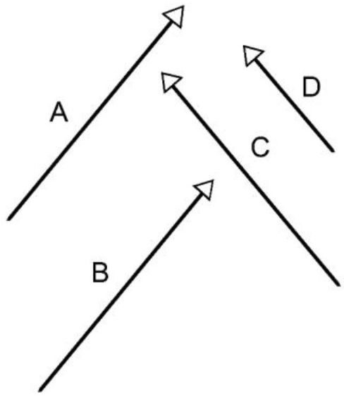
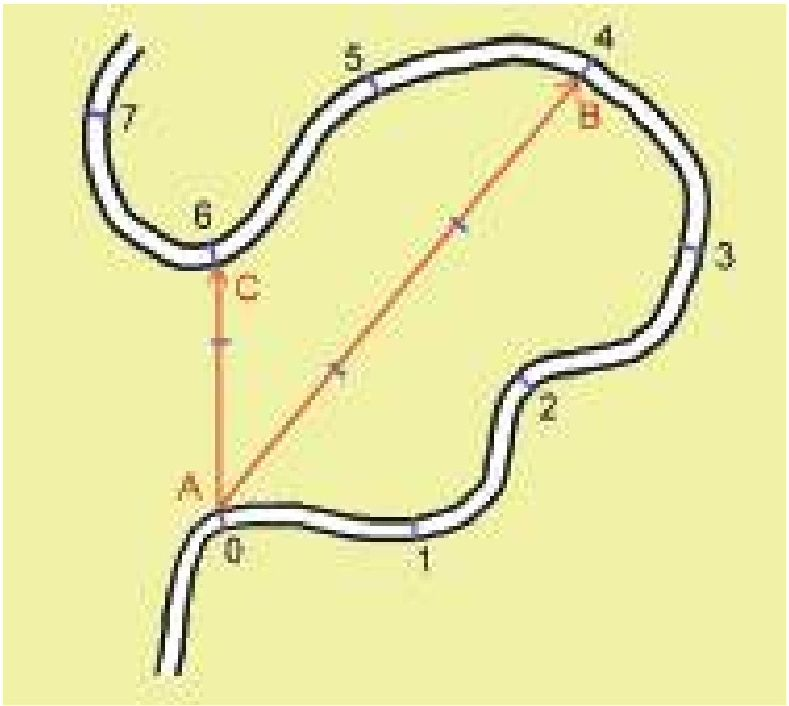
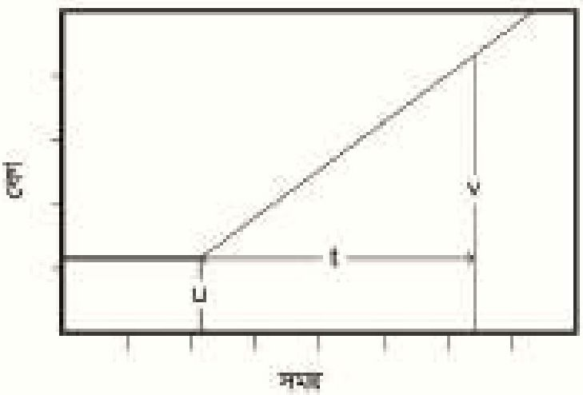
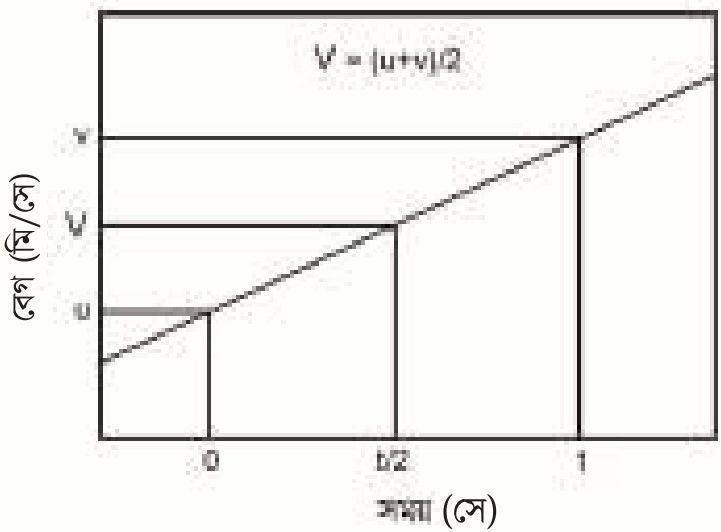
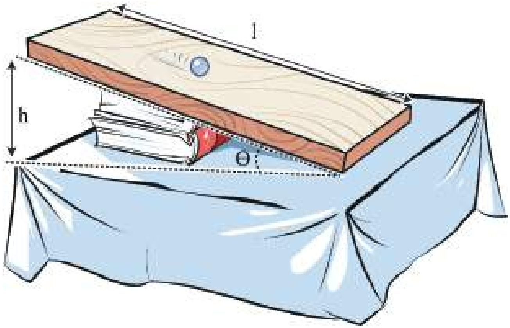
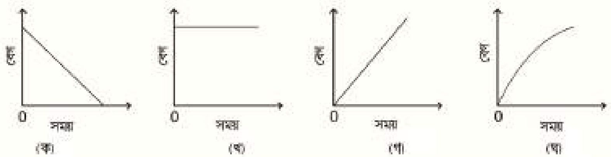

# 2. গতি

Source: Physics Bangla Version, printed pp. 32-61

## 2.0 ভূমিকা ও শিখনফল

<!-- physics-9-10-bn-c02-t2.0-p001 · figure · p.32 -->

<!-- physics-9-10-bn-c02-t2.0-p002 · text · p.32 -->
আমাদের চারপাশে অনেক ধরনের গতি রয়েছে। একজন যখন সাইকেল চালিয়ে যায়, সেটি একধরনের গতি, যখন একটি গাড়ি যায় সেটিও, একধরনের গতি। যখন প্লেন উড়ে যায় সেটিও গতি, পৃথিবী যখন সূর্যের চারদিকে ঘোরে সেটিও একটি গতি। ঝুলন্ত একটি বাতি যখন দুলতে থাকে, সেটিও গতি, রাইফেল থেকে যখন বুলেট বের হয় সেটিও গতি। আপাতদৃষ্টিতে মনে হয়, এই নানা ধরনের গতি সব ভিন্ন ভিন্ন ধরনের গতি; কিন্তু তোমরা জেনে খুবই অবাক এবং খুশি হবে যে একেবারে অল্প কয়েকটি রাশি দিয়ে এই সবগুলোকে ব্যাখ্যা করা সম্ভব।

<!-- physics-9-10-bn-c02-t2.0-p003 · text · p.32 -->
সেই রাশিগুলো, তাদের একক, মাত্রা এবং একের সাথে অন্যের কী সম্পর্ক এই অধ্যায়ে তা আলোচনা করা হবে।

### এ অধ্যায় শেষে আমরা –

<!-- physics-9-10-bn-c02-t2.0-p004 · objective · p.33 -->
* স্টিতি ও গতি ব্যাখ্যা করতে পারব।
* বিভিন্ন প্রকার গতির মধ্যে পার্থক্য করতে পারব।
* স্কেলার ও ভেক্টর রাশি ব্যাখ্যা করতে পারব।
* গতি-সম্পর্কিত রাশিসমূহের মধ্যে পারস্পরিক সম্পর্ক বিশ্লেষণ করতে পারব।
* বাধাহীন ও মুক্তভাবে পড়ন্ত বস্তুর গতি ব্যাখ্যা করতে পারব।
* লেখচিত্রের সাহায্যে গতি সম্পর্কিত রাশিসমূহের মধ্যে সম্পর্ক বিশ্লেষণ করতে পারব।
* আমাদের জীবনে গতির প্রভাব উপলব্ধি করতে পারব।

## 2.1 স্থিতি এবং গতি (Rest and Motion)

<!-- physics-9-10-bn-c02-t2.1-p001 · text · p.34 -->
সময়ের সাথে কোনো কিছুর অবস্থানের যদি পরিবর্তন না হয়, তাহলে সেটি স্থির, আর যদি অবস্থানের পরিবর্তন হয়, তাহলে সেটি গতিশীল।

<!-- physics-9-10-bn-c02-t2.1-p002 · text · p.34 -->
এখন আমাদের ‘অবস্থান’ শব্দটির ভালো করে ব্যাখ্যা করা দরকার। আমাদের দৈনন্দিন কথাবার্তায় আমরা নানাভাবে অবস্থান শব্দটি ব্যবহার করলেও পদার্থবিজ্ঞানের ভাষায় অবস্থান শব্দটির একটি সুনির্দিষ্ট অর্থ রয়েছে। যেমন তোমাকে যদি জিঞ্জেস করা হয়, তোমার স্কুলের অবস্থান কোথায় এবং তুমি যদি উত্তর দাও ‘বিলটুলি’তে তাহলে উত্তরটি সঠিক হলেও স্কুলের অবস্থানটি কিন্তু জানা গেল না। তুমি যদি উত্তর দাও, তোমার স্কুলটি তোমার বাসার গেইট থেকে এক কিলোমিটার দূরে, তাহলেও কিন্তু স্কুলের অবস্থান জানা গেল না। তোমার বাসার গেইটটি কোথায় সেটি আমাদের জানা থাকলেও আমরা বলতে পারব না স্কুলটি সেখান থেকে ঠিক কোন দিকে এক কিলোমিটার দূরে। কিন্তু তুমি যদি বলো, স্কুলটি তোমার বাসার গেইট থেকে পূর্ব দিকে এক কিলোমিটার দূরে তাহলেই শুধু আমরা সুনির্দিষ্টভাবে তোমার স্কুলের অবস্থানটি জানতে পারব। অর্থাৎ স্কুলের অবস্থান জানার জন্য দূরত্ব এবং দিক দুটিই সুনির্দিষ্টভাবে জানতে হয়। শুধু তাই নয়, সেই দূরত্ব এবং দিকটি নির্দেশ করতে হয় একটি নির্দিষ্ট বিন্দু বা প্রসঙ্গ বিন্দুর অবস্থান থেকে। তোমার স্কুলের বেলায় প্রসঙ্গ বিন্দু বা মূলবিন্দু (origin) ছিল তোমার বাসার গেইট। সেটি তোমার বাসার গেইট না হয়ে একটা বাসস্টপ কিংবা একটা শপিং মল হতে পারত। তাহলে অবশ্যই দূরত্ব এবং দিকটির ভিন্ন মান হতো কিন্তু অবস্থানটি অবশ্যই এই নতুন প্রসঙ্গ বিন্দুর সাপেক্ষে বলে দিতে পারতাম। অর্থাৎ কোনো কিছুর অবস্থান বলতে হলে সেটি বলতে হয় কোনো একটি প্রসঙ্গ বিন্দুর সাপেক্ষে। এই প্রসঙ্গ বিন্দুটি চূড়ান্ত কোনো বিষয় নয়, আমরা আমাদের সুবিধা অনুযায়ী যেকোনো বিন্দুকে প্রসঙ্গ বিন্দু বা মূল বিন্দু হিসেবে ধরতে পারি।

<!-- physics-9-10-bn-c02-t2.1-p003 · text · p.34 -->
এখন প্রশ্ন হচ্ছে, অবস্থান নির্দিষ্ট করার জন্য আমাদের যে প্রসঙ্গ বিন্দু বা মূল বিন্দু ধরে নিতে হয় সেই বিন্দুটি কি স্থির একটি বিন্দু হওয়া প্রয়োজন? ধরা যাক তোমার সামনে আরেকজন চেয়ারে স্থির হয়ে বসে আছে। তোমার চেয়ারটাকে যদি প্রসঙ্গ বা মূল বিন্দু ধরে নিই, তাহলে নিশ্চিতভাবে বলা যেতে পারে তোমার বন্ধুর অবস্থানের কোনো পরিবর্তন হচ্ছে না।

<!-- physics-9-10-bn-c02-t2.1-p004 · text · p.34 -->
কিন্তু যদি এমন হয় তোমরা আসলে চলন্ত একটি ট্রেনে বসে আছে, তাহলে কী হবে? ট্রেনের বাইরে স্টেশনে দাঁড়িয়ে থাকা একজন মানুষ বলবে, তুমি কিংবা তোমার বন্ধু দুজনেই গতিশীল, কেউ স্থির নও! তাহলে কার কথাটি সত্যি? তোমার, নাকি স্টেশনে দাঁড়িয়ে থাকা মানুষটির? আসলে তোমার কিংবা স্টেশনে দাঁড়িয়ে থাকা মানুষটির, দুজনের কথাই সত্যি! তার কারণ মূল বিন্দু বা প্রসঙ্গ বিন্দু যদি সমবেগে চলতে থাকে তাহলে আমরা কখনোই জোর দিয়ে বলতে পারব না যে প্রসঙ্গ বিন্দুটি সমবেগে চলছে না এটা আসলে স্থির এবং অন্য সবকিছু উল্টো দিকে সমবেগে চলছে! কাজেই আমরা বলতে পারি, যদি কোনো একটি মূল বিন্দুর সাপেক্ষে কোনো বস্তুর অবস্থানের পরিবর্তন হয়, তাহলে সেই বস্তুরটি ঐ বিন্দুর সাপেক্ষে গতিশীল। মূল বিন্দুটি আসলে স্থির না সমবেগে চলছে সেটি নিয়ে আমরা মাথা ঘামাব না। সেটি গুরুত্বপূর্ণ নয়, তার কারণ সব গতিই আপেক্ষিক।

<!-- physics-9-10-bn-c02-t2.1-p005 · text · p.35 -->
শুধু তাই নয়, আমরা যদি সত্যিকারের স্থির কোনো একটি প্রসঙ্গ বিন্দু খুঁজে বেড়াই, তাহলে বিপদে পড়ে যাব। পৃথিবীর পৃষ্ঠে কোনো কিছুকে মূল বিন্দু ধরে নিলে একজন আপত্তি করে বলতে পারে পৃথিবী তো স্থির নয় সেটা নিজের অক্ষের উপর ঘুরছে কাজেই পৃথিবী পৃষ্ঠের সবকিছু ঘুরছে। আমরা বুঝি করে বলতে পারি, পৃথিবীর কেন্দ্র হচ্ছে মূল বিন্দু। তখন আরেকজন আপত্তি করে বলতে পারে যে সেটিও স্থির নয়, সেটি সূর্যের চারদিকে ঘুরছে। আমরা তখন আরও বুঝি খরচ করে বলতে পারি সূর্যের কেন্দ্রবিন্দুটিই হোক মূল বিন্দু! তখন অন্য কেউ আপত্তি করে বলতেই পারে সূর্যও তো স্থির নয়, সেটাও তো আমাদের গ্যালাক্সির (বাংলায় নামটি ছায়াপথ, ইংরেজিতে Milky Way) কেন্দ্রকে ঘিরে ঘুরছে। বুঝতেই পারছ, তখন কেউ আর সাহস করে গ্যালাক্সির কেন্দ্রকে মূল বিন্দু বলবে না! গ্যালাক্সি, বিশ্বব্রহ্মাণ্ড স্থির কে বলেছে? শুধু তাই নয়, গ্যালাক্সির কেন্দ্রবিন্দুকে মূল বিন্দু ধরা হলে পৃথিবী পৃষ্ঠের একটা অবস্থান বর্ণনা করতে আমরা কী পরিমাণ জটিলতায় পড়ে যাব কেউ চিন্তা করেছে?

<!-- physics-9-10-bn-c02-t2.1-p006 · text · p.35 -->
আসলে এত জটিলতার কোনো প্রয়োজন নেই, আমাদের কাজ চালানোর জন্য আমাদের কাছে স্থির মনে হয়, এরকম যেকোনো বিন্দুকে মূল বিন্দু ধরে সব কাজ করে ফেলতে পারব, শুধু বলে নিতে হবে সব মাপজোখ এই মূল বিন্দুর সাপেক্ষে করা হয়েছে। বিজ্ঞানীরা এভাবে পরমাণুর ভেতরে নিউক্লিয়াস থেকে শুরু করে মহাকাশে পাঠানো উপগ্রহ সবকিছুর মাপজোখ করে ফেলতে পারেন, কখনো কোনো সমস্যা হয়নি!

## 2.2 বিভিন্ন প্রকার গতি (Different Types of Motion)

<!-- physics-9-10-bn-c02-t2.2-p001 · text · p.35 -->
আমরা আমাদের চারপাশে অনেক রকম গতি দেখতে পাই, কোনো কিছু নড়ছে, কোনো কিছু কাঁপছে, কোনো কিছু ঘুরছে, কোনো কিছু সরে যাচ্ছে – এই সবই হচ্ছে নানা রকম গতির উদাহরণ। সস্তাব্য গতির ধরনের কোনো শেষ নেই কিন্তু আমরা ইচ্ছা করলে কিছু কিছু গুরুত্বপূর্ণ ধরনের গতির কথা আলাদা করে বলতে পারি।

### সরলরৈখিক গতি (Linear Motion)

<!-- physics-9-10-bn-c02-t2.2-p002 · text · p.36 -->
এটি সবচেয়ে সহজ গতির উদাহরণ। কোনো কিছু যদি সরল রেখার উপর চলাচল করে তাহলে তার গতিটি হচ্ছে সরলরৈখিক গতি। কোনো কিছুকে সমতলপৃষ্ঠে ধাক্কা দিয়ে ছেড়ে দিলে সেটা সরল রেখায় চলতে থাকে। একটা বলকে উপর থেকে ছেড়ে দিলে সেটা যদি মুক্তভাবে নিচের দিকে পড়ে, তাহলে সেটাও রৈখিক গতি।

### ঘূর্ণন গতি (Circular Motion)

<!-- physics-9-10-bn-c02-t2.2-p003 · text · p.36 -->
একটি বস্তু যদি একটা নির্দিষ্ট বিন্দু থেকে সমদূরত্বে থেকে বৃত্তাকার পথে ঘুরতে থাকে, তাহলে তার গতিকে বলে ঘূর্ণন গতি। বৈদ্যুতিক পাখা, ঘড়ির কাঁটা এগুলো ঘূর্ণন গতির উদাহরণ হলেও চমকপ্রদ একটা উদাহরণ হচ্ছে আকাশের চাঁদ। চাঁদকে কোনো কিছু দিয়ে পৃথিবীর সাথে বেঁধে রাখা নেই তবু এটা পৃথিবীকে ঘিরে ঘুরছে, শুধু তাই নয়, এটা টিপ করে পৃথিবীতে পড়েও যাচ্ছে না!

### চলন গতি (Translational Motion)

<!-- physics-9-10-bn-c02-t2.2-p004 · text · p.36 -->
কোনো কিছু যদি এমনভাবে চলতে থাকে যেন বস্তুর সকল কণা একই সময় একই দিকে যেতে থাকে তাহলে সেটা হচ্ছে চলন গতি। আমরা আমাদের চারপাশে মাঝে মাঝে এরকম অনেক উদাহরণ দেখতে পাই। গাড়ির ঘূর্ণায়মান চাকা বিবেচনায় না আনলে সোজা এগিয়ে যাওয়া একটা গাড়ির গতি চলন গতির উদাহরণ; গাড়ির প্রতিটি বিন্দু একই সময় একই দিকে একই দূরত্ব অতিক্রম করে।

<!-- physics-9-10-bn-c02-t2.2-p005 · figure · p.36 · review: latin-junk -->

<!-- physics-9-10-bn-c02-t2.2-p006 · figure · p.36 -->
**চিত্র ২.০১ : চলন গতির উদাহরণ**

<!-- physics-9-10-bn-c02-t2.2-p007 · text · p.36 -->
চলন গতি সোজা হতেই হবে এমন কোনো বাধ্যবাধকতা নেই; কিন্তু আঁকাবাঁকা পথে চলন গতির উদাহরণ সহজে পাওয়া যাবে না। একটি প্লেনের প্রতিটি বিন্দুকে একই গতিপথে যেতে হলে সেটিকে কীভাবে যেতে হবে ২.০১ চিত্রে দেখানো হয়েছে। দেখেই বুঝতে পারছ আঁকাবাঁকা চলন গতি পাওয়া কেন এত কঠিন।

### পার্যায়বৃত্ত গতি (Periodic Motion)

<!-- physics-9-10-bn-c02-t2.2-p008 · text · p.37 -->
একটি নির্দিষ্ট সময় পরপর যদি গতির পুনরাবৃত্তি হয়, তবে সেই গতিকে পার্যায়বৃত্ত গতি বলা হয়। যে সময়কাল পরপর এই পুনরাবৃত্তি ঘটে, তাকে বলে এই গতির পর্যায়কাল। পার্যায়বৃত্ত গতিতে চলনশীল একটি বস্তুকণা তার গতিপথের প্রতিটি বিন্দুকে এক পর্যায়কাল পরপর একই বেগে অতিক্রম করে। আমাদের হৃৎপিণ্ডের স্পন্দন পার্যায়বৃত্ত কারণ হৃৎপিণ্ডটি নির্দিষ্ট সময় পরপর একইভাবে স্পন্দিত হয়। পার্যায়বৃত্ত গতি বৃত্তাকার (ফ্যানের পাখা) উপবৃত্তাকার (সূর্যকে ঘিরে হ্যালির ধূমকেতুর কক্ষপথ), সরলরৈখিক (স্পিংয়ে ঝুলিয়ে রাখা দুলতে থাকা বস্তু) কিংবা অন্য যেকোনো আকৃতির পথে হতে পারে।

<!-- physics-9-10-bn-c02-t2.2-p009 · figure · p.37 -->
**চিত্র ২.০২: দোলনা সরল স্পন্দন গতির একটি উদাহরণ**

### সরল স্পন্দন গতি (Simple Harmonic Motion)

<!-- physics-9-10-bn-c02-t2.2-p010 · text · p.37 -->
সরল স্পন্দন গতি হচ্ছে একটি বিশেষ ধরনের পার্যায়বৃত্তগতি। স্পন্দন গতির বেলায় একটি নির্দিষ্ট বিন্দুর দুই পাশে বস্তু স্পন্দিত হয়। ঐ নির্দিষ্ট বিন্দুকে বলা হয় সাম্যবিন্দু (equilibrium point)। গতিপথের উভয় পাশের শেষ প্রান্তে বস্তুকণার দ্বিতি থাকে শূন্য। কোনো এক প্রান্ত থেকে সাম্যবিন্দুর দিকে অগ্রসর হওয়ার সময় বস্তুকণার দ্বিতি ক্রমায়নে বাড়তে থাকে, এবং সাম্যবিন্দুতে সর্বোচ্চ দ্বিতি লাভের পর কণাটি অপর প্রান্তের দিকে অগ্রসর হওয়ার সময় সেটির দ্বিতি ক্রমায়নে কমতে কমতে আবার শূন্য হয়ে যায়। এর পর কণাটি তার গতির দিক পরিবর্তন করে বিপরীত দিকে একই ভাবে চলতে শুরু করে এবং আবারও আগের প্রান্তে এসে পৌঁছে এক মুহূর্তের জন্য থেমে থাকে। এই পুরো ঘটনাটি ঘটে সময়ে লাগে এক পর্যায়কাল। গতির এই আদলটারই পুনরাবৃত্তি ঘটেতে থাকে।

<!-- physics-9-10-bn-c02-t2.2-p011 · text · p.37 -->
আমাদের চারপাশে সরল স্পন্দন গতির অসংখ্য উদাহরণ রয়েছে। স্পিং থেকে দুলিয়ে দেওয়া একটা বস্তুর গতি হচ্ছে স্পন্দন গতি। দোলনায় দুলতে থাকা শিশু (চিত্র ২.০২) কিংবা ঘড়ির পেড়ুলামের গতিও এর উদাহরণ। আমরা যখন কথা বলি তখন বাতাসের অণু এই গতি দিয়ে শব্দকে সামনে এগিয়ে নিয়ে যায়। আমরা এতক্ষণ বিশেষ কয়েক ধরনের গতির কথা বলেছি; কিন্তু এই গতিগুলোর কারণটি কোথাও বলিনি। পদার্থবিজ্ঞানের সবচেয়ে বড় সাফল্য হচ্ছে যে, এটি শুধু যে বস্তুর বিচিত্র গতির কারণটি খুঁজে বের করবে তা নয়, এর গতিটি সুনির্দিষ্টভাবে ব্যাখ্যা করতে পারবে।

<!-- physics-9-10-bn-c02-t2.2-p012 · text · p.37 -->
তুমি কি গতির কারণটি অনুমান করতে পারবে?

## 2.3 স্কেলার ও ভেক্টর রাশি (Scalar and Vector Quantities)

<!-- physics-9-10-bn-c02-t2.3-p001 · text · p.38 -->
আমাদের পরিচিত ভৌত জগতে আমরা যা কিছু পরিমাপ করতে পারি, সেটাই রাশি – আনন্দ কিংবা দুঃখ রাশি নয় কিন্তু তাপমাত্রা একটি রাশি। তার কারণ আনন্দ কিংবা দুঃখকে মেপে একটা মান দেওয়া যায় না কিন্তু তাপমাত্রা মেপে মান দেওয়া সম্ভব। তোমার শরীরের তাপমাত্রা ৩৭° C কিংবা ৯৮.৪° F। তাপমাত্রা বোঝানোর জন্য একটি মান বললেই চলে কিন্তু অনেক রাশি আছে, যেগুলোকে একটি মান দিয়ে পুরোপুরি প্রকাশ করা যায় না, হয় তার মানের সাথে একটা দিক বলে দিতে হয়, কিংবা একাধিক মান বলে দিতে হয় যেন সেগুলো মিলিয়ে তার মান এবং দিক দুটোই নির্দিষ্ট করে বোঝা যায়। অবস্থান ছিল সে রকম একটি রাশি, যেটা বোঝানোর জন্য আমাদের শুধু দূরত্ব দিয়ে কাজ হয়নি, তার দিকটিও নির্দেশ করতে হয়েছিল! কাজেই যে রাশি শুধু একটি মান দিয়ে প্রকাশ করা যায় সেটি হচ্ছে স্কেলার আর যেটা প্রকাশ করার জন্য একটা দিকও (চিত্র ২.০৩) উল্লেখ করতে হয়, সেটা হচ্ছে ভেক্টর।

<!-- physics-9-10-bn-c02-t2.3-p002 · figure · p.38 -->

<!-- physics-9-10-bn-c02-t2.3-p003 · figure · p.38 -->
**চিত্র ২.০৩:** **A ও B ভেক্টর হুবহু এক,** যদিও ভিন্ন অবস্থানে রয়েছে, **C ভেক্টর A ও B থেকে ভিন্ন, কারণ মান সমান হলেও দিক ভিন্ন। D ভেক্টর C ভেক্টর থেকে ভিন্ন, কারণ দিক একই হলেও মান সমান নয়।**

<!-- physics-9-10-bn-c02-t2.3-p004 · text · p.38 -->
তাপমাত্রা ছাড়াও স্কেলারের উদাহরণ হচ্ছে সময়, দৈর্ঘ্য কিংবা ভর। কারণ এগুলো শুধু একটি মান দিয়ে প্রকাশ করে ফেলা যায়। তোমরা দেখবে অবস্থান ছাড়াও ভেক্টরের উদাহরণ হচ্ছে বেগ কিংবা বল। পরের অধ্যায়েই এই বেগ এবং বলের সাথে তোমাদের পরিচয় করিয়ে দেওয়া হবে। কারণ এগুলো প্রকাশ করতে হলে মানের সাথে সাথে দিকটাও বলে দিতে হয়।

<!-- physics-9-10-bn-c02-t2.3-p005 · text · p.38 · review: verify-formula -->
ভেক্টর রাশিকে স্কেলার রাশি থেকে আলাদা করে বোঝানোর জন্য সেটাকে মোটা (**Bold**) করে লেখা হয় (**x, y** কিংবা **A, B**)। বইয়ে কিংবা কম্পিউটারে প্রিন্ট করার সময় যেকোনো কিছু মোটা করে লেখা সহজ। কিন্তু যখন কেউ হাতে কাগজে লিখে তখন কোনো কিছুকে ভেক্টর বোঝানোর জন্য তার উপরে ছোট করে একটা তির চিহ্ন দেওয়া হয় ( $\vec{x}, \vec{y}$ কিংবা $\vec{A}, \vec{B}$ )।

<!-- physics-9-10-bn-c02-t2.3-p006 · text · p.38 -->
তোমাদের এখানে যেটুকু পদার্থবিজ্ঞান শেখানো হবে, সেখানে আসলে সত্যিকার অর্থে ভেক্টরের ব্যবহারের প্রয়োজন হবে না, বড়জোর কোনটা স্কেলার কোনটা ভেক্টর মাঝে মাঝে সেটা মনে করিয়ে দেওয়া হবে।

## 2.4 দূরত্ব ও সরণ (Distance and Displacement)

<!-- physics-9-10-bn-c02-t2.4-p001 · text · p.39 -->
আমরা দূরত্ব শব্দটির সাথে খুব ভালোভাবে পরিচিত, তবে সরণ (Displacement) শব্দটি দৈনন্দিন কথাবার্তায় খুব বেশি ব্যবহার করি না। আমরা একটি উদাহরণ দিয়ে দূরত্ব এবং সরণ শব্দ দুটির মাঝে সম্পর্কটি বোঝার চেষ্টা করি। ২.০৪ চিত্রে একটি আঁকাবাঁকা রাস্তা দেখানো হয়েছে। এই রাস্তাটিতে A বিন্দুর সাবেক্সে রাস্তার অতিক্রান্ত দূরত্বগুলো কিলোমিটারে 1, 2, 3 সংখ্যা দিয়ে দেখানো হয়েছে।

<!-- physics-9-10-bn-c02-t2.4-p002 · text · p.39 -->
ধরা যাক তুমি A বিন্দুতে আছ, (অর্থাৎ তোমার অবস্থান A বিন্দু) এখন তুমি সাইকেল চালিয়ে আঁকাবাঁকা পথটি ধরে 4 km রাস্তা অতিক্রম করে B বিন্দুতে পৌঁছছে। আমরা বলতে পারব A এবং B বিন্দুর ভেতরকার দূরত্ব 4 km। দূরত্ব একটি স্কেলার রাশি, কাজেই A এবং B বিন্দুর ভেতরকার দূরত্ব বোঝানোর জন্য কোনো দিকের কথা বলে দিতে হবে না।

<!-- physics-9-10-bn-c02-t2.4-p003 · figure · p.39 -->

<!-- physics-9-10-bn-c02-t2.4-p004 · figure · p.39 -->
**চিত্র ২.০৪ : A বিন্দু থেকে শুরু করে আঁকাবাঁকা পথে সাইকেল চালিয়ে যাওয়া।**

<!-- physics-9-10-bn-c02-t2.4-p005 · text · p.39 · review: verify-formula -->
আমরা A বিন্দুর সাবেক্সে এই পথটি ধরে B বিন্দুর ‘দূরত্ব’ বের করেছি। এখন ইচ্ছে করলে A বিন্দুর সাবেক্সে B বিন্দুর ‘সরণ’ বের করতে পারি। সরণ বলতে বোঝানো হয় A বিন্দুর অবস্থানের সাবেক্সে B বিন্দুর অবস্থান। ছবিতে A বিন্দু থেকে B বিন্দু পর্যন্ত একটা তির চিহ্নিত সরলরেখা দিয়ে সরণটি দেখানো হয়েছে। এই ছবিতে সরণের মান 3 km এবং তিরের দিকটি হচ্ছে সরণের দিক। অর্থাৎ সরণ হচ্ছে ভেক্টর রাশি, এর মান এবং দিক দুটিই আছে। একে $\vec{AB}$ হিসেবেও লেখা যেতে পারে।

<!-- physics-9-10-bn-c02-t2.4-p006 · text · p.39 · review: verify-formula -->
যদি তুমি সাইকেল দিয়ে আরও দুই কিলোমিটার অতিক্রম করে মোট ছয় কিলোমিটার পথ অতিক্রম করে C বিন্দুতে পৌঁছাও তোমার সরণ হবে তির চিহ্নিত সরলরেখা $\vec{AC}$, যার মান 1.5 কিলোমিটার এবং এখানেও তিরের দিকটি তোমার সরণের দিক। যদিও তুমি আঁকাবাঁকা পথ ধরে বেশি দূরত্ব অতিক্রম করেছ; কিন্তু সরণ হয়েছে কম! অর্থাৎ বেশি দূরত্ব অতিক্রম করলেই বেশি সরণ হবে সেটি সত্যি নয়। শুরু থেকে শেষ অবস্থানের পার্থক্য হচ্ছে সরণ।

<!-- physics-9-10-bn-c02-t2.4-p007 · text · p.39 -->
A থেকে শুরু করে আঁকাবাঁকা পথে B পর্যন্ত দূরত্ব 4 km ঠিক একইভাবে B থেকে A পর্যন্ত হচ্ছে 4 km, দুটোই সমান। কিন্তু লক্ষ্য করে দেখো A থেকে B পর্যন্ত সরণ আর B থেকে A পর্যন্ত সরণ কিন্তু সমান নয়। একটি আরেকটির নেগেটিভ বা ঋণাত্মক। ভেক্টর হিসেবে লিখতে পারি:

<!-- physics-9-10-bn-c02-t2.4-p008 · formula · p.40 · review: verify-formula -->
$$\overrightarrow{AB} = -\overrightarrow{BA}$$

<!-- physics-9-10-bn-c02-t2.4-p009 · text · p.40 -->
দূরত্ব এবং সরণ, দুটোর মাত্রাই হলো দৈর্ঘ্যের মাত্রা।

<!-- physics-9-10-bn-c02-t2.4-p010 · text · p.40 -->
[সরণ] = L (ভেক্টর)
[দূরত্ব] = L (স্কেলার)

## 2.5 দ্রুতি এবং বেগ (Speed and Velocity)

<!-- physics-9-10-bn-c02-t2.5-p001 · text · p.40 -->
বেগ বলতে কী বোঝানো হয় আমরা সবাই সেটা মোটামুটি জানি। কোনো কিছু কত দ্রুত যাচ্ছে তার পরিমাণটা হচ্ছে বেগ। তবে পদার্থবিজ্ঞানের ভাষায় বেগের একটা সুনির্দিষ্ট অর্থ আছে এবং বেগের পাশাপাশি আমরা দ্রুতি (speed) নামে আরো একটা রাশি ব্যবহার করি। আমরা যদি দূরত্ব এবং সরণ এই বিষয় দুটো ভালোভাবে বুঝে থাকি তাহলে, দ্রুতি এবং বেগ নামক রাশি দুটোও খুব সহজে বুঝতে পারব।

<!-- physics-9-10-bn-c02-t2.5-p002 · text · p.40 · review: verify-formula -->
দ্রুতি হচ্ছে সময়ের সাথে দূরত্বের পরিবর্তনের হার। অর্থাৎ তুমি যদি ২০ সেকেন্ডে ১০০ m দূরত্ব অতিক্রম করে থাকো তাহলে, তোমার দ্রুতি $v$ হচ্ছে:

<!-- physics-9-10-bn-c02-t2.5-p003 · formula · p.40 · review: verify-formula -->
$$v = \frac{100  m}{20  s} = 5  m/s$$

<!-- physics-9-10-bn-c02-t2.5-p004 · text · p.40 · review: verify-formula -->
> দ্রুতির মাত্রা $[v] = LT^{-1}$

<!-- physics-9-10-bn-c02-t2.5-p005 · text · p.40 -->
বেগ হচ্ছে সময়ের সাথে সরণের পরিবর্তনের হার। অর্থাৎ যদি ২০ সেকেন্ডে কোনো নির্দিষ্ট দিকে তোমার অবস্থানের পরিবর্তন হয় ৫০ m তাহলে তোমার বেগের মান হচ্ছে:

<!-- physics-9-10-bn-c02-t2.5-p006 · formula · p.40 · review: verify-formula -->
$$v = \frac{50  m}{20  s} = 2.5  m/s$$

<!-- physics-9-10-bn-c02-t2.5-p007 · text · p.40 -->
এবং তোমার বেগের দিক হচ্ছে সেই নির্দিষ্ট দিক।
বেগ যেহেতু ভেক্টর তাই তার দিকটি নির্দিষ্ট করে দিতে হবে।

<!-- physics-9-10-bn-c02-t2.5-p008 · text · p.40 · review: verify-formula -->
> বেগের মাত্রা: $[v] = LT^{-1}$

<!-- physics-9-10-bn-c02-t2.5-p009 · text · p.40 -->
এখানে একটা বিষয় লক্ষ্য করা যেতে পারে, আমরা যদি শুধু সরল রৈখিক গতি বিবেচনা করি তাহলে বেগ আর দ্রুতির মাঝে তেমন পার্থক্য নেই, বেগের মানটিই হচ্ছে দ্রুতি। দ্রুতি এবং বেগের ভেতরকার সম্পর্ক বোঝানোর জন্য কয়েকটা উদাহরণ নেওয়া যাক:

### উদাহরণ

<!-- physics-9-10-bn-c02-t2.5-p010 · example · p.41 · review: latin-junk -->
২.০৪ চিত্রে আমরা দূরত্ব এবং সরণ বোঝানোর জন্য একটি আঁকাবাঁকা রাস্তা এবং সেখানে ভিন্ন ভিন্ন অবস্থান দেখিয়েছি। দ্বিতি এবং বেগ বোঝানোর জন্য আমরা সেই একই উদাহরণ ব্যবহার করতে পারি, তবে এবারে কতটুকু সময়ে তুমি একটি অবস্থান থেকে অন্য অবস্থানে গিয়েছ সেটি বলে দিতে হবে। ধরা যাক সাইকেলে A থেকে B অবস্থানে আসতে তোমার সময় লেগেছে 20 minutes, তাহলে এই 20 মিনিটে তোমার গড় দ্বিতি হচ্ছে:

<!-- physics-9-10-bn-c02-t2.5-p011 · formula · p.41 · review: verify-formula -->
$$গড় দ্বিতি = মোট অতিক্রান্ত দূরত্ব / মোট সময়$$

<!-- physics-9-10-bn-c02-t2.5-p012 · example · p.41 -->
অর্থাৎ,

<!-- physics-9-10-bn-c02-t2.5-p013 · formula · p.41 · review: verify-formula -->
$$v = \frac{4  km}{20  minutes} = \frac{4 \times 1000  m}{20 \times 60  s} = 3.33  m/s$$

<!-- physics-9-10-bn-c02-t2.5-p014 · text · p.41 · review: latin-junk -->
এখানে লক্ষ্য করো আমরা দ্বিতি শব্দটি ব্যবহার না করে গড় দ্বিতি শব্দটি ব্যবহার করেছি। কারণ, তুমি সাইকেল চালানোর সময় হয়তো কখনো একটু জোরে কখনো একটু আস্তে সাইকেল চালিয়েছ। তাই ‘তাৎক্ষণিক’ দ্বিতি আমরা বলতে পারব না, 20 minutes সময়টুকুর গড় দ্বিতিটুকুই শুধু বলতে পারব।

<!-- physics-9-10-bn-c02-t2.5-p015 · text · p.41 -->
এবারে আমরা বেগ বের করার চেষ্টা করি। দ্বিতির মতোই আমরা কিন্তু তাৎক্ষণিক বেগ বের করতে পারব না, এই পুরো সময়টিতে তুমি ভিন্ন ভিন্ন বেগে সাইকেল চালিয়েছ। দ্বিতি বেশি কিংবা কম হওয়ার কারণে বেগের পরিবর্তন হয়েছে আবার দিক পরিবর্তন হওয়ার কারণেও বেগের পরিবর্তন হয়েছে। এই সবগুলো পরিবর্তন মিলিয়ে গড় বেগ হচ্ছে:

<!-- physics-9-10-bn-c02-t2.5-p016 · text · p.41 -->
আবার,

<!-- physics-9-10-bn-c02-t2.5-p017 · formula · p.41 · review: verify-formula -->
$$গড় বেগ = সরণ / সময়$$

<!-- physics-9-10-bn-c02-t2.5-p018 · text · p.41 -->
অর্থাৎ,

<!-- physics-9-10-bn-c02-t2.5-p019 · formula · p.41 · review: verify-formula -->
$$v = \frac{3  km}{20  minutes} = \frac{3 \times 1000  m}{20 \times 60  s} = 2.5  m/s$$

<!-- physics-9-10-bn-c02-t2.5-p020 · text · p.41 -->
তোমরা দেখতে পাচ্ছ, এই উদাহরণটিতে গড় দ্বিতির মান থেকে গড় বেগের মান কম। পথটি যদি আঁকাবাঁকা না হয়ে সোজা হতো, তাহলে গড় বেগের মান আর গড় দ্বিতি দুটোই সমান হতো। আমাদের এই উদাহরণে তুমি যদি সব সময় একই গতিতে সাইকেল চালিয়ে যেতে তাহলে আমরা বলতাম তুমি সুসম দ্বিতিতে সাইকেল চালিয়ে এসেছ। যখন কোনো কিছু সুসম দ্বিতিতে চলে তখন তার তাৎক্ষণিক দ্বিতি এবং গড় দ্বিতির মান একই হয়ে যায়।

<!-- physics-9-10-bn-c02-t2.5-p021 · text · p.42 -->
লক্ষ্য করো, পথটি যেহেতু আঁকাবাঁকা তাই এই পথে গেলে ক্রমাগত তোমার দিক পরিবর্তন হচ্ছে, তাই এই পথে তুমি সুখম দ্বিতিতে গেলেও সুখম বেগে যেতে পারবে না। শুধু সরল রৈখিক গতিতে গেলেই সুখম বেগ অর্থাৎ সমবেগে যাওয়া সম্ভব।

<!-- physics-9-10-bn-c02-t2.5-p022 · example · p.42 -->
**প্রশ্ন:** বেগ আর দ্বিতির মাঝে সম্পর্কটা আরো ভালো করে বোঝার জন্য আমরা আরেকটা উদাহরণ নিই। ধরা যাক, একটু সুতা দিয়ে ছোট একটা পাথরকে বেঁধে তুমি সেটাকে মাথার উপর ঘোরচ্ছ (চিত্র ২.০৫)। পাথরটা কি সমবেগে চলছে নাকি সমদ্বিতিতে চলছে? নাকি সমদ্বিতি এবং সমবেগে যাচ্ছে? নাকি কোনোটাই না?

<!-- physics-9-10-bn-c02-t2.5-p023 · example · p.42 -->
**উত্তর:** একটু চিন্তা করলেই তুমি বুঝতে পারবে যে পাথরটার দ্বিতির কোনো পরিবর্তন হচ্ছে না; কিন্তু প্রতি মুহূর্তে বেগের পরিবর্তন হচ্ছে! কারণ প্রতি মুহূর্তে পাথরটার গতির দিক পাল্টে যাচ্ছে। কাজেই এটি হচ্ছে সমদ্বিতির উদাহরণ-সমবেগের নয়! সমবেগ হলে সমদ্বিতি হতেই হবে; কিন্তু সমদ্বিতি হলেই যে সমবেগ হতে হবে, তার কোনো নিশ্চয়তা নেই।

<!-- physics-9-10-bn-c02-t2.5-p024 · figure · p.42 -->
**চিত্র ২.০৫: সুতায় বেঁধে একটি পাথর ঘোরানো হলে দ্বিতি এক থাকলেও বেগের পরিবর্তন হয়।**

<!-- physics-9-10-bn-c02-t2.5-p025 · text · p.42 -->
**প্রশ্ন:** পাথরটিকে হঠাৎ ছেড়ে দিলে তখন কি সেটা সমবেগে অথবা সমদ্বিতিতে যাবে?

<!-- physics-9-10-bn-c02-t2.5-p026 · text · p.42 -->
**উত্তর:** পাথরটি হঠাৎ ছেড়ে দিলে এটি একটি নির্দিষ্ট দিকে ছুটে যাবে। বাতাসের ঘর্ষণ, মাধ্যাকর্ষণ বল, এসব যদি না থাকত তাহলে পাথরটি সমবেগে এবং সমদ্বিতিতে যেতেই থাকত।

## 2.6 ত্বরণ

### (Acceleration)

<!-- physics-9-10-bn-c02-t2.6-p001 · text · p.43 -->
যখন কোনো বস্তু সমবেগে চলে তখন তার কোনো ত্বরণ নেই। বেগের পরিবর্তন হলেই বুঝতে হবে সেখানে ত্বরণ রয়েছে। আরো সুস্পষ্ট করে বললে বলতে হবে ত্বরণ হচ্ছে সময়ের সাথে বেগের পরিবর্তনের হার।

<!-- physics-9-10-bn-c02-t2.6-p002 · text · p.43 -->
বেগের যেহেতু দিক এবং মান দুটিই আছে তাই বেগের পরিবর্তন দুভাবেই হতে পারে। আমাদের আগের উদাহরণে তুমি যখন আঁকাবাঁকা পথে সাইকেল চালিয়ে গিয়েছ, তখন যতবার তুমি বাঁক নিয়েছ ততবার তোমার বেগের পরিবর্তন হয়েছে অর্থাৎ তোমার ত্বরণ হয়েছে। তুমি পুরো পথটুকু সমদ্রুতিতে গিয়ে থাকলেও শুধু দিক পরিবর্তনের জন্য ত্বরণ হয়েছে। তুমি যদি আগের উদাহরণের মতো (চিত্র ২.০৫) একটা পাথরকে সূতা দিয়ে বৈধে মাথার উপর সমদ্রুতিতে যোরাতে থাক তাহলে ধুরতে থাকা পাথরটির ক্রমাগত দিক পরিবর্তন হবে। অর্থাৎ তার বেগের পরিবর্তন হবে বা ত্বরণ হবে।

<!-- physics-9-10-bn-c02-t2.6-p003 · text · p.43 -->
যদি তোমার গতি সরলরৈখিক হয়ে থাকে, তাহলে দিক পরিবর্তনের কোনো সুযোগ নেই। তার ত্বরণ হতে পারে শুধু বেগের মানের (দ্বিতর) পরিবর্তনের কারণে। যদি বেগের মান বাড়তে থাকে, তাহলে আমরা বলি বেগের দিকে বস্তুটির ধনাত্মক ত্বরণ হচ্ছে। যদি বেগের মান কমতে থাকে আমরা বলি বস্তুটির ঋণাত্মক ত্বরণ বা মন্দন (deceleration) হচ্ছে। আমরা এখন সরলরেখায় চলমান কোনো একটি বস্তুর ত্বরণ বের করতে পারি। ত্বরণ একটি ভেক্টর রাশি।

### উদাহরণ

<!-- physics-9-10-bn-c02-t2.6-p004 · example · p.43 -->
**প্রশ্ন:** ২.০৬ চিত্রে কোনো একটা বস্তুর সময়ের সাথে বেগের পরিবর্তন দেখানো হয়েছে। কোথায় ত্বরণ আছে এবং কোথায় নেই বলো।

<!-- physics-9-10-bn-c02-t2.6-p005 · example · p.43 -->
**উত্তর:** A তে ধনাত্মক ত্বরণ আছে, B তে ত্বরণ নেই, C তে ধনাত্মক ত্বরণ আছে, D তে মন্দন বা নেগেটিভ ত্বরণ আছে।

### চিত্র ২.০৬: সময়ের সাথে বেগের পরিবর্তন।

<!-- physics-9-10-bn-c02-t2.6-p006 · table · p.43 · review: verify-table -->
<table><tr><th>সময় (Time)</th><th>বেগ (Velocity)</th><th>সেকশন</th></tr>
<tr><th>0</th><td>0</td><td>A</td></tr>
<tr><th>1</th><td>10</td><td>A</td></tr>
<tr><th>2</th><td>10</td><td>B</td></tr>
<tr><th>3</th><td>10</td><td>B</td></tr>
<tr><th>4</th><td>20</td><td>C</td></tr>
<tr><th>5</th><td>30</td><td>C</td></tr>
<tr><th>6</th><td>40</td><td>C</td></tr>
<tr><th>7</th><td>30</td><td>D</td></tr>
<tr><th>8</th><td>20</td><td>D</td></tr>
<tr><th>9</th><td>10</td><td>D</td></tr></table>

<!-- physics-9-10-bn-c02-t2.6-p007 · text · p.44 -->
এই অধ্যায়ে আমরা শুধু সরল রৈখিক গতি নিয়ে আলোচনা করব, অর্থাৎ যদি দ্বিতির পরিবর্তন হয় তাহলেই ত্বরণ হবে।

<!-- physics-9-10-bn-c02-t2.6-p008 · text · p.44 -->
ত্বরণ হচ্ছে বেগের পরিবর্তনের হার। যদি সমত্বরণ হয়, অর্থাৎ সময়ের সাথে সাথে ত্বরণের পরিবর্তন না হয় তাহলে আমরা লিখতে পারি:

<!-- physics-9-10-bn-c02-t2.6-p009 · formula · p.44 · review: latin-junk,verify-formula -->
$$ত্বরণ = \frac{(অতিক্রান্ত সময়ের শেষে বেগ - অতিক্রান্ত সময়ের আদিতে বেগ)}{অতিক্রান্ত সময়}$$

<!-- physics-9-10-bn-c02-t2.6-p010 · text · p.44 · review: verify-formula -->
অর্থাৎ যদি কোনো এক মুহূর্তে একটি বস্তুর বেগ হয় $u$ এবং $t$ সময় পর তার বেগ হয় $v$ তাহলে ত্বরণ $a$ হচ্ছে

<!-- physics-9-10-bn-c02-t2.6-p011 · formula · p.44 · review: verify-formula -->
$$a = \frac{v - u}{t}$$

<!-- physics-9-10-bn-c02-t2.6-p012 · text · p.44 · review: verify-formula -->
ত্বরণের মাত্রা, $[a] = LT^{-2}$
ত্বরণের একক $ms^{-2}$

<!-- physics-9-10-bn-c02-t2.6-p013 · text · p.44 -->
উপরের সমীকরণটি এভাবেও লেখা যায় (চিত্র ২.০৭) :

<!-- physics-9-10-bn-c02-t2.6-p014 · formula · p.44 · review: verify-formula -->
$$v = u + at$$

<!-- physics-9-10-bn-c02-t2.6-p015 · text · p.44 -->
বস্তুটি যদি স্থির অবস্থায় থেকে শুরু করে সমত্বরণে চলতে থাকে তাহলে

<!-- physics-9-10-bn-c02-t2.6-p016 · formula · p.44 · review: verify-formula -->
$$v = at$$

<!-- physics-9-10-bn-c02-t2.6-p017 · text · p.44 -->
আমরা ইতিমধ্যে বলেছি, এখন পর্যন্ত যা বলা হয়েছে তার সবকিছু প্রয়োজ্য সমত্বরণের জন্য। যদি সমত্বরণ না হয় তাহলে কিন্তু এত সহজে শুধু আদি বেগ আর শেষ বেগ থেকে ত্বরণ বের করে ফেলা যাবে না।

<!-- physics-9-10-bn-c02-t2.6-p018 · figure · p.44 -->

<!-- physics-9-10-bn-c02-t2.6-p019 · figure · p.44 -->
**চিত্র ২.০৭: স্থির অবস্থায় শুরু করে সমত্বরণে গতিশীল বস্তুর বেগ বেড়ে যাওয়া।**

<!-- physics-9-10-bn-c02-t2.6-p020 · text · p.44 -->
আমরা আমাদের চারপাশে গতির যেসব উদাহরণ দেখি; যেমন: গাড়ি, ট্রেন বা সাইকেলের গতি, সেসবের ক্ষেত্রে ত্বরণ প্রায় সব সময়ই অসম ত্বরণ। যেমন: একটি গাড়ি যদি স্থির অবস্থা থেকে শুরু করে ধীরে ধীরে বেগবান হয়, তাহলে তার ত্বরণ শূন্য থেকে শুরু করে ধীরে ধীরে একটি মানে পৌঁছায়, গাড়ি যখন তার পূর্ণ বেগে পৌঁছায়, তখন তার গতি আর বাড়ো না অর্থাৎ ত্বরণ আবার শূন্য হয়ে যায়, আবার গাড়িটি যদি বেগ কমিয়ে থামতে শুরু করে, তাহলে মন্দন হতে থাকে। গাড়িটি যদি পুরোপুরি থেমে যায় তাহলে তার বেগ এবং ত্বরণ দুটিই শূন্য হয়ে যায়।

<!-- physics-9-10-bn-c02-t2.6-p021 · text · p.45 · review: verify-formula -->
তোমাদের মনে হতে পারে সমত্বরণের উদাহরণ খুঁজে পাওয়া বৃষ্টি খুব কঠিন। আসলে আমরা আমাদের চারপাশে যা কিছু দেখি, তার মাঝে কিন্তু সমত্বরণের একটা পরিচিত উদাহরণ আছে। সেটি হচ্ছে মাধ্যাকর্ষণজনিত ত্বরণ (g)। পৃথিবীপৃষ্ঠের কাছাকাছি তার মান 9.8 m/s2, আমরা যদি কোনো একটা বস্তুরকে স্থির অবস্থা থেকে মুক্ত অবস্থায় পড়তে দিই, তাহলে দেখতে পাই তার গতিবেগ $v = gt$ হিসেবে বাড়তে থাকে।

## 2.7 গতির সমীকরণ (Equations of Motion)

<!-- physics-9-10-bn-c02-t2.7-p001 · text · p.45 -->
আমরা যেহেতু শুধু সরল রৈখিক গতি নিয়ে আলোচনা করব, তাই গতি সম্পর্কে আলোচনা করতে গিয়ে আমরা এখন পর্যন্ত যে যে রাশিগুলোর কথা বলেছি সেগুলো হচ্ছে:

<!-- physics-9-10-bn-c02-t2.7-p002 · text · p.45 · review: verify-formula -->
$u$: আদি বেগ (বিবেচ্য সময়কালের শুরুতে বেগ)
$a$: বস্তুকণার ত্বরণ
$t$: যে সময়টুকু অতিক্রান্ত হয়েছে (বিবেচ্য সময়কাল)
$v$: শেষ বেগ (বিবেচ্য সময়কালের শেষে বেগ)
$s$: অতিক্রান্ত সময়ে বস্তুকণা যে দূরত্ব অতিক্রম করেছে।

<!-- physics-9-10-bn-c02-t2.7-p003 · text · p.45 · review: verify-formula -->
ঐ সরলরেখা বরাবর সময় ($t$) বাদে অন্য রাশিগুলোর ধনাভ্যাক বা ঋণাত্মক মান হতে পারে, কিন্তু অন্য কোনো দিক বরাবর হবে না। অর্থাৎ এগুলোকে ভেক্টর হিসেবে বিবেচনা না করে শুধু এগুলোর মান নিয়ে আলোচনা করা হলেই চলবে।

<!-- physics-9-10-bn-c02-t2.7-p004 · text · p.45 · review: verify-formula -->
এই রাশিগুলোর মাঝে যে সম্পর্ক রয়েছে তার প্রায় সবগুলো এর মাঝে আমরা বের করে ফেলেছি। $s$ বা অতিক্রান্ত দূরত্ব সম্বন্ধে আলোচনা বাকি রয়ে গেছে। যদি কোনো ত্বরণ না থাকে তাহলে বেগের পরিবর্তন হয় না, তাই আদি বেগ আর শেষ বেগ সমান ($v = u$), আর অতিক্রান্ত দূরত্ব হচ্ছে

<!-- physics-9-10-bn-c02-t2.7-p005 · formula · p.45 · review: verify-formula -->
$$s = v t$$

<!-- physics-9-10-bn-c02-t2.7-p006 · text · p.45 -->
যদি সমত্বরণ থাকে তাহলে

<!-- physics-9-10-bn-c02-t2.7-p007 · formula · p.45 · review: verify-formula -->
$$v = u + at$$

<!-- physics-9-10-bn-c02-t2.7-p008 · text · p.45 -->
যা থেকে বোঝা যাচ্ছে যে সময়ের সাথে সাথে বেগের পরিবর্তন হয়। পুরো সময়টিকে যদি অনেকগুলো অতিক্রুদ্ধ সমান ভাগে ভাগ করা হয়, তাহলে প্রতিটি ক্ষুদ্র সময়কালে অতিক্রান্ত দূরত্ব সমান হয়না, কারণ ত্বরণের দরুন বস্তুকণার বেগ প্রতি নিয়তই পরিবর্তিত হয়। কিন্তু সম্পূর্ণ অতিক্রান্ত দূরত্ব বের করার জন্য এই ভিন্ন ভিন্ন দূরত্বগুলোরই যোগফল প্রয়োজন। এ ধরনের হিসাব-নিকাশ করার জন্য ক্যালকুলাস (calculus) নামক বিশেষ একধরনের গণিত ব্যবহার করা হয়। কিন্তু ত্বরণশীল বস্তুকণাটির ত্বরণ যদি সুসম হয় তাহলে ক্যালকুলাস ব্যবহার না করেই অতিক্রান্ত দূরত্ব বের করা সম্ভব।

<!-- physics-9-10-bn-c02-t2.7-p009 · text · p.46 · review: verify-formula -->
প্রতি মুহূর্তে বেগের পরিবর্তন হচ্ছে বলে আমরা $s = vt$ লিখতে পারছি না কিন্তু আমরা যদি বস্তুকণার গড় বেগ $V$ জানতে পারি তাহলে কিন্তু লিখতে পারি

<!-- physics-9-10-bn-c02-t2.7-p010 · formula · p.46 · review: verify-formula -->
$$s = Vt$$

<!-- physics-9-10-bn-c02-t2.7-p011 · text · p.46 -->
সুসমভাবে ত্বরণিত একটি বস্তুকণার ক্ষেত্রে একটি নির্দিষ্ট সময়কালের গড় বেগ ঐ সময়কালের ঠিক মাঝামাঝি সময়ের বেগের সমান।

<!-- physics-9-10-bn-c02-t2.7-p012 · figure · p.46 -->

<!-- physics-9-10-bn-c02-t2.7-p013 · text · p.46 -->
অর্থাৎ

<!-- physics-9-10-bn-c02-t2.7-p014 · text · p.46 · review: verify-formula -->
গড়বেগ $V = \frac{u + v}{2} = \frac{u + (u + at)}{2}$

<!-- physics-9-10-bn-c02-t2.7-p015 · formula · p.46 · review: verify-formula -->
$$V = u + \frac{1}{2}at$$

<!-- physics-9-10-bn-c02-t2.7-p016 · figure · p.46 -->
**চিত্র 2.08: সমত্বরণের গতিতে গড় বেগ হচ্ছে**
**আদি বেগ ও শেষ বেগের মাঝামাঝি সময়ের**
**বেগ।**

<!-- physics-9-10-bn-c02-t2.7-p017 · text · p.46 -->
কাজেই অতিক্রান্ত দূরত্ব

<!-- physics-9-10-bn-c02-t2.7-p018 · formula · p.46 · review: verify-formula -->
$$s = Vt$$

<!-- physics-9-10-bn-c02-t2.7-p019 · formula · p.46 · review: verify-formula -->
$$s = \left( u + \frac{1}{2}at \right) t$$

<!-- physics-9-10-bn-c02-t2.7-p020 · formula · p.46 · review: verify-formula -->
$$s = ut + \frac{1}{2}at^2$$

<!-- physics-9-10-bn-c02-t2.7-p021 · text · p.46 · review: verify-formula -->
এখন পর্যন্ত আমরা গতির যে সমীকরণগুলো বের করেছি তার প্রত্যেকটিতেই সময় বা $t$ আছে। আমরা ইচ্ছে করলে এই সমীকরণগুলো ব্যবহার করে একটা সমীকরণ বের করতে পারি যেখানে $t$ নেই। যেমন:

<!-- physics-9-10-bn-c02-t2.7-p022 · formula · p.46 · review: verify-formula -->
$$v = u + at$$

<!-- physics-9-10-bn-c02-t2.7-p023 · formula · p.46 · review: verify-formula -->
$$v^2 = (u+at)^2 = u^2 + 2uat + a^2t^2 = u^2 + 2a\left(ut + \frac{1}{2}at^2\right)$$

<!-- physics-9-10-bn-c02-t2.7-p024 · formula · p.46 · review: verify-formula -->
$$v^2 = u^2 + 2as$$

<!-- physics-9-10-bn-c02-t2.7-p025 · text · p.47 -->
এই সমীকরণটি দেখতে অন্য একটি সাধারণ সমীকরণের মতো হলেও এর মাঝে কিছু চমকপ্রদ পদার্থবিজ্ঞান লুকিয়ে আছে, যেটি আমরা চতুর্থ অধ্যায়ে তোমাদের দেখাব।

### উদাহরণ

<!-- physics-9-10-bn-c02-t2.7-p026 · example · p.47 · review: latin-junk -->
**প্রশ্ন:** একটা গাড়ির বেগ স্থির অবস্থা থেকে বেড়ে 1 মিনিটে 60 km/hour হয়েছে। গাড়িটির ত্বরণ কত?

<!-- physics-9-10-bn-c02-t2.7-p027 · example · p.47 -->
**উত্তর:** আমরা সময়ের জন্য মিনিট বা ঘণ্টা ব্যবহার না করে এখন থেকে সেকেন্ড (s) এবং দূরত্বের জন্য মাইল বা km ব্যবহার না করে m ব্যবহার করতে পারি।

<!-- physics-9-10-bn-c02-t2.7-p028 · text · p.47 -->
উল্লিখিত 1 মিনিট সময়কালের শেষে গাড়ির বেগ

<!-- physics-9-10-bn-c02-t2.7-p029 · formula · p.47 · review: verify-formula -->
$$v = 60 \frac{km}{hour} = \frac{60 \times 1000  m}{60 \times 60  s} = 16.67  m/s$$

<!-- physics-9-10-bn-c02-t2.7-p030 · text · p.47 -->
কাজেই সমস্যাটি হচ্ছে এ রকম, 60 s এ একটা গাড়ি স্থির অবস্থা থেকে শুরু করে 16.67 m/s গতিতে পৌঁছে গেছে, গাড়িটির ত্বরণ কত?

<!-- physics-9-10-bn-c02-t2.7-p031 · formula · p.47 · review: verify-formula -->
$$v = u + at = at$$

<!-- physics-9-10-bn-c02-t2.7-p032 · formula · p.47 · review: verify-formula -->
$$a = \frac{v}{t} = \frac{16.67  m/s}{60  s} = 0.278  m/s^2$$

<!-- physics-9-10-bn-c02-t2.7-p033 · text · p.47 · review: latin-junk -->
**প্রশ্ন:** একটা গাড়ি 60 miles/hour বেগে চলমান অবস্থায় হঠাৎ তার ইঞ্জিন বন্ধ হয়ে যায়। গাড়িটি থামতে 5 minutes সময় নেয়। গাড়িটির মন্দন কত?

<!-- physics-9-10-bn-c02-t2.7-p034 · text · p.47 -->
**উত্তর:** ত্বরণ থাকলে বেগ বাড়তে থাকে, আর বেগ কমতে থাকার অর্থ ঋণাত্মক বা নেগেটিভ ত্বরণ বা মন্দন রয়েছে।

<!-- physics-9-10-bn-c02-t2.7-p035 · text · p.47 · review: verify-formula -->
আবার আমরা সময়ের জন্য $s$ এবং দূরত্বের জন্য $m$ ব্যবহার করব।

<!-- physics-9-10-bn-c02-t2.7-p036 · formula · p.47 · review: verify-formula -->
$$1  mile = 1.6  km = 1600  m$$

<!-- physics-9-10-bn-c02-t2.7-p037 · text · p.47 -->
গাড়িটির আদি বেগ

<!-- physics-9-10-bn-c02-t2.7-p038 · formula · p.47 · review: verify-formula -->
$$u = 60 \frac{miles}{hour} = \frac{60 \times 1.6 \times 1000  m}{60 \times 60  s} = 26.8  m/s$$

<!-- physics-9-10-bn-c02-t2.7-p039 · text · p.47 · review: verify-formula -->
গাড়িটির শেষ বেগ $v = 0  m/s$

### ত্বরণ

<!-- physics-9-10-bn-c02-t2.7-p040 · formula · p.48 · review: verify-formula -->
$$a = \frac{v - u}{t} = \frac{(0 - 26.8)  m/s}{300  s} = -0.089  m/s^2$$

<!-- physics-9-10-bn-c02-t2.7-p041 · text · p.48 · review: verify-formula -->
অর্থাৎ গাড়িটির ত্বরণ $-0.089  m/s^2$ কিংবা মন্দন $0.089  m/s^2$

<!-- physics-9-10-bn-c02-t2.7-p042 · text · p.48 · review: verify-formula -->
**প্রশ্ন:** একটি বুলেট $1.5  km/s$ বেগে ছুটে একটি দেয়ালের মাঝে $10  cm$ ঢুকতে পেরেছে। বুলেটের মন্দন কত?

<!-- physics-9-10-bn-c02-t2.7-p043 · text · p.48 · review: verify-formula -->
**উত্তর:** এটা করার একমাত্র উপায় হচ্ছে $v^2 = u^2 - 2as$ সূত্রটি ব্যবহার করা; যেখানে $a = ত্বরণ$।

<!-- physics-9-10-bn-c02-t2.7-p044 · text · p.48 · review: verify-formula -->
শেষ বেগ $v = 0  m/s$

<!-- physics-9-10-bn-c02-t2.7-p045 · formula · p.48 · review: verify-formula -->
$$0 = (1.5 \times 1000  m/s)^2 - 2a \left( \frac{10}{100} m \right)$$

<!-- physics-9-10-bn-c02-t2.7-p046 · formula · p.48 · review: verify-formula -->
$$a = \frac{(1.5 \times 1000  m/s)^2}{0.2  m} = 11,250,000  m/s^2$$

<!-- physics-9-10-bn-c02-t2.7-p047 · text · p.48 · review: verify-formula -->
মন্দন: $11,250,000  m/s^2$ (কিংবা ত্বরণ $-11,250,000  m/s^2$)

## 2.8 পড়ন্ত বস্তুর সূত্র (Laws of Falling Bodies)

<!-- physics-9-10-bn-c02-t2.8-p001 · text · p.48 · review: verify-formula -->
আমরা বলেছি যে সমত্বরণের একটি পরিচিত উদাহরণ হচ্ছে মাধ্যাকর্ষণজনিত ত্বরণ $g$, যার প্রভাবে যেকোনো বস্তু উপর থেকে ছেড়ে দিলে এটি ক্রমাগত ত্বরাণিত বেগে নিচের দিকে নামতে থাকে। এ ধরনের পড়ন্ত বস্তু দেখে গ্যালিলিও তিনটি সূত্র বের করেন। সূত্রগুলো স্থির অবস্থা থেকে মুক্তভাবে পড়তে থাকা বস্তুর বেলায় ব্যবহার করা যায়। সূত্রগুলো হচ্ছে:

<!-- physics-9-10-bn-c02-t2.8-p002 · text · p.48 · review: verify-formula -->
> **প্রথম সূত্র:** স্থির অবস্থান ও একই উচ্চতা থেকে বিনা বাধায় পড়ন্ত বস্তু সমান সময়ে সমান পথ অতিক্রম করবে।
>
> **দ্বিতীয় সূত্র:** স্থির অবস্থান থেকে বিনা বাধায় পড়ন্ত বস্তুর নির্দিষ্ট সময়ে $(t)$ প্রাপ্ত বেগ $(v)$ ঐ সময়ের সমানুপাতিক। অর্থাৎ $v \propto t$
>
> **তৃতীয় সূত্র:** স্থির অবস্থান থেকে বিনা বাধায় পড়ন্ত বস্তু নির্দিষ্ট সময়ে যে দূরত্ব $(h)$ অতিক্রম করে তা ঐ সময়ের $(t)$ বর্গের সমানুপাতিক। অর্থাৎ $h \propto t^2$ আমরা সমত্বরণের উদাহরণ হিসেবে $g$ বা মাধ্যাকর্ষণজনিত ত্বরণের কথা বলছিলাম। গতি সম্পর্কে আমরা যে সমীকরণগুলো বের করেছি সেগুলো ব্যবহার করে খুব সহজেই আমরা পড়ন্ত বস্তুর গতি বের করতে পারি। অতিক্রান্ত দূরত্বের বোঝায় $s$ ব্যবহার করা হয়েছিল, এবারে নিম্নমুখী অতিক্রান্ত উচ্চতা বোঝানোর জন্য $h$ ব্যবহার করব, ত্বরণের জন্য $a$ না লিখে $g$ লিখব, শুধু এ দুটোই হবে পার্থক্য।

<!-- physics-9-10-bn-c02-t2.8-p003 · formula · p.49 · review: verify-formula -->
$$\begin{aligned}
v &= u + gt \\
h &= ut + \frac{1}{2}gt^2 \\
v^2 &= u^2 + 2gh
\end{aligned}$$

<!-- physics-9-10-bn-c02-t2.8-p004 · text · p.49 -->
পড়ন্ত বস্তু সম্বন্ধে গ্যালিলিওর যে তিনটি সূত্র আছে সেগুলো আসলে এই সূত্রগুলো ছাড়া আর কিছু নয়!

<!-- physics-9-10-bn-c02-t2.8-p005 · text · p.49 -->
প্রথম সূত্রটি বলছে যে একই উচ্চতা থেকে ছেড়ে দেওয়া হলে যেকোনো বস্তু একই সময়ে নিচে পড়বে অর্থাৎ এটি বস্তুর ভরের উপর নির্ভর করবে না। এটি আমাদের দৈনন্দিন জীবনের অভিজ্ঞতার সাথে খাপ খায় না। এক টুকরো কাগজ আর একটি ছোট পাথর উপর থেকে ছেড়ে দিলে আমরা দেখি পাথরটি আগে এবং কাগজটি পরে নিচে এসে পড়ে। এটি ঘটে বাতাসের বাধার কারণে, বাতাসহীন একটি টিউবে এরকম পরীক্ষা করা হলে কাগজ এবং পাথর একই সময়ে নিচে এসে পড়ে। পড়ন্ত বস্তুর সূত্রগুলো থেকে গ্যালিলিওর প্রথম সূত্রটি বোঝা যায়। তার কারণ পড়ন্ত বস্তুর বেগ বা অতিক্রান্ত উচ্চতার সমীকরণগুলোতে কোথাও বস্তুর ভর নেই, অর্থাৎ ভারী এবং হালকা সব বস্তু উপরেই মাধ্যাকর্ষণজনিত ত্বরণ সমানভাবে কাজ করে। কাজেই সমান সময়ে অর্জিত বেগ এবং অতিক্রান্ত দূরত্ব সমান।

<!-- physics-9-10-bn-c02-t2.8-p006 · text · p.49 · review: verify-formula -->
গ্যালিলিওর দ্বিতীয় সূত্রটি $g$ এর কারণে বেগ বৃদ্ধির সূত্র। আদি বেগ $u$ শূন্য হলে বেগ $v$ অতিক্রান্ত সময় $t$ এর সাথে সমানুপাতিক। গ্যালিলিও এর তৃতীয় সূত্রটি অতিক্রান্ত উচ্চতা $h$ এর সূত্রটি ছাড়া আর কিছু নয়। এই সূত্রটিতে $u = 0$ ধরে নেওয়া হলে আমরা দেখতে পাই অতিক্রান্ত উচ্চতা $t^2$ এর সমানুপাতিক।

### উদাহরণ

<!-- physics-9-10-bn-c02-t2.8-p007 · example · p.49 · review: latin-junk -->
**প্রশ্ন:** ক্রিকেটার একজন ভালো পেস বোলার ঘণ্টায় 150 km/hour বেগে বল ছুড়তে পারে। সে যদি খাড়া উপরের দিকে বলটা ছোড়ে বলটা কত উপরে উঠবে?

### উত্তর:

<!-- physics-9-10-bn-c02-t2.8-p008 · formula · p.50 · review: verify-formula -->
$$150  km/hour = \frac{150 \times 1000  m}{60 \times 60  s} = 41.67  m/s$$

<!-- physics-9-10-bn-c02-t2.8-p009 · text · p.50 · review: verify-formula -->
বল উপরে ছুড়লে মাধ্যাকর্ষণজনিত ত্বরণ এই বলটার ওপর মন্দন হিসাবে কাজ করবে। শেষ পর্যন্ত বলটি থেমে যাবে। সেই উচ্চতাটাকে $h$ হিসাবে লিখলে

<!-- physics-9-10-bn-c02-t2.8-p010 · formula · p.50 · review: verify-formula -->
$$v^2 = u^2 - 2gh$$

<!-- physics-9-10-bn-c02-t2.8-p011 · text · p.50 · review: verify-formula -->
কাজেই $v = 0, \quad u = 41.67  m/s, \quad g = 9.8  m/s^2$

<!-- physics-9-10-bn-c02-t2.8-p012 · formula · p.50 · review: verify-formula -->
$$h = \frac{u^2}{2g} = \frac{(41.67)^2}{2 \times 9.8}  m = 88.59  m$$

<!-- physics-9-10-bn-c02-t2.8-p013 · text · p.50 -->
(প্রায় 30 তলা দালানের ছাদ পর্যন্ত!)

### উত্তর: ক্রিকেট বলের মতো বের করার চেষ্টা করি, শুধু আদি বেগ 41.67 m/s এর বদলে হবে 10,000 m/s

<!-- physics-9-10-bn-c02-t2.8-p014 · text · p.50 -->
কাজেই

<!-- physics-9-10-bn-c02-t2.8-p015 · formula · p.50 · review: verify-formula -->
$$h = \frac{(10,000)^2}{2 \times 9.8} m = 5,102,000  m = 5,102  km$$

<!-- physics-9-10-bn-c02-t2.8-p016 · text · p.50 -->
যদিও দেখে মনে হচ্ছে কোথাও কোনো ভুল হয়নি কিন্তু আসলে উত্তরটা সঠিক নয়। তার কারণ হচ্ছে আমরা মাধ্যাকর্ষণজনিত ত্বরণের মান ধরেছি 9.8 m/s2, পৃথিবীর কাছাকাছি দূরত্বের জন্য এটা সঠিক, কিন্তু যদি পৃথিবী থেকে অনেক উপরে উঠে যাওয়া যায় এর মান কমতে থাকবে। আমরা যখন

<!-- physics-9-10-bn-c02-t2.8-p017 · formula · p.50 · review: verify-formula -->
$$v^2 = u^2 - 2gh$$

<!-- physics-9-10-bn-c02-t2.8-p018 · text · p.50 · review: verify-formula -->
সমীকরণটি বের করেছি সেখানে ধরে নিয়েছি $g$ এর মানের পরিবর্তন হচ্ছে না। এই সমস্যার বেলায় সেটা সত্যি না। তাই আমরা এখন পর্যন্ত যেটুকু শিখেছি, সেই বিদ্যা দিয়ে এটা সমাধান করতে পারব না! না পারলেও খুব একটা ক্ষতি হবে না, কারণ এত তীব্র গতিতে কোনো কিছু ছুড়ে দিলে বাতাসের সাথে ঘর্ষণে যে তাপ সৃষ্টি হবে, সেই তাপে এটা জ্বলেপুড়ে শেষ হয়ে যাবে।

### (গতি ও লেখচিত্র)

<!-- physics-9-10-bn-c02-t2.8-p019 · text · p.51 -->
আমরা আগের অধ্যায়গুলোতে গতির সমীকরণগুলো বের করেছি এবং অতিক্রান্ত দূরত্ব, বেগ এবং ত্বরণের ভেতর সম্পর্কগুলো বিশ্লেষণ করেছি। এই অধ্যায়ে আমরা একই বিষয়গুলো শুধু লেখচিত্র দিয়ে বিশ্লেষণ করে দেখব। লেখচিত্র দিয়ে বিভিন্ন রাশি বিশ্লেষণ করা হলে আমরা গতির বিভিন্ন রাশি নিয়ে এক ধরনের বাস্তব অনুভূতি পেতে পারি।

<!-- physics-9-10-bn-c02-t2.8-p020 · table · p.51 · review: verify-table -->
**টেবিল ২.০১**
<table><tr><th>সময় (s)</th><th>দূরত্ব (m)</th></tr>
<tr><td>0</td><td>0</td></tr>
<tr><td>1</td><td>1</td></tr>
<tr><td>2</td><td>4</td></tr>
<tr><td>3</td><td>9</td></tr>
<tr><td>4</td><td>16</td></tr>
<tr><td>5</td><td>25</td></tr></table>

<!-- physics-9-10-bn-c02-t2.8-p021 · table · p.51 · review: verify-table -->
<table><tr><th>সময় (s)</th><th>দূরত্ব (m)</th></tr>
<tr><td>0</td><td>0</td></tr>
<tr><td>2</td><td>6</td></tr>
<tr><td>4</td><td>24</td></tr>
<tr><td>6</td><td>54</td></tr>
<tr><td>8</td><td>96</td></tr>
<tr><td>10</td><td>150</td></tr></table>

<!-- physics-9-10-bn-c02-t2.8-p022 · text · p.51 · review: latin-junk -->
এখানে একটা বিষয় একটুখানি উল্লেখ করা দরকার। আমরা যখন অতিক্রান্ত দূরত্ব, বেগ কিংবা ত্বরণ নিয়ে আলোচনা করেছি, আমরা সব সময়ই একটি আদর্শ পরিবেশ কল্পনা করে নিয়েছি। আমরা ধরে নিয়েছি কোনো ঘর্ষণ নেই এবং একটি বস্তু যখন গতিশীল হয়, তখন অন্য কোনোভাবে তার শক্তি ক্ষয় হয় না। বাস্তব জীবনে সেটি ঘটে না, তাই অতিক্রান্ত দূরত্ব, বেগ কিংবা ত্বরণ নিয়ে কোনো সত্যিকার উপাত্ত সংগ্রহ করা খুব সহজ নয়। সত্যিকারের পরীক্ষা করার জন্য ল্যাবরেটরিতে air track ব্যবহার করা হয়, যেখানে বাতাসের একটি আস্তরণে একটি বস্তুর ভাসমান রেখে ঘর্ষণবিহীন অবস্থান তৈরি করার চেষ্টা করা হয়। সময়ের সাথে বস্তুর অবস্থানের পরিবর্তন মাপার জন্য বৈদ্যুতিক স্পার্ক কিংবা ইলেকট্রনিক সংকেত ব্যবহার করা হয়। আমরা দৈনন্দিন জীবনে সহজে সেরকম উপাত্ত পাব না। তাই আপাতত আমরা ধরে নেব আমাদের লেখচিত্র ব্যবহার করার জন্য এরকম আদর্শ পরিবেশে কিছু উপাত্ত সংগ্রহ করেছি। সময়ের সাথে অবস্থানের পরিবর্তনের এরকম দুই সেট উপাত্ত টেবিল ২.০১ এ দেখানো হলো। প্রথম সেটটি আমরা এখানে করে দেখাব, তোমরা দ্বিতীয় সেটটি নিজে নিজে করবে।

### Graphs of distance, speed, and acceleration vs. time — সময় (s)

<!-- physics-9-10-bn-c02-t2.8-p023 · table · p.52 · review: verify-table -->
<table><tr><th>সময় (s)</th><th>দূরত্ব (m)</th><th>বেগ (m/s)</th><th>ত্বরণ (m/s2)</th></tr>
<tr><th>0</th><td>0</td><td>0</td><td>2</td></tr>
<tr><th>1</th><td>1</td><td>1</td><td>2</td></tr>
<tr><th>2</th><td>4</td><td>3</td><td>2</td></tr>
<tr><th>3</th><td>9</td><td>6</td><td>2</td></tr>
<tr><th>4</th><td>16</td><td>10</td><td>2</td></tr>
<tr><th>5</th><td>25</td><td>15</td><td></td></tr></table>

<!-- physics-9-10-bn-c02-t2.8-p024 · figure · p.52 -->
**চিত্র ২.০৯:** দূরত্ব-সময় থেকে বেগ-সময় এবং বেগ-সময় থেকে ত্বরণ-সময় বের করে একটি গ্রাফ পেপারে লেখাচিত্র আঁকা হয়েছে।

<!-- physics-9-10-bn-c02-t2.8-p025 · text · p.52 · review: known-confusable-corrected -->
এই সারণি বা টেবিলের প্রথম সেটটির উপাত্ত দূরত্ব-সময় ২.০৯ চিত্রটিতে দেখানো হয়েছে। আমাদের উপাত্তগুলো রয়েছে শুধু পূর্ণ সেকেন্ডের জন্য। কিন্তু লেখাচিত্রটি আঁকার কারণে আমরা ০ থেকে ৫ s এর ভেতর যেকোনো সময়ের জন্য দূরত্বটি বের করতে পারব। যেমন: 2.5 সেকেন্ডে বস্তুটির দূরত্ব 6.25 m এর কাছাকাছি।

<!-- physics-9-10-bn-c02-t2.8-p026 · text · p.53 · review: known-confusable-corrected -->
আমাদের কাছে যদি সময় এবং দূরত্বের একটি লেখচিত্র থাকে, তাহলে সেখান থেকে আমরা খুব সহজেই বস্তুটির বেগ বের করতে পারব। বেগ হচ্ছে অবস্থানের পরিবর্তনের হার। কাজেই আমরা লেখচিত্রে দেখতে পাই বস্তুরটি ০ থেকে 1 সেকেন্ডে ০ m থেকে 1 m দূরত্ব অতিক্রম করেছে।

<!-- physics-9-10-bn-c02-t2.8-p027 · text · p.53 -->
কাজেই এই সময়ের গড় বেগ

<!-- physics-9-10-bn-c02-t2.8-p028 · formula · p.53 · review: verify-formula -->
$$v = \frac{(1 - 0)  m}{1  s} = 1  m/s$$

<!-- physics-9-10-bn-c02-t2.8-p029 · text · p.53 -->
আমরা গড় বেগটি ০ থেকে 1 s সময়ের মাঝামাঝি 0.5 s বরাবর বসাতে পারি। একইভাবে 1 থেকে 2 s এর ভেতরকার গড় বেগ হচ্ছে

<!-- physics-9-10-bn-c02-t2.8-p030 · formula · p.53 · review: verify-formula -->
$$v = \frac{(4 - 1)  m}{(2 - 1)  s} = 3  m/s$$

<!-- physics-9-10-bn-c02-t2.8-p031 · text · p.53 -->
এই বেগটি একটি উপান্ত হিসেবে 1 থেকে 2 s এর মাঝামাঝি 1.5 s বরাবর বসাতে পারি। একইভাবে আমরা দেখতে পাই 2 এবং 3 s এর মাঝখানে গড় বেগ 5 m/s, 3 এবং 4 s এর মাঝখানে গড় বেগ 7 m/s এবং 4 এবং 5 s এর মাঝখানে গড় বেগ 9 m/s। এই উপান্ত বিন্দুগুলো গ্রাফ পেপারে দেখতে পাই মোটামুটি একটি সরলরেখা গঠন করে। আমরা শুধু 0.5, 1.5, 2.5, 3.5 এবং 4.5 s এ উপান্তগুলো বসিয়েছি, কিন্তু এই বিন্দুগুলোর ভেতর দিয়ে একটা সরলরেখা টেনে দেওয়ার পর আমরা যেকোনো সময়ে বেগ বের করতে পারব। যেমন: 3 s এ বেগ হচ্ছে 6 m/s।

<!-- physics-9-10-bn-c02-t2.8-p032 · text · p.53 -->
2.09 চিত্রে বেগ-সময় লেখচিত্র আঁকার পর একই পদ্ধতিতে আমরা ত্বরণ বের করতে পারব।

<!-- physics-9-10-bn-c02-t2.8-p033 · text · p.53 -->
ত্বরণ হচ্ছে বেগের পরিবর্তনের হার। বেগ যেহেতু একটি সরলরেখা তাই এক্ষেত্রে যেখানেই ত্বরণ বের করি না কেন আমরা একই মান পাব। যেমন 2 এবং 3 s এর মাঝখানে বেগের পরিবর্তনের হার হচ্ছে।

<!-- physics-9-10-bn-c02-t2.8-p034 · formula · p.53 · review: verify-formula -->
$$a = \frac{(6 - 4)  m/s}{(3 - 2)  s} = 2  m/s^2$$

<!-- physics-9-10-bn-c02-t2.8-p035 · text · p.53 -->
অন্য যেকোনো সময়েও এই ত্বরণ বের করলে আমরা একই মান পাব। 2.09 চিত্রে ত্বরণ-সময় লেখচিত্রে এটি দেখানো হয়েছে।

<!-- physics-9-10-bn-c02-t2.8-p036 · text · p.54 -->
কাজেই তোমরা দেখতে পেলে দূরত্ব-সময়ের একটি লেখচিত্র থেকে শুরু করে আমরা যেকোনো সময়ের বেগ কিংবা ত্বরণ বের করতে পেরেছি। আমরা যত নির্ভূতভাবে এই লেখচিত্র আঁকতে পারব, তত সঠিক ভাবে এই রাশিগুলো বের করতে পারব। এবারে দ্বিতীয় সেটটি নিয়ে লেখচিত্র ঐকে তোমরা বেগ এবং ত্বরণ বের করো।

### অনুসন্ধান ২.০১

<!-- physics-9-10-bn-c02-t2.8-p037 · activity · p.54 -->
**চালু তলের উপর গড়াতে থাকা বস্তুর গড় দ্রুতি বের করা।**

<!-- physics-9-10-bn-c02-t2.8-p038 · activity · p.54 -->
**উদ্দেশ্য:** বিভিন্ন চালে অতিক্রান্ত একই দূরত্বের জন্য দ্রুতি বের করে লেখচিত্রের সাহায্যে চালের সাথে সম্পর্ক বের করা।

<!-- physics-9-10-bn-c02-t2.8-p039 · activity · p.54 -->
**যন্ত্রপাতি:**

<!-- physics-9-10-bn-c02-t2.8-p040 · activity · p.54 -->
1. একটি সমতল তন্তু বা বেঞ্চ বা টেবিল
2. একটি রুলার বা মিটার স্কেল
3. একটি মারবেল অথবা সিলিন্ডারের আকারের কলম বা পেনসিল, যেটি গড়িয়ে যেতে পারে

<!-- physics-9-10-bn-c02-t2.8-p041 · figure · p.54 -->

<!-- physics-9-10-bn-c02-t2.8-p042 · figure · p.54 -->
**চিত্র ২.১০: চালু পথে একটি মারবেল গড়িয়ে দেওয়া হয়েছে।**

### কাজের ধারা:

<!-- physics-9-10-bn-c02-t2.8-p043 · text · p.55 -->
1. একটি সমতল তন্তু বা বেধও বা টেবিল নিয়ে তার দৈর্ঘ্যটি (L) একটি রুলাব বা মিটার স্কেলে মেপে নাও। এই দূরত্বটি হবে আমাদের অতিক্রান্ত দূরত্ব।

<!-- physics-9-10-bn-c02-t2.8-p044 · text · p.55 · review: verify-formula -->
2. সমতল তন্তু বা বেধও অথবা টেবিলটির এক পাশে একটা বই দিয়ে সমতল পৃষ্ঠটি ঢালু করে নাও। উঁচু প্রান্তের উচ্চতা (h) মেপে নাও। উচ্চতাকে দৈর্ঘ্য দিয়ে ভাগ দিয়ে কতটুকু ঢালু ($\sin\theta = h/L$) বের করো।

<!-- physics-9-10-bn-c02-t2.8-p045 · text · p.55 -->
3. ঢালু পৃষ্ঠে একটা মারবেল অথবা পেনসিল বা কলম রেখে নিশ্চিত করো যেন সেটি গড়িয়ে যায়।

<!-- physics-9-10-bn-c02-t2.8-p046 · text · p.55 -->
4. এখন ঢালু পৃষ্ঠে মারবেল, পেনসিল বা কলমটি গড়িয়ে যেতে কতক্ষণ সময় নেয় সেই সময়টি মাপতে হবে। এটি ঠিক করে মাপার জন্য একটি স্টপ ওয়াচ বা থামা ঘড়ির প্রয়োজন। কিন্তু তোমাদের কাছে সেটি থাকার সম্ভাবনা কম। (আজকাল অনেক মোবাইল ফোনেও থামা ঘড়ি থাকে) তোমরা নিচের পদ্ধতি ব্যবহার করো। যদি তোমাদের কাছে সত্যিকার থামা ঘড়ির পরিবর্তে সাধারণ ঘড়ি থাকে, তাহলেও খুব একটা লাভ হবে না, কারণ সাধারণ ঘড়ি এক সেকেন্ড থেকে কম মাপতে পারে না, আমাদের আরেকটু সূক্ষ্মভাবে মাপা দরকার। যদি থামা ঘড়ি না থাকে আমরা অন্য কোনোভাবে সময়টি মাপার চেষ্টা করতে পারি। তোমরা স্বাভাবিক দ্রুততার এক দুই তিন... গুনে দেখো পনেরো সেকেন্ড কত পর্যন্ত গুনতে পারো। ধরা যাক পনেরো সেকেন্ড তুমি পঁয়তাল্লিশ পর্যন্ত গুনতে পারো, তাহলে ধরে নেব, প্রতিটি সংখ্যা উচ্চারণ করতে আনুমানিক 15/45 = 1/3 সেকেন্ড সময় নেয়।

<!-- physics-9-10-bn-c02-t2.8-p047 · text · p.55 -->
এখন ঢালু পৃষ্ঠটিতে মারবেল পেনসিল বা কলমটিকে গড়িয়ে যেতে দিয়ে এক দুই তিন করে সংখ্যা গুনতে থাকো। মারবেল, পেনসিল বা কলমটি ঢালু পৃষ্ঠের শেষ প্রান্তে পৌঁছানোর জন্য কত পর্যন্ত গুনতে হয় সেটি বের করো। তাকে সঠিক গুণিতক দিয়ে গুণ করে প্রকৃত সময় বের করে নাও।

<!-- physics-9-10-bn-c02-t2.8-p048 · text · p.55 -->
5. একাধিক বার এই পরীক্ষাটি করে সময়ের গড় নাও।

<!-- physics-9-10-bn-c02-t2.8-p049 · text · p.55 -->
6. ঢালু পৃষ্ঠের দৈর্ঘ্যকে সময় দিয়ে ভাগ দিয়ে দ্রুতি বের করে নাও। এটি গড় দ্রুতি।

<!-- physics-9-10-bn-c02-t2.8-p050 · text · p.55 -->
7. দ্বিতীয় আরেকটি বই ব্যবহার করে ঢালু পৃষ্ঠটি আরেকটু বেশি ঢালু করো। বইয়ের কারণে উচ্চতা মেপে নাও। এই উচ্চতার জন্য ঢাল বের করো।

<!-- physics-9-10-bn-c02-t2.8-p051 · text · p.56 -->
৪. আবার মারবেল, পেনসিল বা কলমটি ঢালু পৃষ্ঠে গড়িয়ে দাও, সংখ্যা গুণে সময় পরিমাণ করে আবার গড় দ্বিতি বের করো। এভাবে ঢালটা ধীরে ধীরে বাড়িয়ে প্রত্যেকবার গড় দ্বিতি বের করো।

<!-- physics-9-10-bn-c02-t2.8-p052 · text · p.56 · review: latin-junk -->
৭. একটি গ্রাফ পেপারে X অক্ষে sinθ এবং Y অক্ষে গড় দ্বিতি স্থাপন করে একটি লেখচিত্র আঁকো। লেখচিত্র থেকে যেকোনো ঢালের জন্য দ্বিতি বের করো।

<!-- physics-9-10-bn-c02-t2.8-p053 · table · p.56 · review: verify-table -->
<table><tr><th>পাঠ</th><th>দূরত্ব L (cm)</th><th>উচ্চতা h (cm)</th><th>sinθ = h/L</th><th>সময় t (s)</th><th>দ্বিতি = দূরত্ব/ সময় ( m/s )</th><th>গড় দ্বিতি ( m/s )</th></tr>
<tr><td>1 2 3</td><td></td><td></td><td></td><td></td><td></td><td></td></tr>
<tr><td>1 2 3</td><td></td><td></td><td></td><td></td><td></td><td></td></tr>
<tr><td>1 2 3</td><td></td><td></td><td></td><td></td><td></td><td></td></tr></table>

<!-- physics-9-10-bn-c02-t2.8-p054 · text · p.56 -->
**আলোচনা:** ঢালের সাথে দ্বিতির কী সম্পর্ক সেটি আলোচনা করো। পরীক্ষাটি আরো নির্ভুলভাবে করার জন্য আর কী কী করা সম্ভব আলোচনা করো।

### বিভিন্ন প্রকার গতি নিয়ে খেলা

<!-- physics-9-10-bn-c02-t2.8-p055 · text · p.56 -->
**উদ্দেশ্য:** খেলার মাধ্যমে নানা ধরনের গতির পার্থক্য খুঁজে বের করা।

<!-- physics-9-10-bn-c02-t2.8-p056 · text · p.56 -->
**যন্ত্রপাতি:** একটুখানি খালি জায়গা

<!-- physics-9-10-bn-c02-t2.8-p057 · text · p.56 -->
**কাজের ধারা:**

<!-- physics-9-10-bn-c02-t2.8-p058 · text · p.56 -->
১. বিভিন্ন ধরনের গতি বোঝানোর জন্য নির্দিষ্ট কার্যক্রম ঠিক করে নিতে হবে:

<!-- physics-9-10-bn-c02-t2.8-p059 · text · p.56 -->
**রৈখিক গতি:** সোজা দৌড়ে যেতে হবে, কোথাও বাধা পেলে ঘুরে উল্টা দিকে সোজা দৌড়ে যাবে।

<!-- physics-9-10-bn-c02-t2.8-p060 · text · p.56 -->
**ঘূর্ণন গতি:** দুই হাত দুই পাশে ছড়িয়ে এক জায়গায় ঘুরতে থাকবে।

<!-- physics-9-10-bn-c02-t2.8-p061 · text · p.57 -->
চলন গতি: একই দিকে তাকিয়ে সামনে, পেছনে, ডানে, অথবা বামে নড়তে হবে।

<!-- physics-9-10-bn-c02-t2.8-p062 · text · p.57 -->
পর্যায়বৃত্ত গতি: বৃত্তাকার পথে দৌড়াতে হবে, এবং বারবার এর পুনরাবৃত্তি ঘটাতে হবে।

<!-- physics-9-10-bn-c02-t2.8-p063 · text · p.57 -->
স্পন্দন গতি: দুই হাত উপরে তুলে নির্দিষ্ট তালে ডানে-বামে দোলাতে হবে।

<!-- physics-9-10-bn-c02-t2.8-p064 · text · p.57 -->
2. যে কয়জন এই গতির খেলা খেলতে চায় তারা ঘরে ছড়িয়ে-ছিটিয়ে দাঁড়াবে।

<!-- physics-9-10-bn-c02-t2.8-p065 · text · p.57 -->
3. একজন খেলার পরিচালক উচ্চ স্বরে রৈখিক, ঘূর্ণন, চলন, পর্যায়বৃত্ত বা স্পন্দন কথাটি উচ্চারণ করবে।

<!-- physics-9-10-bn-c02-t2.8-p066 · text · p.57 -->
4. যে গতির কথা বলা হয়েছে সবাইকে সেই গতির কার্যক্রম করতে হবে। যে সাথে সাথে করতে পারবে না সে কার্যক্রম খেলা থেকে বাদ পড়ে যাবে।

<!-- physics-9-10-bn-c02-t2.8-p067 · text · p.57 -->
5. খেলার পরিচালক একেক সময় একেক গতির কথা বলতে থাকবে এবং ছেলেমেয়েদের সাথে সাথে সেই গতিটি করে দেখাতে হবে।

<!-- physics-9-10-bn-c02-t2.8-p068 · text · p.57 -->
শেষ পর্যন্ত যে সঠিকভাবে সবগুলো গতি দেখিয়ে টিকে থাকতে পারবে, তাকে বিজয়ী ঘোষণা করা হবে।

<!-- physics-9-10-bn-c02-t2.8-p069 · text · p.57 -->
গতিগুলোর মূল বৈশিষ্ট্য ঠিক রেখে বিভিন্ন গতির কার্যক্রমগুলো প্রয়োজনমতো পরিবর্তন করা যেতে পারে। যেমন একই সাথে দুটি ভিন্ন ভিন্ন গতি প্রদর্শন করার নির্দেশ দেওয়া যেতে পারে। ‘রৈখিক ও স্পন্দন গতি’ তখন হাত ডানে-বামে দোলাতে দোলাতে ছুটে যেতে হবে।

<!-- physics-9-10-bn-c02-t2.8-p070 · text · p.57 -->
**আলোচনা:** এখানে উল্লেখ করা পদ্ধতিগুলো ছাড়াও আর কীভাবে বিভিন্ন প্রকার গতির প্রদর্শন করা যায় লিখ।

### চলন্ত যানবাহনের দ্বিতি বের করা

<!-- physics-9-10-bn-c02-t2.8-p071 · text · p.57 -->
**উদ্দেশ্য:** ভিন্ন ভিন্ন সময়ে অতিক্রান্ত দূরত্ব থেকে নানা ধরনের যানবাহনের দ্বিতি বের করা।

<!-- physics-9-10-bn-c02-t2.8-p072 · text · p.57 -->
**যন্ত্রপাতি:** রুলার

<!-- physics-9-10-bn-c02-t2.8-p073 · text · p.57 -->
**কাজের ধারা:**

<!-- physics-9-10-bn-c02-t2.8-p074 · text · p.57 -->
1. এটি করার জন্য প্রথমে একটি রাস্তার পাশে দুটি স্থির বস্তুর (লাইট পোস্ট, গাছ, দোকান ইত্যাদি) মাঝখানের দূরত্ব বের করতে হবে। সেটি নির্ধারিতভাবে বের করার বিষয়টি জটিল হতে পারে বলে আমরা একটি সহজ উপায় ব্যবহার করব। প্রথমে তোমার পদক্ষেপের দৈর্ঘ্যটি রুলার দিয়ে মেপে নেবে। (সঠিকভাবে মাপার জন্য দশ পদক্ষেপে অতিক্রান্ত দূরত্ব মেপে দশ দিয়ে ভাগ করে নেওয়া যেতে পারে।)

<!-- physics-9-10-bn-c02-t2.8-p075 · text · p.58 -->
2. এখন রাস্তার পাশে স্থির বস্তু দুটির একটি থেকে অন্যটিতে হেঁটে যাও, কত পদক্ষেপে দূরত্বটি অতিক্রম করেছ সেটি গুনে তাকে তোমার পদক্ষেপের দূরত্ব দিয়ে গুণ করে মোট দূরত্ব বের করে নাও। আনুমানিক দূরত্ব একশ মিটারের কাছাকাছি হলে ভালো।

<!-- physics-9-10-bn-c02-t2.8-p076 · text · p.58 -->
3. এবারে রাস্তার পাশে একটা নিরাপদ দূরত্ব থেকে সাইকেল রিকশা, টেক্সো কিংবা কোনো পথচারীর দ্বিতি মাপার চেষ্টা করো। যেহেতু দূরত্বটি জানা আছে তাই এ দূরত্ব অতিক্রম করার সময়টুকু মাপতে পারলেই দ্বিতীয়টুকু বের করা যাবে।

<!-- physics-9-10-bn-c02-t2.8-p077 · text · p.58 -->
4. সঠিকভাবে সময় মাপার জন্য স্টপ ওয়াচ বা থামা ঘড়ির প্রয়োজন কিংবা সাধারণ ঘড়ি হলেই কাজ চলে যাবে। কিছুই যদি না থাকে তাহলে সময় মাপার জন্য আমরা একটি সহজ পদ্ধতি ব্যবহার করতে পারি। ‘এক হাজার এক’, ‘এক হাজার দুই’ ‘এক হাজার তিন’ এই কথাগুলো স্বাভাবিক দ্রুততার উচ্চারণ করতে মোটামুটি এক সেকেন্ড সময় লাগে। কাজেই এভাবে গুনে আমরা সময় পরিমাণ করতে পারি।

<!-- physics-9-10-bn-c02-t2.8-p078 · text · p.58 -->
5. রাস্তার পাশে দাঁড়িয়ে যখনই দেখবে একটি সাইকেল, রিকশা, টেক্সো বা পথচারী প্রথম স্থির বস্তুটি অতিক্রম করেছে সাথে সাথে ঘড়ি দেখা শুরু করো কিংবা ‘এক হাজার এক’ ‘এক হাজার দুই’ এভাবে গুনতে শুরু করো। যখন দেখবে এই যানটি দ্বিতীয় স্থির বস্তু অতিক্রম করেছে, সাথে সাথে ঘড়িতে সময় দেখো কিংবা গোনা বন্ধ করো। ঘড়ি দেখে সময় বের করো কিংবা তুমি যত পর্যন্ত গুনেছ তত সেকেন্ড সময় লেগেছে। দূরত্বটি অতিক্রম করতে এই সময়টি লেগেছে।

<!-- physics-9-10-bn-c02-t2.8-p079 · text · p.58 -->
দূরত্বকে সময় দিয়ে ভাগ করে দ্বিতি বের করে নাও।

<!-- physics-9-10-bn-c02-t2.8-p080 · text · p.58 -->
**আলোচনা:** একটি ঘড়ির সময়ের সাথে তোমার সময় মাপার পদ্ধতিটি মিলিয়ে দেখো সেটি কতটুকু নির্ভুল। তোমার পদক্ষেপ মাপার প্রক্রিয়াটি কতটুকু নির্ভুল সেটি বিবেচনায় এনে তোমার বের করা দ্বিতিটি কত শতাংশ ভুল থাকতে পারে অনুমান করো।

<!-- physics-9-10-bn-c02-t2.8-p081 · table · p.58 · review: verify-table -->
<table><tr><th>যানবাহন</th><th>পদক্ষেপের সংখ্যা</th><th>অতিক্রান্ত দূরত্ব L (m)</th><th>সময় t (s)</th><th>গড় দ্বিতি = L/t (m/s)</th></tr></table>

## 2.ex নমুনা প্রশ্ন

### বহুনির্বাচনি প্রশ্ন

<!-- physics-9-10-bn-c02-t2.ex-p001 · exercise · p.59 -->
সঠিক উত্তরটির পাশে টিক ( √ ) চিহ্ন দাও

<!-- physics-9-10-bn-c02-t2.ex-p002 · exercise · p.59 -->
১. ত্বরণের একক কোনটি?

<!-- physics-9-10-bn-c02-t2.ex-p003 · exercise · p.59 · review: verify-formula -->
(ক) $ms^{-1}$

<!-- physics-9-10-bn-c02-t2.ex-p004 · exercise · p.59 · review: verify-formula -->
(খ) $ms^{-2}$

<!-- physics-9-10-bn-c02-t2.ex-p005 · exercise · p.59 · review: verify-formula -->
(গ) $Ns$

<!-- physics-9-10-bn-c02-t2.ex-p006 · exercise · p.59 · review: verify-formula -->
(ঘ) $kgs^{-2}$

<!-- physics-9-10-bn-c02-t2.ex-p007 · exercise · p.59 -->
২. ঘড়ির কাঁটার গতি কী রকম গতি?

<!-- physics-9-10-bn-c02-t2.ex-p008 · exercise · p.59 -->
(ক) রৈখিক গতি

<!-- physics-9-10-bn-c02-t2.ex-p009 · exercise · p.59 -->
(খ) উপবৃত্তাকার গতি

<!-- physics-9-10-bn-c02-t2.ex-p010 · exercise · p.59 -->
(গ) পর্যাবৃত্ত গতি

<!-- physics-9-10-bn-c02-t2.ex-p011 · exercise · p.59 -->
(ঘ) স্পন্দন গতি

<!-- physics-9-10-bn-c02-t2.ex-p012 · exercise · p.59 -->
৩. স্থির অবস্থান থেকে বিনা বাধায় পড়ন্ত বস্তুর নির্দিষ্ট সময়ে যে দূরত্ব অতিক্রম করে তা ঐ সময়ের-

<!-- physics-9-10-bn-c02-t2.ex-p013 · exercise · p.59 -->
(ক) সমানুপাতিক

<!-- physics-9-10-bn-c02-t2.ex-p014 · exercise · p.59 -->
(খ) বর্গের সমানুপাতিক

<!-- physics-9-10-bn-c02-t2.ex-p015 · exercise · p.59 -->
(গ) ব্যস্তানুপাতিক

<!-- physics-9-10-bn-c02-t2.ex-p016 · exercise · p.59 -->
(ঘ) বর্গমূলের সমানুপাতিক

<!-- physics-9-10-bn-c02-t2.ex-p017 · exercise · p.60 · review: verify-formula -->
৪. একটি বস্তু স্থির অবস্থান থেকে $a$ সমত্বরণে চলছে। নির্দিষ্ট সময়ে এই বস্তুর অতিক্রান্ত দূরত্ব হবে:

<!-- physics-9-10-bn-c02-t2.ex-p018 · exercise · p.60 · review: verify-formula -->
(i) $s = \frac{(u+v)}{2} t$

<!-- physics-9-10-bn-c02-t2.ex-p019 · exercise · p.60 · review: verify-formula -->
(ii) $s = ut + \frac{1}{2} at$

<!-- physics-9-10-bn-c02-t2.ex-p020 · exercise · p.60 · review: verify-formula -->
(iii) $s = ut + 2a t^2$

<!-- physics-9-10-bn-c02-t2.ex-p021 · exercise · p.60 -->
নিচের কোনটি সঠিক?

<!-- physics-9-10-bn-c02-t2.ex-p022 · exercise · p.60 -->
(ক) i

<!-- physics-9-10-bn-c02-t2.ex-p023 · exercise · p.60 -->
(খ) ii

<!-- physics-9-10-bn-c02-t2.ex-p024 · exercise · p.60 · review: latin-junk -->
(গ) ii ও iii

<!-- physics-9-10-bn-c02-t2.ex-p025 · exercise · p.60 · review: latin-junk -->
(ঘ) i ও ii

<!-- physics-9-10-bn-c02-t2.ex-p026 · exercise · p.60 -->
৫.২.১২ চিত্রের বেগ-সময় লেখচিত্রের কোনটি মুক্তভাবে পড়ন্ত বস্তুর লেখচিত্র নির্দেশ করে?

<!-- physics-9-10-bn-c02-t2.ex-p027 · figure · p.60 -->

<!-- physics-9-10-bn-c02-t2.ex-p028 · figure · p.60 -->
**চিত্র ২.১২**

### সৃজনশীল প্রশ্ন

<!-- physics-9-10-bn-c02-t2.ex-p029 · exercise · p.60 · review: latin-junk,known-confusable-corrected -->
১. রাজীবরা সপরিবারে সিলেটের জাফলং বেড়াতে যাবার জন্য একটি মাইক্রোবাসে রওনা হলো। সে যাত্রার শুরু থেকে সিলেট যাওয়া পর্যন্ত প্রতি 5 minute পরপর গাড়ির স্পিডোমিটার থেকে বেগের মান তথা দ্রুতি লিখে নিল। বেগের মান পেল যথাক্রমে প্রতি ঘণ্টায় 18, 36, 54, 54, 54, 36 ও 18 কিলোমিটার।

<!-- physics-9-10-bn-c02-t2.ex-p030 · exercise · p.61 · review: known-confusable-corrected -->
(ক) তাৎক্ষণিক দ্রুতি কী?

<!-- physics-9-10-bn-c02-t2.ex-p031 · exercise · p.61 · review: known-confusable-corrected -->
(খ) বৃত্তাকার পথে গতিশীল কোনো বস্তুর ত্বরণ ব্যাখ্যা করো।

<!-- physics-9-10-bn-c02-t2.ex-p032 · exercise · p.61 · review: known-confusable-corrected -->
(গ) প্রথম ৫ মিনিটে গাড়িটির অতিক্রান্ত দূরত্ব নির্ণয় করো।

<!-- physics-9-10-bn-c02-t2.ex-p033 · exercise · p.61 · review: known-confusable-corrected -->
(ঘ) সংগৃহীত উপাত্ত দিয়ে বেগ-সময় লেখচিত্র অঙ্কন করে তা ব্যাখ্যা করো।

<!-- physics-9-10-bn-c02-t2.ex-p034 · exercise · p.61 · review: known-confusable-corrected -->
২. একটি বাস যাত্রা শুরু করে 0.05 m/s2 সুসম ত্বরণে বাসস্থান্ডের দিকে যাচ্ছিল। বাসস্থান্ডে পৌঁছার 300 m পূর্বে ড্রাইভার বাসস্থান্ড বরাবর উত্তর রাস্তায় একটি গরু দেখে গাড়িতে ব্রেক কষল। এতে বাসটির থামতে 28 s সময় লাগল। যাত্রা শুরুর স্থান থেকে বাসস্থান্ডের দূরত্ব 4.3 km।

<!-- physics-9-10-bn-c02-t2.ex-p035 · exercise · p.61 · review: known-confusable-corrected -->
(ক) চলন গতি কাকে বলে?

<!-- physics-9-10-bn-c02-t2.ex-p036 · exercise · p.61 · review: known-confusable-corrected -->
(খ) একটি পানিপূর্ণ বোতল ও এক টুকরো কাগজ একসাথে চার তলার বারান্দা থেকে ফেলে দিলে কোনটি আগে মাটিতে পড়বে এবং কেন?

<!-- physics-9-10-bn-c02-t2.ex-p037 · exercise · p.61 · review: known-confusable-corrected -->
(গ) যাত্রা শুরুর কত সময় পরে ড্রাইভার বাসটিতে ব্রেক কষল তা নির্ণয় কর।

<!-- physics-9-10-bn-c02-t2.ex-p038 · exercise · p.61 · review: known-confusable-corrected -->
(ঘ) গরুটিকে দুষ্টিনা থেকে রক্ষা করা সম্ভব হয়েছিল কি? গাণিতিক যুক্তিসহ মতামত দাও।

<!-- physics-9-10-bn-c02-t2.ex-p039 · exercise · p.61 · review: known-confusable-corrected -->
১. সরল স্পন্দন গতি উদাহরণ সহ ব্যাখ্যা করো।

<!-- physics-9-10-bn-c02-t2.ex-p040 · exercise · p.61 · review: known-confusable-corrected -->
২. মহাবিশ্বের সব গতিই আপেক্ষিক ব্যাখ্যা করো।

<!-- physics-9-10-bn-c02-t2.ex-p041 · exercise · p.61 · review: known-confusable-corrected -->
৩. ত্বরণকে ভেক্টর রাশি বলা হয় কেন?

<!-- physics-9-10-bn-c02-t2.ex-p042 · exercise · p.61 · review: known-confusable-corrected -->
৪. একটি গাড়ির গড়বেগ 4 m/s বলতে কি বোঝায়?
