# 5. পদার্থের অবস্থা ও চাপ

Source: Physics Bangla Version, printed pp. 127-158

## 5.0 ভূমিকা ও শিখনফল

<!-- physics-9-10-bn-c05-t5.0-p001 · figure · p.127 -->

<!-- physics-9-10-bn-c05-t5.0-p002 · text · p.127 -->
এভারেস্ট বিজয়ী নিশাত মজুমদার এভারেস্টে অক্সিজেন সিলিন্ডার ব্যবহার করে নিঃশ্বাস-প্রশ্বাস নিচ্ছেন।

<!-- physics-9-10-bn-c05-t5.0-p003 · text · p.127 -->
কঠিন, তরল এবং বায়বীয় পদার্থের এই তিনটি অবস্থার সাথে আমরা পরিচিত। এর মাঝে তরল এবং বায়বীয় পদার্থ ‘প্রবাহিত’ হতে পারে, তাই এই দুটোকে প্রবাহীও বলা হয়ে থাকে। এই অধ্যায়ে আমরা পদার্থ তার তিন অবস্থাতে কীভাবে চাপ প্রয়োগ করে সেটি বিশ্লেষণ করে দেখব। শুধু তা-ই নয়, পদার্থের একটি বিশেষ ধর্ম হচ্ছে স্থিতিস্থাপকতা। কঠিন, তরল এবং বায়বীয় অবস্থায় স্থিতিস্থাপকতার ধর্ম কীভাবে কাজ করে সেটি নিয়েও আলোচনা করা হবে।

<!-- physics-9-10-bn-c05-t5.0-p004 · text · p.127 -->
কঠিন, তরল এবং বায়বীয় ছাদাও ‘প্লাজমা’ নামে পদার্থের আরো একটি অবস্থা আছে, কেন এটিকে পদার্থের চতুর্থ অবস্থা বলা হয়, আমরা সেটিও বোঝার চেষ্টা করব।

### এ অধ্যায় শেষে আমরা –

<!-- physics-9-10-bn-c05-t5.0-p005 · objective · p.128 -->
* বল ও ক্ষেত্রফলের পরিবর্তনের সাথে চাপের পরিবর্তন ব্যাখ্যা করতে পারব।
* স্থির তরলের মধ্যে কোনো বিন্দুতে চাপের রাশিমালা পরিমাণ করতে পারব।
* তরলে নিমজিত বস্তুর উর্ধ্বমুখী চাপের অনুভূতি ব্যাখ্যা করতে পারব।
* প্যাসকলের সূত্র ব্যাখ্যা করতে পারব।
* প্যাসকলের সূত্রের ব্যবহারিক ক্রিয়া প্রদর্শন করতে পারব।
* আর্কিমিডিসের সূত্র ব্যাখ্যা করতে পারব।
* ঘনত্ব ব্যাখ্যা করতে পারব।
* দৈনন্দিন জীবনে ঘনত্বের ব্যবহার ব্যাখ্যা করতে পারব।
* বস্তু কেন পানিতে ভাসে তা ব্যাখ্যা করতে পারব।
* বায়ুমণ্ডলের চাপ ব্যাখ্যা করতে পারব।
* তরল স্তম্ভের উচ্চতা ব্যবহার করে বায়ুমণ্ডলীয় চাপ পরিমাণ করতে পারব।
* উচ্চতা বৃদ্ধির সাথে বায়ুমণ্ডলের চাপের পরিবর্তন বিশ্লেষণ করতে পারব।
* আবহাওয়ার উপর বায়ুমণ্ডলের চাপের পরিবর্তন বিশ্লেষণ করতে পারব।
* পীড়ন ও বিকৃতি ব্যাখ্যা করতে পারব।
* হুকের সূত্র ব্যাখ্যা করতে পারব।
* পদার্থের আণবিক গতিতত্ত্ব ব্যাখ্যা করতে পারব।
* পদার্থের প্লাজমা অবস্থা ব্যাখ্যা করতে পারব।

## 5.1 চাপ (Pressure)

<!-- physics-9-10-bn-c05-t5.1-p001 · text · p.129 · review: verify-formula -->
আমরা আমাদের দৈনন্দিন কথাবার্তায় চাপ শব্দটা নানাভাবে ব্যবহার করলেও পদার্থবিজ্ঞানে চাপ শব্দটার একটা সুনির্দিষ্ট অর্থ রয়েছে। আমরা আগের অধ্যায়গুলোতে নানা সময় নানা ধরনের বল প্রয়োগ করার কথা বলেছি, তবে বলটি ঠিক কীভাবে প্রয়োগ করা হবে, সেটি বলা হয়নি। যেমন—তুমি একটা পাথরকে এক হাতে ঠেলতে পারো, দুই হাতে ঠেলতে পারো কিংবা তোমার সারা শরীর দিয়ে ঠেলতে পারো (চিত্র ৫.০১)। প্রতেকবীর তুমি সমান পরিমাণ বল প্রয়োগ করলেও চাপ কিন্তু হবে ভিন্ন। প্রথম ক্ষেত্রে তুমি তোমার হাতের তালুর ক্ষেত্রফলের ভেতর দিয়ে বল প্রয়োগ করেছ, যদি তোমার প্রয়োগ করা বল হয় $F$ এবং হাতের তালুর ক্ষেত্রফল হয় $A$ তাহলে চাপ $P$ হচ্ছে

<!-- physics-9-10-bn-c05-t5.1-p002 · formula · p.129 · review: verify-formula -->
$$P = \frac{F}{A}$$

<!-- physics-9-10-bn-c05-t5.1-p003 · text · p.129 · review: verify-formula -->
চাপের একক $\frac{N}{m^2}$ অথবা $Pa$ (প্যাসকেল)
চাপের মাত্রা $[P] = ML^{-1}T^{-2}$

<!-- physics-9-10-bn-c05-t5.1-p004 · text · p.129 -->
কাজেই দ্বিতীয় ক্ষেত্রে দুই হাত ব্যবহার করায় বল প্রয়োগকারী ক্ষেত্রফল দ্বিগুণ বেড়ে যাবে বলে চাপ অর্ধেক হয়ে যাবে, তৃতীয় ক্ষেত্রে সারা শরীর ব্যবহার করে বল প্রয়োগ করায় বল প্রয়োগকারী ক্ষেত্রফল আরো বেড়ে যাবে; তাই চাপ আরো কমে যাবে।

<!-- physics-9-10-bn-c05-t5.1-p005 · text · p.129 · review: verify-formula -->
বল একটি ভেক্টর, তাই তোমাদের ধারণা হতে পারে চাপ $P$ বৃদ্ধি ভেক্টর! কিন্তু মজার ব্যাপার হচ্ছে চাপ $P$ কিন্তু একটা স্কেলার রাশি এবং আমরা যদি সঠিকভাবে লিখতে চাই তাহলে এটি লেখা উচিত এভাবে:

<!-- physics-9-10-bn-c05-t5.1-p006 · figure · p.129 -->
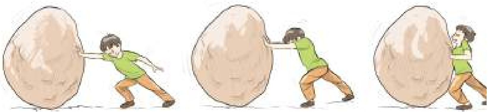

<!-- physics-9-10-bn-c05-t5.1-p007 · figure · p.129 -->
**চিত্র ৫.০১: কতটুকু জায়গায় বল প্রয়োগ করা হচ্ছে তার উপরে চাপ নির্ভর করে।**

### $F = PA$

<!-- physics-9-10-bn-c05-t5.1-p008 · text · p.130 -->
অর্থাৎ স্ক্রেন্টফলকেই ভেক্টর হিসেবে ধরা হয়! ভেক্টরের পরিমাণ আর দিক থাকতে হয়, স্ক্রেন্টফলের পরিমাণটুকু হচ্ছে ভেক্টরের পরিমাণ, বক্রতলে স্ক্রেন্টফলের উপর বাইরের লম্ব হচ্ছে ভেক্টরের দিক।

<!-- physics-9-10-bn-c05-t5.1-p009 · text · p.130 -->
চাপ স্কেলার হওয়ার কারণে এর কোনো দিক নেই। এটি খুবই প্রয়োজনীয়; কারণ চাপ ধারণাটি কঠিন পদার্থ থেকে অনেক বেশি প্রয়োজনীয় তরল কিংবা বায়বীয় পদার্থে। তরল বা বায়বীয় পদার্থ যখন চাপ প্রয়োগ করে তখন আসলে সেটি দিকের উপর নির্ভর করে না। এই বিষয়টি আমরা একটু পরেই দেখব।

### উদাহরণ

<!-- physics-9-10-bn-c05-t5.1-p010 · example · p.130 -->
**প্রশ্ন:** ধরা যাক তোমার ভর 50 kg, তোমার শরীরের পিঠের দিকের স্ক্রেন্টফল 0.5 m2 এবং দুই পায়ের তলার স্ক্রেন্টফল 0.03 m2। তুমি চিত্র হয়ে শুয়ে থাকলে মেঝেতে কত চাপ প্রয়োগ করবে এবং দাঁড়িয়ে থাকলে মেঝেতে কত চাপ প্রয়োগ করবে?

<!-- physics-9-10-bn-c05-t5.1-p011 · example · p.130 · review: verify-formula -->
**উত্তর:** ভর 50 kg কাজেই ওজন $50 \times 9.8  N = 490  N$

<!-- physics-9-10-bn-c05-t5.1-p012 · text · p.130 -->
যখন শুয়ে থাকো তখন চাপ

<!-- physics-9-10-bn-c05-t5.1-p013 · formula · p.130 · review: verify-formula -->
$$P = \frac{490  N}{0.5  m^2} = 980 \frac{N}{m^2}$$

<!-- physics-9-10-bn-c05-t5.1-p014 · text · p.130 -->
যখন দাঁড়িয়ে থাকো তখন চাপ

<!-- physics-9-10-bn-c05-t5.1-p015 · formula · p.130 · review: verify-formula -->
$$P = \frac{490  N}{0.03  m^2} = 16,333 \frac{N}{m^2}$$

<!-- physics-9-10-bn-c05-t5.1-p016 · text · p.130 -->
দেখতেই পাচ্ছ শুয়ে পড়লে অনেক কম চাপ দেওয়া হয়। এ জন্য মানুষ যখন চোরাবালিতে পড়ে, তখন নিজেকে বাঁচানোর জন্য সব সময় শুয়ে পড়তে হয় যেন সে অনেক কম চাপ দেয় এবং চোরাবালিতে সহজে ভুবে না যায়।

<!-- physics-9-10-bn-c05-t5.1-p017 · text · p.130 -->
আবার এর উল্টোটাও সত্যি, বল প্রয়োগ করার অংশটুকুর স্ক্রেন্টফল যদি কম হয়, তাহলে চাপ বেড়ে যায়। একটি পেরেকের সুচালো মুখের স্ক্রেন্টফল খুবই কম তাই এটি যখন কাঠ বা দেয়ালে স্পর্শ করে পেছনের চওড়া মাথায় হাতুড়ি দিয়ে আঘাত করা হয়, তখন বলটি সুচালো মাথা দিয়ে কাঠ বা দেয়ালে চাপ দেয়। সুচালো মাথার স্ক্রেন্টফল যেহেতু খুবই কম তাই চাপটি খুবই বেশি এবং অনায়াসে পেরেক কাঠ বা দেয়ালে ঢুকে যেতে পারে। ছুরির বেলাতোও এই কথাটি সত্যি। তার ধারালো মাথা খুব তীক্ষ্ণ বলে সেই মাথা দিয়ে কোনো কিছুতে অনেক চাপ দিতে পারে এবং সহজেই সেটিকে কেটে ফেলা সম্ভব।

<!-- physics-9-10-bn-c05-t5.1-p018 · text · p.131 -->
চাপের এককের আরেকটি নাম প্যাসকেল (Pa), 1 N বল 1 m2 ক্ষেত্রফলের উপর প্রয়োগ করলে 1 Pa (1 প্যাসকেল) চাপ প্রয়োগ করা হয়।

## 5.2 ঘনত্ব (Density)

<!-- physics-9-10-bn-c05-t5.2-p001 · text · p.131 · review: verify-formula -->
তরল এবং বায়বীয় পদার্থের চাপ বোঝার আগে আমাদের ঘনত্ব সম্পর্কে ধারণাটি অনেক স্পষ্ট থাকা দরকার। ঘনত্ব হচ্ছে একক আয়তনে ভরের পরিমাণ অর্থাৎ কোনো বস্তুর ভর যদি $m$ এবং আয়তন $V$ হয় তাহলে তার ঘনত্ব

<!-- physics-9-10-bn-c05-t5.2-p002 · formula · p.131 · review: verify-formula -->
$$\rho = \frac{m}{V}$$

<!-- physics-9-10-bn-c05-t5.2-p003 · text · p.131 · review: latin-junk,verify-formula -->
ঘনত্বের একক kg/m3 অথবা gm/cc
ঘনত্বের মাত্রা $[P] = ML^{-3}$

<!-- physics-9-10-bn-c05-t5.2-p004 · text · p.131 -->
টেবিল ৫.০১ এ তোমাদের পরিচিত কয়েকটি পদার্থের ঘনত্ব দেওয়া হলো। এখানে একটা বিষয় মনে রাখা ভালো, তাপমাত্রা বাড়লে কিংবা কমলে পদার্থের আয়তন বাড়বে কিংবা কমতে পারে। যেহেতু ভরের কোনো পরিবর্তন হয় না তাই পদার্থের ঘনত্ব তাপমাত্রার সাথে পরিবর্তন হতে পারে। সেজন্য পদার্থের ঘনত্বের কথা বলতে হলে সাধারণত সেটি কোন তাপমাত্রায় মাপা হয়েছে সেটিও বলে দিতে হয়।

<!-- physics-9-10-bn-c05-t5.2-p005 · table · p.131 · review: verify-table -->
**টেবিল ৫.০১: বিভিন্ন পদার্থের ঘনত্ব**
<table><tr><th>পদার্থ</th><th>ঘনত্ব (gm/cc)</th></tr>
<tr><td>বাতাস</td><td>0.00127</td></tr>
<tr><td>কর্ক</td><td>0.25</td></tr>
<tr><td>কার্ঠ</td><td>0.4 - 0.5</td></tr>
<tr><td>মানবদেহ</td><td>0.995</td></tr>
<tr><td>পানি</td><td>1.00</td></tr>
<tr><td>কাচ</td><td>2.60</td></tr>
<tr><td>লোহা</td><td>7.80</td></tr>
<tr><td>পারদ</td><td>13.6</td></tr>
<tr><td>সোনা</td><td>19.30</td></tr></table>

### উদাহরণ

<!-- physics-9-10-bn-c05-t5.2-p006 · example · p.131 · review: latin-junk -->
**প্রশ্ন:** 1 kg পানিতে 0.25 kg লবণ গুলে নেওয়ার পর তার আয়তন হলো 1200 cc এই পানির ঘনত্ব কত?

<!-- physics-9-10-bn-c05-t5.2-p007 · example · p.131 · review: latin-junk -->
**উত্তর:** 1 cc হচ্ছে 1 cm3 কাজেই

<!-- physics-9-10-bn-c05-t5.2-p008 · formula · p.131 · review: verify-formula -->
$$1  cc = (10^{-2}  m)^3 = 10^{-6}  m^3$$

### কাজেই লবণ গোলা পানির ঘনত্ব

<!-- physics-9-10-bn-c05-t5.2-p009 · formula · p.132 · review: verify-formula -->
$$\rho = \frac{1  kg + 0.25  kg}{1200 \times 10^{-6}  m^3} = 1.04 \times 10^3  kg/m^3$$

<!-- physics-9-10-bn-c05-t5.2-p010 · text · p.132 · review: latin-junk -->
**প্রশ্ন:** জর্ডানের ডেড সি (Dead sea) এর ঘনত্ব 1.24 kg/liter এই সমুদ্রের 1 kg পানির আয়তন কত?

<!-- physics-9-10-bn-c05-t5.2-p011 · text · p.132 · review: latin-junk,verify-formula -->
**উত্তর:** 1 litre হচ্ছে 1000 cc বা $10^{-3}  m^3$ কাজেই জর্ডানের ডেড সি এর পানির ঘনত্ব

<!-- physics-9-10-bn-c05-t5.2-p012 · formula · p.132 · review: verify-formula -->
$$\rho = 1.24 \frac{kg}{liter} = \frac{1.24  kg}{10^{-3}  m^3} = 1.24 \times 10^3  kg m^{-3}$$

<!-- physics-9-10-bn-c05-t5.2-p013 · text · p.132 -->
কাজেই 1 kg পানির আয়তন:

<!-- physics-9-10-bn-c05-t5.2-p014 · formula · p.132 · review: verify-formula -->
$$V = \frac{m}{\rho} = \frac{1  kg}{1.24 \times 10^3  kg m^{-3}} = 0.81 \times 10^{-3}  m^3$$

<!-- physics-9-10-bn-c05-t5.2-p015 · text · p.132 · review: latin-junk -->
কিংবা 0.81 liter

<!-- physics-9-10-bn-c05-t5.2-p016 · text · p.132 -->
**প্রশ্ন:** নিউক্লিয়াসের ঘনত্ব কত? 1 চা চামচ নিউক্লিয়াসের ভর কত?

<!-- physics-9-10-bn-c05-t5.2-p017 · text · p.132 · review: verify-formula -->
**উত্তর:** নিউক্লিয়াস তৈরি হয় নিউট্রন আর প্রোটন দিয়ে যাদেরকে সুযম গোলক হিসেবে বিবেচনা করা যায়। তাদের একটার ভর $1.67 \times 10^{-27}  kg$, তাদের ব্যাসার্ধ আনুমানিক $1.25  fm = 1.25 \times 10^{-15}  m$ কাজেই নিউট্রন কিংবা প্রোটনের ঘনত্ব বের করতে পারলে সেটাকেই নিউক্লিয়াসের ঘনত্ব হিসেবে ধরতে পারি!

<!-- physics-9-10-bn-c05-t5.2-p018 · text · p.132 -->
নিউক্লিয়াসের ঘনত্ব

<!-- physics-9-10-bn-c05-t5.2-p019 · formula · p.132 · review: verify-formula -->
$$\rho = \frac{m}{\frac{4\pi}{3}r^3} = \frac{1.67 \times 10^{-27}  kg}{\frac{4\pi}{3}(1.25 \times 10^{-15}  m)^3} = 0.204 \times 10^{18}  kg/m^3$$

<!-- physics-9-10-bn-c05-t5.2-p020 · text · p.132 · review: latin-junk -->
এই সংখ্যাটি যে কত বিশাল সেটা তোমাদের অনুমান করা দরকার। এক চা চামচে মোটামুটি 1 cc জিনিস ধরে, কাজেই এক চা-চামচ নিউক্লিয়াসের ভর:

<!-- physics-9-10-bn-c05-t5.2-p021 · formula · p.132 · review: verify-formula -->
$$m = 0.204 \times 10^{18}  kg/m^3 \times 10^{-6}  m^3 = 2 \times 10^{11}  kg$$

<!-- physics-9-10-bn-c05-t5.2-p022 · text · p.132 -->
এটা মোটামুটিভাবে পৃথিবীর সব মানুষের সম্মিলিত ভর।

<!-- physics-9-10-bn-c05-t5.2-p023 · text · p.133 -->
আবার অন্যভাবেও এটা দেখতে পারি। একটা পরমাণুতে নিউক্লিয়াসে নিউটন-প্রোটন থাকে, বাইরে থাকে ইলেকট্রন। ইলেকট্রনের ভর নিউট্রন-প্রোটনের ভর থেকে প্রায় 1800 গুণ কম, কাজেই যেকোনো জিনিসের ভরটা আসলে নিউক্লিয়াসের ভর। ইলেকট্রনগুলোকে না ধরলে খুব একটা স্ফতি বৃদ্ধি হয় না। কিন্তু আমরা চারপাশে যেসব দেখি, তার আকার কিন্তু নিউক্লিয়াসের আয়তন নয়। তার আয়তন এসেছে পরমাণুর আয়তন থেকে। খুব ছোট একটা নিউক্লিয়াসকে ঘিরে তুলনামূলকভাবে অনেক বড় একটা কক্ষপথে ইলেকট্রন ঘুরতে থাকে। নিউক্লিয়াসের ব্যাসার্ধ থেকে পরমাণুর ব্যাসার্ধ প্রায় এক লক্ষ গুণ বড়।

<!-- physics-9-10-bn-c05-t5.2-p024 · text · p.133 -->
কাজেই আমরা অন্যভাবে বলতে পারি, পৃথিবীর সব মানুষকে একত্র করে যদি কোনোভাবে চাপ দিয়ে তাদের শরীরের যে কয়টি পরমাণু আছে সেগুলো ভেঙে সমস্ত নিউক্লিয়াস একত্র করে ফেলা যায় তাহলে সেটা একটা চা চামচে ঐটে যাবে!

### ৫.২.১ দৈনদিন জীবনে ঘনত্বের ব্যবহার

<!-- physics-9-10-bn-c05-t5.2-p025 · text · p.133 -->
আমাদের দৈনদিন জীবনে ঘনত্ব একটা গুরুত্বপূর্ণ ভূমিকা পালন করে। সেটা অনেক সময় আমরা আলাদা করে লক্ষ্য করি না। যেমন ধরা যাক, চুলোতে একটা পাত্রে আমরা যখন পানি গরম করতে দিই, কিছুক্ষণের মাঝেই পানি টগবগ করে ফুটে থাকে। তার কারণ পাত্রের নিচের অংশে যে পানি থাকে সেটি যখন চুলোর আগুনে উত্তপ্ত হয়ে প্রসারিত হয়, তখন তার ঘনত্ব কমে যায়। ঘনত্ব কম বলে সেই পানিটা উপরে উঠে যায় এবং আশপাশের শীতল পানি নিচে এসে জমা হয়। একটু পর উত্তপ্ত হয়ে সেটাও উপরে উঠে যায় এবং এভাবে চলতেই থাকে এবং কিছুক্ষণেই পানিটা ফুটে থাকে (এই পদ্ধতিতে পানি কিংবা গ্যাসকে গরম করার পদ্ধতির নাম কনভেকশন বা পরিচলন)। যদি উত্তপ্ত করার পর পানির ঘনত্ব কমে না যেত, তাহলে সেটি উপরে উঠে যেত না এবং চুলোর আগুনে শুধু পাত্রের নিচের পানি গরম করতে পারতাম এবং পুরো পাত্রের পানি উত্তপ্ত করা সম্ভব হতো না।

<!-- physics-9-10-bn-c05-t5.2-p026 · text · p.133 -->
গ্রীষ্মকালের প্রচণ্ড রোদের মাঝে যারা পুকুরের পানিতে ঝাঁপ দিয়েছে, তারা নিশ্চয়ই লক্ষ্য করেছ পুকুরের উপরের পানিটা উষ্ণ হলেও নিচের পানি শীতল। এখানে তাপটুকু এসেছে উপর থেকে এবং পানি গরম হওয়ার পর ঘনত্ব কমে গিয়ে উপরেই রয়ে গেছে, পুকুরের পুরো পানি সমানভাবে উত্তপ্ত হতে পারেনি।

<!-- physics-9-10-bn-c05-t5.2-p027 · text · p.133 -->
বিভিন্ন অনুষ্ঠানের উল্লেখনীতে আমরা বেলুন ওড়াতে দেখেছি। এই বেলুনকে ওড়ানোর জন্য তার ভেতর বাতাস থেকে হালকা কোনো গ্যাস ঢোকাতে হয়। নিরাপত্তার দিক থেকে বিবেচনা করা হলে সেটি নিক্ষৃয় হিলিয়াম গ্যাস দিয়ে ভরার কথা কিন্তু হিলিয়াম গ্যাস তুলনামূলকভাবে অনেক ব্যয়বহুল বলে প্রায় সময়েই হাইড্রোজেন গ্যাস দিয়ে কাজ সারা হয়, যেটি যথেষ্ট বিপজ্জনক। শুধু তা-ই নয়, জ্বালানি হিসেবে ব্যবহৃত মিথেন গ্যাস বাতাস থেকে হালকা বলে অনেক সময় এই গ্যাস দিয়েও গ্যাস বেলুন তৈরি করে ব্যবহার করা হয়, যেটি সমান বিপজ্জনক।

<!-- physics-9-10-bn-c05-t5.2-p028 · text · p.134 -->
আমরা অনেক সময় ফানুস ওড়াতে দেখেছি। এই ফানুসের নিচেও একটা আগুন জ্বালানো হয়, সেটি ফানুসকে আলোকোজ্জ্বল করার সাথে সাথে ভেতরের বাতাসকে উত্তপ্ত করে হালকা করে উপরে নিয়ে যায়।

<!-- physics-9-10-bn-c05-t5.2-p029 · text · p.134 -->
একটি ডিম ভালো না পচা সেটা ইচ্ছে করলে পানিতে ডুবিয়ে বের করা যায়। যথেষ্ট পচা হলে তার ঘনত্ব পানি থেকে কম হবে এবং সেটি পানিতে ভেসে উঠবে।

## 5.3 তরলের ভেতর চাপ (Pressure in Liquids)

<!-- physics-9-10-bn-c05-t5.3-p001 · text · p.134 · review: verify-formula -->
যারা পানিতে ঝাঁপাঝাঁপি করেছে তারা সবাই জানে পানির গভীরে গেলে একধরনের চাপ অনুভব করা যায় (যদিও বায়ুমণ্ডল আমাদের ওপর একটা চাপ দেয় কিন্তু আমরা সেটা অনুভব করি না। কারণ আমাদের শরীরও সমান পরিমাণ চাপ দেয়।) পানি কিংবা অন্য কোনো তরলের গভীরে গেলে ঠিক কতটুকু চাপ অনুভব করা যাবে সেটি ইতিমধ্যে তোমাদের বলা হয়েছে। তোমার উপরে তরলের যে স্তম্ভটুকু থাকবে তার ওজন থেকেই তোমার উপরের চাপ নির্ণয় করতে হবে। ধরা যাক তুমি তরলের $h$ গভীরতায় চাপ নির্ণয় করতে চাইছ। সেখানে $A$ ক্ষেত্রফলের একটি পৃষ্ঠ কল্পনা করে নাও (চিত্র ৫.০২)। তার উপরে তরলের যে স্তম্ভটুকু হবে, সেখানকার তরলটুকুর ওজন $A$ পৃষ্ঠে বল প্রয়োগ করবে।

<!-- physics-9-10-bn-c05-t5.3-p002 · figure · p.134 -->
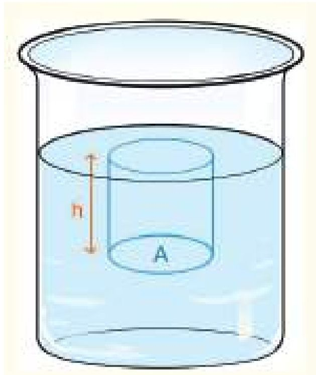

<!-- physics-9-10-bn-c05-t5.3-p003 · text · p.134 · review: verify-formula -->
$A$ পৃষ্ঠের উপরের তরলটুকুর আয়তন $Ah$ তরলের ঘনত্ব যদি $\rho$ হয় তাহলে এই তরলের ওজন বা বল

<!-- physics-9-10-bn-c05-t5.3-p004 · formula · p.134 · review: verify-formula -->
$$F = mg = (Ah\rho)g$$

<!-- physics-9-10-bn-c05-t5.3-p005 · text · p.134 -->
কাজেই চাপ:

<!-- physics-9-10-bn-c05-t5.3-p006 · formula · p.134 · review: verify-formula -->
$$P = \frac{F}{A} = \frac{Ah\rho g}{A} = h\rho g$$

<!-- physics-9-10-bn-c05-t5.3-p007 · text · p.134 · review: latin-junk -->
অর্থাৎ নির্দিষ্ট ঘনত্বের তরলে গভীরতার সাথে সাথে চাপ বাড়তে থাকে। পানির বেলায় আনুমানিক প্রতি দশ মিটার গভীরতায় বাতাসের চাপের সমপরিমাণ চাপ বেড়ে যায়। ভূপৃষ্ঠে বায়ুমণ্ডলের চাপকে 1 atm বলা হয়, যার পরিমাণ হলো 101325 Pa!

<!-- physics-9-10-bn-c05-t5.3-p008 · figure · p.134 -->
**চিত্র ৫.০২: তরলের উচ্চতার জন্য নিচের পৃষ্ঠে চাপ সৃষ্টি হয়।**

<!-- physics-9-10-bn-c05-t5.3-p009 · text · p.135 -->
বাতাস বা গ্যাসকে যে রকম চাপ দিয়ে সংকুচিত করে তার ঘনত্ব বাড়িয়ে ফেলা যায়, তরলের বেলায় কিন্তু সেটি সত্যি নয় (কঠিনের বেলায় তো নয়ই ) তরলকে চাপ দিয়ে সে রকম সংকুচিত করা যায় না। তাই তার ঘনত্ব বাড়ানো কিংবা কমানো যায় না। ৫.০৩ চিত্রে সমুদ্রের পৃষ্ঠদেশ থেকে সমুদ্রের গভীরতায় গেলে কীভাবে পানির চাপ বাড়তে থাকে সেটা দেখানো হয়েছে। যেহেতু পানির ঘনত্ব প্রায় সমান তাই চাপটা সমান হারে বাড়ছে। সমুদ্রপৃষ্ঠে শূন্য থেকে শুরু করে সমুদ্রের তলদেশে সেটি অনেক বেড়ে গেছে।

### চিত্র ৫.০৩: পানির গভীরতার সাথে সাথে পানির চাপ বেড়ে যায়।

<!-- physics-9-10-bn-c05-t5.3-p010 · table · p.135 · review: verify-table -->
<table><tr><th>গভীরতা (km)</th><th>পানির চাপ (atm)</th></tr>
<tr><th>0</th><td>0</td></tr>
<tr><th>1</th><td>100</td></tr>
<tr><th>2</th><td>200</td></tr>
<tr><th>3</th><td>300</td></tr>
<tr><th>4</th><td>400</td></tr>
<tr><th>5</th><td>500</td></tr>
<tr><th>6</th><td>600</td></tr></table>

<!-- physics-9-10-bn-c05-t5.3-p011 · figure · p.135 -->
**চিত্র ৫.০৩: পানির গভীরতার সাথে সাথে পানির চাপ বেড়ে যায়।**

### উদাহরণ

<!-- physics-9-10-bn-c05-t5.3-p012 · example · p.135 -->
**প্রশ্ন:** তুমি মাছ সমুদ্রপৃষ্ঠ থেকে 2,100 m গভীরতায় যেতে পারে, সেটি কত চাপ সহ্য করতে পারে?

<!-- physics-9-10-bn-c05-t5.3-p013 · example · p.135 · review: latin-junk -->
ধরে নাও যে, প্রতি 10 m গভীরতার জন্য 1 atm চাপ বাড়ে।

<!-- physics-9-10-bn-c05-t5.3-p014 · example · p.135 -->
**উত্তর:** তুমি মাছ

<!-- physics-9-10-bn-c05-t5.3-p015 · formula · p.135 · review: verify-formula -->
$$P = \frac{2,100  m}{10  m/atm} = 210  atm$$

<!-- physics-9-10-bn-c05-t5.3-p016 · text · p.135 -->
চাপ সহ্য করতে পারে।

<!-- physics-9-10-bn-c05-t5.3-p017 · text · p.136 · review: latin-junk -->
**প্রশ্ন:** পানির নিচে প্রতি 10 m গভীরতায় 1 atm চাপ বেড়ে যায়। ডাইভাররা সর্বোচ্চ 1,000 ft (305 m) গভীর পর্যন্ত গিয়েছে, সেখানে তাদের কতটুকু চাপ সহ্য করতে হয়েছে?

<!-- physics-9-10-bn-c05-t5.3-p018 · text · p.136 · review: latin-junk -->
**উত্তর:** প্রতি 10 m এ 1 atm বা 1 bar চাপ বেড়ে গেলে 305 m গভীরতায়

<!-- physics-9-10-bn-c05-t5.3-p019 · formula · p.136 · review: verify-formula -->
$$\frac{305  m}{10  m/atm} = 30.5  atm$$

<!-- physics-9-10-bn-c05-t5.3-p020 · text · p.136 · review: latin-junk -->
ডাইভারদের 30.5 atm চাপ সহ্য করতে হবে।

<!-- physics-9-10-bn-c05-t5.3-p021 · text · p.136 -->
**প্রশ্ন:** কেরোসিন (ঘনত্ব 800 kg m-3), পানি (ঘনত্ব 1000 kg m-3) এবং পারদ (ঘনত্ব 13,600 kg m-3) এই তিনটি তরলের জন্য 50 cm নিচে চাপ বের করো।

<!-- physics-9-10-bn-c05-t5.3-p022 · text · p.136 · review: verify-formula -->
**উত্তর:** চাপ $P = h\rho g$

<!-- physics-9-10-bn-c05-t5.3-p023 · text · p.136 -->
কেরোসিনের জন্য

<!-- physics-9-10-bn-c05-t5.3-p024 · formula · p.136 · review: verify-formula -->
$$P = 0.50  m \times 800  kg m^{-3} \times 9.8  N kg^{-1} = 3,920  N m^{-2}$$

<!-- physics-9-10-bn-c05-t5.3-p025 · text · p.136 -->
পানির জন্য

<!-- physics-9-10-bn-c05-t5.3-p026 · formula · p.136 · review: verify-formula -->
$$P = 0.50  m \times 1000  kg m^{-3} \times 9.8  N kg^{-1} = 4,900  N m^{-2}$$

<!-- physics-9-10-bn-c05-t5.3-p027 · text · p.136 -->
পারদের জন্য

<!-- physics-9-10-bn-c05-t5.3-p028 · formula · p.136 · review: verify-formula -->
$$P = 0.50  m \times 13,600  kg m^{-3} \times 9.8  N kg^{-1} = 666,40  N m^{-2}$$

<!-- physics-9-10-bn-c05-t5.3-p029 · text · p.136 · review: latin-junk -->
**প্রশ্ন:** কেরোসিন, পানি এবং পারদ এই তিনটি তরলের কত গভীরতায় 1 *atm* এর সমান চাপ হবে?

<!-- physics-9-10-bn-c05-t5.3-p030 · text · p.136 · review: latin-junk -->
**উত্তর:** আমরা জানি পারদের জন্য 76 cm গভীরতায় 1 atm চাপ হয়। পানির ঘনত্ব পারদ থেকে 13.6 গুণ কম কাজেই পানির গভীরতা 13.6 গুণ বেশি হবে। অর্থাৎ পানির গভীরতা:

<!-- physics-9-10-bn-c05-t5.3-p031 · formula · p.136 · review: verify-formula -->
$$76  cm \times 13.6 = 1034  cm = 10.34  m$$

<!-- physics-9-10-bn-c05-t5.3-p032 · text · p.136 · review: verify-formula -->
কেরোসিনের ঘনত্ব পানির ঘনত্ব থেকে 0.8 গুণ কম কাজেই কেরোসিনের জন্য গভীরতা পানির গভীরতা থেকে $1/0.8 = 1.25$ গুণ বেশি হবে

<!-- physics-9-10-bn-c05-t5.3-p033 · formula · p.136 · review: verify-formula -->
$$10.34  m \times 1.25 = 12.92  m$$

### ৫.৩.১ আর্কিমিডিসের নীতি এবং প্লবতা (Archimedes’ Principle and Buoyancy)

<!-- physics-9-10-bn-c05-t5.3-p034 · text · p.137 · review: verify-formula -->
তোমরা সবাই নিশ্চয়ই আর্কিমিডিসের নীতি এবং সেই সূত্রের পেছনের গল্পটি জানো। নীতিটি সহজ, কোনো বস্তু তরলে নিমজ্জিত করলে সেটি যে পরিমাণ তরল অপসারণ করে সেইটুকু তরলের সমান ওজন বস্তুটির ওজন থেকে কমে যায়। আমরা এখন এই নীতিটি বের করব। ৫.০৪ চিত্রে দেখানো হয়েছে খানিকটা তরল পদার্থে একটা সিলিন্ডার ডোবানো রয়েছে। (এটি সিলিন্ডার না হয়ে অন্য যেকোনো আকৃতির বস্তু হতে পারত, আমরা হিসাবের সুবিধার জন্য সিলিন্ডার নিয়েছি।) ধরা যাক সিলিন্ডারের উচ্চতা $h$ এবং উপরের ও নিচের প্রস্থচ্ছেদের ক্ষেত্রফল $A$। আমরা কল্পনা করে নিই সিলিন্ডারটি এমনভাবে তরলে ডুবিয়ে রাখা হয়েছে যেন তার উপরের পৃষ্ঠটির গভীরতা $h_1$ এবং নিচের পৃষ্ঠের গভীরতা $h_2$। (তরল কিংবা বায়বীয়) পদার্থের চাপ কোনো নির্দিষ্ট দিকে কাজ করে না। এটি সব দিকে কাজ করে। কাজেই সিলিন্ডারের উপরের পৃষ্ঠে নিচের দিকে যে চাপ কাজ করে তার পরিমাণ

<!-- physics-9-10-bn-c05-t5.3-p035 · figure · p.137 -->
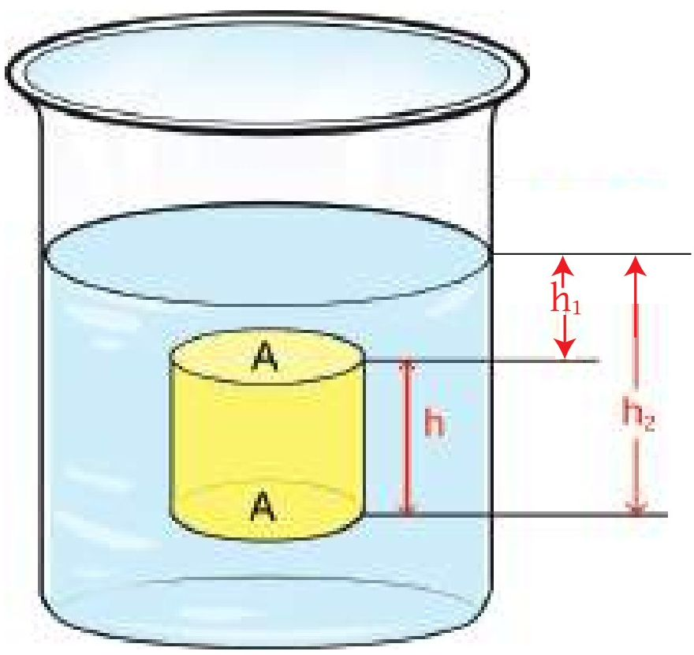

<!-- physics-9-10-bn-c05-t5.3-p036 · figure · p.137 -->
**চিত্র ৫.০৪: একটি বস্তু যতটুকু তরল অপসারিত করে তার সমপরিমাণ ওজন হারায়।**

<!-- physics-9-10-bn-c05-t5.3-p037 · formula · p.137 · review: verify-formula -->
$$P_1 = h_1 \rho g$$

<!-- physics-9-10-bn-c05-t5.3-p038 · text · p.137 -->
এবং নিচের পৃষ্ঠে উপরের দিকে যে চাপ কাজ করে তার পরিমাণ

<!-- physics-9-10-bn-c05-t5.3-p039 · formula · p.137 · review: verify-formula -->
$$P_2 = h_2 \rho g$$

<!-- physics-9-10-bn-c05-t5.3-p040 · text · p.137 -->
কাজেই সিলিন্ডারে উপর পৃষ্ঠে নিচের দিকে এবং নিচের পৃষ্ঠে উপরের দিকে প্রয়োগ করা বল যথাক্রমে:

<!-- physics-9-10-bn-c05-t5.3-p041 · formula · p.137 · review: verify-formula -->
$$F_1 = AP_1 = Ah_1 \rho g$$

<!-- physics-9-10-bn-c05-t5.3-p042 · formula · p.137 · review: verify-formula -->
$$F_2 = AP_2 = Ah_2 \rho g$$

<!-- physics-9-10-bn-c05-t5.3-p043 · text · p.137 · review: verify-formula -->
চারপাশের পৃষ্ঠের উপর কতটুকু বল প্রয়োগ হয়েছে সেটা নিয়ে আমাদের মাথা ঘামাতে হবে না। কারণ সিলিন্ডারটি একদিক থেকে যে বল অনুভব করে অন্যদিক থেকে ঠিক তার বিপরীত পরিমাণ বল অনুভব করে এবং একে অন্যকে কাটাকাটি করে দেয়। যেহেতু $h_2$ এর মান $h_1$ থেকে বেশি তাই দেখতে পাচ্ছি $F_2$ এর মান $F_1$ থেকে বেশি। কাজেই মোট বলটি হবে উপরের দিকে এবং তার পরিমাণ:

<!-- physics-9-10-bn-c05-t5.3-p044 · formula · p.138 · review: verify-formula -->
$$F = F_2 - F_1 = A(h_2 - h_1)\rho g$$

<!-- physics-9-10-bn-c05-t5.3-p045 · formula · p.138 · review: verify-formula -->
$$F = Ah\rho g$$

<!-- physics-9-10-bn-c05-t5.3-p046 · text · p.138 · review: verify-formula -->
যেহেতু $Ah$ হচ্ছে সিলিন্ডারের আয়তন, $\rho$ তরলের ঘনত্ব এবং $g$ মাধ্যাকর্ষণজনিত ত্বরণ, কাজেই উপরের দিকে প্রয়োগ করা বলের পরিমাণ হচ্ছে সিলিন্ডারের আয়তনের সমান তরলের ওজন। ঠিক যেটি আর্কিমিডিসের নীতি নামে পরিচিত। উর্ধ্বমুখী এই বলটিকে প্লুবতা (Buoyancy) বলে।

### নিজে করো

<!-- physics-9-10-bn-c05-t5.3-p047 · activity · p.138 -->
একটি রাবার ব্যান্ডের এক মাথায় একটা বড় আলু বা অন্য কোনো ফল বেঁধে বুলিয়ে দেখো রাবার ব্যান্ডটি কতখানি লম্বা হয়ে আছে। এবারে আলু কিংবা ফলটি পানিতে ডুবিয়ে নাও দেখবে রাবার ব্যান্ডটি বেশি খানিকটা সংকুচিত হয়ে গেছে কারণ, ডুবন্ত অবস্থায় ফলটির ওজন অনেক কম!

### ৫.৩.২ বস্তুর ভেসে থাকা বা ডুবে যাওয়া

<!-- physics-9-10-bn-c05-t5.3-p048 · text · p.138 -->
এখন তোমরা নিশ্চয়ই বুঝতে পেরেছ কেন একটা বস্তু ভেসে থাকে আবার অন্য একটা বস্তু ডুবে যায়। তোমরা জানো একটা বস্তু পানিতে ডোবানো হলে প্লুবতার কারণে সেটা যতটুকু পানি সরিয়েছে উপরের দিকে সেই পানির ওজনের সমপরিমাণ বল অনুভব করে। সেই বলটি বস্তুটার ওজনের বেশি হলে বস্তুটা ভেসে থাকবে। ঠিক যে পরিমাণ ডুবে থাকলে বস্তুর সমান ওজনের পানি অপসারণ করবে, ততটুকুই ডুবে, বাকি অংশটুকু পানিতে ডুবে যাবে না।

<!-- physics-9-10-bn-c05-t5.3-p049 · text · p.138 -->
যদি বস্তুটার ওজন অপসারিত পানির ওজন থেকে বেশি হয়, তাহলে সেটি পানিতে ডুবে যাবে। তবে পানিতে ডুবে থাকা অবস্থায় তার ওজন কিন্তু সত্যিকার ওজন থেকে কম মনে হবে।

<!-- physics-9-10-bn-c05-t5.3-p050 · text · p.138 -->
যদি কোনোভাবে বস্তুটার ওজন অপসারিত পানির ওজনের ঠিক সমান করে ফেলা যায়, তাহলে বস্তুটাকে পানির ভেতরে যেখানেই রাখা হবে সেটা সেখানেই থাকবে, উপরেও ভেসে উঠবে না নিচেও ডুবে যাবে না। দৈনন্দিন জীবনে সে রকম কিছু চোখে না পড়লেও পানির নিচে দিয়ে চলাচল করার জন্য সাবমেরিনে এটি করা হয়।

### উদাহরণ

<!-- physics-9-10-bn-c05-t5.3-p051 · example · p.139 · review: verify-formula -->
**প্রশ্ন:** এক টুকরো কাঠ পানিতে ভাসিয়ে দিলে তার কত শতাংশ ডুবে থাকবে? (কাঠের ঘনত্ব $\rho = 0.5 \times 10^3  kg/m^3$ পানির ঘনত্ব $\rho_W = 10^3  kg/m^3$)

<!-- physics-9-10-bn-c05-t5.3-p052 · example · p.139 · review: verify-formula -->
**উত্তর:** কাঠকে ভেসে থাকতে হলে তার ডুবন্ত অংশের সমপরিমাণ পানির ভর কাঠের ভরের সমান হতে হবে। অর্থাৎ যদি কাঠের আয়তন $V$ হয় তার ভর $V\rho$, এবং যদি কাঠের $V_1$ অংশ পানিতে ডুবে থাকে তাহলে সেই পরিমাণ পানির ভর $V_1\rho_W$, কাজেই

<!-- physics-9-10-bn-c05-t5.3-p053 · formula · p.139 · review: verify-formula -->
$$V\rho = V_1\rho_W$$

<!-- physics-9-10-bn-c05-t5.3-p054 · formula · p.139 · review: verify-formula -->
$$\frac{V_1}{V} = \frac{\rho}{\rho_W} = \frac{0.5 \times 10^3  kg/m^3}{10^3  kg/m^3} \times 100 = 50\%$$

<!-- physics-9-10-bn-c05-t5.3-p055 · text · p.139 · review: verify-formula -->
**প্রশ্ন:** $10kg$ ভরের একটা কাঠ নদীর পানিতে ভেসে ভেসে সমুদ্রে গেল। নদীর পানিতে সেটি অর্ধেক ডুবেছিল, সমুদ্রে কতটুকু ডুববে? (সমুদ্রের পানির ঘনত্ব $\rho_S = 1.03 \times 10^3  kg/m^3$)

<!-- physics-9-10-bn-c05-t5.3-p056 · text · p.139 · review: verify-formula -->
**উত্তর:** নদীর পানির ঘনত্ব $\rho_W = 10^3  kg/m^3$

<!-- physics-9-10-bn-c05-t5.3-p057 · text · p.139 · review: verify-formula -->
কাঠের আয়তন $V$ এবং ঘনত্ব $\rho$ হলে কাঠের ভর $V\rho$

<!-- physics-9-10-bn-c05-t5.3-p058 · text · p.139 -->
নদীর পানিতে কাঠের অর্ধেক ডুবে থাকে কাজেই

<!-- physics-9-10-bn-c05-t5.3-p059 · formula · p.139 · review: verify-formula -->
$$V\rho = \frac{1}{2}V\rho_W$$

<!-- physics-9-10-bn-c05-t5.3-p060 · text · p.139 -->
কাঠের ঘনত্ব

<!-- physics-9-10-bn-c05-t5.3-p061 · formula · p.139 · review: verify-formula -->
$$\rho = \frac{1}{2}\rho_W = 0.5 \times 10^3  kg/m^3$$

<!-- physics-9-10-bn-c05-t5.3-p062 · text · p.139 · review: verify-formula -->
সমুদ্রের পানিতে $V_1$ পরিমাণ ডুবে থাকলে

<!-- physics-9-10-bn-c05-t5.3-p063 · formula · p.139 · review: verify-formula -->
$$V\rho = V_1\rho_S$$

<!-- physics-9-10-bn-c05-t5.3-p064 · formula · p.139 · review: verify-formula -->
$$\frac{V_1}{V} = \frac{\rho}{\rho_S} = \frac{0.5 \times 10^3  kg/m^3}{1.03 \times 10^3  kg/m^3} \times 100 = 48.5\%$$

<!-- physics-9-10-bn-c05-t5.3-p065 · text · p.140 -->
**প্রশ্ন:** ধরা যাক আর্কিমিডিসের সোনার মুকুটের ভর বাতাসে 10 kg এবং পানিতে ভুবিয়ে ভর করলে আপাতভাব 9.4 kg হয়েছে। মুকুটের ঘনত্ব কত?

<!-- physics-9-10-bn-c05-t5.3-p066 · text · p.140 · review: verify-formula -->
**উত্তর:** মুকুটের আয়তন $V$, ঘনত্ব $\rho$ হলে, $V\rho = 10  kg$

<!-- physics-9-10-bn-c05-t5.3-p067 · text · p.140 · review: verify-formula -->
এবং $V\rho - V\rho_W = 9.4  kg$

<!-- physics-9-10-bn-c05-t5.3-p068 · formula · p.140 · review: verify-formula -->
$$V\rho_W = V\rho - 9.4  kg = 10  kg - 9.4  kg = 0.6  kg$$

<!-- physics-9-10-bn-c05-t5.3-p069 · formula · p.140 · review: verify-formula -->
$$V = \frac{0.6  kg}{\rho_W} = \frac{0.6  kg}{10^3  kg/m^3} = 0.6 \times 10^{-3}  m^3$$

<!-- physics-9-10-bn-c05-t5.3-p070 · formula · p.140 · review: verify-formula -->
$$\rho = \frac{10  kg}{V} = \frac{10  kg}{0.6 \times 10^{-3}  m^3} = 16,666  kg/m^3$$

<!-- physics-9-10-bn-c05-t5.3-p071 · text · p.140 -->
সোনার আসল ঘনত্ব 19,300 kg/m3 কাজেই বোঝাই যাচ্ছে এই মুকুটে খাদ মেশানো আছে।

<!-- physics-9-10-bn-c05-t5.3-p072 · text · p.140 -->
> এক গ্লাস পানিতে এক টুকরো বরফ ভাসছে, বরফটি গলে যাওয়ার পর গ্লাসে পানির উচ্চতা কি বেড়ে যাবে নাকি সমান থাকবে?

### ৫.৩.৩ প্যাসকেলের সূত্র

<!-- physics-9-10-bn-c05-t5.3-p073 · text · p.140 -->
এই অধ্যায়ে আমরা দেখিয়েছি যে তরল পদার্থে চাপ প্রয়োগ করলে সেটা চারদিকে সমধালিত হয়। তোমরা একটু চিন্তা করলেই বুঝতে পারবে এটাই স্বাভাবিক। তার কারণ এই চাপটুকু যদি পুরো তরল পদার্থে সমধালিত না হয় তাহলে তরলের এক অংশে চাপ বেশি এবং অন্য অংশে চাপ কম থাকবে, কাজেই সেখানে একটা প্রস্থচ্ছেদ কল্পনা করে নিলে এক দিক থেকে আরোপিত বল অন্যদিক থেকে আরোপিত বল থেকে বেশি হবে এবং এই বলের কারণে তরলটি প্রবাহিত হবে যতক্ষণ পর্যন্ত না চাপ সমান হয়ে যায়। প্যাসকেল এই বিষয়টি একটা সূত্র হিসেবে দিয়েছিলেন, সেটি এ রকম:

<!-- physics-9-10-bn-c05-t5.3-p074 · text · p.140 -->
> **প্যাসকেলের সূত্র:** একটা আবদ্ধ পাত্রে তরল বা বায়বীয় পদার্থে বাইরে থেকে চাপ দেওয়া হলে সেই চাপ সমানভাবে সমধালিত হয়ে পাত্রের সংলগ্ন গায়ে লক্ষ্যভাবে কাজ করবে।

<!-- physics-9-10-bn-c05-t5.3-p075 · text · p.140 · review: verify-formula -->
**প্যাসকেলের সূত্রের ব্যবহার:** প্যাসকেলের এই সূত্রটি ব্যবহার করে অত্যন্ত চমকপ্রদ কিছু যন্ত্র তৈরি করা যায়। ৫.০৫ ছবিতে সে রকম একটা যন্ত্র দেখানো হয়েছে, এখানে পাশাপাশি দুটি সিলিন্ডার একটা নল দিয়ে সংযুক্ত। ধরা যাক একটি সিলিন্ডারের প্রস্থচ্ছেদ $A_1$ অন্যটির $A_2$ এবং তুমি $A_1$ প্রস্থচ্ছেদের সিলিন্ডারে $F_1$ বল প্রয়োগ করেছ তাহলে তোমার প্রয়োগ করা চাপ

<!-- physics-9-10-bn-c05-t5.3-p076 · formula · p.141 · review: verify-formula -->
$$P = \frac{F_1}{A_1}$$

<!-- physics-9-10-bn-c05-t5.3-p077 · text · p.141 -->
এই চাপ তরলের মাধ্যমে চারদিকে সন্ধ্যালিত হবে ও দ্বিতীয় সিলিন্ডারে প্রস্থচ্ছেদেও প্রয়োগ করবে।

<!-- physics-9-10-bn-c05-t5.3-p078 · text · p.141 · review: verify-formula -->
কাজেই দ্বিতীয় সিলিন্ডারে প্রয়োগ করা বলের পরিমাণ হবে $F_2 = PA_2 = F_1 \left( \frac{A_2}{A_1} \right)$

<!-- physics-9-10-bn-c05-t5.3-p079 · text · p.141 · review: verify-formula -->
তুমি নিশ্চয়ই চমৎকৃত হয়ে দেখতে পাচ্ছ যদি $(A_2/A_1)$ এর মান 100 হয় তাহলে তুমি প্রথম সিলিন্ডারে যে পরিমাণ বল প্রয়োগ করছ দ্বিতীয় সিলিন্ডারে তার থেকে 100 গুণ বল পেয়ে যাচ্ছ! এই পদ্ধতিটি খুব কার্যকর, বড় বড় কলকারখানা কিংবা বিমান নিয়ন্ত্রণে এই পদ্ধতি ব্যবহার করা হয়। তবে তোমরা একটা জিনিস জেনে রাখো এটা বলবুদ্ধিকরণ নীতি। এই পদ্ধতিতে শক্তি কিন্তু মোটেও বাড়ানো যায় না। তুমি প্রথম সিলিন্ডারে যে পরিমাণ শক্তি প্রয়োগ করবে দ্বিতীয় সিলিন্ডারে ঠিক সেই পরিমাণ শক্তি ফিরে পাবে!

<!-- physics-9-10-bn-c05-t5.3-p080 · figure · p.141 -->
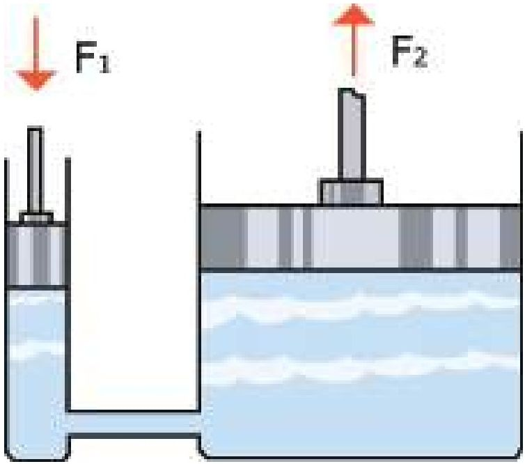

<!-- physics-9-10-bn-c05-t5.3-p081 · figure · p.141 · review: verify-formula -->
**চিত্র ৫.০৫ : $F_1$ বল প্রয়োগ করলে প্রস্থচ্ছেদের উপর নির্ভর করে অন্য দিকে $F_2$ বল পাওয়া যায়।**

### উদাহরণ

<!-- physics-9-10-bn-c05-t5.3-p082 · example · p.141 -->
**প্রশ্ন:** দেখাও যে বল বৃদ্ধি করা হলেও যে পরিমাণ শক্তি প্রয়োগ করা হচ্ছে, ঠিক সেই পরিমাণ শক্তি ফিরে পাচ্ছ।

<!-- physics-9-10-bn-c05-t5.3-p083 · example · p.141 · review: verify-formula -->
**উত্তর:** ধরা যাক, ছোট পিস্টনে $F_1$ বল প্রয়োগ করা হয়েছে এবং পিস্টনটি $l_1$ দূরত্ব অতিক্রম করেছে, কাজেই কাজের পরিমাণ

<!-- physics-9-10-bn-c05-t5.3-p084 · formula · p.141 · review: verify-formula -->
$$W_1 = F_1 l_1$$

<!-- physics-9-10-bn-c05-t5.3-p085 · text · p.141 -->
বড় পিস্টনে বলের পরিমাণ

<!-- physics-9-10-bn-c05-t5.3-p086 · formula · p.141 · review: verify-formula -->
$$F_2 = F_1 \left( \frac{A_2}{A_1} \right)$$

<!-- physics-9-10-bn-c05-t5.3-p087 · text · p.141 · review: verify-formula -->
যেহেতু ছোট পিস্টন অপসারিত তরলটুকু বড় পিস্টনটুকুকে $l_2$ দূরত্ব ঠেলে নিয়ে যায়, কাজেই

<!-- physics-9-10-bn-c05-t5.3-p088 · formula · p.141 · review: verify-formula -->
$$l_1 A_1 = l_2 A_2$$

<!-- physics-9-10-bn-c05-t5.3-p089 · text · p.141 -->
বড় পিস্টনে অতিক্রান্ত দূরত্ব:

<!-- physics-9-10-bn-c05-t5.3-p090 · text · p.142 -->
কাজেই কাজের পরিমাণ

<!-- physics-9-10-bn-c05-t5.3-p091 · formula · p.142 · review: verify-formula -->
$$l_2 = l_1 \left( \frac{A_1}{A_2} \right)$$

<!-- physics-9-10-bn-c05-t5.3-p092 · formula · p.142 · review: verify-formula -->
$$W_2 = F_2 l_2 = F_1 \left( \frac{A_2}{A_1} \right) l_1 \left( \frac{A_1}{A_2} \right) = F_1 l_1$$

<!-- physics-9-10-bn-c05-t5.3-p093 · text · p.142 -->
অর্থাৎ বড় পিস্টনের কাজের পরিমাণ ছোট পিস্টনের কাজের সমান।

## 5.4 বাতাসের চাপ (Air Pressure)

<!-- physics-9-10-bn-c05-t5.4-p001 · text · p.142 · review: verify-formula -->
বাতাসের একটা চাপ আছে (চিত্র ৫.০৬)। আমরা এই চাপ আলাদাভাবে অনুভব করি না কারণ আমাদের শরীরের ভেতর থেকেও বাইরে একটি চাপ দেওয়া হচ্ছে। তাই দুটো চাপ একটা আরেকটিকে কাটাকাটি করে দেয়। মহাকাশে বাতাস নেই, তাই বাতাসের চাপও নেই, তাই সেখানে শরীরের ভেতরের চাপকে কাটাকাটি করার জন্য কিছু নেই এবং এ রকম পরিবেশে মুহূর্তের মধ্যে মানুষের শরীর তার ভেতরকার চাপে বিস্ফোরিত হয়ে যেতে পারে। সে জন্য মহাকাশে মহাকাশচারীরা সব সময়ই চাপ নিরোধক স্পেস স্যুট পরে থাকেন। পৃথিবী পৃষ্ঠে বাতাসের এই চাপ $10^5  N/m^2$ যার অর্থ তুমি যদি পৃথিবী পৃষ্ঠে $1  m^2$ ক্ষেত্রফলের খানিকটা জায়গা কল্পনা করে নাও, তাহলে তার উপরে বাতাসের যে স্তম্ভটি রয়েছে তার ওজন $10^5  N$, এটা মোটামুটিভাবে একটা হাতির ওজন!

<!-- physics-9-10-bn-c05-t5.4-p002 · text · p.142 -->
এখানে একটা বিষয় এখনই তোমাদের খুব ভালো করে বুঝতে হবে, এটি সত্যি, ওজন হচ্ছে বল এবং এই বলটি নিচের দিকে কাজ করে। বল হচ্ছে ভেক্টর তাই এর মান এবং দিক দুটোরই প্রয়োজন আছে। চাপ ভেক্টর নয়, তার কোনো দিক নেই তাই যেকোনো জায়গায় চারদিকে চাপ সমান। তুমি যেখানে এখন দাঁড়িয়ে কিংবা বসে আছে তোমার ওপর বাতাস যে চাপ প্রয়োগ করছে, সেটা তোমার উপরে ডানে বামে সামনে পেছনে বা নিচে চারদিকেই সমান। বাতাস কিংবা তরল পদার্থের জন্য এটা সব সময়ই সত্যি।

<!-- physics-9-10-bn-c05-t5.4-p003 · figure · p.142 · review: latin-junk -->
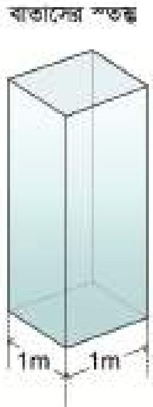

<!-- physics-9-10-bn-c05-t5.4-p004 · figure · p.142 -->
**চিত্র ৫.০৬: বাতাসের চাপটি আসে বাতাসের স্তম্ভের ওজন থেকে।**

<!-- physics-9-10-bn-c05-t5.4-p005 · text · p.142 -->
পাতলা টিন অথবা অ্যালুমিনিয়ামের তৈরি কোনো নিশ্চিদ্দ কোঁটা যদি কোনোভাবে বায়ুশূন্য করা যায়, তাহলে সেটা দুমড়েমুচড়ে যাবে, তার কারণ স্বাভাবিক অবস্থায় বাইরের বাতাসের চাপকে কোঁটার ভেতরের বাতাসের পাল্টা চাপ দিয়ে একটা সমতা বজায় রেখেছিল। ভেতরের বাতাস পাক্ষ্য করে সরিয়ে নেবার পর ভেতরে বাইরের বাতাসের চাপ প্রতিহত করার মতো কিছু নেই, তাই বাইরের বাতাসের চাপ এখন কৌটাকে দুমড়েমুচড়ে দেবে (চিত্র ৫.০৭)। তোমরা যে জিনিসটা লক্ষ্য করবে সেটি হচ্ছে কৌটাটা শুধু উপর দিক থেকে দুমড়েমুচড়ে যাবে না। চারদিক থেকে দুমড়েমুচড়ে যাবে। চাপ যদি শুধু উপর থেকে আসত, তাহলে কৌটাটা শুধু উপর থেকে দুমড়েমুচড়ে যেত। চাপ যেহেতু চারদিকেই সমান তাই চাপটা চারদিক থেকেই আসছে এবং টিনের কৌটাটা চারদিক থেকে দুমড়েমুচড়ে যাচ্ছে।

<!-- physics-9-10-bn-c05-t5.4-p006 · figure · p.143 -->
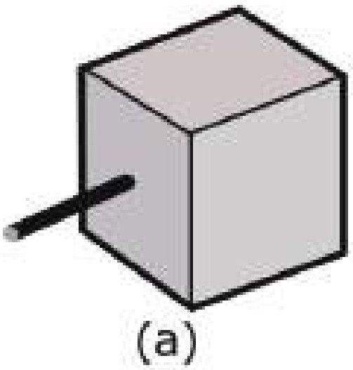

<!-- physics-9-10-bn-c05-t5.4-p007 · figure · p.143 -->
**চিত্র ৫.০৭:** (a) যে দেখানো কিউবটির ভেতর থেকে পাম্প করে বাতাস সরিয়ে নিলে যদি শুধু উপর থেকে চাপ দিত তাহলে (b) ছবির মতো চ্যাপ্টা হয়ে যেত। কিন্তু যেহেতু চারদিক থেকে চাপ আসে তাই (c) ছবির মতো সংকুচিত হয়।

### নিজে করো

<!-- physics-9-10-bn-c05-t5.4-p008 · figure · p.143 -->
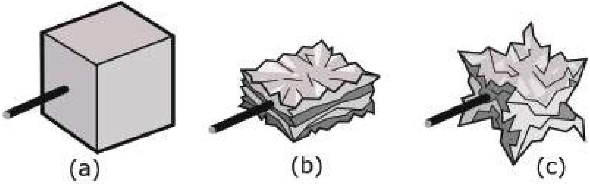

<!-- physics-9-10-bn-c05-t5.4-p009 · figure · p.143 -->
**চিত্র ৫.০৮:** বাতাসের চাপে প্লাস্টিকের বোতল দুমড়েমুচড়ে গেছে।

<!-- physics-9-10-bn-c05-t5.4-p010 · text · p.143 -->
একটি এক লিটারের প্লাস্টিকের পানির খালি বোতল নাও। তার ভেতরে সাবধানě খানিকটা ফুটন্ত গরম পানি ঢেলে প্লাস্টিকের বোতলের ভেতর পানিটাকে নাড়াচাড়া করো। ভেতরের পুরো বাতাস উত্তপ্ত হওয়ার পর বোতলের ছিপিটি শক্ত করে লাগিয়ে নাও। এবারে কিছুক্ষণ অপেক্ষা করো কিংবা প্লাস্টিকের বোতলটি ঠান্ডা পানির ধারায় ধরে রেখে ঠান্ডা করে নাও। ভেতরে খানিকটা শূন্যতা তৈরি হবে বলে বাইরের বাতাসের চাপে বোতলটি দুমড়েমুচড়ে যাবে (চিত্র ৫.০৮)।

<!-- physics-9-10-bn-c05-t5.4-p011 · text · p.144 -->
পৃথিবী পৃষ্ঠে বাতাসের চাপটি আসছে এর উপরের স্তম্ভটির ওজন থেকে। তাই আমরা যদি উপরে উঠি তাহলে আমাদের উপরের স্তম্ভের উচ্চতাটুকু কমে যাবে, ওজনটাও কমে যাবে এবং সেজন্য সেখানে বাতাসের চাপও কমে যাবে। বিষয়টি সত্যি এবং ৫.০৯ চিত্রে তোমাদের দেখানো হয়েছে উচ্চতার সাথে সাথে বাতাসের চাপ কেমেন করে কমে যায়। যে বিষয়টা তোমাদের আলাদা করে লক্ষ্য করার কথা সেটি হচ্ছে প্রায় পাঁচ কিলোমিটার উচ্চতায় পৌঁছানোর পর বাতাসের চাপ অর্ধেক কমে গিয়েছে। সাধারণভাবে মনে হতে পারে তাহলে পরের পাঁচ কিলোমিটারে বাকি অর্ধেক কমে সেখানে বাতাসের চাপ শূন্য হয়ে যাচ্ছে না কেন? এর একটা সুনির্দিষ্ট কারণ আছে। বাতাস বা গ্যাসকে চাপ দিয়ে সংকুচিত করা যায়। তাই পৃথিবীর পৃষ্ঠে, যেখানে বাতাসের চাপ সবচেয়ে বেশি, সেখানে বাতাস সবচেয়ে বেশি সংকুচিত হয়ে আছে অর্থাৎ বাতাসের ঘনত্ব সেখানে সবচেয়ে বেশি। আমরা যতই উপরে উঠতে থাকব বাতাসের চাপ যে রকম কমতে থাকবে তার ঘনত্বও সে রকম কমতে থাকবে।

<!-- physics-9-10-bn-c05-t5.4-p012 · text · p.144 -->
উচ্চতার সাথে সাথে বাতাসের ঘনত্ব কমে যাওয়ার অনেকগুলো বাস্তব দিক আছে। আকাশে যখন প্লেন উড়ে তখন বাতাসের ঘর্ষণ প্লেনের জন্য অনেক বড় সমস্যা। যত উপরে ওঠা যাবে, বাতাসের ঘনত্ব তত কমে যাবে এবং ঘর্ষণও কমে যাবে তাই সত্যি সত্যি বড় বড় যাত্রীবাহী প্লেন আকাশে অনেক ওপর দিয়ে উড়ার চেষ্টা করে। সাধারণভাবে মনে হতে পারে তাহলে প্লেনগুলো আরো উপর দিয়ে, একেবারে মহাকাশ দিয়ে উড়ে যায় না কেন, তাহলে তো ঘর্ষণ আরো কমে যাবে। তার কারণ প্লেনকে ওড়ানোর জন্য তার শক্তিশালী ইঞ্জিন দরকার আর সেই ইঞ্জিনে জ্বালানি জ্বালানোর জন্য অক্সিজেন দরকার। উপরে যেখানে বাতাসের ঘনত্ব কম, সেখানে অক্সিজেনও কম, তাই বেশি উচ্চতায় অক্সিজেনের অভাব হয়ে যায় বলে প্লেনের ইঞ্জিন মহাকাশে কাজ করবে না!

### চিত্র ৫.০৯: উচ্চতার সাথে বাতাসের চাপ কমে যায় — বাতাসের চাপ (atm) vs উচ্চতা (km)

<!-- physics-9-10-bn-c05-t5.4-p013 · table · p.144 · review: verify-table -->
<table><tr><th>উচ্চতা (km)</th><th>বাতাসের চাপ (atm)</th></tr>
<tr><th>0</th><td>1.0</td></tr>
<tr><th>5</th><td>0.55</td></tr>
<tr><th>10</th><td>0.27</td></tr>
<tr><th>15</th><td>0.12</td></tr>
<tr><th>20</th><td>0.05</td></tr>
<tr><th>25</th><td>0.02</td></tr></table>

<!-- physics-9-10-bn-c05-t5.4-p014 · figure · p.144 -->
**চিত্র ৫.০৯: উচ্চতার সাথে বাতাসের চাপ কমে যায়**

<!-- physics-9-10-bn-c05-t5.4-p015 · text · p.144 · review: latin-junk -->
যারা পর্বতশৃঙ্খle ওঠে তাদের জন্যও সেই একই সমস্যা। যত উপরে উঠতে থাকে, সেখানে বাতাসের চাপ কমে যাওয়ার সমস্যা থেকে অনেক বড় সমস্যা বাতাসের ঘনত্ব কমে যাওয়ার কারণে অক্সিজেনের পরিমাণ কমে যাওয়া। যারা পর্বতারাহণ করে, সেজন্য তাদের অত্যন্ত কম অক্সিজেনে শুধু বৈঁচে থাকা নয় পর্বতারোহণের মতো অত্যন্ত কষ্টসাধ্য কাজ করা শিখতে হয়, সেজন্য তাদের শরীরকেও প্রস্তুত করতে হয়।

<!-- physics-9-10-bn-c05-t5.4-p016 · text · p.145 -->
**উদাহরণ:** এভারেস্টের চূড়ায় (29,032 ft) বাতাসে কতটুকু অক্সিজেন আছে?

<!-- physics-9-10-bn-c05-t5.4-p017 · text · p.145 · review: latin-junk -->
**উত্তর:** 29,032 ft = 8,849 m = 8.85 km

<!-- physics-9-10-bn-c05-t5.4-p018 · text · p.145 -->
ছবির গ্রাফ থেকে দেখছি, এই উচ্চতায় বাতাসের চাপ পৃথিবী পৃষ্ঠে বাতাসের চাপের মাত্র 35% কাজেই সেখানে অক্সিজেনের পরিমাণও পৃথিবী পৃষ্ঠের অক্সিজেনের প্রায় 1/3 বা এক-তৃতীয়াংশ।

### ৫.৪.১ টরিসেলির পরীক্ষা

<!-- physics-9-10-bn-c05-t5.4-p019 · text · p.145 -->
তোমরা নিশ্চয়ই স্ট্র দিয়ে কখনো না কখনো কোণ্ড ডিঙ্কস খেয়েছ। কখনো কি চিন্তা করেছ স্ট্রতে চুমক দিলে কেন কোণ্ড ডিঙ্কস তোমার মুখে চলে আসে? আসলে ব্যাপারটি ঘটে বাতাসের চাপের জন্য। ব্যাপারটি বুঝা খুব সহজ হতো যদি তুমি কখনো 10.5 মিটার লম্বা একটা স্ট্র দিয়ে কোণ্ড ডিঙ্কস খাওয়ার চেষ্টা করতে। (ব্যাপারটি মোটেও বাস্তবসম্মত নয়। কিন্তু যুক্তির খাতিরে মনে নাও) তাহলে তুমি আবিষ্কার করতে ডিঙ্কসটা 10.3 মিটার পর্যন্ত উঠে হঠাৎ করে থেমে গেছে। আর যতই চুমক দেওয়ার চেষ্টা করো ডিঙ্কসটা উপরে উঠছে না। (আমরা ধরে নিচ্ছি কোণ্ড ডিঙ্কসের যনত্ব পানির যনত্বের কাছাকাছি)

<!-- physics-9-10-bn-c05-t5.4-p020 · text · p.145 -->
পারদ মুখে নেওয়ার মতো তরল নয় কিন্তু যুক্তির খাতিরে কল্পনা করো তুমি স্ট্র দিয়ে পারদ চুমক দিয়ে মুখে আনার চেষ্টা করছ। যদি স্ট্রটি 76 cm থেকে বেশি লম্বা হয়, তাহলে তুমি আবিষ্কার করবে পারদ ঠিক 76 cm উচ্চতায় এসে থেমে গেছে, তুমি যতই চুমক দেওয়ার চেষ্টা করো পারদ আর উপরে উঠবে না! পানির যনত্ব থেকে পারদের যনত্ব 13.6 গুণ বেশি, তাই পানি যেটুকু উচ্চতায় উঠেছে পারদ তার থেকে 13.6 গুণ কম উঠেছে।

<!-- physics-9-10-bn-c05-t5.4-p021 · text · p.145 -->
এমনিতে একটি স্ট্র মুখে নিয়ে কোণ্ড ডিঙ্কসের বোতলে ধরে রাখলে কোণ্ড ডিঙ্কসটা উপরে উঠবে না। কারণ তোমার মুখের ভেতরে বাতাসের যে চাপ স্ট্র দুবিয়ে রাখা তরলেও সেই একই বাতাসের চাপ। দুটো চাপই সমান, কাজেই এর ভেতরে কোনো কার্যকর বল নেই। এখন যদি তুমি চুমক দাও,

<!-- physics-9-10-bn-c05-t5.4-p022 · text · p.145 -->
যার অর্থ তুমি মুখের ভেতরে শূন্যতা তৈরি করার চেষ্টা করো, তখন সেখানে বাতাসের চাপ কমে যায়। তখন তরলের উপরে বাতাসের চাপের জন্য তরলটা স্ট্র বেয়ে উপরে ওঠে।

<!-- physics-9-10-bn-c05-t5.4-p023 · text · p.146 -->
পারদ ব্যবহার করে বাতাসের চাপের এই পরীক্ষাটি বিজ্ঞানী টিরিসেলি করেছিলেন ১৬৪৩ সালে। তিনি অবশ্য মুখ দিয়ে পারদকে একটি নল বেয়ে টেনে তোলার চেষ্টা করেননি, তিনি এক মুখ বন্ধ একটা নলের ভেতর পারদ ভরে, নলটি পারদ ভরা একটা পাত্রের উল্টো করে রেখেছিলেন। পারদের উচ্চতা নামতে নামতে ঠিক ৭৬ cm এসে থেমে গেল। তুমি চুমুক দিয়ে খাবার সময় মুখের ভেতরে যে শূন্যতা তৈরি করার চেষ্টা করো কানের নলের উপরে ঠিক সেই শূন্যতা তৈরি হয়ে গিয়েছিল। বাতাস পারদের উপরে চাপ দিচ্ছে এবং সেই চাপ তরলের সব জায়গায় সমণুলিত হয়ে নলের নিচেও এসেছে। নলের উপরে কোনো ফুটো নেই, তাই সেদিক দিয়ে বাতাস চাপ দিতে পারে না। কাজেই সমতা আনার জন্য নলের নিচে এক মাত্র চাপ হচ্ছে ৭৬ cm উচ্চ পারদ স্তম্ভের ওজনের কারণে তৈরি হওয়া চাপ।

<!-- physics-9-10-bn-c05-t5.4-p024 · figure · p.146 -->
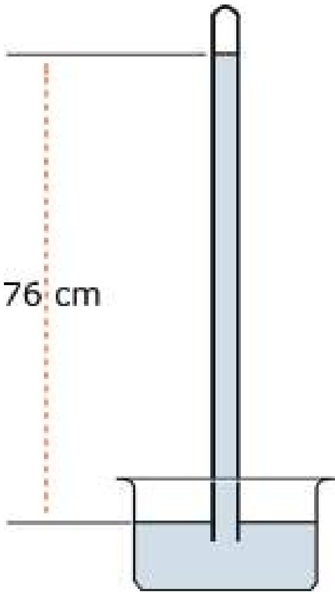

<!-- physics-9-10-bn-c05-t5.4-p025 · figure · p.146 -->
**চিত্র ৫.১০ : বাতাসের চাপের কারণে পারদ ঠিক ৭৬ cm উচ্চতায় স্থির হয়ে যায়।**

<!-- physics-9-10-bn-c05-t5.4-p026 · text · p.146 -->
বাতাসের চাপ মাপার যন্ত্রের নাম ব্যারোমিটার (চিত্র ৫.১০) এবং টিরিসেলির এই পদ্ধতি দিয়ে তৈরি ব্যারোমিটারে এখানো বাতাসের চাপ মাপা হয়। বাতাসের চাপ বাড়লে পারদের উচ্চতা ৭৬ cm থেকে বেশি হয়, চাপ কমলে উচ্চতা ৭৬ cm থেকে কমে যায়।

<!-- physics-9-10-bn-c05-t5.4-p027 · text · p.146 -->
> টিরিসেলির পারদের তৈরি ব্যারোমিটারের কানের নলটি যদি সোজা না হয়ে আঁকাবাঁকা হয়, তাহলে কি কাজ করবে?

<!-- physics-9-10-bn-c05-t5.4-p028 · text · p.146 · review: latin-junk -->
> পারদের পরিবর্তে কেরোসিন দিয়ে ব্যারোমিটার তৈরি করলে তার উচ্চতা কত হবে? (কেরোসিনের ঘনত্ব 0.8 gm/cm3)

### ৫.৪.২ বাতাসের চাপ এবং আবহাওয়া

<!-- physics-9-10-bn-c05-t5.4-p029 · text · p.146 -->
বাতাসের চাপের সাথে আবহাওয়ার খুব ঘনিষ্ঠ একটা সম্পর্ক আছে। তোমরা নিশ্চয়ই আবহাওয়ার খবরে অনেকবার সমুদ্র নিম্নচাপ সূচি হওয়ার কথা শুনছে, যার অর্থ সেখানে বাতাসের চাপ কমে গেছে। তখন চাপ সমান করার জন্য আশপাশের উচ্চ চাপ এলাকা থেকে বাতাস সেই নিম্নচাপের দিকে আসতে থাকে এবং মাঝে মাঝে একটা ঘূর্ণির সৃষ্টি হয়, সেই ঘূর্ণিটি বিশেষ অবস্থায় ঘূর্ণিঝড়ের সৃষ্টি করে। আমাদের দেশে ঘূর্ণিঝড়ের ভয়াবহতার খবর তোমরা নিশ্চয়ই জানো।

<!-- physics-9-10-bn-c05-t5.4-p030 · text · p.147 -->
তোমরা যখন পরের অধ্যায়ে তাপ এবং তাপমাত্রা সম্পর্কে পড়বে, তখন তোমরা জানতে পারবে যে বাতাসের তাপমাত্রা বেড়ে গেলে সেটি প্রসারিত হয় বলে তার ঘনত্ব কমে যায় এবং চাপ কমে যায়। বাতাসের চাপ আরো কার্যকরভাবে কমে, যদি তার মাঝে জলীয় বাষ্পের পরিমাণ বেড়ে যায়। জলীয়

<!-- physics-9-10-bn-c05-t5.4-p031 · text · p.147 -->
বাষ্প হচ্ছে পানি, পানির অণুতে একটি অক্সিজেন এবং দুটি হাইড্রোজেন থাকে এবং পানির অণুর আণবিক ভর হচ্ছে (16 + 1 + 1 =) 18। বাতাসের মূল উপাদান হচ্ছে নাইট্রোজেন (পারমাণবিক ভর 14) দুটো পরমাণু দিয়ে তৈরি হয়, তাই তাদের আণবিক ভর (14 + 14 =) 28 এবং অক্সিজেন (পারমাণবিক ভর 16), এটিও দুটি পরমাণু দিয়ে তৈরি, তাই আণবিক ভর (16 + 16 =) 32 যা পানির আণবিক ভর থেকে অনেক বেশি। তাই যখন বাতাসে জলীয় বাষ্প থাকে তখন বেশি আণবিক ভরের নাইট্রোজেন এবং অক্সিজেনের বদলে কম আণবিক ভরের পানির অণু স্থান করে নেয়, কাজেই বাতাসের ঘনত্ব কমে যায়। বাতাসের ঘনত্ব কম হলে বাতাসের চাপও কমে যায়। কাজেই ব্যারোমিটারে বাতাসের চাপ দেখেই স্থানীয় আবহাওয়া সম্পর্কে ভবিষ্যদ্বাণী করা সম্ভব। ব্যারোমিটারে উচ্চ চাপ দেখালে বোঝা যায়, বাতাস শুকনো এবং আবহাওয়া ভালো। চাপ কমতে থাকলে বোঝা যায় জলীয় বাষ্পের পরিমাণ বাড়ছে। চাপ বেশি কম দেখালে বুঝতে হবে আশপাশের এলাকা থেকে বাতাস ছুটে এসে ঝড়-বৃষ্টি শুরু হতে যাচ্ছে।

## 5.5 স্থিতিস্থাপকতা (Elasticity)

<!-- physics-9-10-bn-c05-t5.5-p001 · text · p.147 -->
তোমরা সবাই কখনো না কখনো একটা স্প্রিং কিংবা একটা রাবার ব্যান্ড টেনে লম্বা করে আবার ছেড়ে দিয়েছ। তোমরা নিশ্চয়ই লক্ষ্য করেছ স্প্রিং কিংবা রাবার ব্যান্ডকে টেনে ছেড়ে দেওয়া হলে সেটা আবার আগের দৈর্ঘ্য ফিরে আসার চেষ্টা করছে। টেনে ধরাকে পদার্থবিজ্ঞানের ভাষায় বলা হয় বল প্রয়োগ করা আর দৈর্ঘ্য পরিবর্তন হওয়াকে বলা হয় বিকৃতি ঘটা। দৈনন্দিন জীবনে বিকৃতি শব্দটি খুবই নেতিবাচক। কিন্তু এখানে এটাকে তোমরা নেতিবাচক হিসেবে দেখো না। এটা হচ্ছে আকার বা আকৃতির পরিবর্তন মাত্র।

<!-- physics-9-10-bn-c05-t5.5-p002 · text · p.147 -->
কাজেই তোমরা বুঝতে পারছ কোনো বস্তুরকে বল প্রদান করলে তার ভেতরে একটা বিকৃতি ঘটে (এবং এই বিকৃতির জন্য প্রত্যয়নী বল নামে একটা পাল্টা বলের তৈরি হয়) বলাটি সরিয়ে নিলে বিকৃতির অবসান ঘটে আর বস্তুটি আবার তার আগের অবস্থায় ফিরে যায়। পদার্থের এই ধর্মের নাম স্থিতিস্থাপকতা। তবে মনে রাখতে হবে কতটুকু বল প্রয়োগ করা যাবে তার একটা সীমা আছে। এই সীমা অতিক্রম করে ফেললে পদার্থ তার আগের অবস্থায় ফিরে আসতে পারবে না। তার মাঝে একটা স্থায়ী বিকৃতি ঘটে যেতে পারে। এই সীমাকে স্থিতিস্থাপক সীমা বলে। একটা রডকে অল্প একটু বাঁকা করে ছেড়ে দিলে সেটা সোজা হয়ে যায়। বেশি বাঁকা করলে বাঁকা হয়েই থাকে আর সোজা হয় না। কাজেই আমরা বিষয়টা এভাবে বলতে পারি:

<!-- physics-9-10-bn-c05-t5.5-p003 · text · p.148 · review: verify-formula -->
**বিকৃতি:** বাইরে থেকে বল প্রয়োগ করলে পদার্থের আকার বা দৈর্ঘ্যের যে আপেক্ষিক পরিবর্তন হয় সেটা হচ্ছে বিকৃতি। অর্থাৎ $L_0$ দৈর্ঘ্যের একটি বস্তুর ওপর বল প্রয়োগ করা হলে তার দৈর্ঘ্য যদি $L$ হয় তাহলে বিকৃতি হচ্ছে

<!-- physics-9-10-bn-c05-t5.5-p004 · formula · p.148 · review: verify-formula -->
$$\frac{L - L_0}{L_0}$$

<!-- physics-9-10-bn-c05-t5.5-p005 · figure · p.148 -->
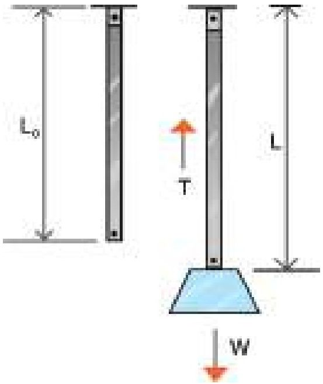

<!-- physics-9-10-bn-c05-t5.5-p006 · text · p.148 -->
দেখাই যাচ্ছে বিকৃতির কোনো একক নেই, এটি একটি সংখ্যা মাত্র।

<!-- physics-9-10-bn-c05-t5.5-p007 · text · p.148 · review: verify-formula -->
**পীড়ন:** একক ক্ষেত্রফলে বিকৃতির কারণে পদার্থের ভেতর যে বল তৈরি হয়, সেটাই হচ্ছে পীড়ন। অর্থাৎ $A$ প্রস্থচ্ছেদের একটা বস্তুরে বল প্রয়োগ করা হলে যদি তার বিকৃতি ঘটে সেই বিকৃতি যদি $F$ প্রত্যয়নী বল তৈরি করে তাহলে পীড়ন হচ্ছে

<!-- physics-9-10-bn-c05-t5.5-p008 · formula · p.148 · review: verify-formula -->
$$\frac{F}{A}$$

<!-- physics-9-10-bn-c05-t5.5-p009 · figure · p.148 -->
drawing: diagram of a rod under tension T with weight W

<!-- physics-9-10-bn-c05-t5.5-p010 · figure · p.148 -->
**চিত্র ৫.১১:** বল প্রয়োগ করলে দণ্ডের বিকৃতি ঘটে এবং সে জন্য্য পীড়ন সৃষ্টি হয়।

<!-- physics-9-10-bn-c05-t5.5-p011 · text · p.148 -->
দেখতেই পাচ্ছ এটা চাপের মতো এবং এর একক (Pa) প্যাসকেল।

<!-- physics-9-10-bn-c05-t5.5-p012 · text · p.148 · review: verify-formula -->
> **তুকের সূত্র:** আমরা যদি পীড়ন এবং বিকৃতি বুঝে থাকি, তাহলে তুকের সূত্রটি বোঝা খুব সহজ। এই সূত্র অনুসারে স্থিতিস্থাপক সীমার ভেতরে পীড়ন এবং বিকৃতি সমানুপাতিক
>
> পীড়ন $\propto$ বিকৃতি

<!-- physics-9-10-bn-c05-t5.5-p013 · text · p.148 -->
কাজেই

<!-- physics-9-10-bn-c05-t5.5-p014 · formula · p.148 · review: latin-junk,verify-formula -->
$$পীড়ন = ধ্রুবক \times বিকৃতি$$

<!-- physics-9-10-bn-c05-t5.5-p015 · text · p.148 -->
অর্থাৎ প্রত্যেক পদার্থের পীড়ন এবং বিকৃতির সাথে সম্পর্কযুক্ত একটা ধ্রুবক থাকে, সেই ধ্রুবকটার নাম স্থিতিস্থাপক গুণাঙ্ক। দুটি নির্দিষ্ট বিষয় নিয়ে আলোচনা করলে বোঝা আরো সহজ হবে:

<!-- physics-9-10-bn-c05-t5.5-p016 · text · p.148 · review: verify-formula -->
(i) ধরা যাক $A$ প্রস্থচ্ছেদের একটা তারের দৈর্ঘ্য $L_0$, এর সাথে $W$ ওজনের একটা ভর ঝুলিয়ে দেওয়া হলো এই বলটি বোলানের কারণে $L_0$ দৈর্ঘ্যটি বেড়ে হলো $L$ (চিত্র ৫.১১) এই বাড়িত দৈর্ঘ্য তারটির ভেতরে একটা পাল্টা বল তৈরি করেছে $T$ (এখানে $T$ অক্ষরটি ব্যবহার করা হয় টেনশন Tension শব্দের জন্য। সাধারণত যখন কোনো তারকে টানা, হয় তখন তার ভেতরে যে বল কাজ করে তার নাম টেনশন)। কাজেই পীড়ন হচ্ছে $T/A$ এবং বিকৃতি হচ্ছে:

<!-- physics-9-10-bn-c05-t5.5-p017 · formula · p.149 · review: verify-formula -->
$$\frac{L - L_0}{L_0}$$

<!-- physics-9-10-bn-c05-t5.5-p018 · text · p.149 -->
কাজেই

<!-- physics-9-10-bn-c05-t5.5-p019 · formula · p.149 · review: verify-formula -->
$$\frac{T}{A} \propto \frac{L - L_0}{L_0}$$

<!-- physics-9-10-bn-c05-t5.5-p020 · text · p.149 -->
কিংবা

<!-- physics-9-10-bn-c05-t5.5-p021 · formula · p.149 · review: verify-formula -->
$$\frac{T}{A} = Y \left( \frac{L - L_0}{L_0} \right)$$

<!-- physics-9-10-bn-c05-t5.5-p022 · table · p.149 · review: verify-table -->
**টেবিল ৫.০২: বিভিন্ন পদার্থের ইয়াংস মডুলাস**
<table><tr><th>পদার্থ</th><th>G-Pa</th></tr>
<tr><td>রবাব</td><td>0.01-0.1</td></tr>
<tr><td>হাড়</td><td>9</td></tr>
<tr><td>কাঠ</td><td>10</td></tr>
<tr><td>কাচ</td><td>50 - 90</td></tr>
<tr><td>অ্যালুমিনিয়াম</td><td>69</td></tr>
<tr><td>তামা</td><td>117</td></tr>
<tr><td>লোহা</td><td>200</td></tr>
<tr><td>হীরা</td><td>1220</td></tr></table>

<!-- physics-9-10-bn-c05-t5.5-p023 · text · p.149 · review: verify-formula -->
এই ধ্রুবকের নাম ইয়াংস মডুলাস (Young’s Modulus)। যেহেতু বিকৃতির কোনো একক নেই, তাই $Y$ এর একক হচ্ছে Nm$^{-2}$. টেবিল ৫.০২ এ কয়েকটি পদার্থের ইয়াংস মডুলাস দেওয়া হলো।

### উদাহরণ

<!-- physics-9-10-bn-c05-t5.5-p024 · example · p.149 -->
**প্রশ্ন:** ইয়াংস মডুলাসের মান বেশি হলে পদার্থ কীভাবে দৈর্ঘ্য পরিবর্তন করে?

<!-- physics-9-10-bn-c05-t5.5-p025 · example · p.149 -->
**উত্তর:** দৈর্ঘ্যের পরিবর্তনের হার

<!-- physics-9-10-bn-c05-t5.5-p026 · formula · p.149 · review: verify-formula -->
$$\frac{L - L_0}{L_0} = \frac{1}{Y} \left( \frac{T}{A} \right)$$

<!-- physics-9-10-bn-c05-t5.5-p027 · text · p.149 · review: verify-formula -->
কাজেই $T/A$ যদি সমান হয়, তাহলে $Y$ যত বেশি হবে দৈর্ঘ্যের পরিবর্তন তত কম হবে।

<!-- physics-9-10-bn-c05-t5.5-p028 · text · p.149 · review: verify-formula -->
(ii) ধরা যাক একটি সিলিন্ডারে সাধারণ অবস্থায় $V_0$ আয়তনের গ্যাস আছে। এই গ্যাসে $P$ চাপ দেওয়ার কারণে সিলিন্ডারের গ্যাসের আয়তন কমে হয়ে গেল $V$ (চিত্র ৫.১২), এখানে পীড়ন হচ্ছে $P$ এবং বিকৃতি হচ্ছে:

<!-- physics-9-10-bn-c05-t5.5-p029 · formula · p.149 · review: verify-formula -->
$$\frac{V - V_0}{V_0}$$

<!-- physics-9-10-bn-c05-t5.5-p030 · text · p.150 -->
কাজেই আমরা লিখতে পারি

<!-- physics-9-10-bn-c05-t5.5-p031 · formula · p.150 · review: verify-formula -->
$$P \propto \left( \frac{V - V_0}{V_0} \right)$$

<!-- physics-9-10-bn-c05-t5.5-p032 · formula · p.150 · review: verify-formula -->
$$P = B \left( \frac{V - V_0}{V_0} \right)$$

<!-- physics-9-10-bn-c05-t5.5-p033 · text · p.150 · review: verify-formula -->
এখানে $B$ হচ্ছে ধ্বংসক এবং এই ধ্বংসকের নাম বাল্ক মডুলাস বা আয়তন গুণাঙ্ক (Bulk Modulus)। $B$ এর একক হচ্ছে Nm$^{-2}$ কিংবা প্যাসকেল!

<!-- physics-9-10-bn-c05-t5.5-p034 · figure · p.150 -->
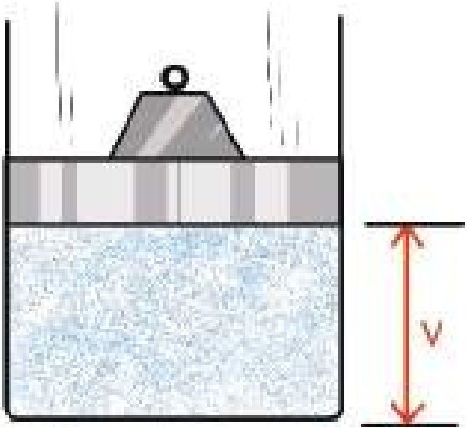

<!-- physics-9-10-bn-c05-t5.5-p035 · figure · p.150 -->
**চিত্র৫.১২: আবদ্ধ বাতাসে চাপ প্রয়োগ করলে বাতাস সংকুচিত হয়।**

## 5.6 পদার্থের তিন অবস্থা: কঠিন, তরল এবং গ্যাস

### (The three states of Matter: Solid, Liquid and Gas)

<!-- physics-9-10-bn-c05-t5.6-p001 · text · p.150 -->
তোমরা নিশ্চয়ই জানো বিশ্বের সবকিছু তৈরি হয়েছে অণু দিয়ে। (অবশ্য অণু মৌলিক কণা নয়, অণু তৈরি হয়েছে পরমাণু দিয়ে, পরমাণু তৈরি হয়েছে ইলেকট্রন এবং নিউক্লিয়াস দিয়ে, নিউক্লিয়াস তৈরি হয়েছে প্রোটন এবং নিউট্রন দিয়ে, প্রোটন এবং নিউট্রন তৈরি হয়েছে কোয়ার্ক দিয়ে এবং বিজ্ঞানীরা ধারণা করছেন ইলেকট্রন কিংবা কোয়ার্ক তৈরি হয়েছে স্ট্রিং দিয়ে।) যেহেতু একটা পদার্থের ধর্ম তার অণুতে বজায় থাকে, তাই আমরা অণুকেই পদার্থের সবচেয়ে ছোট একক হিসেবে ধরে নিই। যেমন— পানির অণুতে পানির সব ধর্ম আছে কিন্তু পানিকে তার পরমাণুতে ভেঙে নিলে সেটি আর পানি থাকে না। সেটা রূপান্তরিত হবে একটা অক্সিজেন আর দুইটা হাইড্রোজেনের পরমাণুতে, দুটোই গ্যাস।

<!-- physics-9-10-bn-c05-t5.6-p002 · text · p.151 -->
একটা পদার্থে তার অণুগুলো কীভাবে আছে তার ওপর নির্ভর করে সেটি কি কঠিন, তরল নাকি গ্যাস (চিত্র ৫.১৩)। এর সবচেয়ে পরিচিত উদাহরণ হচ্ছে পানি, এটি কঠিন তরল কিংবা গ্যাস তিন রূপেই থাকতে পারে। তার অণুগুলো কীভাবে আছে তার উপর নির্ভর করছে এটি কি বরফ, পানি নাকি জলীয় বাষ্প।

<!-- physics-9-10-bn-c05-t5.6-p003 · figure · p.151 -->
**চিত্র৫.১৩: (a) কঠিন, (b) তরল এবং (c) গ্যাস।**

<!-- physics-9-10-bn-c05-t5.6-p004 · text · p.151 -->
যখন কোনো পদার্থ গ্যাস অবস্থায় থাকে, তখন তার অণুগুলো থাকে মুক্ত অবস্থায়, একটি থেকে অন্যটির মাঝে দূরত্ব অনেক বেশি। যখন তরল অবস্থায় থাকে তখন অণুগুলো তুলনামূলকভাবে কাছে হলেও একটার সাপেক্ষে অন্যটি নড়তে পারে। কঠিন অবস্থায় অণুগুলো কাছাকাছি থাকে, কিন্তু একটি অণু অন্য অণুর সাপেক্ষে নড়তে পারে না।

<!-- physics-9-10-bn-c05-t5.6-p005 · text · p.151 -->
একটা গ্যাসের অণুগুলোর মাঝে দূরত্ব অনেক বেশি। সেগুলোর কোনো নিয়মিত আয়তন বা আকার নেই। তরল পদার্থের গ্যাসগুলো কাছাকাছি, তাদের নির্দিষ্ট আয়তন থাকলেও কোনো নিয়মিত আকার নেই। কঠিন পদার্থের অণুগুলো খুব কাছাকাছি থাকে, তাই তাদের নির্দিষ্ট আয়তন এবং নিয়মিত আকার আছে।

<!-- physics-9-10-bn-c05-t5.6-p006 · text · p.151 -->
গ্যাসে অণুগুলো মুক্তভাবে ছোটাহুটি করতে পারে, তরলে অণুগুলো কাঁপে এবং একটার পাশ দিয়ে অন্যটি চলে যেতে পারে, কঠিন পদার্থে অণুগুলো নিজ অবস্থানে থেকে কাঁপলেও স্থান পরিবর্তন করতে পারে না।

<!-- physics-9-10-bn-c05-t5.6-p007 · text · p.151 -->
এমনিতে আমরা কঠিন, তরল বা গ্যাস কোনোটিরই অণুকে দেখতে পাই না, এটাকে কঠিন, তরল বা গ্যাস হিসেবে দেখি। উপরে অণুগুলোর যে বৈশিষ্ট্যের কথা বলা হয়েছে, তাদের কঠিন, তরল বা গ্যাসীয় অবস্থাতেও সেটা প্রকাশ পায়। যেমন—

<!-- physics-9-10-bn-c05-t5.6-p008 · table · p.152 · review: verify-table -->
<table><tr><th>গ্যাস: আণবিক ধর্ম</th><th>গ্যাসে তার প্রতিফলন</th></tr>
<tr><td>অণুগুলো একটা আরেকটার পাশে ছুটতে পারে।</td><td>যে পাত্রে রাখা হয় তার পুরো আয়তনে ছড়িয়ে পড়ে।</td></tr>
<tr><td>অণুগুলোর মাঝে দূরত্ব বেশি, ফাঁকা জায়গা রয়েছে।</td><td>গ্যাসকে চাপ দিয়ে সংকুচিত করা যায়।</td></tr>
<tr><td>একটি অণু অন্য অণুর সাপেক্ষে ছুটতে পারে।</td><td>গ্যাস সহজে প্রবাহিত হয়।</td></tr></table>

<!-- physics-9-10-bn-c05-t5.6-p009 · table · p.152 · review: verify-table -->
<table><tr><th>তরল: আণবিক ধর্ম</th><th>তরল পদার্থে তার প্রতিফলন</th></tr>
<tr><td>অণুগুলো একটা আরেকটার পাশ দিয়ে যেতে পারে।</td><td>সহজে প্রবাহিত হয়, যে পাত্রে রাখা হয় তার আকার ধারণ করে।</td></tr>
<tr><td>অণুগুলো কাছাকাছি বলে ফাঁকা জায়গা নেই।</td><td>তরলকে চাপ দিয়ে সংকুচিত করা যায় না।</td></tr></table>

<!-- physics-9-10-bn-c05-t5.6-p010 · table · p.152 · review: verify-table -->
<table><tr><th>কঠিন: আণবিক ধর্ম</th><th>কঠিন পদার্থে তার প্রতিফলন</th></tr>
<tr><td>অণুগুলো নিজ অবস্থানে দাঁড়ি।</td><td>নির্দিষ্ট আকার থাকে।</td></tr>
<tr><td>অণুগুলোর মাঝে দূরত্ব খুব কম।</td><td>চাপ দিয়ে সংকুচিত করা যায় না।</td></tr>
<tr><td>অণুগুলো নিজ অবস্থানে আটকা পড়ে থাকে।</td><td>টেলে প্রবাহিত করা যায় না।</td></tr></table>

### ৫.৬.১ পদার্থের আণবিক গতিতত্ত্ব

<!-- physics-9-10-bn-c05-t5.6-p011 · text · p.152 -->
একটি কঠিন পদার্থ টেবিলে রাখা হলে কঠিন পদার্থটি টেবিলের যে অংশটুকু স্পর্শ করবে সেখানে এক ধরনের চাপ প্রয়োগ করবে। কঠিন পদার্থ না রেখে আমরা যদি একইভাবে টেবিলে তরল পদার্থ রাখতে চাই সেটি কাজ করবে না, তরলটি সারা টেবিলে গড়িয়ে যাবে। তরলটি রাখতে হবে কোনো একটা পাত্রে এবং তরলটি শুধু নিচে নয় চারদিকে পাত্রটির গায়ে চাপ দেবে। (পাত্রটির গায়ে একটা ফুটো করা হলে তরলের চাপে এই ফুটো দিয়ে তরল বের হতে থাকবে) আমরা যদি গ্যাস রাখতে চাই, তাহলে সেটি আর পাত্রে রাখা সম্ভব না, তখন সেটি একটা আবদ্ধ জায়গায় রাখতে হবে এবং গ্যাস এই আবদ্ধ জায়গার চারদিকে চাপ প্রয়োগ করবে। একটা বেলুন ফুলিয়ে সেখানে গ্যাস রাখা হয় এবং বেলুনটা না ফাটিয়ে সেখানে একটা ফুটো করতে পারলে বাতাসের চাপে এই ফুটো দিয়ে বাতাস বের হতে থাকবে।

### নিজে করো

<!-- physics-9-10-bn-c05-t5.6-p012 · activity · p.153 -->
একটা বেলুন ফুলিয়ে বেলুনটির পুঁথি এক টুকরা স্কচটেপ ভালো করে লাগাও। এবারে একটা সুচ দিয়ে স্কচটেপের উপর দিয়ে বেলুনটাতে একটা ফুটো করো। তাহলে বেলুনটা ফাটবে না, দেখবে ফুটো দিয়ে বাতাস বের হয়ে যাচ্ছে।

<!-- physics-9-10-bn-c05-t5.6-p013 · text · p.153 -->
আমরা গ্যাসের চাপের কথা উল্লেখ করেছি কিন্তু এর কারণটি ব্যাখ্যা করিনি। পদার্থের আণবিক গতিতত্ত্ব দিয়ে আমরা চাপের কারণটি ব্যাখ্যা করতে পারব। আবদ্ধ জায়গায় গ্যাস রাখা হলে এটি পাত্রের গায়ে একধরনের চাপ দেয়, পদার্থের আণবিক গতিতত্ত্ব দিয়ে সেটি ব্যাখ্যা করা যায়। আবদ্ধ জায়গার ভেতর গ্যাসের অণুগুলো ছোটাছুটি করতে থাকে এবং প্রতিনিয়ত সেটি আবদ্ধ জায়গার দেয়ালে এসে আঘাত করে এবং প্রতিফলিত হয়ে ফিরে যায়। অর্থাৎ গ্যাসের অণু একটি ভরবেগে দেয়ালে আঘাত করে অন্য ভরবেগে ফিরে যায়। তোমরা জানো ভরবেগের পরিবর্তন করতে হলে বস্তুর উপর বল প্রয়োগ করতে হয়। গ্যাসের অণু দেয়ালে আঘাত করে বল প্রয়োগ করে, নিউটনের তৃতীয় সূত্র অনুযায়ী পাত্রের দেয়াল একটি পাল্টা বল গ্যাসের অণুর উপর প্রয়োগ করে অণুটিকে প্রতিফলিত করে দেয়।

<!-- physics-9-10-bn-c05-t5.6-p014 · text · p.153 -->
এভাবে অসংখ্য অণু আবদ্ধ পাত্রের দেয়ালে আঘাত করে বল প্রয়োগ করতে থাকে এবং এই সম্মিলিত বলটিই গ্যাসের চাপ হিসেবে দেখা যায়। যদি গ্যাসের তাপ বাড়িয়ে দেওয়া হয়, তাহলে অণুগুলোর গতিশক্তি বেড়ে যাবে এবং সেটি আরো জোরে দেয়ালে আঘাত করতে পারবে। অর্থাৎ চাপ বেড়ে যাবে। আমরা পরের অধ্যায়ে তাপ দিয়ে তাপমাত্রা বাড়ানোর সাথে চাপ বেড়ে যাওয়ার সম্পর্কটি নতুনভাবে দেখব।

### ৫.৬.২ পদার্থের চতুর্থ অবস্থা

<!-- physics-9-10-bn-c05-t5.6-p015 · text · p.153 -->
কঠিন, তরল এবং গ্যাস এই তিনটি ভিন্ন অবস্থার বাইরেও পদার্থের চতুর্থ আবেকটি অবস্থা হতে পারে, এর নাম প্লাজমা। আমরা জানি, অণু কিংবা পরমাণুর নিউক্লিয়াসে যে কয়টি পজিটিভ চার্জের প্রোটন থাকে তার বাইরের ঠিক সেই কয়টি নেগেটিভ চার্জের ইলেকট্রন থাকে। সে কারণে একটা অণু কিংবা পরমাণুর সম্মিলিত চার্জ শূন্য। বিশেষ অবস্থায় অণু কিংবা পরমাণুকে আয়নিত করে ফেলা যায়, কিছু পরমাণুর এক বা একাধিক ইলেকট্রনকে মুক্ত করে ফেলা যায়, তখন আলাদা আলাদাভাবে পরমাণুগুলো আর চার্জ নিরপেক্ষ থাকে না। ইলেকট্রন এবং আয়নের এক ধরনের মিশ্রণ তৈরি হয়। এটি যদিও গ্যাসের মতো থাকে কিন্তু গ্যাসের সব ধর্ম এর জন্য সত্যি নয়। যেমন আমরা জানি গ্যাসের কোনো নির্দিষ্ট আকার নেই কিন্তু চৌম্বক ক্ষেত্র দিয়ে প্লাজমার নির্দিষ্ট আকার তৈরি করে ফেলা যায়।

<!-- physics-9-10-bn-c05-t5.6-p016 · text · p.154 -->
প্রচণ্ড তাপ দিয়ে গ্যাসকে প্লাজমা করা যায়, শক্তিশালী বৈদ্যুতিক ক্ষেত্র প্রয়োগ করেও প্লাজমা করা যায়। আমাদের ঘরে টিউবলাইটের ভেতর প্লাজমা তৈরি হয়, নিওন লাইটের যে উজ্জ্বল বিজ্ঞাপন দেখা যায়, সেগুলোর ভেতরেও প্লাজমা থাকে। বজ্রপাত হলে যে বিজলির আলো দেখা যায়, সেটিও প্লাজমা আবার দূর নক্ষত্রের মাঝে যে পদার্থ সেটিও প্লাজমা অবস্থায় আছে। আমরা বর্তমানে ফিশান পদ্ধতিতে ভারী নিউক্লিয়াসকে ভেঙে নিউক্লিয়ার শক্তি ব্যবহার করি। হালকা নিউক্লিয়াসকে একত্র করে ফিউশন পদ্ধতিতে শক্তি তৈরি করার জন্য প্লাজমা ব্যবহার করার চেষ্টা করা হয় এবং এটি এখন পদার্থবিজ্ঞানের গবেষণায় একটি গুরুত্বপূর্ণ ক্ষেত্র!

### কঠিন বস্তুর ঘনত্ব বের করা

<!-- physics-9-10-bn-c05-t5.6-p017 · text · p.154 -->
**যন্ত্রপাতি:** স্পিং ব্যালেস, পানিতে রাখা হলে পুরোপুরি ভুবে যায়, সেরকম কোনো একটি কঠিন বস্তু, পানির পাত্রে পানি।

<!-- physics-9-10-bn-c05-t5.6-p018 · text · p.154 -->
**তত্ত্ব:** বস্তুর ভরকে বস্তুর আয়তন দিয়ে ভাগ দেওয়া হলে ঘনত্ব বের হয়। বস্তুর ভর স্পিং ব্যালেস দিয়ে বের করা যায়। বস্তুর আয়তন আর্কিমিডিসের সূত্র দিয়ে বের করা সম্ভব, পানিতে ডোবালে তার ভর যত গ্রাম কমে যাবে, বস্তুর আয়তন তত সিসি (cm3)।

<!-- physics-9-10-bn-c05-t5.6-p019 · text · p.154 -->
**কাজের ধারা:**

<!-- physics-9-10-bn-c05-t5.6-p020 · text · p.154 -->
1. একটি স্পিং ব্যালেস দিয়ে কোনো একটি কঠিন বস্তুর ভর বের করো।
2. বস্তুটি একটা সুতা দিয়ে স্পিং ব্যালেসের সাথে বেঁধে পানিতে ডুবিয়ে আবার তার ওজন মেপে নাও।
3. বস্তুর ঘনত্ব বের করো।

### বস্তুর ঘনত্ব নির্ণয়ের ছক

<!-- physics-9-10-bn-c05-t5.6-p021 · table · p.154 · review: verify-table -->
<table><tr><th>পর্যবেক্ষণ সংখ্যা</th><th>বস্তুর ওজন M1 gm-wt</th><th>পানিতে ডোবানো অবস্থায় বস্তুর ওজন M2 gm-wt</th><th>বস্তুর আয়তন (M1-M2) cm3</th><th>বস্তুর ঘনত্ব (M1/M1-M2) gm/cm3</th></tr></table>

## 5.ex নমুনা প্রশ্ন

### বহুনির্বাচনি প্রশ্ন

<!-- physics-9-10-bn-c05-t5.ex-p001 · exercise · p.155 · review: known-confusable-corrected -->
সঠিক উত্তরটির পাশে টিক ( √ ) চিহ্ন দাও

<!-- physics-9-10-bn-c05-t5.ex-p002 · exercise · p.155 · review: known-confusable-corrected -->
১. বায়ুচাপ পরিমাপের যন্ত্রের নাম কী?

<!-- physics-9-10-bn-c05-t5.ex-p003 · exercise · p.155 · review: known-confusable-corrected -->
(ক) থার্মোমিটার
(খ) ব্যারোমিটার
(গ) ম্যানোমিটার
(ঘ) সিসমোমিটার

<!-- physics-9-10-bn-c05-t5.ex-p004 · exercise · p.155 · review: known-confusable-corrected -->
২. তরলের চাপের পরিমাণ কী হবে?

<!-- physics-9-10-bn-c05-t5.ex-p005 · exercise · p.155 · review: known-confusable-corrected -->
(ক) গভীরতার সমানুপাতিক
(খ) ক্ষেত্রফলের সমানুপাতিক
(গ) ঘনত্বের ব্যস্তানুপাতিক
(ঘ) অতিক্রীয় তরণের সমান

<!-- physics-9-10-bn-c05-t5.ex-p006 · exercise · p.155 · review: known-confusable-corrected -->
৩. পদার্থের চতুর্থ অবস্থার নাম কী?

<!-- physics-9-10-bn-c05-t5.ex-p007 · exercise · p.155 · review: known-confusable-corrected -->
(ক) গ্যাস
(খ) প্লাজমা
(গ) কঠিন
(ঘ) তরল

### চিত্র থেকে নিচের ৪ ও ৫ নং প্রশ্নের উত্তর দাও

<!-- physics-9-10-bn-c05-t5.ex-p008 · figure · p.156 -->
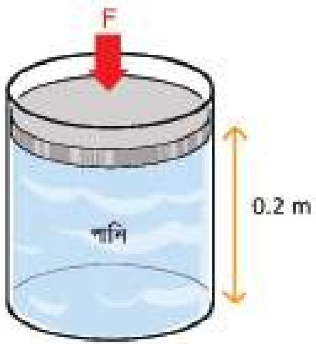

<!-- physics-9-10-bn-c05-t5.ex-p009 · figure · p.156 -->
**চিত্র ৫.১৭**

<!-- physics-9-10-bn-c05-t5.ex-p010 · exercise · p.156 -->
**৪. পাত্রের নিম্নতলে কী পরিমাণ চাপ অনুভূত হবে?**

<!-- physics-9-10-bn-c05-t5.ex-p011 · exercise · p.156 -->
(ক) 98 Pa
(খ) 980 Pa
(গ) 196 Pa
(ঘ) 1960 Pa

<!-- physics-9-10-bn-c05-t5.ex-p012 · exercise · p.156 -->
**৫. যদি পাত্রের মুখে F বল প্রয়োগ করা হয় তবে বল:**

<!-- physics-9-10-bn-c05-t5.ex-p013 · exercise · p.156 · review: latin-junk -->
i. শুধু পাত্রের তলায় চাপ প্রয়োগ করবে
ii. শুধু পাত্রের বক্র তলে চাপ প্রয়োগ করবে
iii. পাত্রের সকল দিকে চাপ প্রয়োগ করবে

<!-- physics-9-10-bn-c05-t5.ex-p014 · exercise · p.156 -->
**নিচের কোনটি সঠিক?**

<!-- physics-9-10-bn-c05-t5.ex-p015 · exercise · p.156 · review: latin-junk -->
(ক) i
(খ) iii
(গ) ii ও iii
(ঘ) i, ii ও iii

### সৃজনশীল প্রশ্ন

<!-- physics-9-10-bn-c05-t5.ex-p016 · exercise · p.157 · review: known-confusable-corrected -->
১. চিত্র দেখে নিচের প্রশ্নগুলোর উত্তর দাও:

<!-- physics-9-10-bn-c05-t5.ex-p017 · exercise · p.157 · review: known-confusable-corrected -->
(ক) ঘনত্ব কাকে বলে?

<!-- physics-9-10-bn-c05-t5.ex-p018 · exercise · p.157 · review: known-confusable-corrected -->
(খ) ইম্পাত রাবারের তুলনায় বেশি স্থিতিস্থাপক — ব্যাখ্যা করো।

<!-- physics-9-10-bn-c05-t5.ex-p019 · exercise · p.157 · review: known-confusable-corrected -->
(গ) বস্তুটির ঘনত্ব নির্ণয় করো।

<!-- physics-9-10-bn-c05-t5.ex-p020 · exercise · p.157 · review: known-confusable-corrected -->
(ঘ) চিত্রে বস্তুটির এভাবে ভেসে থাকার কারণ গাণিতিক যুক্তিসহ ব্যাখ্যা করো।

<!-- physics-9-10-bn-c05-t5.ex-p021 · figure · p.157 · review: known-confusable-corrected -->

<!-- physics-9-10-bn-c05-t5.ex-p022 · figure · p.157 · review: known-confusable-corrected -->
চিত্র ৫.১৮

<!-- physics-9-10-bn-c05-t5.ex-p023 · exercise · p.157 · review: known-confusable-corrected,verify-formula -->
২. ফাহিম $L_1$ দৈর্ঘ্যের একটি রাবার ব্যান্ডের এক মাথা দেয়ালে গাঁথা পেরেকের সাথে বেঁধে অপর মাথায় M ভর ঝুলিয়ে দিয়ে দেখল রাবার ব্যান্ডটি $L_2$ পর্যন্ত লম্বা হয়। ভর সারিয়ে নিলে আবার আগের অবস্থায় ফিরে আসে। সে তার পরীক্ষার ফলাফল কাগজে নিচের টেবিল আকারে লিখে রাখল।

<!-- physics-9-10-bn-c05-t5.ex-p024 · table · p.157 · review: known-confusable-corrected,verify-formula,verify-table -->
<table><tr><td>ভর (kg)</td><td>0</td><td>0.4</td><td>1</td><td>1.4</td><td>2.2</td><td>3</td><td>4</td><td>5</td></tr>
<tr><td>ভর ঝুলানো অবস্থায় দৈর্ঘ্য $L_2$ (cm)</td><td>10</td><td>12</td><td>15</td><td>17</td><td>21</td><td>25</td><td>30</td><td>36</td></tr>
<tr><td>ভর সারিয়ে নেওয়ার পর দৈর্ঘ্য $L_1$ (cm)</td><td>10</td><td>10</td><td>10</td><td>10</td><td>10</td><td>10</td><td>10.2</td><td>10.6</td></tr></table>

<!-- physics-9-10-bn-c05-t5.ex-p025 · exercise · p.157 · review: known-confusable-corrected -->
(ক) হুকের সূত্রটি লেখো।

<!-- physics-9-10-bn-c05-t5.ex-p026 · exercise · p.157 · review: known-confusable-corrected -->
(খ) বিকৃতির একক নেই কেন?

<!-- physics-9-10-bn-c05-t5.ex-p027 · exercise · p.157 · review: known-confusable-corrected,verify-formula -->
(গ) M= 2.7 kg হলে $L_2$ =? হিসাব করো।

<!-- physics-9-10-bn-c05-t5.ex-p028 · exercise · p.157 · review: known-confusable-corrected -->
(ঘ) হুকের তথ্য বিশ্লেষণপূর্বক রাবার ব্যান্ডের স্থিতিস্থাপক সীমা সম্পর্কে যৌক্তিক মতামত দাও।

### সংক্ষিপ্ত উত্তর প্রশ্ন

<!-- physics-9-10-bn-c05-t5.ex-p029 · exercise · p.158 -->
১. ট্রিসেলির শূন্যস্তান কি প্রকৃতপক্ষে শূন্য? ব্যাখ্যা করো ।

<!-- physics-9-10-bn-c05-t5.ex-p030 · exercise · p.158 · review: latin-junk -->
২. সোনার ঘনত্ব 19.3 gm/cc বলতে কী বোঝায়?

<!-- physics-9-10-bn-c05-t5.ex-p031 · exercise · p.158 -->
৩. সমান গভীরতায় পানি ও পারদে মধ্যে কোনটিতে চাপ বেশি হবে এবং কেন?

<!-- physics-9-10-bn-c05-t5.ex-p032 · exercise · p.158 -->
৪. বস্তুর ভেসে থাকা বা ডুবে যাবার কারণ ব্যাখ্যা করো ।
