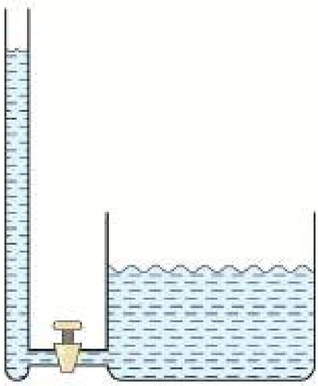
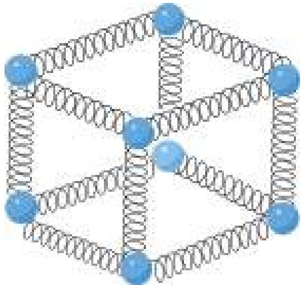
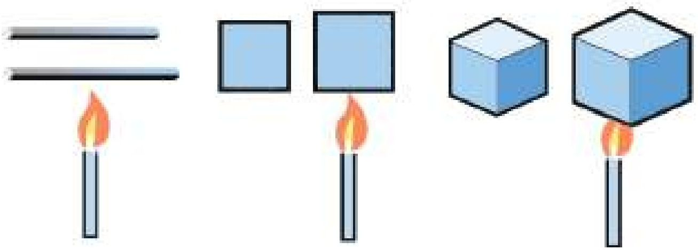
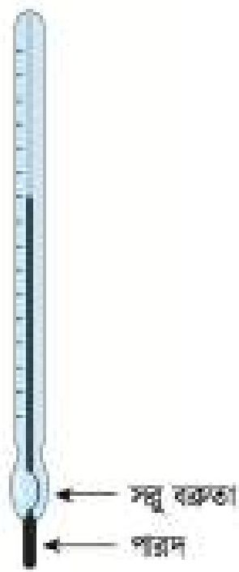
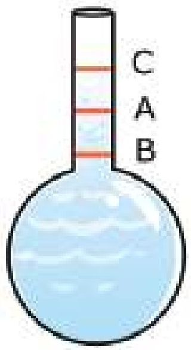
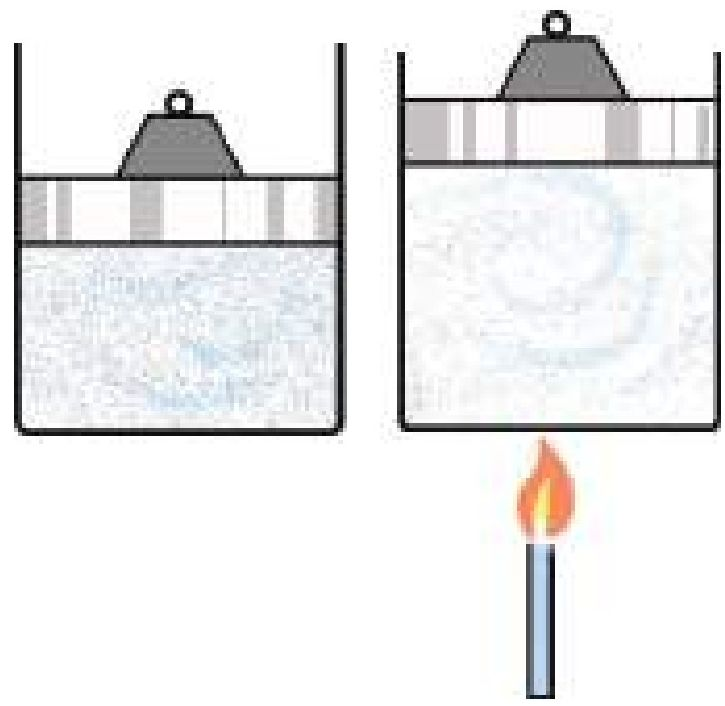

# 6. বস্তুর ওপর তাপের প্রভাব

Source: Physics Bangla Version, printed pp. 159-185

## 6.0 ভূমিকা ও শিখনফল

<!-- physics-9-10-bn-c06-t6.0-p001 · figure · p.159 -->

<!-- physics-9-10-bn-c06-t6.0-p002 · text · p.159 -->
তাপ হচ্ছে একধরনের শক্তি। শক্তির ধারণা থেকে আমাদের মনে হতে পারে বেশি তাপশক্তি থেকে বৃদ্ধি সব সময়েই তাপ কম তাপশক্তির দিকে যায়; কিন্তু সেটি সত্যি নয়। তাপশক্তি কোন দিকে যাবে সেটি নির্ভর করে তাপমাত্রার উপর। এই অধ্যায়ে আমরা তাপ এবং তাপমাত্রা কীভাবে পরিমাণ করতে পারি এবং দুইয়ের মাঝে কী সম্পর্ক সেটি দেখব।

<!-- physics-9-10-bn-c06-t6.0-p003 · text · p.159 -->
তাপশক্তিটুকু আসলে বস্তুর অণু-পরমাণুর গতি বা কম্পন থেকে এসেছে। তাপ দিয়ে কোনো কঠিন বস্তুর অণুগুলোর কম্পন যদি অনেক বাড়িয়ে দেওয়া যায়, তাহলে একটি অণু অন্য অণু থেকে সরে যেতে পারে অর্থাৎ অবস্থার পরিবর্তন হতে পারে। এই অধ্যায়ে আমরা কঠিন, তরল এবং গ্যাসের উপর তাপের প্রভাব নিয়ে আলোচনা করব।

### এ অধ্যায় শেষে আমরা –

<!-- physics-9-10-bn-c06-t6.0-p004 · objective · p.160 -->
* তাপ ও তাপমাত্রা ব্যাখ্যা করতে পারব।
* পদার্থের তাপমাত্রিক ধর্ম ব্যাখ্যা করতে পারব।
* ফারেনহাইট, সেলসিয়াস এবং কেলভিন স্কেলের মধ্যে সম্পর্ক বুঝতে পারব।
* বস্তুর অভ্যন্তরীণ শক্তি বৃদ্ধির সাপেক্ষে তাপমাত্রা বৃদ্ধি ব্যাখ্যা করতে পারব।
* পদার্থের তাপীয় প্রসারণ ব্যাখ্যা করতে পারব।
* কঠিন পদার্থের দৈর্ঘ্য, ক্ষেত্রফল এবং আয়তন প্রসারণ ব্যাখ্যা করতে পারব।
* তরলের আপাত ও প্রকৃত প্রসারণ ব্যাখ্যা করতে পারব।
* আপেক্ষিক তাপ ও তাপ ধারণক্ষমতা ব্যাখ্যা করতে পারব।
* তাপ পরিমাপের মূলনীতি ব্যাখ্যা করতে পারব।
* পদার্থের অবস্থার পরিবর্তনে তাপের প্রভাব ব্যাখ্যা করতে পারব।
* গলন, বাষ্পীভবন ও ঘনীভবন ব্যাখ্যা করতে পারব।
* গলনাঙ্ক ও স্ফুটনাঙ্ক ব্যাখ্যা করতে পারব।
* গলনাঙ্কের উপর চাপের প্রভাব ব্যাখ্যা করতে পারব।
* স্ফুটন ও বাষ্পায়ন ব্যাখ্যা করতে পারব।
* গলনের এবং বাষ্পীভবনের সুপ্ততাপ ব্যাখ্যা করতে পারব।
* বাষ্পায়ন শীতলীকরণের কারণ ব্যাখ্যা করতে পারব।
* বাষ্পায়নের উপর নিয়ামকের প্রভাব ব্যাখ্যা করতে পারব।

## 6.1 তাপ ও তাপমাত্রা (Heat and Temperature)

<!-- physics-9-10-bn-c06-t6.1-p001 · text · p.161 -->
তাপ একধরনের শক্তি। আমরা দেখেছি শক্তি কাজ করতে পারে, যেমন – ট্রেন বা গাড়িতে আসলে জ্বালানি তেল জ্বালিয়ে তাপ তৈরি করা হয়, যেটা ট্রেন বা গাড়িকে ছুটিয়ে নিয়ে যায়। সেজন্য আলো, বিদ্যুৎ বা গতিশক্তির মতো আমরা নতুন ধরনের এই শক্তির নাম দিয়েছি তাপশক্তি।

<!-- physics-9-10-bn-c06-t6.1-p002 · text · p.161 · review: known-confusable-corrected -->
মজার ব্যাপার হচ্ছে, আমরা যদি আগাবিক পর্যায়ে দেখতে পেতাম অর্থাৎ যেকোনো পদার্থের দিকে তাকালেই তার অণুগুলোকে দেখতে পেতাম তাহলে সম্ভবত তাপশক্তি নামে একটা নতুন নাম না দিয়ে এটাকে ‘গতিশক্তি’ নামেই রেখে দিতাম। তার কারণ তাপশক্তি বলতে আমরা যেটা বোঝাই সেটা আসলে পদার্থের অণুগুলোর সম্মিলিত গতিশক্তি ছাড়া কিছু নয়। একটা কঠিন পদার্থে অণুগুলো যখন উত্তপ্ত হয় তখন অণুগুলো নিজের নির্দিষ্ট অবস্থানে থেকে কাঁপতে থাকে। যত বেশি উত্তপ্ত হবে অণুগুলোর কাঁপুনি তত বেড়ে যাবে। যদি অনেক বেশি উত্তপ্ত হয় তাহলে অণুগুলোর নিজের ভেতরে যে আন্তঃআণবিক বল রয়েছে, সেই বলকে ছাড়িয়ে অণুগুলো মুক্ত হয়ে যাবে। তখন আমরা সেটাকে বলি তরল। তখন অণুগুলো এলোমেলোভাবে একে অন্যের ভেতর দিয়ে ছোটছুটি করতে থাকে। তাদের একটা গতি থাকে কাজেই এটা গতিশক্তি। যত উত্তপ্ত করা হয় অণুগুলো তত জোরে ছোটছুটি করে। যদি আরো উত্তপ্ত করা হয় তখন অণুগুলো আগাবিক বন্ধন থেকে পুরোপুরি মুক্ত হয়ে যেতে পারে। আমরা তখন সেটাকে বলি গ্যাস। একটা গ্যাসকে যত উত্তপ্ত করা হবে, অণুগুলো তত জোরে ছোটছুটি করবে। গতি যত বেশি হবে গতিশক্তি তত বেশি হবে।

<!-- physics-9-10-bn-c06-t6.1-p003 · text · p.161 · review: latin-junk,known-confusable-corrected -->
যেহেতু খালি চোখে আমরা অণুগুলোকে দেখি না, তাদের ছোটছুটি দেখি না; তাই আমরা পরোক্ষভাবে পুরো জিনিসটা বোঝার চেষ্টা করি। আমরা সেটাকে তাপশক্তি নাম দিই এবং তাপমাত্রা বলে পদার্থের তাপীয় অবস্থা ব্যাখ্যা করার চেষ্টা করি। কাজেই আমরা বলতে পারি পদার্থের অণুগুলোর কম্পন বা গতির কারণে যে শক্তি পাওয়া যায় সেটা হচ্ছে তাপ। যেহেতু এটা শক্তি তাই স্বাভাবিকভাবে অন্য শক্তির মতোই তার একক হচ্ছে জুল (J). তাপের আরো একটি একক আছে তার নাম ক্যালরি (cal)। 1 gm পানির তাপমাত্রা 1°C বাড়াতে হলে যে পরিমাণ তাপের দরকার সেটা হচ্ছে 1 ক্যালরি। 1 ক্যালরি হচ্ছে 4.2 J এর সমান।

<!-- physics-9-10-bn-c06-t6.1-p004 · text · p.161 · review: latin-junk -->
তোমরা হয়তো খাবারের জন্য ক্যালরি শব্দটি ব্যবহার করতে শুনেছ। ফুড ক্যালরি বলতে আসলে বোঝানো হয় মানুষ নির্দিষ্ট খাবার থেকে কী পরিমাণ শক্তি পায় এবং এটার জন্য একক আসলে *k* cal বা 1000 ক্যালরি। তবে সেটা নিয়ে আমরা মাথা ঘামাব না। এখানে আমরা খাবার থেকে পাওয়া শক্তি নয় তাপশক্তি নিয়েই আলোচনা করব।

### ৬.১.১ অভ্যন্তরীণ শক্তি ও তাপের প্রবাহ (Internal Energy and Flow of Heat)

<!-- physics-9-10-bn-c06-t6.1-p005 · text · p.162 -->
আমরা যদি তাপকে একটা শক্তি হিসেবে মনে নিই, তাহলে সাথে সাথে এর পরের যে বিষয়টা আমাদের জানতে হবে। সেটা হচ্ছে কীভাবে তাপশক্তি এক জায়গা থেকে অন্য জায়গায় স্থানান্তরিত হয়। সাধারণভাবে আমাদের ধারণা সব সময়ই শক্তির প্রবাহ হয় বৃষ্টি বেশি শক্তি থেকে কম শক্তিতে। ছোট একটা গরম আল্পিনে যে পরিমাণ তাপশক্তি রয়েছে তার থেকে অনেক বেশি তাপশক্তি রয়েছে এক গ্লাস পানিতে। কিন্তু গরম আল্পিনটা আমরা যদি পানিতে ডুবিয়ে দিই তাহলে কিন্তু আল্পিনের অল্প তাপশক্তি থেকেই খানিকটা চলে যাবে গ্লাসের পানিতে। তার কারণ তাপশক্তির প্রবাহটা তাপের পরিমাণের ওপর নির্ভর করে না, এটা নির্ভর করে তাপমাত্রার উপরে। দুটো ভিন্ন তাপমাত্রার জিনিস যদি একে অন্যের সংস্পর্শে আসে, তাহলে সব সময়ই বেশি তাপমাত্রা থেকে তাপ কম তাপমাত্রার জিনিসে যেতে থাকবে যতক্ষণ না দুটোর তাপমাত্রা সমান হচ্ছে।

<!-- physics-9-10-bn-c06-t6.1-p006 · text · p.162 -->
আমরা এখনো ‘তাপমাত্রা’ নামের রাশিটি সংজ্ঞায়িত করিনি। কিন্তু দৈনন্দিন জীবনে এটি এত ব্যবহৃত হয় যে বিষয়টি কী তা বুঝতে কারো সমস্যা হয় না। পদার্থবিজ্ঞানের ভাষায় বলতে পারি, এটা হচ্ছে পদার্থের ভেতরকার অণুগুলোর গড় গতিশক্তির একটা পরিমাণ। আমাদের অভিভূততা থেকে আমরা বলতে পারি, তাপমাত্রা হচ্ছে সেই তাপীয় অবস্থা যেটি ঠিক করে একটা বস্তু অন্য বস্তুর সংস্পর্শে এলে সেটি কি তাপ দেবে নাকি তাপ নেবে। বিষয়টা বোঝানোর জন্য আমরা পানির পৃষ্ঠদেশের উচ্চতার সাথে তুলনা করতে পারি (চিত্র ৬.০১)। যদি পানির দুটি পাত্রের পানির পৃষ্ঠদেশের উচ্চতা ভিন্ন হয়, তাহলে পাত্র দুটিকে একটি নল দিয়ে একত্র করার পর কোন পাত্রের পানি বেশি কোন পাত্রের পানি কম সেটি পানির প্রবাহ ঠিক করবে না। কোন পাত্র থেকে কোন পাত্রের পানি যাবে সেটা নির্ভর করবে কোন পাত্রের পানির পৃষ্ঠদেশের উচ্চতা কত তার ওপর। সব সময়ই বেশি উচ্চতা থেকে পানি কম উচ্চতায় প্রবাহিত হবে, যতক্ষণ পর্যন্ত না দুটি উচ্চতা সমান হয়ে যাচ্ছে। এখানে পানির পরিমাণটাকে তাপশক্তির সাথে তুলনা করতে পারি, পানির পৃষ্ঠদেশের উচ্চতাকে তুলনা করতে পারি তাপমাত্রার সাথে। তাপমাত্রার বেলাতেও এটা সত্যি যে যতক্ষণ পর্যন্ত না দুটি বস্তুর তাপমাত্রা সমান হচ্ছে ততক্ষণ তাপ প্রবাহিত হতে থাকবে।

<!-- physics-9-10-bn-c06-t6.1-p007 · figure · p.162 -->

<!-- physics-9-10-bn-c06-t6.1-p008 · figure · p.162 -->
**চিত্র ৬.০১: তাপমাত্রা তরলের উচ্চতার মতো, তাপ তরলের আয়তনের মতো।**

## 6.2 পদার্থের তাপমাত্রিক ধর্ম

### (Thermometric Properties of Matter)

<!-- physics-9-10-bn-c06-t6.2-p001 · text · p.163 -->
তাপমাত্রা পরিমাপের জন্য বিশেষ পদার্থের বিশেষ ধর্মকে কাজে লাগাতে হয়। তাপমাত্রা পরিবর্তন হলে পদার্থের যে ধর্মের পরিবর্তন হয় এবং যে পরিবর্তন সূক্ষ্মভাবে পরিমাপ করে তাপমাত্রা মাপা যায় সেটাই হচ্ছে তাপমাত্রিক ধর্ম। অর্থাৎ তাপমাত্রা মাপার জন্য পদার্থের যে ধর্মটি ব্যবহার করা হয় সেটি হচ্ছে তাপমাত্রিক ধর্ম। তোমরা জুর মাপার পারদের থার্মোমিটার দেখে থাকবে, সেটি শরীরের তাপমাত্রা মাপে। এখানে পারদ হচ্ছে তাপমাত্রিক পদার্থ এবং পারদের আয়তনের প্রসারণ হচ্ছে তার তাপমাত্রিক ধর্ম।

<!-- physics-9-10-bn-c06-t6.2-p002 · text · p.163 -->
পারদ ছাড়াও অ্যালকোহলের থার্মোমিটার আছে। সেখানে অ্যালকোহল হচ্ছে তাপমাত্রিক পদার্থ এবং তারলের প্রসারণ হচ্ছে তাপমাত্রিক ধর্ম।

<!-- physics-9-10-bn-c06-t6.2-p003 · text · p.163 -->
গ্যাস থার্মোমিটারে গ্যাস হচ্ছে তাপমাত্রিক পদার্থ এবং নির্দিষ্ট আয়তনে রক্ষিত গ্যাসের চাপ হচ্ছে তাপমাত্রিক ধর্ম। তাপমাত্রার সাথে ধাতুর রোধ বা রেজিস্ট্যান্সের পরিবর্তন হয়, তাই রোধকেও তাপমাত্রিক ধর্ম হিসেবে ব্যবহার করা যায়। একেকটি তাপমাত্রিক পদার্থ একেক তাপমাত্রার জন্য কার্যকর। তাই খুব বেশি বা কম তাপমাত্রা মাপার জন্য বিশেষ তাপমাত্রিক পদার্থের বিশেষ তাপমাত্রিক ধর্ম ব্যবহার করতে হয়। তামা এবং কনস্ট্যান্টন ধাতুকে তাপমাত্রিক পদার্থ হিসেবে ব্যবহার করা হয়। দুটি ভিন্ন ভিন্ন ধাতুর সংযোগস্থলে (থার্মো কাপল) তাপমাত্রার পরিবর্তন হলে এটি একটি ইএমএফ (emf: electromotive force) তৈরি করে, সেটি মেপে তাপমাত্রা বের করা যায়। এই থার্মোকাপল -200°C থেকে 1000°C পর্যন্ত তাপমাত্রা মাপতে পারে বলে ইনডাস্ট্রিতে ব্যাপকভাবে ব্যবহৃত হয়।

<!-- physics-9-10-bn-c06-t6.2-p004 · text · p.163 · review: latin-junk -->
আমরা যদি তাপমাত্রার ধারণাটুকু ঠিক করে পেয়ে যাই, তাহলে এর পরেই আমাদের জানতে হবে এর একক কী কিংবা তার থেকেও গুরুত্বপূর্ণ প্রশ্ন, আমরা কেমন করে তাপমাত্রা মাপব। তাপমাত্রার প্রচলিত একক হচ্ছে সেলসিয়াস (°C)। সাধারণভাবে বলা যায়, এই স্কেলে 1 atm বাতাসের চাপের যে তাপমাত্রায় বরফ গলে পানিতে পরিণত হয়, সেটাকে 0°C এবং যে তাপমাত্রায় পানি ফুটে থাকে সেটাকে 100°C ধরা হয়েছে। তবে মজার ব্যাপার হলো বিজ্ঞানী সেলসিয়াস যখন তাপমাত্রার স্কেল তৈরি করেছিলেন, তখন শূন্য ডিগ্রি ধরেছিলেন ফুটন্ত পানির তাপমাত্রা, 100 ডিগ্রি ধরেছিলেন বরফ গলনের তাপমাত্রা। বর্তমান স্কেলের ঠিক উল্টো।

<!-- physics-9-10-bn-c06-t6.2-p005 · text · p.163 -->
আমাদের দৈনন্দিন জীবনে আমরা সাধারণত সেলসিয়াস স্কেল ব্যবহার করলেও আন্তর্জাতিক এককটির নাম হচ্ছে কেলভিন (K)। সেলসিয়াস স্কেলের সাথে 273.15°C যোগ করলেই কেলভিন স্কেল পাওয়া যায়। যদি শুধু তাপমাত্রার পার্থক্য নিয়ে মাথা ঘামাই তাহলে সেলসিয়াস স্কেল আর কেলভিন স্কেলে কোনো পার্থক্য নেই। অর্থাৎ তাপমাত্রা 10°C বেড়েছে বলা যে কথা, তাপমাত্রা 10K বেড়েছে বলা সেই একই কথা। কিন্তু যদি জিঞ্জেস করা হয় এই ঘরের তাপমাত্রা কত, যদি সেটা হয় 30°C তাহলে কেলভিন স্কেলে সেটা হবে (30 + 273.15 =) 303.15 K। তোমাদের মনে হতে পারে দুটো স্কেল হুবহু একই রকম শুধু 273.15°C পার্থক্য এর পেছনে কারণটি কী?

<!-- physics-9-10-bn-c06-t6.2-p006 · figure · p.164 -->

<!-- physics-9-10-bn-c06-t6.2-p007 · figure · p.164 -->
**চিত্র ৬.০২: সেলসিয়াস কেলভিন এবং ফারেনহাইট তাপমাত্রার স্কেল।**

<!-- physics-9-10-bn-c06-t6.2-p008 · text · p.164 -->
এটি করার পেছনের কারণটি খুবই চমকপ্রদ। সাধারণভাবে হয়তো মনে হতে পারে আমরা বুঝি যত বেশি বা যত কম তাপমাত্রা কল্পনা করতে পারব, আসলে সেটি সত্যি নয়। তাপমাত্রা যত ইচ্ছে বেশি কল্পনা করতে সমস্যা নেই কিন্তু যত ইচ্ছে কম কল্পনা করা সম্ভব নয়। সবচেয়ে কম একটা তাপমাত্রা আছে এবং তাপমাত্রা এর থেকে কম হওয়া যায় না। শুধু তাই নয়, আমরা এই তাপমাত্রার কাছাকাছি যেতে পারি কিন্তু কখনোই এই তাপমাত্রায় পৌঁছাতে পারব না। এই তাপমাত্রাকে পরম শূন্য বা Absolute Zero বলা হয়। সেলসিয়াস স্কেলে এই তাপমাত্রার মান -273.15°C কাজেই কেলভিন স্কেলে এর মান হচ্ছে শূন্য কেলভিন। অন্যভাবে বলা যায় কেলভিন স্কেলটি তৈরি হয়েছে পরম শূন্য তাপমাত্রাকে শূন্য কেলভিন ধরে।

<!-- physics-9-10-bn-c06-t6.2-p009 · text · p.164 -->
তাপমাত্রার যেকোনো স্কেল তৈরি করতে হলে দুটো নির্দিষ্ট তাপমাত্রা (বা স্থিরাঙ্ক) দরকার। কেলভিন স্কেলে একটি হচ্ছে পরম শূন্য। যেটাকে শূন্য ডিগ্রি ধরা হয়েছে। অন্যটি হচ্ছে পানির তৈধ বিন্দু বা Triple Point এই তাপমাত্রায় একটা নির্দিষ্ট চাপে (0.0060373 atm) বরফ, পানি এবং জলীয় বাষ্প এক সাথে থাকতে পারে বলে তাপমাত্রাকে অনেক বেশি সূক্ষ্মভাবে নির্দিষ্ট করা যায়। সেলসিয়াস স্কেলে এর মান 0.01°C এবং এই স্কেলের সাথে মিল রাখার জন্য কেলভিন স্কেলে এর মান 273.16 K।

<!-- physics-9-10-bn-c06-t6.2-p010 · text · p.164 -->
কেলভিন এবং সেলসিয়াস স্কেলের পাশাপাশি ফারেনহাইট স্কেল বলেও একটা স্কেল আছে। যেখানে বরফ গলন এবং পানির বাষ্পীভবনের তাপমাত্রা যথাক্রমে 32°F ও 212°F। চিত্র 6.02 এ তিনটি স্কেলকে তুলনা করার জন্য দেখানো হলো। কেলভিন স্কেলে 0°C তাপমাত্রা 273.15 K হলেও আমরা আমাদের দৈনন্দিন জীবনে অনেক সময়েই এটাকে 273 K ধরে নিই। দৈনন্দিন হিসাবে সেটা কোনো গুরুতর সমস্যা করে না।

### ৬.২.১ ভিন্ন স্কেলের মাঝে সম্পর্ক

<!-- physics-9-10-bn-c06-t6.2-p011 · text · p.165 · review: verify-formula -->
যদি একটি নির্দিষ্ট তাপমাত্রা সেলসিয়াস, কেলভিন এবং ফারেনহাইট স্কেলে যথাক্রমে $T_C$, $T_K$ আর $T_F$ দেখায় তাহলে আমরা লিখতে পারি:

<!-- physics-9-10-bn-c06-t6.2-p012 · formula · p.165 · review: verify-formula -->
$$\frac{T_C - 0}{100 - 0} = \frac{T_K - 273.15}{373.15 - 273.15} = \frac{T_F - 32}{212 - 32}$$

<!-- physics-9-10-bn-c06-t6.2-p013 · text · p.165 -->
কিংবা

<!-- physics-9-10-bn-c06-t6.2-p014 · formula · p.165 · review: verify-formula -->
$$\frac{T_C}{100} = \frac{T_K - 273.15}{100} = \frac{T_F - 32}{180}$$

<!-- physics-9-10-bn-c06-t6.2-p015 · text · p.165 · review: verify-formula -->
$T_C$ এর সাপেক্ষে কেলভিন স্কেল এবং ফারেনহাইট স্কেল যথাক্রমে:

<!-- physics-9-10-bn-c06-t6.2-p016 · formula · p.165 · review: verify-formula -->
$$T_C = T_K - 273.15^\circ$$

<!-- physics-9-10-bn-c06-t6.2-p017 · formula · p.165 · review: verify-formula -->
$$T_C = \frac{5}{9}(T_F - 32^\circ)$$

### উদাহরণ

<!-- physics-9-10-bn-c06-t6.2-p018 · example · p.165 -->
**প্রশ্ন:** কোন তাপমাত্রায় সেলসিয়াস এবং ফারেনহাইট স্কেল সমান?

<!-- physics-9-10-bn-c06-t6.2-p019 · example · p.165 -->
**উত্তর:** সেলসিয়াস এবং ফারেনহাইট তাপমাত্রার সম্পর্কটি এ রকম:

<!-- physics-9-10-bn-c06-t6.2-p020 · formula · p.165 · review: verify-formula -->
$$T_C = \frac{5}{9}(T_F - 32^\circ)$$

<!-- physics-9-10-bn-c06-t6.2-p021 · formula · p.165 · review: verify-formula -->
$$9T_C = 5T_F - 5 \times 32^\circ$$

<!-- physics-9-10-bn-c06-t6.2-p022 · text · p.165 · review: verify-formula -->
$T_C$ এবং $T_F$ সমান হলে:

<!-- physics-9-10-bn-c06-t6.2-p023 · formula · p.165 · review: verify-formula -->
$$4T_C = -5 \times 32^\circ = -160^\circ$$

<!-- physics-9-10-bn-c06-t6.2-p024 · formula · p.165 · review: verify-formula -->
$$T_C = -40^\circ$$

<!-- physics-9-10-bn-c06-t6.2-p025 · text · p.165 · review: verify-formula -->
অর্থাৎ যে তাপমাত্রা $-40^\circ$ C দেখায় সেই একই তাপমাত্রা $-40^\circ$ F দেখায়।

<!-- physics-9-10-bn-c06-t6.2-p026 · text · p.165 -->
**প্রশ্ন:** কোন তাপমাত্রায় কেলভিন এবং ফারেনহাইট স্কেল সমান?

<!-- physics-9-10-bn-c06-t6.2-p027 · text · p.165 -->
**উত্তর:** কেলভিন এবং ফারেনহাইট তাপমাত্রার সম্পর্কটি এ রকম:

<!-- physics-9-10-bn-c06-t6.2-p028 · text · p.166 · review: verify-formula -->
$$T_K - 273.15^\circ = \frac{5}{9}(T_F - 32^\circ)$$
$$9T_K - 9 \times 273.15^\circ = 5T_F - 5 \times 32^\circ$$

<!-- physics-9-10-bn-c06-t6.2-p029 · text · p.166 · review: verify-formula -->
যদি $T_K$ এবং $T_F$ সমান হয়:

<!-- physics-9-10-bn-c06-t6.2-p030 · text · p.166 · review: verify-formula -->
$$4T_K = 9 \times 273.15^\circ - 5 \times 32^\circ$$
$$T_K = 574.59  K$$

<!-- physics-9-10-bn-c06-t6.2-p031 · text · p.166 -->
**প্রশ্ন:** সুস্থ দেহের তাপমাত্রা 98.4°F, সেলসিয়াসে সেটা কত?

<!-- physics-9-10-bn-c06-t6.2-p032 · text · p.166 -->
**উত্তর:** সেলসিয়াস এবং ফারেনহাইট তাপমাত্রার সম্পর্কটি এ রকম:

<!-- physics-9-10-bn-c06-t6.2-p033 · formula · p.166 · review: verify-formula -->
$$T_C = \frac{5}{9}(T_F - 32^\circ)$$

<!-- physics-9-10-bn-c06-t6.2-p034 · text · p.166 · review: verify-formula -->
কাজেই $T_F = 98.4^\circ$ হলে

<!-- physics-9-10-bn-c06-t6.2-p035 · formula · p.166 · review: verify-formula -->
$$T_C = \frac{5}{9}(98.4^\circ - 32^\circ) = 36.89^\circ$$

<!-- physics-9-10-bn-c06-t6.2-p036 · text · p.166 -->
(অর্থাৎ 37° C এর কাছাকাছি)

<!-- physics-9-10-bn-c06-t6.2-p037 · text · p.166 -->
**প্রশ্ন:** কোন তাপমাত্রায় সেলসিয়াস এবং কেলভিন স্কেল সমান?

<!-- physics-9-10-bn-c06-t6.2-p038 · text · p.166 -->
**উত্তর:** কখনোই না।

<!-- physics-9-10-bn-c06-t6.2-p039 · text · p.166 -->
> মহাশূন্যে যেখানে কোনো অণু-পরমাণু নেই সেখানে কি তাপমাত্রার অস্তিত্ব আছে?

## 6.3 পদার্থের তাপীয় প্রসারণ (Thermal Expansion of Matter)

### ৬.৩.১ কঠিন পদার্থের প্রসারণ

<!-- physics-9-10-bn-c06-t6.3-p001 · text · p.166 -->
তাপ দিলে প্রায় সব পদার্থের আয়তনই একটু বেড়ে যায়। তাপ ও তাপমাত্রা এই বিষয়গুলো যদি আমরা আমাদের আণবিক মডেল দিয়ে ব্যাখ্যা করি, তাহলে এর কারণটা বুঝা কঠিন নয়। একটা কঠিন পদার্থকে আমরা অনেকগুলো অণু হিসেবে কল্পনা করতে পারি। তাদের ভেতর যে আণবিক বল সেটাকে আমরা স্পিংয়ের সাথে তুলনা করতে পারি। কঠিন পদার্থে অণুগুলো কীভাবে থাকে সেটা দেখানোর জন্য আমরা অণুগুলোর মাঝে একটা স্পিং কল্পনা করেছি এবং ৬.০৩ চিত্রে সেটা দেখানো হয়েছে। কঠিন পদার্থটিকে উত্তপ্ত করলে অণুগুলো কাঁপতে থাকবে। তাপমাত্রা যত বেশি হবে, অণুগুলো তত বেশি বিস্তারে কাঁপবে। সত্যিকারের কঠিন পদার্থের প্রকৃতি ব্যাখ্যা করতে হলে আমাদের এই স্পিং মডেলটাকে একটুখানি উন্নত করতে হবে। স্পিংয়ের বোঝ আমরা দেখেছি একটা স্পিংকে কোনো নির্দিষ্ট দূরত্বে প্রসারিত করলে সেটি যে পরিমাণ বলে টানতে থাকে সেই একই দূরত্ব সংকুচিত করলে এটি ঠিক একই বলে ঠেলতে থাকে। কঠিন পদার্থের অণুগুলোর জন্য এটি পুরোপুরি সত্যি নয়। অণুগুলোকে একটি বেশি দূরত্ব সারিয়ে নিলে এটা যে পরিমাণ বলে টানতে থাকে সেই একই দূরত্ব কাছাকাছি আনলে অনেক বেশি বলে ঠেলতে থাকে। অর্থাৎ স্পিংটি যেন একটি বিশেষ ধরনের স্পিং। এটা প্রসারিত করতে কম বল প্রয়োগ করতে হয় কিন্তু সংকুচিত করতে বেশি বল প্রয়োগ করতে হয়।

<!-- physics-9-10-bn-c06-t6.3-p002 · figure · p.167 -->

<!-- physics-9-10-bn-c06-t6.3-p003 · figure · p.167 -->
**চিত্র ৬.০৩: অণুগুলো একটি অন্যটির সাথে স্পিং দিয়ে যুক্ত কল্পনা করে নেওয়া যায়।**

<!-- physics-9-10-bn-c06-t6.3-p004 · text · p.167 -->
এখন তুমি কল্পনা করে নাও একটি নির্দিষ্ট তাপমাত্রায় থাকার কারণে অণুগুলো কাঁপছে। বিশেষ ধরনের স্পিং হওয়ার কারণে কাঁপার সময় অণুগুলো কাছাকাছি যায় কম কিন্তু দূরে সরে যায় বেশি। এবারে কঠিন পদার্থটিকে আরো উত্তপ্ত করা হলে, অণুগুলো আরো বেশি বিস্তারে কাঁপতে থাকবে। তোমরা বুঝতেই পারছ অণুগুলো এই বিশেষ ধরনের স্পিংয়ের জন্য বেশি কাছে যেতে পারে না; কিন্তু সহজেই বেশি দূরে যেতে পারে। তাই অণুগুলো একে অন্যের থেকে একটু দূরে সরে নতুন একটা সাম্য অবস্থা তৈরি করবে। সব অণু যখন একে অন্য থেকে দূরে সরে যাবে তখন আমাদের কাছে পুরো কঠিন বস্তুটাই একটু প্রসারিত হয়ে গেছে বলে মনে হবে।

<!-- physics-9-10-bn-c06-t6.3-p005 · figure · p.167 -->

<!-- physics-9-10-bn-c06-t6.3-p006 · figure · p.167 -->
**চিত্র ৬.০৪: তাপ প্রয়োগ করলে কঠিন পদার্থের দৈর্ঘ্য, প্রস্থচ্ছেদ এবং আয়তন বেড়ে যায়।**

<!-- physics-9-10-bn-c06-t6.3-p007 · text · p.168 -->
তাপ প্রয়োগ করলে কাঠিন বস্তুর দৈর্ঘ্য, প্রস্থ ও উচ্চতা তিন দিকেই সমানভাবে প্রসারিত হয় (চিত্র ৬.০৪)। পদার্থের এই প্রসারণকে বিক্ষয়েণ করার জন্য দৈর্ঘ্য, ক্ষেত্রফল আর আয়তন প্রসারণ সহগ নামে তিনটি রাশি তৈরি করা হয়েছে।

<!-- physics-9-10-bn-c06-t6.3-p008 · text · p.168 · review: verify-formula -->
$T_1$ তাপমাত্রায় কোনো বস্তুর দৈর্ঘ্য যদি $L_1$ হয় এবং তাপমাত্রা বৃদ্ধি করে সেটি $T_2$ করার পর যদি দৈর্ঘ্য বৃদ্ধি পেয়ে সেটি $L_2$ হয় তাহলে দৈর্ঘ্য প্রসারণ সহগ $\alpha$ হচ্ছে:

<!-- physics-9-10-bn-c06-t6.3-p009 · formula · p.168 · review: verify-formula -->
$$\alpha = \frac{(L_2 - L_1)/L_1}{T_2 - T_1}$$

<!-- physics-9-10-bn-c06-t6.3-p010 · text · p.168 -->
কাজেই

<!-- physics-9-10-bn-c06-t6.3-p011 · formula · p.168 · review: verify-formula -->
$$L_2 = L_1 + \alpha L_1 (T_2 - T_1)$$

<!-- physics-9-10-bn-c06-t6.3-p012 · text · p.168 · review: verify-formula -->
একইভাবে $T_1$ তাপমাত্রায় কোনো বস্তুর ক্ষেত্রফল যদি $A_1$ হয় এবং তাপমাত্রা বৃদ্ধি করে $T_2$ করার পর ক্ষেত্রফলও যদি বেড়ে $A_2$ হয় তাহলে ক্ষেত্রফল প্রসারণ সহগ $\beta$ হচ্ছে:

<!-- physics-9-10-bn-c06-t6.3-p013 · formula · p.168 · review: verify-formula -->
$$\beta = \frac{(A_2 - A_1)/A_1}{T_2 - T_1}$$

<!-- physics-9-10-bn-c06-t6.3-p014 · text · p.168 -->
কাজেই

<!-- physics-9-10-bn-c06-t6.3-p015 · formula · p.168 · review: verify-formula -->
$$A_2 = A_1 + \beta A_1 (T_2 - T_1)$$

<!-- physics-9-10-bn-c06-t6.3-p016 · text · p.168 · review: verify-formula -->
ঠিক একইভাবে $T_1$ তাপমাত্রায় যদি আয়তন $V_1$ হয় এবং তাপমাত্রা বৃদ্ধি করে $T_2$ করার পর যদি আয়তন বেড়ে $V_2$ হয় তাহলে আয়তন প্রসারণ সহগ $\gamma$ হচ্ছে:

<!-- physics-9-10-bn-c06-t6.3-p017 · formula · p.168 · review: verify-formula -->
$$\gamma = \frac{(V_2 - V_1)/V_1}{T_2 - T_1}$$

<!-- physics-9-10-bn-c06-t6.3-p018 · text · p.168 -->
কাজেই

<!-- physics-9-10-bn-c06-t6.3-p019 · formula · p.168 · review: verify-formula -->
$$V_2 = V_1 + \gamma V_1 (T_2 - T_1)$$

<!-- physics-9-10-bn-c06-t6.3-p020 · text · p.168 · review: verify-formula -->
তোমরা দেখতেই পাচ্ছ $\alpha$, $\beta$ এবং $\gamma$ তিনটি রাশির এককই হচ্ছে $K^{-1}$

<!-- physics-9-10-bn-c06-t6.3-p021 · text · p.168 · review: verify-formula -->
> মাত্রা $[\alpha] = [\beta] = [\gamma] = T^{-1}$

### উদাহরণ

<!-- physics-9-10-bn-c06-t6.3-p022 · example · p.168 -->
**প্রশ্ন:** 20° C তাপমাত্রায় তামার দণ্ডের দৈর্ঘ্য 10 m, 120° C তাপমাত্রায় দণ্ডটির দৈর্ঘ্য 10.0167 m, এর দৈর্ঘ্য প্রসারণ সহগ কত?

<!-- physics-9-10-bn-c06-t6.3-p023 · example · p.168 -->
**উত্তর:** দৈর্ঘ্য প্রসারণ সহগ

<!-- physics-9-10-bn-c06-t6.3-p024 · formula · p.169 · review: verify-formula -->
$$\alpha = \frac{L_2 - L_1}{L_1(T_2 - T_1)}$$

<!-- physics-9-10-bn-c06-t6.3-p025 · text · p.169 · review: verify-formula -->
এখানে $L_1 = 10  m$

<!-- physics-9-10-bn-c06-t6.3-p026 · text · p.169 · review: verify-formula -->
$$L_2 = 10.0167  m$$
$$T_2 = 120^\circ  C$$
$$T_1 = 20^\circ  C$$

<!-- physics-9-10-bn-c06-t6.3-p027 · formula · p.169 · review: verify-formula -->
$$\alpha = \frac{10.0167m - 10m}{10m(120^\circ C - 20^\circ C)} = 16.7 \times 10^{-6}   ^\circC^{-1}$$

<!-- physics-9-10-bn-c06-t6.3-p028 · text · p.169 · review: verify-formula -->
তোমরা উপরের উদাহরণগুলো থেকে দেখেছ, কঠিন পদার্থের প্রসারণ সহগের মান আসলে খুবই কম। সে কারণে $\alpha, \beta$ এবং $\gamma$ এই তিনটি ভিন্ন ভিন্ন সহগের কিন্তু প্রয়োজন ছিল না। আমরা কাজ চালানোর জন্য শুধু দৈর্ঘ্য প্রসারণ সহগটি ব্যাখ্যা করে নিলেই পারতাম। যেমন ধরা যাক, ক্ষেত্রফল প্রসারণের ব্যাপারটি। আমরা দেখেছি:

<!-- physics-9-10-bn-c06-t6.3-p029 · formula · p.169 · review: verify-formula -->
$$A_2 = A_1 + \beta A_1(T_2 - T_1)$$

<!-- physics-9-10-bn-c06-t6.3-p030 · text · p.169 · review: verify-formula -->
কিন্তু ক্ষেত্রফল $A_1$ আসলে দৈর্ঘ্য এবং প্রস্থের গুণফল এবং যদি আমরা বর্গাকৃতির ক্ষেত্রফল ধরে নিই যার বাহুর দৈর্ঘ্য $L_1$ তাহলে তাপমাত্রা বাড়ালে তার ক্ষেত্রফল হবে

<!-- physics-9-10-bn-c06-t6.3-p031 · formula · p.169 · review: verify-formula -->
$$A_2 = L_2^2 = [L_1 + \alpha L_1(T_2 - T_1)]^2$$

<!-- physics-9-10-bn-c06-t6.3-p032 · text · p.169 -->
কিংবা

<!-- physics-9-10-bn-c06-t6.3-p033 · formula · p.169 · review: verify-formula -->
$$A_2 = L_1^2 + 2\alpha L_1^2(T_2 - T_1) + \alpha^2 L_1^2(T_2 - T_1)^2$$

<!-- physics-9-10-bn-c06-t6.3-p034 · text · p.169 -->
কিন্তু

<!-- physics-9-10-bn-c06-t6.3-p035 · formula · p.169 · review: verify-formula -->
$$A_1 = L_1^2$$

<!-- physics-9-10-bn-c06-t6.3-p036 · text · p.169 -->
কাজেই

<!-- physics-9-10-bn-c06-t6.3-p037 · formula · p.169 · review: verify-formula -->
$$A_2 = A_1 + 2\alpha A_1(T_2 - T_1) + \alpha^2 A_1(T_2 - T_1)^2$$

<!-- physics-9-10-bn-c06-t6.3-p038 · text · p.169 · review: verify-formula -->
আমরা দেখেছি $\alpha$ এর মান খুবই ছোট, কাজেই $\alpha^2$ এর মান আরও ছোট, সত্যি কথা বলতে কি এটি এত ছোট যে উপরের সমীকরণে $\alpha^2$ সহ পুরো অংশটুকু আমরা যদি পুরোপুরি বাদ দিই আমাদের বিশ্লেষণ বা হিসাবে এমন কিছু স্কতি হবে না। তাই আমরা লিখতে পারি:

<!-- physics-9-10-bn-c06-t6.3-p039 · formula · p.169 · review: verify-formula -->
$$A_2 = A_1 + 2\alpha A_1(T_2 - T_1)$$

<!-- physics-9-10-bn-c06-t6.3-p040 · text · p.169 -->
কিন্তু আমরা জানি

<!-- physics-9-10-bn-c06-t6.3-p041 · formula · p.169 · review: verify-formula -->
$$A_2 = A_1 + \beta A_1(T_2 - T_1)$$

<!-- physics-9-10-bn-c06-t6.3-p042 · text · p.170 -->
কাজেই নিশ্চয়ই:

<!-- physics-9-10-bn-c06-t6.3-p043 · formula · p.170 · review: verify-formula -->
$$\beta = 2\alpha$$

<!-- physics-9-10-bn-c06-t6.3-p044 · text · p.170 · review: verify-formula -->
ঠিক একইভাবে আমরা $L_1$ দৈর্ঘ্য, প্রস্থ, উচ্চতা নিয়ে একটা কিউব কল্পনা করতে পারি $T_1$ তাপমাত্রায় যার আয়তন $V_1$ এবং তাপমাত্রা বাড়িয়ে $T_2$ করার পর যার আয়তন হয়েছে $V_2$, কাজেই

<!-- physics-9-10-bn-c06-t6.3-p045 · formula · p.170 · review: verify-formula -->
$$V_2 = [L_1 + \alpha L_1(T_2 - T_1)]^3$$

<!-- physics-9-10-bn-c06-t6.3-p046 · text · p.170 · review: verify-formula -->
একই যুক্তিতে এখানেও যদি $\alpha^2$ এবং $\alpha^3$ সহ অংশগুলোকে বাদ দিই আমাদের বিশ্লেষণ বা হিসাবের এমন কোনো স্কতি হবে না। কাজেই শুধু প্রথম দুটি অংশ থাকবে অর্থাৎ

<!-- physics-9-10-bn-c06-t6.3-p047 · formula · p.170 · review: verify-formula -->
$$V_2 = L_1^3 + 3\alpha L_1^3(T_2 - T_1) \dots$$

<!-- physics-9-10-bn-c06-t6.3-p048 · text · p.170 -->
কিন্তু আমরা জানি

<!-- physics-9-10-bn-c06-t6.3-p049 · formula · p.170 · review: verify-formula -->
$$V_1 = L_1^3$$

<!-- physics-9-10-bn-c06-t6.3-p050 · text · p.170 -->
অর্থাৎ

<!-- physics-9-10-bn-c06-t6.3-p051 · formula · p.170 · review: verify-formula -->
$$V_2 = V_1 + 3\alpha V_1(T_2 - T_1)$$

<!-- physics-9-10-bn-c06-t6.3-p052 · text · p.170 -->
কাজেই

<!-- physics-9-10-bn-c06-t6.3-p053 · formula · p.170 · review: verify-formula -->
$$V_2 = V_1 + \gamma V_1(T_2 - T_1)$$

<!-- physics-9-10-bn-c06-t6.3-p054 · text · p.170 -->
কাজেই নিশ্চয়ই:

<!-- physics-9-10-bn-c06-t6.3-p055 · formula · p.170 · review: verify-formula -->
$$\gamma = 3\alpha$$

<!-- physics-9-10-bn-c06-t6.3-p056 · text · p.170 -->
বাস্তব জীবনে আমাদের কঠিন পদার্থের প্রসারণের বিষয়টা সব সময়ই মনে রাখতে হয়। তোমরা নিশ্চয়ই রেললাইনের মাঝে ফাঁকাটি দেখেছ। তাপমাত্রার প্রসারণকে মনে রেখে এটা করা হয়েছে। প্রসারণের এই সুযোগটি না দিলে উত্তপ্ত দিনে রেললাইন আঁকাবাঁকা হয়ে যেতে পারত। বেশি মিশ্রি খেয়ে এবং নিয়মিত দাঁত ব্রাশ না করে তোমাদের যাদের দাঁতে গ্যাভিটি হয়েছে তারা যখন ডেন্টিস্টের কাছে গিয়েছ, তারা হয়তো লক্ষ্য করেছ একটা বিশেষ পদার্থ দিয়ে দাঁতের গর্তটি বুজিয়ে দেওয়া হয়েছে। এই পদার্থটির প্রসারণ সহগ অনেক যত্ন করে দাঁতের প্রসারণ সহগের সমান করা হয়েছে। যদি প্রসারণ সহগ দাঁত থেকে কম হতো, তাহলে গরম কিছু খাওয়ার সময় এটা দাঁতের সমান প্রসারিত না হয়ে খুলে আসত। আবার প্রসারণ সহগ বেশি হলে ঠান্ডা কিছু খাওয়ার সময় বেশি ছোট হয়ে দাঁত থেকে খুলে আসত। পদার্থবিজ্ঞান না পড়েও অনেক সাধারণ মানুষও তাপমাত্রায় প্রসারণের বিষয়টা জানে। তোমরা লক্ষ্য করে দেখবে কোনো কোটার মুখ আটকে গেলে সেটাতে গরম পানি ঢালা হয়। যেন এটা প্রসারিত হয়ে সহজে খুলে আসে।

<!-- physics-9-10-bn-c06-t6.3-p057 · example · p.171 -->
**প্রশ্ন:** কাচের গ্লাসে গরম পানি ঢাললে গ্লাস ফেটে যায় কেন?

<!-- physics-9-10-bn-c06-t6.3-p058 · example · p.171 -->
**উত্তর:** কোনো কোনো অংশে হঠাৎ করে তাপমাত্রা বেড়ে যাওয়ায় কোথাও প্রসারণ বেশি হয়, সে কারণে গ্লাস ফেটে যায়।

<!-- physics-9-10-bn-c06-t6.3-p059 · text · p.171 · review: latin-junk,verify-formula -->
**প্রশ্ন:** সোনার ঘনত্ব 19.30 gm/cc, এর দৈর্ঘ্য প্রসারণ সহগ $14 \times 10^{-6}   ^\circC^{-1}$ এর তাপমাত্রা 100° C বাড়ালে ঘনত্ব কত হবে?

<!-- physics-9-10-bn-c06-t6.3-p060 · text · p.171 -->
**উত্তর:** ঘনত্ব

<!-- physics-9-10-bn-c06-t6.3-p061 · formula · p.171 · review: verify-formula -->
$$\rho = \frac{m}{V}$$

<!-- physics-9-10-bn-c06-t6.3-p062 · text · p.171 · review: verify-formula -->
যেখানে $V$ হচ্ছে আয়তন এবং $m$ হচ্ছে ভর। তাপমাত্রা বাড়ালে ভর এক থাকলেও আয়তন বেড়ে যায়। কাজেই 100°C তাপমাত্রা বাড়ালে তার আয়তন $V'$ হবে:

<!-- physics-9-10-bn-c06-t6.3-p063 · formula · p.171 · review: verify-formula -->
$$V' = V + \gamma V(T_2 - T_1) = V(1 + 3\alpha \times 100)$$

<!-- physics-9-10-bn-c06-t6.3-p064 · formula · p.171 · review: verify-formula -->
$$\alpha = 14 \times 10^{-6}   ^\circC^{-1}$$

<!-- physics-9-10-bn-c06-t6.3-p065 · formula · p.171 · review: verify-formula -->
$$V' = V(1 + 4.2 \times 10^{-3})$$

<!-- physics-9-10-bn-c06-t6.3-p066 · formula · p.171 · review: verify-formula -->
$$\rho' = \frac{m}{V'} = \frac{m}{V(1 + 4.2 \times 10^{-3})} = \frac{m}{V} \times 0.9958 = 0.9958\rho$$

<!-- physics-9-10-bn-c06-t6.3-p067 · formula · p.171 · review: verify-formula -->
$$\rho' = 0.9958 \times 19.30  gm/cc = 19.22  gm/cc$$

<!-- physics-9-10-bn-c06-t6.3-p068 · text · p.171 -->
**প্রশ্ন:** তাপমাত্রা যদি আরো 1000°C বাড়ানো হয় তাহলে ঘনত্ব কত হবে?

<!-- physics-9-10-bn-c06-t6.3-p069 · text · p.171 -->
**উত্তর:** সোনার গলনাঙ্ক 1064°C কাজেই এই তাপমাত্রায় সোনা গলে যাবে।

### ৬.৩.২ তরল পদার্থের প্রসারণ

<!-- physics-9-10-bn-c06-t6.3-p070 · text · p.171 -->
তরল পদার্থের দৈর্ঘ্য বা ক্ষেত্রফল বলে কিছু নেই। তরল পদার্থের শুধু আয়তন আছে। কাজেই তরল পদার্থের প্রসারণ বলতে তার আয়তন প্রসারণকেই বুঝায়। তরল পদার্থের প্রসারণ মাপার সময় একটু সতর্ক থাকতে হয় কারণ তরল পদার্থকে সব সময়ই কোনো পাত্রে রাখতে হয়। কাজেই প্রসারণ সহগ মাপতে চাইলে যখন তরলটিকে উত্তপ্ত করার চেষ্টা করা হয়, তখন স্বাভাবিকভাবে পাত্রটিও উত্তপ্ত হয়ে ওঠে এবং পাত্রটিরও একটি প্রসারণ ঘটে। কাজেই পাত্রে তরলের যে প্রসারণ দেখা যায় সেটা সত্যিকারের প্রসারণ না, সেটা হচ্ছে আপাত প্রসারণ। কাজেই প্রকৃত প্রসারণ বের করতে হলে পাত্রের প্রসারণের ব্যাপারটা সব সময়ই মনে রাখতে হবে। সাধারণত তরলের প্রসারণ কঠিন পদার্থের প্রসারণ থেকে বেশি হয়। যদি তা না হতো তাহলে আমরা আপাত প্রসারণটি হয়তো দেখতেই পেতাম না। মনে হতো আপাত সংকোচন।

<!-- physics-9-10-bn-c06-t6.3-p071 · text · p.172 -->
তরল পদার্থের প্রসারণের সবচেয়ে সহজ উদাহরণ হচ্ছে থার্মোমিটার। নানা রকম থার্মোমিটার রয়েছে। তার মধ্যে জুর মাপার থার্মোমিটার (চিত্র ৬.০৫) সন্তুষ্ট তোমাদের কাছে সবচেয়ে পরিচিত। থার্মোমিটারের গোড়ায় একটা কাচের টিউবে পারদ থাকে। তাপ দেওয়া হলে পারদের আয়তন বেড়ে যায় এবং একটা খুব সরু নল বেয়ে উঠতে থাকে, কতদূর উঠেছে সেটা হচ্ছে তাপমাত্রার পরিমাণ। জুর মাপার সময় যেহেতু থার্মোমিটারকে বগল থেকে কিংবা মুখ থেকে বের করে তাপমাত্রা দেখতে হয় তখন যেন পারদের কলামটুকু কমে না যায় সেজন্য সরু নলটির গোড়ায় নলটিতে একটা খুব সরু বক্রতা রাখা হয়। এ কারণে একবার প্রসারিত হয়ে উপরে উঠে গেলে তাপমাত্রা কমে যাবার পরও নেমে আসতে পারে না। ঝাঁকিয়ে নামাতে হয়।

<!-- physics-9-10-bn-c06-t6.3-p072 · figure · p.172 -->

<!-- physics-9-10-bn-c06-t6.3-p073 · figure · p.172 -->
**চিত্র ৬.০৫: জুর মাপার**
**থার্মোমিটারে পারদ যেন নেমে**
**যেতে না পারে সেজন্য টিউবে**
**সূক্ষ্ম বক্রতা তৈরি করা হয়।**

### প্রকৃত এবং আপাত প্রসারণ

<!-- physics-9-10-bn-c06-t6.3-p074 · text · p.172 -->
আগেই বলা হয়েছে, তরলকে সব সময় কোনো পাত্রে রেখে উত্তপ্ত করতে হয়। তাপ দেওয়া হলে তরলটির সাথে সাথে পাত্রটিরও প্রসারণ হয়। তাই সত্যি সত্যি তরলের কতটুকু প্রসারণ হয়েছে সেটি বের করতে হলে পাত্রের প্রসারণটুকু বিবেচনায় রাখতে হয়। এটি বিবেচনায় না রেখে তরলের প্রসারণ বের করা হলে আমরা সেটাকে বলি আপাত প্রসারণ। পাত্রের প্রসারণটি বিবেচনায় রেখে তরলের প্রসারণ বের করা হলে সেটি হবে সত্যিকার প্রসারণ বা প্রকৃত প্রসারণ।

<!-- physics-9-10-bn-c06-t6.3-p075 · figure · p.172 -->

<!-- physics-9-10-bn-c06-t6.3-p076 · figure · p.172 -->
**চিত্র ৬.০৬: সত্যিকার**
**এবং আপাত প্রসারণ।**

<!-- physics-9-10-bn-c06-t6.3-p077 · text · p.172 -->
একটা সরু নলবিশিষ্ট কাচের বাল্বে A দাগ পর্যন্ত তরলে ভর্তি করে যদি বাল্টিকে গরম করা হয় তাহলে আমরা দেখব প্রথমে তরলের উচ্চতা B তে নেমে এসেছে (চিত্র ৬.০৬)। এটি ঘটবে কারণ তাপ দেওয়ার পর তরলটির তাপমাত্রা বাড়ার আগে বাল্টির তাপমাত্রা বেড়ে যাবে এবং তার প্রসারণ হবে, অর্থাৎ বাল্টি একটুখানি বড় হয়ে যাবে।

<!-- physics-9-10-bn-c06-t6.3-p078 · text · p.173 -->
আমরা তারপরও যদি তাপ দিতে থাকি তাহলে তরলটির উচ্চতা বাড়তে থাকবে। যেহেতু তরলের প্রসারণ বেশি তাই আমরা দেখব। তরলটি A অতিক্রম করে শেষ পর্যন্ত C উচ্চতায় পৌঁছেছে।

<!-- physics-9-10-bn-c06-t6.3-p079 · text · p.173 · review: latin-junk,verify-formula -->
নলটির প্রস্থচ্ছেদকে দিয়ে যদি AB উচ্চতাকে গুণ দিই তাহলে আমরা পাত্রটির প্রসারণ ($V_B$) পাব। যদি BC উচ্চতাকে গুণ দিই তাহলে তরলের প্রকৃত প্রসারণ ($V_L$) পাব। এখানে আপাত প্রসারণ ($V_a$) হচ্ছে

<!-- physics-9-10-bn-c06-t6.3-p080 · formula · p.173 · review: verify-formula -->
$$V_a = V_L - V_B$$

### 6.3.3 গ্যাসের প্রসারণ

<!-- physics-9-10-bn-c06-t6.3-p081 · text · p.173 -->
কঠিন পদার্থের আকার আর আয়তন দুটিই আছে। তাই তার প্রসারণ বুঝতে কোনো সমস্যা হয়নি। তরলের নির্দিষ্ট আকার না থাকলেও তার আয়তন আছে। তাই তার প্রসারণও আমরা ব্যাখ্যা করতে পারি কিংবা মাপতে পারি। গ্যাসের বেলায় বিষয়টা বেশ মজার। কারণ তার নির্দিষ্ট আকার তো নেই-ই, নির্দিষ্ট আয়তনও নেই। গ্যাসকে যে পাত্রে ঢোকানো হবে গ্যাসটি সাথে সাথে সেই পাত্রের পুরো আয়তন নিয়ে নেবে। একই পরিমাণ গ্যাস ভিন্ন ভিন্ন আয়তনের পাত্রে ঢোকানো হলে তার চাপ হয় ভিন্ন। কাজেই আমরা ঠিক করে নিতে পারি, যদি গ্যাসের আয়তন বৃদ্ধি মাপতে চাই তাহলে লক্ষ্য রাখতে হবে তার চাপের যেন পরিবর্তন না হয়। ৬.০৭ চিত্রে যে রকম দেখানো হয়েছে। একটা সিলিন্ডারের পিস্টনের ওপর নির্দিষ্ট ওজনের কিছু একটা রাখা হয়েছে, যেন এটা সব সময়ই সিলিন্ডারের আবদ্ধ গ্যাসকে সমান চাপ দেয়।

<!-- physics-9-10-bn-c06-t6.3-p082 · figure · p.173 -->

<!-- physics-9-10-bn-c06-t6.3-p083 · figure · p.173 -->
**চিত্র ৬.০৭: তাপ প্রয়োগ করলে বাতাসের আয়তন বেড়ে যায়।**

<!-- physics-9-10-bn-c06-t6.3-p084 · text · p.173 -->
তরল কিংবা কঠিন পদার্থকে চাপ দিয়ে খুব বেশি সংকুচিত করা যায় না। কিন্তু গ্যাসকে খুব সহজে সংকুচিত করা যায়। তাই প্রথমেই আমাদের গ্যাসের চাপ আর আয়তনের মাঝে সম্পর্কটা জানা দরকার। এটাকে বলে আদর্শ গ্যাসের সূত্র এবং এটা হচ্ছে—

<!-- physics-9-10-bn-c06-t6.3-p085 · formula · p.174 · review: verify-formula -->
$$PV = nRT$$

<!-- physics-9-10-bn-c06-t6.3-p086 · text · p.174 · review: verify-formula -->
এখানে $P$ হচ্ছে চাপ, $V$ হচ্ছে আয়তন, $n$ হচ্ছে গ্যাসের পরিমাণ (মোলে মাপা) $R$ একটি ধ্রুবক ($8.314 J K^{-1}mol^{-1}$) এবং $T$ হচ্ছে কেলভিন স্কেলে তাপমাত্রা।

<!-- physics-9-10-bn-c06-t6.3-p087 · text · p.174 · review: verify-formula -->
এখন আমরা গ্যাসের জন্য প্রসারণ সহগ বের করতে পারি। একটা নির্দিষ্ট চাপে যদি $T_1$ তাপমাত্রায় গ্যাসের আয়তন হয় $V_1$ এবং $T_2$ তাপমাত্রায় গ্যাসের আয়তন হয় $V_2$ তাহলে গ্যাসের আয়তন প্রসারণ সহগ $\gamma_P$ হচ্ছে:

<!-- physics-9-10-bn-c06-t6.3-p088 · formula · p.174 · review: verify-formula -->
$$\gamma_P = \frac{(V_2 - V_1) / V_1}{T_2 - T_1}$$

<!-- physics-9-10-bn-c06-t6.3-p089 · text · p.174 -->
আমরা জানি

<!-- physics-9-10-bn-c06-t6.3-p090 · text · p.174 · review: verify-formula -->
$$PV_1 = nRT_1$$
$$PV_2 = nRT_2$$

<!-- physics-9-10-bn-c06-t6.3-p091 · text · p.174 -->
কাজেই

<!-- physics-9-10-bn-c06-t6.3-p092 · formula · p.174 · review: verify-formula -->
$$P(V_2 - V_1) = nR(T_2 - T_1)$$

<!-- physics-9-10-bn-c06-t6.3-p093 · text · p.174 · review: verify-formula -->
বাম পাশে $PV_1$ এবং ডান পাশে $nRT_1$ দিয়ে ভাগ দিয়ে:

<!-- physics-9-10-bn-c06-t6.3-p094 · formula · p.174 · review: verify-formula -->
$$\frac{V_2 - V_1}{V_1} = \frac{T_2 - T_1}{T_1}$$

<!-- physics-9-10-bn-c06-t6.3-p095 · text · p.174 -->
কাজেই

<!-- physics-9-10-bn-c06-t6.3-p096 · formula · p.174 · review: verify-formula -->
$$\frac{(V_2 - V_1) / V_1}{T_2 - T_1} = \frac{1}{T_1}$$

<!-- physics-9-10-bn-c06-t6.3-p097 · text · p.174 -->
অর্থাৎ

<!-- physics-9-10-bn-c06-t6.3-p098 · formula · p.174 · review: verify-formula -->
$$\gamma_P = \frac{1}{T_1}$$

<!-- physics-9-10-bn-c06-t6.3-p099 · text · p.174 · review: verify-formula -->
কাজেই দেখতেই পাচ্ছ, গ্যাসের প্রসারণের সহগ মোটেই কোনো ধ্রুব সংখ্যা নয়। এটা তাপমাত্রার বিপরীত ($T_1^{-1}$) অর্থাৎ তাপমাত্রা যত কম হবে গ্যাসের প্রসারণ হবে তত বেশি। অন্যভাবে বলা যায় একটি নির্দিষ্ট চাপে একটি নির্দিষ্ট তাপমাত্রায় গ্যাসের তাপমাত্রা এক ডিগ্রি বাড়ালে তার যেটুকু প্রসারণ হবে একই চাপে কিন্তু কম তাপমাত্রায় গ্যাসের তাপমাত্রা এক ডিগ্রি বাড়ালে প্রসারণ হবে তার থেকে বেশি।

### নিজে করো

<!-- physics-9-10-bn-c06-t6.3-p100 · activity · p.175 -->
দুটি বেলুন নাও, একটিতে খানিকটা পানি ভরা আর অন্যটিতে সমান আয়তনের বাতাস। এবারে দুটোই গরম পানিতে কিছুক্ষণ ডুবিয়ে রাখো। দেখবে পানি ভরা বেলুনটির আকার আগের মতোই আছে, কারণ তাপে তরলের সেরকম প্রসারণ হয় না। কিন্তু বাতাস ভরা বেলুনটি অনেকখানি ফুলে উঠেছে, কারণ তাপে গ্যাসের প্রসারণ তরল থেকে অনেক বেশি।

## 6.4 পদার্থের অবস্থার পরিবর্তনে তাপের প্রভাব

### (Effect of Heat in Change of State)

<!-- physics-9-10-bn-c06-t6.4-p001 · text · p.175 -->
তোমরা ইতোমধ্যে জেনে গেছ সব পদার্থ অণু দিয়ে তৈরি এবং কঠিন পদার্থে অণুগুলো নির্দিষ্ট অবস্থানে থেকে একে অন্যকে আটকে রাখে। তাপ দেওয়া হলে এগুলোর কম্পন বেড়ে গিয়ে আণবিক বন্ধন শিথিল হয়ে একে অন্যের ওপর গড়াগড়ি খেয়ে নড়তে শুরু করে এবং এটাকে আমরা বলি তরল। তাপমাত্রা যদি আরো বেড়ে যায়। তখন অণুগুলো মুক্ত হয়ে ছোটছোট শুরু করে, তাকে আমরা বলি গ্যাস। এই ব্যাপারটি আমরা এখন আরেকটু গভীরভাবে দেখব এবং পদার্থের অবস্থার পরিবর্তনের সাথে সম্পর্ক আছে এ রকম বিভিন্ন রাসির সাথে পরিচিত হব।

<!-- physics-9-10-bn-c06-t6.4-p002 · text · p.175 -->
একটা কঠিন পদার্থকে যখন তাপ দেওয়া হয় তখন তার তাপমাত্রা বাড়তে থাকে। (কী হারে তাপমাত্রা বাড়বে এবং সেটা কীসের ওপর নির্ভর করে সেটা আমরা একটু পরেই জেনে যাব।) তাপমাত্রা (একটা নির্দিষ্ট চাপে) একটা নির্দিষ্ট মানে পৌঁছালে কঠিন পদার্থটি গলতে শুরু করে। এই প্রক্রিয়াটার নাম গলন এবং যে তাপমাত্রায় গলন শুরু হয় সেটাকে বলে গলনাঙ্ক। আমরা যদি কঠিন পদার্থের তাপমাত্রা মাপতে থাকি, তাহলে একটু অবাক হয়ে লক্ষ্য করব যখন গলন শুরু হয়েছে তখন তাপ দেওয়া সত্ত্বেও খানিকটা কঠিন খানিকটা তরলের এই মিশ্রণের তাপমাত্রা আর বাড়ছে না, (৬.০৮ চিত্রে যে রকম দেখানো হয়েছে) এই সময়টিতে তাপ কঠিন পদার্থের অণুগুলোর ভেতরকার আন্তঃআণবিক বন্ধনকে শিথিল করতে যায় হয়। তাই অণুগুলোকে আরো গতিশীল করতে পারে না বলে তাপমাত্রা বাড়তে পারে না। গলন চলাকালে নির্দিষ্ট গলনাঙ্কে যে পরিমাণ তাপ দিয়ে পুরো কঠিন পদার্থকে তরলে রূপান্তর করতে হয় সেই তাপকে বলা হয় গলনের সুপ্ততাপ।

<!-- physics-9-10-bn-c06-t6.4-p003 · text · p.175 -->
একবার পুরো কঠিন পদার্থটি তরলে রূপান্তরিত হওয়ার পর তাপমাত্রা আবার বাড়তে শুরু করে (৬.০৮ চিত্রে যে রকম দেখানো হয়েছে) তাপমাত্রা বাড়তে বাড়তে এক সময় তরল পদার্থটি গ্যাসে পরিবর্তন হতে শুরু করে। এই প্রক্রিয়াটির নাম বাষ্পীভবন। যে তাপমাত্রায় বাষ্পীভবন ঘটে সেটাকে বলে স্ফুটনাঙ্ক। আবার সবাইকে মনে করিয়ে দেওয়া হচ্ছে এই স্ফুটনাঙ্ক চাপের ওপর নির্ভর করে।

<!-- physics-9-10-bn-c06-t6.4-p004 · text · p.176 -->
যখন বাষ্পীভবন প্রক্রিয়া শুরু হয় তখন তরলের অণুগুলো তাপশক্তি নিয়ে পরস্পরের সাথে যে আণবিক বন্ধন আছে, সেটা থেকে মুক্ত হতে শুরু করে গলনের মতো এখানেও যদি তাপ দেওয়া হয়, তাতে তরলের তাপমাত্রা কিন্তু বাড়ো না। তরলকে বাষ্পীভূত করার সময় যে পরিমাণ তাপ দিয়ে পুরো তরল পদার্থকে গ্যাসে পরিণত করা হয়, সেই তাপকে বলা হয় বাষ্পীভবনের সুপ্ততাপ। পুরো তরলটা গ্যাসে রূপান্তর করার পর তাপ দিতে থাকলে গ্যাসের তাপমাত্রা আবার বাড়তে থাকে। তাপমাত্রা মোটামুটি অচিন্তনীয় পর্যায়ে নিতে পারলে অণুগুলো আয়নিত হতে শুরু করবে এবং প্লাজমা নামে পদার্থের চতুর্থ অবস্থা শুরু হবে। কিন্তু সেটি অন্য ব্যাপার।

### তাপমাত্রা (°C) vs সময় (s)

<!-- physics-9-10-bn-c06-t6.4-p005 · table · p.176 · review: verify-table -->
<table><tr><th>সময় (s)</th><th>তাপমাত্রা (°C)</th></tr>
<tr><th>0</th><td>0</td></tr>
<tr><th>1</th><td>10</td></tr>
<tr><th>2</th><td>20</td></tr>
<tr><th>3</th><td>30</td></tr>
<tr><th>4</th><td>40</td></tr>
<tr><th>5</th><td>50</td></tr>
<tr><th>6</th><td>60</td></tr>
<tr><th>7</th><td>70</td></tr>
<tr><th>8</th><td>80</td></tr>
<tr><th>9</th><td>90</td></tr>
<tr><th>10</th><td>100</td></tr>
<tr><th>11</th><td>100</td></tr>
<tr><th>12</th><td>100</td></tr>
<tr><th>13</th><td>100</td></tr>
<tr><th>14</th><td>100</td></tr>
<tr><th>15</th><td>100</td></tr>
<tr><th>16</th><td>100</td></tr>
<tr><th>17</th><td>110</td></tr>
<tr><th>18</th><td>120</td></tr></table>

<!-- physics-9-10-bn-c06-t6.4-p006 · figure · p.176 -->
**চিত্র ৬.০৮: তাপ প্রয়োগ করার সময় গলনাঙ্ক এবং স্ফুটনাঙ্কের তাপমাত্রার পরিবর্তন হয় না।**

<!-- physics-9-10-bn-c06-t6.4-p007 · text · p.176 -->
তাপ দিয়ে কঠিন থেকে তরল এবং তরল থেকে গ্যাসে রূপান্তরের এই প্রক্রিয়ার অন্তত একটি উদাহরণ আমরা সবাই দেখেছি, সেটি হচ্ছে বরফ, পানি এবং বাষ্প। আমরা যদিও সরাসরি গলনের সুপ্ততাপ কিংবা বাষ্পীভবনের সুপ্ততাপ দেখি না। কিন্তু তার একটা প্রভাব অনেক সময় অনুভব করেছি। অনেক ভিড়ে বা আবদ্ধ জায়গায় গরমে ছটফট করে আমরা যদি হঠাৎ খোলা জায়গায় কিংবা বাতাসে আসি তখন শরীর শীতল হয়ে জুড়িয়ে যায়। তার কারণ খোলা জায়গায় আসার পর শরীর থেকে ঘাম বাষ্পীভূত হওয়ার সময় বাষ্পীভবনের সুপ্ততাপটুকু শরীর থেকে নিয়ে নেয়। এবং শরীরটাকে শীতল করে দেয়।

<!-- physics-9-10-bn-c06-t6.4-p008 · text · p.176 -->
তাপ দিয়ে কঠিন থেকে তরল এবং তরল থেকে গ্যাসে যে রকম রূপান্তর করা হয়, তার উল্টো প্রক্রিয়াটিও কিন্তু ঘটে। তাপ সরিয়ে নিলে একটা গ্যাস প্রথমে তরল, তারপর কঠিন হতে পারে। বায়বীয় অবস্থা থেকে তরল অবস্থায় রূপান্তরিত হওয়াকে ঘনীভবন (Liquification) বলে। তরল অবস্থা থেকে কঠিন অবস্থায় রূপান্তরিত হওয়াকে কঠিনীভবন (Solidification) বলে।

<!-- physics-9-10-bn-c06-t6.4-p009 · text · p.177 -->
আমরা পদার্থের অবস্থার পরিবর্তনের সময় বলেছি কঠিন থেকে তরল কিংবা তরল থেকে গ্যাসে রূপান্তরের জন্য একটি নির্দিষ্ট তাপমাত্রায় পৌঁছাতে হয়। কিন্তু সেই তাপমাত্রায় না পৌঁছেও কঠিন থেকে তরল, তরল থেকে গ্যাস কিংবা সরাসরি কঠিন থেকে গ্যাসে রূপান্তর হতে পারে। আমরা যদি পদার্থের আণবিক মডেলে ফিরে যাই, তাহলে বিষয়টা বোঝা মোটেও কঠিন নয়। যদি একটা অণু কোনোভাবে যথেষ্ট শক্তি পেয়ে যায় এবং তার কারণে যদি গতিশক্তি যথেষ্ট বেড়ে যায় তবে সেটি কঠিন পদার্থ কিংবা তরল পদার্থের পৃষ্ঠদেশ থেকে বের হয়ে আসতে পারে। কঠিন কিংবা তরলের পৃষ্ঠদেশে যেহেতু বাইরের বাতাস থেকে অসংখ্য অণু ক্রমাগত আঘাত করছে, তাই তাদের আঘাতে কখনো কখনো কঠিন কিংবা তরলের কোনো কোনো অণু মুক্ত হয়ে যাওয়ার মতো শক্তি পেয়ে যেতে পারে। তাই পৃষ্ঠদেশ যত বিস্তৃত হবে, এই প্রক্রিয়াটি তত বেশি কাজ করবে। আমরা সবাই এই প্রক্রিয়াটি দেখেছি একটা ভেজা জিনিস এমনিতেই শুকিয়ে যায় এর জন্য এটাকে স্ফুটনাঙ্কের তাপমাত্রায় নিতে হয় না। শুকিয়ে যাওয়া মানেই তরল পদার্থের অণুর বাষ্পায়িত হয়ে যাওয়া। যেকোনো তাপমাত্রায় এই প্রক্রিয়া ঘটতে পারে এবং এই প্রক্রিয়াটার নাম বাষ্পায়ন (Evaporation)।

<!-- physics-9-10-bn-c06-t6.4-p010 · text · p.177 -->
পানির বাষ্পায়নের সময় পানি যে রকম তার বাষ্পীভবনের সুপ্ততাপটুকু নিয়ে নেয়, এর উল্টোটাও সত্যি। যদি কোনো প্রক্রিয়ায় বাষ্প পানিতে রূপান্তরিত হয়, তখন সেটি তাপ সরবরাহ করে। ঘূর্ণিঝড়ের সময় সমুদ্রের জলীয় বাষ্পে ভরা বাতাস উপরে উঠে যখন জলকণায় রূপান্তরিত হয়, তখন বাষ্পীভবনের সুপ্ততাপটা শক্তি হিসেবে বের হয়ে আসে। এই শক্তিতা ঘূর্ণিঝড়ের প্রচণ্ড শক্তি হিসেবে কাজ করে।

### বাষ্পায়নের নির্ভরশীলতা

<!-- physics-9-10-bn-c06-t6.4-p011 · text · p.177 -->
তোমরা নিশ্চয়ই লক্ষ্য করেছ বর্ষাকালের বৃষ্টিভেজা দিনগুলোতে ভেজা কাপড় কিছুতেই শুকাতে চায় না। আবার শীতকালে ঘরের ভেতর ছায়াতেও একটা কাপড় ধুয়ে শুকাতে দিলে সেটি শুকিয়ে যায়। কাপড় ধুয়ে শুকাতে দিলে সব সময় কাপড়টি ভালো করে মেলে দিতে হয়, ভেজা কাপড় ভাঁজ হয়ে থাকলে সেই জায়গাটুকু ভেজা থেকে যায়। ভেজা কাপড় শুকানোর বিষয়টি পানির বাষ্পায়ন ছাড়া আর কিছু না। কাজেই তোমরা দেখতেই পাচ্ছ, পানির বাষ্পায়ন বেশ কিছু বিষয়ের উপর নির্ভর করে। সত্যি কথা বলতে কি পানির জন্য যেটা সত্যি অন্যান্য তরলের বেলাতেও সেটা সত্যি। তাই আমরা সাধারণভাবেই একটা তরলের বাষ্পায়ন কোন কোন বিষয়ের উপর নির্ভর করে তার একটা তালিকা করতে পারি:

<!-- physics-9-10-bn-c06-t6.4-p012 · text · p.177 -->
**বাতাসের প্রবাহ:** বাতাসের প্রবাহ বেশি হলে বাষ্পায়ন বেশি হয়।

<!-- physics-9-10-bn-c06-t6.4-p013 · text · p.178 -->
**তরলের উপরিভাগের ক্ষেত্রফল:** তরলের উপরিভাগের ক্ষেত্রফল যত বেশি হবে বাষ্পায়ন তত বেশি হবে। এক ঘ্লাস পানি বাষ্পীভূত হতে অনেক সময় নেবে কিন্তু সেই পানিটা বড় থালায় ঢেলে দিলে অনেক তাড়াতাড়ি শুকিয়ে যাবে।

<!-- physics-9-10-bn-c06-t6.4-p014 · text · p.178 -->
**তরলের প্রকৃতি:** তরলের স্ফুটনাঙ্ক কম হলে বাষ্পায়ন বেশি। উদ্বারী তরলের বাষ্পায়ন সবচেয়ে বেশি।

<!-- physics-9-10-bn-c06-t6.4-p015 · text · p.178 -->
**বাতাসের চাপ:** বাতাসের চাপ যত কম হবে বাষ্পায়নের হার তত বেশি। শূন্যস্থানে বাষ্পায়ন সবচেয়ে বেশি, তাই খাদ্য সংরক্ষণের জন্য খাবারকে শুকাতে পাশা দিয়ে বাতাস বের করে নেওয়া হয়।

<!-- physics-9-10-bn-c06-t6.4-p016 · text · p.178 -->
**উষ্ণতা:** তরল এবং তরলের কাছাকাছি বাতাসের উষ্ণতা বেশি হলে বাষ্পায়ন বেশি হয়।

<!-- physics-9-10-bn-c06-t6.4-p017 · text · p.178 -->
**বায়ুর শুষ্কতা:** বাতাস যত শুষ্ক হবে তরল তত তাড়াতাড়ি বাষ্পায়ন হবে।

## 6.5 আপেক্ষিক তাপ (Specific Heat)

<!-- physics-9-10-bn-c06-t6.5-p001 · text · p.178 · review: verify-formula -->
তাপ, তাপমাত্রা এবং এর সাথে সম্পর্ক রয়েছে এ রকম অনেকগুলো বিষয় নিয়ে আলোচনা করা হলেও একটা বস্তুর তাপমাত্রা কতটুকু বাড়াতে হলে সেখানে কতটুকু তাপ দিতে হবে সেটি এখানো আলোচনা করা হয়নি। তোমরা হয়তো লক্ষ্য করে থাকবে খানিকটা পানিকে উত্তপ্ত করতে বেশ অনেকক্ষণ চুলার ওপর রেখে সেটাতে তাপ দিতে হয়। প্রায় সমপরিমাণ ধাতব কোনো বস্তুরকে সেই একই তাপমাত্রায় নিয়ে যেতে কিন্তু মোটেও বেশি সময় উত্তপ্ত করতে হয় না। এর কারণ পানির আপেক্ষিক তাপ বেশি সেই তুলনায় ধাতব পদার্থের আপেক্ষিক তাপ অনেক কম। 1 kg পদার্থের তাপমাত্রা 1 K বাড়াতে যে পরিমাণ তাপের প্রয়োজন সেটি হচ্ছে ঐ পদার্থের আপেক্ষিক তাপ। অর্থাৎ যদি $m$ ভরের কোনো পদার্থকে $T_1$ থেকে $T_2$ তাপমাত্রায় নিতে $Q$ তাপের প্রয়োজন হয় তাহলে আপেক্ষিক তাপ $s$ হচ্ছে:

<!-- physics-9-10-bn-c06-t6.5-p002 · formula · p.178 · review: verify-formula -->
$$s = \frac{Q}{m(T_2 - T_1)}$$

<!-- physics-9-10-bn-c06-t6.5-p003 · text · p.178 -->
> আপেক্ষিক তাপের একক J kg-1K-1

<!-- physics-9-10-bn-c06-t6.5-p004 · text · p.178 · review: verify-formula -->
তাপ ধারণক্ষমতা $C$ বলতে বোঝানো হয় একটা বস্তুর তাপমাত্রা 1 K বাড়াতে কত তাপের প্রয়োজন। আপেক্ষিক তাপ হচ্ছে 1 kg ভরের তাপমাত্রা 1 K বাড়াতে কত তাপের প্রয়োজন। তাই বস্তুর আপেক্ষিক তাপ জেনে নিলে আমরা খুব সহজেই যেকোনো বস্তুর তাপ ধারণক্ষমতা $C$ বের করতে পারব। কারণ বস্তুর ভর যদি $m$ হয়, আপেক্ষিক তাপ $s$ হয় তাহলে

<!-- physics-9-10-bn-c06-t6.5-p005 · formula · p.179 · review: verify-formula -->
$$C = ms$$

<!-- physics-9-10-bn-c06-t6.5-p006 · text · p.179 -->
10 kg সোনার তাপ ধারণক্ষমতা হচ্ছে

<!-- physics-9-10-bn-c06-t6.5-p007 · formula · p.179 · review: verify-formula -->
$$C = 10 \times 230  JK^{-1} = 2300  JK^{-1}$$

<!-- physics-9-10-bn-c06-t6.5-p008 · text · p.179 -->
সে তুলনায় 10 *kg* পানির তাপ ধারণক্ষমতা

<!-- physics-9-10-bn-c06-t6.5-p009 · formula · p.179 · review: latin-junk,verify-formula -->
$$C = 10 \times 4200  JK^{-1} = 42,000  JK^{-1}  প্রায় 20 গুণ বেশি।$$

<!-- physics-9-10-bn-c06-t6.5-p010 · text · p.179 -->
তার অর্থ সোনা কিংবা অন্য কোনো ধাতুকে চট করে উত্তপ্ত করা যায় কিন্তু পানিকে এত সহজে উত্তপ্ত করা যায় না।

## 6.6 ক্যালোরিমিতির মূলনীতি

### (Fundamental Principles of Calorimetry)

<!-- physics-9-10-bn-c06-t6.6-p001 · text · p.179 -->
শীতকালে গোসল করার সময় অনেক সময়ই আমরা বালতির ঠান্ডা পানিতে খানিকটা প্রায় ফুটন্ত গরম পানি ঢেলে দিই। ফুটন্ত গরম পানি বালতির শীতল পানিকে তাপ দিতে দিতে ঠান্ডা হতে থাকে। বালতির শীতল পানিও গরম ফুটন্ত পানি থেকে তাপ নিতে নিতে উত্তপ্ত হতে থাকে। কিছুক্ষণের মধ্যে দেখা যায় উত্তপ্ত পানির তাপমাত্রা কমে এবং শীতল পানির তাপমাত্রা বেড়ে পুরো পানিটুকুই একটা আরামদায়ক উষ্ণতায় চলে এসেছে।

<!-- physics-9-10-bn-c06-t6.6-p002 · text · p.179 -->
আমরা ইচ্ছে করলেই কোন পদার্থের কোন তাপমাত্রার বস্তুর সাথে অন্য কোন তাপমাত্রার কোন বস্তু মেশালে কোনটি কতটুকু তাপ দেবে বা নেবে এবং শেষ পর্যন্ত কত তাপমাত্রায় পৌঁছাবে এই বিষয়গুলো বের করে ফেলতে পারব। তা করতে হলে আমাদের শুধু কয়েকটা নিয়ম মনে রাখতে হবে:

<!-- physics-9-10-bn-c06-t6.6-p003 · text · p.179 -->
(i) বেশি তাপমাত্রার বস্তু কম তাপমাত্রার বস্তুর কাছে তাপ দিতে থাকবে যতক্ষণ পর্যন্ত না দুটো তাপমাত্রাই সমান হয়।

<!-- physics-9-10-bn-c06-t6.6-p004 · text · p.179 -->
(ii) উত্তপ্ত বস্তু যতটুকু তাপ পরিত্যাগ করবে, শীতল বস্তু ঠিক ততটুকু তাপ গ্রহণ করবে।
(আমরা ধরে নিয়েছি এই প্রক্রিয়াতে অন্য কোনোভাবে কোনো তাপ নষ্ট হচ্ছে না।)

### উদাহরণ

<!-- physics-9-10-bn-c06-t6.6-p005 · example · p.179 · review: latin-junk,verify-formula -->
**প্রশ্ন:** 30° *C* তাপমাত্রায় 1 liter পানিতে 100 gm ওজনের এক টুকরো বরফ ছেড়ে দেওয়া হলো। পুরো বরফটি গলে যাবার পর মোট পানির তাপমাত্রা কত হবে? (বরফ গলনের সুপ্ততাপ $L = 334  kJ/kg$)

<!-- physics-9-10-bn-c06-t6.6-p006 · example · p.180 -->
**উত্তর:** বরফের তাপমাত্রা 0° C ধরে নিই।

<!-- physics-9-10-bn-c06-t6.6-p007 · text · p.180 · review: latin-junk,verify-formula -->
বরফের ভর $m_1 = 100  gm = 0.1  kg$
1 liter পানির ভর $m_2 = 1  kg$
পানির আপেক্ষিক তাপ $s = 4.2 \times 10^3  J kg^{-1}K^{-1}$

<!-- physics-9-10-bn-c06-t6.6-p008 · text · p.180 · review: verify-formula -->
বরফটুকু গলতে এবং বরফ গলা পানির চূড়ান্ত তাপমাত্রায় পৌঁছাতে যে তাপের প্রয়োজন হবে সেই তাপটুকু 1 kg পানিকে সরবরাহ করতে হবে। ধরা যাক পানির চূড়ান্ত তাপমাত্রা $T$, তাহলে বরফ যে পরিমাণ তাপ গ্রহণ করবে সেগুলো হলো:

<!-- physics-9-10-bn-c06-t6.6-p009 · text · p.180 · review: verify-formula -->
গলার জন্য প্রয়োজনীয় তাপ: $m_1 L$
গলার পর 0° C থেকে $T$ পর্যন্ত তাপমাত্রা বাড়ার জন্য তাপ: $m_1 s(T - 0)$

<!-- physics-9-10-bn-c06-t6.6-p010 · text · p.180 · review: verify-formula -->
এই তাপগুলো সরবরাহ করবে বাকি $m_2$ পরিমাণ পানি, কাজেই তার তাপমাত্রা কমে যাবে। অর্থাৎ:

<!-- physics-9-10-bn-c06-t6.6-p011 · text · p.180 · review: verify-formula -->
তাপ সরবরাহ করা হবে: $m_2 s(30^\circ C - T)$

<!-- physics-9-10-bn-c06-t6.6-p012 · text · p.180 -->
দুটো তাপ সমান হতে হবে। কাজেই:

<!-- physics-9-10-bn-c06-t6.6-p013 · formula · p.180 · review: verify-formula -->
$$m_1 L + m_1 s T = m_2 s (30^\circ C - T)$$

<!-- physics-9-10-bn-c06-t6.6-p014 · formula · p.180 · review: verify-formula -->
$$T = \frac{30^\circ C \times m_2 s - m_1 L}{(m_1 + m_2) s}$$

<!-- physics-9-10-bn-c06-t6.6-p015 · formula · p.180 · review: verify-formula -->
$$T = \frac{30 \times 1 \times 4.2 \times 10^3 - 0.1 \times 334 \times 10^3}{(1 + 0.1) 4.2 \times 10^3} = 20^\circ C$$

<!-- physics-9-10-bn-c06-t6.6-p016 · text · p.180 · review: latin-junk -->
**প্রশ্ন:** 75° C তাপমাত্রার 2 liter পানিতে 20° C তাপমাত্রার 1 liter পানি যোগ করা হলে চূড়ান্ত তাপমাত্রা কত?

<!-- physics-9-10-bn-c06-t6.6-p017 · text · p.180 · review: latin-junk,verify-formula -->
**উত্তর:** ধরা যাক, চূড়ান্ত তাপমাত্রা $T$ তাহলে 2 liter পানির তাপমাত্রা 75°C থেকে কমে সেটি $T$ তে পৌঁছাবে। এই তাপটুকু গ্রহণ করে 1 liter পানির তাপমাত্রা 20°C থেকে বেড়ে $T$ তে পৌঁছাবে। কাজেই

<!-- physics-9-10-bn-c06-t6.6-p018 · text · p.180 · review: latin-junk,verify-formula -->
1 liter পানির ভর $m_1 = 1  kg$
2 liter পানির ভর $m_2 = 2  kg$

<!-- physics-9-10-bn-c06-t6.6-p019 · text · p.180 · review: verify-formula -->
পানির আপেক্ষিক তাপ $s = 4.2 \times 10^3  J kg^{-1}K^{-1}$

<!-- physics-9-10-bn-c06-t6.6-p020 · formula · p.181 · review: verify-formula -->
$$m_1s(75^\circ  C - T) = m_2s(T - 20^\circ  C)$$

<!-- physics-9-10-bn-c06-t6.6-p021 · formula · p.181 · review: verify-formula -->
$$T = \frac{(75m_1 + 20m_2)s}{(m_1 + m_2)s} ^\circ C = \frac{75 \times 2 + 20}{2 + 1} ^\circ C = 56.6^\circ  C$$

<!-- physics-9-10-bn-c06-t6.6-p022 · text · p.181 · review: verify-formula -->
**প্রশ্ন:** $120^\circ  C$ তাপমাত্রায় উত্তপ্ত $10  gm$ ভরের এক টুকরো লোহা একটা পাত্রে রাখা $30^\circ  C$ তাপমাত্রার $1  kg$ পানিতে ছেড়ে দেওয়া হলো। পানির তাপমাত্রা কত হবে?

<!-- physics-9-10-bn-c06-t6.6-p023 · text · p.181 · review: verify-formula -->
**উত্তর:**
লোহার ভর $m_1 = 0.01  kg$
পানির ভর $m_2 = 1  kg$
লোহার আপেক্ষিক তাপ $s_1 = 0.45 \times 10^3  J kg^{-1}K^{-1}$
পানির আপেক্ষিক তাপ $s_2 = 4.2 \times 10^3  J kg^{-1}K^{-1}$

<!-- physics-9-10-bn-c06-t6.6-p024 · text · p.181 · review: verify-formula -->
লোহার টুকরো যতটুকু তাপ হারাবে পানি ঠিক ততটুকু তাপ গ্রহণ করবে। কাজেই লোহার চূড়ান্ত তাপমাত্রা $T$ হলো

<!-- physics-9-10-bn-c06-t6.6-p025 · formula · p.181 · review: verify-formula -->
$$m_1s_1(120^\circ  C - T) = m_2s_2(T - 30^\circ  C)$$

<!-- physics-9-10-bn-c06-t6.6-p026 · formula · p.181 · review: verify-formula -->
$$T = \frac{120m_1s_1 + 30m_2s_2}{m_1s_1 + m_2s_2} = \frac{120 \times 0.01 \times 0.45 \times 10^3 + 30 \times 1 \times 4.2 \times 10^3}{0.01 \times 0.45 \times 10^3 + 1 \times 4.2 \times 10^3} ^\circ C$$

<!-- physics-9-10-bn-c06-t6.6-p027 · formula · p.181 · review: verify-formula -->
$$T = 30.1^\circ  C$$

## 6.7 গলনাঙ্ক এবং স্ফুটনাঙ্কের ওপর চাপের প্রভাব

### (Effect of Pressure on Melting Point and Boiling Point)

<!-- physics-9-10-bn-c06-t6.7-p001 · text · p.181 -->
চাপ দেওয়া হলে পদার্থের গলনাঙ্ক কমে যায়, তাই দুই টুকরা বরফকে চাপ দিয়ে এক টুকরো বরফে পরিণত করে ফেলা যায়। বরফের যেখানে চাপ পড়েছে সেখানে গলনাঙ্ক কমে যায় বলে বরফের তাপমাত্রাতেই সেখানকার বরফ গলে যায়, চাপ সরিয়ে নিলে গলনাঙ্ক আগের মান ফিরে পায়, তখন গলে যাওয়া পানি আবার বরফে পরিণত হয়ে একটা বরফ খণ্ড হয়ে যায়। একটা বরফের ওপর একটা তার এবং তারের দুই পাশে দুটি ওজন বুলিয়ে দিলে মনে হবে তারটি বরফকে কেটে দুই টুকরো করে ফেলেছে, কিন্তু বরফটি পরীক্ষা করলে দেখা যাবে, সেটি অথগু এক টুকরো বরফই আছে (চিত্র ৬.০৯)।

<!-- physics-9-10-bn-c06-t6.7-p002 · text · p.182 -->
চাপের কারণে স্ফুটনাঙ্কের পরিবর্তন হয়। চাপ কম হলে স্ফুটনাঙ্ক কমে যায়, চাপ বেশি হলে স্ফুটনাঙ্ক বেড়ে যায়। এজন্য যারা পর্বতারোহণ করে, অনেক উচ্চতায় যায় তাদের রান্না হতে সময় বেশি নেয়। বাতাসের চাপ কম বলে সেখানে পানি তুলনামূলকভাবে কম তাপমাত্রায় ফুটে থাকে। তাই তাপমাত্রা বাড়ানো যায় না, সেজন্য রান্না করতে সময় বেশি লাগে। একই কারণে প্রেশার কুকার তৈরি হয়েছে। এটি আসলে একটি নিশ্চিদ্দ পাত্র। তাই রান্না করার সময় বাষ্প আবদ্ধ হয়ে চাপ বাড়িয়ে দেয় এবং সে কারণে পানির স্ফুটনাঙ্ক বেড়ে যায় বলে বেশি তাপমাত্রায় পানি ফুটে থাকে। তাপমাত্রা বেশি বলে রান্নাও করা যায় তাড়াতাড়ি।

<!-- physics-9-10-bn-c06-t6.7-p003 · figure · p.182 -->

<!-- physics-9-10-bn-c06-t6.7-p004 · figure · p.182 -->
**চিত্র ৬.০৯: একটি বরফ খণ্ডকে সূক্ষ্ম তারের চাপ দিয়ে কাটা সন্থব।**

<!-- physics-9-10-bn-c06-t6.7-p005 · text · p.182 -->
গ্যাসকে চাপ দিলে তার গলনাঙ্ক বেড়ে যায় তাই খুব বেশি শীতল না করেই চাপ বাড়িয়ে গ্যাসকে তরল করা যায়। তখন অবশ্য অনেক তাপের সৃষ্টি হয়, সেই তাপকে সরিয়ে নেওয়ার ব্যবস্থা করতে হয়।

## 6.ex নমুনা প্রশ্ন

### বহুনির্বাচনি প্রশ্ন

<!-- physics-9-10-bn-c06-t6.ex-p001 · exercise · p.182 -->
সঠিক উত্তরটির পাশে টিক ( √ ) চিহ্ন দাও

<!-- physics-9-10-bn-c06-t6.ex-p002 · exercise · p.182 -->
১. রেললাইন নির্মাণের সময় দুটি রেল যেখানে মিলিত হয় সেখানে একটু ফাঁকা রাখা হয় কেন?

<!-- physics-9-10-bn-c06-t6.ex-p003 · exercise · p.182 -->
(ক) লোহা সাশ্রয় করার জন্য

<!-- physics-9-10-bn-c06-t6.ex-p004 · exercise · p.182 -->
(খ) গ্রীষ্মকালে রেললাইনের তাপমাত্রা বৃদ্ধি হ্রাস করার জন্য

<!-- physics-9-10-bn-c06-t6.ex-p005 · exercise · p.182 -->
(গ) রেলগাড়ি চালার সময় খটখট শব্দ করার জন্য

<!-- physics-9-10-bn-c06-t6.ex-p006 · exercise · p.182 -->
(ঘ) তাপীয় প্রসারণের কারণে রেললাইনের বিকৃতি পরিহার করার জন্য

<!-- physics-9-10-bn-c06-t6.ex-p007 · exercise · p.183 -->
২. ঘরান্তু দেহে পাখার বাতাস আরাম দেয় কেন?

<!-- physics-9-10-bn-c06-t6.ex-p008 · exercise · p.183 -->
(ক) পাখার বাতাস গায়ের ঘাম বের হতে দেয় না তাই
(খ) বাষ্পায়ন শীতলতার সৃষ্টি করে তাই
(গ) পাখার বাতাস শীতল জলীয় বাষ্প ধারণ করে তাই
(ঘ) পাখার বাতাস সরাসরি লোমকূপ দিয়ে শরীরে ঢুকে যায় তাই

<!-- physics-9-10-bn-c06-t6.ex-p009 · exercise · p.183 -->
**চিত্রের সাহায্যে ৩ ও ৪ নং প্রশ্নের উত্তর দাও**

### তাপমাত্রা (Temperature) vs সময় (Time in minutes)

<!-- physics-9-10-bn-c06-t6.ex-p010 · table · p.183 · review: verify-table -->
<table><tr><th>সময় (মিনিট)</th><th>তাপমাত্রা (°C)</th></tr>
<tr><th>2</th><td>0</td></tr>
<tr><th>4</th><td>0</td></tr>
<tr><th>6</th><td>0</td></tr>
<tr><th>8</th><td>50</td></tr>
<tr><th>10</th><td>75</td></tr>
<tr><th>12</th><td>100</td></tr>
<tr><th>14</th><td>100</td></tr>
<tr><th>16</th><td>100</td></tr>
<tr><th>18</th><td>100</td></tr>
<tr><th>20</th><td>100</td></tr></table>

<!-- physics-9-10-bn-c06-t6.ex-p011 · figure · p.183 -->
**চিত্র ৬.১০: বরফ গলনের লেখচিত্র**

<!-- physics-9-10-bn-c06-t6.ex-p012 · exercise · p.183 -->
৩. সম্পূর্ণ বরফ গলতে কত সময় লেগেছিল?

<!-- physics-9-10-bn-c06-t6.ex-p013 · exercise · p.183 -->
(ক) ২ মিনিট
(খ) ৪ মিনিট
(গ) ৬ মিনিট
(ঘ) ৪ মিনিট

<!-- physics-9-10-bn-c06-t6.ex-p014 · exercise · p.184 -->
৪. গলিত পানির তাপমাত্রা স্ফুটনাঙ্কে পৌঁছাতে প্রয়োজনীয় সময় কত মিনিট?

<!-- physics-9-10-bn-c06-t6.ex-p015 · exercise · p.184 -->
(ক) ৬

<!-- physics-9-10-bn-c06-t6.ex-p016 · exercise · p.184 -->
(খ) ৮

<!-- physics-9-10-bn-c06-t6.ex-p017 · exercise · p.184 -->
(গ) ১২

<!-- physics-9-10-bn-c06-t6.ex-p018 · exercise · p.184 -->
(ঘ) ১৮

<!-- physics-9-10-bn-c06-t6.ex-p019 · exercise · p.184 -->
৫. সূপ্ততাপের মাধ্যমে:

<!-- physics-9-10-bn-c06-t6.ex-p020 · exercise · p.184 · review: latin-junk -->
i. বস্তুর তাপমাত্রা বৃদ্ধি হয়
ii. বস্তুর অবস্থার পরিবর্তন হয়
iii. বস্তুর অভ্যন্তরীণ শক্তি বৃদ্ধি পায়

<!-- physics-9-10-bn-c06-t6.ex-p021 · exercise · p.184 -->
নিচের কোনটি সঠিক

<!-- physics-9-10-bn-c06-t6.ex-p022 · exercise · p.184 -->
(ক) i

<!-- physics-9-10-bn-c06-t6.ex-p023 · exercise · p.184 -->
(খ) ii

<!-- physics-9-10-bn-c06-t6.ex-p024 · exercise · p.184 · review: latin-junk -->
(গ) ii ও iii

<!-- physics-9-10-bn-c06-t6.ex-p025 · exercise · p.184 · review: latin-junk -->
(ঘ) i, ii ও iii

### সৃজনশীল প্রশ্ন

<!-- physics-9-10-bn-c06-t6.ex-p026 · exercise · p.184 · review: known-confusable-corrected,verify-formula -->
১. দুটি বৈদ্যুতিক খুঁটির মধ্যবর্তী দূরত্ব ৩০ m। খুঁটি দুটির সাথে ৩০.০০১ m দৈর্ঘ্যের তামার তার যদি সংযোগ দেওয়া হয় ঐ দিন বায়ুর তাপমাত্রা ছিল ৩০° C। তামার দৈর্ঘ্য প্রসারণ সহগ $16.7 \times 10^{-6} K^{-1}$। শীতকালে একদিন বায়ুর তাপমাত্রা ৪° C হলো।

<!-- physics-9-10-bn-c06-t6.ex-p027 · exercise · p.184 · review: known-confusable-corrected -->
(ক) পানির বৈধ বিন্দুর সংজ্ঞা দাও।

<!-- physics-9-10-bn-c06-t6.ex-p028 · exercise · p.184 · review: known-confusable-corrected -->
(খ) দুটি বস্তুর তাপ সমান হলেও এদের তাপমাত্রা ভিন্ন হতে পারে কি? ব্যাখ্যা করো।

<!-- physics-9-10-bn-c06-t6.ex-p029 · exercise · p.184 · review: known-confusable-corrected -->
(গ) তামার আয়তন প্রসারণ সহগ নির্ণয় করো।

<!-- physics-9-10-bn-c06-t6.ex-p030 · exercise · p.184 · review: known-confusable-corrected -->
(ঘ) শীতকালে তারটি ছিড়ে যাবে কি না গাণিতিকভাবে বিশ্লেষণ করো।

<!-- physics-9-10-bn-c06-t6.ex-p031 · exercise · p.185 · review: known-confusable-corrected -->
২. দুইটি ধাতব দণ্ডের দৈর্ঘ্য 6m। একটিতে 125,000 J তাপ দেয়া হলে দণ্ডটির তাপমাত্রা 30°C থেকে বেড়ে 80°C হয় এবং এর দৈর্ঘ্য বৃদ্ধি পেয়ে 6.0051 m হয়। অপর দণ্ডের তাপমাত্রা 20°C থেকে বাড়িয়ে 60°C করা হলে এর দৈর্ঘ্য বৃদ্ধি পেয়ে 6.0045 m হয়।

<!-- physics-9-10-bn-c06-t6.ex-p032 · exercise · p.185 · review: known-confusable-corrected -->
(ক) 1 ক্যালরী কাকে বলে?

<!-- physics-9-10-bn-c06-t6.ex-p033 · exercise · p.185 · review: known-confusable-corrected -->
(খ) পদার্থের তাপমাত্রিক ধর্ম ব্যাখ্যা করো।

<!-- physics-9-10-bn-c06-t6.ex-p034 · exercise · p.185 · review: known-confusable-corrected -->
(গ) প্রথম দণ্ডের ভর 6 kg হলে এর আপেক্ষিক তাপ নির্ণয় করো।

<!-- physics-9-10-bn-c06-t6.ex-p035 · exercise · p.185 · review: known-confusable-corrected -->
(ঘ) দণ্ডদুটি একই উপাদানের তৈরি কি না, গাণিতিক ব্যাখ্যাসহ মন্তব্য করো।

### সংক্ষিপ্ত উত্তর প্রশ্ন

<!-- physics-9-10-bn-c06-t6.ex-p036 · exercise · p.185 -->
১. ঘূর্ণিঝড়ে শক্তির সৃষ্টিতে বাত্পায়নের ভূমিকা ব্যাখ্যা করো।

<!-- physics-9-10-bn-c06-t6.ex-p037 · exercise · p.185 -->
২. তাপ ও তাপমাত্রার মধ্যে দুটি পার্থক্য লিখ।

<!-- physics-9-10-bn-c06-t6.ex-p038 · exercise · p.185 -->
৩. পানির ত্রৈধবিন্দুর তাপমাত্রা 273.16 K বলতে কি বোঝায়?

<!-- physics-9-10-bn-c06-t6.ex-p039 · exercise · p.185 -->
৪. উঁচু পাহাড়ের উপর রান্না করতে বেশি সময় লাগে কেন?
