# 7. তরঙ্গ ও শব্দ

Source: Physics Bangla Version, printed pp. 186-209

## 7.0 ভূমিকা ও শিখনফল

<!-- physics-9-10-bn-c07-t7.0-p001 · figure · p.186 -->

<!-- physics-9-10-bn-c07-t7.0-p002 · text · p.186 -->
পদার্থবিজ্ঞান ঠিকভাবে বোঝার জন্য যে কয়েকটি বিষয়ে সুস্পষ্ট ধারণা থাকতে হয়, তার একটি হচ্ছে তরঙ্গ। আমাদের পরিচিত কয়েক ধরনের যান্ত্রিক তরঙ্গের মাঝেই আমরা এই অধ্যায়ের আলোচনা সীমাবদ্ধ রাখব।

<!-- physics-9-10-bn-c07-t7.0-p003 · text · p.186 -->
শব্দ একধরনের তরঙ্গ। আমাদের দৈনন্দিন জীবনে শব্দের খুব বড় একটা ভূমিকা রয়েছে। তাই আমরা এই অধ্যায়ে শব্দ, শব্দের বেগ, শব্দের প্রতিধ্বনি এবং তার দূষণ নিয়েও আলোচনা করব।

### এ অধ্যায় শেষে আমরা –

<!-- physics-9-10-bn-c07-t7.0-p004 · objective · p.187 · review: known-confusable-corrected -->
* তরঙ্গের বৈশিষ্ট্য ব্যাখ্যা করতে পারব।
* তরঙ্গ-সংশ্লিষ্ট রাশিসমূহের মধ্যে সরল গাণিতিক সম্পর্ক স্থাপন এবং পরিমাণ করতে পারব।
* শব্দ তরঙ্গের বৈশিষ্ট্য ব্যাখ্যা করতে পারব।
* প্রতিধ্বনি সৃষ্টি ব্যাখ্যা করতে পারব।
* দৈনন্দিন জীবনে প্রতিধ্বনি ব্যবহার ব্যাখ্যা করতে পারব।
* শব্দের বেগ, কম্পাঙ্ক এবং তরঙ্গ দৈর্ঘ্যের গাণিতিক সম্পর্ক স্থাপন এবং তা থেকে রাশিসমূহ পরিমাণ করতে পারব।
* শব্দের বেগের পরিবর্তন ব্যাখ্যা করতে পারব।
* শ্রাব্যতার সীমা ও এদের ব্যবহার ব্যাখ্যা করতে পারব।
* শব্দদূষণের কারণ ও ফলাফল এবং প্রতিরোধের কৌশল ব্যাখ্যা করতে পারব।

## 7.1 সরল স্পন্দন গতি (Simple Harmonic Motion)

<!-- physics-9-10-bn-c07-t7.1-p001 · text · p.188 · review: verify-formula -->
একটা উল্লেখ স্পিংয়ের নিচে একটা ভর লাগিয়ে সেটা নিচের দিকে টেনে ছেড়ে দিলে সেটা উপরে-নিচে দুলতে থাকে। (তৃতীয় এবং চতুর্থ অধ্যায়ে আমরা এই গতিটি ব্যাখ্যা করছি।) আমরা দেখেছি, ঘর্ষণের জন্য বা অন্য কোনো কারণে শক্তি ক্ষয় হয়ে বলে এটা একসময় থেমে যায়। তা না হলে এটা অনন্তকাল উপরে-নিচে দুলতে থাকত। আমরা এটাও দেখেছি যে স্পিংয়ের সাথে লাগানো ভরটির গতিশক্তি এবং স্থিতি শক্তির মার্ফে আদান-প্রদান ঘটে। ধরে নেওয়া যেতে পারে যে স্পিংটি হুক (Hooke) -এর সূত্র মনে চলে। সূত্রটি আবার মনে করিয়ে দেয়া যাক। স্পিং-এর ধ্রুবক যদি হয় $k$, এবং স্পিং-এর শেষ প্রান্তের অবস্থান যদি হয় তার সাম্যাবস্থা থেকে $x$ দূরেছে, তাহলে স্পিং-এর প্রত্যয়নী বল $F$ হলো

<!-- physics-9-10-bn-c07-t7.1-p002 · formula · p.188 · review: verify-formula -->
$$F = -kx$$

<!-- physics-9-10-bn-c07-t7.1-p003 · text · p.188 -->
হুকের সূত্রের কারণে যে ছন্দিত বা স্পন্দন গতি হয়, সেটাকে বলে সরল স্পন্দন গতি। পদার্থবিজ্ঞানের সবচেয়ে গুরুত্বপূর্ণ গতিগুলোর একটি হচ্ছে এই গতি।

<!-- physics-9-10-bn-c07-t7.1-p004 · text · p.188 · review: verify-formula -->
তোমাদের এই বইয়ে এটা বের করে দেখানোর সুযোগ নেই কিন্তু জানিয়ে রাখতে স্মৃতি কী? যদি একটা স্পিংয়ের ধ্রুবক হয় $k$ এবং স্পিং-এর সাথে সংযুক্ত ভর হয় $m$ তাহলে ভরটির গতির দোলনকাল হবে

<!-- physics-9-10-bn-c07-t7.1-p005 · formula · p.188 · review: verify-formula -->
$$T = 2\pi \sqrt{\frac{m}{k}}$$

<!-- physics-9-10-bn-c07-t7.1-p006 · text · p.188 · review: verify-formula -->
যদি এটা স্পিং না হয়ে একটা পেন্ডুলাম হতো, পেন্ডুলামের দৈর্ঘ্য হতো $l$, আর মাধ্যাকর্ষণজনিত ত্বরণ হতো $g$, তাহলে দোলনকাল হতো

<!-- physics-9-10-bn-c07-t7.1-p007 · formula · p.188 · review: verify-formula -->
$$T = 2\pi \sqrt{\frac{l}{g}}$$

<!-- physics-9-10-bn-c07-t7.1-p008 · text · p.188 -->
(না, কোনো ভুল হয়নি, তুমি একটা হালকা ভরই বোলাও আর ভারী ভরই বোলাও, দোলনকাল একই হয়, এটা ভরের ওপর নির্ভর করে না।)

### উদাহরণ

<!-- physics-9-10-bn-c07-t7.1-p009 · example · p.188 · review: latin-junk -->
**প্রশ্ন:** 1 m লম্বা একটা সুতা দিয়ে 10 gm ভরের একটা পাথর ঝুলিয়ে দাও। তার দোলনকাল কত?

### উত্তর:

<!-- physics-9-10-bn-c07-t7.1-p010 · formula · p.189 · review: verify-formula -->
$$T = 2\pi \sqrt{\frac{l}{g}} = 2\pi \sqrt{\frac{1 m}{9.8 m/s^2}} = 2.0 s$$

<!-- physics-9-10-bn-c07-t7.1-p011 · text · p.189 · review: latin-junk,verify-formula -->
পাথরটার ওজন 10 gm না হয়ে অন্য কিছু হলেও দোলনকাল একই থাকত। ইচ্ছা করলে তুমি এখনই দোলনকাল মেপে সেখান থেকে $g$ এর মান বের করতে পারবে। চেষ্টা করে দেখো!

<!-- physics-9-10-bn-c07-t7.1-p012 · text · p.189 -->
একটা স্পিংয়ের নিচে একটা ভর ঝুলিয়ে দিলে ভরটা স্পিংটাকে টেনে একটু লম্বা করে সেই অবস্থানে স্থির হয়ে থাকবে। স্পিংয়ের এই অবস্থাটাকে বলা যায় সাম্য অবস্থা (চিত্র ৭.০১-০)।

<!-- physics-9-10-bn-c07-t7.1-p013 · text · p.189 · review: verify-formula -->
এখন যদি ভরটাকে টেনে একটু নিচে $a$ দূরত্ব নামিয়ে এনে ছেড়ে দিই (চিত্র ৭.০১-১) তাহলে ভরটা উপরের দিকে উঠতে থাকবে, সাম্যাবস্থা পার হয়ে এটা উপরে $a$ দূরত্বে উঠে যাবে। তারপর আবার নিচে নামতে থাকবে। সাম্যাবস্থা পার হয়ে নিচে নেমে যাবে এবং এটা চলতেই থাকবে।

<!-- physics-9-10-bn-c07-t7.1-p014 · figure · p.189 -->
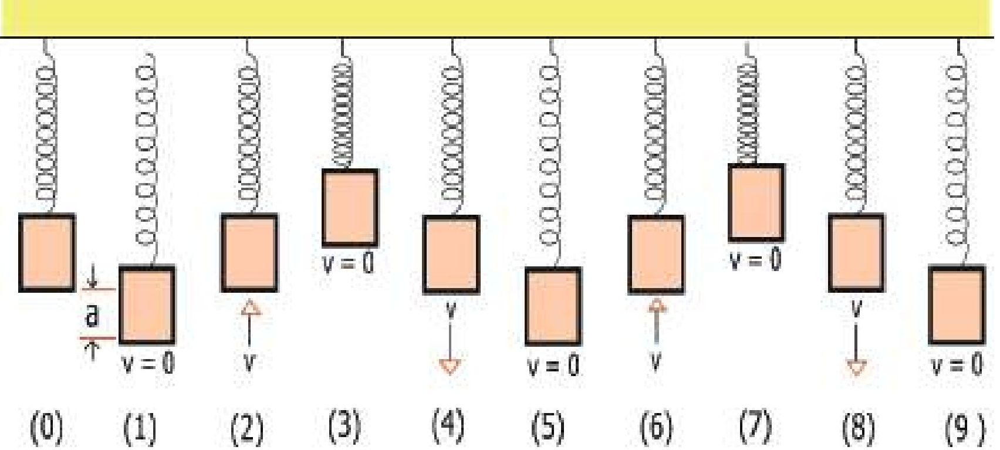

<!-- physics-9-10-bn-c07-t7.1-p015 · figure · p.189 -->
**চিত্র ৭.০১: (0) হচ্ছে সাম্য অবস্থা। টেনে (1) অবস্থানে নিয়ে ছেড়ে দেবার পর স্পিংটি সরল স্পন্দিত বেগে দুলছে।**

<!-- physics-9-10-bn-c07-t7.1-p016 · text · p.190 · review: verify-formula -->
ভরটা যখন $2 \rightarrow 3 \rightarrow 4 \rightarrow 5$ অবস্থান শেষ করে যে অবস্থানে শুরু করেছিল ঠিক একই অবস্থানে (৬) একই অবস্থায় ফিরে আসে (উপরের দিকে $v$ বেগে গতিশীল) তখন আমরা বলি একটা পূর্ণ স্পন্দন হয়েছে। মনে রাখতে হবে $2 \rightarrow 3$ শেষ করে $4$ এলেও কিন্তু যে অবস্থান থেকে শুরু করেছে সেই অবস্থানে ফিরে আসবে, এটা পূর্ণ স্পন্দন নয় কারণ প্রথম $2$ অবস্থানটিতে ভরটি উপরের দিকে যাচ্ছে এবং পরের $4$ অবস্থানটিতে নিচের দিকে যাচ্ছে। কাজেই এক অবস্থানে একই অবস্থায় ফিরে আসা হলো না।

<!-- physics-9-10-bn-c07-t7.1-p017 · text · p.190 · review: verify-formula -->
সরল স্পন্দন গতি বিশ্লেষণ করতে হলে আমাদের কয়েকটা রাশি ব্যাখ্যা করে নেওয়া ভালো। প্রথমটি হতে পারে পর্যায় কাল (Time Period) বা দোলনকাল $T$। একটা পূর্ণ স্পন্দন হতে যে সময় নেয় সেটা হচ্ছে পর্যায়কাল বা দোলনকাল। কম্পাঙ্ক $f$ হচ্ছে প্রতি সেকেন্ড পূর্ণ স্পন্দনের সংখ্যা অর্থাৎ $f = \frac{1}{T}$, এখন পর্যায়কাল $T$ যদি সেকেন্ডে প্রকাশ করি, তাহলে $f$ এর একক হার্টজ (Hz) বা $s^{-1}$ হবে।

<!-- physics-9-10-bn-c07-t7.1-p018 · text · p.190 · review: verify-formula -->
সরল স্পন্দিত গতিতে সাম্যাবস্থা থেকে উপরে কিংবা নিচে সবচেয়ে বেশি যে সরণ হয়, তাকে বলে বিস্তার (Amplitude)। ৭.০১ চিত্রে যেভাবে দেখানো হয়েছে তাতে বিস্তার হচ্ছে $a$।

<!-- physics-9-10-bn-c07-t7.1-p019 · text · p.190 -->
এর পরের রাশিটি হচ্ছে দশা (Phase)। স্পিংয়ে লাগানো ভরটি যখন ওঠানামা করছে, তখন কোনো এক মুহূর্তে যদি ভরটির দিকে তাকাই তাহলে আমরা দেখব সেটি সাম্যাবস্থা থেকে কোনো একটি দূরত্বে কোনো এক দিকে ধাবমান আছে, সেই অবস্থাটি হচ্ছে তার দশা। সরল স্পন্দন গতিতে ভর এবং স্পিংয়ের এই নির্দিষ্ট অবস্থাটি তুবহু একইভাবে ফিরে আসবে, আবার ঠিক এক পর্যায়কাল পরে। পদার্থবিজ্ঞানের ভাষায় বলা যায় সরল স্পন্দন গতিতে কোনো এক মুহূর্তে যে দশা হয়, এক দোলনকাল পর আবার সেই দশা ফিরে আসে।

## 7.2 তরঙ্গ (Waves)

<!-- physics-9-10-bn-c07-t7.2-p001 · text · p.190 -->
আমরা সবাই তরঙ্গ দেখেছি, পানিতে একটা টিল ছুড়ে দিলে সেই বিন্দু থেকে পানির তরঙ্গ চারদিকে ছড়িয়ে পড়ে। ঘরে বাতি জ্বালালে যে আলো ঘরে ছড়িয়ে পড়ে সেটাও তরঙ্গ। আমরা যখন কথা বলি আর শব্দটা যখন এক জায়গা থেকে অন্য জায়গায় পৌঁছে যায় সেটাও তরঙ্গ। একটা স্পিংকে সংকুচিত করে ছেড়ে দিলে তার ভেতর দিয়ে যে বিচ্যুতিটি ছুটে যায় সেটাও তরঙ্গ। টান করে রাখা একটা দড়ির মাঝে ঝাঁকুনি দিলে যে বিচ্যুতিটি দড়ি বরাবর ছুটে যায়, সেটাও তরঙ্গ। এক কথায় বলা যায় তরঙ্গটি কী আমরা সেটা অনুভব করতে পারি, কিন্তু তার জন্য পদার্থবিজ্ঞানের ভাষায় একটা সুন্দর সংজ্ঞা দিতে চাই তাহলে কী বলব?

<!-- physics-9-10-bn-c07-t7.2-p002 · text · p.191 · review: known-confusable-corrected -->
কোনো একটি রশির মানের বিচ্যুতি বা আন্দোলন যদি সময়ের সাথে স্থানান্তরিত হয়, তবে সেই বিচ্যুতি বা আন্দোলনকে বলা হয় তরঙ্গ। একটি একক আন্দোলন একটি তরঙ্গ তৈরি করতে পারে। আবার পরপর আন্দোলনের পুনরাবৃত্তিতেও তরঙ্গ তৈরি হতে পারে; সে ক্ষেত্রে একে বলা হয় তরঙ্গদল (Wavetrain)। তবে, ‘তরঙ্গ’ বলতে সাধারণত এরূপ পুনরাবৃত্ত তরঙ্গদলকেই বোঝায়, একক আন্দোলন বোঝায় কদাচিৎ।

<!-- physics-9-10-bn-c07-t7.2-p003 · text · p.191 · review: known-confusable-corrected -->
কোনো কোনো তরঙ্গ প্রবাহিত হতে মাধ্যমের প্রয়োজন হয়, আবার কোনো কোনো তরঙ্গ প্রবাহিত হওয়ার জন্য কোনো মাধ্যমের প্রয়োজন হয় না। যেসব তরঙ্গ প্রবাহের জন্য বায়বীয়, তরল বা কঠিন কোনো মাধ্যমের প্রয়োজন হয়, তাদের বলা হয় যান্ত্রিক তরঙ্গ (Mechanical Wave)। এসব তরঙ্গের ক্ষেত্রে মাধ্যমের কণাগুলো তরঙ্গ প্রবাহে অংশগ্রহণ করে।

<!-- physics-9-10-bn-c07-t7.2-p004 · text · p.191 · review: known-confusable-corrected -->
পুকুরে একটি ডিল ছুড়ে দিলে যে একক তরঙ্গ তৈরি হয়, তা পানির মাধ্যমে চারদিকে ছড়িয়ে পড়ে। একটি সুর-শলাকার কম্পন যদি বায়বীয়, তরল বা কঠিন কোনো মাধ্যমে সঞ্চালিত হয়, তাহলে আমরা বলি যে ঐ মাধ্যমের ভেতর দিয়ে শব্দের তরঙ্গদল প্রবাহিত হয়। যখন বৈদ্যুতিক ক্ষেত্র ও চৌম্বকক্ষেত্রের পুনরাবৃত্ত আন্দোলন স্থানান্তরিত হয়, তখন একে আমরা বলি বিদ্যুৎচুম্বকীয় বা তড়িৎচুম্বকীয় তরঙ্গ। আলোর তরঙ্গ, গামা রশ্মি, মাইক্রোওয়েভ ইত্যাদি তড়িৎচুম্বকীয় তরঙ্গের উদাহরণ। এই ধরনের তরঙ্গ প্রবাহিত হওয়ার জন্য কোনো মাধ্যম প্রয়োজন হয় না।

### ৭.২.১ তরঙ্গের বৈশিষ্ট্য

<!-- physics-9-10-bn-c07-t7.2-p005 · text · p.191 · review: known-confusable-corrected -->
এখানে আমরা তরঙ্গের কিছু বৈশিষ্ট্য আলোচনা করব। নিচের প্রথম বৈশিষ্ট্যটি (i) শুধুমাত্র যান্ত্রিক তরঙ্গের ক্ষেত্রে প্রযোজ্য, এবং বাকি বৈশিষ্ট্যগুলো (ii-v) প্রায় সব ধরনের তরঙ্গের জন্য প্রযোজ্য।

<!-- physics-9-10-bn-c07-t7.2-p006 · text · p.191 · review: known-confusable-corrected -->
(i) একটা মাধ্যমের ভেতর দিয়ে যখন তরঙ্গ যেতে থাকে, তখন মাধ্যমের কণাগুলো নিজ অবস্থানে থেকে শুধুমাত্র স্পন্দিত হয়, কিন্তু নিজেরা তরঙ্গের প্রবাহের দিকে সরে যায় না।

<!-- physics-9-10-bn-c07-t7.2-p007 · figure · p.192 · review: known-confusable-corrected -->
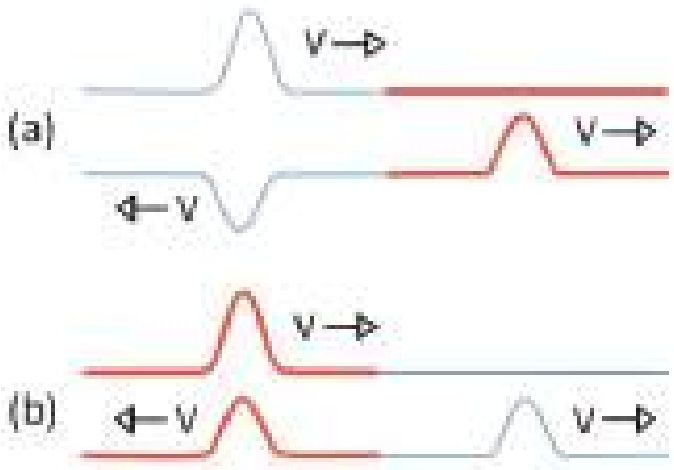

<!-- physics-9-10-bn-c07-t7.2-p008 · figure · p.192 · review: known-confusable-corrected -->
**চিত্র ৭.০২:** ভিন্ন প্রস্থচ্ছেদের তারের ভেতর একটি তরঙ্গ প্রতিফলিত এবং প্রতিসরিত হচ্ছে। (a) সর্বু তার থেকে মোটা তারে গেলে এক ধরনের প্রতিফলন হয় আবার (b) মোটা তার থেকে সর্বু তারে গেলে অন্য ধরনের প্রতিফলন হয়।

<!-- physics-9-10-bn-c07-t7.2-p009 · text · p.192 · review: known-confusable-corrected -->
(iv) তরঙ্গের প্রতিফলন কিংবা প্রতিসরণ হয়। পরের দুটি অধ্যায়ে আলোর প্রতিফলন ও প্রতিসরণ অনেক বড় করে আলোচনা করা হয়েছে। আপাতত জেনে রাখো যে এক মাধ্যম থেকে অন্য মাধ্যমে যাবার সময় তরঙ্গের খানিকটা বা সবটা প্রথম মাধ্যমে ফিরে আসার ঘটনাকে বলে প্রতিফলন (চিত্র ৭.০২)। তরঙ্গ প্রথম মাধ্যম থেকে দ্বিতীয় মাধ্যমে প্রবেশ করার ঘটনাকে বলে প্রতিসরণ। আমরা যখন শব্দের প্রতিধ্বনি শুনি, তখন আমরা আসলে শুনি প্রতিফলিত শব্দ। পানিতে ডুবে থাকা অবস্থায় আমি যদি বাইরের শব্দ শুনি তার অর্থ হচ্ছে আমি প্রতিসরিত শব্দ শুনছি।

<!-- physics-9-10-bn-c07-t7.2-p010 · text · p.192 · review: known-confusable-corrected -->
(v) তরঙ্গের যতগুলো বৈশিষ্ট্য আছে, তার মাঝে একটি গুরুত্বপূর্ণ বৈশিষ্ট্য হচ্ছে উপরিপাতন। আমাদের দৈনন্দিন জীবনে যদিও সেটা আমাদের খুব বেশি চোখে পড়ে না। ধরা যাক দুটি ভিন্ন ভিন্ন জায়গা থেকে একই রাশির দুটি তরঙ্গ একটি বিন্দুতে এসে হাজির হয়েছে। একটি তরঙ্গের ঐ রাশিটির মান যখন ধনাত্মক, অন্যটির মান যদি তখন ঋণাত্মক হয়, তাহলে তখন কী হবে? এগুলো হচ্ছে উপরিপাতনের বিষয়। যখন তরঙ্গের আরো গভীরে যাবে, তখন বিষয়গুলো

<!-- physics-9-10-bn-c07-t7.2-p011 · text · p.192 · review: known-confusable-corrected -->
(ii) তরঙ্গের মাধ্যমে শক্তি এক স্থান থেকে অন্য স্থানে প্রবাহিত হতে পারে। প্রবাহিত শক্তি তরঙ্গের বিস্তারের বর্গের সমানুপাতিক। অর্থাৎ বিস্তার যদি দ্বিগুণ হয়, প্রবাহিত শক্তি হয় চার গুণ।

<!-- physics-9-10-bn-c07-t7.2-p012 · text · p.192 · review: known-confusable-corrected -->
(iii) সব তরঙ্গেরই একটা বেগ থাকে। যে মাধ্যমের মধ্য দিয়ে তরঙ্গ প্রবাহিত হয় তার প্রকৃতির ওপর নির্ভর করে তরঙ্গের বেগ। বাতাসে শব্দের বেগ 330 m/s, কিন্তু পানিতে এই বেগ 1493 m/s! চিলে একটা দড়িতে একটা তরঙ্গের যত বেগ হবে, টানটান করে রাখা দড়িতে হবে তার থেকে বেশি।

<!-- physics-9-10-bn-c07-t7.2-p013 · figure · p.192 · review: known-confusable-corrected -->
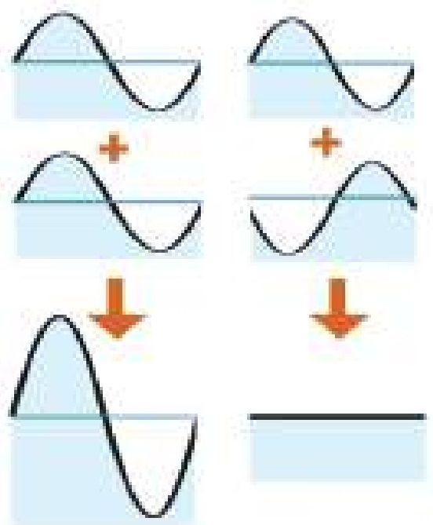

<!-- physics-9-10-bn-c07-t7.2-p014 · figure · p.192 · review: known-confusable-corrected -->
**চিত্র ৭.০৩:** দুটি তরঙ্গ যোগ হয়ে আরো বড় তরঙ্গ হতে পারে, আবার একটি অন্যটিকে নিঃশেষও করে দিতে পারে।

<!-- physics-9-10-bn-c07-t7.2-p015 · text · p.193 · review: known-confusable-corrected -->
আরো ভালোভাবে জেনে যাবে। আপাতত শুধু সহজ দুটি বিষয় ৭.০৩ চিত্রে দেখানো হয়েছে। দুটো তরঙ্গ একটি আরেকটিকে বড় করে দিতে পারে আবার একটি আরেকটিকে ধ্বংসও করে দিতে পারে।

<!-- physics-9-10-bn-c07-t7.2-p016 · text · p.193 · review: known-confusable-corrected -->
একটি আলোকোজ্জ্বল জায়গায় বড় একটি থালায় খানিকটা পানি ঢেলে নাও। থালায় যেন অন্য কোনো কম্পন না থাকে সেটি নিশ্চিত করো। পানির যেকোনো বিন্দু স্পর্শ করলে সেই বিন্দু থেকে চারদিকে তরঙ্গ ছড়িয়ে পড়বে এবং থালার তলায় তুমি তার প্রতিচ্ছবি দেখতে পাবে। থালার পানির ঠিক কেন্দ্রে স্পর্শ করলে দেখবে, একটি তরঙ্গ সেখান থেকে শুরু হয়ে থালার কিনারায় গিয়ে সেখান থেকে প্রতিফলিত হয়ে কেন্দ্রে মিলিত হবে। তরঙ্গটি ঠিক ভাবে তৈরি করতে পারলে সেটি কেন্দ্রে মিলিত হওয়ার পর আবার পাশে ছড়িয়ে পড়বে। তুমি একটুখানি চেষ্টা করলেই এই তরঙ্গের বেগ মাপতে পারবে। চেষ্টা করে দেখো।

<!-- physics-9-10-bn-c07-t7.2-p017 · text · p.193 · review: known-confusable-corrected -->
ঠিক কেন্দ্রে স্পর্শ না করে একটু পাশে স্পর্শ করলে কী হবে? করে দেখো।

### ৭.২.২ তরঙ্গের প্রকারভেদ

<!-- physics-9-10-bn-c07-t7.2-p018 · figure · p.193 -->
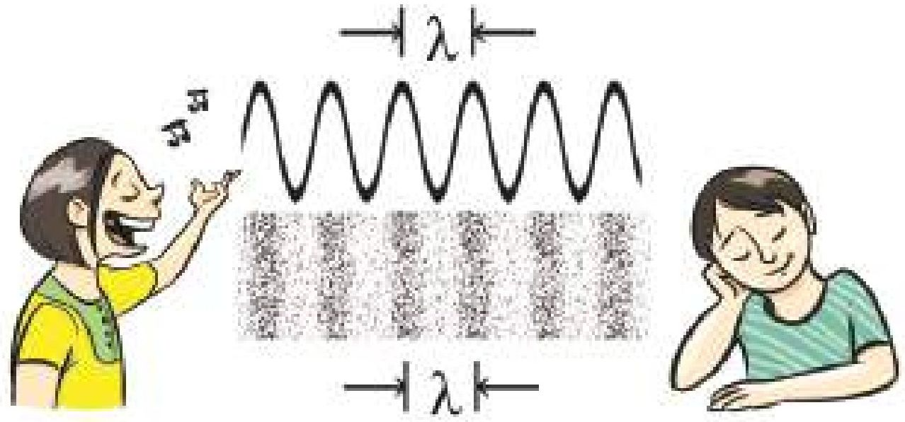

<!-- physics-9-10-bn-c07-t7.2-p019 · figure · p.193 · review: verify-formula -->
**চিত্র ৭.০৪: শব্দ হচ্ছে বাতাসের চাপের কারণে সংকোচন এবং প্রসারণের একটি অনুদৈর্ঘ্য তরঙ্গ। এখানে $\lambda$ হচ্ছে তরঙ্গদৈর্ঘ্য।**

<!-- physics-9-10-bn-c07-t7.2-p020 · text · p.194 -->
একটা স্পিংয়ের মধ্য দিয়ে একটা তরঙ্গ প্রবাহিত হওয়ার সময় তরঙ্গটি স্পিংকে সংকুচিত এবং প্রসারিত করে এগিয়ে যায়। আবার একটা দড়ির এক প্রান্তে একটা ঝাঁকুনি দিয়ে একটা তরঙ্গ তৈরি করলে সেটা দড়ির মধ্য দিয়ে এগিয়ে যায়। এই দুটি তরঙ্গের মাঝে কিন্তু একটা মৌলিক পার্থক্য আছে। স্পিংয়ে তরঙ্গটি ছিল সংকোচন এবং প্রসারণের, এবং সেই সংকোচন এবং প্রসারণের দিক এবং তরঙ্গের বেগের দিক একই। এই ধরনের তরঙ্গের নাম অনুদৈর্ঘ্য তরঙ্গ। শব্দ (চিত্র ৭.০৪) হচ্ছে এক ধরনের অনুদৈর্ঘ্য তরঙ্গ (Longitudinal Wave)।

<!-- physics-9-10-bn-c07-t7.2-p021 · figure · p.194 -->
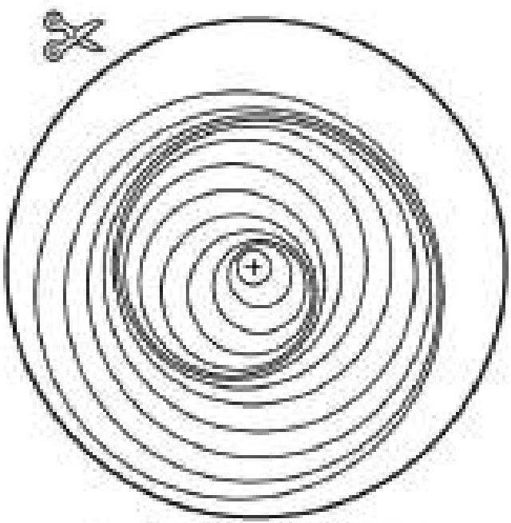

<!-- physics-9-10-bn-c07-t7.2-p022 · text · p.194 -->
১. এই ঘূর্ণিটি কাটোফলি করে গোল করে কেটে নও

<!-- physics-9-10-bn-c07-t7.2-p023 · figure · p.194 -->
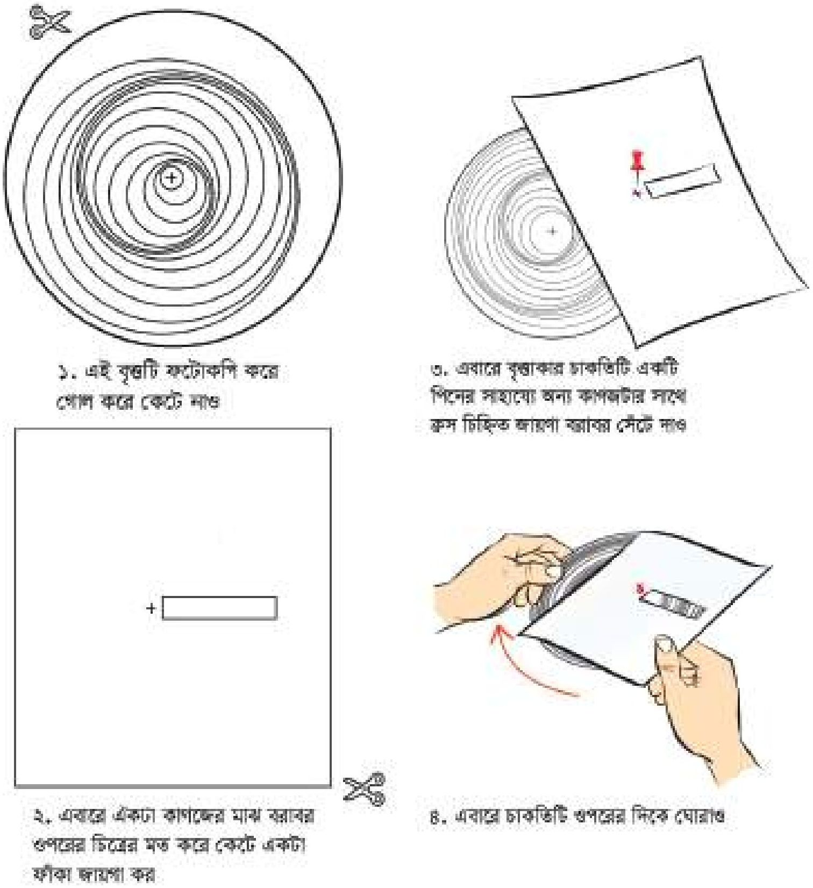

<!-- physics-9-10-bn-c07-t7.2-p024 · text · p.194 -->
৩. এবারে বৃদ্ধাকার চাক্ষিটি একটি পিনের সাহায্যে অন্য কাগজটির সাথে ক্রম চিহ্নিত আঁঘা বরাবর সেটে নও

<!-- physics-9-10-bn-c07-t7.2-p025 · figure · p.194 -->
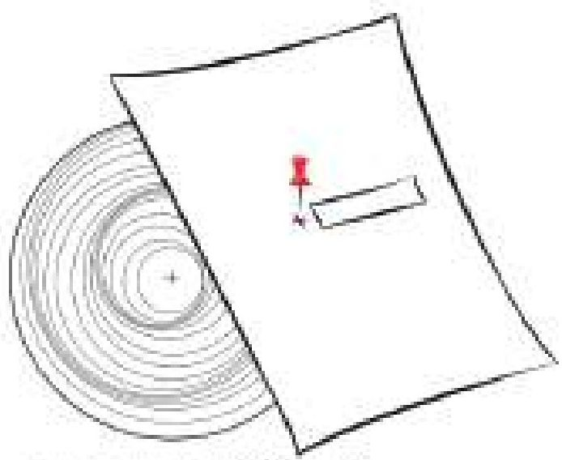

<!-- physics-9-10-bn-c07-t7.2-p026 · text · p.194 -->
২. এবারে একটা কাগজের মাঝ বরাবর ওপরের চিত্রের মত করে কেটে একটা ফাঁকা জায়গা কর

<!-- physics-9-10-bn-c07-t7.2-p027 · figure · p.194 -->
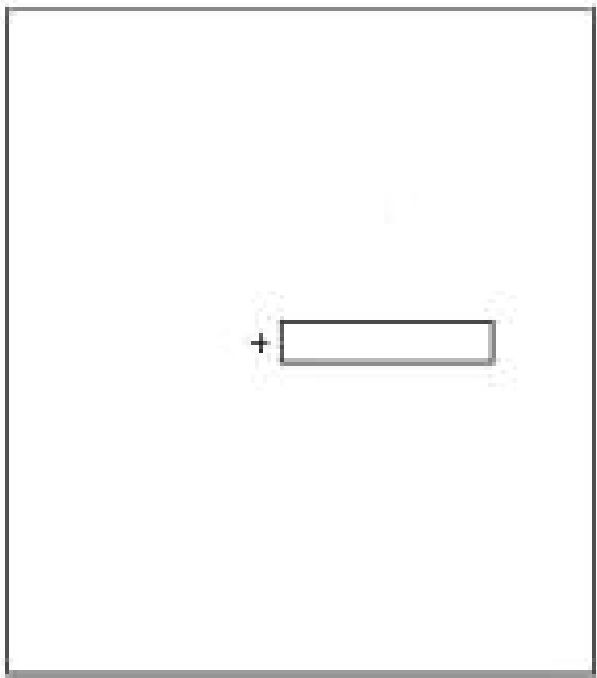

<!-- physics-9-10-bn-c07-t7.2-p028 · text · p.194 -->
৪. এবারে চাক্ষিটি ওপরের দিকে ঘোরানও

<!-- physics-9-10-bn-c07-t7.2-p029 · figure · p.194 -->
**চিত্র ৭.০৫: অনুদৈর্ঘ্য তরঙ্গ কীভাবে অগ্রসর হয় তার মডেল।**

<!-- physics-9-10-bn-c07-t7.2-p030 · text · p.195 · review: known-confusable-corrected -->
আমরা যখন দড়িতে ঝাঁকুনি দিয়ে তরঙ্গ তৈরি করেছি, সেখানে দড়ির কণাগুলোর কম্পন কিন্তু তরঙ্গের বেগের দিকে ঘটে না। কম্পনের দিক অর্থাৎ দড়ির ওঠা এবং নামা, তরঙ্গের বেগের সাথে লম্ব। এরকম তরঙ্গের নাম অনুপ্রস্থ তরঙ্গ (Transverse Wave)। পানির ঢেউ হচ্ছে এর আরেকটি উদাহরণ।

<!-- physics-9-10-bn-c07-t7.2-p031 · text · p.195 · review: known-confusable-corrected -->
৭.০৫ চিত্রটি ফটোকপি করে নাও। এবারে ছবিতে দেখানো উপায়ে কেটে নাও, লক্ষ্য করো নিচের আয়তাকার কাগজটিতে ছোট একটা জানালা তৈরি করা হয়েছে। এখন উপরের বৃত্তাকার কাগজটির উপর আয়তাকার কাগজটি রাখো। একটা ছোট তার ক্রস চিত্রিত জায়গা দিয়ে প্রবেশ করিয়ে চাপ দিয়ে তারটি ঝাঁজ করে নাও। এখন নিচের বৃত্তাকার কাগজটি ঘুরিয়ে কাটা অংশটিতে দেখো, অনুদৈর্ঘ্য তরঙ্গ বা *Longitudinal Wave* কীভাবে অগ্রসর হয় পরীক্ষার দেখতে পাবে।

### ৭.২.৩ তরঙ্গ-সংশ্লিষ্ট রাশি

<!-- physics-9-10-bn-c07-t7.2-p032 · text · p.195 · review: known-confusable-corrected -->
সরল স্পন্দন গতিতে আমরা যে সকল রাশির কথা বলেছি, তার সবগুলোই আসলে পর্যায়বৃত্ত তরঙ্গের বোঝায় ব্যবহার করতে পারব। তরঙ্গের পূর্ণ স্পন্দন হয়; তার পর্যায়কাল আছে, কম্পাঙ্ক আছে এবং বিস্তার আছে। আমরা দেখেছি কোনো একটা তরঙ্গ প্রবাহিত হওয়ার সময় আমরা যদি মাধ্যমের কোনো একটা কণার দিকে তাকিয়ে থাকি, তাহলে দেখব সেই কণাটির সরল স্পন্দিত কম্পন হচ্ছে।

<!-- physics-9-10-bn-c07-t7.2-p033 · text · p.195 · review: known-confusable-corrected -->
তরঙ্গের বোঝায় আমরা নতুন দুটি রাশির কথা বলতে পারি যার একটা হচ্ছে তরঙ্গদৈর্ঘ্য। তরঙ্গের যেকোনো একটি দশা থেকে তার পরবর্তী একই দশার মাঝে দূরত্ব হচ্ছে তার তরঙ্গদৈর্ঘ্য (চিত্র ৭.০৪)। অর্থাৎ এক পর্যায়কালে একটা তরঙ্গ যেটুকু দূরত্ব অতিক্রম করে সেটাই হচ্ছে তরঙ্গ দৈর্ঘ্য।

<!-- physics-9-10-bn-c07-t7.2-p034 · text · p.195 · review: known-confusable-corrected,verify-formula -->
তরঙ্গের জন্য দ্বিতীয় আরেকটি রাশি হচ্ছে তরঙ্গের বেগ। প্রতি সেকেন্ডে একটা তরঙ্গ যেটুকু দূরত্ব অতিক্রম করে সেটাই হচ্ছে সেই তরঙ্গের বেগ। প্রতি সেকেন্ডে যে কয়টি পর্যায়কাল থাকে সেটি হচ্ছে কম্পাঙ্ক। কম্পাঙ্ক যদি $f$ এবং তরঙ্গ দৈর্ঘ্য যদি $\lambda$ হয় তাহলে বেগ $v$ হচ্ছে

<!-- physics-9-10-bn-c07-t7.2-p035 · formula · p.195 · review: known-confusable-corrected,verify-formula -->
$$v = f\lambda$$

<!-- physics-9-10-bn-c07-t7.2-p036 · text · p.195 · review: known-confusable-corrected -->
একটা তরঙ্গ যখন একটা মাধ্যম থেকে অন্য মাধ্যমে প্রবাহিত হয়, তখন তার বেগের পরিবর্তন হয়। যেহেতু কম্পাঙ্ক সব সময় সমান থাকে, তরঙ্গ দৈর্ঘ্যের পরিবর্তন হয়। অর্থাৎ তরঙ্গ বিভিন্ন মাধ্যমের ভেতর দিয়ে যাওয়ার সময় তার তরঙ্গ দৈর্ঘ্য কিংবা বেগের পরিবর্তন হয় কিন্তু কক্ষাঙ্কের বা পর্যায়কালের কোনো পরিবর্তন হয় না।

### উদাহরণ

<!-- physics-9-10-bn-c07-t7.2-p037 · example · p.196 -->
**প্রশ্ন:** ৭.০৬ চিত্রে একটি তরঙ্গ দেখানো হয়েছে। এই চিত্র থেকে তরঙ্গের বিস্তার, তরঙ্গ দৈর্ঘ্য, দোলনকাল, কক্ষাঙ্ক এবং বেগের ভেতর কোন কোনটির মান বের করা সম্ভব? সেগুলো বের করে দেখাও।

<!-- physics-9-10-bn-c07-t7.2-p038 · figure · p.196 -->
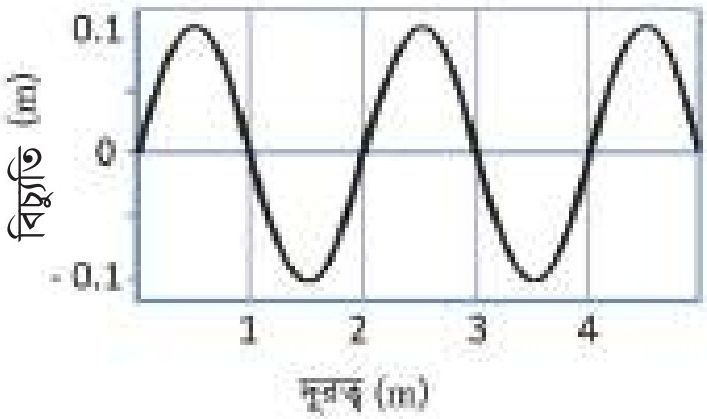

<!-- physics-9-10-bn-c07-t7.2-p039 · figure · p.196 -->
**চিত্র ৭.০৬: অবস্থানের সাপেক্ষে একটি তরঙ্গ।**

<!-- physics-9-10-bn-c07-t7.2-p040 · example · p.196 · review: verify-formula -->
**উত্তর:** ছবিতে যে তথ্য দেওয়া আছে সেখান থেকে শুধু তরঙ্গটির বিস্তার ($0.1\ m$) এবং তরঙ্গ দৈর্ঘ্য ($2\ m$) বের করা সম্ভব। এই ছবিতে যে তথ্য দেওয়া আছে, সেখান থেকে পর্যায়কাল, কক্ষাঙ্ক বা বেগ বের করা সম্ভব নয়। উপরের তরঙ্গটি একটি নির্দিষ্ট সময়ে তরঙ্গের অবস্থা। সময়ের সাথে অবস্থানের কীভাবে পরিবর্তন হয়েছে এখানে সে সম্পর্কে কোনো তথ্য নেই।

<!-- physics-9-10-bn-c07-t7.2-p041 · text · p.196 -->
**প্রশ্ন:** ৭.০৭ চিত্রে আরেকটি তরঙ্গ দেখানো হয়েছে। এই চিত্র থেকে তরঙ্গের বিস্তার, তরঙ্গ দৈর্ঘ্য, দোলনকাল, কক্ষাঙ্ক এবং বেগের ভেতর কোন কোনটি বের করা সম্ভব? সেগুলো বের করে দেখাও।

### চিত্র ৭.০৭: সময়ের সাপেক্ষে একটি তরঙ্গ। (Displacement (m) vs সময় (s))

<!-- physics-9-10-bn-c07-t7.2-p042 · table · p.196 · review: verify-table -->
<table><tr><th>সময় (s)</th><th>বিচ্ছুরিত (m)</th></tr>
<tr><th>0</th><td>0.0</td></tr>
<tr><th>0.5</th><td>0.2</td></tr>
<tr><th>1</th><td>0.0</td></tr>
<tr><th>1.5</th><td>-0.2</td></tr>
<tr><th>2</th><td>0.0</td></tr>
<tr><th>2.5</th><td>0.2</td></tr>
<tr><th>3</th><td>0.0</td></tr>
<tr><th>3.5</th><td>-0.2</td></tr>
<tr><th>4</th><td>0.0</td></tr>
<tr><th>4.5</th><td>0.2</td></tr>
<tr><th>5</th><td>0.0</td></tr></table>

<!-- physics-9-10-bn-c07-t7.2-p043 · text · p.196 · review: verify-formula -->
**উত্তর:** এই তরঙ্গের বিস্তার ($0.2\ m$) এবং পর্যায়কাল ($2\ s$)। এই ছবি থেকে অন্য কোনো তথ্য বের করা সম্ভব না। এই ছবিটিতে একটা নির্দিষ্ট স্থানে সময়ের সাথে সাথে তরঙ্গটি কীভাবে পরিবর্তিত হচ্ছে সেটি দেখানো হয়েছে কাজেই এখান থেকে তরঙ্গ দৈর্ঘ্য কত বলা সম্ভব নয়।

<!-- physics-9-10-bn-c07-t7.2-p044 · text · p.197 -->
**প্রশ্ন:** ৭.০৮ চিত্রে একটি নির্দিষ্ট সময়ে বিভিন্ন অবস্থানে এবং একটি নির্দিষ্ট অবস্থানে বিভিন্ন সময়ে একটি তরঙ্গের অবস্থা দেখানো হয়েছে। এর বিস্তার, তরঙ্গ দৈর্ঘ্য, দোলনকাল, কম্পাঙ্ক এবং বেগ বের করো।

<!-- physics-9-10-bn-c07-t7.2-p045 · text · p.197 -->
**উত্তর:** প্রথম চিত্র থেকে আমরা দেখতে পাচ্ছি তরঙ্গটির

<!-- physics-9-10-bn-c07-t7.2-p046 · text · p.197 · review: verify-formula -->
বিস্তার $a = 0.1$ m
তরঙ্গ দৈর্ঘ্য $\lambda = 1$ m

<!-- physics-9-10-bn-c07-t7.2-p047 · text · p.197 -->
দ্বিতীয় চিত্র থেকে আমরা দেখতে পাচ্ছি তরঙ্গটির

<!-- physics-9-10-bn-c07-t7.2-p048 · text · p.197 · review: verify-formula -->
বিস্তার $a = 0.1$ m (এটি আমরা প্রথম ছবি থেকেও জানি)
দোলনকাল $T = 0.2$ s
দোলনকাল থেকে কম্পাঙ্ক $f$ বের করতে পারি

<!-- physics-9-10-bn-c07-t7.2-p049 · formula · p.197 · review: verify-formula -->
$$f = \frac{1}{T} = \frac{1}{0.2}  s^{-1} = 5  Hz$$

### চিত্র ৭.০৮: একই সাথে অবস্থান এবং সময়ের সাপেক্ষে একটি তরঙ্গ। (Left Panel: বিস্তার (m) vs দূরব (m); Right Panel: বিস্তার (m) vs সময় (s))

<!-- physics-9-10-bn-c07-t7.2-p050 · table · p.197 · review: verify-table -->
<table><tr><th>Panel</th><th>X-axis Label</th><th>Y-axis Value (বিস্তার (m))</th></tr>
<tr><th rowspan="5">Left Panel (দূরব (m))</th><th>0.0</th><td>0.00</td></tr>
<tr><th>0.5</th><td>0.00</td></tr>
<tr><th>1.0</th><td>0.00</td></tr>
<tr><th>1.5</th><td>0.00</td></tr>
<tr><th>2.0</th><td>0.00</td></tr>
<tr><th rowspan="5">Right Panel (সময় (s))</th><th>0.0</th><td>0.00</td></tr>
<tr><th>0.1</th><td>0.00</td></tr>
<tr><th>0.2</th><td>0.00</td></tr>
<tr><th>0.3</th><td>0.00</td></tr>
<tr><th>0.4</th><td>0.00</td></tr></table>

<!-- physics-9-10-bn-c07-t7.2-p051 · figure · p.197 -->
**চিত্র ৭.০৮:** একই সাথে অবস্থান এবং সময়ের সাপেক্ষে একটি তরঙ্গ।

<!-- physics-9-10-bn-c07-t7.2-p052 · text · p.197 -->
কাজেই দুটি চিত্রের তথ্য ব্যবহার করে আমরা বলতে পারি

<!-- physics-9-10-bn-c07-t7.2-p053 · text · p.197 · review: verify-formula -->
তরঙ্গটির বেগ $v = \lambda f = 1  m \times 5  Hz = 5  ms^{-1}$

<!-- physics-9-10-bn-c07-t7.2-p054 · text · p.197 -->
**প্রশ্ন:** ৭.০৯ চিত্রে একটি তরঙ্গের বিভিন্ন অবস্থা দেখানো হয়েছে, যেখানে A, B, C, D, এবং E দিয়ে এর বিভিন্ন অবস্থান চিহ্নিত হয়েছে। কোন কোন অবস্থানে দশা এক?

<!-- physics-9-10-bn-c07-t7.2-p055 · text · p.197 · review: verify-formula -->
**উত্তর:** $A$ এবং $C$ তে দশা এক

<!-- physics-9-10-bn-c07-t7.2-p056 · text · p.197 · review: verify-formula -->
$A$ এবং $B$ তে তরঙ্গের মান সমান হলেও দশা বিপরীত

<!-- physics-9-10-bn-c07-t7.2-p057 · text · p.197 · review: verify-formula -->
$D$ এবং $E$ তে মান সমান হলেও দশা এক নয়।

<!-- physics-9-10-bn-c07-t7.2-p058 · figure · p.198 -->
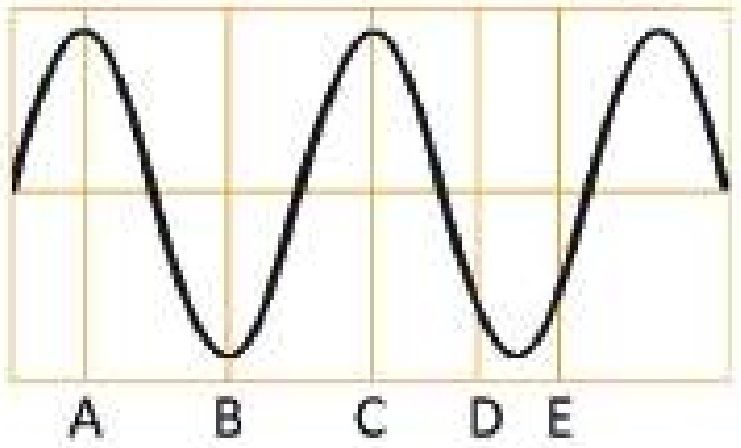

<!-- physics-9-10-bn-c07-t7.2-p059 · figure · p.198 -->
**চিত্র ৭.০৯ : ভিন্ন ভিন্ন অবস্থানে একটি তরঙ্গের দর্শা**

## 7.3 শব্দ তরঙ্গ (Sound Wave)

<!-- physics-9-10-bn-c07-t7.3-p001 · text · p.198 -->
শব্দ তরঙ্গ তৈরি করতে তার একটা উৎসের দরকার, সেটাকে প্রবাহিত করার জন্য একটা মাধ্যমের দরকার এবং সেই শব্দ গ্রহণ করার জন্য কোনো এক ধরনের রিসিভার দরকার। আমাদের চারপাশে অসংখ্য শব্দের উৎস রয়েছে। অবশ্যই সবচেয়ে পরিচিত উৎস আমাদের কণ্ঠ। সেখানে যে ভোকাল কর্ড আছে আমরা তার ভেতর দিয়ে বাতাস বের করার সময় সেখানে যে কম্পন হয় সেটা দিয়ে শব্দ তৈরি হয়। কথা বলার সময় আমরা যদি গলায় স্পর্শ করি, তাহলে আমরা সেই কম্পন অনুভব করতে পারব।

<!-- physics-9-10-bn-c07-t7.3-p002 · text · p.198 · review: latin-junk -->
তোমরা নিশ্চয়ই লক্ষ্য করেছ পুরুষের গলার স্বর মোটা এবং নারী ও শিশুদের গলার স্বর তীক্ষ্ণ। আমরা যখন কোনো একটা শব্দ করি তখন আমাদের ফুসফুস থেকে বাতাস গলা দিয়ে দিয়ে বের হয়ে আসে। আমাদের গলায় ও ফুসফুসে বাতাস চোকার জন্য এবং বের হওয়ার জন্য রয়েছে Wind pipe এর উপরে শব্দ সৃষ্টি করার জন্য রয়েছে স্বরযন্ত্র (Larynx)। সেখানে দুটো পর্দা ভালভের মতো কাজ করে, এই পর্দা দুটির নাম ভোকাল কর্ড (Vocal Cord)। বাতাস বের করার সময় এগুলো কাঁপতে পারে এবং শব্দ তৈরি করে। বয়সের সাথে সাথে পুরুষের ভোকাল কর্ড শক্ত হয়ে যায়, নারীদেরটি কোমল থাকে। সে জন্য পুরুষেরা কম কম্পাঙ্কের শব্দ তৈরি করে মেয়েরা বেশি কম্পাঙ্কের শব্দ তৈরি করে। সে কারণে পুরুষের গলার স্বর মোটা, নারীর স্বর তীক্ষ্ণ।

<!-- physics-9-10-bn-c07-t7.3-p003 · text · p.198 -->
৭.১০ চিত্রে দেখানো উপায়ে একটি কাগজ কেটে নিয়ে দুই আঙুলের মাঝে রেখে মুখে লাগিয়ে ফুঁ দাও। কাগজের কাটা টুকরো দুটো স্বরযন্ত্র বা ভোকাল কর্ডের মতো কেঁপে শব্দ তৈরি করবে। বিভিন্নভাবে কাগজ কেটে বিভিন্ন রকম শব্দ তৈরি করতে পার কিনা দেখো।

<!-- physics-9-10-bn-c07-t7.3-p004 · text · p.199 · review: known-confusable-corrected -->
আমাদের কণ্ঠ ছাড়াও নানা শব্দের উৎস আছে। যেমন, ইলেকট্রনিক স্পিকারে যে পাতলা ডায়াফ্রাম রয়েছে সেটিকে সুনির্দিষ্টভাবে কাঁপিয়ে শব্দ তৈরি করা হয়। স্কুলের ঘণ্টার মাঝে আঘাত করলে সেটি কাঁপতে শুরু করে শব্দ তৈরি করে, এবং তখন হাত দিয়ে সেটাকে চেপে ধরে কম্পন বন্ধ করে ফেললে সাথে সাথে শব্দও বন্ধ হয়ে যায়। গিটারের তারে টোকা দিলে সেটি কাঁপতে থাকে এবং শব্দ তৈরি করে। ল্যাবরেটরিতে সুর শলাকা দিয়ে নির্দিষ্ট কম্পাঙ্কের শব্দ তৈরি করা যায়।

<!-- physics-9-10-bn-c07-t7.3-p005 · figure · p.199 -->

<!-- physics-9-10-bn-c07-t7.3-p006 · figure · p.199 -->
**চিত্র ৭.১০: কাগজ দিয়ে ভোকাল কর্ড তৈরি করে সেটাকে ফুঁ দিয়ে কাঁপিয়ে শব্দ তৈরি করা যায়।**

<!-- physics-9-10-bn-c07-t7.3-p007 · text · p.199 -->
কম্পন দিয়ে শব্দ তৈরি করার পর সেটিকে এক জায়গা থেকে অন্য জায়গায় প্রবাহিত করার জন্য একটা মাধ্যমের দরকার হয়। তরল ও কঠিন পদার্থের ভেতর দিয়েও শব্দ প্রবাহিত করা যায়, কিন্তু আমরা বাতাসের মাধ্যমেই শব্দ শুনে অভ্যস্ত। মাধ্যম ছাড়া যে শব্দ যেতে পারে না সেটি দেখানোর জন্য ল্যাবরেটরিতে ৭.১১ চিত্রে দেখানো উপায়ে একটা জারের মধ্যে একটা কলিং বেল রেখে সেটাকে বাইরে থেকে বিদ্যুৎ সরবরাহ করে বাজানো যেতে পারে। তারপর একটা পাম্প দিয়ে জারটিকে ধীরে ধীরে বায়ুশূন্য করা শুরু করলে কলিং বেলের শব্দ মৃদু হতে শুরু করে। বেলজারটি পুরোপুরি বায়ুশূন্য করা হলে ভেতরে কলিং বেলটি কাঁপতে থাকলেও বাইরে থেকে কোনো শব্দ শোনা যায় না।

<!-- physics-9-10-bn-c07-t7.3-p008 · figure · p.199 -->
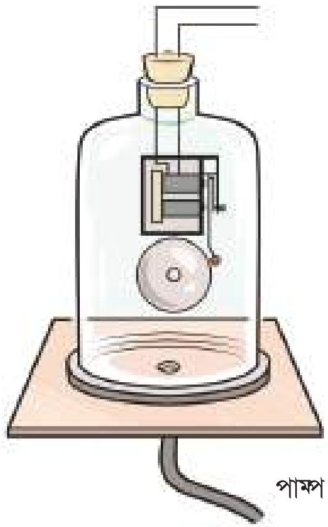

<!-- physics-9-10-bn-c07-t7.3-p009 · figure · p.199 -->
**চিত্র ৭.১১: বেলজার থেকে বাতাস পাম্প করে সরিয়ে নিলে কলিং বেল শব্দটি আর শোনা যাবে না।**

<!-- physics-9-10-bn-c07-t7.3-p010 · text · p.199 -->
আমরা আমাদের কান দিয়ে শব্দ শুনতে পাই। শব্দের কম্পাঙ্ক যদি 20 Hz থেকে 20,000 Hz (অর্থাৎ 20 kHz) এর মাঝখানে থাকে তাহলে সেই শব্দ শোনা যায়। (তবে কানে হেডফোন লাগিয়ে অবিরত গান শুনে কিংবা প্রচণ্ড শব্দদুষণে থাকলে অনেক সময় শোনার ক্ষমতা কমে যায়।) শব্দের কম্পাঙ্ক 20 Hz থেকে কম হলে সেটাকে শব্দেতর বা ইনফ্রাসাউন্ড বলে এবং 20 kHz থেকে বেশি হলে সেটাকে শব্দোত্তর বা আল্ট্রাসাউন্ড বলে। 20 Hz থেকে কম কিংবা 20 kHz থেকে বেশি কম্পাঙ্ক তৈরি করা হলে সেটি বাতাসে যে আলোড়ন সৃষ্টি করে আমরা সেটি শুনতে পাই না। এ ধরনের শব্দের অস্তিত্ব বুঝতে হলে আমরা বিশেষ ধরনের মাইক্রোফোন বা রিসিভার ব্যবহার করতে পারি। অনেক পশুপাখি কম কম্পাঙ্কের শব্দ শুনতে পায়। ভূমিকম্পের ঠিক আগে এ ধরনের কম কম্পাঙ্কের যে শব্দ তৈরি হয় অনেক সময় পশুপাখি সেই শব্দ শুনে আতঙ্কে ছোটোছোটি করেছে বলে জানা গেছে।

### শব্দ তরঙ্গের বৈশিষ্ট্য

<!-- physics-9-10-bn-c07-t7.3-p011 · text · p.200 -->
শব্দ একটি যান্ত্রিক তরঙ্গ কারণ বস্তুকণার কম্পনের ফলে শব্দ তরঙ্গ সৃষ্টি হয়, এবং সেটি সঞ্চালনের জন্যও একটি স্থিতিস্থাপক মাধ্যমের দরকার হয়। শব্দ একটি অনুদৈর্ঘ্য তরঙ্গ কারণ এই তরঙ্গের প্রবাহের দিক এবং মাধ্যমের কণার কম্পনের দিক এক। শব্দের বেগ মাধ্যমের প্রকৃতির উপর নির্ভর করে। বায়বীয় মাধ্যমে এর বেগ কম, তরলে তার চেয়ে বেশি, কঠিন পদার্থে আরো বেশি। শব্দের বেগ মাধ্যমের তাপমাত্রা এবং আর্দ্রতার উপরও নির্ভর করে। অন্যান্য তরঙ্গের মতো, শব্দ তরঙ্গের তীব্রতাও তার বিস্তারের বর্গের সমানুপাতিক। অর্থাৎ শব্দ তরঙ্গের বিস্তার বেশি হলে শব্দের তীব্রতা বেশি হয় এবং তরঙ্গের বিস্তার কম হলে শব্দের তীব্রতা কম হয়। অন্যান্য যেকোনো তরঙ্গের মতোই শব্দ তরঙ্গের প্রতিফলন, প্রতিসরণ এবং উপরিপাতন হতে পারে।

<!-- physics-9-10-bn-c07-t7.3-p012 · figure · p.200 -->
**চিত্র ৭.১২: প্লাস্টিকের গ্লাসের পেছনে সূতা বেঁধে “ফোন” তৈরি করা যায়।**

### নিজে করো

<!-- physics-9-10-bn-c07-t7.3-p013 · activity · p.200 -->
দুটো প্লাস্টিকের গ্লাস নিয়ে গ্লাসগুলোর নিচে দুটি ছোট ছিদ্র করো। (সেফটি পিন আগুনে গরম করে স্পর্শ করো।) সেই ফুটো দিয়ে সূতা প্রবেশ করিয়ে সূতাটা বেঁধে নাও (চিত্র ৭.১২)। এভাবে দুটি প্লাস্টিকের গ্লাসকে একটা লম্বা সূতা দিয়ে বেঁধে নিয়ে দুইজন দুই জায়গায় দাঁড়িয়ে একজন কথা বলো অন্যজন শোনো। (সূতাটা যেন টান টান থাকে, তা না হলে কিন্তু কথা শোনা যাবে না) আমরা বাতাসে কথা শুনতে শুনতে এত অভ্যস্ত হয়ে গেছি যে ধরেই নিয়েছি শব্দ বুঝি শুধু বাতাসেই সঞ্চালিত হয়। শব্দ যে তরল কিংবা কঠিন পদার্থের মতো অন্য মাধ্যম দিয়েও সঞ্চালিত হতে পারে এই পরীক্ষাটি তার একটা প্রমাণ।

### উদাহরণ

<!-- physics-9-10-bn-c07-t7.3-p014 · example · p.201 · review: known-confusable-corrected -->
**প্রশ্ন:** 1 kHz কম্পনের একটি সুর শলাকা বা টিউনিং ফর্ক দিয়ে শব্দ তৈরি করে সেটি বাতাসে, পানিতে এবং লোহার ভেতর দিয়ে প্রবাহিত হতে দিয়ে তার বেগ নির্ণয় করে দেখা গেছে শব্দের বেগ বাতাসে 334 m/s, পানিতে 1493 m/s এবং লোহার ভেতরে 5130 m/s কোন মাধ্যমে তরঙ্গ দৈর্ঘ্য কত?

<!-- physics-9-10-bn-c07-t7.3-p015 · example · p.201 · review: known-confusable-corrected,verify-formula -->
**উত্তর:** তরঙ্গের বেগ = $\lambda f$ যেখানে $\lambda$ তরঙ্গের দৈর্ঘ্য এবং $f$ কম্পাঙ্ক। এখানে কম্পাঙ্ক 1 kHz বা 1000 Hz কাজেই

<!-- physics-9-10-bn-c07-t7.3-p016 · formula · p.201 · review: verify-formula -->
$$\lambda = \frac{v}{f}$$

<!-- physics-9-10-bn-c07-t7.3-p017 · text · p.201 -->
**বাতাসে**

<!-- physics-9-10-bn-c07-t7.3-p018 · formula · p.201 · review: verify-formula -->
$$\lambda = \frac{334  ms^{-1}}{10^3  s^{-1}} = 0.334  m$$

<!-- physics-9-10-bn-c07-t7.3-p019 · text · p.201 -->
**পানিতে**

<!-- physics-9-10-bn-c07-t7.3-p020 · formula · p.201 · review: verify-formula -->
$$\lambda = \frac{1493  ms^{-1}}{10^3  s^{-1}} = 1.49  m$$

<!-- physics-9-10-bn-c07-t7.3-p021 · text · p.201 -->
**লোহায়**

<!-- physics-9-10-bn-c07-t7.3-p022 · formula · p.201 · review: verify-formula -->
$$\lambda = \frac{5130  ms^{-1}}{10^3  s^{-1}} = 5.13  m$$

### ৭.৩.১ প্রতিধ্বনি

<!-- physics-9-10-bn-c07-t7.3-p023 · text · p.201 · review: known-confusable-corrected -->
শব্দ যেহেতু একধরনের তরঙ্গ, তাই তার প্রতিফলন হতে পারে। সাধারণত বড় ফাঁকা দালানের ভেতর কথা বললে এক ধরনের গমগম আওয়াজ হয় যাকে আমরা বলি প্রতিধ্বনি। সেটি প্রতিফলন ছাড়া আর কিছু নয়। দালানের ভেতর দূরত্ব বেশি নয় বলে শব্দটা আলাদাভাবে শুনতে পাই না। আমরা যখন কিছু শুনি তার অনুভূতিটা 0.1 s পর্যন্ত থেকে যায়, তাই দুটি শব্দ আলাদাভাবে শুনতে হলে দুটি শব্দের মাঝে কমপক্ষে 0.1 s এর একটা ব্যবধান থাকা দরকার। শব্দের বেগ 330 m/s কাজেই 0.1 s এর ব্যবধান তৈরি করতে শব্দকে কমপক্ষে 33 m দূরত্ব অতিক্রম করতে হয়। একটি বড় দেয়াল, দালান কিংবা খাড়া পাহাড়ের সামনে কমপক্ষে এই দূরত্বের অর্ধেক দূরত্ব (16.5 m) দাঁড়ালে শব্দটি গিয়ে প্রতিফলিত হয়ে ফিরে আসতে 0.1 s সময় লাগবে এবং আমরা শব্দের প্রতিধ্বনি শুনতে পাব।

<!-- physics-9-10-bn-c07-t7.3-p024 · text · p.201 -->
বাদুড়ের চোখ আছে এবং সেই চোখে সে বেশ ভালো দেখতে পায়, তারপরও তারা ওড়ার সময় শব্দের প্রতিধ্বনি ব্যবহার করে। বাদুড় ওড়ার সময় তার কর্ণ থেকে শব্দ তৈরি করে, সামনে কোনো কিছু থাকলে শব্দটি সেখানে প্রতিফলিত হয়ে ফিরে আসে, কতক্ষণ পর শব্দটি ফিরে এসেছে সেখান থেকে বাদুড় দূরত্বটা অনুমান করতে পারে। এজন্য অনধিকারেও বাদুড় কোথাও ধাক্কা না খেয়ে উড়ে যেতে পারে। বাদুড়ের তৈরি এই শব্দ আমরা শুনতে পাই না, কারণ শব্দটি আল্ট্রাসাউন্ড অর্থাৎ আমাদের শ্রুতিসীমার বাইরের কক্ষপাঙ্কের শব্দ। বাদুড় প্রায় 100 kHz কক্ষনের শব্দ তৈরি করতে পারে।

<!-- physics-9-10-bn-c07-t7.3-p025 · text · p.202 -->
> বাদুড় ওড়ার সময় আল্ট্রাসাউন্ড শব্দ তৈরি না করে ইনফ্রা-সাউন্ড শব্দ তৈরি করলে বাদুড়ের কী সমস্যা হতো?

### ৭.৩.২ শব্দের বেগের পার্থক্য

<!-- physics-9-10-bn-c07-t7.3-p026 · text · p.202 -->
বাতাসে শব্দের বেগ তাপমাত্রার বর্গমূলের সমানুপাতিক। অর্থাৎ

<!-- physics-9-10-bn-c07-t7.3-p027 · formula · p.202 · review: verify-formula -->
$$v \propto \sqrt{T}$$

<!-- physics-9-10-bn-c07-t7.3-p028 · text · p.202 -->
এখানে তাপমাত্রা কিন্তু সেলসিয়াস নয় কেলভিন তাপমাত্রা।

<!-- physics-9-10-bn-c07-t7.3-p029 · text · p.202 -->
শব্দের বেগ বাতাসের চাপের ওপর নির্ভর করে না। তবে বাতাসের ঘনত্বের বর্গমূলের ওপর বস্তানুপাতিকভাবে নির্ভর করে। তাই বাতাসে জলীয়বাস্থ্য থাকলে বাতাসের ঘনত্ব কমে যায়, সে জন্য শব্দের বেগ বেড়ে যায়।

<!-- physics-9-10-bn-c07-t7.3-p030 · table · p.202 · review: verify-table -->
**টেবিল ৭.০১: বিভিন্ন মাধ্যমে শব্দের বেগ**
<table><tr><th>মাধ্যম</th><th>m/s</th></tr>
<tr><td>বাতাস</td><td>330</td></tr>
<tr><td>হাইড্রোজেন</td><td>1,284</td></tr>
<tr><td>পারদ</td><td>1,450</td></tr>
<tr><td>পানি</td><td>1,493</td></tr>
<tr><td>লোহা</td><td>5,130</td></tr>
<tr><td>হীরা</td><td>12,000</td></tr></table>

<!-- physics-9-10-bn-c07-t7.3-p031 · text · p.202 · review: known-confusable-corrected -->
শব্দ নামক যান্ত্রিক তরঙ্গের বেগ মাধ্যমের স্থতিস্থাপকতার ওপর নির্ভর করে। তরল এবং কঠিন পদার্থের প্রকৃতি বাতাস থেকে ভিন্ন এবং স্বাভাবিক কারণেই শব্দের বেগ সেখানে ভিন্ন। তরলে শব্দের বেগ বাতাসে বেগের থেকে বেশি এবং কঠিন পদার্থে শব্দের বেগ তার থেকেও বেশি। ৭.০১ টেবিলে বিভিন্ন মাধ্যমে শব্দের বেগ দেখানো হয়েছে।

<!-- physics-9-10-bn-c07-t7.3-p032 · text · p.202 -->
> একটা টেবিলের এক মাথায় একজন কান লাগিয়ে রাখো, আরেকজনকে বলো টেবিলের অন্য মাথায় হালকা টোকা দিতে। টোকার শব্দটি তুমি খুবই স্পষ্ট শুনতে পাবে, কারণ শব্দের মাধ্যম হিসেবে কঠিন পদার্থ বাতাসের তুলনায় অনেক ভালো।

<!-- physics-9-10-bn-c07-t7.3-p033 · text · p.202 -->
**প্রশ্ন:** কোনো জায়গায় শীতকালে তাপমাত্রা 10° C এবং শব্দের বেগ 338 m/s, গ্রীষ্মকালে তাপমাত্রা বেড়ে 30° C হলে শব্দের বেগ কত?

<!-- physics-9-10-bn-c07-t7.3-p034 · text · p.203 -->
**উত্তর:**

<!-- physics-9-10-bn-c07-t7.3-p035 · formula · p.203 · review: verify-formula -->
$$v \propto \sqrt{T}$$

<!-- physics-9-10-bn-c07-t7.3-p036 · formula · p.203 · review: verify-formula -->
$$\frac{v_1}{v_2} = \sqrt{\frac{T_1}{T_2}}$$

<!-- physics-9-10-bn-c07-t7.3-p037 · formula · p.203 · review: verify-formula -->
$$v_1 = v_2 \sqrt{\frac{T_1}{T_2}} = 338 \sqrt{\frac{273 + 30}{273 + 10}}  m/s = 349.6  m/s$$

### ৭.৩.৩ শব্দের ব্যবহার (Uses of Sound)

<!-- physics-9-10-bn-c07-t7.3-p038 · text · p.203 -->
শব্দের প্রচলিত ব্যবহারের কথা নিশ্চয়ই আর কাউকে আলাদা করে বলতে হবে না। আমরা কথা বলি, গান শুনি, ডাক্তাররা হৎস্পন্দন শোনেন, ইঞ্জিনিয়াররা যন্ত্রপাতির শব্দ শোনেন ইত্যাদি। শব্দের আরো কিছু ব্যবহার আছে, যার কথা তোমরা হয়তো শোনোনি। সন্তানসন্ত্বা মায়ের গর্ভে যে নবজাতকটি বড় হয় বাইরে থেকে তাকে দেখার কোনো উপায় ছিল না। এখন আল্ট্রাসনোগ্রাফি নামে একটি প্রক্রিয়ায় সেটি দেখা সম্ভব হয়।

### ত্রিমাত্রিক সিসমিক সার্ভে (3D Seismic Survey)

<!-- physics-9-10-bn-c07-t7.3-p039 · text · p.203 -->
মাটির নিচে গ্যাস বা তেল আছে কি না দেখার জন্য সিসমিক সার্ভে করা হয়। এটি করার জন্য মাটির খানিকটা নিচে ছোট বিস্ফোরণ ঘটাণো হয়, বিস্ফোরণের শব্দ মাটির নিচের বিভিন্ন স্তরে প্রতিফলিত হয়ে উপরে ফিরে আসে। জিওফোন (Geophone) নামে বিশেষ এক ধরনের রিসিভারে সেই প্রতিফলিত তরঙ্গকে ধারণ (Detect) করা হয় (চিত্র ৭.১৩)। সমস্ত তথ্য বিশ্লেষণ করে মাটির নিচের নির্ধারিত ত্রিমাত্রিক ছবি বের করে, কোথায় গ্যাস বা কোথায় তেল আছে তা বের করা যায়। শব্দের উৎসটি কোথায় আছে এবং জিওফোনগুলো কোথায় আছে দুটিই জানা থাকার কারণে উৎস থেকে জিওফোনে শব্দ আসতে কতটুকু সময় লেগেছে জানতে পারলেই বিভিন্ন স্তরের দূরত্ব নির্ধারিতভাবে বের করা যায়।

<!-- physics-9-10-bn-c07-t7.3-p040 · figure · p.203 -->
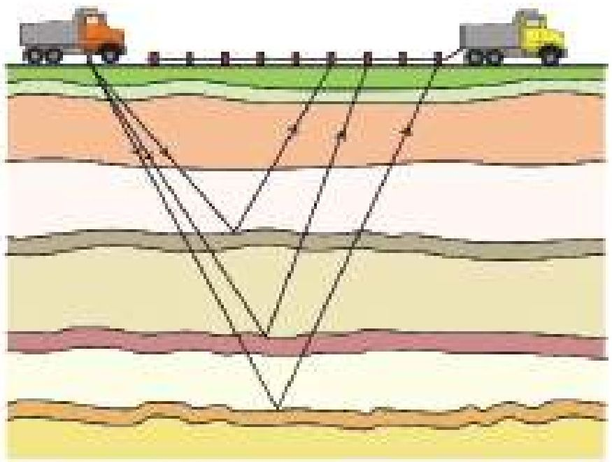

<!-- physics-9-10-bn-c07-t7.3-p041 · figure · p.203 -->
**চিত্র ৭.১৩: শব্দ তরঙ্গো প্রতিফলন থেকে ভূপৃষ্ঠের ভিন্ন ভিন্ন স্তর সম্পর্কে তথ্য জানা যায়।**

### আল্ট্রাসাউন্ড ক্লিনার

<!-- physics-9-10-bn-c07-t7.3-p042 · text · p.204 -->
ল্যাবরেটরিতে যখন ছোটখাটো যন্ত্রপাতি নিখুঁতভাবে পরীক্ষার করতে হয়, তখন আল্ট্রাসাউন্ড ক্লিনার ব্যবহার করা হয়। এখানে কোনো একটি তরলে ছোটখাটো যন্ত্রপাতি ডুবিয়ে রেখে তার ভেতর আল্ট্রাসাউন্ড প্রবাহিত করা হয়, এবং তার কক্ষনে যন্ত্রপাতির সব ময়লা বের হয়ে আসে।

### ৭.৩.৪ সুরযুক্ত শব্দ

<!-- physics-9-10-bn-c07-t7.3-p043 · text · p.204 -->
আমাদের চারপাশে নানা ধরনের শব্দ রয়েছে। তার মাঝে কিছু কিছু শব্দ শুনতে আমাদের ভালো লাগে আবার কিছু কিছু শুনতে আমাদের বিরক্ত লাগে। যে সকল শব্দ শুনতে আমাদের ভালো লাগে তার মাঝে সবচেয়ে প্রধান হচ্ছে বিভিন্ন বাদ্যন্ত্রের শব্দ। ৭.১৪ চিত্রে বেশ কয়েকটি বাদ্যন্ত্রের শব্দের তরঙ্গ দেখানো হয়েছে। তোমরা দেখতেই পছন্দ এর সবগুলোই পর্যাবৃত্ত কম্পন। সুরশলাকা বা টিউনিংফর্ক থেকে নিখুঁত একটি কম্পাঙ্কর শব্দ নির্গত হয়। কিন্তু সুরযুক্ত শব্দে শুধু একটি কম্পাঙ্কের তরঙ্গ থাকে না, একাধিক কম্পাঙ্কের তরঙ্গ পরস্পরের ওপর উপরিপাতিত হয়ে শব্দটাকে সুরেলা করে তোলে।

<!-- physics-9-10-bn-c07-t7.3-p044 · figure · p.204 -->
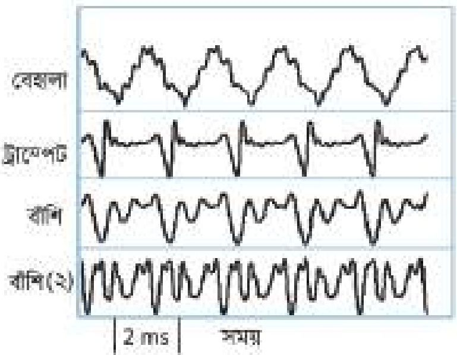

<!-- physics-9-10-bn-c07-t7.3-p045 · figure · p.204 -->
**চিত্র ৭.১৪: ভিন্ন ভিন্ন বাদ্যন্ত্রের শব্দ তরঙ্গ।**

<!-- physics-9-10-bn-c07-t7.3-p046 · text · p.204 -->
সুরেলা শব্দ তৈরি করার জন্য নানা ধরনের বাদ্যন্ত্রের ব্যবহার করা হয়, সেগুলোকে মোটামুটি তিন ভাগে ভাগ করা যায়:

<!-- physics-9-10-bn-c07-t7.3-p047 · text · p.204 -->
তার দিয়ে তৈরি বাদ্যন্ত্র: একতারা, বেহালা, সেতার।
বাতাসের প্রবাহ দিয়ে তৈরি বাদ্যন্ত্র: বাঁশি, হারমোনিয়াম।
আঘাত (Percussion) দিয়ে শব্দ তৈরি করার বাদ্যন্ত্র: ঢোল, তবলা।

<!-- physics-9-10-bn-c07-t7.3-p048 · text · p.204 -->
আজকাল ইলেকট্রনিকস ব্যবহার করে সম্পূর্ণ ভিন্ন উপায়ে সুরেলা শব্দ তৈরি করা হয়।

### ৭.৩.৫ শব্দের দূষণ

<!-- physics-9-10-bn-c07-t7.3-p049 · text · p.205 -->
শব্দ আমাদের জীবনের খুব প্রয়োজনীয় একটি বিষয়, কিন্তু এর বাড়াবাড়ি আমাদের জীবনকে অসহনীয় করে তুলতে পারে। আমরা যারা শহরে থাকি, বিশেষ করে যারা বড় রাস্তার পাশে থাকি তারা নিশ্চয়ই লক্ষ্য করেছি রাস্তায় বাস, গাড়ি, ট্রাকের ইঞ্জিনের শব্দ এবং অনবরত হর্নের শব্দ প্রায়ই সহনশীল সীমার বাইরে চলে যায়। দীর্ঘদিন এই শব্দদূষণে থাকতে থাকতে আমরা অনেক সময় তাতে অভ্যস্ত হয়ে যাই। তখন শব্দদূষণহীন কোনো নিরিবিলি জায়গায় যাওয়ার সৌভাগ্য হলে হঠাৎ করে শব্দদূষণহীন জীবনের গুরুত্ব ধরতে পারি। বিভিন্ন ধরনের শব্দের পরিমাণ ৭.০২ টেবিলে দেখানো হয়েছে।

<!-- physics-9-10-bn-c07-t7.3-p050 · text · p.205 -->
টেবিল ৭.০২: বিভিন্ন ধরনের শব্দের পরিমাণ

<!-- physics-9-10-bn-c07-t7.3-p051 · table · p.205 · review: verify-table -->
<table><tr><td>জেট ইঞ্জিন</td><td>110-140 dB</td></tr>
<tr><td>ট্রাফিক</td><td>80-90 dB</td></tr>
<tr><td>গাড়ি</td><td>60-80 dB</td></tr>
<tr><td>টেলিভিশন</td><td>50-60 dB</td></tr>
<tr><td>কথাবার্তা</td><td>40-60 dB</td></tr>
<tr><td>নিঃশ্বাস</td><td>10 dB</td></tr>
<tr><td>মশার পাখার শব্দ</td><td>0 dB</td></tr></table>

<!-- physics-9-10-bn-c07-t7.3-p052 · text · p.205 -->
এটি বলার অপেক্ষা রাখে না যে শব্দদূষণের কারণে আমাদের শোনার ক্ষমতা অনেকখানি ক্ষতিগ্রস্ত হয়। আমাদের অনেককে অপ্রয়োজনেও কানে হেডফোন লাগিয়ে গান শোনে, যাতে সমস্যাটি আরো জটিল হয়ে যায়।

<!-- physics-9-10-bn-c07-t7.3-p053 · text · p.205 -->
শব্দদূষণ কমানোর জন্য প্রথম প্রয়োজন দেশে এর বিরুদ্ধে আইন তৈরি করা। যেন কেউ শব্দদূষণ সৃষ্টি করতে না পারে এবং করা হলে তার বিরুদ্ধে আইনি ব্যবস্থা নেওয়া যায়। এরপর প্রয়োজন জনসচেতনতা। সবাইকে বিষয়টি বুঝাতে হবে। যথাসম্ভব কম হর্ন ব্যবহার করে চলাচল, কলকারখানায় শব্দ শোষণের যন্ত্র চালু, মাইকের ব্যবহার কমিয়ে দেওয়া কিংবা বন্ধ করে দেওয়া, কম শব্দের যানবাহন ব্যবহার ইত্যাদি। একই সাথে শহরের ফাঁকা জায়গায় প্রচুর গাছ লাগিয়ে শব্দকে শোষণ করার মতো ব্যবস্থাও নেওয়া উচিত।

## 7.ex নমুনা প্রশ্ন

### বহুনির্বাচনি প্রশ্ন

<!-- physics-9-10-bn-c07-t7.ex-p001 · exercise · p.206 -->
সঠিক উত্তরটির পাশে টিক ( √ ) চিহ্ন দাও

<!-- physics-9-10-bn-c07-t7.ex-p002 · exercise · p.206 -->
১. শব্দ কোন ধরনের তরঙ্গ?

<!-- physics-9-10-bn-c07-t7.ex-p003 · exercise · p.206 -->
(ক) অনুপ্রস্তুত তরঙ্গ
(খ) তড়িৎচৌম্বক তরঙ্গ
(গ) অনুদৈর্ঘ্য তরঙ্গ
(ঘ) বেতার তরঙ্গ

<!-- physics-9-10-bn-c07-t7.ex-p004 · exercise · p.206 -->
২. শব্দের বেগ কোন মাধ্যমে সবচেয়ে বেশি।

<!-- physics-9-10-bn-c07-t7.ex-p005 · exercise · p.206 -->
(ক) কাঠিন
(খ) তরল
(গ) গ্যাসীয়
(ঘ) প্লাজমা

<!-- physics-9-10-bn-c07-t7.ex-p006 · exercise · p.206 -->
৩. বৈদ্যুতিক লাইনে মৃত বাদুড় ঝুলে থাকতে দেখা যায় কেন?

<!-- physics-9-10-bn-c07-t7.ex-p007 · exercise · p.206 · review: latin-junk -->
i. বৈদ্যুতিক লাইনের কারণে সূক্ষ্ম তড়িৎক্ষেত্র দ্বারা বাদুড় আকৃষ্ট হওয়ায়।
ii. সামনের দিকের শব্দোত্তর তরঙ্গের প্রতিধ্বনি শুনতে না পাওয়ায়।
iii. বাদুড় একটি তারে ঝুলে অপর তারটি স্পর্শ করায়।

<!-- physics-9-10-bn-c07-t7.ex-p008 · exercise · p.206 -->
নিচের কোন উত্তরটি সঠিক

<!-- physics-9-10-bn-c07-t7.ex-p009 · exercise · p.206 · review: latin-junk -->
(ক) i ও ii
(খ) i ও iii
(গ) ii ও iii
(ঘ) i, ii ও iii

<!-- physics-9-10-bn-c07-t7.ex-p010 · exercise · p.207 · review: known-confusable-corrected,verify-formula -->
৭.১৬ চিত্রে $S$ একটি শব্দ উৎস এবং $AB$ পানির পৃষ্ঠতল। শব্দের বেগ $332  m/s$ ধরে নিয়ে এবং পাশের তথ্য ও চিত্রের ভিত্তিতে ৪ ও ৫ নং প্রশ্নের উত্তর দাও।

<!-- physics-9-10-bn-c07-t7.ex-p011 · exercise · p.207 · review: verify-formula -->
৮. পানির উচ্চতা $h$ এর মান সর্বোচ্চ কত পর্যন্ত প্রতিধ্বনি শোনা যাবে?

<!-- physics-9-10-bn-c07-t7.ex-p012 · exercise · p.207 -->
(ক) 30 m
(খ) 13.40 m
(গ) 10 m
(ঘ) 3.40 cm

<!-- physics-9-10-bn-c07-t7.ex-p013 · figure · p.207 -->
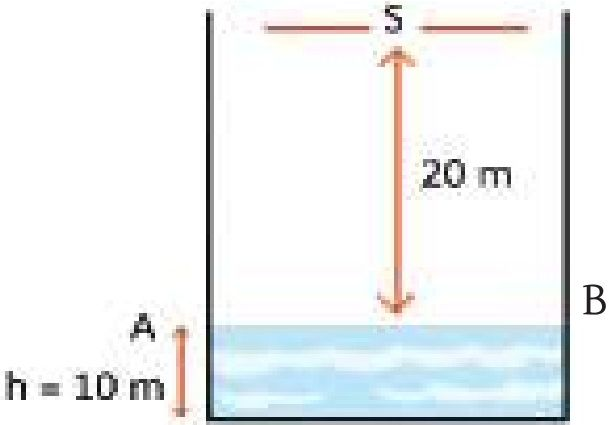

<!-- physics-9-10-bn-c07-t7.ex-p014 · exercise · p.207 -->
৫. প্রদত্ত চিত্রের ক্ষেত্রের প্রতিধ্বনি শুনতে কত সময় প্রয়োজন হবে?

<!-- physics-9-10-bn-c07-t7.ex-p015 · exercise · p.207 -->
(ক) 0.10 s
(খ) 0.12 s
(গ) 0.14 s
(ঘ) 0.18 s

<!-- physics-9-10-bn-c07-t7.ex-p016 · exercise · p.207 -->
**চিত্র: ৭.১৬**

### সৃজনশীল প্রশ্ন

<!-- physics-9-10-bn-c07-t7.ex-p017 · exercise · p.207 · review: known-confusable-corrected,verify-formula -->
১. নাভিদের বাসা থেকে একটি কারখানার দূরত্ব 16.6m। প্রতিনীয়ত কারখানার মেশিনের শব্দ ও ৬ ঘণ্টা পরপর এলামের শব্দ শোনা যায়। এর ফলে প্রায় প্রতিদিনই তাঁর পড়াশোনায় ব্যঘাত ঘটে। ইদানিং সে মাথাব্যথা ও অনিদ্রায় ভুগছে। (বায়ুতে শব্দের বেগ $332  ms^{-1}$)

<!-- physics-9-10-bn-c07-t7.ex-p018 · exercise · p.207 · review: known-confusable-corrected -->
(ক) প্রতিধ্বনি কি?

<!-- physics-9-10-bn-c07-t7.ex-p019 · exercise · p.207 · review: known-confusable-corrected -->
(খ) বায়ু অপেক্ষা পানিতে শব্দের বেগ বেশি কেন? ব্যাখ্যা করো।

<!-- physics-9-10-bn-c07-t7.ex-p020 · exercise · p.207 · review: known-confusable-corrected -->
(গ) কারখানার অ্যালার্মের শব্দ নাভিদের বাসায় পৌঁছাতে কত সময় লাগে নির্ণয় করো।

<!-- physics-9-10-bn-c07-t7.ex-p021 · exercise · p.207 · review: known-confusable-corrected -->
(ঘ) নাভিদের সমস্যার কারণ ও তা সমাধানে সন্তাব্য করণীয় সুপারিশ করো।

<!-- physics-9-10-bn-c07-t7.ex-p022 · exercise · p.208 · review: known-confusable-corrected -->
২. নিচের তথ্য ও ৭.১৭ চিত্রের ভিত্তিতে প্রশ্নগুলোর উত্তর দাও।

<!-- physics-9-10-bn-c07-t7.ex-p023 · figure · p.208 · review: known-confusable-corrected -->
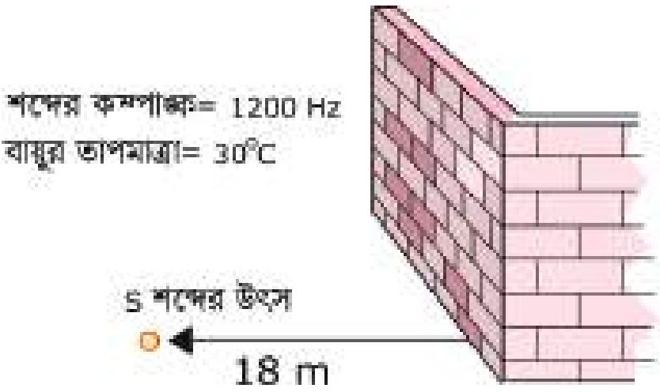

<!-- physics-9-10-bn-c07-t7.ex-p024 · figure · p.208 · review: known-confusable-corrected -->
**চিত্র ৭.১৭**

<!-- physics-9-10-bn-c07-t7.ex-p025 · exercise · p.208 · review: known-confusable-corrected -->
(ক) পর্যায়বৃত্ত গতি কাকে বলে?

<!-- physics-9-10-bn-c07-t7.ex-p026 · exercise · p.208 · review: known-confusable-corrected -->
(খ) পানির ঢেউ অনুপ্রস্থ তরঙ্গ কোন? ব্যাখ্যা করো।

<!-- physics-9-10-bn-c07-t7.ex-p027 · exercise · p.208 · review: known-confusable-corrected -->
(গ) শব্দের তরঙ্গ দৈর্ঘ্য নির্ণয় করো।

<!-- physics-9-10-bn-c07-t7.ex-p028 · exercise · p.208 · review: known-confusable-corrected,verify-formula -->
(ঘ) $S$ অবস্থান থেকে প্রতিধ্বনি শোনা সম্ভব কি? গাণিতিক যুক্তিসহ যাচাই করো।

<!-- physics-9-10-bn-c07-t7.ex-p029 · exercise · p.208 · review: known-confusable-corrected -->
৩. শীতের সকালে ফারহান তার স্কুলের মাঠের একটি দেয়াল থেকে 17.25m দূরে দাঁড়িয়ে চিৎকার করলে তার প্রতিধ্বনি শুনতে পায়। কিন্তু একই স্থানে গরমের একদিনে চিৎকার করে সে প্রতিধ্বনি শুনতে পেল না। [0°C তাপমাত্রায় বায়ুতে শব্দের বেগ 332 ms-1, শীতের দিনের তাপমাত্রা 10°C, গরমের দিনের তাপমাত্রা 30°C]

<!-- physics-9-10-bn-c07-t7.ex-p030 · exercise · p.208 · review: known-confusable-corrected -->
(ক) পর্যায়কাল কি?

<!-- physics-9-10-bn-c07-t7.ex-p031 · exercise · p.208 · review: known-confusable-corrected -->
(খ) শব্দ একটি যান্ত্রিক তরঙ্গ-ব্যাখ্যা করো।

<!-- physics-9-10-bn-c07-t7.ex-p032 · exercise · p.208 · review: known-confusable-corrected -->
(গ) উদ্দীপক অনুসারে গরমের দিনে শব্দের বেগ কত?

<!-- physics-9-10-bn-c07-t7.ex-p033 · exercise · p.208 · review: known-confusable-corrected -->
(ঘ) উদ্দীপকে একই স্থান থেকেও প্রতিধ্বনি শোনা বা না শোনার কারণ বিশ্লেষণ করো।

### সংক্ষিপ্ত উত্তর প্রশ্ন

<!-- physics-9-10-bn-c07-t7.ex-p034 · exercise · p.209 · review: known-confusable-corrected -->
১. অনুদৈর্ঘ্য ও অনুপ্রস্তু তরঙ্গের মধ্যে দুইটি পার্থক্য লিখ।

<!-- physics-9-10-bn-c07-t7.ex-p035 · exercise · p.209 -->
২. সরল দোলকের গতি কোন ধরনের গতি ব্যাখ্যা করো।

<!-- physics-9-10-bn-c07-t7.ex-p036 · exercise · p.209 -->
৩. শব্দের প্রতিফলনের জন্য প্রতিফলক বড় হওয়া প্রয়োজন কেন?

<!-- physics-9-10-bn-c07-t7.ex-p037 · exercise · p.209 · review: known-confusable-corrected -->
৪. ধানের ক্ষেতে বাতাসের দোলন কোন ধরনের তরঙ্গ- ব্যাখ্যা করো।
