# 8. আলোর প্রতিফলন

Source: Physics Bangla Version, printed pp. 210-240

## 8.0 ভূমিকা ও শিখনফল

<!-- physics-9-10-bn-c08-t8.0-p001 · figure · p.210 -->

<!-- physics-9-10-bn-c08-t8.0-p002 · text · p.210 -->
চারপাশের যা কিছু আছে সেগুলো থেকে যখন আলো প্রতিফলিত হয়ে আমাদের চোখে এসে পড়ে, আমরা তখন সেগুলো দেখতে পাই। আগের অধ্যায়ে শব্দকে তরঙ্গ হিসেবে জেনেছি। এই অধ্যায়ে আমরা আলোকে তরঙ্গ হিসেবে জানব, তবে সেটি হবে সম্পূর্ণ ভিন্ন এক ধরনের তরঙ্গ যার নাম বিদ্যুৎ চৌম্বকীয় তরঙ্গ।

<!-- physics-9-10-bn-c08-t8.0-p003 · text · p.210 -->
আলো যখন সমতল আয়নায় প্রতিফলিত হয়, তখন সেটি প্রতিবিম্ব তৈরি করে। আমরা সবাই প্রতিবিম্বের সাথে পরিচিত। আয়না সমতল না হয়ে গোলাকৃতিরও হয়। তখন সেটি যে প্রতিবিম্ব তৈরি করবে সেটি হবে অন্যরকম। এই অধ্যায়ে আমরা নানা ধরনের আয়নার নানা ধরনের প্রতিবিম্বের বিষয়গুলোও আলোচনা করব।

### এ অধ্যায় শেষে আমরা –

<!-- physics-9-10-bn-c08-t8.0-p004 · objective · p.211 -->
* আলোর প্রকৃতি ব্যাখ্যা করতে পারব।
* আলোর প্রতিফলনের সূত্র ব্যাখ্যা করতে পারব।
* দর্পণ ব্যাখ্যা করতে পারব।
* প্রতিবিম্ব ব্যাখ্যা করতে পারব।
* আলোক রশ্মির ক্রিয়ারেখা অঙ্কন করে দর্পণে সৃষ্ট প্রতিবিম্ব ব্যাখ্যা করতে পারব।
* দর্পণে প্রতিবিম্ব সৃষ্টির কিছু সাধারণ ঘটনা ব্যাখ্যা করতে পারব।
* দর্পণের ব্যবহার ব্যাখ্যা করতে পারব।
* বিবর্ধন ব্যাখ্যা করতে পারব।
* প্রতিবিম্ব সৃষ্টি প্রদর্শন করতে পারব।
* আমাদের জীবনে বিভিন্ন আলোকীয় ঘটনার প্রভাব এবং এদের অবদান উপলব্ধি করতে পারব এবং প্রশংসা করতে পারব।

## 8.1 আলোর প্রকৃতি (Nature of Light)

<!-- physics-9-10-bn-c08-t8.1-p001 · text · p.212 -->
আমরা আলোর কারণে দেখতে পাই। আমরা চোখে গাছপালা দেখি, আকাশ দেখি, চেয়ার-টেবিল দেখি, মানুষ দেখি, তার মানে এই নয় যে গাছপালা, আকাশ, চেয়ার-টেবিল কিংবা মানুষ হচ্ছে আলো। এগুলো থেকে আলো প্রতিফলিত হয়ে সেই আলোটা আমাদের চোখে পড়ে, চোখের রেটিনা থেকে

<!-- physics-9-10-bn-c08-t8.1-p002 · figure · p.212 -->
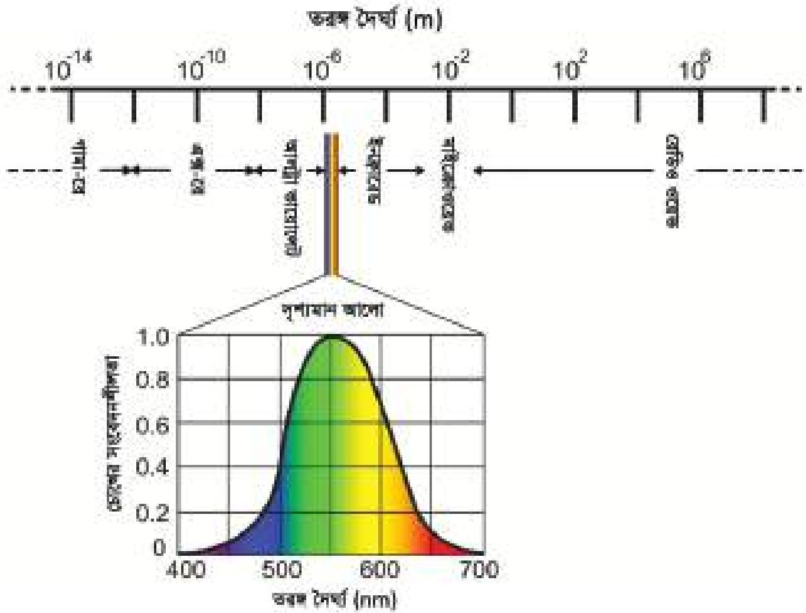

<!-- physics-9-10-bn-c08-t8.1-p003 · figure · p.212 -->
**চিত্র ৮.০১: আলোর স্পেকট্রাম এবং ভিন্ন ভিন্ন রংয়ে চোখের সংবেদনশীলতা।**

<!-- physics-9-10-bn-c08-t8.1-p004 · text · p.212 -->
সেই আলো দিয়ে তৈরি সংকেত আমাদের মস্তিষ্কে পৌঁছায় আর আমাদের মস্তিষ্ক বুঝতে পারে কোনটা গাছপালা কিংবা কোনটা মানুষ। পুরো ব্যাপারটা শুরু হয় চোখের মাঝে আলো ঢোকা থেকে।

<!-- physics-9-10-bn-c08-t8.1-p005 · text · p.212 · review: verify-formula -->
আলো হচ্ছে বিদ্যুৎ চৌম্বকীয় তরঙ্গ। এটি পর্যাবৃত্ত তরঙ্গও বটে। সকল পর্যাবৃত্ত তরঙ্গের একটা তরঙ্গদৈর্ঘ্য থাকে তার মানে আলোরও তরঙ্গদৈর্ঘ্য আছে। আমরা যারা পুকুরে ডিল ছুড়ে কিংবা একটা দড়িতে ঝাঁকুনি দিয়ে তরঙ্গ তৈরি করেছি, তারা জানি যে ইচ্ছে করলেই ছোট-বড় তরঙ্গদৈর্ঘ্যের তরঙ্গ তৈরি করা যায়, তাই আলোরও নানা তরঙ্গদৈর্ঘ্য থাকতে পারে। কথাটা সঠিক, বিদ্যুৎ চৌম্বকীয় তরঙ্গের দৈর্ঘ্য যা কিছু হতে পারে। সেটা কয়েক কিলোমিটার থেকেও বেশি হতে পারে, আবার এক মিটারের ট্রিলিয়ন ট্রিলিয়ন ভাগের এক ভাগও হতে পারে ($1$ ট্রিলিয়ন $=10^{12}$)। যে বিষয়টা আমাদের ভালো করে জানা দরকার, সেটি হচ্ছে এই সস্নায় বিশাল তরঙ্গদৈর্ঘ্যের ছোট একটা অংশের আলো আমরা দেখতে পাই। তরঙ্গদৈর্ঘ্য এর থেকে বেশি হলেও আমরা দেখতে পাই না, আবার এর থেকে ছোট হলেও আমরা আলো দেখতে পাই না। তরঙ্গদৈর্ঘ্য 400 nm থেকে 700 nmএর ভেতর হলে আমরা বিদুৎ চৌম্বকীয় তরঙ্গ দেখতে পাই এবং সেটাকে আমরা বলি আলো। আমরা যে চোখে নানা রং দেখতে পাই, সেগুলোও আসলে বিভিন্ন তরঙ্গদৈর্ঘ্যের আলো। তরঙ্গদৈর্ঘ্য যখন ছোট হয় সেটা হয় বেগুনি। যখন তরঙ্গদৈর্ঘ্য বাড়তে থাকে, তখন সেটা নীল সবুজ হলুদ কমলা লাল হয়ে চোখের কাছে অদৃশ্য হয়ে যায়। মানুষের চোখ এই ব্যাপ্তির বাইরে তরঙ্গদৈর্ঘ্যের আলো দেখতে পায় না, কিন্তু পোকামাকড় বা অন্য অনেক প্রাণী এর বাইরেও দেখতে পায়। বিভিন্ন আলোতে মানুষের চোখের সংবেদনশীলতা ৮.০১ চিত্রে দেখানো হয়েছে।

### নিজে করো

<!-- physics-9-10-bn-c08-t8.1-p006 · activity · p.213 -->
তোমরা নিশ্চয়ই কম্পিউটারে কিংবা সিডি প্লেয়ারে ব্যবহার করার সিডি দেখেছ। এরকম একটি সিডি সূর্যের আলোতে ধরে আলোটিকে কাছাকাছি দেয়ালে প্রতিফলিত করো। তুমি সেখানে সূর্যের আলোর পুরো বর্ণালী দেখতে পারবে। সিডিতে আসলে খুবই সূক্ষ্ম খাঁজ কাটা থাকে, এই খাঁজগুলো গ্রেটিং হিসেবে কাজ করে, যেটি বিভিন্ন রঙের আলোতে বিভক্ত করে দেয়।

<!-- physics-9-10-bn-c08-t8.1-p007 · activity · p.213 -->
৮.০১ চিত্রে আলোর বিভিন্ন তরঙ্গদৈর্ঘ্যের নাম দেখানো হয়েছে। তরঙ্গদৈর্ঘ্য যদি দৃশ্যমান আলোর সবচেয়ে ছোট তরঙ্গদৈর্ঘ্য থেকেও ছোট হয়, সেই আলোকে আমরা বলি আল্ট্রা ভায়োলেট বা অতিবেগুনি আলো। আরো ছোট হলে এক্স-রে, আরো ছোট হলে গামা রে—যেটা তেজস্ক্রিয় নিউক্লিয়াস থেকে বের হয়। আবার তরঙ্গদৈর্ঘ্য যদি দৃশ্যমান আলোর সবচেয়ে বড় তরঙ্গদৈর্ঘ্য থেকেও বড় হয়, সেই আলোকে আমরা বলি ইনফ্রারেড বা অবলোহিত আলো; আরো বড় হলে মাইক্রোওয়েভ, আরো বড় হলে রেডিও ওয়েভ। পদার্থবিজ্ঞান শিখতে হলে যে বিষয়গুলো জানতে হয়, বিদুৎ চৌম্বকীয় তরঙ্গের এই বিভাজনটি হচ্ছে তার মধ্যে একটি অতি গুরুত্বপূর্ণ একটা বিষয়।

<!-- physics-9-10-bn-c08-t8.1-p008 · activity · p.213 -->
ইনফ্রারেড আলোর তরঙ্গ দৈর্ঘ্য বেশি বলে আমরা খালি চোখে দেখতে পাই না। টেলিভিশনের রিমোট কন্ট্রোল করার ইউনিট থেকে ইনফ্রারেড আলো বের হয় বলে আমরা সেখান থেকে আলো বের হতে দেখি না। এটিকে মোবাইলের ক্যামেরা দিয়ে দেখতে পারো কারণ মোবাইলের ক্যামেরায় ছবি তোলার জন্য সিসিডি নামে যে আলোক সংবেদনশীল যন্ত্রাংশ ব্যবহার করা হয় সেগুলো দৃশ্যমান আলোর সাথে সাথে খানিকটা ইনফ্রারেড আলো দেখতে পায়।

<!-- physics-9-10-bn-c08-t8.1-p009 · text · p.214 -->
তোমরা দেখতেই পাচ্ছ আমরা আমাদের চোখে যে আলো দেখতে পাই তার তরঙ্গদৈর্ঘ্য খুবই ছোট কিন্তু পদার্থবিজ্ঞানের অনেক চমকপ্রদ পরীক্ষা আছে, যেগুলো দিয়ে আমরা এই তরঙ্গের নানা চমকপ্রদ বৈশিষ্ট্য দেখতে পারি।

<!-- physics-9-10-bn-c08-t8.1-p010 · text · p.214 -->
আলো সম্পর্কে আমরা যদি জানতে চাই তাহলে শুরু করতে পারি প্রতিফলন দিয়ে।

## 8.2 প্রতিফলন (Reflection)

<!-- physics-9-10-bn-c08-t8.2-p001 · text · p.214 -->
প্রতিফলন কথাটা বলতেই আমাদের প্রায় সবার চোখেই আয়নার সামনে দাঁড়িয়ে থাকার চিত্রটা ভেসে ওঠে কিন্তু মনে রাখতে হবে প্রতিফলন বিষয়টা আরো অনেক ব্যাপক। যখনই এক মাধ্যম থেকে অন্য মাধ্যমে আলোকে পাঠানো হয়, তখনই আসলে তিনটি ভিন্ন ভিন্ন ঘটনা ঘটে, তার একটি হচ্ছে প্রতিফলন। অন্য দুটি হচ্ছে প্রতিসরণ আর শোষণ। (চিত্র ৮.০২)

<!-- physics-9-10-bn-c08-t8.2-p002 · figure · p.214 · review: latin-junk -->
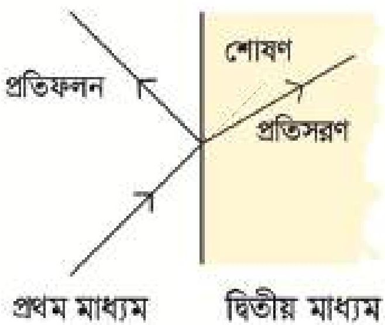

<!-- physics-9-10-bn-c08-t8.2-p003 · figure · p.214 -->
**চিত্র ৮.০২: এক মাধ্যম থেকে অন্য মাধ্যমে আলোর প্রতিফলন, প্রতিসরণ ও শোষণ।**

<!-- physics-9-10-bn-c08-t8.2-p004 · text · p.214 -->
প্রথম মাধ্যম থেকে দ্বিতীয় মাধ্যমে যাবার সময় খানিকটা আলো আবার প্রথম মাধ্যমেই ফিরে আসে এই ঘটনার নাম হচ্ছে প্রতিফলন। খানিকটা আলো দ্বিতীয় মাধ্যমে ঢুকে যেতে পারে। এই ঘটনাটি হচ্ছে প্রতিসরণ। আবার খানিকটা আলো দুই মাধ্যমের মধ্যের তলে শোষিত হয়ে যায়। এই ঘটনার নাম হচ্ছে শোষণ। এই অধ্যায়ে আমরা প্রতিফলন এবং পরের অধ্যায়ে প্রতিসরণ নিয়ে আলোচনা করব।

<!-- physics-9-10-bn-c08-t8.2-p005 · text · p.214 -->
আগেই বলা হয়েছে আলো এক ধরনের তরঙ্গ। সাধারণভাবে তরঙ্গের যাওয়ার জন্য মাধ্যমের প্রয়োজন হয় (পানি না থাকলে পানির ঢেউটা হবে কোথায়?) কিন্তু আলোর বিষয়টা সম্পূর্ণ ভিন্ন। এটা যেহেতু বিদুৎ এবং চৌম্বক ক্ষেত্রের তরঙ্গ, তাই এটা যাওয়ার কোনো মাধ্যমের দরকার নেই। আলো তার বিদুৎ আর চৌম্বক ক্ষেত্র দুটির তরঙ্গ তৈরি করে নিজেই চলে যেতে পারে। কাজেই প্রতিফলন বা প্রতিসরণ ব্যাখ্যা করার জন্য যখন প্রথম এবং দ্বিতীয় মাধ্যমের কথা বলা হয়েছে, তখন একটি মাধ্যম আসলে শূন্য মাধ্যমও হতে পারে। সত্যি কথা বলতে কি আমাদের দৈনন্দিন জীবনে আমরা কাচ বা পানিতে আলোর প্রতিফলন এবং প্রতিসরণের যে উদাহরণগুলো দেখি সেখানে একটা মাধ্যম বাতাস অন্যটি কাচ (কিংবা পানি)। বাতাস এত হালকা মাধ্যম যে আলোর সঞ্চালনের ক্ষেত্রে সেটাকে শূন্য মাধ্যম ধরে নিলে এমন কিছু বড় ভুল হয় না।

### ৮.২.১ প্রতিফলনের সূত্র

<!-- physics-9-10-bn-c08-t8.2-p006 · text · p.215 -->
প্রতিফলনের সূত্র বোঝার আগে আমাদের কয়েকটা বিষয়কে সংজ্ঞায়িত করে নেওয়া দরকার। যখন এক মাধ্যম থেকে অন্য মাধ্যমে আলো এসে পড়ে, আমরা আপাতত ধরে নিই সেটি হচ্ছে একটা সমতল। বিষয়টি বোঝার জন্য আমরা ধরে নিই যে আলোটা প্রতিফলিত হবে, সেটা একটা আলোক রেখা বা আলোক রশ্মি। যখন একটা আলোক রশ্মি এক মাধ্যম থেকে অন্য মাধ্যমের ওপর একটা বিন্দুতে এসে পড়ে প্রথমেই সেই বিন্দু থেকে একটা লক্ষ কল্পনা করে নিতে হবে। যে আলোক রশ্মিটি এসে সেই বিন্দুটিতে পড়েছে এবং যে লক্ষটি কল্পনা করেছ সেই দুটি রেখাকে নিয়ে একটি সমতল কল্পনা করে নাও। (চিত্র ৮.০৩)

<!-- physics-9-10-bn-c08-t8.2-p007 · text · p.215 · review: verify-formula -->
যে রশ্মিটি প্রথম মাধ্যম থেকে দ্বিতীয় মাধ্যমে ঢোকার জন্য একটা বিন্দুতে আপতিত হয়েছে আমরা সেটাকে বলব, আপতন রশ্মি (XO)। যে রশ্মিটি প্রতিফলিত হয়েছে (OX') সেটা হচ্ছে প্রতিফলিত রশ্মি (বোঝাই যাচ্ছে যেটা দ্বিতীয় মাধ্যমে ঢুকে যাবে সেটা প্রতিসরিত রশ্মি—এই অধ্যায়ে সেটা নিয়ে আমরা আলোচনা করব না।) আপতিত রশ্মি আপতন বিন্দুতে মাধ্যমের উপর অভিলক্ষের সাথে যে কোণ করবে, সেটাকে বলব আপতন কোণ ($\theta_i$), প্রতিফলিত রশ্মি অভিলক্ষের সাথে যে কোণ ($\theta_r$) করবে, সেটাকে বলব প্রতিফলন কোণ। এখন আমরা প্রতিফলনের সূত্র দুটি বলতে পারি:

<!-- physics-9-10-bn-c08-t8.2-p008 · figure · p.215 -->
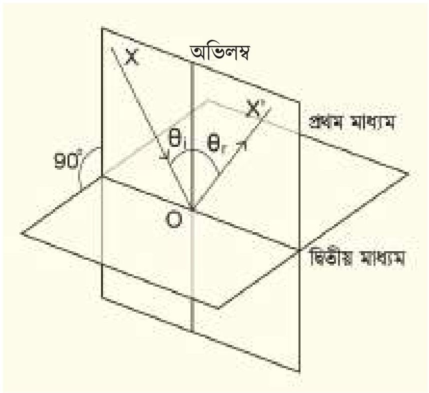

<!-- physics-9-10-bn-c08-t8.2-p009 · figure · p.215 -->
**চিত্র ৮.০৩: প্রথম মাধ্যম থেকে দ্বিতীয় মাধ্যমে আলোর প্রতিফলন।**

<!-- physics-9-10-bn-c08-t8.2-p010 · text · p.215 -->
**প্রথম সূত্র:** আপতন রশ্মি এবং লক্ষ দিয়ে আমরা যে সমতলটি কল্পনা করে নিয়েছিলাম প্রতিফলিত রশ্মিটি সেই সমতলেই থাকবে।

<!-- physics-9-10-bn-c08-t8.2-p011 · text · p.215 -->
**দ্বিতীয় সূত্র:** প্রতিফলন কোণটি হবে আপতন কোণের সমান।

### উদাহরণ

<!-- physics-9-10-bn-c08-t8.2-p012 · example · p.215 -->
**প্রশ্ন:** ৮.০৪ চিত্রে দেখানো অবস্থায় দুটি আয়না M1 এবং M2 রাখা আছে। মাঝখানে x বিন্দুতে একটি মোমবাতি রাখা হয়েছে। মোমবাতির প্রতিবিম্ব কোথায় হবে?

<!-- physics-9-10-bn-c08-t8.2-p013 · text · p.216 -->
উত্তর: আয়নায় প্রতিবিম্ব দেখা যাবে। সেই প্রতিবিম্বের প্রতিবিম্বটিও আয়না দুটিতে দেখা যাবে, এভাবে চলতেই থাকবে। কাজেই ৮.০৪ চিত্রে যেভাবে দেখানো হয়েছে, সেভাবে অসংখ্য প্রতিবিম্ব দেখা যাবে।

<!-- physics-9-10-bn-c08-t8.2-p014 · figure · p.216 -->
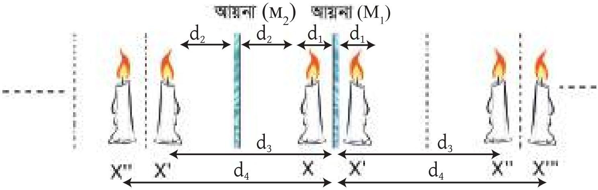

<!-- physics-9-10-bn-c08-t8.2-p015 · figure · p.216 · review: verify-formula -->
**চিত্র ৮.০৪:** দুটি সমান্তরাল আয়নার মাঝখানে একটি মোমবাতি $x$ রাখা হলে তার প্রতিবিম্ব $x'$ এবং $x'$ প্রতিবিম্বের প্রতিবিম্ব $x''$, $x'''$ ... তৈরি হতে থাকে।

### আয়নাতে ডান-বাম উল্টে যায়, ওপর-নিচ উল্টায় না কেন?

<!-- physics-9-10-bn-c08-t8.2-p016 · text · p.216 -->
প্রতিফলনের দুটি সূত্র বলা হলেই প্রতিফলন নিয়ে সবকিছু বলা হয়ে যায় না, সত্যি কথা বলতে কি প্রতিফলনের সবচেয়ে গুরুত্বপূর্ণ বিষয়টাই বলা হয়নি, কতটুকু প্রতিফলন হবে? প্রতিফলনের জন্য যদি আয়না ব্যবহার করা হয় তাহলে প্রায় পুরোটাই প্রতিফলিত হয়, কিন্তু প্রতিফলন কথ্যটি তো শুধু আয়নার জন্য তৈরি করা হয়নি—এটা তো যেকোনো দুটো মাধ্যমের মাঝে হতে পারে। কতটুকু প্রতিফলন হবে সেটার জন্য সূত্রটির নাম ফ্রেনেলের (Fresnel) সূত্র। সূত্রটা তোমরা আরেকটু বড় হয়ে শিখবে, এখন মূল বিষয়টা শুধু জেনে রাখো—আপাতন কোণ যত বেশি হবে প্রতিফলনও হবে তত বেশি (চিত্র ৮.০৫)। তোমরা দেখেছ সাধারণ এক টুকরো কাচে প্রতিফলন হয় কম, মাত্র ৪% থেকে ৫%, বাকিটা ভেতরে দিয়ে প্রতিসরিত হয়ে যায়। কিন্তু প্রতিফলন কোণ যদি বেশি হয় ৪০° কিংবা ৯০° এর কাছাকাছি, তাহলে প্রতিফলিত আলো অনেক বেশি বেড়ে যায়। জানালার কাচের পাশে দাঁড়িয়ে তোমরা এখনই সেটা পরীক্ষা করে দেখতে পারো।

<!-- physics-9-10-bn-c08-t8.2-p017 · figure · p.216 · review: verify-formula -->
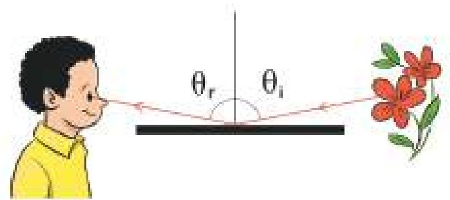

<!-- physics-9-10-bn-c08-t8.2-p018 · figure · p.216 -->
**চিত্র ৮.০৫:** আপাতন কোণ বেশি হলে প্রতিফলন অনেক বেশি হয়।

### শোষণ

<!-- physics-9-10-bn-c08-t8.2-p019 · text · p.217 -->
আমাদের চারপাশের জগতের সৌন্দর্যের বড় একটা অংশ আসে বিভিন্ন রং থেকে। কিন্তু রংটি আসে কেমন করে? আমরা যখন সবুজ পাতার মাঝে একটা লাল গোলাপ ফুল দেখি, সেটি কোন লাল কিংবা তার পাতাটি কোন সবুজ? বিষয়টা আরো বিস্ময়কর মনে হতে পারে যখন তোমরা দেখবে সবুজ আলোতে লাল ফুলটাকেই দেখাবে কুচকুচে কালো কিংবা লাল আলোতে সবুজ পাতাকে দেখাবে কুচকুচে কালো।

<!-- physics-9-10-bn-c08-t8.2-p020 · text · p.217 -->
বিষয়টা আসলে সহজ, সাধারণ দৃশ্যমান আলোতে(অনেক সময় বলে সাদা আলো), আসলে দৃশ্যমান সীমার মধ্যের সব তরঙ্গদৈর্ঘ্যই আলো থাকে, রং যেহেতু তরঙ্গদৈর্ঘ্যের ওপর নির্ভর করে, তাই বলা যেতে পারে সেখানে সব রঙের আলো রয়েছে। যখন সবগুলো রং থাকে তখন সেখানে আলাদভাবে কোনো রং দেখা যায় না—তখন আলোটাকে আমরা বলি বর্ণহীন কিংবা সাদা আলো। এই আলোটা যখন একটা লাল গোলাপ ফুলে পড়ে, তখন গোলাপ ফুলটা লাল রং ছাড়া অন্য সবগুলো রং শোষণ করে নেয়। তাই যে আলোটা প্রতিফলিত হয়ে আমাদের চোখে পড়ে, সেখানে লাল ছাড়া আর কোনো রং থাকে না এবং গোলাপ ফুলটাকে মনে হয় লাল। ঠিক সে রকম সবুজ পাতাটাতে সব রং এসে পড়ে এবং পাতাটা সবুজ ছাড়া অন্য সব রং শোষণ করে নেয়। তখন যে রং প্রতিফলিত, হয় সেটাতে সবুজ ছাড়া অন্য কোনো রঙের আলো থাকে না বলে পাতাটাকে দেখায় সবুজ। (চিত্র ৮.০৬)

<!-- physics-9-10-bn-c08-t8.2-p021 · figure · p.217 · review: latin-junk -->
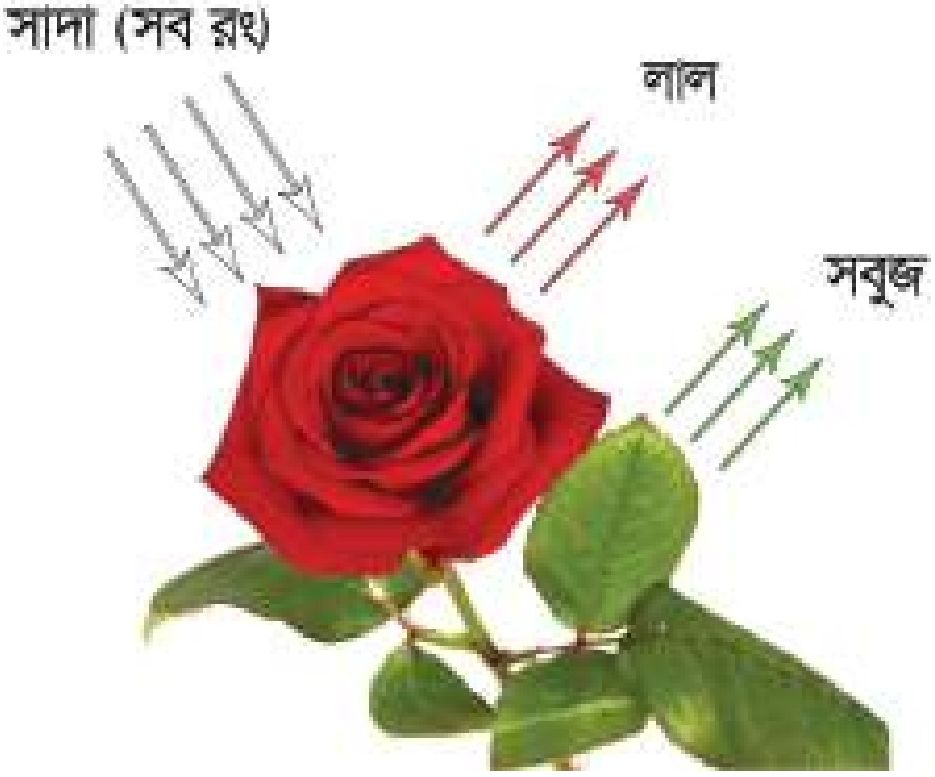

<!-- physics-9-10-bn-c08-t8.2-p022 · figure · p.217 -->
**চিত্র ৮.০৬: একটা বস্তু সব রং শোষণ করে যেটা প্রতিফলিত করে সেটাকেই তার রং বলে মনে হয়।**

<!-- physics-9-10-bn-c08-t8.2-p023 · text · p.217 -->
যদি সম্পূর্ণ লাল আলোতে এই গোলাপ ফুল এবং পাতাটাকে দেখা হতো তাহলে ফুলটাকে ঠিকই লাল দেখা যেত কারণ এটা লাল রং শোষণ করে না কিন্তু পাতাটাকে তার সঠিক রঙে না দেখিয়ে দেখাবে কালো। কারণ পাতাটা লাল রংকে শোষণ করে ফেলবে এবং কোনো রঙের আলো প্রতিফলিত করবে না। ঠিক একই কারণে সবুজ আলোতে পাতাটা সবুজ দেখালেও সেই রঙের আলো গোলাপ ফুল পুরোপুরি শোষণ করে নেবে বলে গোলাপ ফুল থেকে প্রতিফলিত হওয়ার মতো কোনো রঙের আলো থাকবে না বলে সেটাকে দেখাবে কালো।

### ৮.২.২ মসৃণ এবং অমসৃণ পৃষ্ঠে প্রতিফলন

<!-- physics-9-10-bn-c08-t8.2-p024 · text · p.218 -->
আয়না কিংবা আয়নার মতো মসৃণ পৃষ্ঠে আলোর সমান্তরাল রশ্মিগুলো প্রতিফলনের পরেও সমান্তরাল থাকে, কারণ প্রত্যেকটা রশ্মিই প্রতিফলনের সূত্র মেনে আপাতন কোণের সমান প্রতিফলন কোণে প্রতিফলিত হয়। পৃষ্ঠটি যদি মসৃণ না হয় তাহলেও প্রত্যেকটা রশ্মিই প্রতিফলনের সূত্র মেনে চলে কিন্তু একেক অংশের পৃষ্ঠ একেক কোণে থাকে বলে প্রতিফলনের পর আলোক রশ্মিগুলো ভিন্ন ভিন্ন কোণে প্রতিফলিত হয়। তখন প্রতিফলনের পর আর আলোক রশ্মিগুলো সমান্তরাল না থেকে চারদিকে ছড়িয়ে পড়ে। (চিত্র ৮.০৭) এ ধরনের প্রতিফলনকে অনেক সময় ব্যাপ্ত প্রতিফলন বলা হয়।

<!-- physics-9-10-bn-c08-t8.2-p025 · figure · p.218 -->
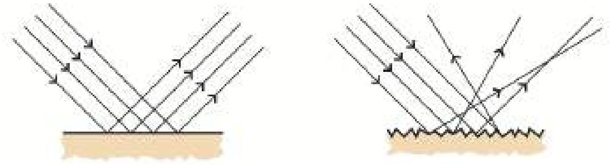

<!-- physics-9-10-bn-c08-t8.2-p026 · figure · p.218 -->
**চিত্র ৮.০৭: মসৃণ পৃষ্ঠে আলো প্রতিফলিত হয় কিন্তু অমসৃণ পৃষ্ঠে আলো বিচ্ছুরিত হয়।**

## 8.3 আয়না বা দর্পণ (Mirror)

<!-- physics-9-10-bn-c08-t8.3-p001 · text · p.218 -->
আমরা সবাই আয়না (দর্পণ) দেখেছি। আয়নায় নিয়মিত প্রতিফলনের কারণে স্পষ্ট প্রতিবিম্বের তৈরি হয়। আয়না তৈরি করার জন্য কাচের পেছনে প্রতিফলনের উপযোগী ধাতুর প্রলেপ দেওয়া হয়। কাচের সামনের পৃষ্ঠ থেকে ৪% আলো প্রতিফলিত হলেও পেছনের পৃষ্ঠ থেকে প্রায় পুরো আলোই প্রতিফলিত হয় বলে সেটি মূল প্রতিবিম্বটি তৈরি করে। টেলিস্কোপ বা অন্য অপটিক্যাল (Optical) যন্ত্রে যখন মূল প্রতিবিম্বটি খুব গুরুত্বপূর্ণ হয় তখন কাচের উপরেই রুপা বা অ্যালুমিনিয়ামের প্রলেপ দেওয়া হয় যেন একটি ৪% হালকা আরেকটি ৯৬% স্পষ্ট, এ রকম দুটি প্রতিবিম্ব তৈরি না হয়ে একটা ১০০% স্পষ্ট প্রতিবিম্ব তৈরি হয়।

<!-- physics-9-10-bn-c08-t8.3-p002 · figure · p.218 -->
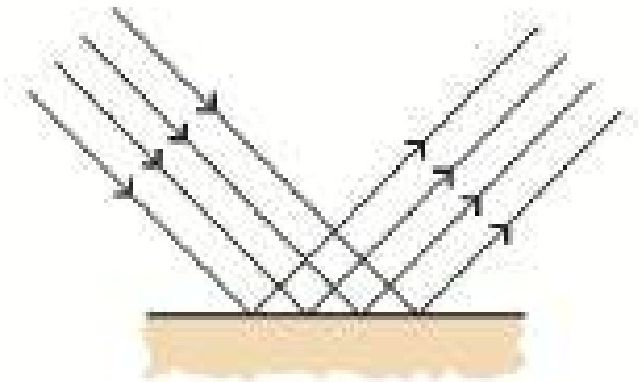

<!-- physics-9-10-bn-c08-t8.3-p003 · figure · p.218 · review: known-confusable-corrected -->
**চিত্র ৮.০৮: X বস্তুটির প্রতিবিম্ব X'**
**অবস্থানে দেখা যাবে।**

### ৮.৩.১ প্রতিবিষ্টি

<!-- physics-9-10-bn-c08-t8.3-p004 · text · p.219 · review: known-confusable-corrected,verify-formula -->
তুমি যখন আয়নার সামনে দাঁড়াও তখন তুমি নিজের প্রতিবিষ্টি দেখতে পাও। তুমি আয়নার যতটুকু সামনে আছে, তোমার মনে হবে প্রতিবিষ্টি বুঝি ঠিক ততটুকু পেছনে আছে। ৮.০৮ চিত্রে দেখানো হয়েছে $X$ হচ্ছে একটি বস্তুর সেখান থেকে তিনটি রশ্মি $AB$ আয়নায় প্রতিফলিত হয়েছে (অর্থাৎ আপাতন কোণ = প্রতিফলিত কোণ)। প্রতিফলিত রশ্মিগুলোকে আমরা যদি আয়নার পেছনে বাড়িয়ে দিই তাহলে মনে হবে সবগুলো $X'$ এক বিন্দুতে কেন্দ্রীভূত হয়েছে। এই বিন্দুটিই হচ্ছে $X$ বস্তুটির প্রতিবিষ্টি। সত্যিকার বস্তুরে একটা বিন্দু না থেকে অনেকগুলো বিন্দু থাকে এবং প্রতিটা বিন্দুর একটা করে প্রতিবিষ্টি হয়ে পুরো বস্তুটির প্রতিবিষ্টি তৈরি হয়।

<!-- physics-9-10-bn-c08-t8.3-p005 · text · p.219 · review: known-confusable-corrected,verify-formula -->
আমরা যদি জ্যামিতি ব্যবহার করে প্রতিবিষ্টির অবস্থান দেখাতে চাই তাহলে কমপক্ষে দুটি রশ্মি আঁকতে হবে। চিত্রটা আঁকা অনেক সহজ হয় যদি আমরা সোজা লম্বভাবে যাওয়া রশ্মিটিকে ($XP$) একটি রশ্মি হিসেবে নিই এবং চিত্র যেভাবে দেখানো হয়েছে সেভাবে তার সাথে অন্য যেকোনো একটা রশ্মিকে ($XO$) নিই। $OPX$ এবং $OPX'$ ত্রিভুজ দুটি সর্বসম। অর্থাৎ $XP = X'P$ তার মানে $X$ বিন্দুর $X'$ প্রতিবিষ্টি আয়না থেকে বস্তুটির সমান দূরত্বে তৈরি হয়েছে।

### উদাহরণ

<!-- physics-9-10-bn-c08-t8.3-p006 · example · p.219 · review: verify-formula -->
**প্রশ্ন:** চিত্র ৮.০৯ এ দেখাও $OPX$ এবং $OPX'$ ত্রিভুজ দুটি সর্বসম।

<!-- physics-9-10-bn-c08-t8.3-p007 · figure · p.219 -->
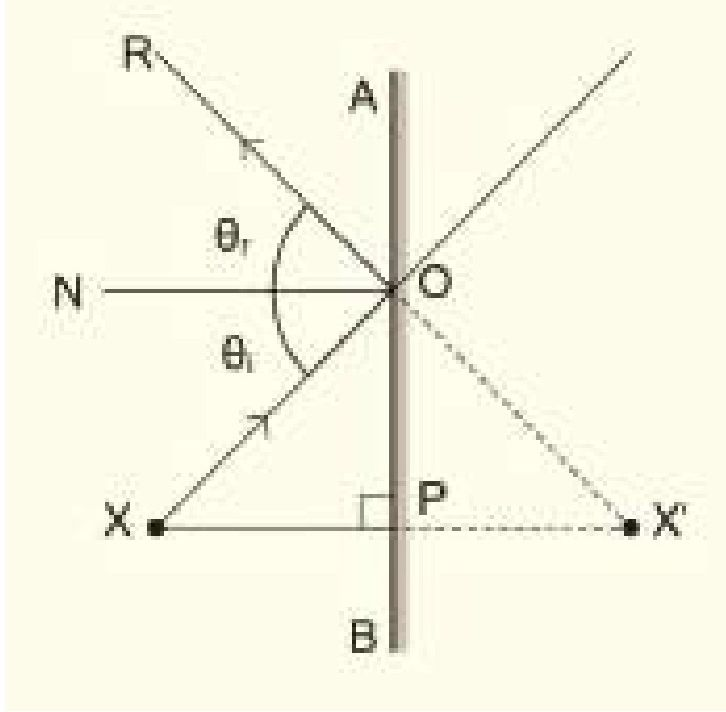

<!-- physics-9-10-bn-c08-t8.3-p008 · example · p.219 · review: verify-formula -->
**উত্তর:** এখানে $\angle XPO = \angle X'PO$ কারণ দুটিই সমকোণ যেহেতু $XP$ হচ্ছে আয়নার পৃষ্ঠে আঁকা লম্ব। প্রতিফলনের নিয়ম অনুযায়ী আপাতন কোণ প্রতিফলন কোণের সমান কাজেই $\angle XOP = \angle ROA$ আবার $\angle ROA = \angle X'OP$ কাজেই ত্রিভুজ $OPX$ এবং $OPX'$ এর মাঝে $OP$ সাধারণ বাহু এবং এই বাহুর দুই দিকের কোণ দুটি সমান। $OPX$ এবং $OPX'$ ত্রিভুজ দুটি সর্বসম, তাই $XP = X'P$

<!-- physics-9-10-bn-c08-t8.3-p009 · figure · p.219 · review: known-confusable-corrected,verify-formula -->
**চিত্র ৮.০৯:** $X$ অবস্থানের বস্তুটির প্রতিবিষ্টি দেখার জন্য $XP$ এবং $XO$ এই দুটি আলোক রশ্মি ব্যবহার করাই যথেষ্ট।

<!-- physics-9-10-bn-c08-t8.3-p010 · text · p.219 -->
কোনো আয়নায় আমরা যদি একটি বস্তুর প্রতিবিষ্টি দেখি, সেটিকে যথেষ্ট বাস্তব মনে হলেও আসলে সেটি বাস্তব নয়। কারণ যেখান থেকে আলো আসছে বলে মনে হয়, সেখান থেকে আসলে কোনো আলোর উৎস নেই। আমরা পরে দেখব অনেক সময় কিন্তু সত্যি সত্যি এমনভাবে একটা প্রতিবিম্ব তৈরি হয়, যেখানে সত্যি সত্যি আলো কেন্দ্রীভূত হয় এবং সেখান থেকে আলোক রশ্মি বের হয়ে আসে। এ রকম প্রতিবিম্বকে বলে বাস্তব প্রতিবিম্ব এবং এই ধরনের প্রতিবিম্ব দিয়ে অনেক কাজ করা সম্ভব। আয়নায় যে প্রতিবিম্ব তৈরি হয় সেখানে সত্যিকারের আলো কেন্দ্রীভূত হয় না, তাই এর নাম অবাস্তব প্রতিবিম্ব।

<!-- physics-9-10-bn-c08-t8.3-p011 · text · p.220 · review: verify-formula -->
৮.১০ চিত্রে একটি মাত্র বিন্দু না হয়ে একটা বিস্তৃত বস্তুর প্রতিবিম্ব কীভাবে তৈরি হয় দেখানো হয়েছে। $X$ এবং $Y$ বিন্দু থেকে আলো আয়নায় প্রতিফলিত হয়ে যথাক্রমে $X'$ এবং $Y'$ এ অবাস্তব প্রতিবিম্ব তৈরি করেছে অর্থাৎ মনে হচ্ছে চোখে আলোক রশ্মি আসছে $X'$ এবং $Y'$ থেকে। দেখাই যাচ্ছে $XY$ এর যে দৈর্ঘ্য $X'Y'$ এর সেই একই দৈর্ঘ্য। $XY$ তে তীরের মাথাটি যদি উপরের দিকে হয় তাহলে $X'Y'$ তেও তীরের মাথাটি উপরের দিকে হবে। অর্থাৎ সাধারণ আয়নায় কিংবা দর্পণে প্রতিবিম্ব:

<!-- physics-9-10-bn-c08-t8.3-p012 · figure · p.220 -->
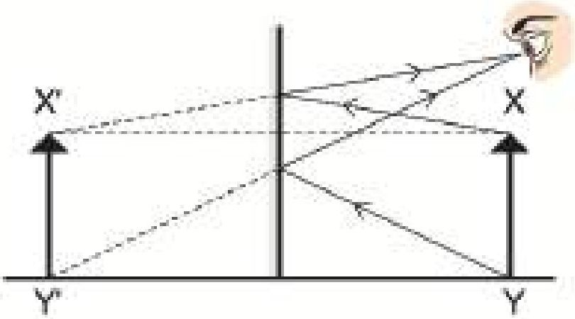

<!-- physics-9-10-bn-c08-t8.3-p013 · figure · p.220 · review: known-confusable-corrected,verify-formula -->
**চিত্র ৮.১০: $XY$ বস্তুটির প্রতিবিম্ব $X'Y'$**

<!-- physics-9-10-bn-c08-t8.3-p014 · text · p.220 -->
(a) আয়না থেকে সমদূরত্বে
(b) অবাস্তব
(c) সোজা এবং
(d) সমান দৈর্ঘ্যের

<!-- physics-9-10-bn-c08-t8.3-p015 · text · p.220 -->
আমরা আলাদা আলাদাভাবে এই বিষয়গুলো মনে করিয়ে দিচ্ছি কারণ একটু পরেই দেখব সাধারণ আয়নার বদলে অন্য ধরনের আয়না ব্যবহার করলে প্রতিবিম্ব ভিন্ন দূরত্বে হতে পারে, বাস্তব হতে পারে, উল্টো হতে পারে এমনকি ছোট কিংবা বড়ও হতে পারে।

### নিজে করো

<!-- physics-9-10-bn-c08-t8.3-p016 · figure · p.220 -->
**চিত্র ৮.১১: তিন টুকরা কাচ দিয়ে ক্যালাইডোস্কোপ তৈরি করা যায়।**

<!-- physics-9-10-bn-c08-t8.3-p017 · text · p.221 -->
এক মাপের তিনটি কাচের টুকরো নাও (ছবি ফ্রেমের দোকানে এরকম কাচের টুকরো সহজেই পাওয়া যায়) তিনটি কাচের টুকরো ত্রিভুজাকৃতিভাবে রেখে (চিত্র ৮.১১) কাগজ দিয়ে কয়েকবার পেঁচিয়ে নাও এবং আঁথা দিয়ে জুড়ে দিয়ে কাচের টুকরোকে ত্রিভুজাকৃতি ভাবে আটকে রাখো। এক পাশে পাতলা কাগজ দিয়ে ঢেকে দাও। এবারে ভেতরে একটা দুটো রঙিন পাথর, পুঁতি, ভাঙা কাচের চুড়ি ইত্যাদি রেখে অন্য পাশ দিয়ে দেখো। তুমি অপরূব নকশা দেখতে পাবে। এটাকে ক্যালাইডোস্কোপ (kaleidoscope) বলে। চোখে লাগিয়ে রেখে এটা ঘোরাও তাহলে নকশাটিকে নড়তে দেখবে। কাচ থেকে প্রতিফলনের প্রতিফলন এবং তার প্রতিফলনের কারণে এটা ঘটে। তোমাদের মনে হতে পারে সাধারণ স্বচ্ছ কাচে প্রতিফলন বৃষ্টি হয় খুব কম; কিন্তু ক্যালাইডোস্কোপ কাচ যেভাবে দেখা হয়, যেখানে আপাতন কোন অনেক বেশি তাই প্রতিফলনটুকু অনেক বেশি।

### উদাহরণ

<!-- physics-9-10-bn-c08-t8.3-p018 · example · p.221 -->
**প্রশ্ন:** পূর্ণদৈর্ঘ্য প্রতিবিম্ব দেখার জন্য একটি সমতল আয়না কত বড় হতে হয়?

<!-- physics-9-10-bn-c08-t8.3-p019 · example · p.221 -->
**উত্তর:** ৮.১২ চিত্রের জ্যামিতি থেকে বলা যায় সমতল আয়নার দৈর্ঘ্য ০.৭৫ মিটার। মজার ব্যাপার হচ্ছে, তুমি আয়না থেকে ১ মিটার দূরেই থাকো কিন্তু ১০ মিটার দূরে থাকো তোমার আয়নার দৈর্ঘ্য কিন্তু সব সময়ই হবে তোমার দৈর্ঘ্যের অর্ধেক। তোমার মা-বাবা কিন্তু অন্য কেউ যদি সাজগোজ করার পর তাদের কেমন দেখাচ্ছে দেখার জন্য পূর্ণদৈর্ঘ্য সমতল আয়না (ফুল লেংথ মিরর) কিনতে যায় তাদের বলো অর্ধদৈর্ঘ্য সমতল আয়না কিনলেই কাজ চলে যাবে।

<!-- physics-9-10-bn-c08-t8.3-p020 · figure · p.221 -->
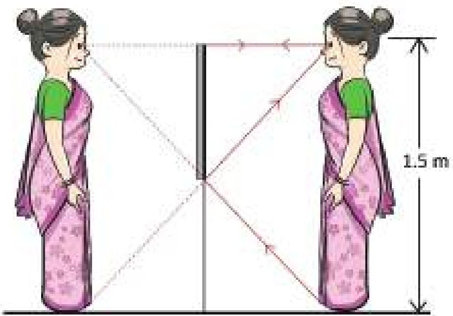

<!-- physics-9-10-bn-c08-t8.3-p021 · figure · p.221 -->
**চিত্র ৮.১২: পূর্ণদৈর্ঘ্য প্রতিবিম্ব দেখার জন্য পূর্ণদৈর্ঘ্য আয়নার প্রয়োজন হয় না।**

<!-- physics-9-10-bn-c08-t8.3-p022 · text · p.222 -->
**প্রশ্ন:** দুটি সমতল আয়না পরস্পরের সাথে ৬০° কোণে রাখা আছে (চিত্র ৮.১৩)। প্রথম আয়নায় ৬০° তে আলো ফেলা হলে আলোক রশ্মি কোন দিকে যাবে?

<!-- physics-9-10-bn-c08-t8.3-p023 · figure · p.222 -->
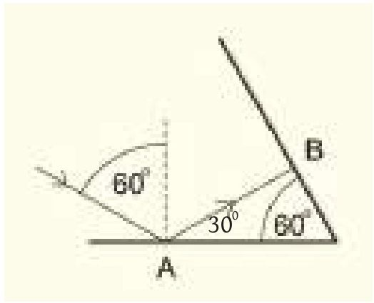

<!-- physics-9-10-bn-c08-t8.3-p024 · text · p.222 -->
**উত্তর:** জ্যামিতি থেকে বলা যায় রশ্মিটি B বিন্দুতে আপতিত হবে এবং ঠিক বিপরীত দিকে প্রতিফলিত হবে।

<!-- physics-9-10-bn-c08-t8.3-p025 · figure · p.222 -->
**চিত্র ৮.১৩:** ৬০° কোণে রাখা দুটি আয়নার একটিতে ৬০° কোণে আপতিত আলো।

<!-- physics-9-10-bn-c08-t8.3-p026 · figure · p.222 -->
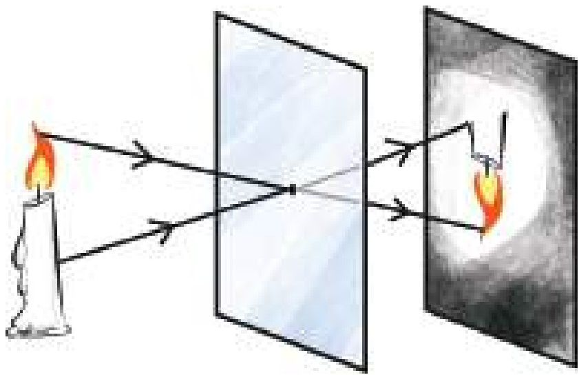

<!-- physics-9-10-bn-c08-t8.3-p027 · figure · p.222 -->
**চিত্র ৮.১৪:** সূক্ষ্ম ফুটো দিয়ে কোনো বস্তুর প্রতিবিম্ব তৈরি করা সম্ভব।

<!-- physics-9-10-bn-c08-t8.3-p028 · text · p.222 -->
একটা অন্ধকার ঘরে একটা বোর্ডের মাঝে খুব ছোট একটা ফুটো করে একটা জ্বলন্ত মোমবাতির সামনে রাখো। ৮.১৪ চিত্রে দেখানো উপায়ে বোর্ডটার অন্য পাশে একটা সাদা কাগজ রাখো। সাদা কাগজে যদি অন্য কোথাও থেকে আলো পড়তে না দাও তাহলে সেখানে মোমবাতির শিখার একটা প্রতিবিম্ব দেখবে। পেছনের সাদা কাগজটি সামনে-পেছনে সরিয়ে প্রতিবিম্বটি ছোট-বড় করতে পারবে। প্রতিবিম্বটি কি বাস্তব নাকি অবাস্তব? সোজা না উল্টো? সমদূরত্বে না ভিন্ন দূরত্বে? বড় না ছোট?

<!-- physics-9-10-bn-c08-t8.3-p029 · text · p.222 -->
বুঝতেই পারছ, প্রতিবিম্বটি বাস্তব, উল্টো, সকল দূরত্বে স্পষ্ট এবং যত দূরে তৈরি হয় তত বড়। এই পদ্ধতিতে পিন হোল ক্যামেরা তৈরি হয়।

<!-- physics-9-10-bn-c08-t8.3-p030 · example · p.223 · review: latin-junk -->
**প্রশ্ন:** ৮.১৫ চিত্রে যেভাবে দেখানো হয়েছে, সেভাবে দুটি আয়না AO এবং BO পরস্পরের সাথে লম্বভাবে রাখা আছে। তার সামনে তুমি তোমার বাম হাতটি রেখেছ। হাতটির প্রতিবিম্বগুলো আঁকো।

<!-- physics-9-10-bn-c08-t8.3-p031 · figure · p.223 -->
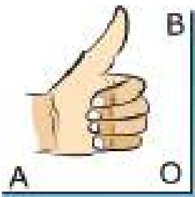

<!-- physics-9-10-bn-c08-t8.3-p032 · example · p.223 · review: latin-junk -->
**উত্তর:** AOB তে তোমার প্রকৃত হাত। A'OB তে তোমার হাতের সামনা-সামনি প্রতিবিম্ব। ঠিক সেরকম AOB' তে তোমার হাতের উপর-নিচ প্রতিবিম্ব। লক্ষ্য করো, দুই ক্ষেত্রেই বাম হাতের প্রতিবিম্ব ডান হাত হিসেবে এসেছে। A'OB' ক্ষেত্রে প্রতিবিম্বের প্রতিবিম্ব দেখা যাবে। এটি A'OB এর প্রতিবিম্বের উপর-নিচ প্রতিবিম্ব হতে পারে, আবার AOB' এর প্রতিবিম্বের সামনা-সামনি প্রতিবিম্ব হতে পারে। লক্ষ্য করো একবার প্রতিফলনে বাম হাত ডান হাত হয়ে গিয়েছিল কিন্তু দুইবার প্রতিফলনে (প্রতিফলনের প্রতিফলনে) বাম হাত আবার বাম হাত হিসেবেই এসেছে।

<!-- physics-9-10-bn-c08-t8.3-p033 · figure · p.223 -->
**চিত্র ৮.১৫: সমকোণে রাখা দুটি আয়নায় বাম হাতের মুঠির ভিন্ন ভিন্ন প্রতিফলন।**

## 8.4 গোলীয় আয়না (Spherical Mirror)

<!-- physics-9-10-bn-c08-t8.4-p001 · text · p.223 -->
সাধারণ সমতল আয়না আমরা সবাই দেখেছি কিন্তু সত্যিকারের গোলীয় আয়না আমরা সবাই নাও দেখে থাকতে পারি—তবে গোলীয় আয়নার মূল বিষয়টি কিন্তু চকচকে নতুন চামচে অনেকটা দেখা যায়। গোলীয় আয়না দুই রকমের হয়ে থাকে—অবতল এবং উত্তল। একটা ফার্ণি গোলকের খানিকটা কেটে তার পৃষ্ঠে রুপা বা অ্যালুমিনিয়ামের প্রলেপ লাগিয়ে অবতল কিংবা উত্তল গোলীয় আয়না তৈরি করা যায়। কোন পৃষ্ঠে রুপা বা অ্যালুমিনিয়ামের প্রলেপ দেওয়া হবে তার ওপর নির্ভর করবে এই গোলীয় আয়নাটি অবতল না উত্তল গোলীয় আয়না হবে।

<!-- physics-9-10-bn-c08-t8.4-p002 · figure · p.223 -->
**চিত্র ৮.১৬: একটি চামচের উল্টো পৃষ্ঠ উত্তল গোলীয় আয়নার মতো।**

## 8.5 উত্তল আয়না (Convex Mirror)

<!-- physics-9-10-bn-c08-t8.5-p001 · text · p.224 · review: verify-formula -->
তোমরা যদি কখনো একটা চকচকে চামচের নিচের বা পেছনের অংশে নিজের চেহারার দেখার চেষ্টা করে থাকো (চিত্র ৮.১৬) তাহলে নিশ্চয়ই লক্ষ্য করেছ যে, সেখানে তুমি তোমার চেহারারটা সোজা দেখালেও সেটি হবে তুলনামূলকভাবে ছোট। চামচের এই অংশটা উত্তল আয়নার মতো কাজ করে। সত্যিকারের গোলকীয় উত্তল আয়না একটা প্রকৃত গোলকের অংশ হয়। ধরা যাক, গোলকটির ব্যাসার্ধ $r$ (চিত্র ৮.১৭) এবং তার একটা অংশ কেটে তার উত্তল অংশটির দিক থেকে আলোর প্রতিফলনের ব্যবস্থা করা হয়েছে। এই আয়নায় একটা সমান্তরাল আলো ফেলা হলে আলোটি চারদিকে ছড়িয়ে যাবে, ছড়িয়ে যাওয়া আলোক রশ্মিগুলো যদি আয়নাটি যে গোলকের অংশ তার ভিতরে দিকে বর্ধিত করি তাহলে মনে হবে সেটা বুঝি একটা বিন্দু থেকে ছড়িয়ে গেছে। ঐ বিন্দুটিকে বলে ফোকাস বিন্দু। উত্তল আয়নার যে পৃষ্ঠ থেকে প্রতিফলন হয় তার কেন্দ্রবিন্দুটিকে বলে মেরু বিন্দু এবং এই বিন্দু থেকে ফোকাস বিন্দুর দূরত্বটিকে ফোকাস দূরত্ব ($f$) বলে।

<!-- physics-9-10-bn-c08-t8.5-p002 · text · p.224 · review: verify-formula -->
একটা গোলীয় আয়নাকে আমরা সব সময়ই একটা গোলকের অংশ হিসেবে কল্পনা করতে পারি। ঐ গোলকটির ব্যাসার্ধ যদি $r$ হয় তাহলে ফোকাস দূরত্ব $r/2$ হবে।

<!-- physics-9-10-bn-c08-t8.5-p003 · figure · p.224 -->
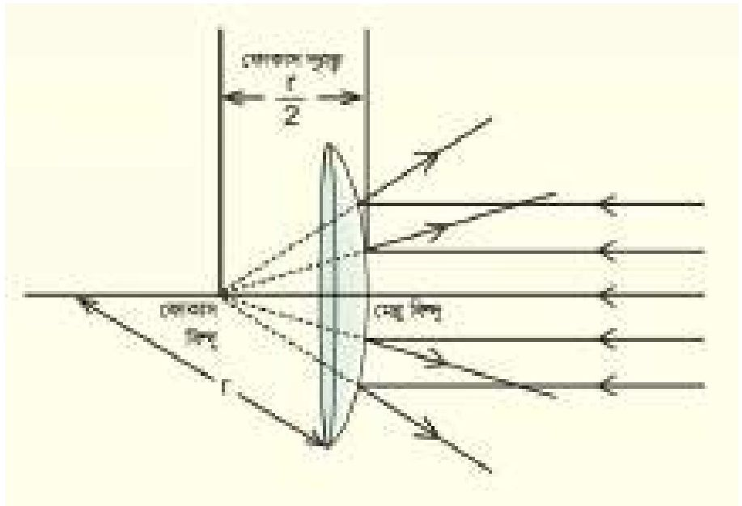

<!-- physics-9-10-bn-c08-t8.5-p004 · figure · p.224 -->
**চিত্র ৮.১৭: উত্তল আয়নার ফোকাস দূরত্ব গোলকের ব্যাসার্ধের অর্ধেক।**

### উদাহরণ

<!-- physics-9-10-bn-c08-t8.5-p005 · example · p.224 · review: verify-formula -->
**প্রশ্ন:** প্রমাণ করো $f = r/2$

<!-- physics-9-10-bn-c08-t8.5-p006 · example · p.224 -->
**উত্তর:** মজার ব্যাপার হচ্ছে, তুমি কিন্তু এটা পুরোপুরি প্রমাণ করতে পারবে না, শুধু এর কাছাকাছি প্রমাণ করতে পারবে। ধরা যাক গোলীয় আয়নার মূল অক্ষের সাথে সমান্তরাল দুটি রশ্মি A এবং B

<!-- physics-9-10-bn-c08-t8.5-p007 · text · p.225 · review: latin-junk,verify-formula -->
থেকে X (মেবু বিন্দু) বিন্দুতে এবং অন্য একটি Y বিন্দুতে এসেছে (চিত্র ৮.১৮)। যে রশ্মিটি X বিন্দুতে এসেছে সেটি প্রতিফলিত হয়ে যদিকে এসেছে ঠিক সেদিকেই ফিরে যাবে। কারণ X বিন্দুতে আপতিত আলোক রশ্মি গোলীয় তলের সাথে স্পর্শক তলের উপর লম্বভাবে আপতিত হয়। আমরা এই রেখাটিকে গোলকের কেন্দ্র O বিন্দু পর্যন্ত বর্ধিত করি, দেখাই যাচ্ছে OX = r (গোলকের ব্যাসার্ধ)। B থেকে যে রশ্মিটি Y বিন্দুতে এসেছে সেটি সেই বিন্দুতে লম্ব ON এর সাথে $\theta_i$ আপতন কোণ করেছে। BY রশ্মিটির প্রতিফলন কোণ $\theta_r$ এবং সেটি প্রতিফলিত হয়ে YP দিকে যাবে। আমরা PY কে বর্ধিত করলে সেটি OX রেখাকে F বিন্দুতে ছেদ করবে।

<!-- physics-9-10-bn-c08-t8.5-p008 · figure · p.225 · review: verify-formula -->
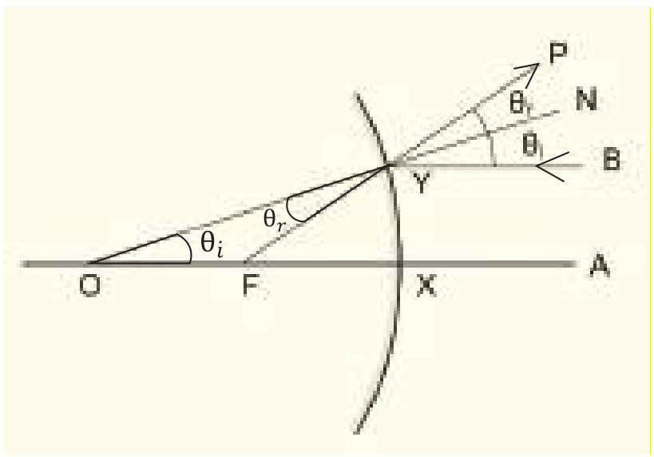

<!-- physics-9-10-bn-c08-t8.5-p009 · text · p.225 · review: latin-junk,verify-formula -->
FO = FY কারণ OFY ত্রিভুজের $\angle FOY = \angle OYF$ যেহেতু $\angle FOY = \theta_i$ এবং $\angle FYO = \theta_r$

<!-- physics-9-10-bn-c08-t8.5-p010 · text · p.225 · review: latin-junk,verify-formula -->
FY $\cong$ FX যখন XY ব্যাসার্ধ r থেকে অনেক ছোট হয় তখন এটি সত্য। বেশির ভাগ উত্তল আয়নায় এটা সত্য।

<!-- physics-9-10-bn-c08-t8.5-p011 · figure · p.225 · review: verify-formula -->
drawing: A diagram of a convex spherical mirror showing incident ray OB, reflected ray YP, and the principal axis OXA. It labels points O, F, X, A, Y, P, N, and angles $\theta_i$, $\theta_r$, and $\theta_i$.

<!-- physics-9-10-bn-c08-t8.5-p012 · figure · p.225 -->
**চিত্র ৮.১৮: একটি গোলীয় উত্তল আয়না আসলে একটা গোলকের অংশ।**

<!-- physics-9-10-bn-c08-t8.5-p013 · text · p.225 · review: latin-junk,verify-formula -->
কাজেই FO = FY $\cong$ FX = r/2 অর্থাৎ ফোকাস দূরত্ব f = r/2

<!-- physics-9-10-bn-c08-t8.5-p014 · text · p.225 -->
**প্রশ্ন:** সমতল আয়নাকে যদি আমরা গোলীয় উত্তল আয়না হিসেবে কল্পনা করি, তাহলে তার ফোকাস দূরত্ব কত?

<!-- physics-9-10-bn-c08-t8.5-p015 · text · p.225 -->
**উত্তর:** অসীম।

<!-- physics-9-10-bn-c08-t8.5-p016 · text · p.225 · review: known-confusable-corrected -->
আমরা এখন গোলীয় আয়নার জন্য প্রতিবিম্ব কেমন হতে পারে সেটি দেখব। তোমরা দেখবে গোলীয় উত্তল আয়নায় প্রতিবিম্ব সব সময় অবাস্তব কিন্তু গোলীয় অবতল আয়নায় সেটি বাস্তব কিংবা অবাস্তব দুটিই হতে পারে, তবে সেটি নির্ভর করে বস্তুটি কোথায় আছে তার উপর।

### (Image in a Convex Spherical Mirror)

<!-- physics-9-10-bn-c08-t8.5-p017 · text · p.225 -->
আমরা আগেই বলেছি, চামচের বাইরের অংশটা গোলীয় উত্তল আয়নার মতো কাজ করে এবং সেখানে তুমি নিজেকে দেখতে চাইলে ছোট এবং সোজা একটা প্রতিবিম্ব দেখতে পাও। যার অর্থ আমরা গোলীয় উত্তল আয়নার প্রতিবিম্বটি সব সময়ই ছোট দেখার কথা।

<!-- physics-9-10-bn-c08-t8.5-p018 · text · p.226 -->
গোলীয় উত্তল আয়নায় কীভাবে প্রতিবিম্ব তৈরি হয় সেটি বোঝার জন্য আলোক রশ্মি গোলীয় উত্তল আয়নায় কীভাবে প্রতিফলিত হয় সেটি জানতে হবে। সেটি নির্ভর করে আলোক রশ্মি কী কোণে গোলীয় উত্তল আয়নায় এসে পড়ছে তার উপর। আমরা তিনটি বিশেষ আলোক রশ্মির প্রতিফলনের নিয়ম জানলেই কীভাবে প্রতিবিম্ব তৈরি হয় সেটি ব্যাখ্যা করতে পারব:

<!-- physics-9-10-bn-c08-t8.5-p019 · text · p.226 -->
(i) আলোক রশ্মি কেন্দ্রমুখী হলে (চিত্র ৮.১৯, XN কিংবা YR রশ্মি) সেটি লক্ষ্যভাবে প্রতিফলিত হয়ে যৌদিক থেকে এসেছে ঠিক সেদিকেই ফিরে যায়।

<!-- physics-9-10-bn-c08-t8.5-p020 · text · p.226 -->
(ii) প্রধান অক্ষের সমান্তরাল (চিত্র ৮.১৯, XP) রশ্মিটি প্রতিফলনের পর মনে হবে যেন রশ্মিটি (PQ) ফোকাস বিন্দু (F) থেকে ছড়িয়ে যাচ্ছে।

<!-- physics-9-10-bn-c08-t8.5-p021 · text · p.226 -->
(iii) আলোক রশ্মির দিক পরিবর্তন করা হলে এটি যৌদিক থেকে এসেছে ঠিক সেদিক দিয়ে ফিরে যায়। কাজেই কোনো আলোক রশ্মি (চিত্র ৮.১৯, QP) ফোকাস অভিমুখী হলে সেটি প্রধান অক্ষের সাথে সমান্তরাল হয়ে (PX) প্রতিফলিত হবে।

<!-- physics-9-10-bn-c08-t8.5-p022 · text · p.226 · review: latin-junk -->
আমরা এখন এই তিনটি নিয়ম ব্যবহার করে প্রতিবিম্ব তৈরি করতে পারব। ৮.১৯ চিত্রে একটা উত্তল আয়নার সামনে XY একটি বস্তু রাখা আছে Y বিন্দু থেকে আলো R বিন্দুতে এলে সেটি লক্ষ্যভাবে প্রতিফলিত হয়ে আবার Y বিন্দুর দিকেই ফিরে যায়, যার অর্থ XY বস্তুর Y বিন্দুর প্রতিবিম্বটি এই YO রেখার কোথাও হবে। সেটি ঠিক কোথায় জানতে হলে X বিন্দু থেকে অন্যদিকে আরেকটি রশ্মি আঁকতে হবে, আমাদের সেটি করার প্রয়োজন নেই কারণ X বিন্দুটির প্রতিবিম্বটি বের করে সেখান থেকে আমরা এটি জেনে নেব।

<!-- physics-9-10-bn-c08-t8.5-p023 · figure · p.226 -->
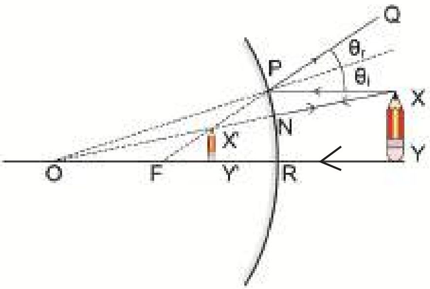

<!-- physics-9-10-bn-c08-t8.5-p024 · figure · p.226 · review: latin-junk -->
**চিত্র ৮.১৯: উত্তল আয়নায় একটি বস্তু XY ফোকাস দূরহের ভেতরে রাখা হলে প্রতিবিম্ব X'Y' ছোট দেখায়।**

<!-- physics-9-10-bn-c08-t8.5-p025 · text · p.226 · review: latin-junk -->
X বিন্দুর প্রতিবিম্ব বের করার জন্য দুটি রশ্মি আঁকতে হবে, একটি আগের মতো সরাসরি O বিন্দুর সাথে যুক্ত করি। YR রশ্মিটি যে রকম লক্ষ্যভাবে প্রতিফলিত হয়ে Y এর দিকে ফিরে গিয়েছিল এই রশ্মিটিও ঠিক একইভাবে N বিন্দুতে প্রতিফলিত হয়ে X এর দিকে ফিরে যাবে। দ্বিতীয় রশ্মিটি YR এর সাথে সমান্তরালভাবে আঁকা যেতে পারে, সেটা উত্তল আয়নার P বিন্দুতে আপতিত হয়ে প্রতিফলিত হবে এবং মনে হবে যেন F বিন্দু থেকে ছড়িয়ে যাচ্ছে কাজেই আমরা FP কে যুক্ত করে Q এর দিকে বাড়িয়ে দিতে পারি।

<!-- physics-9-10-bn-c08-t8.5-p026 · text · p.227 · review: latin-junk -->
FP রেখাটা OX রেখাকে X' বিন্দুতে ছেদ করেছে, যার অর্থ X বিন্দুর প্রতিবিষ্টি হবে X' বিন্দুতে। X' থেকে OY রেখার ওপর লম্ব টানলে সেটা Y' বিন্দুতে ছেদ করবে। যেহেতু আমাদের মনে হবে X বিন্দুর প্রতিফলনটি আসছে X' বিন্দু থেকে সে কারণে আমাদের মনে হবে Y বিন্দুর প্রতিফলনটি আসছে Y' বিন্দু থেকে। কাজেই X'Y' হবে XY এর প্রতিবিষ্ণ।

<!-- physics-9-10-bn-c08-t8.5-p027 · text · p.227 · review: latin-junk -->
দেখাই যাচ্ছে X'Y' সব সময় XY থেকে ছোট এবং XY উত্তল আয়না থেকে যত দূরে থাকবে X'Y' হবে তত ছোট। প্রতিফলনের নিয়ম ব্যবহার করে উত্তল কিংবা অবতল আয়নায় প্রতিবিষ্ণ আঁকার এই পদ্ধতিটি ভালো করে জেনে রাখা দরকার, এটি পদার্থবিজ্ঞানের খুব প্রয়োজনীয় একটা পদ্ধতি।

<!-- physics-9-10-bn-c08-t8.5-p028 · text · p.227 -->
বোঝাই যাচ্ছে X'Y' থেকে আসলে সত্যিকারের আলো বিচ্ছুরিত হচ্ছে না, আমাদের শুধু মনে হচ্ছে বৃষ্টি প্রতিবিষ্টি এখানে আছে। কাজেই এটা অবাস্তব প্রতিবিষ্ণ। সাধারণ আয়নার প্রতিবিষ্ণের সাথে তুলনা করে আমরা বলতে পারি।

<!-- physics-9-10-bn-c08-t8.5-p029 · text · p.227 -->
(a) এই প্রতিবিষ্টির অবস্থান হবে ফোকাস বিন্দু এবং মেরু বিন্দুর মাঝখানে। বস্তুটি যত দূরে থাকবে প্রতিবিষ্টি ফোকাস বিন্দুর তত কাছে তৈরি হবে।
(b) এই প্রতিবিষ্টি অবাস্তব
(c) এটি সোজা
(d) এটা ছোট, বস্তুটি আয়না থেকে যত দূরে যাবে প্রতিবিষ্টি তত ছোট হতে থাকবে।

## 8.6 অবতল গোলীয় আয়না (Concave Mirror)

<!-- physics-9-10-bn-c08-t8.6-p001 · text · p.227 -->
একটা চকচকে চামচের ভেতরের অংশটা অবতল গোলীয় আয়নার উদাহরণ হতে পারে। তোমরা যারা চামচের ভেতরের দিকে তাকিয়েছ, তারা নিশ্চয়ই লক্ষ্য (চিত্র ৮.২০) করেছে সেখানে তোমার প্রতিবিষ্টি ছোট এবং সবচেয়ে চমকপ্রদ হচ্ছে যে প্রতিবিষ্টি উল্টো। তোমরা চাইলে তোমার আঙুল চামচটার খুব কাছে এনে দেখতে পারো, তখন দেখবে আঙুলটা সোজাই দেখাচ্ছে। এবারে আন্তে আন্তে দূরে সরাতে থাক, দেখবে তোমার আঙুলটা বড় দেখাতে শুরু করেছে (আমরা সমতল আয়না কিংবা উত্তল আয়নায় এর আগে প্রতিবিষ্ণ তৈরি করতে পেরেছি কিন্তু কখনোই বস্তুর প্রকৃত আকার থেকে বড় প্রতিবিষ্ণ তৈরি করতে পারিনি—এই প্রথম বড় প্রতিবিষ্ণ দেখতে

<!-- physics-9-10-bn-c08-t8.6-p002 · figure · p.227 -->
**চিত্র ৮.২০: একটি চামচের ভেতরের অংশ অবতল গোলীয় আয়নার মতো কাজ করে।**

<!-- physics-9-10-bn-c08-t8.6-p003 · text · p.228 -->
পাচ্ছি। আঁড়ুলটা যদি আস্তে আস্তে সরাতে থাকো একসময় অবাক হয়ে দেখবে আঁড়ুলের প্রতিবিম্বটা উল্টো হয়ে গেছে। এটাকে এখন যতই সরিয়ে নাও, এটা এখন সব সময় উল্টোই থেকে যাবে। (সমতল আয়না কিংবা উত্তল আয়না দিয়ে আমরা এর আগে কখনোই উল্টো প্রতিবিম্ব তৈরি করতে পারিনি—এই প্রথম আমরা উল্টো প্রতিবিম্ব দেখছি।)

<!-- physics-9-10-bn-c08-t8.6-p004 · text · p.228 -->
কাজেই দেখতে পাচ্ছ চামচের বাইরের অংশটা উত্তল আয়নার মতো এবং ভেতরের অংশটা অবতল আয়নার মতো কাজ করে। সত্যিকারের গোলীয় অবতল আয়না আসলে একটা গোলকের অংশ। উত্তল আয়নার বলায় বাইরের উত্তল অংশ থেকে আলো প্রতিফলিত হতো, অবতল আয়নার বলায় আলো ভেতরের অবতল অংশ থেকে প্রতিফলিত হবে।

<!-- physics-9-10-bn-c08-t8.6-p005 · figure · p.228 · review: latin-junk -->
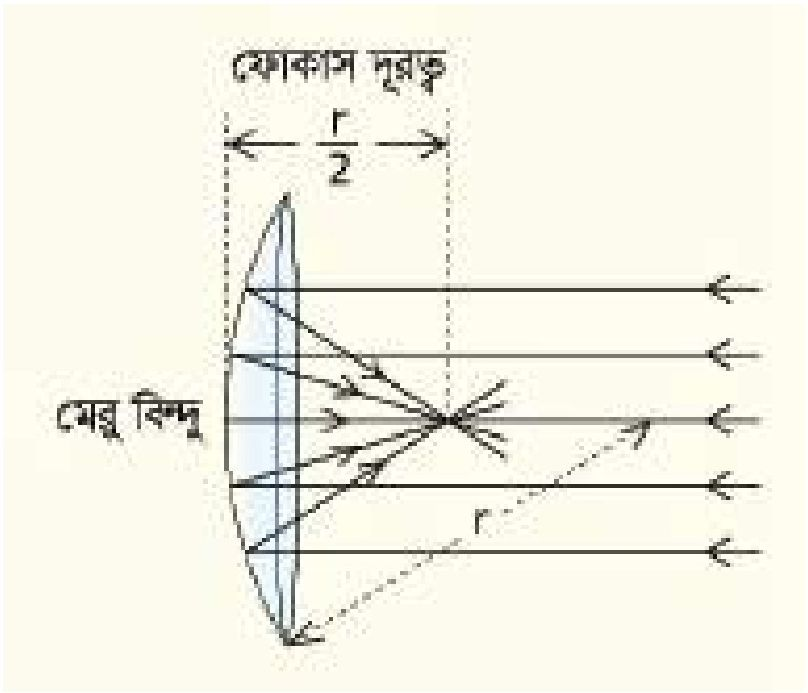

<!-- physics-9-10-bn-c08-t8.6-p006 · text · p.228 -->
একটি অবতল আয়নায় সমান্তরাল আলো ফেলা হলে আলোর রশ্মিগুলো প্রতিফলনের পর এক বিন্দুতে মিলিত হবে (চিত্র ৮.২১)। বুঝতেই পারছ এই বিন্দুটি অবতল আয়নার ফোকাস বিন্দু এবং মেরু বিন্দু থেকে এই বিন্দু পর্যন্ত দূরত্বটা হচ্ছে ফোকাস দূরত্ব। আলোর রশ্মির তো আর থেমে থাকার উপায় নেই কাজেই এক বিন্দুতে মিলিত হবার পরও সেটা সোজা সামনের দিকে এগোতে থাকবে এবং দেখা যাবে সেই বিন্দু থেকে আলোক রশ্মিগুলো ছড়িয়ে পড়ছে। অর্থাৎ ফোকাস বিন্দুতে পৌঁছানোর আগে আলো একত্রিত হতে থাকে (অভিসারী) ফোকাস বিন্দুতে পৌঁছানোর পর আলো ছড়িয়ে যেতে থাকে (অপসারী)।

<!-- physics-9-10-bn-c08-t8.6-p007 · figure · p.228 -->
**চিত্র ৮.২১: অবতল আয়নার ফোকাস দূরত্ব গোলকের ব্যাসার্ধের অর্ধেক।**

### icon: hand pointing up উদাহরণ

<!-- physics-9-10-bn-c08-t8.6-p008 · text · p.228 -->
**প্রশ্ন:** সমতল আয়নাকে আমরা যদি গোলীয় অবতল আয়না হিসেবে কল্পনা করি, তাহলে তার ফোকাস দূরত্ব কত?

<!-- physics-9-10-bn-c08-t8.6-p009 · text · p.228 -->
**উত্তর:** অসীম।

<!-- physics-9-10-bn-c08-t8.6-p010 · text · p.228 -->
উত্তল আয়নার বলাতেও আমরা একই উত্তর পেয়েছিলাম, যার অর্থ ফোকাস দূরত্ব বাড়তে বাড়তে অসীম হয়ে গেলে উত্তল এবং অবতল আয়না দুটিই সমতল আয়না হয়ে যায়। উত্তল আয়নার মতো অবতল আয়নাতেও ফোকাস দূরত্ব হচ্ছে ব্যাসার্ধের অর্ধেক। এটি হুবহু প্রমাণ করা যায় না, কাছাকাছি প্রমাণটি এবারে আমরা তোমাদের হাতে ছেড়ে দিলাম।

### ৮.৬.১ অবতল আয়নায় প্রতিবিম্ব (Image in a Concave Mirror)

<!-- physics-9-10-bn-c08-t8.6-p011 · text · p.229 -->
এবারে এসেছি আমরা সবচেয়ে মজার অংশটুকুতে। সমতল আয়না এবং উত্তল আয়নায় শুধু একধরনের প্রতিবিম্ব তৈরি হতো। অবতল আয়নায় দুই ধরনের প্রতিবিম্ব হতে পারে। একটা বস্তুর ফোকাস দূরত্ব থেকে কম দূরত্বে রাখলে একধরনের প্রতিবিম্ব তৈরি হয়, ফোকাস দূরত্ব থেকে বেশি দূরত্বে রাখলে অন্য রকম প্রতিবিম্ব তৈরি হয়।

<!-- physics-9-10-bn-c08-t8.6-p012 · text · p.229 -->
সেটি শুরু করার আগে আমরা আলোক রশ্মি গোলীয় অবতল আয়নায় কীভাবে প্রতিফলিত হয় সেটি জেনে নেই। গোলীয় অবতল আয়নায় আলোক রশ্মির প্রতিফলনের তিনটি বিশেষ নিয়ম জানলেই কীভাবে প্রতিবিম্ব তৈরি হয় সেটি ব্যাখ্যা করতে পারব:

<!-- physics-9-10-bn-c08-t8.6-p013 · text · p.229 -->
(i) আলোক রশ্মি ব্যাসার্ধ বরাবর বা কেন্দ্র থেকে শুরু হলে (চিত্র ৮.২২, OP কিংবা ON রশ্মি) সেটি লম্বভাবে প্রতিফলিত হয়ে যৌতিক থেকে এসেছে ঠিক সেদিকেই ফিরে যায়।

<!-- physics-9-10-bn-c08-t8.6-p014 · text · p.229 -->
(ii) প্রধান অক্ষের সমান্তরাল (চিত্র ৮.২২, XQ) রশ্মিটি প্রতিফলনের পর ফোকাস বিন্দু (F) দিয়ে যাবে (QF)।

<!-- physics-9-10-bn-c08-t8.6-p015 · text · p.229 -->
(iii) আলোক রশ্মির দিক পরিবর্তন করা হলে এটি যৌতিক থেকে এসেছে ঠিক সেদিক দিয়ে ফিরে যায়। কাজেই কোনো আলোক রশ্মি (চিত্র ৮.২২, FQ) ফোকাস দিয়ে গেলে সেটি প্রধান অক্ষের সাথে সমান্তরাল হয়ে (QX) প্রতিফলিত হবে।

<!-- physics-9-10-bn-c08-t8.6-p016 · text · p.229 -->
এবারে আমরা অবতল আয়নার জন্য প্রতিবিম্ব তৈরি করতে পারব।

### ফোকাস দূরত্ব থেকে কম দূরত্বে

<!-- physics-9-10-bn-c08-t8.6-p017 · text · p.229 · review: latin-junk,verify-formula -->
৮.২২ চিত্রে একটা গোলীয় অবতল আয়না দেখানো হয়েছে, অবতল আয়নাটি যে গোলকের অংশ সেই গোলকের কেন্দ্র হচ্ছে O, অবতল আয়নার ফোকাস বিন্দু F এবং ধরা যাক XY বস্তুরির প্রতিবিম্বটি আমরা বের করতে চাই। Y বিন্দুটি থেকে আলো অবতল আয়নার P বিন্দুতে প্রতিফলিত হয়ে আবার Y হয়ে O বিন্দুর দিকে ফিরে যাবে। কাজেই বোঝা যাচ্ছে এটি OP রেখায় কিংবা তার বর্ধিত অংশের কোনো একটা বিন্দুতে থাকবে, ঠিক কোথায় সেই বিন্দুটি হবে সেটি বের করতে হলে Y বিন্দু থেকে অন্যদিকে আরো একটি রশ্মিকে অবতল আয়নার দিকে আঁকতে হবে, আমরা আর সেটি করছি না, আগের মতো X বিন্দুটির প্রতিবিম্ব বের করতে পারলেই সেখান থেকে Y বিন্দুটির প্রতিবিম্বের সঠিক জায়গাটি বের করা যাবে। X বিন্দুর প্রতিবিম্ব বের করতে হলে এই বিন্দু থেকে দুটি রেখা আঁকতে হবে, বোঝাই যাচ্ছে প্রথম রেখাটি হবে OX রেখার বর্ধিত অংশ, এটা অবতল আয়নাতে লম্বভাবে আপতিত হয় ঠিক সেই পথেই উল্টো দিকে প্রতিফলিত হয়ে ফিরে যাবে। চিত্রে যেভাবে দেখানো হয়েছে X বিন্দু থেকে আরেকটা রশ্মি হতে পারে অক্ষের সাথে সমান্তরাল একটা রশ্মি, কারণ আমরা এর মধ্যে জেনে গেছি সমান্তরাল রশ্মি প্রতিফলনের পর ফোকাস বিন্দু দিয়ে যায়। কাজেই এটা $Q$ বিন্দুতে আপতিত হয়ে প্রতিফলিত হয়ে $F$ বিন্দু দিয়ে চলে যাবে।

<!-- physics-9-10-bn-c08-t8.6-p018 · figure · p.230 -->
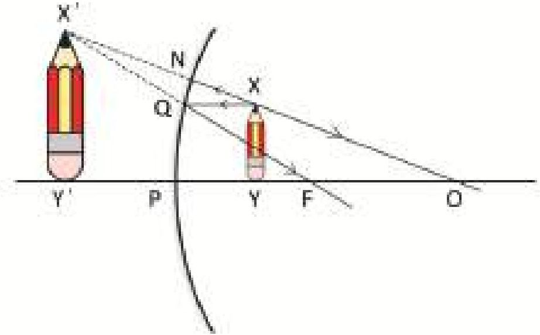

<!-- physics-9-10-bn-c08-t8.6-p019 · figure · p.230 -->
**চিত্র ৮.২২: অবতল আয়নায় একটি বস্তু ফোকাস দূরত্বের ভেতরে রাখা হলে প্রতিবিম্বটি বড় দেখায়।**

<!-- physics-9-10-bn-c08-t8.6-p020 · text · p.230 · review: verify-formula -->
$X$ বিন্দু থেকে বের হওয়া দুটি রশ্মি প্রতিফলনের পর $NO$ এবং $QF$ এর দিকে যাবে এবং দেখাই যাচ্ছে এই রশ্মি দুটো মিলিত হওয়ার কোনো সুযোগ নেই। কাজেই ডান পাশে কোনো প্রতিবিম্ব তৈরি হতে পারবে না। কিন্তু যদি ডান পাশ থেকে বাম পাশে তাকানো যায় তাহলে মনে হবে $ON$ রেখা এবং $FQ$ রেখা দুটি বৃদ্ধি $X'$ বিন্দুতে মিলিত হয়েছে—কাজেই $X'$ হবে $X$ এর প্রতিবিম্ব। এই বিন্দু থেকে $OP$ অক্ষের ওপর একটি লম্ব আঁকলেই আমরা $XY$ এর পুরো প্রতিবিম্ব $X'Y'$ পেয়ে যাব। $X'Y'$ থেকে সত্যিকারভাবে কোনো আলো যাচ্ছে না, শুধু আমাদের মনে হচ্ছে এখানে বৃদ্ধি প্রতিবিম্বটি তৈরি হয়েছে। কাজেই এই প্রতিবিম্বটি অবাস্তব প্রতিবিম্ব। চিত্র থেকে দেখা যাচ্ছে প্রতিবিম্বটি মূল বস্তু থেকে বড়। শুধু তা-ই নয়, আমরা বস্তুটিকে যতই ফোকাস বিন্দুর কাছে আনব, প্রতিবিম্বটি ততই বড় হবে। (যদি এটাকে ঠিক ফোকাস বিন্দুতে বসানো হয় তাহলে প্রতিফলিত আলোক রশ্মি আসলে সমান্তরাল হয়ে যাবে অর্থাৎ প্রতিবিম্ব তৈরি করার জন্য আলোক রশ্মি আর মিলিত হতে পারবে না।)

<!-- physics-9-10-bn-c08-t8.6-p021 · text · p.230 -->
এবারে অবতল আয়নায় ফোকাস দূরত্বের ভেতরে কোনো কিছু রাখা হলে তার প্রতিবিম্বটি কেমন হবে সেটি দেখে নেওয়া যাক:

<!-- physics-9-10-bn-c08-t8.6-p022 · text · p.230 -->
(a) প্রতিবিম্বটির অবস্থান কোথায় হবে সেটি নির্ভর করবে আসল বস্তুটির অবস্থানের ওপর। বস্তুটি যতই ফোকাসের কাছে রাখা হবে প্রতিবিম্বের অবস্থানটি হবে তত দূরে।

<!-- physics-9-10-bn-c08-t8.6-p023 · text · p.230 -->
(b) এটি অবাস্তব

<!-- physics-9-10-bn-c08-t8.6-p024 · text · p.230 -->
(c) সোজা

<!-- physics-9-10-bn-c08-t8.6-p025 · text · p.230 -->
(d) প্রতিবিম্বটির দৈর্ঘ্যও নির্ভর করবে তার অবস্থানের ওপর, যত ফোকাস বিন্দুর কাছে যাবে তার দৈর্ঘ্যও তত বেড়ে যাবে।

### ফোকাস দূরত্ব থেকে বেশি দূরে

<!-- physics-9-10-bn-c08-t8.6-p026 · text · p.231 -->
আমরা এখন পর্যন্ত যত প্রতিবিষ্টি দেখেছি তার মাঝে এই প্রতিবিষ্টি সবচেয়ে চমকপ্রদ কারণ, এই প্রথমবার আমরা একটি বাস্তব প্রতিবিষ্টি দেখব, অর্থাৎ যেখানে প্রতিবিষ্টি তৈরি হবে, সেখানে সত্যি সত্যি আলো কেন্দ্রীভূত হবে (চিত্র ৮.২৩)।

<!-- physics-9-10-bn-c08-t8.6-p027 · text · p.231 · review: latin-junk -->
সত্যিকারের বস্তুটি হচ্ছে *XY* এবং *Y* বিন্দুর প্রতিবিষ্টি অন্যবারের মতো নিশ্চয়ই *YP* রেখার উপরে থাকবে। *X* বিন্দুটির প্রতিবিষ্টি বের করার জন্য আমাদের দুটি রশ্মি আঁকতে হবে। একটি হবে অক্ষের সাথে সমান্তরাল *XQ* এবং প্রতিফলিত হয়ে এটি নিশ্চয়ই ফোকাস বিন্দু *F* এর ভেতর দিয়ে *QF* হিসেবে যাবে। দ্বিতীয় রশ্মিটি আমরা *F* বিন্দুর ভেতর দিয়ে আঁকতে পারি। এটি অবতল আয়নায় প্রতিফলিত হয়ে *RS* হিসেবে সমান্তরাল হয়ে যাবে, কারণ সমান্তরাল রেখার আলো অবতল আয়নাতে প্রতিফলিত হয়ে যে রকম ফোকাস বিন্দুর ভেতর দিয়ে যায়, ঠিক সে রকম তার উল্টোটাও সত্যি, আলো সব সময়ই তার গতিপথ উল্টো পথে পুরোপুরি অনুসরণ করে। *QF* এবং *RS* রেখা দুটি *X'* বিন্দুতে ছেদ করেছে এবং *X'* বিন্দুটি হচ্ছে *X* বিন্দুর প্রতিবিষ্টি। কাজেই *X'* বিন্দু থেকে *PO* রেখার ওপর লম্বটি *Y'* বিন্দুতে ছেদ করেছে এবং *X'Y'* হচ্ছে *XY* এর প্রতিবিষ্টি। দেখতেই পাচ্ছ এই প্রতিবিষ্টি এখন পর্যন্ত দেখা অন্যান্য প্রতিবিষ্টি থেকে ভিন্ন।

<!-- physics-9-10-bn-c08-t8.6-p028 · figure · p.231 -->
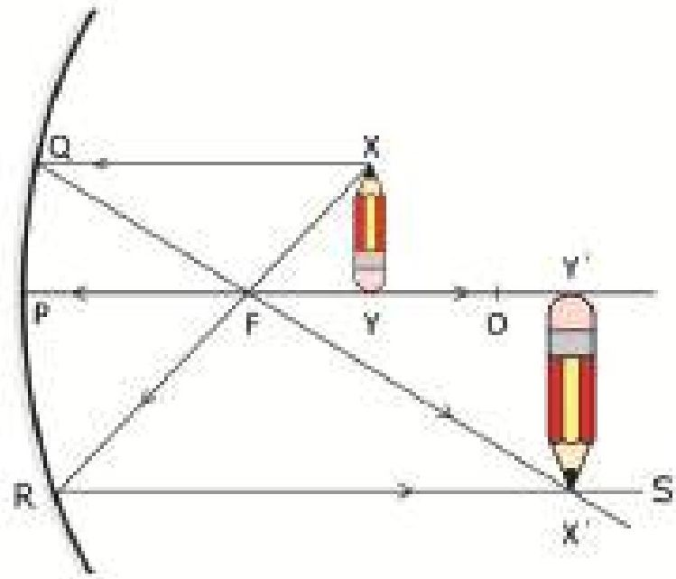

<!-- physics-9-10-bn-c08-t8.6-p029 · figure · p.231 -->
**চিত্র ৮.২৩: অবতল আয়নায় একটি বস্তু ফোকাস দূরত্বের বাইরে রাখলে প্রতিবিষ্টি হয় উল্টো।**

<!-- physics-9-10-bn-c08-t8.6-p030 · text · p.231 · review: latin-junk -->
*XY* বস্তুটি ফোকাস দূরত্বের দ্বিগুণ থেকে বেশি দূরে রাখা হয়েছে। এভাবে বস্তুরির প্রতিবিষ্টি হয়েছে ছোট। বস্তুটি যদি ঠিক ফোকাস দূরত্বের দ্বিগুণ দূরে রাখা হতো তাহলে তার প্রতিবিষ্টিও হতো এই একই বিন্দুতে, ৮.২৫ চিত্রে যেমন

<!-- physics-9-10-bn-c08-t8.6-p031 · figure · p.231 -->
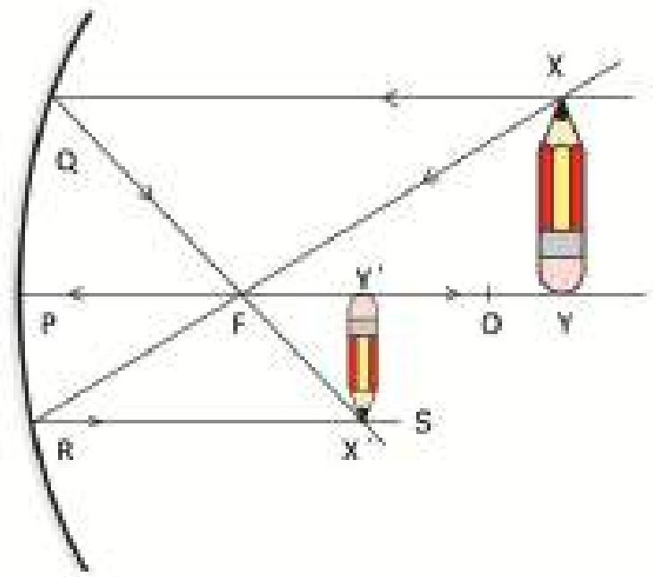

<!-- physics-9-10-bn-c08-t8.6-p032 · figure · p.231 -->
**চিত্র ৮.২৪: অবতল আয়নায় একটি বস্তু ফোকাস দূরত্বের দ্বিগুণ দূরত্বের বাইরে রাখলে প্রতিবিষ্টি উল্টো এবং ছোট হয়।**

<!-- physics-9-10-bn-c08-t8.6-p033 · text · p.231 · review: known-confusable-corrected -->
২০২৩ দেখানো হয়েছে। শুধু তাই নয়, প্রতিবিষ্টিটির আকার হতো ঠিক বস্তুটির সমান। ফোকাস দূরত্বের বাইরে রাখা এই তিনটি ভিন্ন ভিন্ন ব্যাপার এবারে গুছিয়ে লেখা যেতে পারে। ফোকাস দূরত্বের বাইরে কোনো বস্তুকে রাখা হলে তার প্রতিবিষ্টি হবে এ রকম:

<!-- physics-9-10-bn-c08-t8.6-p034 · text · p.232 · review: known-confusable-corrected -->
(a) প্রতিবিষ্টির অবস্থানটা নির্ভর করবে বস্তুটি কোথায় আছে তার ওপর। যতক্ষণ পর্যন্ত বস্তুটি ফোকাস বিন্দু এবং অবতল আয়নার কেন্দ্রের মাঝখানে আছে প্রতিবিষ্টির অবস্থানটা হবে কেন্দ্রের বাইরে। বস্তুটি যদি অবতল আয়নার বক্রতার কেন্দ্র থেকে বাইরে থাকে তাহলে তার প্রতিবিষ্টি হবে মেরুবিন্দু এবং কেন্দ্রের ভেতরে। যদি বস্তুটি ঠিক কেন্দ্রের ওপর থাকে তাহলে প্রতিবিষ্টির অবস্থানটাও হবে কেন্দ্রে।

<!-- physics-9-10-bn-c08-t8.6-p035 · text · p.232 · review: known-confusable-corrected -->
(b) প্রতিবিষ্টি বাস্তব। তাই বস্তুটাকে দিয়ে তার প্রতিবিষ্টি যে রকম বের করতে পারি ঠিক সে রকম প্রতিবিষ্টিটাকে বস্তু ধরা হলে বস্তুটাই হবে তার প্রতিবিষ্টি।

<!-- physics-9-10-bn-c08-t8.6-p036 · text · p.232 -->
(c) প্রতিবিষ্টি উল্টো।

<!-- physics-9-10-bn-c08-t8.6-p037 · text · p.232 · review: known-confusable-corrected -->
(d) প্রতিবিষ্টিটির দৈর্ঘ্য নির্ভর করবে এটি কোথায় আছে তার ওপর। যদি এটা ফোকাস বিন্দু এবং বক্রতার কেন্দ্রের মাঝখানে থাকে তাহলে প্রতিবিষ্টিটির দৈর্ঘ্য হবে বস্তুটি থেকে বড়। যত ফোকাস বিন্দুর কাছাকাছি তত বড়। যদি বস্তুটি বক্রতার কেন্দ্র থেকে বাইরে হয় তাহলে এর আকার হবে আসল বস্তুটি থেকে ছোট। যদি এটা ঠিক বক্রতার কেন্দ্রে থাকে তাহলে প্রতিবিষ্টির আকার হবে ঠিক বস্তুটির আকারের সমান।

### অবতল গোলীয় আয়নায় গঠিত প্রতিবিষ্টির বৈশিষ্ট্য

<!-- physics-9-10-bn-c08-t8.6-p038 · table · p.232 · review: verify-table -->
<table><tr><th>বস্তুর অবস্থান</th><th>প্রতিবিষ্টির অবস্থান</th><th>প্রতিবিষ্টির বৈশিষ্ট্য</th></tr>
<tr><td>অসীম দূরত্বে</td><td>ফোকাসবিন্দু F এ</td><td>বাস্তব এবং শূন্য দৈর্ঘ্যের</td></tr>
<tr><td>অসীম দূরত্ব ও কেন্দ্রবিন্দু O এর মাঝে</td><td>ফোকাসবিন্দু F এবং কেন্দ্রবিন্দু O এর মাঝে</td><td>বাস্তব, উল্টো এবং খর্চিত দৈর্ঘ্যের</td></tr>
<tr><td>কেন্দ্রবিন্দু O তে</td><td>কেন্দ্রবিন্দু O তে</td><td>বাস্তব, উল্টো এবং সমান দৈর্ঘ্যের</td></tr>
<tr><td>কেন্দ্রবিন্দু O এবং ফোকাসবিন্দু F এর মাঝে</td><td>কেন্দ্রবিন্দু O এবং অসীম দূরত্বের মাঝে</td><td>বাস্তব, উল্টো এবং বিবর্ধিত দৈর্ঘ্যের</td></tr>
<tr><td>ফোকাসবিন্দু F তে</td><td>অসীম দূরত্বের</td><td>কোন প্রতিবিষ্টির গঠন হয় না</td></tr>
<tr><td>ফোকাসবিন্দু F এবং মেরুবিন্দু P এর মাঝে</td><td>বিপরীত দিকে অসীম দূরত্ব এবং মেরুবিন্দু P এর মাঝে</td><td>অবাস্তব, সোজা এবং বিবর্ধিত</td></tr>
<tr><td>মেরুবিন্দু P তে</td><td>মেরুবিন্দু P তে</td><td>অবাস্তব, সোজা এবং সমান দৈর্ঘ্যের</td></tr></table>

<!-- physics-9-10-bn-c08-t8.6-p039 · text · p.233 -->
আমরা জ্যামিতি ব্যবহার করে উত্তল এবং অবতল আয়নার জন্য প্রতিবিম্বের অবস্থান আকার ইত্যাদি বের করেছি। আমরা চাইলে একটিমাত্র সূত্র ব্যবহার করে এই কাজগুলো করতে পারতাম, সূত্রটি হচ্ছে:

<!-- physics-9-10-bn-c08-t8.6-p040 · formula · p.233 · review: verify-formula -->
$$\frac{1}{u} + \frac{1}{v} = \frac{1}{f}$$

<!-- physics-9-10-bn-c08-t8.6-p041 · text · p.233 · review: verify-formula -->
এখানে $u$ হচ্ছে আয়নার পৃষ্ঠ থেকে বস্তুর দূরত্ব, $v$ হচ্ছে প্রতিবিম্বের দূরত্ব এবং $f$ হচ্ছে ফোকাস দূরত্ব।

<!-- physics-9-10-bn-c08-t8.6-p042 · text · p.233 · review: known-confusable-corrected -->
বাস্তব প্রতিবিম্ব খুবই গুরুত্বপূর্ণ একটি ধারণা। আমরা পরের অধ্যায়ে দেখব কেমন করে লেগ দিয়েও এ রকম বাস্তব প্রতিবিম্ব তৈরি করা যায়। তোমরা দেখতেই পেয়েছ বাস্তব প্রতিবিম্বে সত্যিকারের আলোক রশ্মি থাকে, তাই এটাকে যদি কোনো পর্দায় ফেলা যায়, সেখানে প্রতিবিম্বটি দেখাও সম্ভব হয়। সাধারণ বা সমতল আয়নায় তুমি তোমার চেহারা দেখতে পারবে কিন্তু শুধু সাধারণ আয়না দিয়ে কখনো তোমার চেহারা কোনো পর্দায় ফেলতে পারবে না।

### উদাহরণ

<!-- physics-9-10-bn-c08-t8.6-p043 · example · p.233 · review: verify-formula -->
**প্রশ্ন:** ৮.২৪ চিত্রে দেখানো হয়েছে $XY$ বস্তুটির প্রতিবিম্ব তৈরি হয়েছে $X'Y'$ এ। যদি $X'Y'$ টি বস্তুটি হতো তাহলে তার প্রতিবিম্ব কোথায় হতো?

<!-- physics-9-10-bn-c08-t8.6-p044 · figure · p.233 -->
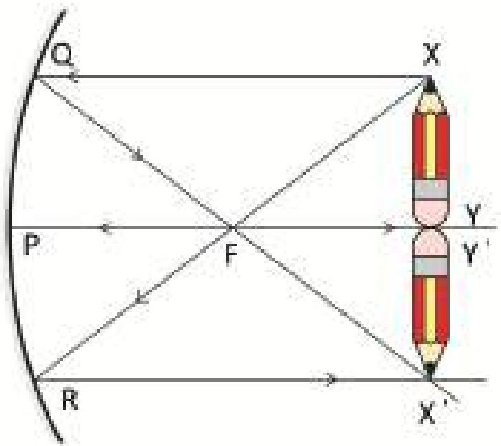

<!-- physics-9-10-bn-c08-t8.6-p045 · example · p.233 · review: verify-formula -->
**উত্তর:** এটি বাস্তব প্রতিবিম্ব। কাজেই $X'Y'$ যদি প্রকৃত বস্তু হয় তাহলে তার প্রতিবিম্ব হবে $XY$।

<!-- physics-9-10-bn-c08-t8.6-p046 · text · p.233 -->
**প্রশ্ন:** অবতল আয়নার ফোকাস দূরত্ব এর ঠিক দ্বিগুণ দূরত্বে একটি বস্তু রাখলে প্রতিবিম্বটি কোথায় দেখা যাবে?

<!-- physics-9-10-bn-c08-t8.6-p047 · text · p.233 -->
**উত্তর:** (চিত্র ৮.২৫) ঠিক একই জায়গায় একই আকারের কিন্তু উল্টো অবস্থায় দেখা যাবে।

<!-- physics-9-10-bn-c08-t8.6-p048 · figure · p.233 -->
**চিত্র ৮.২৫:** অবতল আয়নার ফোকাস দূরত্ব এর দ্বিগুণ দূরত্বে একটি বস্তু রাখলে প্রতিবিম্বটি ঠিক একই জায়গায় উল্টো অবস্থায় দেখা যায়।

<!-- physics-9-10-bn-c08-t8.6-p049 · text · p.233 -->
আমরা এতক্ষণ গোলীয় অবতল আয়নার ভেতরকার বিজ্ঞানটুকু শিখেছি, এবারে দেখা যাক কীভাবে সেটা আমরা ব্যবহার করি।

## 8.7 বিবর্ধন (Magnification)

<!-- physics-9-10-bn-c08-t8.7-p001 · text · p.234 · review: verify-formula -->
আমরা যেহেতু দেখতে পেয়েছি যে একটা প্রতিবিম্ব কখনো প্রকৃত বস্তু থেকে ছোট হয় কখনো বড় হয়, তাই বিষয়টিকে ব্যাখ্যা করার জন্য ‘বিবর্ধন’ বলে একটা শব্দ ব্যবহার করা যেতে পারে। প্রতিবিম্বটি মূল বস্তু থেকে কত গুণ বড় সেটাকে বিবর্ধন $m$ বলা হয়। যদি একটা বস্তুর আকার হয় $l$ এবং তার প্রতিবিম্বের আকার হয় $l'$ তাহলে বিবর্ধন হচ্ছে:

<!-- physics-9-10-bn-c08-t8.7-p002 · formula · p.234 · review: verify-formula -->
$$m = \frac{l'}{l}$$

<!-- physics-9-10-bn-c08-t8.7-p003 · text · p.234 · review: known-confusable-corrected -->
আমরা যখন টেলিস্কোপে কোনো বস্তুকে দেখি, খালি চোখে দেখলে সেটাকে যত বড় দেখানোর কথা টেলিস্কোপে দেখলে সেটাকে সে তুলনায় যত বড় দেখাবে, সেটাই হচ্ছে টেলিস্কোপের বিবর্ধন।

## 8.8 আয়নার ব্যবহার (Use of Mirrors)

### ৮.৮.১ সাধারণ আয়না

<!-- physics-9-10-bn-c08-t8.8-p001 · text · p.234 -->
দৈনন্দিন জীবনে সাধারণ আয়নার ব্যবহার সবচেয়ে বেশি। যখনই একদিকে পাঠানো আলোকে অন্যদিকে নিতে হয়, তখন আমরা সাধারণ আয়না ব্যবহার করি। তোমরা নিশ্চয়ই লক্ষ্য করেছ সাধারণ আয়নায় ডান এবং বাম দিক বদলে যায়। তাই যদি আমাদের ডান-বাম অবিকৃত রাখতে হয় তাহলে একটি আয়নার প্রতিবিম্ব অন্য একটি আয়নার দ্বিতীয়বার প্রতিফলিত করে আবার ঠিক করে নিতে হয়।

<!-- physics-9-10-bn-c08-t8.8-p002 · text · p.234 -->
সাধারণ আয়নার প্রতিবিম্ব ডান এবং বামের পরিবর্তন হয়। দুটি আয়নাকে পরস্পরের সাথে ৯০° তে রেখে সেটাকেই একটা আয়না হিসেবে ব্যবহার করলে ডান-বামের পরিবর্তন হয় না। দুটি আয়না দিয়ে বিষয়টা পরীক্ষা করে দেখো (চিত্র ৮.২৬)।

<!-- physics-9-10-bn-c08-t8.8-p003 · figure · p.234 -->
**চিত্র ৮.২৬: সাধারণ আয়নায় প্রতিবিম্ব ডান এবং বাম পাল্টে যায়, প্রতিবিম্যে বাম-ডান অবিকৃত রাখতে হলে দুটি আয়নাকে সমকোণে রাখতে হবে।**

<!-- physics-9-10-bn-c08-t8.8-p004 · text · p.235 -->
এখানে একটা খুব গুরুত্বপূর্ণ বিষয় জেনে রাখা ভালো, যখন খুব ভালো প্রতিফলনের প্রয়োজন হয় তখন কিন্তু সাধারণ আয়না ব্যবহার না করে সম্পূর্ণ ভিন্ন এক ধরনের প্রতিফলন করা হয়। আমরা পরের অধ্যায়ে দেখব পুরোপুরি সচ্ছ মাধ্যম দিয়ে কীভাবে আলোকে প্রতিফলিত করা যায়।

### ৮.৮.২ উত্তল আয়না

<!-- physics-9-10-bn-c08-t8.8-p005 · text · p.235 -->
উত্তল আয়নায় যেহেতু সোজা এবং ছোট প্রতিবিম্ব তৈরি করা যায়, তাই বড় কোনো দৃষ্টিকে ছোট জায়গায় দেখতে হলে উত্তল আয়না ব্যবহার করা হয়। গাড়ির দক্ষ ড্রাইভাররা গাড়ি চালানোর সময় সব সময় পেছনে কী হচ্ছে দেখার চেষ্টা করেন, সে জন্য গাড়ির ড্রাইভারের সামনে রিয়ার ভিউ মিরর থাকে। এই মিররগুলোতে উত্তল আয়না ব্যবহার করা হয় যেন ছোট একটা আয়না দিয়েই গাড়ির ড্রাইভাররা পেছনের বড় একটা জায়গা দেখতে পারেন।

### ৮.৮.৩ অবতল আয়না

<!-- physics-9-10-bn-c08-t8.8-p006 · figure · p.235 -->
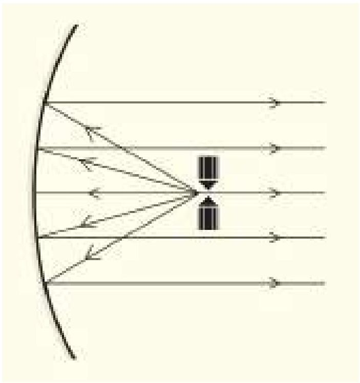

<!-- physics-9-10-bn-c08-t8.8-p007 · text · p.235 -->
অবতল আয়নার সবচেয়ে বড় ব্যবহার হচ্ছে টেলিস্কোপে। পৃথিবীর সবচেয়ে বড় এবং সবচেয়ে সূক্ষ্ম টেলিস্কোপে অবতল আয়না ব্যবহার করা হয়। অনেক সাধারণভাবে মনে করে দূরের কোনো ছোট জিনিসকে অনেক বড় করে দেখানোই বুঝি ভালো টেলিস্কোপের দায়িত্ব। আসলে সেটি সত্যি নয়, ভালো টেলিস্কোপের দায়িত্ব অনেক কম আলোতেও স্পষ্ট প্রতিবিম্ব তৈরি করা। সেজন্য অবতল আয়নার আকার যত বড় হবে, সেটি তত বেশি আলো সংগ্রহ করে তত স্পষ্ট প্রতিবিম্ব তৈরি করতে পারবে। পৃথিবীর সব বড় বড় টেলিস্কোপে অবতল আয়না ব্যবহার করা হয়।

<!-- physics-9-10-bn-c08-t8.8-p008 · text · p.235 -->
অবতল আয়নার আরেকটি ব্যবহার হচ্ছে আলোকের সমান্তরাল বিম বা রশ্মি গুচ্ছ তৈরি করা। জাহাজ বা লণ্ঠনের সার্চলাইটে অবতল আয়না ব্যবহার হয়। আলোর উৎসটুকু থাকে ফোকাস বিন্দুতে (চিত্র ৮.২৭), তাই সেটি অবতল আয়নায় প্রতিফলিত হয়ে সমান্তরাল বিম হিসেবে বের হয়ে যায়। তোমরা দৈনন্দিন জীবনে যে টর্চলাইট ব্যবহার করো সেখানেও বাল্বটি রাখা হয় একটি অবতল আয়নার ফোকাস বিন্দুতে।

<!-- physics-9-10-bn-c08-t8.8-p009 · text · p.235 -->
অবতল আয়নায় ফোকাস দূরত্বের ভেতরে কিছু থাকলে যেহেতু সোজা এবং বড় প্রতিবিম্ব তৈরি হয় তাই কোনো কিছু বড় করে দেখতে হলেও অবতল আয়না ব্যবহার করা হয়। ডাক্তার কিংবা ডেন্টিস্টরা তাই অনেক সময়ই কিছু দেখার জন্য অবতল আয়না ব্যবহার করেন।

### ৮.৮.৪ পাহাড়ি রাস্তার অদ্ভুত ব্যঁক

<!-- physics-9-10-bn-c08-t8.8-p010 · text · p.236 -->
পাহাড়ি রাস্তা সাধারণত আঁকাবাঁকা হয় আবার একই সাথে উঁচু-নিচু হয়। শুধু তাই নয়, অনেক সময়ই রাস্তার এক পাশে উঁচু পাহাড় অন্য পাশে গভীর খাদ থাকে। কাজেই পাহাড়ি রাস্তায় গাড়ি চালানোর সময় অনেক সতর্ক থাকতে হয়। তারপরও স্থানে স্থানে গাড়ি চালানো ঝুঁকিপূর্ণ হতে পারে। বিশেষ করে যখন প্রায় সমকোণে ব্যঁক নিতে হয় তখন রাস্তার অন্য পাশ দিয়ে কী আসছে সেটা জানার কোনো উপায় থাকে না। এরকম অবস্থায় ব্যঁকগুলোতে ৪৫° কোণে বড় আকারের সমতল বা উল্লম আয়না বসানো হয়। তখন রাস্তার দুই পাশের সব যানবাহনই রাস্তার অন্য পাশে কী আছে সেটি দেখতে পায় এবং রাস্তায় গাড়ি চালানো তুলনামূলকভাবে নিরাপদ হয়ে যায়।

<!-- physics-9-10-bn-c08-t8.8-p011 · figure · p.236 -->
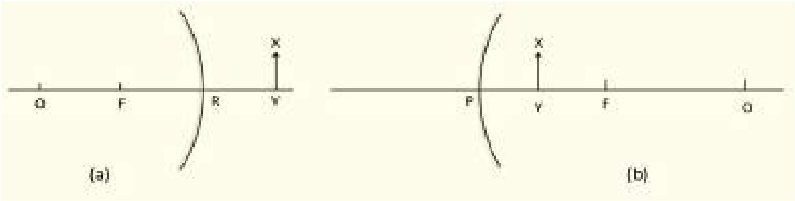

<!-- physics-9-10-bn-c08-t8.8-p012 · figure · p.236 -->
**চিত্র ৮.২৯: (a) উল্লম আয়নায় ফোকাস দূরত্বের ভেতরে রাখা একটি বস্তু। (b) অবতল আয়নায় ফোকাস দূরত্বের ভেতরে রাখা একটি বস্তু।**

<!-- physics-9-10-bn-c08-t8.8-p013 · text · p.236 · review: latin-junk -->
**XY বস্তুটির জন্য (চিত্র ৮.২৯) আলোক রশ্মিগুলো ঐকে প্রতিবিম্ব কোথায় হবে দেখাও।**

<!-- physics-9-10-bn-c08-t8.8-p014 · figure · p.236 -->
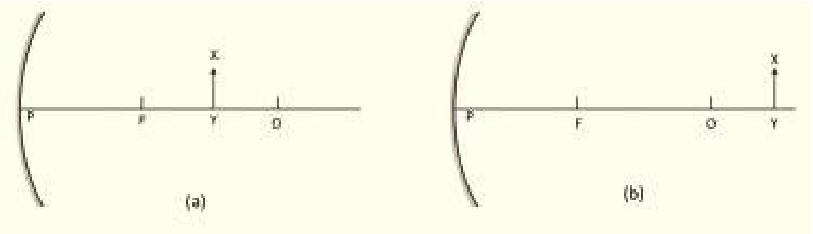

<!-- physics-9-10-bn-c08-t8.8-p015 · figure · p.236 -->
**চিত্র ৮.৩০: (a) অবতল আয়নায় ফোকাস দূরত্বের বাইরে রাখা একটি বস্তু। (b) অবতল আয়নায় দ্বিগুণ ফোকাস দূরত্বের বাইরে রাখা একটি বস্তু।**

<!-- physics-9-10-bn-c08-t8.8-p016 · text · p.236 · review: latin-junk -->
**XY বস্তুটির জন্য (চিত্র ৮.৩০) আলোক রশ্মিগুলো ঐকে প্রতিবিম্ব কোথায় হবে দেখাও।**

## 8.ex নমুনা প্রশ্ন

### বহুনির্বাচনি প্রশ্ন

<!-- physics-9-10-bn-c08-t8.ex-p001 · exercise · p.237 -->
সঠিক উত্তরটির পাশে টিক (√) চিহ্ন দাও

<!-- physics-9-10-bn-c08-t8.ex-p002 · exercise · p.237 -->
১. উত্তল দর্পণ কোথায় ব্যবহার হয়?

<!-- physics-9-10-bn-c08-t8.ex-p003 · exercise · p.237 -->
(ক) গাড়িতে
(খ) টর্চলাইটে
(গ) সৌরচুল্লিতে
(ঘ) রাডারে

<!-- physics-9-10-bn-c08-t8.ex-p004 · exercise · p.237 -->
২. প্রতিফলন কত প্রকার?

<!-- physics-9-10-bn-c08-t8.ex-p005 · exercise · p.237 -->
(ক) 4
(খ) 3
(গ) 2
(ঘ) 1

<!-- physics-9-10-bn-c08-t8.ex-p006 · exercise · p.237 -->
৩. সমতল দর্পণে সৃষ্ট প্রতিবিম্ব-

<!-- physics-9-10-bn-c08-t8.ex-p007 · exercise · p.237 -->
(i) আকারে লক্ষ্যবস্তুর সমান
(ii) পর্দায় গঠন করা যায়
(iii) দর্পণ থেকে বস্তুর দূরত্বের সমান দূরত্বে গঠিত হয়।

<!-- physics-9-10-bn-c08-t8.ex-p008 · exercise · p.238 -->
নিচের কোনটি সঠিক?

<!-- physics-9-10-bn-c08-t8.ex-p009 · exercise · p.238 · review: latin-junk -->
(ক) i ও ii

<!-- physics-9-10-bn-c08-t8.ex-p010 · exercise · p.238 · review: latin-junk -->
(খ) ii ও iii

<!-- physics-9-10-bn-c08-t8.ex-p011 · exercise · p.238 · review: latin-junk -->
(গ) i ও iii

<!-- physics-9-10-bn-c08-t8.ex-p012 · exercise · p.238 · review: latin-junk -->
(ঘ) i, ii ও iii

<!-- physics-9-10-bn-c08-t8.ex-p013 · exercise · p.238 -->
৮.৩১ চিত্রের আলোকে ৪ ও ৫ নং প্রশ্নের উত্তর দাও।

<!-- physics-9-10-bn-c08-t8.ex-p014 · figure · p.238 -->
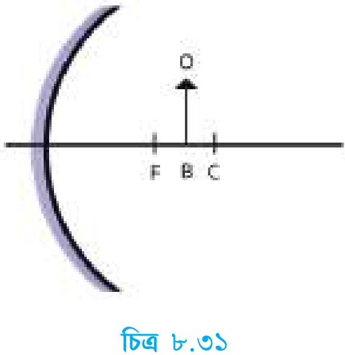

<!-- physics-9-10-bn-c08-t8.ex-p015 · figure · p.238 -->
**চিত্র ৮.৩১**

<!-- physics-9-10-bn-c08-t8.ex-p016 · exercise · p.238 · review: latin-junk -->
৪. BO বস্তুর প্রতিবিম্বের আকৃতি কীরূপ হবে-

<!-- physics-9-10-bn-c08-t8.ex-p017 · exercise · p.238 -->
(ক) বিবর্ধিত

<!-- physics-9-10-bn-c08-t8.ex-p018 · exercise · p.238 -->
(খ) খর্বিত

<!-- physics-9-10-bn-c08-t8.ex-p019 · exercise · p.238 -->
(গ) অত্যন্ত বিবর্ধিত

<!-- physics-9-10-bn-c08-t8.ex-p020 · exercise · p.238 -->
(ঘ) অত্যন্ত খর্বিত

<!-- physics-9-10-bn-c08-t8.ex-p021 · exercise · p.239 · review: latin-junk -->
৫. BO বস্তুর প্রতিবিম্বের অবস্থান কোথায় হবে?

<!-- physics-9-10-bn-c08-t8.ex-p022 · exercise · p.239 -->
(ক) ফোকাস ও মেবুর মাঝে

<!-- physics-9-10-bn-c08-t8.ex-p023 · exercise · p.239 -->
(খ) প্রধান ফোকাসে

<!-- physics-9-10-bn-c08-t8.ex-p024 · exercise · p.239 -->
(গ) বক্রতার কেন্দ্রে

<!-- physics-9-10-bn-c08-t8.ex-p025 · exercise · p.239 -->
(ঘ) বক্রতার কেন্দ্র ও অসীমের মাঝে

### সৃজনশীল প্রশ্ন

<!-- physics-9-10-bn-c08-t8.ex-p026 · exercise · p.239 · review: known-confusable-corrected -->
১. চিত্র ৮.৩৩

<!-- physics-9-10-bn-c08-t8.ex-p027 · figure · p.239 · review: known-confusable-corrected -->
drawing: A line segment PQ with a ray incident at an angle of 60 degrees to the vertical line PQ.

<!-- physics-9-10-bn-c08-t8.ex-p028 · figure · p.239 · review: known-confusable-corrected -->
**চিত্র ৮.৩৩**

<!-- physics-9-10-bn-c08-t8.ex-p029 · exercise · p.239 · review: known-confusable-corrected -->
(ক) প্রতিবিম্ব কাকে বলে?

<!-- physics-9-10-bn-c08-t8.ex-p030 · exercise · p.239 · review: known-confusable-corrected -->
(খ) দর্পণে লম্বভাবে আপতিত রশ্মি একই পথে ফিরে আসে কেন?

<!-- physics-9-10-bn-c08-t8.ex-p031 · exercise · p.239 · review: known-confusable-corrected -->
(গ) চিত্রের আলোকে প্রতিফলন কোণের মান নির্ণয় করো।

<!-- physics-9-10-bn-c08-t8.ex-p032 · exercise · p.239 · review: latin-junk,known-confusable-corrected -->
(ঘ) PQ দর্পণে গঠিত প্রতিবিম্ব অবস্থত্ব—চিত্রসহ ব্যাখ্যা করো।

<!-- physics-9-10-bn-c08-t8.ex-p033 · exercise · p.240 · review: known-confusable-corrected -->
২. একদল শিক্ষার্থী ব্যবহারিক ল্যাবে একটি পরীক্ষণের প্রথম পর্যায়ে একটি অবতল দর্পণের সামনে 2cm দৈর্ঘ্যের একটি কাঠি রাখায় পর্দায় এর 3.51 গুণ বড় প্রতিবিম্ব দেখতে পেল। পরীক্ষণের দ্বিতীয় পর্যায়ে পর্দায় এর ৬ গুণ বড় প্রতিবিম্ব দেখতে পেল।

<!-- physics-9-10-bn-c08-t8.ex-p034 · exercise · p.240 · review: known-confusable-corrected -->
(ক) বিবরণ কী?

<!-- physics-9-10-bn-c08-t8.ex-p035 · exercise · p.240 · review: known-confusable-corrected -->
(খ) ভিউ মিরর বা দেখার দর্পণ হিসেবে সমতল দর্পণ ব্যবহার করা হয় না কেন?

<!-- physics-9-10-bn-c08-t8.ex-p036 · exercise · p.240 · review: known-confusable-corrected -->
(গ) পরীক্ষণের প্রথম পর্যায়ে কাঠিটির প্রতিবিম্বের দৈর্ঘ্য ও প্রকৃতি নির্ণয় করো।

<!-- physics-9-10-bn-c08-t8.ex-p037 · exercise · p.240 · review: known-confusable-corrected -->
(ঘ) পরীক্ষণের দ্বিতীয় পর্যায়ে কী কী পরিবর্তন করা হয়েছিল?

### সংক্ষিপ্ত উত্তর প্রশ্ন

<!-- physics-9-10-bn-c08-t8.ex-p038 · exercise · p.240 -->
১. আলোর প্রতিফলন বলতে কী বোঝায়?

<!-- physics-9-10-bn-c08-t8.ex-p039 · exercise · p.240 -->
২. মূদু আলোতে গাছের পাতা কালো দেখায়-ব্যাখ্যা করো।

<!-- physics-9-10-bn-c08-t8.ex-p040 · exercise · p.240 -->
৩. বাস্তব বিম্ব বলতে কী বোঝায়?

<!-- physics-9-10-bn-c08-t8.ex-p041 · exercise · p.240 -->
৪. দর্পণে লক্ষ্যভাবে আপতিত রশ্মি প্রতিফলিত হয়ে একই পথে ফিরে আসে কেন?
