# 9. আলোর প্রতিসরণ

Source: Physics Bangla Version, printed pp. 241-269

## 9.0 ভূমিকা ও শিখনফল

<!-- physics-9-10-bn-c09-t9.0-p001 · figure · p.241 -->

<!-- physics-9-10-bn-c09-t9.0-p002 · text · p.241 · review: verify-formula -->
শূন্যস্থানে আলোর বেগ প্রতি সেকেন্ডে $2.99792458 \times 10^8$ m। আলো যখন অন্য কোনো মাধ্যমে প্রবেশ করে, তখন আলোর বেগ এর থেকে কমে যায় এবং এই প্রক্রিয়াটিকে ব্যাখ্যা করার জন্য প্রতিসরণাঙ্ক বলে একটি রাশি সংজ্ঞায়িত করা হয়েছে। তোমরা ইচ্ছা করলেই দেখাতে পারবে আলোর বেগের তারতম্যের জন্য এক মাধ্যম থেকে অন্য মাধ্যমে যাওয়ার সময় আলোক রশ্মি বৈকে যায় অর্থাৎ দিক পরিবর্তন করে।

<!-- physics-9-10-bn-c09-t9.0-p003 · text · p.241 -->
আলোর এই ধর্ম বা প্রতিসরণের কারণে পূর্ণ অভ্যন্তরীণ প্রতিফলন নামে একটি অত্যন্ত চমকপ্রদ ব্যাপার ঘটে পারে। এই অধ্যায়ে আমরা পূর্ণ অভ্যন্তরীণ প্রতিফলনের নানা ধরনের ব্যবহার নিয়ে আলোচনা করব।

<!-- physics-9-10-bn-c09-t9.0-p004 · text · p.241 -->
একটি বিন্দু থেকে আগত আলোকরশ্মিসমূহ একটি উত্তল বা অবতল লেন্সের মধ্য দিয়ে প্রতিসরণের পর ঐ বিন্দুটির একটি বিস্ত তৈরি করে। বিভিন্ন অবস্থায় এই বিস্ত বিভিন্ন ধরনের হতে পারে। এই অধ্যায়ে আমরা এই বিস্তের ধরনসমূহ আলোচনা করব।

### এ অধ্যায় শেষে আমরা –

<!-- physics-9-10-bn-c09-t9.0-p005 · objective · p.242 -->
* প্রতিসরণের সূত্র ব্যাখ্যা করতে পারব।
* প্রতিসরণাঙ্ক ব্যাখ্যা করতে পারব।
* পূর্ণ অভ্যন্তরীণ প্রতিফলন ব্যাখ্যা করতে পারব।
* অপটিক্যাল ফাইবারের ব্যবহার ব্যাখ্যা করতে পারব।
* লেন্স এবং এর প্রকারভেদ ব্যাখ্যা করতে পারব।
* আলোকরশ্মির ক্রিয়ারেখা অঙ্কন করে লেন্সসংক্রান্ত বিভিন্ন রাশি বর্ণনা করতে পারব।
* লেন্সে সূক্ষ্ট প্রতিবিম্ব আলোক রশ্মির ক্রিয়ারেখা অঙ্কন করে বর্ণনা করতে পারব।
* লেন্সের ক্ষমতা ব্যাখ্যা করতে পারব।

## 9.1 আলোর প্রতিসরণ (Refraction of Light)

<!-- physics-9-10-bn-c09-t9.1-p001 · text · p.243 -->
তোমরা এর মাঝে জেনে গেছ যে আলো যখন একটা মাধ্যম থেকে অন্য মাধ্যমে প্রবেশ করতে চায় তখন তিনটি ভিন্ন ভিন্ন ঘটনা ঘটতে পারে। একটি হচ্ছে প্রতিফলন, যখন প্রথম মাধ্যম থেকে দ্বিতীয় মাধ্যমে প্রবাহিত হওয়ার সময় খানিকটা আলো আবার প্রথম মাধ্যমে ফিরে আসে, এবং সে বিষয়টি আমরা আগের অধ্যায়ে আলোচনা করেছি। দ্বিতীয়টি হচ্ছে প্রতিসরণ, যখন প্রথম মাধ্যম থেকে দ্বিতীয় মাধ্যমে আলো প্রবেশ করে, যে বিষয়টি আমরা এই অধ্যায়ে আলোচনা করব। তৃতীয়টি হচ্ছে শোষণ, যখন খানিকটা আলো দ্বিতীয় মাধ্যম দ্বারা শোষিত হয়, যে বিষয়টি আমরা আলোচনা করব না।

<!-- physics-9-10-bn-c09-t9.1-p002 · text · p.243 · review: verify-formula -->
আলোর প্রতিসরণ বোঝার জন্য প্রতিসরণাঙ্ক বলে একটা রাশি ($n$) ব্যবহার করা হয়। আমরা জানি, শূন্য স্থানে আলোর বেগ $2.99 \times 10^8$ m/s, [ব্যবহারিক ক্ষেত্রে এটি $3 \times 10^8$ m/s ধরা হয়] এবং অন্য যে কোনো মাধ্যমের ভেতর দিয়ে আলোর বেগ এর চেয়ে কম। একটি মাধ্যমে আলোর বেগ শূন্যস্থানে বেগের যত গুণ কম সেটাই হচ্ছে ঐ মাধ্যমটার প্রতিসরণাঙ্ক। যেমন, $20^\circC$ তাপমাত্রার পানিতে আলোর বেগ হচ্ছে $2.26 \times 10^8$ m/s, কাজেই ঐ তাপমাত্রায় পানির প্রতিসরণাঙ্ক হচ্ছে:

<!-- physics-9-10-bn-c09-t9.1-p003 · formula · p.243 · review: verify-formula -->
$$n = \frac{c}{v} = \frac{3 \times 10^8  m/s}{2.26 \times 10^8  m/s} = 1.33$$

<!-- physics-9-10-bn-c09-t9.1-p004 · text · p.243 · review: verify-formula -->
অর্থাৎ শূন্য স্থানে আলোর বেগ $20^\circC$ তাপমাত্রার পানিতে আলোর বেগ থেকে 1.33 গুণ বেশি।

<!-- physics-9-10-bn-c09-t9.1-p005 · text · p.243 -->
ফাইবার অপটিক কেবল এর কাচের তন্তুর প্রতিসরণাঙ্ক 1.5, কাজেই ফাইবারের ভেতর দিয়ে আলোর বেগ

<!-- physics-9-10-bn-c09-t9.1-p006 · formula · p.243 · review: verify-formula -->
$$v = 3 \times 10^8  ms^{-1} / 1.50 = 2.00 \times 10^8  ms^{-1}$$

<!-- physics-9-10-bn-c09-t9.1-p007 · text · p.243 · review: verify-formula -->
প্রতিসরণাঙ্ক একটি সংখ্যা এবং এর কোনো একক নেই। যেহেতু আলোর সর্বোচ্চ বেগ $c$, সেহেতু $n$ এর মান সবসময়ই 1 থেকে বেশি। ৯.০১ টেবিলে কিছু পদার্থের প্রতিসরণাঙ্ক দেওয়া হয়েছে। শূন্য মাধ্যমে স্বাভাবিকভাবেই $n$ এর মান হবে 1, বাতাসের প্রতিসরণাঙ্ক 1.00029, এটি 1 এর এত কাছাকাছি যে আমরা এটিকে 1 হিসাবেই ধরে নেব।

<!-- physics-9-10-bn-c09-t9.1-p008 · table · p.243 · review: verify-table -->
**টেবিল ৯.০১: ভিন্ন ভিন্ন মাধ্যমে আলোর প্রতিসরণাঙ্ক**
<table><tr><td>শূন্য মাধ্যম</td><td>1.00</td></tr>
<tr><td>বাতাস</td><td>1.00029</td></tr>
<tr><td>পানি (20°C)</td><td>1.33</td></tr>
<tr><td>সাধারণ কাচ</td><td>1.52</td></tr>
<tr><td>হীরা</td><td>2.42</td></tr></table>

### উদাহরণ

<!-- physics-9-10-bn-c09-t9.1-p009 · example · p.243 -->
**প্রশ্ন:** 9.01 টেবিলে দেখানো মাধ্যমগুলোতে আলোর বেগ কত বের করো।

<!-- physics-9-10-bn-c09-t9.1-p010 · example · p.243 · review: verify-formula -->
**উত্তর:** কোনো মাধ্যমে আলোর বেগ $v = \frac{c}{n}$

<!-- physics-9-10-bn-c09-t9.1-p011 · text · p.244 · review: verify-formula -->
শূন্য মাধ্যমে $v = 3 \times 10^8  ms^{-1} / 1.00 = 3 \times 10^8  ms^{-1}$

<!-- physics-9-10-bn-c09-t9.1-p012 · text · p.244 · review: verify-formula -->
বাতাসে $v = 3 \times 10^8  ms^{-1} / 1.00029 = 3 \times 10^8  ms^{-1}$

<!-- physics-9-10-bn-c09-t9.1-p013 · text · p.244 · review: verify-formula -->
পানিতে $v = 3 \times 10^8  ms^{-1} / 1.33 = 2.26 \times 10^8  ms^{-1}$

<!-- physics-9-10-bn-c09-t9.1-p014 · text · p.244 · review: verify-formula -->
সাধারণ কাচে $v = 3 \times 10^8  ms^{-1} / 1.52 = 2 \times 10^8  ms^{-1}$

<!-- physics-9-10-bn-c09-t9.1-p015 · text · p.244 · review: verify-formula -->
হীরাতে $v = 3 \times 10^8  ms^{-1} / 2.42 = 1.24 \times 10^8  ms^{-1}$

<!-- physics-9-10-bn-c09-t9.1-p016 · text · p.244 -->
এখানে উল্লেখ্য, শূন্য মাধ্যম ছাড়া অন্য কোনো মাধ্যমের প্রতিসরণাঙ্ক বলতে হলে সেটি কোন তরঙ্গ দৈর্ঘ্যের আলোতে মাপা হয়েছে সেটি বলে দিতে হয়। কারণ এই প্রতিসরণাঙ্ক আলোর তরঙ্গদৈর্ঘ্যের ওপর নির্ভর করে।

<!-- physics-9-10-bn-c09-t9.1-p017 · figure · p.244 -->
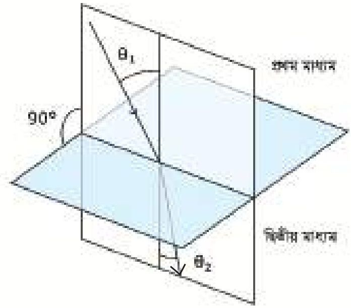

### ৯.১.১ প্রতিসরণের সূত্র

<!-- physics-9-10-bn-c09-t9.1-p018 · text · p.244 -->
প্রতিফলনের বেলায় আলোক রশ্মি যে বিন্দুতে পড়েছে আমরা সেই বিন্দু থেকে একটি লম্ব কল্পনা করে নিয়েছিলাম, এখানেও সেই একই কাজ করতে হবে। ৯.০১ চিত্রটিতে লম্বের সাথে আপতিত রশ্মিটির কোণকে বলব আপতন কোণ, দ্বিতীয় মাধ্যমে লম্বের সাথে প্রতিসরিত রশ্মির কোণকে বলব প্রতিসরণ কোণ।

<!-- physics-9-10-bn-c09-t9.1-p019 · figure · p.244 -->
**চিত্র ৯.০১: প্রথম মাধ্যম থেকে দ্বিতীয় মাধ্যমে আলোর প্রতিসরণ।**

<!-- physics-9-10-bn-c09-t9.1-p020 · text · p.244 · review: verify-formula -->
> **প্রতিসরণের প্রথম সূত্র:** আপতন রশ্মি এবং লম্ব দিয়ে আমরা যে সমতলটি কল্পনা করে নিয়েছি প্রতিসরিত রশ্মি সেই সমতলে থাকবে।
>
> **প্রতিসরণের দ্বিতীয় সূত্র:** প্রথম মাধ্যমের প্রতিসরণাঙ্ক $n_1$, দ্বিতীয় মাধ্যমের প্রতিসরণাঙ্ক $n_2$, আপতন কোণ $\theta_1$, এবং প্রতিসরণ কোণ $\theta_2$, হলে
>
> $$n_1 \sin \theta_1 = n_2 \sin \theta_2$$

<!-- physics-9-10-bn-c09-t9.1-p021 · text · p.244 -->
এই অতি সহজ সূত্রটি মনে রাখলে তুমি প্রতিসরণ-সংক্রান্ত সব সমস্যার সমাধান করে ফেলতে পারবে।

<!-- physics-9-10-bn-c09-t9.1-p022 · text · p.245 · review: verify-formula -->
যদি প্রথম মাধ্যমটি শূন্য বা বাতাস হয় তাহলে $n_1 = 1$ ধরে লিখতে পারি (চিত্র ৯.০২)

<!-- physics-9-10-bn-c09-t9.1-p023 · formula · p.245 · review: verify-formula -->
$$n_2 = \frac{\sin \theta_1}{\sin \theta_2}$$

<!-- physics-9-10-bn-c09-t9.1-p024 · text · p.245 · review: verify-formula -->
$n_2$ এর মান ১ থেকে বেশি, তাই $\theta_2 < \theta_1$ অর্থাৎ প্রতিসরণের পর আলোক রশ্মিটি লক্ষ্যের দিকে সরে যাবে। $n$ বেশি হলে আমরা অনেক সময় তাকে ‘ঘন মাধ্যম’ বুলি। মনে রাখতে হবে এখানে মাধ্যমের ভরের কারণে ঘন বলছি না। এটাকে ঘন বলতে বোঝানো হচ্ছে এর $n$ বেশি। কাজেই প্রতিসরণের দ্বিতীয় সূত্র থেকে আমরা বলতে পারি, আলো হালকা মাধ্যম থেকে ঘন মাধ্যমে প্রবেশ করলে প্রতিসরিত রশ্মি লক্ষ্যের দিকে বেঁকে যাবে। আবার ঘন মাধ্যম থেকে হালকা মাধ্যমে প্রবেশ করলে সেটি লক্ষ থেকে দূরে সরে যাবে। (চিত্র ৯.০২)

<!-- physics-9-10-bn-c09-t9.1-p025 · figure · p.245 -->
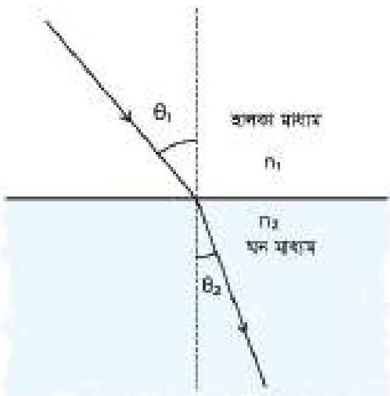

<!-- physics-9-10-bn-c09-t9.1-p026 · figure · p.245 -->
**চিত্র ৯.০২: হালকা মাধ্যম থেকে ঘন মাধ্যমে হওয়ার সময় আলো লক্ষ্যের দিকে বেঁকে যায়। ঘন মাধ্যম থেকে হালকা মাধ্যমে যাবার সময় আলো লক্ষ থেকে দূরে সরে যায়।**

<!-- physics-9-10-bn-c09-t9.1-p027 · text · p.245 -->
প্রতিসরণ নিয়ে আলোচনা করা হচ্ছে বলে এই চিত্রগুলোতে শুধু আপতন রশ্মি এবং প্রতিসরিত রশ্মি আঁকা হয়েছে, কিন্তু সবাইকে মনে রাখতে হবে যখনই একটি আলোক রশ্মি এক মাধ্যম থেকে অন্য মাধ্যমে প্রবেশ করে তখনই খানিকটা আলো প্রতিফলিত হয়। দুটো মাধ্যমের মাঝে কতখানি আলো প্রতিফলিত হবে এবং কতখানি প্রতিসরিত হবে সেটা নির্ভর করে মাধ্যম দুটির ওপর এবং আপতন কোণের ওপর। আপতন কোণ বাড়তে থাকলে সব সময়ই প্রতিফলন বাড়তে থাকে।

<!-- physics-9-10-bn-c09-t9.1-p028 · text · p.245 · review: known-confusable-corrected -->
ভরের কারণে যে ঘনত্ব তার সাথে একটি মাধ্যমের প্রতিসরণাঙ্কের সরাসরি কোন সম্পর্ক নেই। তবে সাধারণত: দেখা যায় যে অধিক ঘনত্বের মাধ্যমের প্রতিসরণাঙ্ক বেশী হয়, যদিও এর ব্যতিক্রমও আছে। কম ঘনত্বের বায়ু মাধ্যমের প্রতিসরণাঙ্কের তুলনায় বেশী ঘনত্বের বায়ু মাধ্যমের প্রতিসরণাঙ্ক বেশী হয়।

### নিজে করো

<!-- physics-9-10-bn-c09-t9.1-p029 · figure · p.246 -->
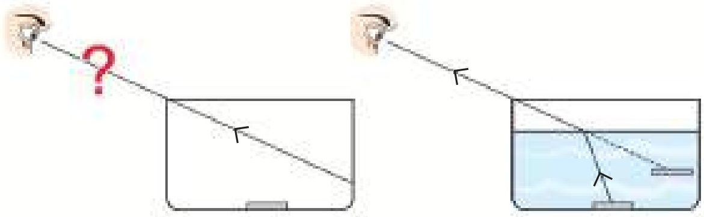

<!-- physics-9-10-bn-c09-t9.1-p030 · figure · p.246 -->
**চিত্র৯.০৩: পানি ও কাঁচের ভেতর আলোর প্রতিসরণ।**

<!-- physics-9-10-bn-c09-t9.1-p031 · text · p.246 -->
একটি কাপের মাঝে একটা মুদ্রা রেখে সেটাকে সামনে এমনভাবে রাখো যেন সেটি দেখা না যায়। মাথা না নাড়িয়ে মুদ্রাটি কীভাবে দেখা সম্ভব? কাপে পানি ঢাললেই মুদ্রাটি দৃশ্যমান হয়ে যাবে (চিত্র৯.০৩)। প্রতিসরণের কারণে আলো বাঁকা হয়ে এসে তোমার চোখে পড়বে। তোমার চোখ ঐ বাঁকা আলোর দিক বরাবর মুদ্রাটি দেখতে পাবে। শুধু তাই নয়, তোমার কাছে মনে হবে মুদ্রাটি বুঝি উপরে উঠে এসেছে।

### উদাহরণ

<!-- physics-9-10-bn-c09-t9.1-p032 · example · p.246 · review: verify-formula -->
**প্রশ্ন:** বাতাস থেকে আলোক রশ্মি $n = 1.6$ মাধ্যমে $45^\circ$ তে আপতিত হয়েছে। (চিত্র ৯.০৪ a) এটি কত ডিগ্রি কোণে দ্বিতীয় মাধ্যমে প্রবেশ করবে?

<!-- physics-9-10-bn-c09-t9.1-p033 · example · p.246 · review: verify-formula -->
**উত্তর:** আমরা জানি $n_1 \sin \theta_1 = n_2 \sin \theta_2$

<!-- physics-9-10-bn-c09-t9.1-p034 · text · p.246 · review: verify-formula -->
কাজেই $\sin \theta_2 = \frac{n_1}{n_2} \sin \theta_1 = \frac{1}{1.6} \times \frac{1}{\sqrt{2}} = 0.44$

<!-- physics-9-10-bn-c09-t9.1-p035 · formula · p.246 · review: verify-formula -->
$\theta_2 = 26^\circ$

<!-- physics-9-10-bn-c09-t9.1-p036 · text · p.246 · review: verify-formula -->
**প্রশ্ন:** ৯.০৪(b) চিত্রটিতে একটি রশ্মি $60^\circ$ তে বাতাস থেকে একটি মাধ্যমে প্রবেশ করে $45^\circ$ কোণে দ্বিতীয় মাধ্যমে প্রতিসরিত হচ্ছে। দ্বিতীয় মাধ্যমটির প্রতিসরণাঙ্ক কত?

<!-- physics-9-10-bn-c09-t9.1-p037 · figure · p.247 -->
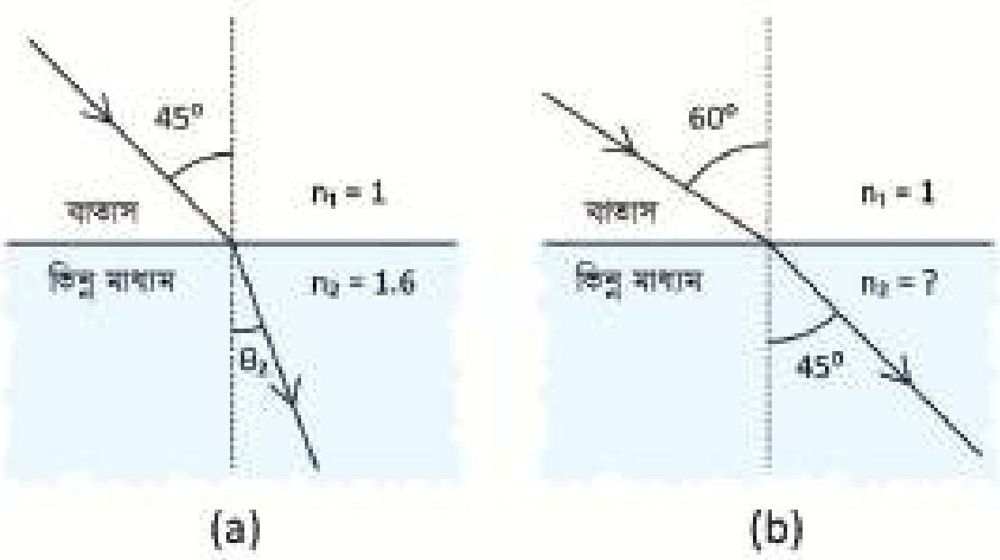

<!-- physics-9-10-bn-c09-t9.1-p038 · figure · p.247 -->
**চিত্র ৯.০৪: (a) আলো ৪৫° কোণে আপতিত হচ্ছে (b) আলো ৬০° কোণে আপতিত হয়ে ৪৫° কোণে প্রতিসরিত হচ্ছে।**

<!-- physics-9-10-bn-c09-t9.1-p039 · text · p.247 · review: verify-formula -->
**উত্তর:** আমরা জানি $n_1 \sin \theta_1 = n_2 \sin \theta_2$

<!-- physics-9-10-bn-c09-t9.1-p040 · formula · p.247 · review: verify-formula -->
$$1 \times \sin 60^\circ = n_2 \sin 45^\circ$$

<!-- physics-9-10-bn-c09-t9.1-p041 · formula · p.247 · review: verify-formula -->
$$n_2 = \frac{\sin 60^\circ}{\sin 45^\circ} = 1.22$$

### ৯.১.২ আপেক্ষিক প্রতিসরণাঙ্ক

<!-- physics-9-10-bn-c09-t9.1-p042 · text · p.247 -->
আমরা বলেছি কোনো মাধ্যমের প্রতিসরণাঙ্ক সব সময় ১ থেকে বেশি হয়। কারণ প্রতিসরণাঙ্ক হলো শূন্য মাধ্যমে আলোর বেগের তুলনায় সেই মাধ্যমে আলোর বেগের মান। মাঝে মাঝে এক মাধ্যমের প্রতিসরণাঙ্কের তুলনায় অন্য মাধ্যমের প্রতিসরণাঙ্ক প্রকাশ করা হয়, তখন কোনটির সাথে কোনটির তুলনা করা হয়েছে তার ওপর নির্ভর করে সেটা ১ থেকে কম হতে পারে।

<!-- physics-9-10-bn-c09-t9.1-p043 · text · p.247 -->
যেমন পানিকে প্রথম মাধ্যম এবং কাচকে দ্বিতীয় মাধ্যম ধরলে (চিত্র ৯.০৫)

<!-- physics-9-10-bn-c09-t9.1-p044 · formula · p.247 · review: verify-formula -->
$$n_1 \sin \theta_1 = n_2 \sin \theta_2$$

<!-- physics-9-10-bn-c09-t9.1-p045 · formula · p.247 · review: verify-formula -->
$$n_1 = 1.33$$

<!-- physics-9-10-bn-c09-t9.1-p046 · formula · p.247 · review: verify-formula -->
$$n_2 = 1.52$$

<!-- physics-9-10-bn-c09-t9.1-p047 · text · p.247 · review: verify-formula -->
সুতরাং পানির সাপেক্ষে কাচের প্রতিসরণাঙ্ক $\frac{v_1}{v_2} = \frac{v_0 / v_2}{v_0 / v_1} = \frac{n_2}{n_1} = \frac{\sin \theta_1}{\sin \theta_2} = 1.14$

<!-- physics-9-10-bn-c09-t9.1-p048 · text · p.247 · review: verify-formula -->
যেটি ১ থেকে বেশি। এখানে $v_0$ বলতে শূন্য মাধ্যমে আলোর বেগ বোঝানো হয়েছে।

<!-- physics-9-10-bn-c09-t9.1-p049 · text · p.248 · review: verify-formula -->
একইভাবে কাচের তুলনায় পানির প্রতিসরণাঙ্ক $\frac{n_1}{n_2} = \frac{\sin \theta_2}{\sin \theta_1} = 0.88$ যেটি ১ থেকে কম।

<!-- physics-9-10-bn-c09-t9.1-p050 · text · p.248 -->
অর্থাৎ যে মাধ্যমের প্রতিসরণাঙ্ক বের করতে চাচ্ছি সেটিকে যার সাপেক্ষে বের করতে চাইছ তার প্রতিসরণাঙ্ক দিয়ে ভাগ করতে হবে।

<!-- physics-9-10-bn-c09-t9.1-p051 · figure · p.248 -->
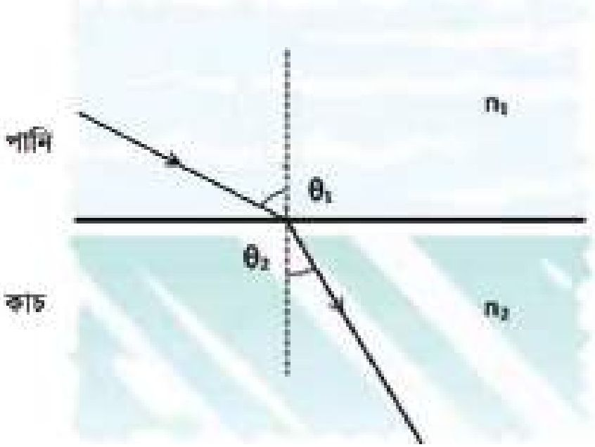

<!-- physics-9-10-bn-c09-t9.1-p052 · figure · p.248 -->
চিত্র ৯.০৫: পানি ও কাচের ভেতর আলোর প্রতিসরণ।

<!-- physics-9-10-bn-c09-t9.1-p053 · text · p.248 -->
পানির তুলনায় হীরা: 1.82
হীরার তুলনায় পানি: 0.55
কাঁচের তুলনায় হীরা: 1.59
হীরার তুলনায় কাঁচ: 0.63

<!-- physics-9-10-bn-c09-t9.1-p054 · text · p.248 -->
তবে পদার্থবিজ্ঞানে সাধারণত দুটি মাধ্যমের তুলনা হিসেবে প্রতিসরণাঙ্ক ব্যবহার না করে শূন্যমাধ্যমের সাপেক্ষেই প্রতিসরণাঙ্ক হিসাব করা হয়।

<!-- physics-9-10-bn-c09-t9.1-p055 · text · p.248 -->
ঘন মাধ্যমে আলোর বেগ কম, এ রকম অবস্থায় কোনো কিছু কি আলো থেকে দ্বিত যেতে পারবে?

## 9.2 পূর্ণ অভ্যন্তরীণ প্রতিফলন (Total Internal Reflection)

<!-- physics-9-10-bn-c09-t9.2-p001 · text · p.248 -->
প্রতিফলন সম্পর্কে আলোচনা করার সময় বলা হয়েছিল যখন অত্যন্ত নির্খুত এবং পূর্ণাঙ্গ প্রতিফলন প্রয়োজন হয়, তখন আয়না ব্যবহার না করে পুরোপরি সচ্ছ মাধ্যম ব্যবহার করে এক ধরনের প্রতিফলন করানো হয়। এই প্রতিফলনের নাম পূর্ণ অভ্যন্তরীণ প্রতিফলন। এটি অত্যন্ত সহজ এবং চমকপ্রদ একটি প্রক্রিয়া, যেখানে প্রতিসরণের নিয়ম ব্যবহার করে আলোক রশ্মিটি ঘন মাধ্যম থেকে হালকা মাধ্যমে পাঠাতে হয় মাত্র।

<!-- physics-9-10-bn-c09-t9.2-p002 · text · p.248 -->
আমরা এর মাঝে জেনে গেছি (এবং অনেকবার ব্যবহার করেছি), প্রতিসরণের সূত্র হচ্ছে

<!-- physics-9-10-bn-c09-t9.2-p003 · formula · p.248 · review: verify-formula -->
$$n_1 \sin \theta_1 = n_2 \sin \theta_2$$

<!-- physics-9-10-bn-c09-t9.2-p004 · text · p.248 · review: verify-formula -->
অর্থাৎ যদি $n_1$ থেকে $n_2$ বড় হয় তাহলে $\theta_2$ থেকে $\theta_1$ বড় হবে। ধরা যাক তুমি একটি ঘন মাধ্যম ($n_2$) থেকে একটি আলোক রশ্মি হালকা মাধ্যমের ($n_1$) দিকে পাঠাচ্ছ (চিত্র ৯.০৬)। প্রতিসরণ এবং প্রতিফলনের নিয়ম অনুযায়ী খানিকটা আলো প্রতিফলিত হবে এবং খানিকটা প্রতিসরিত হবে। এবার $\theta_2$ অল্প অল্প করে বাড়াতে থাকলে $\theta_1$ বাড়তে থাকবে। যেহেতু $\theta_2$ থেকে $\theta_1$ বড় হবে কাজেই $\theta_2 < 90^\circ$ থাকতেই $\theta_1 = 90^\circ$ হয়ে যাবে এবং এর পর থেকে আলোর প্রতিসরিত হওয়ার আর কোনো সুযোগ থাকবে না।

<!-- physics-9-10-bn-c09-t9.2-p005 · text · p.249 · review: verify-formula -->
অর্থাৎ যখন $\theta_1 = 90^\circ$ হবে তখন থেকে পুরো আলোকেই প্রতিফলিত হতে হবে। $\theta_2$ এর যে মানের জন্য $\theta_1 = 90^\circ$ হয় সেই কোণকে ক্রান্তি কোণ বা সংকট কোণ (Critical Angle) $\theta_c$ বলে।

<!-- physics-9-10-bn-c09-t9.2-p006 · figure · p.249 -->
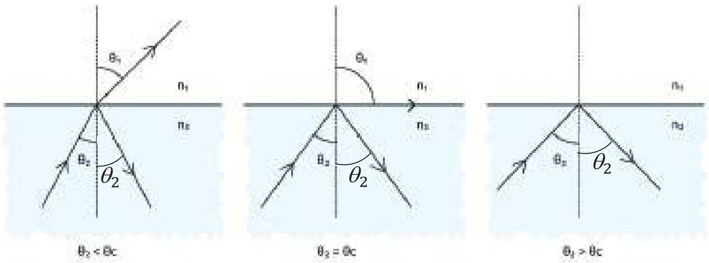

<!-- physics-9-10-bn-c09-t9.2-p007 · figure · p.249 -->
**চিত্র ৯.০৬:** ঘন মাধ্যম থেকে হালকা মাধ্যমে যাওয়ার সময় আলোর পূর্ণ অভ্যন্তরীণ প্রতিফলন হতে পারে।

<!-- physics-9-10-bn-c09-t9.2-p008 · text · p.249 · review: verify-formula -->
অর্থাৎ $n_1 \sin 90^\circ = n_2 \sin \theta_c$

<!-- physics-9-10-bn-c09-t9.2-p009 · text · p.249 · review: verify-formula -->
কিংবা $\sin \theta_c = \frac{n_1}{n_2}$

<!-- physics-9-10-bn-c09-t9.2-p010 · text · p.249 · review: verify-formula -->
$n_1$ এবং $n_2$ এর মান জানা থাকলে আমরা একটি কোণ $\theta_c$ বের করতে পারব যার জন্য উপরের সূত্রটি সত্যি। কাজেই সূত্রটাকে এভাবেও লেখা যেতে পারে:

<!-- physics-9-10-bn-c09-t9.2-p011 · figure · p.249 -->
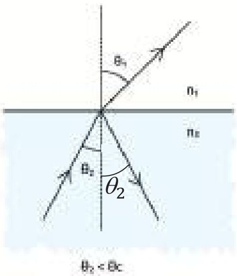

<!-- physics-9-10-bn-c09-t9.2-p012 · figure · p.249 -->
**চিত্র ৯.০৭:** সবচেয়ে পরিপূর্ণ প্রতিফলন হয় পূর্ণ অভ্যন্তরীণ প্রতিফলনে।

<!-- physics-9-10-bn-c09-t9.2-p013 · formula · p.249 · review: verify-formula -->
$$\theta_c = \sin^{-1} \left( \frac{n_1}{n_2} \right)$$

<!-- physics-9-10-bn-c09-t9.2-p014 · text · p.249 · review: verify-formula -->
কাচের $n_2 = 1.52$ এবং
বাতাসের $n_1 = 1.00$ হলে

<!-- physics-9-10-bn-c09-t9.2-p015 · formula · p.249 · review: verify-formula -->
$$\frac{n_1}{n_2} = \frac{1.00}{1.52} = 0.66$$

<!-- physics-9-10-bn-c09-t9.2-p016 · text · p.249 -->
এটা দেখানো সম্ভব যে

<!-- physics-9-10-bn-c09-t9.2-p017 · formula · p.249 · review: latin-junk,verify-formula -->
$$\sin 41.8^\circ = 0.66  বা  \sin^{-1}(0.66) = 41.8^\circ$$

<!-- physics-9-10-bn-c09-t9.2-p018 · text · p.249 · review: verify-formula -->
কাজেই ক্রান্তি কোণ $\theta_c = 41.8^\circ$ অর্থাৎ যদি স্বচ্ছ কাচ থেকে বাতাসে আলো পাঠানোর সময় আলোক রশ্মি 41.8° থেকে বেশি আপতন কোণ করে তাহলে আলোক রশ্মিটি স্বচ্ছ কাচ থেকে বের না হয়ে পুরোপুরি প্রতিফলিত হয়ে যায়। তোমরা যদি একটি প্রিজম সংগ্রহ করতে পারো তাহলে খুব সহজেই পূর্ণ অভ্যন্তরীণ প্রতিফলন ব্যাপারটি নিজের চোখে দেখতে পাবে। ৯.০৭ চিত্রটিতে কাচ-বাতাস বিদেদতলে আলোর আপতন কোণ 45°, যা নাকি কাচ-বাতাসের ক্রান্তি কোণ 41.8° থেকে বেশি। কাজেই এখানে পূর্ণ অভ্যন্তরীণ প্রতিফলন হবে।

### উদাহরণ

<!-- physics-9-10-bn-c09-t9.2-p019 · example · p.250 · review: verify-formula -->
**প্রশ্ন:** পানিতে ডুবে যদি এই পরীক্ষাটা করতে চাও তাহলে কী হবে? (কাচের $n_2 = 1.52$ এবং পানির $n_1 = 1.33$)

<!-- physics-9-10-bn-c09-t9.2-p020 · example · p.250 · review: verify-formula -->
**উত্তর:** পানিতে $\frac{n_1}{n_2} = 0.88$ কাজেই কাচের ক্রান্তি কোণ হবে 61.6° কারণ $sin 61.6^\circ = 0.88$ অথবা $sin^{-1}(0.88) = 61.6^\circ$

<!-- physics-9-10-bn-c09-t9.2-p021 · text · p.250 -->
আপতন কোণ যেহেতু 45°, যা ক্রান্তি কোণ 61.6° থেকে কম, তাই পূর্ণ অভ্যন্তরীণ প্রতিফলন হবে না।

<!-- physics-9-10-bn-c09-t9.2-p022 · text · p.250 -->
**প্রশ্ন:** 1.45 প্রতিসরণাক্ষের একটি মাধ্যমের ভেতর থেকে আলো 75° তে আপতিত হয়েছে। (চিত্র ৯.০৮) মাধ্যমটির অন্য পাশে বাতাস থাকলে আলোটি কত ডিগ্রি কোণে বের হয়ে আসবে।

<!-- physics-9-10-bn-c09-t9.2-p023 · figure · p.250 -->

<!-- physics-9-10-bn-c09-t9.2-p024 · text · p.250 -->
**উত্তর:** আমরা জানি

<!-- physics-9-10-bn-c09-t9.2-p025 · formula · p.250 · review: verify-formula -->
$$n_1 \sin \theta_1 = n_2 \sin \theta_2$$

<!-- physics-9-10-bn-c09-t9.2-p026 · formula · p.250 · review: verify-formula -->
$$1.45 \times \sin 75^\circ = 1 \times \sin \theta_2$$

<!-- physics-9-10-bn-c09-t9.2-p027 · formula · p.250 · review: verify-formula -->
$$\sin \theta_2 = 1.40$$

<!-- physics-9-10-bn-c09-t9.2-p028 · text · p.250 · review: verify-formula -->
কিন্তু আমরা জানি $\sin \theta_2$ এর মান কখনো 1 থেকে বেশি হতে পারে না। এখানে এ ব্যাপারটি ঘটেছে কারণ আলো প্রতিসরিত না হয়ে পূর্ণ অভ্যন্তরীণ প্রতিফলিত হয়েছে, কাজেই যখনই যন মাধ্যম থেকে হালকা মাধ্যমে আলোর প্রতিসরণ দেখতে হয় তখন প্রথমে ক্রান্তি কোণটি বের করে নেওয়া ভালো, এই ক্রান্তি কোণ থেকে কম কোণে আলো আপতিত হলে শুধুমাত্র প্রতিসরণ হওয়া সম্ভব।

<!-- physics-9-10-bn-c09-t9.2-p029 · figure · p.250 -->
**চিত্র ৯.০৮: আলো 75° কোণে আপতিত হয়েছে।**

<!-- physics-9-10-bn-c09-t9.2-p030 · text · p.251 · review: verify-formula -->
এই ক্ষেত্রে ক্রান্তি কোণ $\theta_c$ হলে $sin\theta_c = \frac{1}{1.45} = 0.69$ বা $\theta_c = 43.6^\circ$

<!-- physics-9-10-bn-c09-t9.2-p031 · text · p.251 · review: verify-formula -->
কাজেই $75^\circ$ তে আলো আপতিত হলে সেটি প্রতিসরিত না হয়ে পূর্ণ অভ্যন্তরীণ প্রতিফলন হবে।

### ৯.২.১ রংধনু

<!-- physics-9-10-bn-c09-t9.2-p032 · text · p.251 -->
তোমরা যারা ভাবছ যে তোমরা সত্যি সত্যি কখনো পূর্ণ অভ্যন্তরীণ প্রতিফলন দেখনি, তাদেরকে মনে করিয়ে দেওয়া যায় যে যারা রংধনু দেখেছে তারাই পূর্ণ অভ্যন্তরীণ প্রতিফলন দেখেছে। রংধনু তৈরি হয় পানির পূর্ণ অভ্যন্তরীণ প্রতিফলন দিয়ে।

<!-- physics-9-10-bn-c09-t9.2-p033 · text · p.251 -->
শুধু তা-ই নয়, যারা প্রিজমের অভাবে সাদা আলোকে তার রংগুলোতে ভাগ করে দেখতে পারেনি তারাও এই ব্যাপারটি রংধনুতেই ঘটেতে দেখেছ। বৃষ্টি হওয়ার পরপর যদি রোদ ওঠে, তাহলে আমরা রংধনু দেখি। তার কারণ তখন বাতাসে পানির কণা থাকে এবং পানির কণায় সেই আলো পূর্ণ অভ্যন্তরীণ প্রতিফলিত হওয়ার সময় ভিন্ন ভিন্ন রঙের আলো ভিন্ন ভিন্ন পরিমাণে বেঁকে যায়। এই আলোর রশ্মিগুলো দিয়ে রংধনুর ভিন্ন ভিন্ন রঙের ব্যান্ড (Band) তৈরি হয়।

<!-- physics-9-10-bn-c09-t9.2-p034 · figure · p.251 -->
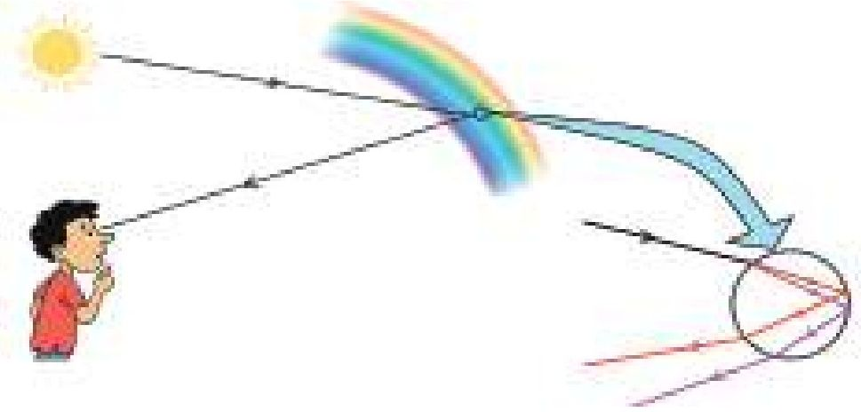

<!-- physics-9-10-bn-c09-t9.2-p035 · figure · p.251 -->
**চিত্র ৯.০৯ : রংধনু**

<!-- physics-9-10-bn-c09-t9.2-p036 · text · p.251 -->
তোমরা যারা রংধনু দেখেছ তারা নিশ্চয়ই আবিষ্কার করেছে এটি সব সময়ই সূর্যের বিপরীত আকাশে দেখা যায় এবং এখন তার কারণটি নিশ্চয়ই বুঝতে পারছ।

<!-- physics-9-10-bn-c09-t9.2-p037 · text · p.251 -->
> ভরদুপুরে রংধনু দেখা যায় না কেন?

### ৯.২.২ মরুচিকা

<!-- physics-9-10-bn-c09-t9.2-p038 · text · p.251 -->
মরুভূমিতে মরুচিকা খুবই পরিচিত দৃশ্য। তোমরা হয়তো শুনে অবাক হবে যে মরুচিকাও রংধনুর মতো পূর্ণ অভ্যন্তরীণ প্রতিফলনের কারণে ঘটে থাকে।

<!-- physics-9-10-bn-c09-t9.2-p039 · text · p.251 -->
কোনো কিছু পাওয়ার আশা করে শেষ পর্যন্ত না পেলে সেটাকেও মরুচিকা বলা হয় কিন্তু মূল শব্দটি এসেছে মরুভূমিতে উষ্ণ স্থানে সূক্ষ্ম এক ধরনেরে দৃষ্টি বিশ্রাম থেকে। যদিও আমরা জানি উত্তপ্ত বাতাস হালকা বলে উপরে চলে যায় কিন্তু মরুভূমির উত্তপ্ত বালুর কারণে তার কাছাকাছি স্তরের বাতাস উপরের স্তরের বাতাস থেকে উত্তপ্ত থাকতে পারে। কাজেই মরুভূমির বাতাসকে আমরা ৯.১০ চিএর মতো করে কল্পনা করে নিতে পারি।

<!-- physics-9-10-bn-c09-t9.2-p040 · text · p.252 -->
সহজভাবে বোঝানোর জন্য এখানে মাত্র তিনটি স্তর দেখানো হয়েছে। উপরের স্তরে বাতাসের ঘনত্ব বেশি তাই প্রতিসরণাঙ্ক বেশি। নিচের স্তরে বাতাস উত্তপ্ত তাই ঘনত্ব কম এবং প্রতিসরণাঙ্কও কম। গাছ থেকে আলো প্রতিটি স্তরে প্রতিসরিত হওয়ার সময় প্রতিসরণ কোন বেড়ে যায় এবং কোনো একটা স্তরে এসে পূর্ণ অভ্যন্তরীণ প্রতিফলন হয়ে যেতে পারে। বেশি প্রতিসরণাঙ্কের থেকে কম প্রতিসরণাঙ্কের মাধ্যমে প্রবেশ করার সময় দূর থেকে দেখা হলে আপতন কোণের মান বেশি হওয়ার কারণে ক্রান্তি কোণকে অতিক্রম করার সম্ভাবনা বেশি থাকে। তাই মরীচিকাকে দূর থেকে দেখা যায়, কাছে এলে দেখা যায় না। যেহেতু কোনো মানুষ দূরের একটি গাছের দিকে তাকালে সরাসরি গাছটি দেখতে পাবে এবং পূর্ণ অভ্যন্তরীণ প্রতিফলনের কারণে গাছের একটি প্রতিবিম্ব গাছের নিচেও দেখতে পাবে। মনে হবে নিচে পানি থাকার কারণে সেখানে গাছের প্রতিবিম্ব দেখা যাচ্ছে। কিন্তু কাছে গেলে দেখা যাবে কোনো পানি নেই।

<!-- physics-9-10-bn-c09-t9.2-p041 · figure · p.252 -->
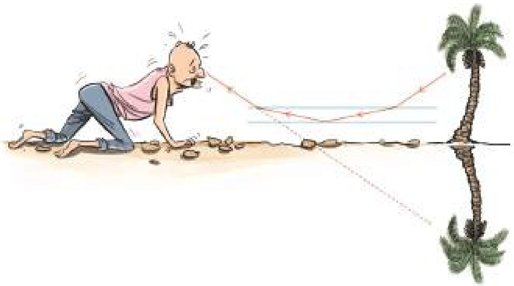

<!-- physics-9-10-bn-c09-t9.2-p042 · figure · p.252 -->
**চিত্র ৯.১০: মরুভূমিতে বাতাসের ঘনত্বের পার্থক্যের কারণে মরীচিকা দেখা যায়।**

<!-- physics-9-10-bn-c09-t9.2-p043 · text · p.252 -->
গরমের দিনে উত্তপ্ত রাস্তায় গাড়ি চালিয়ে যাওয়ার সময় একই কারণে দূরে কালচে ভেজা রাস্তা দেখা যায়। সেখানে পৌঁছানোর পর দেখা যায় রাস্তাটি খটখটে শুকনো। এটাও এক ধরনের মরীচিকা।

## 9.3 প্রতিসরণের ব্যবহার

<!-- physics-9-10-bn-c09-t9.3-p001 · text · p.252 -->
আলোর প্রতিসরণের নানা ধরনের ব্যবহার রয়েছে। আমাদের জীবনের নানা ক্ষেত্রে যে ব্যবহারগুলো গুরুত্বপূর্ণ ভূমিকা পালন করে থাকে তোমাদের সেরকম কয়েকটি উদাহরণ দেওয়া যেতে পারে:

### ৯.৩.১ অপটিক্যাল ফাইবার

<!-- physics-9-10-bn-c09-t9.3-p002 · text · p.253 -->
নতুন পৃথিবীর যোগাযোগের ক্ষেত্রে বৈদ্যুতিক তারের বদলে অত্যন্ত সুরু কাচের তন্তুর ব্যবহার বেড়ে গেছে। আগে যেখানে বৈদ্যুতিক সংকেত দিয়ে তথ্য পাঠানো হতো এখন সেখানে আলোর সংকেত দিয়ে তথ্য পাঠানো হয়। মুক্ত অবস্থায় আলো সরলরেখায় যায় কিন্তু ফাইবারে আলো আটকা পড়ে যায় বলে সেটাকে ঘুরিয়ে পেঁচিয়ে যেকোনো দিকে নেওয়া সম্ভব। অপটিক্যাল ফাইবার অত্যন্ত সুরু কাচের তন্তু। এর ভেতরের অংশকে বলে কোর (core), বাইরের অংশকে বলে ক্ল্যাড (clad)। দুটিই একই কাচ দিয়ে তৈরি হলেও ভেতরের অংশের (কোর) প্রতিসরণাঙ্ক বাইরের অংশ থেকে বেশি। এ কারণে পূর্ণ অভ্যন্তরীণ প্রতিফলনের মাধ্যমে আলোকে কোরের মাঝে আটকে রেখে অনেক দূরে নিয়ে যাওয়া যায়। (চিত্র ৯.১১a)। অপটিক্যাল ফাইবার দিয়ে আলো শত শত কিলোমিটার নিয়ে যাওয়া যায় কারণ, এই কাচের তন্তুতে আলোর শোষণ হয় খুবই কম। দৃশ্যমান আলো হলে শোষণ বেশি হয় বলে ফাইবারে লম্বা তরঙ্গা দৈর্ঘ বিশিষ্ট ইনফ্রারেড বা অবলাল রশ্মি ব্যবহার করা হয়।

<!-- physics-9-10-bn-c09-t9.3-p003 · figure · p.253 -->
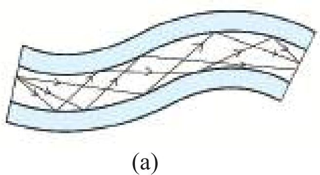

<!-- physics-9-10-bn-c09-t9.3-p004 · figure · p.253 -->
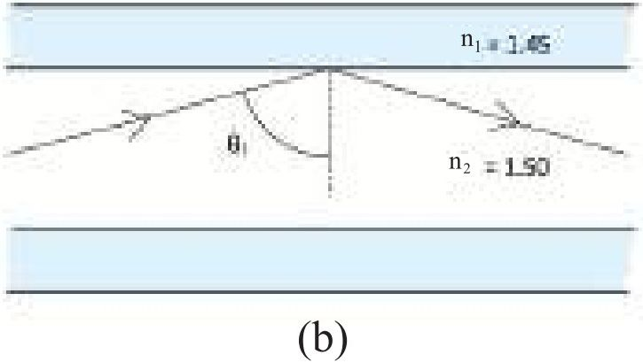

<!-- physics-9-10-bn-c09-t9.3-p005 · figure · p.253 -->
**চিত্র ৯.১১: (a) অপটিক্যাল ফাইবারে পূর্ণ অভ্যন্তরীণ প্রতিফলনের মাধ্যমে আলো যেতে পারে।**

<!-- physics-9-10-bn-c09-t9.3-p006 · text · p.253 -->
**(b) অপটিক্যাল ফাইবারের কোর থেকে ক্ল্যাডে আলোর পূর্ণ অভ্যন্তরীণ প্রতিফলন হয়।**

### উদাহরণ

<!-- physics-9-10-bn-c09-t9.3-p007 · example · p.253 -->
**প্রশ্ন:** অপটিক্যাল ফাইবারের কোরের প্রতিসরণাঙ্ক 1.50 এবং ক্ল্যাডের প্রতিসরণাঙ্ক 1.45 হলে (চিত্র ৯.১১b) আলোকে পূর্ণ অভ্যন্তরীণ প্রতিফলন হওয়ার জন্য কত ডিগ্রিতে আপতিত হতে হবে?

<!-- physics-9-10-bn-c09-t9.3-p008 · example · p.253 · review: verify-formula -->
**উত্তর:**
$$\theta_c = sin^{-1} \left( \frac{n_1}{n_2} \right)$$

<!-- physics-9-10-bn-c09-t9.3-p009 · text · p.253 · review: verify-formula -->
এখানে $n_1 = 1.45$ এবং $n_2 = 1.50$

<!-- physics-9-10-bn-c09-t9.3-p010 · formula · p.253 · review: verify-formula -->
$$\theta_c = sin^{-1} \left( \frac{1.45}{1.50} \right) = sin^{-1}(0.97) = 75^\circ$$

<!-- physics-9-10-bn-c09-t9.3-p011 · text · p.253 · review: verify-formula -->
কাজেই আলোকরশ্মিকে $75^\circ$ কিংবা তার চেয়ে বেশি কোণে আপতিত হতে হবে।

### ৯.৩.২ প্রিজম

<!-- physics-9-10-bn-c09-t9.3-p012 · text · p.254 -->
আলোক বিজ্ঞানের ভাষায় দুইটি অসমান্তরাল সমতল পৃষ্ঠ দ্বারা আবদ্ধ একটি স্বচ্ছ মাধ্যমকে বলে প্রিজম। প্রিজমের মধ্যে দিয়ে প্রবাহিত আলোক রশ্মির দিক পাল্টে যায়। (চিত্র ৯.১২) প্রথম পৃষ্ঠ দিয়ে আলোক রশ্মিটি প্রবেশ করার সময় লক্ষ্যের দিকে বৈকে যায়। যেহেতু দ্বিতীয় পৃষ্ঠটি সমান্তরাল নয় তাই সেই পৃষ্ঠ দিয়ে আলো বের হওয়ার সময় লক্ষ্য থেকে সরে গেলেও সেটি আর মূল দিকে ঘুরে যেতে পারে না।

<!-- physics-9-10-bn-c09-t9.3-p013 · figure · p.254 -->
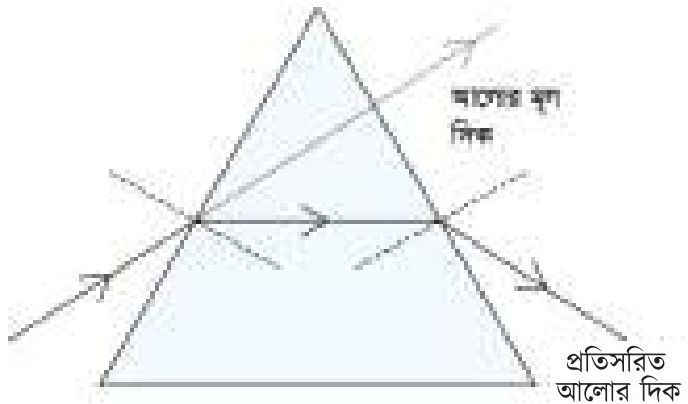

<!-- physics-9-10-bn-c09-t9.3-p014 · figure · p.254 -->
**চিত্র ৯.১২: প্রিজমের আলোক রশ্মির দিক প্রিজমের ভূমির দিকে বৈকে যায়।**

<!-- physics-9-10-bn-c09-t9.3-p015 · text · p.254 -->
প্রিজমে আলোর দিক পাল্টে যাবার ঘটনা ঘটলেও সেটি অন্য একটি কারণে আরো বেশি গুরুত্বপূর্ণ। প্রিজমে একটি আলোকরশ্মি প্রবেশ করার পর সেটি মূল দিক থেকে কতটুকু বৈকে যাবে সেই প্রিজমের প্রতিসরণাঙ্কের ওপর নির্ভর করে। আমরা আগেই বলেছি, প্রতিসরণাঙ্ক আসলে আলোর তরঙ্গ দৈর্ঘ্য বা রঙের ওপর নির্ভর করে। তাই ভিন্ন ভিন্ন রঙের জন্য প্রতিসরণাঙ্ক ভিন্ন, কাজেই একই আলোকরশ্মিতে ভিন্ন ভিন্ন রং থাকলে প্রিজমের ভেতর দিয়ে যাওয়ার সময় সেই রঙের আলোগুলো ভিন্ন ভিন্ন কোণে দিক পরিবর্তন করবে। কাজেই আমরা দেখব প্রিজম থেকে আলো বের হবার সময় তার রংগুলো আলাদা হয়ে গেছে, নিউটন প্রথম দেখিয়েছিলেন।

### ৯.৩.৩ পেরিস্কোপ ও বাইনোকুলার

<!-- physics-9-10-bn-c09-t9.3-p016 · text · p.254 -->
আমরা সবাই জানি সাবমেরিনে পেরিস্কোপ থাকে এবং সেই পেরিস্কোপ দিয়ে পানির নিচ থেকে পানির উপরের দৃষ্টি দেখা সম্ভব। সাধারণ আয়না দিয়ে যে ধরনের পেরিস্কোপ তৈরি করা যায় তার থেকে অনেক বেশি কার্যকর পেরিস্কোপ তৈরি করা হয় প্রিজম এবং তার পূর্ণ অভ্যন্তরীণ প্রতিফলন দিয়ে (চিত্র ৯.১৩)। বাইনোকুলারের দৈর্ঘ্য কমানোর জন্যও এর ভেতরে প্রিজম দিয়ে পূর্ণ অভ্যন্তরীণ প্রতিফলন ঘটানো হয়ে থাকে।

<!-- physics-9-10-bn-c09-t9.3-p017 · figure · p.254 -->
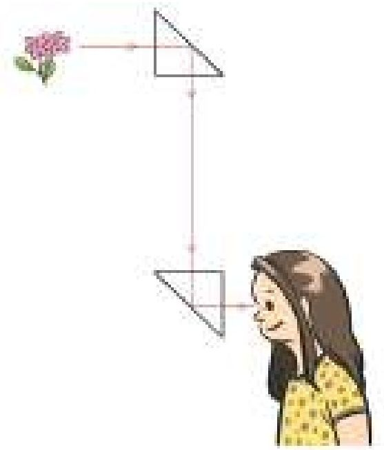

<!-- physics-9-10-bn-c09-t9.3-p018 · figure · p.254 -->
**চিত্র ৯.১৩: আধুনিক পেরিস্কোপে আয়নার পরিবর্তে প্রিজম ব্যবহার হয়।**

### ৯.৩.৪ লেন্স (Lens)

<!-- physics-9-10-bn-c09-t9.3-p019 · text · p.255 -->
দুটি বক্রতল অথবা একটি বক্রতল ও একটি সমতল দ্বারা আবদ্ধ একটি স্বচ্ছ মাধ্যমকে বলে লেন্স। লেন্স দিয়ে চশমা থেকে শুরু করে টেলিস্কোপ বা মাইক্রোস্কোপের মতো সূক্ষ্ম অপটিক্যাল যন্ত্রপাতি পর্যন্ত তৈরি করা হয়। ভিডিও প্রজেক্টর বা ক্যামেরাতেও লেন্স ব্যবহার করা হয়। এই অধ্যায়ে আমরা বিস্তৃতভাবে লেন্স, লেন্সের প্রকারভেদ এবং তার ধর্ম নিয়ে আলোচনা করব।

## 9.4 লেন্সের প্রকারভেদ (Types of Lenses)

<!-- physics-9-10-bn-c09-t9.4-p001 · text · p.255 -->
আমরা উত্তল এবং অবতল আয়না পড়ার সময় দেখেছি এই আয়নাগুলোতে প্রতিফলিত হয়ে আলো কখনো একবিন্দুতে কেন্দ্রীভূত (অভিসারী রশ্মি) হয় আবার কখনো ছড়িয়ে পড়ে (অপসারী রশ্মি), এবং সে কারণে বাস্তব বা অবাস্তব প্রতিবিম্ব তৈরি হয়। সেই প্রতিবিম্ব কখনো ছোট হয়, কখনো বড় হয়। আয়নার এই বৈশিষ্ট্যকে নানাভাবে ব্যবহার করে বিভিন্ন ধরনের অপটিক্যাল যন্ত্রপাতি তৈরি করা হয়ে থাকে। ঠিক সে রকম লেন্স দিয়েও নানা ধরনের যন্ত্রপাতি তৈরি হয়।

<!-- physics-9-10-bn-c09-t9.4-p002 · figure · p.255 -->
**চিত্র ৯.১৪: একটি উত্তল ও একটি অবতল লেন্সের প্রস্থচ্ছেদ**

<!-- physics-9-10-bn-c09-t9.4-p003 · text · p.255 -->
আমরা সবাই লেন্স দেখেছি (তার কারণ চশমার কাচগুলো আসলে এক ধরনের লেন্স)। তোমাদের মাঝে যারা চশমা ব্যবহার করো কিংবা যারা অন্যদের চশমা ব্যবহার করতে দেখেছ তারা নিশ্চিতভাবেই লক্ষ্য করেছ যে চশমার লেন্স দুই ধরনের। এক ধরনের লেন্স দিয়ে খুব কাছে জিনিসকে একটু দূরে দেখা যায়। (সাধারণত বয়স্কদের চশমার লেন্স এ রকম হয়।) আবার অন্য ধরনের লেন্স দিয়ে খুব দূরের জিনিসকে একটু কাছে দেখা যায় (সাধারণত কম বয়সীদের চশমার লেন্স এ রকম হয়)। প্রথম ধরনের লেন্সগুলো উত্তল (Convex) কিংবা অভিসারী লেন্স দ্বিতীয় ধরনের লেন্সগুলো অবতল (Concave) কিংবা অপসারী লেন্স।

<!-- physics-9-10-bn-c09-t9.4-p004 · text · p.256 · review: verify-formula -->
উত্তল লেন্সগুলোর মাঝখানের অংশ প্রান্ত থেকে পুরু হয়। আর অবতল লেন্সগুলোর মাঝখানের অংশ প্রান্ত থেকে সবু হয় ৯.১৪ চিত্রটিতে যে রকম দেখানো হয়েছে। ছবির লেন্সগুলো দুটি গোলীয় বৃত্ত দিয়ে সীমাবদ্ধ। এই দুটি গোলীয় বৃত্তের ব্যাসার্ধ সমানও হতে পারে ভিন্নও হতে পারে। এই বৃত্তগুলোর কেন্দ্রকে বক্রতার কেন্দ্র বলে। ৯.১৫ চিত্রটিতে $C_1$ এবং $C_2$ বক্রতার কেন্দ্র। একটি গোলকীয় তল ও একটি সমতল দিয়ে সীমাবদ্ধ স্বচ্ছ বস্তুও উত্তল বা অবতল লেন্স হতে পারে।

<!-- physics-9-10-bn-c09-t9.4-p005 · figure · p.256 -->
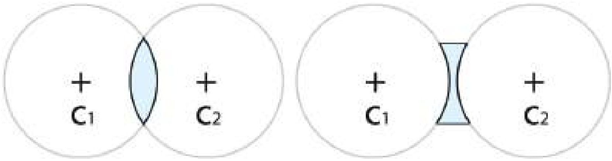

<!-- physics-9-10-bn-c09-t9.4-p006 · figure · p.256 -->
**চিত্র ৯.১৫: উত্তল এবং অবতল লেন্সকে দুটি গোলের অংশ হিসেবে কল্পনা করা যায়**

<!-- physics-9-10-bn-c09-t9.4-p007 · text · p.256 -->
দৈনদিন জীবনে বা বিজ্ঞানের নানা বিষয়ে নানা ধরনের লেন্স ব্যবহার করা হয়। তবে আমরা আমাদের এই বইয়ে আমাদের আলোচনা পাতলা লেন্সের মাঝে সীমাবদ্ধ রাখব। পাতলা লেন্স এবং পুরু লেন্সের পার্থক্য নামকরণ থেকেই বুঝা গেলেও আমরা পার্থক্যটুকু আরেকটু পরিস্কার করে নিই। লেন্সের প্রস্থচ্ছেদের দিকে তাকালে আমরা দেখতে পাই যদিও লেন্সের পৃষ্ঠদেশের এক ধরনের বক্রতা আছে কিন্তু ঠিক মাঝামাঝি জায়গায় দুটি পৃষ্ঠ প্রায় সমান্তরাল। আমরা জানি সমান্তরাল পৃষ্ঠ দিয়ে আলো যাওয়ার সময় প্রতিসরণের কারণে আলোক রশ্মিটি মূল দিক থেকে খানিকটা বিচ্যুত হয়ে যায় (চিত্র ৯.১৬)।

<!-- physics-9-10-bn-c09-t9.4-p008 · figure · p.256 -->
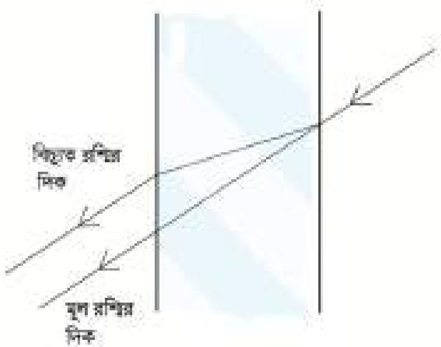

<!-- physics-9-10-bn-c09-t9.4-p009 · text · p.256 -->
লেসটি যত পুরু হবে আলোকরশ্মিটি মূল রশ্মির দিক থেকে তত বেশি সরে যাবে। যদি (সমান্তরাল) পৃষ্ঠ দুটি খুব কাছাকাছি হয় তাহলে আমরা ধরে নিতে পারি মূল আলোক রশ্মি যে দিক দিয়ে এসেছে মোটামুটি সেদিক দিয়েই বের হয়েছে, তার কোনো বিচ্যুতি হয়নি। যেসব লেন্সের বোঝায় তার কেন্দ্র দিয়ে আলোক রশ্মি যাওয়ার সময় ধরে নেওয়া যায় যে রশ্মিটির দিক অপরিবর্তিত আছে, সেই সব লেন্সকে পাতলা লেন্স বলে (চিত্র ৯.১৭)।

<!-- physics-9-10-bn-c09-t9.4-p010 · figure · p.256 -->
**চিত্র ৯.১৬: পুরু কাচের ভেতর দিয়ে যাবার সময় প্রতিসরণের কারণে মূল রশ্মি থেকে আলোক রশ্মি বিচ্যুত হয়।**

<!-- physics-9-10-bn-c09-t9.4-p011 · text · p.257 -->
কিংবা অন্যভাবে বলতে পারি পাতলা লেন্সের মাঝখানের যে বিন্দু দিয়ে আলোক রশ্মি যাবার সময় বেঁকে যায় না সেটিই লেন্সের কেন্দ্র (চিত্র ৯.১৭) বা লেন্সের আলোকীয় কেন্দ্র (Optical Center)।

<!-- physics-9-10-bn-c09-t9.4-p012 · figure · p.257 -->
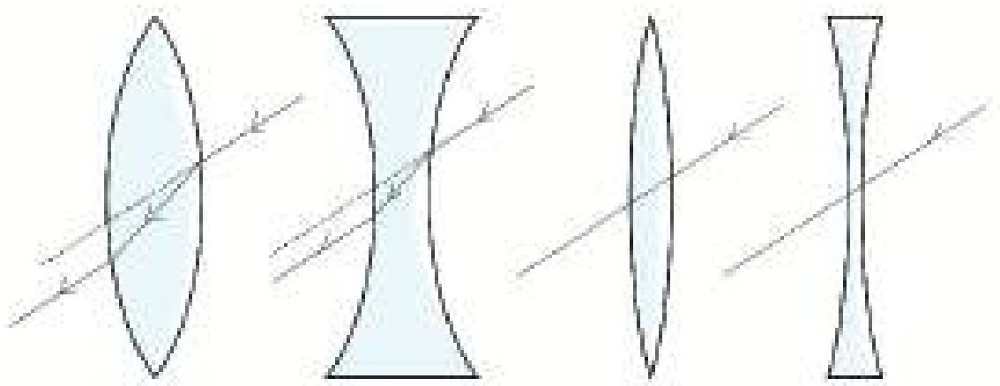

<!-- physics-9-10-bn-c09-t9.4-p013 · figure · p.257 -->
**চিত্র ৯.১৭:** পুরু লেন্স কেন্দ্র দিয়ে যাওয়া আলোক রশ্মি সমান্তরালভাবে বের হলেও একটু সরে যায়, পাতলা লেন্স কেন্দ্র দিয়ে যাওয়া আলোক রশ্মি তার দিক পরিবর্তন না করে সোজাসুজি বের হয়ে যায়।

### ৯.৪.১ অবতল লেন্স (Concave lens)

<!-- physics-9-10-bn-c09-t9.4-p014 · text · p.257 -->
উত্তল এবং অবতল আয়না আলোচনা করার সময় আমরা প্রথমে উত্তল আয়না নিয়ে আলোচনা করেছিলাম। লেন্সের বোঝায় আমরা প্রথমে অবতল লেন্স নিয়ে আলোচনা করি। কারণ উত্তল আয়নায় যে ধরনের প্রতিবিম্ব তৈরি হয় অবতল লেন্সে সেই একই ধরনের প্রতিবিম্ব তৈরি হয়।

<!-- physics-9-10-bn-c09-t9.4-p015 · text · p.257 -->
উত্তল আয়নার বোঝায় আমরা দেখেছিলাম সেখানে সমান্তরাল আলো পড়লে সেটি প্রতিফলিত হওয়ার সময় চারদিকে ছড়িয়ে পড়ে। অবতল লেন্সের বোঝাতেও ঠিক এই ধরনের ব্যাপার ঘটে। এই লেন্স সমান্তরাল আলো পড়লে প্রতিসরিত হওয়ার সময় সেটি ছড়িয়ে পড়ে। প্রতিসরিত রশ্মিগুলো যদি আমরা পেছনের দিকে বাড়িয়ে নিই তাহলে মনে হবে সেগুলো একটি বিন্দু থেকে সবদিকে ছড়িয়ে পড়েছে। সেই বিন্দুটিকে বলে লেন্সের ফোকাস বিন্দু (Focal Point), এবং লেন্সের কেন্দ্র থেকে এই ফোকাস বিন্দুর দূরত্বটিকে বলে ফোকাস দূরত্ব (Focal Length) (চিত্র ৯.১৮)।

<!-- physics-9-10-bn-c09-t9.4-p016 · figure · p.257 -->
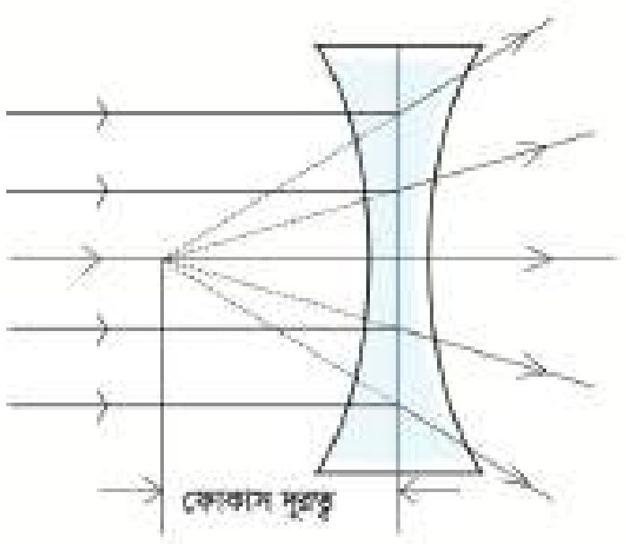

<!-- physics-9-10-bn-c09-t9.4-p017 · figure · p.257 -->
**চিত্র ৯.১৮:** অবতল লেন্সের ভেতর দিয়ে যাওয়ার সময় সমান্তরাল রশ্মি ছড়িয়ে পড়ে।

<!-- physics-9-10-bn-c09-t9.4-p018 · text · p.258 -->
আয়নার বেলায় আমরা শুধু এক দিক থেকে আয়নার ওপর আলো ফেলতে পারতাম। লেন্সের বেলায় দুই দিক থেকেই আলো ফেলা যায়। প্রত্যেকটা লেন্সের একটা ফোকাস দূরত্ব থাকে। আলো যেদিক দিয়েই ফেলা হোক তার ফোকাস দূরত্ব সমান থাকে। অবতল লেন্সে সমান্তরাল আলো ফেলা হলে রশ্মিগুলো ছড়িয়ে পড়ে এবং মনে হয় তারা যেন ফোকাস বিন্দু থেকে বিচ্ছুরিত হয়ে ছড়িয়ে পড়ছে। আলোকরশ্মির গতিপথ উল্টো করে দিলে এটি যেদিক দিয়ে এসেছে ঠিক সেদিক দিয়ে ফিরে যায়। তাই অবতল লেন্সের ছড়িয়ে যাওয়ার আলোর গতিপথ কোনোভাবে উল্টো করে দিতে পারলে সেটি সমান্তরাল হয়ে উল্টো দিকে বের হয়ে যাবে (চিত্র ৯.১৯)।

<!-- physics-9-10-bn-c09-t9.4-p019 · figure · p.258 -->
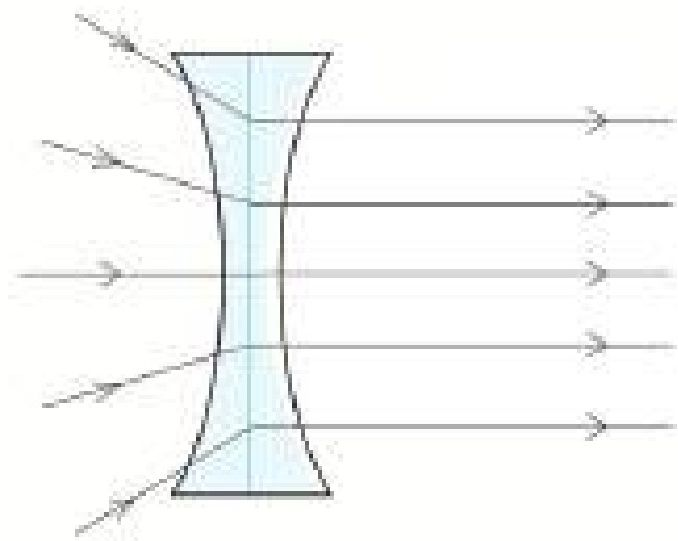

<!-- physics-9-10-bn-c09-t9.4-p020 · figure · p.258 -->
**চিত্র ৯.১৯: অবতল লেন্সের ভেতর দিয়ে যাবার সময় অভিসারী রশ্মি সমান্তরাল হয়ে যাবে।**

<!-- physics-9-10-bn-c09-t9.4-p021 · text · p.258 -->
অবতল লেন্সে কীভাবে প্রতিবিম্ব তৈরি হয় সেটি বোঝার জন্য আলোকরশ্মি অবতল লেন্সে কীভাবে প্রতিসরিত হয় সেটি জানতে হবে। সেটি নির্ভর করে আলোকরশ্মি কী কোণে অবতল লেন্সে এসে পড়ছে তার উপর। আমরা তিনটি বিশেষ আলোক রশ্মির প্রতিসরণের নিয়ম জানলেই কীভাবে প্রতিবিম্ব তৈরি হয় সেটি ব্যাখ্যা করতে পারব:

<!-- physics-9-10-bn-c09-t9.4-p022 · text · p.258 -->
(i) আলোকরশ্মি কেন্দ্রমুখী হলে (চিত্র ৯.২০, YO কিংবা XO রশ্মি) সেটি প্রতিসরণের পর সোজাসুজি চলে যায়।

<!-- physics-9-10-bn-c09-t9.4-p023 · text · p.258 -->
(ii) প্রধান অক্ষের সমান্তরাল (চিত্র ৯.২০, XP) রশ্মিটি প্রতিসরণের পর মনে হবে যেন রশ্মিটি (PS) ফোকাস বিন্দু (F) থেকে আসছে।

<!-- physics-9-10-bn-c09-t9.4-p024 · text · p.258 -->
(iii) আলোকরশ্মির দিক পরিবর্তন করা হলে এটি যেদিক থেকে এসেছে ঠিক সেদিক দিয়ে ফিরে যায়। কাজেই কোনো আলোকরশ্মি (চিত্র ৯.২০, SP) ফোকাস অভিমুখী হলে সেটি প্রধান অক্ষের সাথে সমান্তরাল হয়ে (PX) প্রতিসরিত হবে।

<!-- physics-9-10-bn-c09-t9.4-p025 · text · p.258 · review: latin-junk,known-confusable-corrected -->
আমরা এখন ইচ্ছা করলে অবতল লেন্সের সামনে অবস্থিত একটা বস্তুর প্রতিবিম্ব কখন হবে সেটা বের করতে পারি। ধরা যাক একটা বস্তু XY একটা অবতল লেন্সের কাছে রাখা হয়েছে। (চিত্র ৯.২০) বিশ্লেষণটি সহজ করার জন্য ধরে নিয়েছি বস্তুটির Y বিন্দুটি লেন্সের মূল অক্ষ YR এর উপরে। বস্তুটির কোন বিন্দুর প্রতিবিম্বটি কোথায় হবে সেটি বের করার জন্য সেই বিন্দু থেকে অন্তত দুটি রশ্মি আঁকা দরকার। তবে Y বিন্দু থেকে দুটি রশ্মি না ঐকেও আমরা প্রতিবিম্বটি বের করতে পারব। Y বিন্দু থেকে YR অঙ্ক বরাবর একটি রশ্মি আঁকা সন্দ্বব, তাই আমরা জানি Y বিন্দুটির প্রতিবিষ্টি এই অঙ্কের ওপর তৈরি হবে। X বিন্দুটির প্রতিবিষ্টি থেকে অঙ্কের ওপর লক্ষ্যটি ঐকে নিলেই আমরা Y বিন্দুর প্রতিবিষ্টি পেয়ে যাব।

<!-- physics-9-10-bn-c09-t9.4-p026 · text · p.259 · review: latin-junk -->
X বিন্দু থেকে দুটি রশ্মি কল্পনা করি। একটি অঙ্কের সাথে সমান্তরাল XP, যেটি লেন্স থেকে বের হওয়ার সময় ছড়িয়ে যাবে। যেহেতু মনে হবে ফোকাস থেকে বিচ্ছুরিত হচ্ছে তাই ফোকাস F থেকে P পর্যন্ত একটি রেখা টেনে বর্ধিত করলেই সেই রশ্মিটি আমরা পেয়ে যাব। দ্বিতীয় রশ্মিটি X বিন্দু থেকে লেন্সের কেন্দ্রের দিকে ঐকে নিই। পাতলা লেন্সের নিয়ম অনুযায়ী এটি সরাসরি XT দিকে বের হয়ে যাবে। XT এবং FS রেখা দুটি যে বিন্দুতে ছেদ করবে সেটিই হচ্ছে X এর প্রতিবিষ্টি X'; X' থেকে অঙ্কের ওপর লক্ষ্য আঁকলে আমরা XY এর প্রতিবিষ্টি X'Y' পেয়ে যাব।

<!-- physics-9-10-bn-c09-t9.4-p027 · figure · p.259 -->
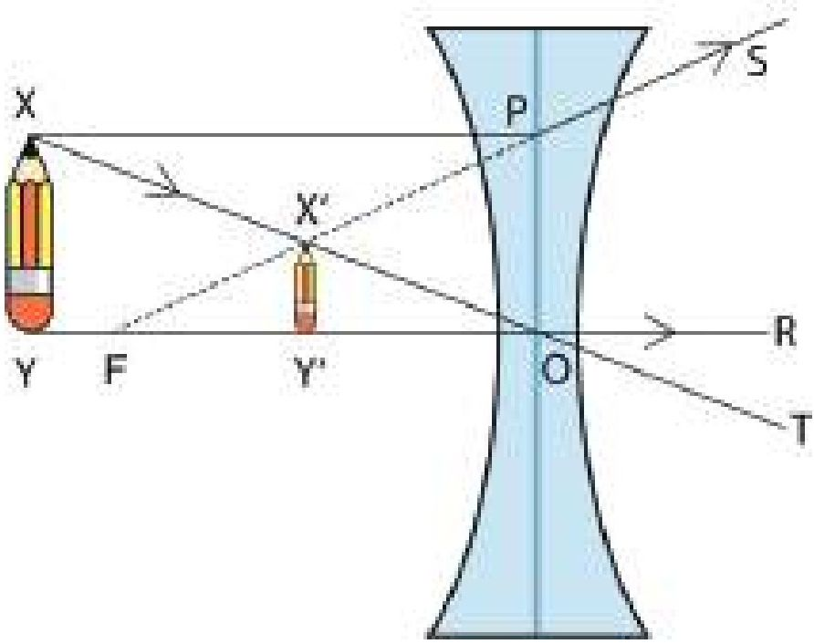

<!-- physics-9-10-bn-c09-t9.4-p028 · figure · p.259 · review: known-confusable-corrected -->
**চিত্র ৯.২০: অবতল লেন্স একটি বস্তুকে ছোট দেখায়।**

<!-- physics-9-10-bn-c09-t9.4-p029 · text · p.259 -->
উত্তল আয়নার বলায় আমরা যা দেখেছিলাম অবতল লেন্সের প্রতিবিষ্টির বলাতেও সেটি সত্যি প্রতিবিষ্টি হয়।

<!-- physics-9-10-bn-c09-t9.4-p030 · text · p.259 -->
(a) লেন্সের কেন্দ্র এবং ফোকাস বিন্দুর মাঝখানে অবস্থিত;
(b) অবাস্তব;
(c) সোজা, এবং
(d) বস্তুর তুলনায় ছোট।

### ৯.৪.২ উত্তল লেন্স (Convex Lens)

<!-- physics-9-10-bn-c09-t9.4-p031 · text · p.259 -->
উত্তল লেন্সের প্রতিবিষ্টিগুলো চমকপ্রদ। অবতল আয়নায় আমরা যেমন বিভিন্ন ধরনের প্রতিবিষ্টি পেয়েছিলাম, উত্তল লেন্সেও ঠিক একই ভাবে বিভিন্ন ধরনের প্রতিবিষ্টি পাব। অবতল আয়নায় আমরা দেখেছিলাম তার ওপর সমান্তরাল রশ্মি ফেলা হলে সেটি ফোকাস বিন্দুতে এসে কেন্দ্রীভূত হয়। উত্তল লেন্সেও ঠিক একই ব্যাপার ঘটে, সমান্তরাল রশ্মি ফেলা হলে সেগুলো এই লেন্সের ফোকাস বিন্দুতে কেন্দ্রীভূত হয় (চিত্র ৯.২১) এবং তারপর আবার ছড়িয়ে যায়।

<!-- physics-9-10-bn-c09-t9.4-p032 · text · p.260 -->
কাজেই আগের যুক্তি ব্যবহার করে বলা যায় যদি কোনো বিন্দু থেকে আলো বিচ্ছুরিত হয় এবং একটা উত্তল লেন্সের ফোকাস বিন্দুতে সেই বিচ্ছুরিত আলোর উৎসটাকে (চিত্র ৯.২২) রাখা যায় তাহলে বিচ্ছুরিত আলো লেন্সের ভেতর দিয়ে যাবার পর সমান্তরাল রশ্মি হয়ে যাবে। এখন আমরা ভিন্ন ভিন্ন অবস্থানে একটা বস্তুর থাকলে তার প্রতিবিম্ব কোথায় এবং কেমন হবে সেটি বের করে ফেলি।

<!-- physics-9-10-bn-c09-t9.4-p033 · figure · p.260 -->
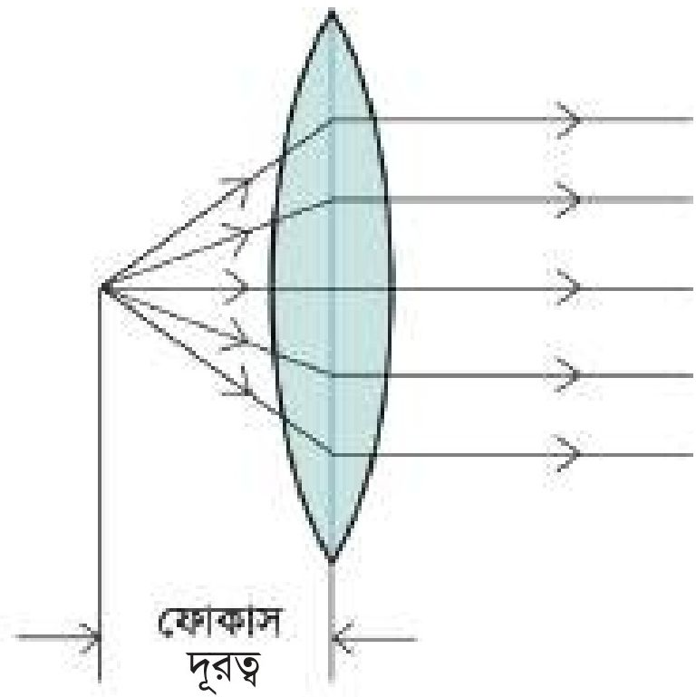

<!-- physics-9-10-bn-c09-t9.4-p034 · figure · p.260 -->
**চিত্র ৯.২১:** উত্তল লেন্সের ভেতর দিয়ে যাবার সময় সমান্তরাল রশ্মি ফোকাস বিন্দুতে কেন্দ্রীভূত হয়।

<!-- physics-9-10-bn-c09-t9.4-p035 · figure · p.260 -->
**চিত্র ৯.২২:** ফোকাস দূরত্বে আলোক বিন্দু রাখা হলে উত্তল লেন্স সেটিকে সমান্তরাল রশ্মিতে পরিণত করে।

<!-- physics-9-10-bn-c09-t9.4-p036 · text · p.260 -->
সেটি শুরু করার আগে আমরা আলোকরশ্মি উত্তল লেন্সে কীভাবে প্রতিসরিত হয় সেটি জেনে নিই। উত্তল লেন্সে তিনটি বিশেষ আলোকরশ্মির প্রতিসরণের নিয়ম জানলেই কীভাবে প্রতিবিম্ব তৈরি হয় সেটি ব্যাখ্যা করতে পারব:

<!-- physics-9-10-bn-c09-t9.4-p037 · text · p.260 -->
(i) আলোকরশ্মি কেন্দ্রমুখী হলে (চিত্র ৯.২৩, YO কিংবা XO রশ্মি) সেটি প্রতিসরণের পর সোজাসুজি চলে যায়।

<!-- physics-9-10-bn-c09-t9.4-p038 · text · p.260 -->
(ii) প্রধান অক্ষের সমান্তরাল (চিত্র ৯.২৩, XC) রশ্মিটি প্রতিসরণের পর ফোকাস বিন্দু (F) দিয়ে যাবে (CT)।

<!-- physics-9-10-bn-c09-t9.4-p039 · text · p.260 -->
(iii) আলোকরশ্মির দিক পরিবর্তন করা হলে এটি যেদিক থেকে এসেছে ঠিক সেদিক দিয়ে ফিরে যায়। কাজেই কোনো আলোকরশ্মি (চিত্র ৯.২৩, TC) ফোকাস দিয়ে গেলে সেটি প্রধান অক্ষের সাথে সমান্তরাল হয়ে (CX) প্রতিসরিত হবে।

<!-- physics-9-10-bn-c09-t9.4-p040 · text · p.260 -->
এবারে আমরা উত্তল লেন্সের জন্য প্রতিবিম্ব তৈরি করতে পারব।

### ফোকাস দূরত্ব থেকে কম দূরত্ব

<!-- physics-9-10-bn-c09-t9.4-p041 · text · p.261 · review: verify-formula -->
প্রথমে ধরা যাক একটি বস্তু $XY$ কে লেগ এবং তার ফোকাস বিন্দুর $F$ মাঝখানে রাখা হলো। (চিত্র ৯.২৩) আগে যেভাবে ব্যাখ্যা করা হয়েছে ঠিক সেই একই যুক্তিতে বলতে পারি $Y$ বিন্দুর প্রতিবিম্বটি $YOF$ অক্ষ রেখার ওপর হবে। $X$ বিন্দুটির প্রতিবিম্ব $X'$ থেকে এই অক্ষের ওপর লম্ব আঁকা হলেই আমরা $Y$ এর প্রতিবিম্বের অবস্থান পেয়ে যাব।

<!-- physics-9-10-bn-c09-t9.4-p042 · figure · p.261 -->
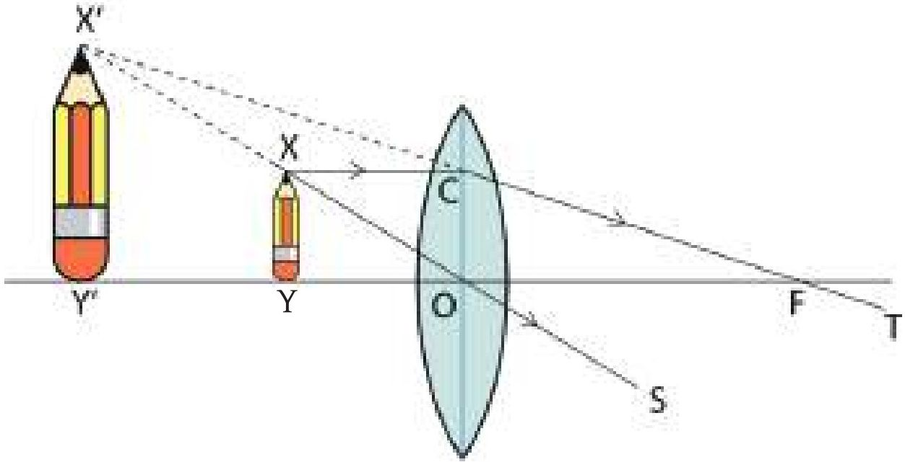

<!-- physics-9-10-bn-c09-t9.4-p043 · figure · p.261 -->
**চিত্র ৯.২৩: ফোকাস দূরত্বের ভেতরে বস্তু রাখা হলে উত্তল লেন্সে বড় প্রতিবিম্ব দেখা যায়।**

<!-- physics-9-10-bn-c09-t9.4-p044 · text · p.261 · review: verify-formula -->
এবারে $X$ বিন্দু থেকে দুটি রশ্মি আঁকি, অক্ষের সাথে সমান্তরাল $XC$ রেখাটি ফোকাস বিন্দু $F$ এর ভিতর দিয়ে $T$ এর দিকে যাবে। $X$ বিন্দু থেকে একটি রশ্মি লেন্সের কেন্দ্রবিন্দু দিয়ে আঁকা হলে সেটি সরলরেখায় $XO$ হয়ে $S$ এর দিকে যাবে। দেখতেই পাচ্ছ $CFT$ এবং $XOS$ রেখা দুটি সামনে গিয়ে মিলিত হতে পারবে না। যার অর্থ বাস্তব প্রতিবিম্ব তৈরি হবার কোনো সুযোগ নেই। রেখা দুটো পেছন দিকে বাড়িয়ে দিলে যে $X'$ বিন্দুতে মিলিত হবে সেটাই $X$ বিন্দুর প্রতিবিম্ব।

<!-- physics-9-10-bn-c09-t9.4-p045 · text · p.261 · review: verify-formula -->
এই বিন্দু থেকে $YF$ রেখার উপর লম্ব আঁকা হলে লম্বটি $Y'$ বিন্দুতে স্পর্শ করে; সেটা $Y$ বিন্দুর প্রতিবিম্ব।

<!-- physics-9-10-bn-c09-t9.4-p046 · text · p.261 · review: verify-formula -->
দেখাই যাচ্ছে $XY$ বস্তুটি যতই লেন্সের কাছাকাছি আনা হবে, প্রতিবিম্বটি ততই ছোট হতে থাকবে। আবার বস্তুটি যতই ফোকাস বিন্দু $F$ এর কাছাকাছি আনা হবে, প্রতিবিম্বটি ততই বড় হতে থাকবে। বস্তুটি যখন ঠিক ফোকাস বিন্দু $F$ এর ওপর হবে তখন প্রতিবিম্বটির আকার হবে অসীম। আমরা এখন বলতে পারি যদি একটা উত্তল লেন্সের কেন্দ্রবিন্দু এবং ফোকাস বিন্দুর মাঝখানে একটি বস্তু রাখা হয় তাহলে বস্তুটির প্রতিবিম্ব হয়

<!-- physics-9-10-bn-c09-t9.4-p047 · text · p.261 -->
(a) যে দিকে বস্তুটি রয়েছে সেই দিকেই অবস্থিত;
(b) অবাস্তব;
(c) সোজা, এবং
(d) বস্তুর তুলনায় বড়।

### ফোকাস দূরত্বের বাইরে

<!-- physics-9-10-bn-c09-t9.4-p048 · text · p.262 -->
এবারে আমরা দেখি বস্তুটি ফোকাস দূরত্ব থেকে বাইরে রাখলে কী হয়। অবতল আয়নার মতো এখানেও তিনটি ভিন্ন অবস্থায় ভিন্ন ঘটনা ঘটতে পারে। (i) বস্তুটি ফোকাস দূরত্বের বাইরে কিন্তু দ্বিগুণ ফোকাস দূরত্বের ভেতরে (ii) বস্তুটি দ্বিগুণ ফোকাস দূরত্বের বাইরে এবং (iii) বস্তুটি ঠিক দ্বিগুণ ফোকাস দূরত্ব। একটি একটি করে দেখা যাক।

<!-- physics-9-10-bn-c09-t9.4-p049 · figure · p.262 -->
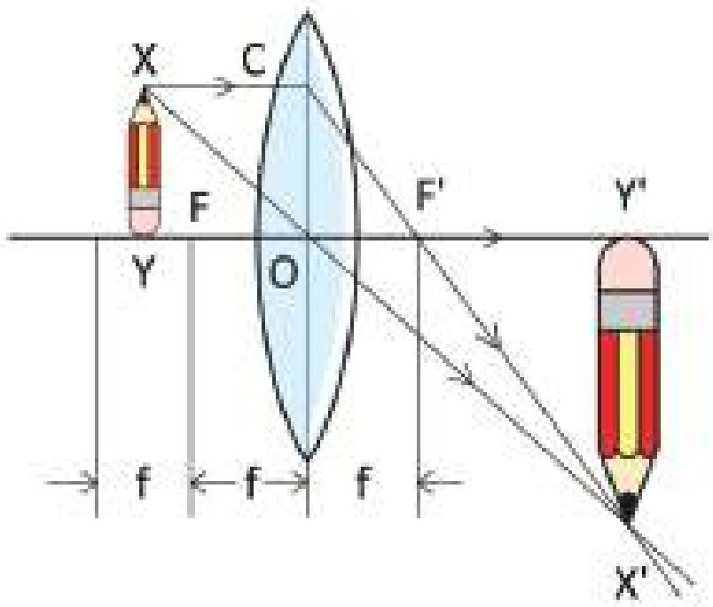

<!-- physics-9-10-bn-c09-t9.4-p050 · text · p.262 · review: verify-formula -->
(i) বস্তুটিকে ফোকাস দূরত্বের বাইরে কিন্তু ফোকাস দূরত্বের দ্বিগুণ দৈর্ঘ্যের ভেতরে রাখা হবে। ৯.২৪ চিত্রটিতে $XY$ বস্তুটির $Y$ বিন্দুর প্রতিবিম্বটি $YO$ রেখার উপরে হবে তাই আগের মতো আমরা শুধু $X$ বিন্দুটির প্রতিবিম্ব বের করি। $X$ বিন্দু থেকে অক্ষের সাথে সমানতরাল রশ্মিটি ফোকাস বিন্দু $F$ এর ভেতর দিয়ে যাবে। লেন্সের কেন্দ্রবিন্দু দিয়ে অন্য একটি রশ্মি $XO$ সরলরেখায় যাবে। দুটি রেখা যেখানে ছেদ করবে সেই $X'$ বিন্দুটি হচ্ছে $X$ এর প্রতিবিম্ব। $X'$ থেকে অক্ষ $YO$ রেখার ওপর লম্ব আঁকা হলে $Y'$ বিন্দুটি হবে $Y$ এর প্রতিবিম্বের অবস্থান। কাজেই $X'Y'$ হচ্ছে $XY$ এর প্রতিবিম্ব। অর্থাৎ এই প্রতিবিম্বের জন্য আমরা বলতে পারি, প্রতিবিম্ব হয়।

<!-- physics-9-10-bn-c09-t9.4-p051 · text · p.262 -->
(a) ফোকাস দূরত্বের দ্বিগুণ দূরত্বের বাইরে অবস্থিত;
(b) বাস্তব;
(c) উল্টো, এবং
(d) বস্তুর তুলনায় বড়।

<!-- physics-9-10-bn-c09-t9.4-p052 · text · p.262 · review: verify-formula -->
(ii) এবারে আমরা দেখি বস্তুটি ফোকাস দূরত্বের ঠিক দ্বিগুণ দূরত্বে রাখা হলে কী হয়। দেখতেই পাচ্ছি $XY$ বস্তুটি যদি ঠিক ফোকাস দূরত্বের দ্বিগুণ দূরত্বে (চিত্র৯.২৫) রাখা হয় তাহলে প্রতিবিম্বটির আকার হবে $XY$ বস্তুটির সমান এবং প্রতিবিম্বটির অবস্থান হবে লেন্সের কেন্দ্র থেকে ঠিক সমান দূরত্বে। বস্তুটি যতই ফোকাস বিন্দুর কাছাকাছি আনা হতে থাকবে প্রতিবিম্বটি ততই দূরে তৈরি হবে

<!-- physics-9-10-bn-c09-t9.4-p053 · figure · p.262 -->
চিত্র৯.২৪: ফোকাস দূরত্বের বাইরে কিন্তু দ্বিগুণ ফোকাস দূরত্বের ভেতরে বস্তু রাখা হলে তার বাস্তব, উল্টো ও বড় প্রতিবিম্ব তৈরি হয়।

<!-- physics-9-10-bn-c09-t9.4-p054 · figure · p.263 -->
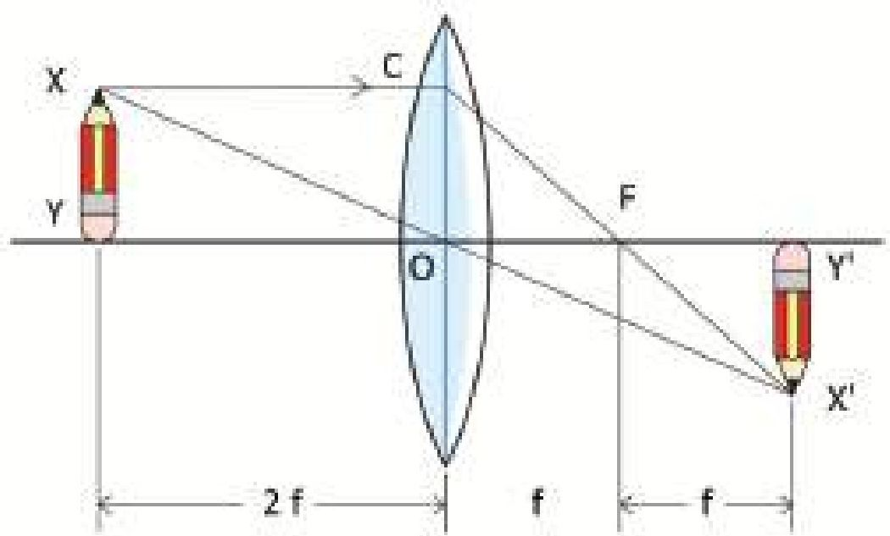

<!-- physics-9-10-bn-c09-t9.4-p055 · figure · p.263 -->
**চিত্র৯.২৫: ঠিক ফোকাস দূরহের দ্বিগুণ দূরহে কোনো বস্তু রাখা হলে তার প্রতিবিম্বটি হবে বস্তুটির সমান।**

<!-- physics-9-10-bn-c09-t9.4-p056 · text · p.263 -->
এবং তার আকার বড় হতে থাকবে। যেহেতু এই প্রতিবিম্বের ভেতর দিয়ে সত্যিকার আলোক রশ্মি যায় তাই এটি বাস্তব প্রতিবিম্ব, এবং ছবিটিতে স্পষ্ট দেখা যাচ্ছে প্রতিবিম্বটি উল্টো অর্থাৎ, প্রতিবিম্বটি হবে

<!-- physics-9-10-bn-c09-t9.4-p057 · text · p.263 -->
(a) ফোকাস দূরহের দ্বিগুণ দূরহে অবস্থিত;
(b) বাস্তব;
(c) উল্টো, এবং
(d) বস্তুর সমান আকারের।

<!-- physics-9-10-bn-c09-t9.4-p058 · text · p.263 -->
(iii) এখন আমরা দেখি বস্তুটি যদি ফোকাস দূরহের দ্বিগুণ দূরহের বাইরে থাকে তাহলে তার কী ধরনের প্রতিবিম্ব কোথায় তৈরি হয়।

<!-- physics-9-10-bn-c09-t9.4-p059 · figure · p.263 -->
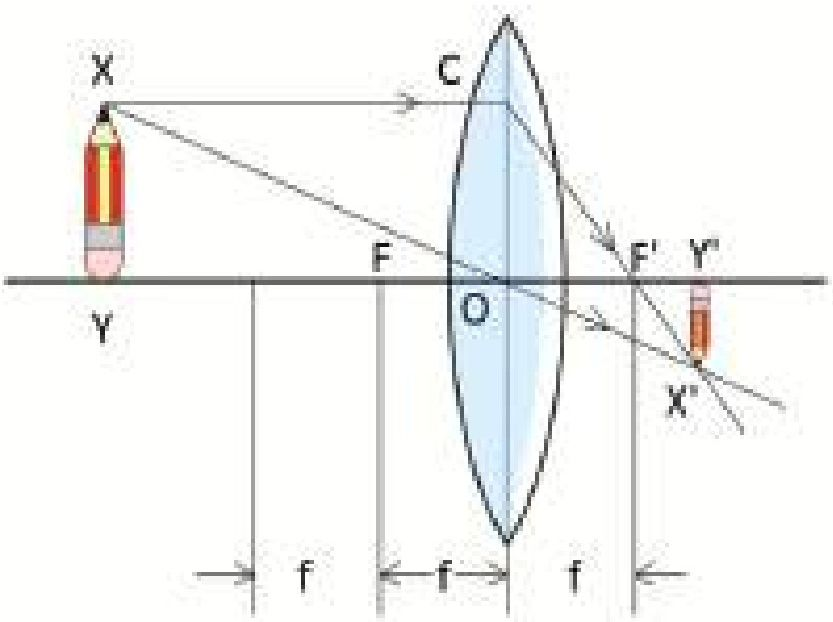

<!-- physics-9-10-bn-c09-t9.4-p060 · text · p.263 -->
এই প্রতিবিম্বটি আকার পদ্ধতি ঠিক আগেরটির মতো শুধু (চিত্র ৯.২৬) বস্তুটিকে বসাতে হবে ফোকাস দূরহের দ্বিগুণ দূরহের বাইরে। আমরা আগেই বলেছি বস্তুটি যদি ফোকাস দূরহের দ্বিগুণ দূরহে রাখা হয়, তাহলে তার সমদূরহে সমান আকারের একটা প্রতিবিম্ব তৈরি হয়। যতই বস্তুটা দূরে

<!-- physics-9-10-bn-c09-t9.4-p061 · figure · p.263 -->
**চিত্র৯.২৬: দ্বিগুণ ফোকাস দূরহের বাইরে বস্তু রাখা হলে তার ছোট, উল্টো ও বাস্তব প্রতিবিম্ব তৈরি হয়।**

<!-- physics-9-10-bn-c09-t9.4-p062 · text · p.264 -->
সরিয়ে নেওয়া হতে থাকে প্রতিবিষ্টি ততই ছোট হতে থাকে এবং ফোকাস বিন্দুর দিকে এগিয়ে আসতে থাকে। বস্তুটি যদি অসীম দূরত্বে সরিয়ে নেওয়া হয় তাহলে তার প্রতিবিষ্টি তৈরি হবে ঠিক ফোকাস বিন্দুতে। কাজেই ফোকাস দূরত্বের দ্বিগুণ দূরত্বের বাইরে কোনো বস্তু রাখা হলে বস্তুটির প্রতিবিষ্টি হয়।

<!-- physics-9-10-bn-c09-t9.4-p063 · text · p.264 -->
(a) ফোকাস দূরত্ব এবং ফোকাস দূরত্বের দ্বিগুণ দূরত্বের মাঝখানে অবস্থিত;
(b) বাস্তব;
(c) উল্টো, এবং
(d) বস্তুর তুলনায় ছোট।

### উদাহরণ

<!-- physics-9-10-bn-c09-t9.4-p064 · example · p.264 -->
**প্রশ্ন:** উল্ট লেন্সের ফোকাস দূরত্বের বাইরে কোনো বস্তু রাখা হলে তার বাস্তব প্রতিবিষ্টি তৈরি হয়। প্রতিবিষ্টির জায়গায় বস্তুটি রাখা হলে তার প্রতিবিষ্টি কোথায় হবে?

<!-- physics-9-10-bn-c09-t9.4-p065 · example · p.264 -->
**উত্তর:** আলোকরশ্মি দিক পরিবর্তন করলে একটি অন্যটিতে পরিবর্তিত হয়।

### নিজে করো

<!-- physics-9-10-bn-c09-t9.4-p066 · activity · p.264 -->
উল্ট লেন্স যদি বহুদূর থেকে কোনো বস্তুর আলো এসে পড়ে তাহলে সেটি লেন্সের ফোকাস বিন্দুতে তার প্রতিবিষ্টি তৈরি করে। এই পদ্ধতি ব্যবহার করে তুমি উল্ট লেন্সের ফোকাস দূরত্ব বের করতে পারবে। এটি করার জন্য তুমি একটা দেয়ালের বেশ দূরে একটি আলোর উৎস রেখে দেয়ালের সামনে তোমার লেন্সটি ধরে সামনে-পেছনে নিতে থাকো যতক্ষণ পর্যন্ত না দেয়ালে আলোর প্রতিবিষ্টি স্পষ্ট হয়। যখন প্রতিবিষ্টি স্পষ্ট হবে তখন লেন্স থেকে দেয়ালের দূরত্বটি মেপে নাও, এটিই হচ্ছে এই লেন্সের ফোকাস দূরত্ব।

<!-- physics-9-10-bn-c09-t9.4-p067 · text · p.264 · review: known-confusable-corrected -->
যদি তোমার কাছে কোনো উল্ট লেন্স না থাকে তাহলে চশমার কাচ দিয়ে পরীক্ষা করতে পারো। ব্যস্ক মানুষের চশমার কাচ অনেক সময় উল্ট লেন্স দিয়ে তৈরি হয়। যদি চশমার কাঁচ দিয়ে কাছাকাছি বস্তুকে বড় দেখায় বুঝে নেবে এটি উল্ট লেন্স।

### ৯.৪.৩ লেন্সের ক্ষমতা (Power of a Lens)

<!-- physics-9-10-bn-c09-t9.4-p068 · text · p.264 -->
লেন্সের সবচেয়ে প্রচলিত ব্যবহার আমরা দেখি চশমায়। তোমরা যদি বিভিন্ন মানুষের চশমার লেন্স পরীক্ষা করে দেখো তাহলে দেখবে কারো কারো চশমার লেন্স তৈরি হয় উল্ট লেন্স দিয়ে, কারো কারো চশমার লেন্স তৈরি হয় অবতল লেন্স দিয়ে। আমরা লেন্সগুলোকে প্রায়ই ‘পাওয়ার’ অর্থাৎ ক্ষমতা দিয়ে ব্যাখ্যা করি। তোমরা নিশ্চয়ই বলেছ কিংবা বলতে শুনছে, অমুকের চশমার পাওয়ার অনেক বেশি। পাওয়ার কথাটি দিয়ে আমরা কী বোঝানোর চেষ্টা করি?

<!-- physics-9-10-bn-c09-t9.4-p069 · text · p.265 · review: known-confusable-corrected -->
এই ধারণাটি এসেছে লেন্স দিয়ে বড় এবং ছোট করে বস্তুকে দেখানোর ক্ষমতা থেকে। দুটি উত্তল লেন্স দিয়ে যদি একটি জিনিসকে লেন্সের কাছাকাছি একই দূরত্বে রেখে দেখি এবং একটি লেন্সে জিনিসটি অন্য লেন্সটি থেকে বড় দেখায় তাহলে যে লেন্সটিতে বড় দেখায় আমরা বলি সেই লেন্সের ক্ষমতা বেশি। তোমরা একটু চিন্তা করলেই দেখবে আসলে যে লেন্সের ফোকাস দূরত্ব যত কম সেই লেন্সে জিনিসটিকে তত বড় দেখাবে। (চিত্র ৯.২৭)

<!-- physics-9-10-bn-c09-t9.4-p070 · figure · p.265 -->
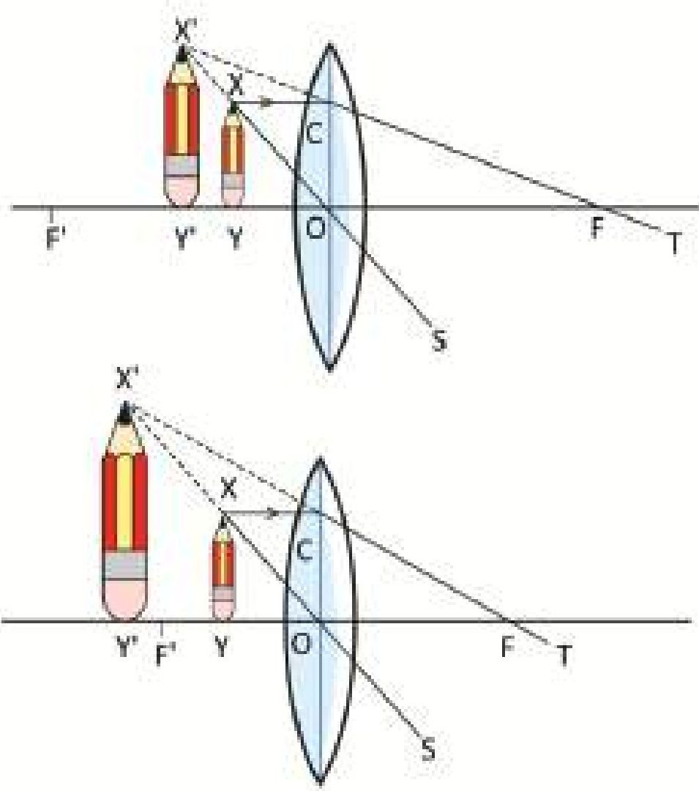

<!-- physics-9-10-bn-c09-t9.4-p071 · text · p.265 · review: verify-formula -->
কাজেই লেন্সের ক্ষমতা $P$ হচ্ছে ফোকাস দূরত্বের ব্যস্তানুপাতিক। যদি ফোকাস দূরত্ব $f$ মিটারে দেওয়া হয় তাহলে ক্ষমতা $P$ এর একক ডায়াপ্টার। অর্থাৎ তোমার পরিচিত কারো চশমার ক্ষমতা যদি হয় 2.5 (সাধারণ কথাবার্তায় ডায়াপ্টার শব্দটা কেউ ব্যবহার করে না।) তাহলে তার চশমার লেন্সের ফোকাস দূরত্ব হবে

<!-- physics-9-10-bn-c09-t9.4-p072 · formula · p.265 · review: verify-formula -->
$$f = \frac{1}{P} = \frac{1}{2.5}  m = 0.4  m$$

<!-- physics-9-10-bn-c09-t9.4-p073 · text · p.265 · review: known-confusable-corrected -->
ক্ষমতার ধারণাটি শুধু উত্তল লেন্সের বড় দেখানোর জন্য নয়। অবতল লেন্সে ছোট দেখানোর সময়ও একই শব্দ ব্যবহার করা হয়। যে অবতল লেন্সে বস্তুকে (সমান দূরত্বে) যত ছোট দেখাবে বুঝতে হবে তার পাওয়ার তত বেশি বা ফোকাস দূরত্ব তত ছোট। উত্তল লেন্সের বোঝায় ক্ষমতা ধনাত্মক বা পজিটিভ, অবতল লেন্সের বোঝায় পাওয়ার ঋণাত্মক বা নেগেটিভ। এটাই হচ্ছে পার্থক্য।

<!-- physics-9-10-bn-c09-t9.4-p074 · figure · p.265 -->
**চিত্র ৯.২৭: যে লেন্সের ফোকাস দূরত্ব যত কম সেই লেন্সে জিনিসটিকে তত বড় দেখায়।**

### নিজে করো

<!-- physics-9-10-bn-c09-t9.4-p075 · figure · p.266 -->
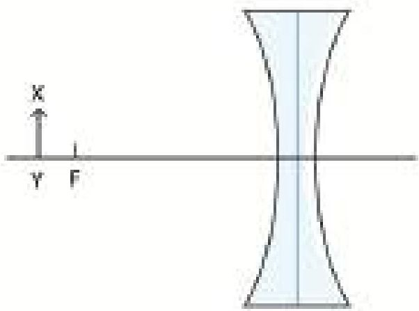

<!-- physics-9-10-bn-c09-t9.4-p076 · figure · p.266 -->
**চিত্র ৯.২৮: অবতল লেন্সের ফোকাস দূরত্বের বাইরে রাখা একটি বস্তু।**

<!-- physics-9-10-bn-c09-t9.4-p077 · activity · p.266 · review: latin-junk -->
XY বস্তুর জন্য রশ্মিগুলো যতটুকু সম্ভব সঠিকভাবে ঐকে প্রতিবিম্ব কোথায় হবে দেখাও।(চিত্র ৯.২৮)

<!-- physics-9-10-bn-c09-t9.4-p078 · figure · p.266 -->
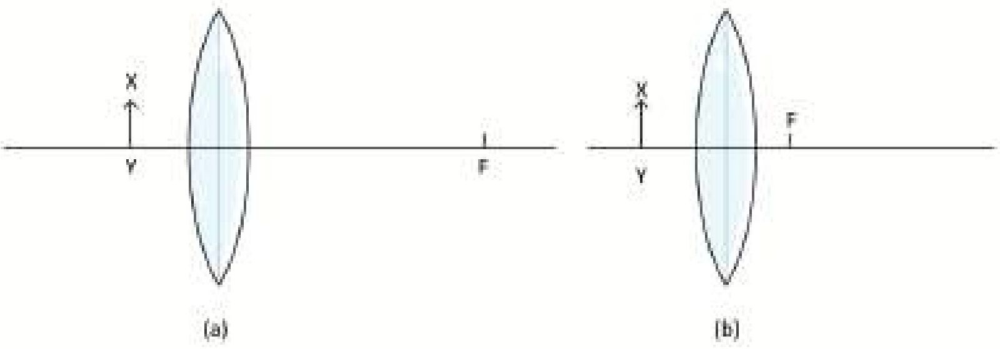

<!-- physics-9-10-bn-c09-t9.4-p079 · figure · p.266 -->
**চিত্র ৯.২৯: (a) উত্তল লেন্সের ফোকাস দূরত্বের ভেতরে রাখা একটি বস্তু (b) উত্তল লেন্সের ফোকাস দূরত্বের বাইরে রাখা একটি বস্তু।**

<!-- physics-9-10-bn-c09-t9.4-p080 · activity · p.266 · review: latin-junk -->
XY বস্তুর জন্য রশ্মিগুলো যতটুকু সম্ভব সঠিকভাবে ঐকে প্রতিবিম্ব কোথায় হবে দেখাও।(চিত্র ৯.২৯a)

<!-- physics-9-10-bn-c09-t9.4-p081 · activity · p.266 · review: latin-junk -->
XY বস্তুর জন্য রশ্মিগুলো যতটুকু সম্ভব সঠিকভাবে ঐকে প্রতিবিম্ব কোথায় হবে দেখাও।(চিত্র ৯.২৯b)

## 9.ex নমুনা প্রশ্ন

### বহুনির্বাচনি প্রশ্ন

<!-- physics-9-10-bn-c09-t9.ex-p001 · exercise · p.267 · review: known-confusable-corrected -->
সঠিক উত্তরটির পাশে টিক ( √ ) চিহ্ন দাও

<!-- physics-9-10-bn-c09-t9.ex-p002 · exercise · p.267 · review: known-confusable-corrected -->
১. যন মাধ্যমের ভেতরের বস্তুকে উপরের হালকা মাধ্যম থেকে দেখলে এর প্রতিবিম্ব কোথায় হবে?

<!-- physics-9-10-bn-c09-t9.ex-p003 · exercise · p.267 · review: known-confusable-corrected -->
(ক) উপরের দিকে উঠে আসবে

<!-- physics-9-10-bn-c09-t9.ex-p004 · exercise · p.267 · review: known-confusable-corrected -->
(খ) নিচের দিকে সরে যাবে

<!-- physics-9-10-bn-c09-t9.ex-p005 · exercise · p.267 · review: known-confusable-corrected -->
(গ) একই জায়গায় থাকবে

<!-- physics-9-10-bn-c09-t9.ex-p006 · exercise · p.267 · review: known-confusable-corrected -->
(ঘ) পাশে সরে যাবে

<!-- physics-9-10-bn-c09-t9.ex-p007 · exercise · p.267 · review: known-confusable-corrected -->
৯.৩০চিত্র থেকে ২ ও ৩ নং প্রশ্নের উত্তর দাও।

<!-- physics-9-10-bn-c09-t9.ex-p008 · figure · p.267 · review: known-confusable-corrected -->

<!-- physics-9-10-bn-c09-t9.ex-p009 · figure · p.267 · review: known-confusable-corrected -->
**চিত্র ৯.৩০**

<!-- physics-9-10-bn-c09-t9.ex-p010 · exercise · p.267 · review: known-confusable-corrected -->
২. এখানে প্রতিসরণ কোণ কত?

<!-- physics-9-10-bn-c09-t9.ex-p011 · exercise · p.267 · review: known-confusable-corrected -->
(ক) 180°

<!-- physics-9-10-bn-c09-t9.ex-p012 · exercise · p.267 · review: known-confusable-corrected -->
(খ) 90°

<!-- physics-9-10-bn-c09-t9.ex-p013 · exercise · p.267 · review: known-confusable-corrected -->
(গ) 45°

<!-- physics-9-10-bn-c09-t9.ex-p014 · exercise · p.267 · review: known-confusable-corrected -->
(ঘ) 0°

<!-- physics-9-10-bn-c09-t9.ex-p015 · exercise · p.268 · review: known-confusable-corrected -->
৩. আপতন কোণটি যদি আরও বড় হয় তাহলে কী ঘটবে?

<!-- physics-9-10-bn-c09-t9.ex-p016 · exercise · p.268 · review: known-confusable-corrected -->
(ক) পূর্ণ অভ্যন্তরীণ প্রতিসরণ
(খ) পূর্ণ অভ্যন্তরীণ প্রতিফলন
(গ) প্রতিসরণ এবং প্রতিফলন
(ঘ) প্রতিফলন

<!-- physics-9-10-bn-c09-t9.ex-p017 · exercise · p.268 · review: known-confusable-corrected -->
৪. লেন্সের রশ্মিচিত্র অঙ্কনের ক্ষেত্রে সচরাচর ব্যবহৃত হয়

<!-- physics-9-10-bn-c09-t9.ex-p018 · figure · p.268 · review: known-confusable-corrected -->
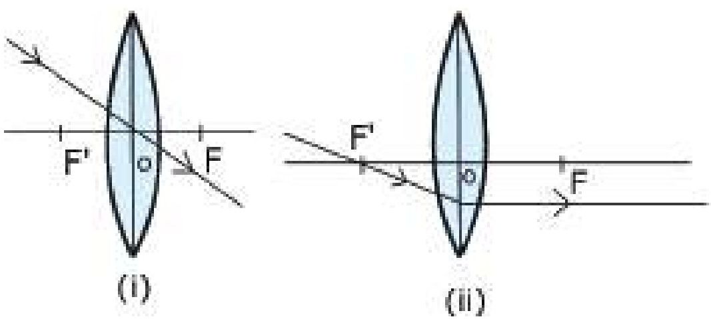

<!-- physics-9-10-bn-c09-t9.ex-p019 · figure · p.268 · review: known-confusable-corrected -->
**চিত্র ৯.৩১**

<!-- physics-9-10-bn-c09-t9.ex-p020 · exercise · p.268 · review: latin-junk,known-confusable-corrected -->
(ক) i
(খ) ii
(গ) i ও ii
(ঘ) i, ii ও iii

<!-- physics-9-10-bn-c09-t9.ex-p021 · exercise · p.268 · review: known-confusable-corrected -->
৫. লেন্সের ক্ষমতার একক কোনটি?

<!-- physics-9-10-bn-c09-t9.ex-p022 · exercise · p.268 · review: known-confusable-corrected -->
(ক) ডায়াপ্টার
(খ) ওয়াট
(গ) অশু ক্ষমতা
(ঘ) মিটার

### সৃজনশীল প্রশ্ন

<!-- physics-9-10-bn-c09-t9.ex-p023 · exercise · p.269 · review: known-confusable-corrected -->
১. দশম শ্রেণির ছাত্রী শিউলী শ্রেণিকক্ষে রু্যাকবোড়ের লেখা ভালোভাবে দেখতে পায় না। ফলে ডাক্তারের শরণাপন্ন হলে ডাক্তার তাকে -2D ক্ষমতাসম্পন্ন লেন্স চশমা হিসেবে ব্যবহারের পরামর্শ দিলেন। শিউলীর বড়ভাই টগর তাকে সেই চশমাটির লেন্স থেকে 1m দূরে অবস্থিত একটি বস্তুর ক্ষেত্রে রশ্মিচিত্র অঙ্কন করে দেখালো প্রতিবিম্ব কোথায় তৈরি হবে। বিশ্বটি বাস্তব না অবাস্তব হবে সেটিও সে শিউলীকে বুঝিয়ে দিল।

<!-- physics-9-10-bn-c09-t9.ex-p024 · exercise · p.269 · review: known-confusable-corrected -->
(ক) লেন্স কাকে বলে?

<!-- physics-9-10-bn-c09-t9.ex-p025 · exercise · p.269 · review: known-confusable-corrected -->
(খ) স্পর্শ না করে কীভাবে একটি লেন্স শনাক্ত করা যায়?

<!-- physics-9-10-bn-c09-t9.ex-p026 · exercise · p.269 · review: known-confusable-corrected -->
(গ) শিউলির চশমার ফোকাস দূরত্ব নির্ণয় করো।

<!-- physics-9-10-bn-c09-t9.ex-p027 · exercise · p.269 · review: known-confusable-corrected -->
(ঘ) উদ্দীপকে টগরের অঙ্কিত রশ্মিচিত্রটি ঐকে, শিউলীকে বোঝাতে তার কার্যক্রম বিশ্লেষণ করো।

### সংক্ষিপ্ত উত্তর প্রশ্ন

<!-- physics-9-10-bn-c09-t9.ex-p028 · exercise · p.269 -->
১. আলোর প্রতিসরণ বলতে কী বোঝায়?

<!-- physics-9-10-bn-c09-t9.ex-p029 · exercise · p.269 -->
২. উত্তল লেন্সকে অভিসারী লেন্স বলা হয় কেন ব্যাখ্যা করো।

<!-- physics-9-10-bn-c09-t9.ex-p030 · exercise · p.269 -->
৩. মরীচিকা কীভাবে সৃষ্টি হয় ব্যাখ্যা করো।

<!-- physics-9-10-bn-c09-t9.ex-p031 · exercise · p.269 -->
৪. অবতল লেন্সের ফোকাস দূরত্ব ঋণাত্মক কেন ব্যাখ্যা করো।
