# 10. স্থির বিদ্যুৎ

Source: Physics Bangla Version, printed pp. 270-297

## 10.0 ভূমিকা ও শিখনফল

<!-- physics-9-10-bn-c10-t10.0-p001 · figure · p.270 -->
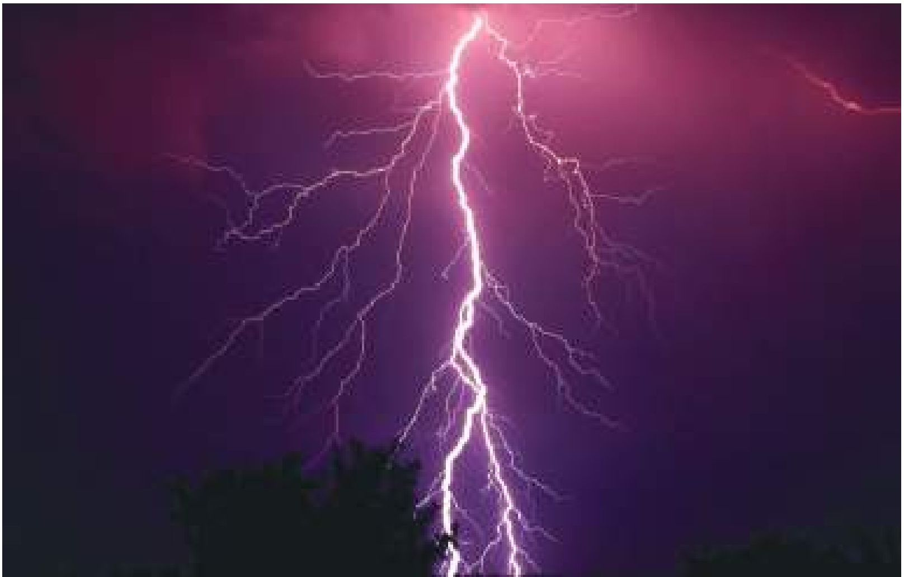

<!-- physics-9-10-bn-c10-t10.0-p002 · text · p.270 -->
শীতকালে চিবুনি দিয়ে চুল আঁচড়ানোর পর সেই চিবুনি ছোট ছোট কাগজের টুকরোর কাছে আনা হলে কাগজের টুকরোগুলো লাফিয়ে চিবুনির দিকে ছুটে আসে। আবার ঝড়ের সময় বজ্রপাতের আলোর ঝলকানির সাথে দিগ্গিদিক প্রক্সিপত করে প্রচণ্ড শব্দে বজ্রপাত হয়। এই দুটো বিষয়ের জন্য দায়ী স্থির বিদ্যুৎ। আমাদের চারপাশের সবকিছুই আসলে অণু-পরমাণু দিয়ে তৈরি। পরমাণুর কেন্দ্রে থাকে নিউক্লিয়াস এবং সেটিকে ঘিরে বাইরে ইলেকট্রন বিচরণশীল। ইলেকট্রনের ঋণাত্মক চার্জ এবং নিউক্লিয়াসের চার্জ ধনাত্মক। কোনো প্রক্রিয়ায় যদি পরমাণুর এক বা একাধিক ইলেকট্রনকে আলাদা করে ফেলা হয় তাহলে স্থির বিদ্যুৎয়ের জন্ম হয়। এই অধ্যায়ে আমরা এই স্থির বিদ্যুৎয়ের বিভিন্ন প্রক্রিয়া আলোচনা করব। দুটো চার্জকে পাশাপাশি রাখা হলে তারা কী বল দ্বারা নিজেদের আকর্ষণ করে সেটিও আমরা এই অধ্যায়ে জেনে নেব।

### এ অধ্যায় শেষে আমরা –

<!-- physics-9-10-bn-c10-t10.0-p003 · objective · p.271 -->
* পরমাণু গঠনের ভিত্তিতে আধান প্রাপ্তির মৌলিক কারণ ব্যাখ্যা করতে পারব।
* ঘর্ষণ ও আবেশ প্রক্রিয়ায় আধান প্রাপ্তি ব্যাখ্যা করতে পারব।
* তড়িৎবীজ্জণ যন্ত্রের সাহায্যে আধান শনাক্ত করতে পারব।
* কুলস্ফের সূত্র ব্যবহার করে তড়িৎ বল পরিমাণ করতে পারব।
* তড়িৎ ক্ষেত্র সৃষ্টির কারণ ব্যাখ্যা করতে পারব।
* তড়িৎ বলরেখার দিক তড়িৎ ক্ষেত্রের দিকে কেমনভাবে নির্দেশ করে ব্যাখ্যা করতে পারব।
* তড়িৎ বিভব ব্যাখ্যা করতে পারব।
* তড়িৎ শক্তি সংরক্ষণে ধারকের কার্যক্রম ব্যাখ্যা করতে পারব।
* স্থির তড়িৎ ব্যবহার ব্যাখ্যা করতে পারব।
* স্থির তড়িৎজনিত বিপজ্জনক ঝুঁকি হতে রক্ষার কৌশল ব্যাখ্যা করতে পারব।

## 10.1 আধান বা চার্জ (Charge)

<!-- physics-9-10-bn-c10-t10.1-p001 · text · p.272 -->
শীতকালে শুকনো চুল চিরুনি দিয়ে আঁচড়িয়ে তোমাদের প্রায় সবাই নিশ্চয়ই কখনো না কখনো ছোট ছোট কাগজের টুকরাকে সেই চিরুনি দিয়ে আকর্ষণ করেছ। শীতপ্রধান দেশে শীতকালে বাতাস খুব শুকনো থাকে, তখন ছোট শিশু যখন কার্পেটে হামাগুড়ি দেয়, তখন তাদের চুল খাড়া হয়ে যায়, দেখে মনে হয় একটি চুল বুঝি অন্য চুলকে ঠেলে খাড়া করিয়ে দিয়েছে। তোমরা সবাই নিশ্চয়ই ঝাড়ের রাতে আকাশ চিরে বিদ্যুতের ঝলককে নিচে নেমে আসতে দেখেছ।

<!-- physics-9-10-bn-c10-t10.1-p002 · text · p.272 -->
কাগজের আকর্ষণ, চুলের বিকর্ষণ কিংবা বজ্রপাত— এই তিনটি ব্যাপারের মূলেই কিন্তু একই বিষয় কাজ করেছে, সেটি হচ্ছে চার্জ বা আধান। চার্জ বা আধান কী, কেন সেটা কখনো আকর্ষণ করে, কখনো বিকর্ষণ করে আবার কখনো বিদ্যুৎ ঝলক তৈরি করে, ইত্যাদি বোঝার জন্য আমাদের একেবারে গোড়ায় যেতে হবে, এবং অণু-পরমাণু কেমন করে তৈরি হয় সেটা জানতে হবে।

<!-- physics-9-10-bn-c10-t10.1-p003 · text · p.272 -->
আমরা সবাই জানি সকল বস্তুই অণু-পরমাণু দিয়ে তৈরি। এখন পর্যন্ত ১১৪টি ভিন্ন ভিন্ন মৌলের পরমাণু পাওয়া গিয়েছে, এর মাঝে মাত্র ৪০টি মৌলের পরমানু (এক বা একাধিক আইসোটোপ) স্থায়ী। মাত্র এই কয়টি পরমাণু দিয়ে লক্ষ্য লক্ষ্য ভিন্ন অণু তৈরি হয়েছে। একটা অক্সিজেন পরমাণুর সাথে দুটো হাইড্রোজেন পরমাণু যুক্ত হয়ে পানি, একটা সোডিয়াম পরমাণুর সাথে একটা ক্লোরিন পরমাণু যুক্ত হয়ে লবণ, একটা কার্বন পরমাণুর সাথে চারটা হাইড্রোজেন পরমাণু দিয়ে মিথেন গ্যাস, ইত্যাদি গঠিত হয়। (অবাক হবার কিছু নেই বাংলায় মাত্র পঞ্চাশটা বর্ণ, সেই বর্ণমালা দিয়ে হাজার হাজার শব্দ তৈরি হয়েছে।)

<!-- physics-9-10-bn-c10-t10.1-p004 · text · p.272 · review: verify-formula -->
পরমাণু হচ্ছে সবকিছুর গঠনিক একক বা ব্লডিং ব্লক (Building Block)। এই পরমাণুর কেন্দ্রে থাকে ছোট একটা নিউক্লিয়াস, তাকে ঘিরে থাকে ইলেকট্রন। নিউক্লিয়াস তৈরি হয় প্রোটন আর নিউট্রন দিয়ে। এর ভেতরে প্রোটনের চার্জ হচ্ছে ধনাত্মক বা পজিটিভ (নিউট্রনের কোনো চার্জ নেই) আর ইলেকট্রনের চার্জ ঋণাত্মক বা নেগেটিভ। প্রোটন আর ইলেকট্রনের চার্জ সমান কিন্তু বিপরীত অর্থাৎ তার মান ($1.6 \times 10^{-19}  Coulomb$) কিন্তু একটা পজিটিভ অন্যটা নেগেটিভ। একটা পরমাণুর নিউক্লিয়াসে যে কয়টা প্রোটন থাকে তার বাইরে ঠিক সেই কয়টা ইলেকট্রন বিচরণশীল থাকে তাই পরমাণুর সম্মিলিত চার্জ শূন্য, অর্থাৎ পরমাণু হচ্ছে বিদ্যুৎ নিরপেক্ষ বা নিস্তড়িৎ বা নিউট্রাল। সবচেয়ে সহজ পরমাণু হচ্ছে হাইড্রোজেন, তার নিউক্লিয়াসটা হচ্ছে শুধু একটা প্রোটন, তাকে ঘিরে বিচরণশীল একটা ইলেকট্রন। এরপরের মৌল হচ্ছে হিলিয়ামের নিউক্লিয়াসে আছে দুটো প্রোটন (এবং চার্জবিহীন দুটো নিউট্রন) আর বাইরে আছে দুটো ইলেকট্রন। এভাবে আস্তে আস্তে আরো বড় বড় পরমাণু তৈরি হয়েছে। নিউক্লিয়াসে যতগুলো প্রোটন থাকে সাধারণত ততগুলো অথবা আরো বেশি নিউট্রন থাকে। শুধু হাইড্রোজেন পরমাণু (কোন নিউট্রন নাই $^1H$) এবং হিলিয়াম-৩ ($^3He$) পরমাণুতে প্রোটনের সংখ্যা নিউট্রনের সংখ্যার চেয়ে বেশি।

<!-- physics-9-10-bn-c10-t10.1-p005 · text · p.273 -->
নিউক্লিয়াসের বাইরে ইলেকট্রনগুলো সব একই কক্ষপথে থাকে না, ১০.০১ চিত্রটিতে পরমাণুর একটি মডেল যেভাবে দেখানো হয়েছে, যেখানে একটা কক্ষপথ পূর্ণ করে ইলেকট্রন পরের কক্ষপথে যেতে পারে। ভেতরের কক্ষপথের ইলেকট্রনগুলো অনেক শক্তভাবে আটকে থাকে। কিছু কিছু পরমাণুর বেলায় বাইরের কক্ষপথের ইলেকট্রনগুলোকে একটু চেঁটা করলে আলাদা করা যায়। ইলেকট্রন আলাদা করার একটা উপায় হচ্ছে ঘর্ষণ।

<!-- physics-9-10-bn-c10-t10.1-p006 · text · p.273 -->
এমনিতে পরমাণুগুলো চার্জ নিরপেক্ষ হয় অর্থাৎ প্রত্যেক পরমাণুতে সমান সংখ্যক প্রোটন আর ইলেকট্রন থাকে। কিন্তু কোনো কারণে যদি বাইরের কক্ষপথের একটা ইলেকট্রন সরিয়ে নেওয়া হয় তাহলে ইলেকট্রনের তুলনায় প্রোটনের সংখ্যা বেড়ে যায় অর্থাৎ পরমাণুটা আর বিদ্যুৎ নিরপেক্ষ বা চার্জ নিউট্রিয়াল থাকে না, তার ভেতরে পজিটিভ চার্জের পরিমাণ বেড়ে যায়। একটা ইলেকট্রন সরিয়ে নিলে পরমাণুটিতে একটি পজিটিভ চার্জ হয়, দুটি সরিয়ে নিলে দুটি পজিটিভ চার্জ হয়। আমরা তখন বলি পরমাণুটি আয়নিত বা আহিত হয়েছে। একটা পরমাণু যে রকম পজিটিভভাবে আয়নিত হতে পারে ঠিক সে রকম নেগেটিভভাবেও আয়নিত হতে পারে অর্থাৎ যখন বিচ্ছিন্ন একটি বা দুটি ইলেকট্রন পরমাণুর সাথে যুক্ত হয়ে যায়, তখন পরমাণুর মোট চার্জ হয় নেগেটিভ।

<!-- physics-9-10-bn-c10-t10.1-p007 · figure · p.273 -->
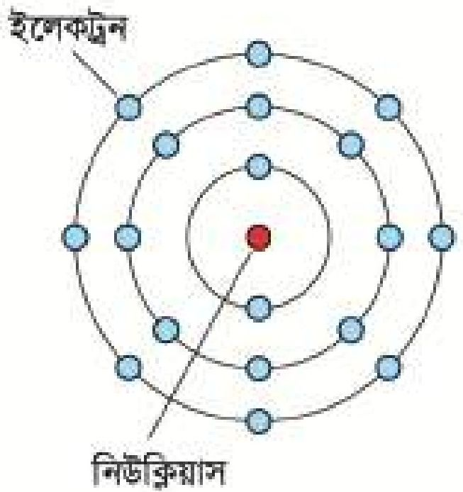

<!-- physics-9-10-bn-c10-t10.1-p008 · figure · p.273 -->
**চিত্র ১০.০১ :** একটি আর্গনের পরমাণুর মডেল। এক কক্ষপথ পূর্ণ করে ইলেকট্রন পরের কক্ষপথে যায়।

<!-- physics-9-10-bn-c10-t10.1-p009 · text · p.273 -->
পরমাণুগুলোর ইলেকট্রনগুলো তার কক্ষপথে বিচরণশীল থাকে। এগুলো বিভিন্ন কক্ষপথে কীভাবে সাজানো হবে তার সুনির্দিষ্ট নিয়ম আছে। তোমরা তোমাদের রসায়ন বইয়ে সেটি বিস্তৃতভাবে দেখেছ। এখন তার গভীরে আমরা যাব না। শুধু বলে রাখি কখনো কখনো শেষ কক্ষপথে একটি-দুটি ইলেকট্রন প্রায় মুক্ত অবস্থায় থাকে, এ রকম পদার্থে ইলেকট্রনগুলো খুব সহজে পুরো পদার্থের মাঝে ছোটোছোটি করতে পারে। এ রকম পদার্থকে আমরা বলি বিদ্যুৎ সুপরিবাহী। আবার কিছু কিছু পদার্থে ছোটোছোটি করার মতো মুক্ত ইলেকট্রন নেই, যে কয়টি আছে খুব শক্তভাবে আবদ্ধ সেগুলো হচ্ছে বিদ্যুৎ অপরিবাহী। ধাতব পদার্থ যেমন সোনা, রুপা, তামা হচ্ছে বিদ্যুৎ সুপরিবাহী। কাঠ, প্লাস্টিক, কাচ, রাবার এসব হচ্ছে বিদ্যুৎ অপরিবাহী।

<!-- physics-9-10-bn-c10-t10.1-p010 · text · p.273 -->
পরমাণুর গঠন সম্পর্কে এখন পর্যন্ত যা যা বলা হয়েছে আমরা যদি সেগুলো বুঝে থাকি তাহলে স্থির বিদ্যুতের পরের বিষয়গুলো মনে হবে খুবই সহজ।

## 10.2 ঘর্ষণে স্থির বিদ্যুৎ তৈরি

### (Static Electricity due to Friction)

<!-- physics-9-10-bn-c10-t10.2-p001 · text · p.274 -->
এক টুকরো কাচকে যদি এক টুকরো সিল্ক দিয়ে ঘষা হয় (১০.০২ চিত্র) তাহলে কাচ থেকে ইলেকট্রনগুলো সিল্কে আসতে শুরু করবে অর্থাৎ কাচটি হবে পজিটিভ বা ধনাত্মক চার্জযুক্ত আর সিল্কটি হবে নেগেটিভ চার্জযুক্ত। কারণ ইলেকট্রনের জন্য কাচের যত আসক্তি সিল্কের

<!-- physics-9-10-bn-c10-t10.2-p002 · figure · p.274 -->
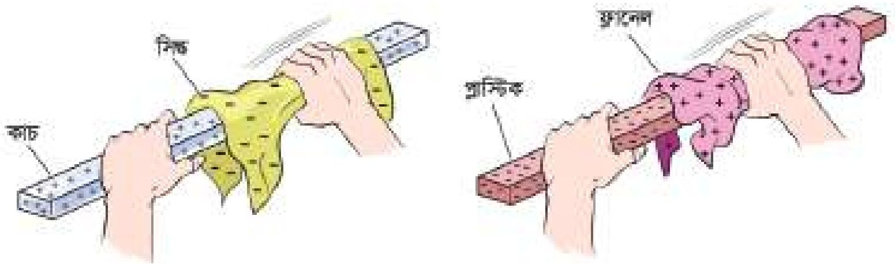

<!-- physics-9-10-bn-c10-t10.2-p003 · figure · p.274 -->
**চিত্র ১০.০২: কাচকে সিল্ক দিয়ে এবং প্লাস্টিককে ফ্লানেল দিয়ে ঘষে পজিটিভ ও নেগেটিভ চার্জ গঠন করা যায়।**

<!-- physics-9-10-bn-c10-t10.2-p004 · text · p.274 -->
আসক্তি তার থেকে বেশি। আবার যদি এক টুকরো প্লাস্টিককে ফ্লানেল (বা পশমি কাপড়) দিয়ে ঘষা হয় তাহলে ফ্লানেল থেকে ইলেকট্রন চলে আসবে প্লাস্টিকের টুকরোতে। কারণ ইলেকট্রনের জন্য প্লাস্টিকের আকর্ষণ ফ্লানেল থেকে বেশি।

<!-- physics-9-10-bn-c10-t10.2-p005 · text · p.274 -->
এবারে আমরা একটা এক্সপেরিমেন্ট করতে পারি। ধরা যাক কাচ এবং সিল্ক ব্যবহার করে আমরা দুই টুকরো কাচকে পজিটিভ চার্জ দিয়ে আহিত করেছি। এখন একটাকে যদি সাবধানে একটা বিদ্যুৎ অপরিবাহী সিল্কের সুতা দিয়ে ঝুলিয়ে দিয়ে তার কাছে অন্যটা নিয়ে আসি, তাহলে দেখবে ঝুলন্ত কাচের টুকরোটি বিকর্ষিত হয়ে সরে যাচ্ছে। (চিত্র ১০.০৩)

<!-- physics-9-10-bn-c10-t10.2-p006 · text · p.274 -->
আমরা যদি একইভাবে দুই টুকরো প্লাস্টিককে নেগেটিভ চার্জ দিয়ে আহিত করে একটাকে সিল্কের সুতা দিয়ে ঝুলে ঝুলিয়ে দিই এবং অন্যটা তার কাছে নিয়ে আসি তাহলে আমরা দেখব, একটা আরেকটাকে বিকর্ষণ করছে। এবারে যদি প্লাস্টিকের দণ্ডটা যখন ঝুলে আছে তখন তার কাছে পজিটিভ চার্জে আহিত কাচের দণ্ডটা নিয়ে আসি তখন দেখব একটা আরেকটাকে আকর্ষণ করছে।

<!-- physics-9-10-bn-c10-t10.2-p007 · text · p.274 -->
আমরা যখন মহাকর্ষ বল পড়েছি তখন দেখেছি সেখানে শুধু একরকম বল বা আকর্ষণ বল থাকে। এর কারণ ভর শুধু এক রকমের হয়। ঋণাত্মক ভর বলে কিছু নাই। এখন আমরা দেখছি এখানে দুই রকম চার্জ এবং বলাটিও দুই রকম, কখনো আকর্ষণ কখনো বিকর্ষণ। এক্সপেরিমেন্টটা যদি ঠিকভাবে করে থাকি তাহলে দেখতে পাব একই ধরনের চার্জ একে অন্যকে বিকর্ষণ করে এবং ভিন্ন ভিন্ন চার্জ একে অন্যকে আকর্ষণ করে।

<!-- physics-9-10-bn-c10-t10.2-p008 · figure · p.275 -->
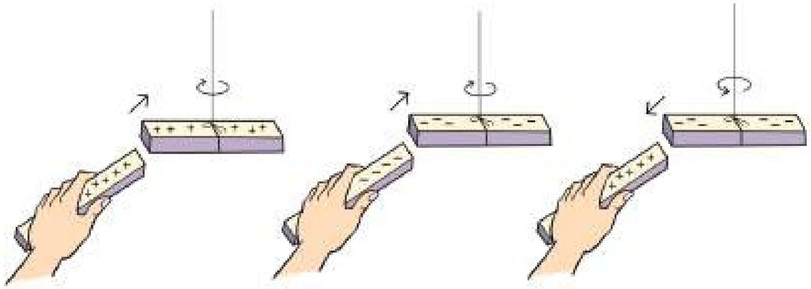

<!-- physics-9-10-bn-c10-t10.2-p009 · figure · p.275 -->
**চিত্র ১০.০৩: একই ধরনের চার্জ বিকর্ষণ করে এবং বিপরীত ধরনের চার্জ আকর্ষণ করে।**

## 10.3 বৈদ্যুতিক আবেশ (Electrical Induction)

<!-- physics-9-10-bn-c10-t10.3-p001 · text · p.275 -->
এই অধ্যায়ের শুরুতে বলা হয়েছে, চিরুনি দিয়ে চুল আঁচড়ানোর পর সেই চিরুনিটি যখন ছোট ছোট কাগজের কাছে আনা হয় তখন কাগজগুলো লাফিয়ে চিরুনির কাছে চলে আসে। বোঝা যায় চিরুনিটা কাগজের টুকরোগুলোকে আকর্ষণ করছে। আমরা এখন জানি চিরুনিটাতে নেগেটিভ চার্জ জমা হয়েছে এবং সে কারণেই চিরুনিটা কাগজের টুকরোগুলোকে আকর্ষণ করছে। কিন্তু এখানে একটা ছোট জটিলতা আছে। আমরা দেখেছি বিপরীত চার্জ আকর্ষণ করে, তাই কাগজগুলোকে আকর্ষণ করতে হলে সেগুলোকে অবশ্যই চিরুনির বিপরীত চার্জ হতে হবে। কিন্তু আমরা জানি কাগজের টুকরোগুলোতে কোনো চার্জই নেই তাহলে চিরুনি কেন এগুলোকে আকর্ষণ করছে?

<!-- physics-9-10-bn-c10-t10.3-p002 · text · p.275 · review: known-confusable-corrected -->
ব্যাপারটা ঘটে বৈদ্যুতিক আবেশ নামের একটা প্রক্রিয়ার জন্য। কাচ কিংবা প্লাস্টিকে চার্জ জমা করে সেটাকে যদি চার্জহীন কোনো কিছুর কাছে আনা হয় তাহলে সেই চার্জহীন বস্তুরার মাঝে এক ধরনের চার্জ জন্ম নেয়। বিষয়টা বোঝানোর জন্য ১০.০৪ চিত্রটিতে একটা ধাতব গোলক দেখানো হয়েছে, এটাকে রাখা হয়েছে বিদ্যুৎ অপরিবাহী স্ট্যাণ্ডের ওপর। এখন একটা কাচকে সিন্ক দিয়ে খুব ভালো করে ঘষে তার মাঝে চার্জ জমা করে নিয়ে সেটা ধাতব গোলকের কাছে নিয়ে এলে ধাতব গোলকের নেগেটিভ চার্জগুলো আকর্ষিত হয়ে কাছে চলে আসবে এবং গোলকের পেছন দিকে পজিটিভ চার্জগুলো সরে যাবে। এখন কাচ দড়ি পজিটিভ চার্জযুক্ত, কাচ দড়ির কাছাকাছি গোলকের অংশটুকু নেগেটিভ চার্জযুক্ত কাজেই এরা পরস্পরকে আকর্ষণ করবে।

<!-- physics-9-10-bn-c10-t10.3-p003 · text · p.276 -->
এবারে আমরা চিড়ুনি দিয়ে কাগজের টুকরোকে আকর্ষণ করার ব্যাপারটা বুঝতে পারব। যখন কাগজের টুকরোর কাছাকাছি নেগেটিভ চার্জযুক্ত চিড়ুনিটা আনা হয়, তখন কাগজের টুকরোর যে অংশ কাছাকাছি সেখানে পজিটিভ চার্জ আবেশিত হয় আর সাথে সাথে যে অংশ দূরে সেখানে নেগেটিভ

<!-- physics-9-10-bn-c10-t10.3-p004 · figure · p.276 -->
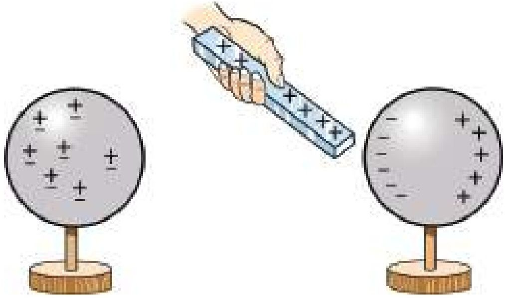

<!-- physics-9-10-bn-c10-t10.3-p005 · figure · p.276 -->
**চিত্র ১০.০৪: চার্জবিহীন বস্তুর কাছে চার্জসহ বস্তু আনা হলে বিপরীত চার্জ আবেশিত হয়।**

<!-- physics-9-10-bn-c10-t10.3-p006 · text · p.276 -->
চার্জ জমা হয়। কাগজের টুকরোর পজিটিভ চার্জের অংশটুকু চিড়ুনির আকর্ষণ অনুভব করে আর কাগজের টুকরোর নেগেটিভ অংশটুকু চিড়ুনির বিকর্ষণ অনুভব করে। কিন্তু যেহেতু পজিটিভ চার্জের অংশটুকু চিড়ুনির কাছে তাই আকর্ষণটুকু বিকর্ষণ থেকে বেশি, সেজন্য কাগজের টুকরো আকর্ষিত হয়ে লাফিয়ে চিড়ুনির কাছে চলে আসে (চিত্র ১০.০৫)।

<!-- physics-9-10-bn-c10-t10.3-p007 · text · p.276 -->
এরপর আরো একটা ব্যাপার ঘটে, তোমরা হয়তো নিজেরাই সেটা লক্ষ্য করেছ। কাগজের যে টুকরোগুলো লাফিয়ে চিড়ুনির গায়ে লেগে যায় সেগুলো আবার প্রায় সাথে সাথেই চিড়ুনি থেকে ছিটকে নিচে চলে আসে।

<!-- physics-9-10-bn-c10-t10.3-p008 · figure · p.276 -->
**চিত্র ১০.০৫: শীতকালে চিড়ুনি দিয়ে চুল আঁচড়ে ছোট কাগজের কাছে ধরলে সেগুলো আকর্ষণ অনুভব করে।**

<!-- physics-9-10-bn-c10-t10.3-p009 · text · p.276 -->
এর কারণটাও নিশ্চয়ই তোমরা বুঝতে পারছ, কাগজের টুকরোটা যদি আকর্ষিত হয়ে চিড়ুনির গায়ে লেগে যায় তাহলে সেটার আর আবেশিত থাকতে হয় না। চিড়ুনির নেগেটিভ চার্জ দিয়ে এটা নিজেই নেগেটিভ চার্জে ভরে যায়। তখন সেগুলো চিড়ুনি থেকে বিকর্ষিত হয়ে ছিটকে নিচে নেমে আসে। যারা বিশ্বাস করো না তারা বিষয়টা একবার পরীক্ষা করে দেখতে পারো।

<!-- physics-9-10-bn-c10-t10.3-p010 · text · p.277 -->
বাতাসে জলীয় বাষ্প থাকলে জমা হওয়া চার্জ দ্রুত হারিয়ে যায়। তাই স্থির বিদ্যুতের এই এক্সপেরিমেন্টগুলো শীতকালে অনেক বেশি ভালো কাজ করে।

### উদাহরণ

<!-- physics-9-10-bn-c10-t10.3-p011 · example · p.277 -->
**প্রশ্ন:** দুটি ধাতব গোলক রয়েছে। একটি পজিটিভ চার্জযুক্ত কাচের দণ্ড দিয়ে দুটি গোলকে কি দুই রকমের চার্জ তৈরি করতে পারবে?

<!-- physics-9-10-bn-c10-t10.3-p012 · figure · p.277 -->

<!-- physics-9-10-bn-c10-t10.3-p013 · figure · p.277 -->
**চিত্র ১০.০৬: দুটি ধাতব গোলককে একসাথে রেখে তাদের ভেতরে ভিন্ন চার্জ আবেশিত করা সম্ভব।**

<!-- physics-9-10-bn-c10-t10.3-p014 · example · p.277 -->
**উত্তর:** হ্যাঁ ১০.০৬ চিত্রটিতে যেভাবে দেখানো হয়েছে, সেভাবে দুটো গোলকে ভিন্ন চার্জ আবেশিত করে আলাদা করা সম্ভব।

<!-- physics-9-10-bn-c10-t10.3-p015 · text · p.277 -->
এই অধ্যায়ের শুরুতে আমরা তিনটি ভিন্ন ভিন্ন ঘটনার কথা বলেছিলাম। এতক্ষণে সেগুলো কোন ঘটছে তোমরা নিশ্চয়ই সেটা বুঝে গেছ। চিরুনির বিষয়টা ব্যাখ্যা করা হয়েছে। ছোট শিশুর হামাগুড়ি দেওয়ার বিষয়টাও বোঝা কঠিন নয়। কার্পেটে ঘষে ঘষে যাবার জন্য তার শরীরে চার্জ জমা হয়, সারা শরীরের সাথে সাথে চুলেও সেই চার্জ ছড়িয়ে পড়ে। সব চুলে একই চার্জ। আমরা জানি এক ধরনের চার্জ বিকর্ষণ করে তাই একটা চুল অন্য চুলকে বিকর্ষণ করে খাড়া হয়ে ছড়িয়ে পড়ে। এখন আমরা বজ্রপাতের বিষয়টাও ব্যাখ্যা করতে পারব। মেঘের সাথে মেঘের ঘর্ষণে সেখানে চার্জ আলাদা হয়ে যায়। আকাশের মেঘে যখন বিপুল পরিমাণ চার্জ জমা হয় তখন সেটা নিচে বিপরীত চার্জের আবেশ তৈরি করে এবং মাঝে মাঝে সেটা এত বেশি হয় যে বাতাস ভেদ করে সেটা মেঘের সাথে যুক্ত হয়ে যায়, যেটাকে আমরা বজ্রপাত বলি। (চিত্র ১০.০৭)

### ১০.৩.১ তড়িৎবীক্ষণ যন্ত্র (Electroscope)

<!-- physics-9-10-bn-c10-t10.3-p016 · text · p.278 -->
ইলেকট্রোস্কোপ স্থির বিদ্যুৎ পরীক্ষার জন্য খুব চমৎকার একটা যন্ত্র। যন্ত্রটা খুবই সহজ, এখানে চার্জের অস্তিত্ব বোঝার জন্য রয়েছে খুবই হালকা সোনা, অ্যালুমিনিয়াম বা অন্য কোনো ধাতুর দুটি পাত। এই পাত দুটো একটা সুপরিবাহী দণ্ড দিয়ে একটা ধাতব চাকতির সাথে লাগানো থাকে, পুরোটা একটা অপরিবাহী ছিপি দিয়ে কাচের বোতলের ভেতর রাখা হয়, যেন বাইরে থেকে দেখা যায় কিন্তু বাতাস বা অন্য কিছু যেন পাতলা ধাতব পাত দুটোকে নাড়চাড়া করতে না পারে।

<!-- physics-9-10-bn-c10-t10.3-p017 · figure · p.278 -->
**চিত্র ১০.০৭: মেঘ থেকে বিপুল পরিমাণ চার্জ যখন মাটিতে নেমে আসে তাকে আমরা বজ্রপাত বলি।**

### চার্জ আহিতকরণ

<!-- physics-9-10-bn-c10-t10.3-p018 · text · p.278 -->
একটা কাচের টুকরোকে সিল্ক দিয়ে ঘষা হলে কাচ দণ্ডটাতে পজিটিভ চার্জ জমা হবে। এখন কাচ দণ্ডটা যদি ইলেকট্রোস্কোপের ধাতব চাকতিতে ছোঁয়ানো যায় তাহলে সাথে সাথে খানিকটা চার্জ চাকতিতে চলে যাবে। চাকতি যেহেতু ধাতব দণ্ড আর সোনার পাতের সাথে লাগানো আছে, তাই চার্জটুকু সব জায়গায় ছড়িয়ে পড়বে। সোনার পাতে যখন একই পজিটিভ চার্জ এসে হাজির হবে আর তখন দেখা যাবে পাত দুটো বিকর্ষণ করে তাদের মাঝে একটা ফাঁক তৈরি হয়েছে।

<!-- physics-9-10-bn-c10-t10.3-p019 · figure · p.278 -->

<!-- physics-9-10-bn-c10-t10.3-p020 · figure · p.278 -->
**চিত্র ১০.০৮: ইলেকট্রোস্কোপে চার্জের উপস্থিতির কারণে সূক্ষ্ম ধাতব পাত পরস্পর থেকে সরে যায়।**

<!-- physics-9-10-bn-c10-t10.3-p021 · text · p.278 -->
ঠিক একইভাবে একটা চিরুনিকে যদি ফ্লানেল দিয়ে ঘষা হয় তাহলে চিরুনিটাতে নেগেটিভ চার্জ জমা হবে। এখন সেটা যদি চাকতিতে স্পর্শ করা হয় তাহলে নেগেটিভ চার্জ সোনার পাত পর্যন্ত ছড়িয়ে পড়বে এবং দুটো পাত একটা আবেকটাকে বিকর্ষণ করে ফাঁক হয়ে যাবে।

### চার্জের প্রকৃতি বের করা

<!-- physics-9-10-bn-c10-t10.3-p022 · text · p.278 -->
কোনো একটা বস্তুতে যদি চার্জ জমা হয় তাহলে সেটা কি পজিটিভ নাকি নেগেটিভ চার্জ সেটা ইলেকট্রোস্কোপ দিয়ে বের করা যায়। প্রথমে ইলেকট্রোস্কোপের চাকতিতে পরিচিত কোনো চার্জ দিতে হবে। ধরা যাক কাচকে সিল্ক দিয়ে ঘষে পজিটিভ চার্জ তৈরি করে আমরা সেটাকে চাকতিতে স্পর্শ করলে যদি সোনার পাত দুটির ফাঁক কমে যায় তাহলে বুঝতে হবে এর মাঝে নেগেটিভ চার্জ। যদি ফাঁকটি আরো বেড়ে যায় তাহলে বুঝতে হবে চার্জটি নিশ্চয়ই পজিটিভ।

### চার্জের আবেশ

<!-- physics-9-10-bn-c10-t10.3-p023 · text · p.279 -->
কোনো একটা বস্তুতে চার্জ আছে কি না সেটা চাকতিকে স্পর্শ না করেই বোঝা সম্ভব। ধরা যাক পজিটিভ চার্জ আছে এ রকম একটা দড়িকে চাকতির কাছে আনা হয়েছে, তাহলে চাকতির মাঝে নেগেটিভ চার্জের আবেশ হবে। (চিত্র ১০.০৮) এই নেগেটিভ চার্জের আবেশ তৈরি করার জন্য ইলেকট্রোস্কোপের অন্যান্য অংশ থেকে নেগেটিভ চার্জকে চাকতির মাঝে চলে আসতে হবে। সে কারণে সোনার পাত দুটিতেও পজিটিভ চার্জ তৈরি হবে। সেই পজিটিভ চার্জ সোনার পাত দুটোর মাঝে একটা ফাঁক তৈরি করবে।

<!-- physics-9-10-bn-c10-t10.3-p024 · text · p.279 -->
যদি পজিটিভ চার্জ দেওয়া কোনো কিছু না এনে নেগেটিভ চার্জ দেওয়া কিছু আনি তাহলেও আমরা দেখব সোনার পাত দুটো ফাঁক হয়ে যাচ্ছে, তবে এবারে সেটি হবে সেখানে নেগেটিভ চার্জ জমা হওয়ার কারণে।

<!-- physics-9-10-bn-c10-t10.3-p025 · text · p.279 -->
> **বর্ষাকালে স্থির বিদ্যুতের পরীক্ষাগুলো ঠিক করে কাজ করে না কেন?**

## 10.4 বৈদ্যুতিক বল (Electric Force)

<!-- physics-9-10-bn-c10-t10.4-p001 · text · p.279 -->
আমরা একটু আগেই দেখেছি, বিপরীত চার্জ একে অন্যকে আকর্ষণ করে কিন্তু এক ধরনের চার্জ একে অন্যকে বিকর্ষণ করে। তবে আমরা এখনো জানি না ঠিক কতখানি আকর্ষণ কিংবা বিকর্ষণ করে, সেটা বুঝতে হলে আমাদের কুলস্ফের সূত্রটি একটুখানি দেখতে হবে। বিজ্ঞানী কুলস্ফ দুটি বিন্দু চার্জের মাঝে কতখানি বল কাজ করে সেটা বের করেছিলেন। এ রকম একটা বলের সূত্র আমরা এর মাঝে একটা দেখে ফেলেছি সেটা হচ্ছে নিউটনের মহাকর্ষ বলের সূত্র। সেটি ছিল এ রকম:

<!-- physics-9-10-bn-c10-t10.4-p002 · figure · p.279 -->
drawing: diagram showing two charges q1 and q2 separated by distance r

<!-- physics-9-10-bn-c10-t10.4-p003 · figure · p.279 · review: verify-formula -->
**চিত্র ১০.০৯:** দুটি চার্জ $q_1$ এবং $q_2$ এর ভেতর বল $F$, আকর্ষণ এবং বিকর্ষণ দুই-ই হতে পারে।

<!-- physics-9-10-bn-c10-t10.4-p004 · formula · p.279 · review: verify-formula -->
$$F = G \frac{m_1 m_2}{r^2}$$

<!-- physics-9-10-bn-c10-t10.4-p005 · text · p.280 · review: verify-formula -->
মজার ব্যাপার হচ্ছে, ভর $m_1$ আর $m_2$ কে চার্জ $q_1$ আর $q_2$ দিয়ে পরিবর্তন করে দিলেই আমরা কুলম্বের সূত্র পেয়ে যাব। মহাকর্ষ বলের জন্য ধ্রুবটি ছিল $G$, এবারে ধ্রুবটির জন্য আমরা $k$ ব্যবহার করব এইটুকুই পার্থক্য। অর্থাৎ যদি $q_1$ আর $q_2$ দুটি বিন্দু চার্জ $r$ দূরত্বে থাকে তাহলে তাদের ভেতরে বল $F$ এর পরিমাণ (চিত্র ১০.০৯):

<!-- physics-9-10-bn-c10-t10.4-p006 · formula · p.280 · review: verify-formula -->
$$F = k \frac{q_1 q_2}{r^2}$$

<!-- physics-9-10-bn-c10-t10.4-p007 · text · p.280 · review: verify-formula -->
এখানে $q_1$ আর $q_2$ দুটি চার্জের একক হচ্ছে কুলম্ব $C$ এবং $r$ বা দূরত্বের একক হচ্ছে $m$, কাজেই $k$ এর একক আমরা বলতে পারি $Nm^2/C^2$ যেন $F$ এর একক হয় $N$ তাহলে

<!-- physics-9-10-bn-c10-t10.4-p008 · formula · p.280 · review: verify-formula -->
$$k = 9 \times 10^9 Nm^2/C^2$$

<!-- physics-9-10-bn-c10-t10.4-p009 · text · p.280 -->
কুলম্ব হচ্ছে চার্জের একক, আমরা পরের অধ্যায়েই দেখব চার্জের প্রবাহ হচ্ছে বৈদ্যুতিক প্রবাহ বা কারেন্ট এবং কারেন্টের একক হচ্ছে অ্যাম্পিয়ার। এক সেকেন্ডব্যাপী এক অ্যাম্পিয়ার কারেন্ট প্রবাহিত করা হলে প্রবাহিত চার্জের পরিমাণ হচ্ছে এক কুলম্ব (C)।

<!-- physics-9-10-bn-c10-t10.4-p010 · text · p.280 -->
তবে কুলম্ব বোঝার সবচেয়ে খাঁটি পদ্ধতি হচ্ছে ইলেকট্রন বা প্রোটনের চার্জের পরিমাণটি বোঝা। তার পরিমাণ

<!-- physics-9-10-bn-c10-t10.4-p011 · text · p.280 · review: verify-formula -->
ইলেকট্রনের চার্জ: $-1.6 \times 10^{-19}  C$
প্রোটনের চার্জ: $+1.6 \times 10^{-19}  C$

<!-- physics-9-10-bn-c10-t10.4-p012 · text · p.280 · review: verify-formula -->
তোমরা দেখতেই পাছছ $q_1$ এবং $q_2$ দুটিই যদি পজিটিভ বা নেগেটিভ হয় তাহলে $F$ এর মান হবে পজিটিভ এবং তখন একটি অন্যটিকে বিকর্ষণ করে। যদি একটা পজিটিভ আর অন্যটি নেগেটিভ হয় তাহলে $F$ এর মান হবে নেগেটিভ, যার অর্থ বলের দিক পরিবর্তন হলো অর্থাৎ চার্জ দুটি একটা আবেকটিকে আকর্ষণ করবে। আমরা আগেই সেটা দেখেছিলাম, সূত্র থেকেও সেটা আছে।

### উদাহরণ

<!-- physics-9-10-bn-c10-t10.4-p013 · example · p.280 · review: verify-formula -->
**প্রশ্ন:** একটি $+1$ কুলম্ব চার্জ এবং একটি $-1$ কুলম্ব চার্জ 10 cm দূরে রাখা হলো। দুটো চার্জের ভেতর বল কতটুকু?

<!-- physics-9-10-bn-c10-t10.4-p014 · example · p.280 -->
**উত্তর:** দুটো বিপরীত চার্জ একে অন্যকে আকর্ষণ করবে। তাদের ভেতরকার বল: (চিত্র ১০.১০ a)

<!-- physics-9-10-bn-c10-t10.4-p015 · formula · p.280 · review: verify-formula -->
$$F = k \frac{q_1 q_2}{r^2}$$

<!-- physics-9-10-bn-c10-t10.4-p016 · text · p.281 · review: verify-formula -->
$$q_1 = 1 C$$
$$q_2 = -1 C$$
$$r = 10 cm = 0.10 m$$
$$k = 9 \times 10^9 Nm^2/C^2$$

<!-- physics-9-10-bn-c10-t10.4-p017 · text · p.281 · review: verify-formula -->
**কাজেই**
$$F = \frac{9 \times 10^9 \times 1 \times (-1)}{(0.10)^2} N = -9 \times 10^{11} N$$

<!-- physics-9-10-bn-c10-t10.4-p018 · figure · p.281 -->
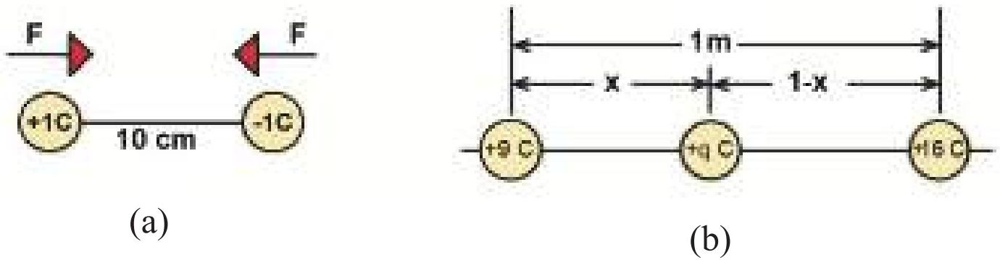

<!-- physics-9-10-bn-c10-t10.4-p019 · text · p.281 -->
(a) (b)

<!-- physics-9-10-bn-c10-t10.4-p020 · figure · p.281 -->
**চিত্র ১০.১০: (a) 10 cm দূরে অবস্থিত +1 C এবং -1 C চার্জ**
**(b) 1 m দূরে অবস্থিত +9C এবং +16C চার্জ**

<!-- physics-9-10-bn-c10-t10.4-p021 · text · p.281 · review: verify-formula -->
**প্রশ্ন:** একটি +9C এবং +16C চার্জ 1 m দূরে রাখা হয়েছে। এখন তৃতীয় একটি চার্জ $+q$ এমনভাবে দুটি চার্জের মাঝখানে রাখো যেন সেটি কোনো বল অনুভব না করে। (চিত্র ১০.১০ b)

<!-- physics-9-10-bn-c10-t10.4-p022 · text · p.281 · review: verify-formula -->
**উত্তর:** $+q$ চার্জটিকে +9C ডান দিকে ঠেলে দেবে এবং +16C বাম দিকে ঠেলে দেবে। দুটি চার্জ যখন একই বলে ঠেলবে তখন $+q$ চার্জটি কোনো বল অনুভব করবে না। ধরা যাক $+q$ চার্জটি +9C চার্জ থেকে $x$ দূরত্বে চার্জদ্বয়ের মধ্যবর্তী রেখাংশের উপর অবস্থিত। ফলে,

<!-- physics-9-10-bn-c10-t10.4-p023 · formula · p.281 · review: verify-formula -->
$$k \frac{(+9)q}{x^2} = k \frac{(+16)q}{(1 - x)^2}$$

<!-- physics-9-10-bn-c10-t10.4-p024 · formula · p.281 · review: verify-formula -->
$$9(1 - x)^2 = 16x^2$$

<!-- physics-9-10-bn-c10-t10.4-p025 · formula · p.281 · review: verify-formula -->
$$7x^2 + 18x - 9 = 0$$

<!-- physics-9-10-bn-c10-t10.4-p026 · formula · p.281 · review: verify-formula -->
$$(7x - 3)(x + 3) = 0$$

<!-- physics-9-10-bn-c10-t10.4-p027 · formula · p.281 · review: verify-formula -->
$$x = 0.43  কিংবা  -3$$

<!-- physics-9-10-bn-c10-t10.4-p028 · text · p.281 · review: verify-formula -->
$x$ এর মান 0 থেকে 1 এর ভেতরে হবে কাজেই এটি নিশ্চয়ই 0.43 ($x$ যদি -3 হয় তাহলে কী হবে নিজেরা চিন্তা করে বের করো)।

<!-- physics-9-10-bn-c10-t10.4-p029 · text · p.282 · review: verify-formula -->
**প্রশ্ন:** হাইড্রোজেন পরমাণুর কেন্দ্রে একটা প্রোটন এবং বাইরে একটা ইলেকট্রন থাকে। প্রোটনের চার্জ $+1.6 \times 10^{-19}$ C এবং ইলেকট্রনের চার্জ $-1.6 \times 10^{-19}$ C. যদি নিউক্লিয়াস থেকে ইলেকট্রনের কক্ষপথের দূরত্ব $0.5 \times 10^{-8}$ m হয় তাহলে তাদের ভেতরে আকর্ষণ কতটুকু?

<!-- physics-9-10-bn-c10-t10.4-p030 · text · p.282 -->
**উত্তর:**

<!-- physics-9-10-bn-c10-t10.4-p031 · formula · p.282 · review: verify-formula -->
$$F = k \frac{q_1 q_2}{r^2}$$

<!-- physics-9-10-bn-c10-t10.4-p032 · text · p.282 -->
এখানে

<!-- physics-9-10-bn-c10-t10.4-p033 · text · p.282 · review: verify-formula -->
$$q_1 = +1.6 \times 10^{-19}  C$$
$$q_2 = -1.6 \times 10^{-19}  C$$
$$k = 9 \times 10^9  Nm^2/C^2$$
$$r = 0.5 \times 10^{-8}  m$$

<!-- physics-9-10-bn-c10-t10.4-p034 · text · p.282 -->
কাজেই

<!-- physics-9-10-bn-c10-t10.4-p035 · formula · p.282 · review: verify-formula -->
$$F = \frac{9 \times 10^9 \times 1.6 \times 10^{-19} \times (-1.6 \times 10^{-19})}{(0.5 \times 10^{-8})^2}  N = -9.22 \times 10^{-12}  N$$

<!-- physics-9-10-bn-c10-t10.4-p036 · text · p.282 -->
বলের ঋণাত্মক মান প্রকাশ করে যে প্রোটন এবং ইলেকট্রনের মধ্যে আকর্ষণ বল বিদ্যমান।

<!-- physics-9-10-bn-c10-t10.4-p037 · text · p.282 -->
**প্রশ্ন:** পৃথিবীতে এবং চাঁদে কী পরিমাণ চার্জ জমা রাখলে মহাকর্ষ বল শূন্য হয়ে চাঁদ কক্ষপথ থেকে ছুটে বের হয়ে যাবে?

<!-- physics-9-10-bn-c10-t10.4-p038 · text · p.282 -->
**উত্তর:** পৃথিবী এবং চাঁদের মাঝে মহাকর্ষ বল:

<!-- physics-9-10-bn-c10-t10.4-p039 · formula · p.282 · review: verify-formula -->
$$F_G = G \frac{mM}{r^2}$$

<!-- physics-9-10-bn-c10-t10.4-p040 · text · p.282 -->
এখানে

<!-- physics-9-10-bn-c10-t10.4-p041 · formula · p.282 · review: verify-formula -->
$$G = 6.67 \times 10^{-11}  Nkg^{-2}m^2$$

<!-- physics-9-10-bn-c10-t10.4-p042 · text · p.282 · review: verify-formula -->
চাঁদের ভর, $m = 7.35 \times 10^{22}  kg$

<!-- physics-9-10-bn-c10-t10.4-p043 · text · p.282 · review: verify-formula -->
পৃথিবীর ভর, $M = 5.97 \times 10^{24}  kg$

<!-- physics-9-10-bn-c10-t10.4-p044 · formula · p.282 · review: verify-formula -->
$$r = 3.84 \times 10^5  km = 3.84 \times 10^8  m$$

<!-- physics-9-10-bn-c10-t10.4-p045 · text · p.282 -->
কাজেই

<!-- physics-9-10-bn-c10-t10.4-p046 · formula · p.282 · review: verify-formula -->
$$F_G = \frac{6.67 \times 10^{-11} \times 7.35 \times 10^{22} \times 5.97 \times 10^{24}}{(3.84 \times 10^8)^2}  N = 1.98 \times 10^{20}  N$$

<!-- physics-9-10-bn-c10-t10.4-p047 · text · p.282 · review: verify-formula -->
পৃথিবী এবং চাঁদে সমান পরিমাণ ($q$) চার্জ রাখা হলে বিকর্ষণ বল:

<!-- physics-9-10-bn-c10-t10.4-p048 · formula · p.283 · review: verify-formula -->
$$F_E = \frac{9 \times 10^9 \times q^2}{(3.84 \times 10^8)^2}  NC^{-2}$$

<!-- physics-9-10-bn-c10-t10.4-p049 · text · p.283 -->
মহাকর্ষকে কুলম বল দিয়ে কমিয়ে দিতে হলে দুটো বল সমান হতে হবে

<!-- physics-9-10-bn-c10-t10.4-p050 · text · p.283 · review: verify-formula -->
অর্থাৎ $F_G = F_E$

<!-- physics-9-10-bn-c10-t10.4-p051 · formula · p.283 · review: verify-formula -->
$$1.98 \times 10^{20}  N = \frac{9 \times 10^9 \times q^2}{(3.84 \times 10^8)^2}  NC^{-2}$$

<!-- physics-9-10-bn-c10-t10.4-p052 · text · p.283 · review: verify-formula -->
$$q^2 = 3.24 \times 10^{27}  C^2$$
$$q = 5.69 \times 10^{13}  C$$

<!-- physics-9-10-bn-c10-t10.4-p053 · text · p.283 -->
সুতরাং ইলেকট্রনের সংখ্যা

<!-- physics-9-10-bn-c10-t10.4-p054 · formula · p.283 · review: verify-formula -->
$$n = \frac{q}{e} = \frac{5.69 \times 10^{13}  C}{1.6 \times 10^{-19}  C} = 3.56 \times 10^{32}$$

<!-- physics-9-10-bn-c10-t10.4-p055 · text · p.283 · review: verify-formula -->
একটা ইলেকট্রনের ভর $9.11 \times 10^{-31}  kg$, কাজেই সবগুলো ইলেকট্রনের ভর:

<!-- physics-9-10-bn-c10-t10.4-p056 · formula · p.283 · review: verify-formula -->
$$(3.56 \times 10^{32}) \times (9.11 \times 10^{-31})  kg = 324  kg$$

<!-- physics-9-10-bn-c10-t10.4-p057 · text · p.283 -->
অর্থাৎ পৃথিবী পৃষ্ঠে এবং চাঁদে মাত্র 324 kg ইলেকট্রন রেখে দিতে পারলে চাঁদ কক্ষপথ থেকে ছুটে বের হয়ে যাবে। (একটা মাঝারি গরুর ভরের সমান)।

## 10.5 তড়িৎ ক্ষেত্র (Electric Field)

<!-- physics-9-10-bn-c10-t10.5-p001 · text · p.283 -->
দুটি চার্জের ভেতরকার বল আমরা কুলমের সূত্র দিয়ে বের করতে পারি। তোমাদের নিশ্চয়ই মনে আছে মাধ্যাকর্ষণ বলের জন্য প্রত্যেকবারই আলাদা করে মহাকর্ষ বল থেকে শুরু না করে আমরা মাধ্যাকর্ষণজনিত ত্বরণ বের করে নিয়েছিলাম। সেটার সঙ্গে ভর গুণ দিলেই বল বের হয়ে যেত।

<!-- physics-9-10-bn-c10-t10.5-p002 · text · p.283 · review: verify-formula -->
তড়িৎ বলের বেলাতেও আমরা সেটা করতে পারি, আমরা তড়িৎ ক্ষেত্র বলে একটা নতুন রাশি সংজ্ঞায়িত করতে পারি, তার সাথে চার্জ $q$ গুণ করলেই আমরা সেই চার্জের ওপর আরোপিত বল $F$ পেয়ে যাব। অর্থাৎ যেকোনো চার্জ $q$ তার চারপাশে একটা তড়িৎ ক্ষেত্র তৈরি করে। সেই তড়িৎ ক্ষেত্রের কোন বিন্দুতে তড়িৎ ক্ষেত্র বা ক্ষেত্র প্রাবল্যের মান হচ্ছে

<!-- physics-9-10-bn-c10-t10.5-p003 · formula · p.283 · review: verify-formula -->
$$E = k \frac{q}{r^2}$$

<!-- physics-9-10-bn-c10-t10.5-p004 · text · p.284 · review: verify-formula -->
এই তড়িৎ ক্ষেত্রে যদি কোনো চার্জ $q$ আনা হয় তাহলে চার্জটি $F$ বল অনুভব করবে, আর $F$ বলের পরিমাণ হবে:

<!-- physics-9-10-bn-c10-t10.5-p005 · formula · p.284 · review: verify-formula -->
$$F = Eq$$

<!-- physics-9-10-bn-c10-t10.5-p006 · text · p.284 · review: verify-formula -->
বল $F$ যেহেতু ভেক্টর, $q$ যেহেতু স্কেলার তাই $E$ হচ্ছে ভেক্টর এবং তার একক হচ্ছে N/C তোমরা দেখবে তড়িৎ ক্ষেত্র দিয়ে ব্যাখ্যা করা হলে পুরো বিষয়টি বিশ্লেষণ করা অনেক সহজ হয়।

<!-- physics-9-10-bn-c10-t10.5-p007 · text · p.284 -->
তড়িৎ ক্ষেত্র দেখা যায় না কিন্তু কাউকে বোঝানোর জন্য অনেক সময় তড়িৎ বলরেখা নামে পুরোপুরি কাল্পনিক এক ধরনের রেখা ঐকে কাল্পনিক এক ধরনের রেখা ঐকে দেখানো হয় (মাইকেল ফ্যারাডে প্রথম সেটা করেছিলেন।) আমাদের পরিচিত জগৎ ত্রিমাত্রিক কাজেই বলরেখাগুলো চারদিকেই ছড়িয়ে পড়েবে। তোমাদের দেখানোর জন্য সেগুলো একটা সমতলে ঐকে দেখানো হয়েছে। (চিত্র ১০.১১)

<!-- physics-9-10-bn-c10-t10.5-p008 · figure · p.284 -->
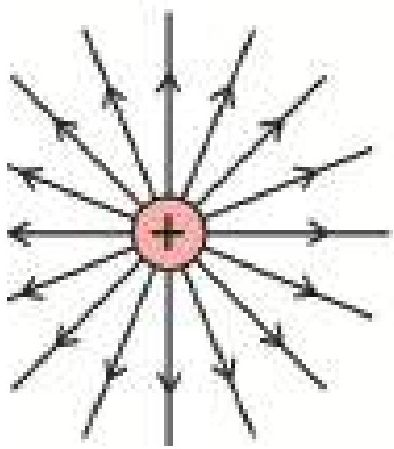

<!-- physics-9-10-bn-c10-t10.5-p009 · figure · p.284 -->
**চিত্র ১০.১১: পজিটিভ চার্জ থেকে বলরেখা চারদিকে ছড়িয়ে পড়ে এবং নেগেটিভ চার্জের দিকে বলরেখা কেন্দ্রীভূত হয়।**

<!-- physics-9-10-bn-c10-t10.5-p010 · text · p.284 -->
বলরেখাগুলো আঁকার সময় কিছু নিয়ম মনে চলা হয়। যেমন:

<!-- physics-9-10-bn-c10-t10.5-p011 · text · p.284 -->
(a) পজিটিভ চার্জের বেলায় বলরেখা পজিটিভ চার্জ থেকে বের হবে এবং নেগেটিভ চার্জের বেলায় বলরেখা নেগেটিভ চার্জ এসে কেন্দ্রীভূত হবে। একটা নির্দিষ্ট বিন্দুতে বলরেখার স্পর্শকের দিক হচ্ছে তড়িৎ ক্ষেত্রের দিক।

<!-- physics-9-10-bn-c10-t10.5-p012 · text · p.284 -->
(b) চার্জের পরিমাণ যত বেশি হবে প্রতি একক আয়তন বা ক্ষেত্রফলে বলরেখার সংখ্যা তত বেশি হবে।

<!-- physics-9-10-bn-c10-t10.5-p013 · text · p.284 -->
(c) বলরেখাগুলো যত কাছাকাছি থাকবে তড়িৎ ক্ষেত্রের মান তত বেশি হবে।

<!-- physics-9-10-bn-c10-t10.5-p014 · text · p.284 -->
(d) একটি চার্জের বলরেখা কখনো অন্য চার্জের বলরেখার ওপর দিয়ে যাবে না।

<!-- physics-9-10-bn-c10-t10.5-p015 · text · p.285 -->
১০.১২ **a** চিত্রটিতে দুটো বিপরীত চার্জের জন্য বলরেখা দেখানো হয়েছে এবং তোমরা দেখতে পাছছ এক চার্জের বলরেখা অন্য চার্জে গিয়ে সমাপ্ত হয়েছে। যেখানে তড়িৎ ক্ষেত্র বেশি সেখানে বলরেখার সংখ্যাও বেশি। শুধু তা-ই নয় চিত্রটি দেখলে দুটো চার্জ একটা আরেকটাকে টানছে এ রকম একটা অনুভূতি হয়। ১০.১২ **b** চিত্রটিতে দুটোই পজিটিভ চার্জ দেখানো হয়েছে এবং চিত্রটি দেখেই দুটো চার্জ একটি আরেকটিকে ঠেলে দিচ্ছে এ রকম অনুভূতি হচ্ছে। শুধু তা-ই নয় দুটো চার্জের মাঝামাঝি অংশে একটি চার্জের তড়িৎ ক্ষেত্র অন্য চার্জের তড়িৎ ক্ষেত্রকে কাটাকাটি করে ফেলে ফলে, সেখানে বলরেখা কম এবং এর মাঝখানে একটি বিন্দু রয়েছে যেখানে তড়িৎ ক্ষেত্রের মান শূন্য। যদি দুটোই নেগেটিভ চার্জ হতো তাহলে শুধু বলরেখার দিক পরিবর্তন হতো, তাছাড়া অন্য সবকিছু আগের মতোই হতো।

<!-- physics-9-10-bn-c10-t10.5-p016 · figure · p.285 -->
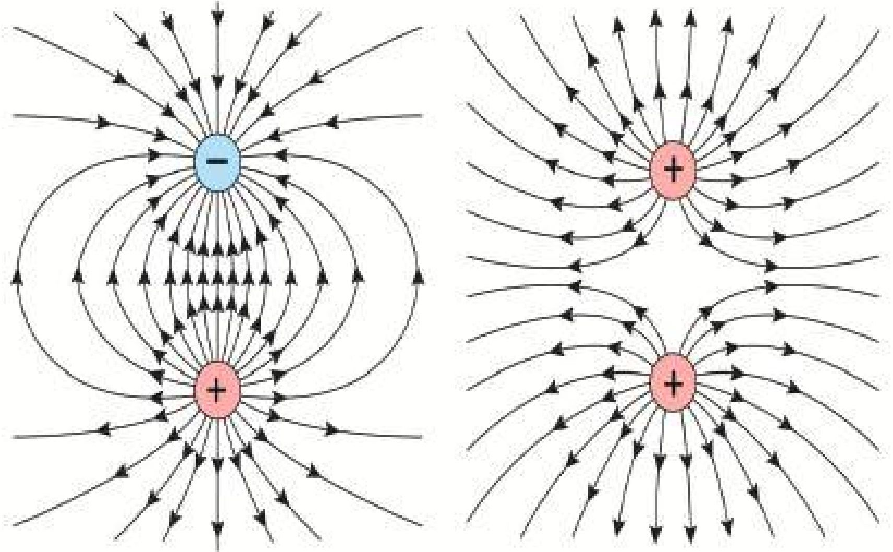

<!-- physics-9-10-bn-c10-t10.5-p017 · figure · p.285 -->
**চিত্র ১০.১২: (a) বিপরীত এবং (b) সমচার্জের জন্য তৈরি বলরেখা।**

### উদাহরণ

<!-- physics-9-10-bn-c10-t10.5-p018 · example · p.286 -->
**প্রশ্ন:** 5 C চার্জের জন্য 10 m দূরে তড়িৎ ক্ষেত্রের মান কত?

<!-- physics-9-10-bn-c10-t10.5-p019 · example · p.286 -->
**উত্তর:**

<!-- physics-9-10-bn-c10-t10.5-p020 · formula · p.286 · review: verify-formula -->
$$E = k \frac{q}{r^2}$$

<!-- physics-9-10-bn-c10-t10.5-p021 · text · p.286 · review: verify-formula -->
এখানে
$$q = 5  C$$
$$r = 10  m$$
$$k = 9 \times 10^9  Nm^2/C^2$$

<!-- physics-9-10-bn-c10-t10.5-p022 · text · p.286 -->
কাজেই

<!-- physics-9-10-bn-c10-t10.5-p023 · formula · p.286 · review: verify-formula -->
$$E = \frac{9 \times 10^9 \times 5}{10^2}  N/C = 4.5 \times 10^8  N/C$$

<!-- physics-9-10-bn-c10-t10.5-p024 · figure · p.286 -->
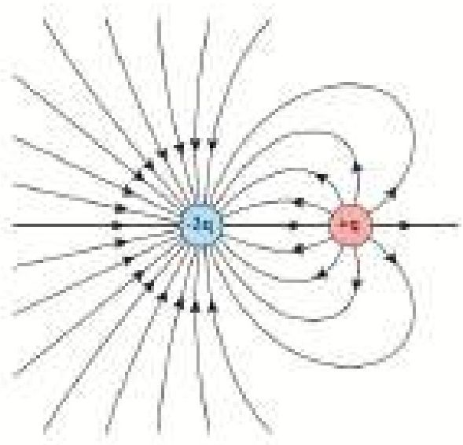

<!-- physics-9-10-bn-c10-t10.5-p025 · figure · p.286 -->
**চিত্র ১০.১৩: চার্জ এবং দ্বিগুণ পরিমাণ বিপরীত চার্জের জন্য বলরেখা।**

<!-- physics-9-10-bn-c10-t10.5-p026 · text · p.286 -->
**প্রশ্ন:** 3C চার্জের একটি বস্তু 10N বল অনুভব করছে, ঐ জায়গায় তড়িৎ ক্ষেত্রের মান কত?

<!-- physics-9-10-bn-c10-t10.5-p027 · text · p.286 · review: verify-formula -->
**উত্তর:** $F = qE$

<!-- physics-9-10-bn-c10-t10.5-p028 · text · p.286 · review: verify-formula -->
কাজেই
$$E = \frac{F}{q}$$

<!-- physics-9-10-bn-c10-t10.5-p029 · text · p.286 · review: verify-formula -->
এখানে
$$F = 10  N$$
$$q = 3  C$$

<!-- physics-9-10-bn-c10-t10.5-p030 · text · p.286 · review: verify-formula -->
কাজেই
$$E = \frac{F}{q} = \frac{10  N}{3  C} = 3.33  N/C$$

<!-- physics-9-10-bn-c10-t10.5-p031 · text · p.286 -->
**প্রশ্ন:** চার্জ এবং তার দ্বিগুণ পরিমাণ বিপরীত চার্জ থাকলে তার বলরেখা কেমন হয়।

<!-- physics-9-10-bn-c10-t10.5-p032 · text · p.286 -->
**উত্তর:** ১০.১৩ চিত্রটিতে দেখানো হয়েছে।

## 10.6 তড়িৎ বিভব (Electric Potential)

<!-- physics-9-10-bn-c10-t10.6-p001 · text · p.287 -->
আমরা জানি যে তড়িৎক্ষেত্রে E তে একটি চার্জ q একটি বল অনুভব করে যার মান হলো F =qE, একটি ধনাত্মক চার্জ বা আধানের কাছে আরেকটি ক্ষুদ্র ধনাত্মক আধান ৭০ আনলে এটি বিকর্ষণ বল অনুভব করে। সুতরাং একটি ধনাত্মক আধান q থেকে r দূরত্বে সরলরেখা বরাবর একটি ক্ষুদ্র টেস্ট চার্জ ৭০ কে আনতে বিকর্ষণ বলের বিপরীতে কাজ করতে হয়। q চার্জের যত কাছে ৭০ চার্জকে আনা হবে তত বেশি বিকর্ষণ বল অনুভব করবে এবং তত বেশি কাজ করতে হবে। কুলম্বের সূত্র অনুযায়ী চার্জ q এবং ৭০ এর মধ্যবর্তী দূরত্ব অসীম হলে এদের মধ্যে কোন বল কাজ করবে না।

<!-- physics-9-10-bn-c10-t10.6-p002 · figure · p.287 -->
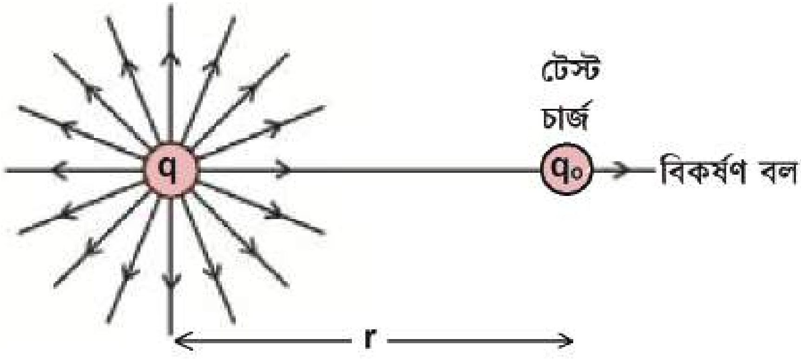

<!-- physics-9-10-bn-c10-t10.6-p003 · figure · p.287 -->
**চিত্র ১০.১৪: একটি ধনাত্মক আধান q থেকে r দূরত্বে একটি ক্ষুদ্র টেস্ট চার্জ q০ কে আনা হলো**

<!-- physics-9-10-bn-c10-t10.6-p004 · text · p.287 -->
অসীম দূরত্ব থেকে একটি অতি ক্ষুদ্র ধনাত্মক টেস্ট চার্জ ৭০ কে সমবেগে একটি চার্জ q থেকে r দূরত্বে আনতে যদি কাজ W সম্পন্ন হয় তবে প্রতি একক টেস্ট চার্জের জন্য কৃত কাজকে ঐ বিন্দুতে চার্জ q এর জন্য তড়িৎ বিভব V হলে

<!-- physics-9-10-bn-c10-t10.6-p005 · formula · p.287 · review: verify-formula -->
$$V = V (r) = \frac{W}{q}$$

<!-- physics-9-10-bn-c10-t10.6-p006 · text · p.288 · review: verify-formula -->
বিন্দু চার্জ $q$ এর জন্য কুলম্বের সূত্র ব্যবহার করে দেখানো যায় যে

<!-- physics-9-10-bn-c10-t10.6-p007 · formula · p.288 · review: verify-formula -->
$$V(r) = k \frac{q}{r}$$

<!-- physics-9-10-bn-c10-t10.6-p008 · text · p.288 -->
তড়িৎ বিভব একটি স্কেলার রাশি।

<!-- physics-9-10-bn-c10-t10.6-p009 · text · p.288 -->
**একক:** এস আই একক ব্যবস্থায় (SI System of Units) বিভবের পরিমাণ করা হয় (Volt) এককে। অসীম দূরত্ব থেকে 1C ধনাত্মক আধানকে তড়িৎ ক্ষেত্রের কোন বিন্দুতে আনতে যদি 1J কাজ সম্পন্ন হয় তবে ঐ বিন্দুর বিভবকে 1V বলে

<!-- physics-9-10-bn-c10-t10.6-p010 · formula · p.288 · review: verify-formula -->
$$1  Volt (V) = \frac{1J}{1C} = JC^{-1}$$

### ১০.৬.১ বিভব পার্থক্য (Potential Difference)

<!-- physics-9-10-bn-c10-t10.6-p011 · text · p.288 -->
তোমরা সবাই ইলেকট্রিক লাইনের গায়ে নানা রকম সতর্কবাণী দেখেছ, যেমন, ‘বিপজ্জনক দশ হাজার ভোল্ট।’ তোমরা সবাই জানো ইলেকট্রিক শক বলে একটা বিষয় আছে, এটি খুব বিপজ্জনক। অসতর্ক মানুষ ইলেকট্রিক শক খেয়ে মারা গেছে সে রকম উদাহরণও আছে। তোমরা যদি বিভব বিষয়টা বুঝে থাক তাহলে নিশ্চয়ই এখন অনুমান করতে পারছ আসলে কী ঘটে। কোথাও যদি বিভব বা পটেনশিয়াল বেশি থাকে এবং তুমি যদি সেটা স্পর্শ করো, তোমার শরীরের পটেনশিয়াল যেহেতু কম সেজন্য বেশি বিভবের জায়গা থেকে চার্জ তোমার শরীরে চলে আসবে। চার্জের সেই প্রবাহ কতটুকু তার ওপর নির্ভর করে তোমার ভেতরে অনেক কিছু হতে পারে।

<!-- physics-9-10-bn-c10-t10.6-p012 · text · p.288 -->
তুমি যেটা স্পর্শ করছ তার পটেনশিয়াল পজিটিভ বা নেগেটিভ দুটোই হতে পারে। এক জায়গায় তোমার শরীর থেকে চার্জ (ইলেকট্রন) যাবে অন্য ক্ষেত্রে তোমার শরীরে চার্জ আসবে, দুটোই বিদ্যুৎ প্রবাহ—শুধু দিকটা ভিন্ন।

<!-- physics-9-10-bn-c10-t10.6-p013 · text · p.288 -->
তুমি নিশ্চয়ই বুঝতে পারছ চার্জ প্রবাহিত হয় বিভব পার্থক্যের জন্য, বিভবের মানের জন্য নয়। সে কারণে একটা কাক যখন হাইভোল্টেজ ইলেকট্রিক তারের ওপর বসে সে ইলেকট্রিক শক খায় না, কারণ তারের বিভব এবং তার নিজের বিভব সমান, কোনো পার্থক্য নেই। শুধু তা-ই নয়, দশ হাজার কিংবা বিশ হাজার ভোল্টের প্রচণ্ড উচ্চ ভোল্টেজে কর্মীরা হেলিকপ্টার দিয়ে খালি হাতে কাজ করে। তারা কোনো ইলেকট্রিক শক খায় না। কারণ শূন্যে থাকার কারণে তারা যখন হাইভোল্টেজ তার স্পর্শ করে তাদের শরীরের ভোল্টেজ তারের সমান হয়ে যায়। কোনো পার্থক্য নেই, তাই কোনো চার্জ প্রবাহিত হয় না। তারা ইলেকট্রিক শক খায় না। তার মানে হচ্ছে, ভোল্টেজের পার্থক্যটা গুরুত্বপূর্ণ ভোল্টেজের মান নয়— এটা সবার জানা দরকার।

<!-- physics-9-10-bn-c10-t10.6-p014 · text · p.289 · review: known-confusable-corrected -->
তারপরও যখন ভোল্টেজের মান মাপতে হয়, তখন তার জন্য একটা নির্দিষ্ট ভোল্টেজ থাকলে ভালো। আমাদের জীবনে আমরা পৃথিবীকে শূন্য বিভব ধরে নিই। পৃথিবীটা এত বিশাল যে এর মাঝে খানিকটা চার্জ দিলেও সেটা গ্রহণ করতে পারে এবং তার জন্য বিভব বেড়ে যায় না, আবার খানিকটা চার্জ নিয়ে গেলেও তার বিভব কমে যায় না। তাই সেটাকে শূন্য বিভব ধরে সবকিছু তার সাপেক্ষে মাপা হয়। তোমরা নিশ্চয়ই লক্ষ্য করে থাকবে ভারী বৈদ্যুতিক যন্ত্রপাতি সব সময় খুব ভালো করে ভূমির সাথে লাগানো (Earthing) হয়। যার অর্থ কোনো দুর্ঘটনায় হঠাৎ করে কোনো কারণে যদি প্রচুর চার্জ চলে আসে তাহলে সেটা যেন দ্রুত এবং নিরাপদে পৃথিবীর মাটিতে চলে যেতে পারে, যারা আশপাশে আছে তাদের যেন কোনো ক্ষতি না হয়।

## 10.7 ধারক (Capacitor)

<!-- physics-9-10-bn-c10-t10.7-p001 · text · p.289 · review: verify-formula -->
আমরা জানি ধাতু বা পরিবাহীতে চার্জ বা আধান দেওয়া হলে তা চার্জিত বা আহিত হয় এবং এটি সমবিভব ( Equipotential ) প্রাপ্ত হয়। আবার একটি ধাতুর আশপাশে অন্য চার্জিত বস্তু অনলে ধাতু বা পরিবাহী বস্তুটিতে আবিস্টি চার্জ তৈরি হয়। পরিবাহী দিয়ে তৈরি একটি বস্তুর বিভব, তাই এর আশপাশে অবস্থিত অন্য বস্তুর উপরও নির্ভর করে। কোনো পদার্থে তাপ দেওয়া হলে তার তাপমাত্রা কত বাড়বে সেটা পদার্থের তাপ ধারণ ক্ষমতার ওপর নির্ভর করে। তাপ ধারণ ক্ষমতা বেশি হলে অনেক তাপ দেওয়া হলেও তাপমাত্রা অল্প একটু বাড়ে, কম হলে অল্প তাপ দেওয়া হলেই অনেকখানি তাপমাত্রা বেড়ে যায়। ঠিক সে রকম পরিবাহী দিয়ে তৈরী কোনো বস্তু ব্যবস্থায় (System Of Conductors) চার্জ দেওয়া হলে তার বিভব কতটুকু বাড়বে সেটা এই ব্যবস্থার একটি বৈশিষ্ট্যের ওপর নির্ভর করে। এই বৈশিষ্ট্যকে আমরা ঐ পরিবাহী ব্যবস্থার ধারকত্ব বলা। ঐ পরিবাহী ব্যবস্থাকে ধারক বা Capacitor বলে। ধারকত্বের একক ফ্যারাড (F)। কোন ধারকের ধারকত্ব বেশি হলে অনেক চার্জ দেওয়া হলেও তার বিভব বাড়বে অল্প একটু, আবার ধারকত্ব কম হলে অল্প চার্জ দিলেই বিভব অনেক বেড়ে যায়। উদাহরণস্বরূপ একটি গোলাকার ধারকের ধারকত্ব $C$ হলে সেখানে যদি $Q$ চার্জ দেওয়া হয় তাহলে বিভব $V$ হবে

<!-- physics-9-10-bn-c10-t10.7-p002 · formula · p.289 · review: verify-formula -->
$$V = \frac{Q}{C}$$

<!-- physics-9-10-bn-c10-t10.7-p003 · text · p.289 · review: verify-formula -->
যেখানে $r$ ব্যাসার্ধের ধাতব গোলকের জন্য $C$ হচ্ছে $C = \frac{r}{k}$

<!-- physics-9-10-bn-c10-t10.7-p004 · figure · p.290 -->
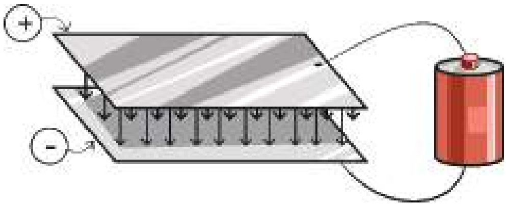

<!-- physics-9-10-bn-c10-t10.7-p005 · figure · p.290 -->
**চিত্র ১০.১৫: সমান্তরাল ধাতব প্লেট দিয়ে তৈরি ক্যাপাসিটর।**

<!-- physics-9-10-bn-c10-t10.7-p006 · text · p.290 · review: verify-formula -->
তবে সবচেয়ে পরিচিত সহজ এবং কার্যকর ধারক তৈরি করা হয় দুটো ধাতব পাত পাশাপাশি রেখে (চিত্র ১০.১৫)। ধাতব পাতের একটিতে যদি ধনাত্মক, অন্যটিতে ঋণাত্মক চার্জ রাখা হয়, তাহলে দুটি পাতের মাঝখানে তড়িৎ ক্ষেত্র তৈরি হয় এবং সেই তড়িৎ ক্ষেত্রে শক্তি সঞ্চিত থাকে। একটা ধারকের ধারকত্ব যদি $C$ এবং ভোল্টেজ $V$ হয় তাহলে তার ভেতরে যে শক্তি (Energy) জমা থাকে সেটি হচ্ছে

<!-- physics-9-10-bn-c10-t10.7-p007 · formula · p.290 · review: latin-junk,verify-formula -->
$$শক্তি = \frac{1}{2} CV^2$$

### উদাহরণ

<!-- physics-9-10-bn-c10-t10.7-p008 · example · p.290 · review: verify-formula -->
**প্রশ্ন:** একটা 20 $\mu$F ধারকে 10 V বৈদ্যুতিক বিভব দেওয়া হয়, তাহলে সেখানে কী পরিমাণ শক্তি সঞ্চিত থাকবে?

<!-- physics-9-10-bn-c10-t10.7-p009 · example · p.290 · review: verify-formula -->
**উত্তর:** শক্তি $= \frac{1}{2} CV^2$

<!-- physics-9-10-bn-c10-t10.7-p010 · formula · p.290 · review: verify-formula -->
$$= \frac{1}{2} \times 20 \times 10^{-6} \times 10^2  J$$

<!-- physics-9-10-bn-c10-t10.7-p011 · formula · p.290 · review: verify-formula -->
$$= 10^{-3}  J = 1  mJ$$

## 10.8 স্থির বিদ্যুতের ব্যবহার (Uses of Static Electricity)

<!-- physics-9-10-bn-c10-t10.8-p001 · text · p.291 -->
আমাদের দৈনন্দিন জীবনে, কলকারখানা, ল্যাবরেটরি, শিক্ষা প্রতিষ্ঠান, হাসপাতাল সব জায়গায় বিদ্যুৎ ব্যবহার করি, তবে প্রায় সব জায়গাতেই সেটা হয় চলাবিদ্যুৎ (পরের অধ্যায়ে আমরা সেটা দেখব) তবে বিশেষ বিশেষ জায়গাতে এখেনো স্থির বিদ্যুৎ ব্যবহার করা হয়:

### ১০.৮.১ ফটোকপি

<!-- physics-9-10-bn-c10-t10.8-p002 · text · p.291 -->
আমরা সবাই কখনো না কখনো কাগজের কোনো লেখার কপি তৈরি করার জন্য ফটোকপি মেশিন ব্যবহার করেছি। এখানে কাগজের লেখার ওপর আলো ফেলে তার একটি প্রতিচ্ছবি একটি বিশেষ ধরনের রোলারে ফেলা হয় এবং সেই রোলারে কাগজের লেখাটির মতো করে স্থির চার্জ তৈরি করা হয়। তারপর এই রোলারটিকে পাউডারের মতো সূক্ষ্ম কালির সংস্পর্শে আনা হলে যেখানে যেখানে চার্জ জমা হয়েছে সেখানে কালো কালি লেগে যায়। তারপর নতুন একটা সাদা কাগজের ওপর ছাপ দিয়ে এই কালিটি বসিয়ে দেওয়া হয়। কালিটি যেন লেপটে না যায় সেজন্য তাপ দিয়ে কালিটিকে আরো ভালো করে কাগজে যুক্ত করে প্রক্রিয়াটি শেষ করা হয়।

### ১০.৮.২ ভ্যান ডি গ্রাফ মেশিন

<!-- physics-9-10-bn-c10-t10.8-p003 · text · p.291 -->
অত্যন্ত উচ্চ বিভব দিয়ে নানা ধরনের কাজ করা হয়। ভ্যান ডি গ্রাফ মেশিনে সেটি করা সম্ভব হয় স্থির বিদ্যুৎ ব্যবহার করে। একটি ঘূর্ণত বিদ্যুৎ অপরিবাহী বেল্টে চার্জযুক্ত কণা বা স্থির বিদ্যুৎ স্প্রে করা হয়, বেল্টটি ঘুরিয়ে একটি ধাতব গোলকের ভেতর নেওয়া হয় (চিত্র ১০.১৬)। বেল্টের ওপর থেকে একটা স্পর্শক এই চার্জটা গ্রহণ করে ধাতব গোলকের কাছে পৌঁছে দেয়। আমরা জানি চার্জ সব সময়ই বেশি থেকে কম বিভবে প্রবাহিত হয়। ভ্যান ডি গ্রাফ জেনারেটরে এটি সব সময় ঘটে থাকে, কারণ ধাতব গোলকের ভেতরে সব সময়ই গোলকের সমান বিভব থাকে। বেল্টের উপরের বাড়তি চার্জটুকুর জন্য যে বাড়তি ভোল্টেজ তৈরি হয় সেটি তাই সব সময়ই গোলকের ভোল্টেজ থেকে বেশি। সে কারণে গোলকের ভেতরে চার্জ থাকলেই সেটা গোলকপৃষ্ঠে চলে যায়। এভাবে বিশাল পরিমাণ চার্জ জমা করিয়ে অনেক উচ্চ পটেনশিয়াল তৈরি করা সম্ভব।

<!-- physics-9-10-bn-c10-t10.8-p004 · figure · p.291 -->
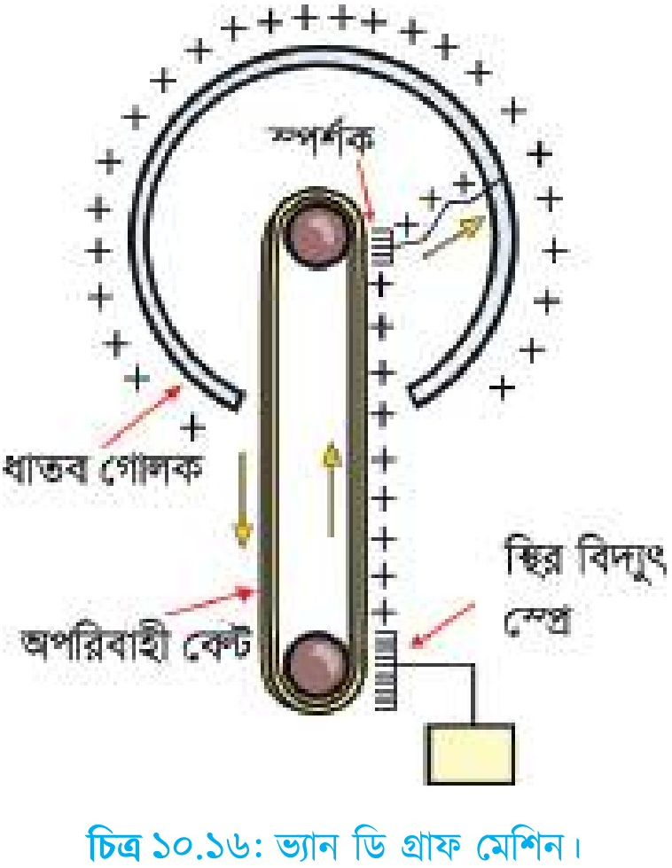

<!-- physics-9-10-bn-c10-t10.8-p005 · figure · p.291 -->
**চিত্র ১০.১৬: ভ্যান ডি গ্রাফ মেশিন।**

### ১০.৮.৩ জ্বালানি ট্রাক

<!-- physics-9-10-bn-c10-t10.8-p006 · text · p.292 -->
পেট্রোল বা অন্য জ্বালানির ট্রাক যখন তাদের জ্বালানি সরবরাহ করে, তখন তাদের খুব সতর্ক থাকতে হয় যেন হঠাৎ করে কোনো বিদ্যুৎ স্কুলিঞ্জা তৈরি হয়ে বড় কোনো বিস্ফোরণের জন্ম না দেয়। জ্বালানি ট্রাকের চাকার সাথে রাস্তার ঘর্ষণে স্থির বিদ্যুৎ তৈরি হলে এটা ঘটতে পারে। সেজন্য এই ধরনের ট্রাকের পেছনে ট্যাংক থেকে একটা শিকল বুলিয়ে দেওয়া হয়, সেটা রাস্তার সাথে ঘষা খেতে থাকে যেন কোনো স্থির বিদ্যুৎ তৈরি হলে সেটা যেন সাথে সাথে মাটিতে চলে যেতে পারে।

### ১০.৮.৪ ইলেকট্রনিকস

<!-- physics-9-10-bn-c10-t10.8-p007 · text · p.292 -->
শীতপ্রধান দেশে বাতাসে জলীয় বাষ্পের পরিমাণ খুব কম থাকে এবং সেখানে স্থির বিদ্যুতের প্রভাব অনেক বেশি। ইলেকট্রনিকসের কাজ করার সময় নানা ধরনের আইসি ব্যবহার করতে হয়। কিছু কিছু আইসি (Integrated Circuit) তাদের পিনে অল্প ভোল্টেজের তারতম্যের কারণেই নষ্ট হয়ে যেতে পারে। কাজেই ইলেকট্রনিকসের কাজ করার সময় শুধু হাত দিয়ে স্পর্শ করার কারণেই একটি মূল্যবান আইসি কিংবা সার্কিট বোর্ড নষ্ট হয়ে যেতে পারে। এরকম পরিস্থিতিতে কাজ করার জন্য পুরো টেবিলে উপরের অংশ বিদ্যুৎ পরিবাহী পদার্থ দিয়ে তৈরি ভূমির সাথে সংযুক্ত করে দেওয়া হয়। একই সাথে যে কাজ করে তার হাতেও বিদ্যুৎ পরিবাহী স্ট্র্যাপ দিয়ে ভূমির সাথে সংযুক্ত রাখা হয়।

### ১০.৮.৫ বজ্রপাত ও বজনিরোধক

<!-- physics-9-10-bn-c10-t10.8-p008 · text · p.292 -->
আকাশে মেঘ জমা হওয়ার সময় জলীয় বাষ্প যখন উপরে উঠতে থাকে, তখন সেই জলীয় বাষ্পের ঘর্ষণের কারণে কিছু ইলেকট্রন আলাদা হয়ে নিচের মেঘগুলোর মাঝে জমা হতে থাকে। তখন স্বাভাবিকভাবেই উপরের মেঘের মাঝে ইলেকট্রন কম পড়ে এবং সেখানে ধনাত্মক চার্জ জমা হয়। মেঘের ভেতর যখন প্রচুর চার্জ জমা হয় তখন স্বাভাবিক অবস্থায় ফিরে আসার জন্য মেঘের ভেতরে বড় স্পার্ক হয়, যেটাকে আমরা বলি বিজলি চমকানো। মাঝে মাঝে আকাশের মেঘে এত বেশি চার্জ জমা হয় যে সেগুলো বাতাসকে আয়নিত করে আয়নরিক অর্থে দুতবেগে মাটিতে নেমে আসে এবং আমরা সেটাকে বলি বজ্রপাত। বজ্রপাতের সময় মেঘ থেকে বিশাল পরিমাণ চার্জ পৃথিবীতে নেমে আসে। বাতাসের ভেতর দিয়ে যাওয়ার সময় সেটা বাতাসকে আয়নিত করে ফেলে, তখন সেখানে প্রচণ্ড তাপ আর আলো আর শব্দ তৈরি হয়ে এই বিশাল পরিমাণ চার্জ যেখানে হাজির হয়, সেখানে ভয়ংকর স্ক্রতি হতে পারে।

<!-- physics-9-10-bn-c10-t10.8-p009 · text · p.292 -->
বজ্রপাতের সময় লক্ষ্য অ্যাক্সিম্যারের মতো বিদ্যুৎ প্রবাহিত হতে পারে এবং এই বিদ্যুৎপ্রবাহের জন্য বাতাসের তাপমাত্রা 20 থেকে 30 হাজার ডিগ্রি সেলসিয়াস পর্যন্ত হয়ে যায়, যেটা সূর্য পূর্বে তাপমাত্রা থেকেও বেশি।

<!-- physics-9-10-bn-c10-t10.8-p010 · text · p.293 -->
এই তাপমাত্রার কারণে আমরা নীলাভ সাদা আলোর একটা ঝলকানি দেখতে পাই। তাপমাত্রার কারণে আরো একটা ব্যাপার ঘটে, বাতাসটুকু উত্তপ্ত হয়ে ফুলে ফেঁপে উঠে বাইরের দিকে ছড়িয়ে পড়ে এবং পরের মুহূর্তে বাইরের বাতাস এসে সেই শূন্যস্থান পূরণ করে। পুরো বিষয়টি ঘটে অতি অল্প সময় এবং একটি গগনবিদারী শব্দ হয়। বাতাসের গতি শব্দের চাইতে দ্বিত হলে তাকে শকওয়েভ বলে এবং বজ্রপাতের শব্দ একধরনের শকওয়েভ। আলোর ঝলকানি এবং শব্দ একই সাথে তৈরি হলেও আমরা আলোটিকে প্রথম দেখি আলোর গতিবেগ এত বেশি যে সেটা প্রায় সাথে সাথে পৌঁছে যায়। শব্দের গতি 330 m/s এর মতো অর্থাৎ এক কিলোমিটার যেতে প্রায় 3s সময় নেয়। কাজেই আলোর কত সেকেন্ড পর শব্দটা শোনা গেছে, সেখান থেকে আমরা বজ্রপাতটা কত দূরে হয়েছে সেটা অনুমান করতে পারি। আনুমানিকভাবে প্রতি তিন সেকেন্ডের জন্য এক কিলোমিটার।

<!-- physics-9-10-bn-c10-t10.8-p011 · text · p.293 -->
বজ্রপাতের সময় যেহেতু আকাশের মেঘ থেকে বিদ্যুতের প্রবাহ নিচে নেমে আসে, তাই এটা সাধারণত উঁচু জিনিসকে সহজে আঘাত করে। তাই বজ্রপাত থেকে রক্ষা করার জন্য উঁচু বিল্ডিংয়ের উপর ধাতব একাধিক সূচালো মুখযুক্ত শলাকা লাগানো হয়। সেটা মোটা বিদ্যুৎ সুপরিবাহী তার দিয়ে মাটির গভীরে নিয়ে যাওয়া হয়। এর পেছনের বিজ্ঞানটুকু খুবই সহজ। আমরা আগেই দেখেছি চার্জযুক্ত কোনো কিছু চার্জহীন কোনো কিছুর কাছে আনলে সেখানে বিপরীত চার্জ আবেশিত হয়। তাই বজ্রপাত হবার উপক্রম হলে বজ্র শলাকাতে ধনাত্মক চার্জ জমা হয় এবং সূচালো শলাকা থাকার কারণে সেখানে তীব্র তড়িৎ ক্ষেত্র তৈরি করে। সেই তড়িৎ ক্ষেত্রের কারণে আশপাশে থাকা বাতাস, জলীয় বাষ্প আয়নিত হয়ে যায় এবং আকাশের দিকে উঠে মেঘের ঋণাত্মক চার্জকে চার্জহীন করে বজ্রপাতের আশঙ্কাকে কমিয়ে দেয়। অনেক উঁচু বিল্ডিংয়ে যখন বজ্র শলাকা রাখা হয় সেটি প্রায় সময়ই সত্যিকার বজ্রপাত গ্রহণ করে আর বিশাল পরিমাণ চার্জকে সেই দণ্ড নিরাপদে মাটির ভেতরে নিয়ে যায়। আকাশ থেকে নেমে আসা বিদ্যুৎ অনিয়ন্ত্রিতভাবে না গিয়ে এই মোটা তার দিয়ে মাটির গভীরে চলে যাবে।

<!-- physics-9-10-bn-c10-t10.8-p012 · text · p.293 -->
সূচালো শলাকায় শুধু যে বজ্রপাত হয় তা নয়, এই সূচালো শলাকা দিয়ে বিপরীত চার্জ বের করে মেঘের মাঝে জমে থাকা চার্জকে নিষ্ক্রিয় করে দিতে পারে। এই কারণে উঁচু বিল্ডিংগুলোতে বজ্রপাত নিরোধক শলাকা লাগানো হলে বজ্রপাতের আশঙ্কা অনেক কমে যায়।

### ১০.৮.৬ স্থির বৈদ্যুতিক রং স্প্রে

<!-- physics-9-10-bn-c10-t10.8-p013 · text · p.293 -->
গাড়ি, সাইকেল, স্টিলের আলমারি বা অন্যান্য ধাতব জিনিস রং করার জন্য আজকাল স্থির বৈদ্যুতিক রং স্প্রে ব্যবহার করা হয়। এই স্প্রেগুলোতে রঙের খুবই স্কুড স্কুড কণা তৈরি করা হয় এবং স্প্রে থেকে বের হওয়ার সময় চার্জযুক্ত হওয়ার কারণে একটি কণা অন্যকে বিকর্ষণ করে ছড়িয়ে পড়ে এবং সে কারণে একটা বড় জায়গাকে খুবই মসৃণভাবে রং করা সম্ভব হয়।

<!-- physics-9-10-bn-c10-t10.8-p014 · text · p.294 -->
রঙের কণাগুলোকে চার্জ করার জন্য রং স্প্রে করার সুচালো মাথাটি একটা উঁচু বিভাবর উৎসের সাথে যুক্ত করে নেওয়া হয়। যে জিনিসটিকে রং করা হবে সেটি বিপরীত বিভবে কিংবা ভূমির সাথে সংযুক্ত করে নেওয়া হয়। রঙের স্কুড স্কুড কণা আধানযুক্ত হওয়ার কারণে জিনিসটির দিকে আকর্ষিত হয় এবং সেখানে খুবই দ্রুতভাবে সংযুক্ত হয়। শুধু তা-ই নয়, রঙের কণাগুলো বৈদ্যুতিক বলরেখা বরাবর গিয়ে কার্ঠামোর যে অপ্রকাশ্য স্থান আছে সেখানেও পৌঁছাতে পারে এবং রঙের আস্তরণ তৈরি করতে পারে।

### ঘর্ষণ এবং আবেশ

<!-- physics-9-10-bn-c10-t10.8-p015 · text · p.294 -->
**উদ্দেশ্য:** ঘর্ষণ এবং আবেশের সাহায্যে চার্জ বা আধান তৈরি করা

<!-- physics-9-10-bn-c10-t10.8-p016 · text · p.294 -->
**যন্ত্রপাতি:** চিরুনি, অ্যালুমিনিয়াম ফয়েলের টুকরো

<!-- physics-9-10-bn-c10-t10.8-p017 · text · p.294 -->
**তত্ত্ব:** শীতকালে চিরুনি দিয়ে চুল আঁচড়ালে চিরুনিতে নেগেটিভ স্থির বিদ্যুৎ বা নেগেটিভ চার্জ জমা হয়।

<!-- physics-9-10-bn-c10-t10.8-p018 · text · p.294 -->
**কাজের ধারা:**

<!-- physics-9-10-bn-c10-t10.8-p019 · text · p.294 -->
(a) খুবই ছোট এক টুকরো অ্যালুমিনিয়াম ফয়েল নিয়ে সেটাকে ছোট করে গুটি পাকিয়ে বলের মতো করে নাও।

<!-- physics-9-10-bn-c10-t10.8-p020 · text · p.294 -->
(b) চিরুনি দিয়ে চুল আঁচড়িয়ে সেটি অ্যালুমিনিয়াম ফয়েল দিয়ে তৈরি স্কুড বলটির কাছে আনো। চিরুনিতে যথেষ্ট পরিমাণ নেগেটিভ চার্জ জমা হয়ে থাকলে সেটি অ্যালুমিনিয়াম ফয়েলের সম্মুখভাগে পজিটিভ চার্জ আবেশ করবে। (অ্যালুমিনিয়াম ফয়েল পরিবাহী বলে সহজেই সম্মুখভাগের ইলেকট্রনগুলো পেছন দিকে সরে যাবে।) সম্মুখভাগটিকে চিরুনি আকর্ষণ করবে এবং আকর্ষণের কারণে সেটি লাফিয়ে চিরুনির গায়ে লেগে যাবে।

<!-- physics-9-10-bn-c10-t10.8-p021 · text · p.294 -->
(c) অ্যালুমিনিয়াম ফয়েল বিদ্যুৎ পরিবাহী বলে সাথে সাথে চার্জ যুক্ত হয়ে যাবে এবং চিরুনি থেকে বিকর্ষিত হয়ে ছিটকে সরে যাবে।

## 10.ex নমুনা প্রশ্ন

### বহুনির্বাচনি প্রশ্ন

<!-- physics-9-10-bn-c10-t10.ex-p001 · exercise · p.295 -->
সঠিক উত্তরটির পাশে টিক (✓) চিহ্ন দাও

<!-- physics-9-10-bn-c10-t10.ex-p002 · exercise · p.295 -->
১. কোনো বস্তুতে আধানের অস্তিত্ব নির্ণয়ের যন্ত্র হলো–

<!-- physics-9-10-bn-c10-t10.ex-p003 · exercise · p.295 -->
(ক) অ্যামিটার
(খ) ভোল্টমিটার
(গ) অণুবীক্ষণ যন্ত্র
(ঘ) তড়িৎবীক্ষণ যন্ত্র

<!-- physics-9-10-bn-c10-t10.ex-p004 · exercise · p.295 -->
২. দুটি আধানের মধ্যকার তড়িৎ বল নিচের কোনটির ওপর নির্ভর করে না?

<!-- physics-9-10-bn-c10-t10.ex-p005 · exercise · p.295 · review: latin-junk -->
i. আধান দুটির মধ্যবর্তী দূরত্বের ওপর।
ii. আধান দুটি যে মাধ্যমে অবস্থিত তার প্রকৃতির ওপর।
iii. আধান দুটির ভরের ওপর।

<!-- physics-9-10-bn-c10-t10.ex-p006 · exercise · p.295 -->
কোনটি সঠিক

<!-- physics-9-10-bn-c10-t10.ex-p007 · exercise · p.295 · review: latin-junk -->
(ক) i ও ii
(খ) iii
(গ) ii ও iii
(ঘ) i, iii ও iii

<!-- physics-9-10-bn-c10-t10.ex-p008 · exercise · p.295 -->
৩. তড়িৎ তীব্রতার একক হচ্ছে

<!-- physics-9-10-bn-c10-t10.ex-p009 · exercise · p.295 -->
(ক) N
(খ) Nm
(গ) Nm-1
(ঘ) NC-1

<!-- physics-9-10-bn-c10-t10.ex-p010 · figure · p.296 -->
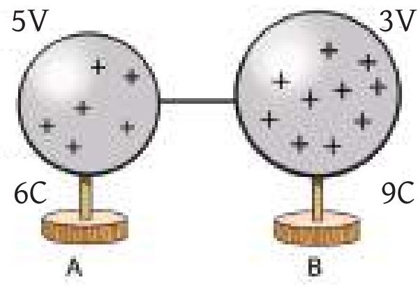

<!-- physics-9-10-bn-c10-t10.ex-p011 · figure · p.296 -->
**চিত্র ১০.১৭**

<!-- physics-9-10-bn-c10-t10.ex-p012 · exercise · p.296 -->
**৪. ১০.১৭ চিত্রে**

<!-- physics-9-10-bn-c10-t10.ex-p013 · exercise · p.296 -->
i. A গোলক থেকে কিছু আধান B গোলকে যাবে

<!-- physics-9-10-bn-c10-t10.ex-p014 · exercise · p.296 · review: latin-junk -->
ii. A গোলক থেকে নির্গত বলরেখা B গোলকে যাবে

<!-- physics-9-10-bn-c10-t10.ex-p015 · exercise · p.296 · review: latin-junk -->
iii. আধান পার্থক্য সর্বদা সমান থাকে।

<!-- physics-9-10-bn-c10-t10.ex-p016 · exercise · p.296 -->
নিচের কোনটি সঠিক?

<!-- physics-9-10-bn-c10-t10.ex-p017 · exercise · p.296 -->
(ক) i

<!-- physics-9-10-bn-c10-t10.ex-p018 · exercise · p.296 -->
(খ) ii

<!-- physics-9-10-bn-c10-t10.ex-p019 · exercise · p.296 · review: latin-junk -->
(গ) i ও iii

<!-- physics-9-10-bn-c10-t10.ex-p020 · exercise · p.296 · review: latin-junk -->
(ঘ) i, ii ও iii

<!-- physics-9-10-bn-c10-t10.ex-p021 · exercise · p.296 · review: verify-formula -->
**৫. একটি 10 $\mu$F এর ধারককে 12 V বিভব পার্থক্যে যুক্ত করলে ধারকে কী পরিমাণ শক্তিতে সঞ্চিত হবে?**

<!-- physics-9-10-bn-c10-t10.ex-p022 · exercise · p.296 · review: verify-formula -->
(ক) $6 \times 10^{-10}$ J

<!-- physics-9-10-bn-c10-t10.ex-p023 · exercise · p.296 · review: verify-formula -->
(খ) $6 \times 10^{-5}$ J

<!-- physics-9-10-bn-c10-t10.ex-p024 · exercise · p.296 · review: verify-formula -->
(গ) $1.44 \times 10^{-3}$ J

<!-- physics-9-10-bn-c10-t10.ex-p025 · exercise · p.296 · review: verify-formula -->
(ঘ) $7.2 \times 10^{-4}$ J

### সৃজনশীল প্রশ্ন

<!-- physics-9-10-bn-c10-t10.ex-p026 · exercise · p.297 · review: known-confusable-corrected -->
১. রিমা চুল আঁচড়ানোর পর দেখতে পেল তার চিরুনি ছোট ছোট কাগজের টুকরাকে আকর্ষণ করছে।
সীমা বলল চিরুনিটি ধনাত্মকভাবে আহিত হয়েছে, যার জন্য এটা ঘটেছে। রিমার বন্ধুবা চিরুনিটি ঋণাত্মক আধানে আহিত হয়েছে। বিষয়টির সুরাহার জন্য দুজন তাদের পদার্থবিজ্ঞান শিক্ষককে খুঁজতে গিয়ে তাকে পদার্থবিজ্ঞান গবেষণাগারে পেল। তিনি সব শুনে তাদেরকে তড়িৎবিজ্ঞান যন্ত্রের সাহায্যে পরীক্ষা করে চিরুনির আধানের প্রকৃতি নির্ণয় করতে বললেন।

<!-- physics-9-10-bn-c10-t10.ex-p027 · exercise · p.297 · review: known-confusable-corrected -->
(ক) আধান বলতে কী বোঝায়?
(খ) কোনো বিন্দুতে তড়িৎ বিভব শূন্য হলেই তড়িৎ ক্ষেত্র শূন্য হবে কী? ব্যাখ্যা কর।
(গ) চিরুনিটি আহিত হওয়ার কারণ বর্ণনা করো।
(ঘ) যন্ত্রটির সাহায্যে কীভাবে চিরুনিটির আধানের প্রকৃতি নির্ণয় করা যাবে ব্যাখ্যা করো।

<!-- physics-9-10-bn-c10-t10.ex-p028 · exercise · p.297 · review: known-confusable-corrected,verify-formula -->
২. $q_1 (2 C)$, $q_2 (-1 C)$ এবং $q_3 (1 C)$ এই তিনটি আধান একটি সরল রেখায় পর্যায়ক্রমে (চিত্র ১০.১৮) পরস্পর থেকে 1m সমদূরত্বে রাখা আছে।

<!-- physics-9-10-bn-c10-t10.ex-p029 · figure · p.297 · review: known-confusable-corrected -->
drawing: diagram of three charges q1, q2, and q3 on a line with distances 1m between them

<!-- physics-9-10-bn-c10-t10.ex-p030 · exercise · p.297 · review: known-confusable-corrected,verify-formula -->
(ক) তড়িৎ বল কী?
(খ) তড়িৎ ক্ষেত্র ও তড়িৎ বিভব একই নয় কেন?
(গ) তিনটি চার্জের জন্য যে বলরেখা তৈরি হবে তার চিত্র আঁকো।
(ঘ) $q_1$ আধানটির মান কত হলে $q_3$ আধানটি কোনো বল অনুভব করবে না বিশ্লেষণ করো।

### সংক্ষিপ্ত উত্তর প্রশ্ন

<!-- physics-9-10-bn-c10-t10.ex-p031 · exercise · p.297 -->
১. স্বাভাবিক পরমাণু চার্জ নিরপেক্ষ কেন? ব্যাখ্যা কর।

<!-- physics-9-10-bn-c10-t10.ex-p032 · exercise · p.297 -->
২. ঘর্ষণে একটি অনাহিত বস্তু কীভাবে আহিত হয়- ব্যাখ্যা কর।

<!-- physics-9-10-bn-c10-t10.ex-p033 · exercise · p.297 -->
৩. শিশু হামাগুড়ি দেয়ার সময় শরীরের চুল খাড়া হয়ে যায় কেন? ব্যাখ্যা কর।

<!-- physics-9-10-bn-c10-t10.ex-p034 · exercise · p.297 -->
৪. তড়িৎ ক্ষেত্রের দুই বিন্দুর পার্থক্য 2 V বলতে কী বোঝায়?
