# 11. চল বিদ্যুৎ

Source: Physics Bangla Version, printed pp. 298-328

## 11.0 ভূমিকা ও শিখনফল

<!-- physics-9-10-bn-c11-t11.0-p001 · figure · p.298 -->

<!-- physics-9-10-bn-c11-t11.0-p002 · text · p.298 -->
ইলেকট্রিসিটি বা চলবিদ্যুৎ ছাড়া আজকাল এক মুহূর্তও আমাদের জীবন ঠিকভাবে চলতে পারে না। আমাদের চারপাশের সব ধরনের যন্ত্রপাতি বা সাজসরঞ্জাম চালানোর জন্য আমাদের ইলেকট্রিসিটির দরকার হয়। আগের অধ্যায়ে আমরা যে স্থির বিদ্যুতের কথা বলেছি, সেই স্থির বিদ্যুৎ বা চার্জগুলো যখন কোনো পরিবাহকের ভেতর দিয়ে প্রবাহিত হয় আমরা সেটাকেই চলবিদ্যুৎ বা ইলেকট্রিসিটি বলি। এই অধ্যায়ে এই চলবিদ্যুৎকে ব্যাখ্যা করার জন্য প্রয়োজনীয় রাশিগুলো বর্ণনা করব এবং যে নিয়মে চলবিদ্যুৎ প্রবাহিত হয় সেগুলো জেনে নেব। এই নিয়মগুলো ব্যবহার করে কীভাবে একটা সার্কিটে বিদ্যুৎপ্রবাহ বা বিভব পরিমাণ করা যায়, সেটিও এই অধ্যায়ে আলোচনা করা হবে।

### এ অধ্যায় শেষে আমরা –

<!-- physics-9-10-bn-c11-t11.0-p003 · objective · p.299 -->
* স্থির তড়িৎ হতে চল তড়িৎ সৃষ্টি প্রদর্শন করতে পারব।
* তড়িৎ প্রবাহের দিক এবং ইলেকট্রন প্রবাহের দিক ব্যাখ্যা করতে পারব।
* তড়িৎ যন্ত্র ও উপকরণের প্রতীক ব্যবহার করে বর্তনী অঙ্কন করতে পারব।
* পরিবাহী, অপরিবাহী ও অর্ধপরিবাহী ব্যাখ্যা করতে পারব।
* লেখচিত্রের সাহায্যে তড়িৎ প্রবাহ ও বিভব পার্থক্য—এই দুইয়ের মধ্যে সম্পর্ক স্থাপন করতে পারব।
* স্থির রোধ এবং পরিবর্তনশীল রোধ ব্যাখ্যা করতে পারব।
* তড়িচ্চালক শক্তি এবং বিভব পার্থক্য ব্যাখ্যা করতে পারব।
* রোধের নির্ভরশীলতা ব্যাখ্যা করতে পারব।
* আপেক্ষিক রোধ ও পরিবাহকত্ব ব্যাখ্যা করতে পারব।
* শ্রেণি ও সমান্তরাল রোধের সংযোগ ব্যবহার করতে পারব।
* বর্তনীতে তুল্য রোধ ব্যবহার করতে পারব।
* তড়িৎ ক্ষমতার হিসাব করতে পারব।
* তড়ি্তের সিস্টেম লস এবং লোডশেডিং ব্যাখ্যা করতে পারব।
* তড়ি্তের নিরাপদ ও কার্যকর ব্যবহার বর্ণনা করতে পারব।
* বাসাবাড়িতে ব্যবহার উপযোগী বর্তনীর নকশা প্রণয়ন করে এর বিভিন্ন অংশে এসি উৎস এর ব্যবহার প্রদর্শন করতে পারব।
* তড়ি্তের নিরাপদ ও কার্যকর ব্যবহারের বিষয়ে সচেতনতা সৃষ্টি করতে পারব।
* তড়িৎ শক্তির অপচয় রোধ ও সংরক্ষণে সচেতনতা সৃষ্টির জন্য পোস্টার অঙ্কন করতে পারব।

## 11.1 বিদ্যুৎপ্রবাহ (Electric Current)

<!-- physics-9-10-bn-c11-t11.1-p001 · text · p.300 -->
আমরা আগের অধ্যায়ে দেখেছি যে যদি দুটো ভিন্ন বস্তুর পটেনশিয়াল বা বিভবের মাঝে পার্থক্য থাকে তাহলে যেটার বেশি বিভব সেখান থেকে যেটার বিভব কম সেখানে চার্জ বা আধান প্রবাহিত হয়। যতক্ষণ পর্যন্ত বিভব দুটো সমান না হচ্ছে চার্জের প্রবাহ হতেই থাকে। চার্জের এই প্রবাহ হচ্ছে তড়িৎ বা বিদ্যুতের প্রবাহ, আমরা যেটাকে সাধারণভাবে ‘ইলেকট্রিসিটি’ বলি, যেটা দিয়ে লাইট জ্বলে, ফ্যান ঘোরে, মোবাইল টেলিফোন চার্জ দেওয়া হয়।

<!-- physics-9-10-bn-c11-t11.1-p002 · figure · p.300 -->
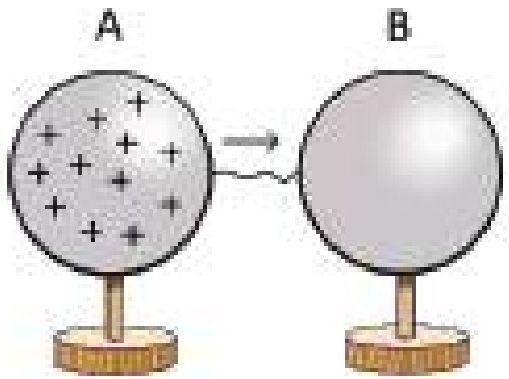

<!-- physics-9-10-bn-c11-t11.1-p003 · figure · p.300 -->
**চিত্র ১১.০১ : চার্জ সংযুক্ত গোলক থেকে চার্জহীন গোলকে বিদ্যুৎ প্রবাহ।**

### ১১.১.১ তড়িৎ চালক শক্তি এবং বিভব পার্থক্য

<!-- physics-9-10-bn-c11-t11.1-p004 · text · p.300 -->
একটা বিষয় নিশ্চয়ই বুঝতে পারছ, পটেনশিয়াল বা বিভব এর পার্থক্য থাকলেই শুধু বিদ্যুৎপ্রবাহ হয়, তাই আমরা যদি বিদ্যুৎপ্রবাহ অবিচ্ছিন্ন রাখতে চাই, তাহলে বিভবের পার্থক্যটাও বজায় রাখতে হবে, সেটাকে কমে সমান হয়ে যেতে দেওয়া যাবে না। যদি দুটো ধাতব গোলকের একটির মাঝে ধনাত্মক চার্জ দিয়ে সেখানে একটি বিভব তৈরি করে চার্জবিহীন অন্য গোলকটির সাথে একটি তার দিয়ে জুড়ে দিই (চিত্র ১১.০১), তাহলে বিদ্যুতের প্রবাহ শুরু হবার সাথে সাথে সাথে পটেনশিয়াল বা বিভব এর পার্থক্য কমেতে থাকবে এবং মুহূর্তের মাঝে দুটি বিপরীত বিভব সমান হয়ে যাবে। একটি সমান্তরাল-পাত ধারক বা ক্যাপাসিটরের দুটো সমান্তরাল ধাতব পাতের উপর আধান বা চার্জ জমা রেখে বিভবের পার্থক্য তৈরি করা সম্ভব। ধারকের সেই দুটো পাত একটি তার দিয়ে জুড়ে দিলেও মুহূর্তের মাঝে পুরো চার্জ প্রবাহিত হয়ে তাদের বিভব সমান হয়ে যাবে। কাজেই বুঝতেই পারছ আমরা যদি ব্যবহার করার মতো সার্বক্ষণিক বিদ্যুৎ চাই তাহলে অন্য কোনো পদ্ধতি দরকার যেটা এমন একটা পটেনশিয়াল বা বিভব পার্থক্য তৈরি করে দেবে যেন চার্জ প্রবাহিত হলেও তার পার্থক্য কমে না যায়।

<!-- physics-9-10-bn-c11-t11.1-p005 · text · p.301 -->
তোমরা সবাই সে রকম পদ্ধতি দেখেছ, এগুলো হচ্ছে ব্যাটারি এবং জেনারেটর। ব্যাটারির ভেতর রাসায়নিক বিক্রিয়া করে বিভবের পার্থক্য তৈরি করা হয়। সেখান থেকে চার্জ প্রবাহ করা হলে রাসায়নিক দ্রব্যগুলো খরচ হতে থাকে। যখন রাসায়নিক দ্রব্যগুলো শেষ হয়ে যায়, তখন ব্যাটারি সেল আর বিদ্যুৎ প্রবাহ করতে পারে না। আমরা সাধারণ যে ব্যাটারিগুলো দেখি, সেগুলোর দুই প্রান্তের যা Pole এর মধ্যে 1.5 V বিভব পার্থক্য তৈরি করে।

<!-- physics-9-10-bn-c11-t11.1-p006 · text · p.301 -->
তোমাদের স্কুলে কিংবা বাসায় যে ইলেকট্রিসিটি সাপ্লাই আছে, সেখানে তোমরা সবাই দেখেছ সেটি ব্যবহার করার জন্য সব সময় দুটো পয়েন্ট থাকে। তার একটাকে থাকে কম পটেনশিয়াল বা বিভব অন্যটাকে বেশি। এই পার্থক্যটা বজায় রাখে জেনারেটর, যেটি ক্রমাগত পটেনশিয়াল পার্থক্য তৈরি করতে থাকে। একটা ব্যাটারি বা একটা জেনারেটরে ক্রমাগত বিদ্যুৎপ্রবাহের জন্য ক্রমাগত চার্জকে কম পটেনশিয়াল বা বিভব থেকে বেশি পটেনশিয়াল বা বিভবের স্থানে হাজির করে রাখতে হয় এবং এর জন্য শক্তির প্রয়োজন হয়। যদি কোনো ব্যাটারিতে Q চার্জকে কম পটেনশিয়াল বা বিভবের প্রান্ত থেকে বেশি পটেনশিয়াল বা বিভবের প্রান্ত আনতে W পরিমাণ কাজ করতে হয়, তাহলে এই ব্যাটারির দুই প্রান্তের বিভব পার্থক্যকে তড়িৎ চালক শক্তি বা ইএমএফ বলে:

<!-- physics-9-10-bn-c11-t11.1-p007 · formula · p.301 · review: verify-formula -->
$$EMF = \frac{W}{Q}$$

<!-- physics-9-10-bn-c11-t11.1-p008 · text · p.301 -->
ব্যাটারি বা জেনারেটর, যগুলো বিদ্যুৎ শক্তি সরবরাহ করে তার তড়িৎ চালক শক্তি বা ইএমএফ থাকে। যখন কোনো ব্যাটারি বা জেনারেটরকে কোনো সার্কিটে লাগানো হয়, তখন এই তড়িৎ চালক শক্তিই চার্জকে পুরো সার্কিটের ভেতর দিয়ে ঘুরিয়ে আনে। একটা ব্যাটারি যে পরিমাণ বিভব তৈরি করে সেটাই হচ্ছে তার তড়িৎ চালক শক্তি (Electromotive Force) বা ইএমএফ। ইংরেজিতে এটাকে বলা হচ্ছে ফোর্স বা ‘বল’ বাংলায় বলছি ‘শক্তি’। কিন্তু প্রকৃত পক্ষে ‘ইএমএফ’ বা ‘তড়িৎ চালক শক্তি’ বলও নয় আবার শক্তিও নয়। তোমাদের আগে বলা হয়েছে পদার্থবিজ্ঞানে ‘বল’ ‘শক্তি’ এই বিষয়গুলো খুবই সুনির্দিষ্ট, ইচ্ছেমতো একটা শব্দের জায়গায় অন্য শব্দ ব্যবহার করা যাবে না। কিন্তু দূর্ভাগ্যকমে এখানে সেটি করা হয়ে গেছে। তোমাদের বিস্ত্রান্ত হওয়ার কোনো কারণ নেই কারণ যেহেতু একটা ব্যাটারি সেল বা জেনারেটর এর দুই প্রান্তে যে পরিমাণ বিভব পার্থক্য তৈরি করে সেটাই হচ্ছে তার ইএমএফ।

<!-- physics-9-10-bn-c11-t11.1-p009 · figure · p.301 -->
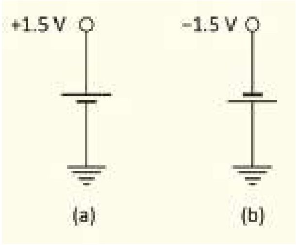

<!-- physics-9-10-bn-c11-t11.1-p010 · figure · p.301 -->
**চিত্র ১১.০২ : একটি ব্যাটারি সেল দিয়ে পজিটিভ বা নেগেটিভ ভোল্টেজ দুটোই তৈরি করা সম্ভব।**

<!-- physics-9-10-bn-c11-t11.1-p011 · text · p.302 -->
আমরা আগেই বলেছি বিভবের মানটি গুরুত্বপূর্ণ নয়, তার পার্থক্যটুকু গুরুত্বপূর্ণ। তাই দেখবে অনেক সময় একটা ব্যাটারির এক মাথার পটেনশিয়ালের মান ভিন্ন করে ফেলা সম্ভব, কিন্তু পার্থক্যটা সব সময়ই সমান থাকবে।

### উদাহরণ

<!-- physics-9-10-bn-c11-t11.1-p012 · example · p.302 -->
**প্রশ্ন:** একটা ব্যাটারির দুই প্রান্তের বিভবের পার্থক্য 1.5 V কিন্তু আসলে দুই প্রান্তের প্রকৃত বিভব কত? নেগেটিভটা শূন্য এবং পজিটিভটা 1.5 V নাকি নেগেটিভটা -1.5 V এবং পজিটিভটা শূন্য?

<!-- physics-9-10-bn-c11-t11.1-p013 · figure · p.302 -->
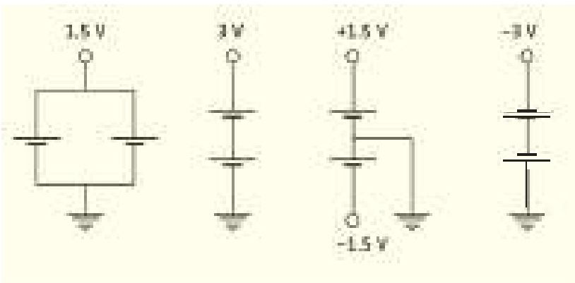

<!-- physics-9-10-bn-c11-t11.1-p014 · figure · p.302 -->
**চিত্র ১১.০৩: দুটি ব্যাটারি সেল দিয়ে বিভিন্ন পজিটিভ বা নেগেটিভ ভোল্টেজ তৈরি করা।**

<!-- physics-9-10-bn-c11-t11.1-p015 · example · p.302 -->
**উত্তর:** দুটোই সত্য হতে পারে। যদি 11.02a চিত্রের মতো হয় তাহলে নেগেটিভটা শূন্য এবং পজিটিভটা 1.5 V। যদি 11.02b চিত্রের মতো হয় তাহলে পজিটিভটা শূন্য এবং নেগেটিভটা -1.5 V।

<!-- physics-9-10-bn-c11-t11.1-p016 · text · p.302 -->
**প্রশ্ন:** দুটি 1.5 V ভোল্টের ব্যাটারি দিয়ে 1.5 V, 3.0 V, ±1.5 V, -3.0 V তৈরি করো।

<!-- physics-9-10-bn-c11-t11.1-p017 · text · p.302 -->
**উত্তর:** ১১.০৩ চিত্রটিতে করে দেখানো হয়েছে।

<!-- physics-9-10-bn-c11-t11.1-p018 · text · p.302 -->
> ধারক বা Capacitor-কে কি ব্যাটারি হিসেবে ব্যবহার করা সম্ভব?

### ১১.১.২ পরিবাহী, অপরিবাহী এবং অর্ধপরিবাহী পদার্থ

<!-- physics-9-10-bn-c11-t11.1-p019 · text · p.302 -->
**পরিবাহী পদার্থ:** আমরা যদি পদার্থের গঠনটা ভালো করে বুঝে থাকি, তাহলে একটা বিষয় খুব ভালো করে জেনেছি। কঠিন পদার্থে তার অণু-পরমাণু শক্ত করে নিজের জায়গায় বসে থাকে। তাপমাত্রা বাড়লে তারা নিজের জায়গায় কাঁপাকাঁপি করতে পারে কিন্তু সেখান থেকে সরে অন্য জায়গায় চলে যায় না। তোমাদের রসায়ন বইয়ে তোমরা যখন ধাতব বন্ধন পড়েছ সেখানে দেখেছ, ধাতব পরমাণুর কিছু ইলেকট্রন প্রায় মুক্ত অবস্থায় থাকে এবং সেগুলো এক জায়গা থেকে অন্য জায়গায় যেতে পারে। সেজন্য আমরা সেগুলোকে বলি পরিবাহী পদার্থ। সোনা, রুপা, তামা, অ্যালুমিনিয়াম এগুলো সুপরিবাহী পদার্থ। পরিবাহী পদার্থ দিয়ে চার্জকে স্থানান্তর করা যায়, তবে সব সময় মনে রাখতে হবে এই স্থানান্তর হয় ইলেকট্রন দিয়ে, বিদ্যুতের প্রবাহ হয় ইলেকট্রন দিয়ে, নেগেটিভ চার্জের ইলেকট্রন।

<!-- physics-9-10-bn-c11-t11.1-p020 · text · p.303 -->
**অপরিবাহী পদার্থ:** যে পদার্থের ভেতর তড়িৎ বা বিদ্যুৎ পরিবহনের জন্য কোনো মুক্ত ইলেকট্রন নেই সেই পদার্থগুলো হচ্ছে বিদ্যুৎ অপরিবাহী বা অন্তরক পদার্থ। প্লাস্টিক, রাবার, কাঠ, কাচ এগুলো হচ্ছে অপরিবাহী পদার্থের উদাহরণ। মূলত অধাতুগুলো বিদ্যুৎ অপরিবাহী হয়।

<!-- physics-9-10-bn-c11-t11.1-p021 · text · p.303 -->
**অর্ধপরিবাহী পদার্থ:** কিছু কিছু পদার্থের বিদ্যুৎ পরিবহন ক্ষমতা সাধারণ তাপমাত্রায় পরিবাহী এবং অপরিবাহী পদার্থের মাঝামাঝি, তবে তাপমাত্রা বাড়ালে পরিবহন ক্ষমতা বেড়ে যায়। এই ধরনের পদার্থকে অর্ধপরিবাহী বা সেমিকন্ডাক্টর বলে। সিলিকন বা জার্মেনিয়াম সেমিকন্ডাক্টরের উদাহরণ। এই বইয়ের শেষ অধ্যায়ে সেমিকন্ডাক্টর নিয়ে সংক্ষিপ্ত আলোচনা করা হয়েছে।

### ১১.১.৩ বিদ্যুৎপ্রবাহের দিক (Direction of Current Flow)

<!-- physics-9-10-bn-c11-t11.1-p022 · text · p.303 -->
আমরা দেখেছি দুটো ভিন্ন বিভবের বস্তুকে পরিবাহী দিয়ে সংযুক্ত করে দিলে আধানের প্রবাহ শুরু হয় এবং যতক্ষণ পর্যন্ত বিভব সমান না হচ্ছে ততক্ষণ পর্যন্ত আধানের প্রবাহ হয় এবং আমরা বলি তাদের মাঝে বিদ্যুৎ প্রবাহ হচ্ছে। তোমাদের কেউ কেউ নিশ্চয়ই এখন একটু ভাবনার মাঝে পড়েছ, কারণ আমরা যখন আধান বা চার্জের প্রবাহ দিয়ে দুটি ভিন্ন বিভবের মাঝে সমতা আনার কথা বলেছি তখন কিন্তু একবারও বলিনি এটা শুধু নেগেটিভ চার্জের জন্য সত্যি, কারণ শুধু নেগেটিভ চার্জের ইলেকট্রনই এক জায়গা থেকে অন্য জায়গায় যেতে পারে। পজিটিভ চার্জের বেলায় তাহলে কী হয়? পজিটিভ আয়ন তো খুবই শক্তভাবে নিজের জায়গায় আটকে থাকে, তাহলে কেমন করে পজিটিভ চার্জ এক জায়গা থেকে অন্য জায়গায় যায়?

<!-- physics-9-10-bn-c11-t11.1-p023 · text · p.303 -->
তোমরা নিশ্চয়ই কী ঘটে সেটা অনুমান করে ফেলেছ, ইলেকট্রনের অভাব হচ্ছে পজিটিভ চার্জ। তাই ইলেকট্রনকে সরিয়ে অভাব আরো বাড়িয়ে দেওয়ার অর্থ হচ্ছে পজিটিভ চার্জ সরবরাহ করা। কাজেই ১১.০১ চিত্রে যদি বলা হয় বিদ্যুৎ প্রবাহের মাধ্যমে A থেকে B তে পজিটিভ চার্জ গিয়েছে তার প্রকৃত অর্থ হচ্ছে B থেকে A তে ইলেকট্রন গিয়েছে।

<!-- physics-9-10-bn-c11-t11.1-p024 · text · p.303 · review: verify-formula -->
আধান বা চার্জের প্রবাহ হচ্ছে বিদ্যুৎপ্রবাহ বা তড়িৎপ্রবাহ। আমরা এতক্ষণ সাধারণভাবে এটা বোঝার চেষ্টা করেছি, এখন এটাকে আরো একটু নির্দিষ্ট করা যাক। বিদ্যুৎ বা তড়িৎপ্রবাহ বলতে আমরা সময়ের সাথে চার্জ-প্রবাহের হারকে বোঝাই অর্থাৎ $t$ সময়ে যদি $Q$ চার্জ প্রবাহিত হয় তাহলে বিদ্যুৎ বা তড়িৎ প্রবাহ হচ্ছে:

<!-- physics-9-10-bn-c11-t11.1-p025 · formula · p.303 · review: verify-formula -->
$$I = \frac{Q}{t}$$

<!-- physics-9-10-bn-c11-t11.1-p026 · text · p.304 -->
আধান বা চার্জের একক কুলম্ব (C) এবং সময়ের একক সেকেন্ড (s) হলে বিদ্যুৎপ্রবাহের একক হচ্ছে অ্যাম্পিয়ার (A = C/s)। মজার ব্যাপার হচ্ছে, আমরা কিন্তু চার্জের একক বের করার জন্য বলেছিলাম এক সেকেন্ডে এক অ্যাম্পিয়ার বিদ্যুৎপ্রবাহ করতে যে পরিমাণ চার্জ প্রবাহিত হয়, সেটাই হচ্ছে কুলম্ব। তড়িৎ বা বিদ্যুৎপ্রবাহ (কারেন্ট) হচ্ছে চার্জ-প্রবাহের হার, A থেকে B তে যদি 1 অ্যাম্পিয়ার কারেন্ট প্রবাহিত হয় তার অর্থ 1 কুলম্ব পজিটিভ চার্জ A থেকে B তে গিয়েছে। যার প্রকৃত অর্থ 1 কুলম্ব চার্জের সমপরিমাণ ইলেকট্রন B থেকে A-তে গিয়েছে। কাজেই তোমরা দেখতে পাচ্ছ, বিদ্যুৎপ্রবাহের দিক হচ্ছে ইলেকট্রন-প্রবাহের দিকের উল্টো। ইলেকট্রনের চার্জকে পজিটিভ ধরে নিলেই সব সমস্যা মিটে যেত; কিন্তু সেটার জন্য এখন দেরি হয়ে গেছে।

## 11.2 বিভব পার্থক্য এবং তড়িৎপ্রবাহের মধ্যে সম্পর্ক

### (Relationship between Potential Difference and Electricity)

<!-- physics-9-10-bn-c11-t11.2-p001 · text · p.304 -->
এবারে আমরা সত্যিকারের বর্তনী বা সার্কিটে সত্যিকারের বিদ্যুৎপ্রবাহ নিয়ে আলোচনা করব। আমরা অনেকবার বলেছি যে দুটি বিন্দুতে যদি পটেনশিয়াল বা বিভব পার্থক্য থাকে এবং আমরা যদি একটি পরিবাহী তার দিয়ে সেই দুটি বিন্দুকে জুড়ে দিই, তাহলে বিন্দু দুটির ভেতরে বিদ্যুৎ প্রবাহ হবে, কিন্তু কতটুকু বিদ্যুৎপ্রবাহ হবে সেটি নিয়ে এখনো কিছু বলা হয়নি। শুধু তা-ই নয়, একটা সোনার পরিবাহী তার দিয়ে জুড়ে দিলে যেটুকু বিদ্যুৎ প্রবাহিত হবে একটা লোহার তার জুড়ে দিলেও কি সমান পরিমাণ বিদ্যুৎ প্রবাহিত হবে?

### ১১.২.১ ও'মের সূত্র (Ohm's Law)

<!-- physics-9-10-bn-c11-t11.2-p002 · text · p.304 -->
পটেনশিয়াল বা বিভব পার্থক্য এবং তড়িৎপ্রবাহের মাঝে সম্পর্ক দেখার জন্য আমরা একটা পরীক্ষণ করতে পারি। বিভব মাপার জন্য যে যন্ত্রটি ব্যবহার করা হয় তার নাম ভোল্টমিটার, বিদ্যুৎপ্রবাহ বা কারেন্ট মাপার জন্য যে যন্ত্র ব্যবহার করা হয় সেটার নাম অ্যামিটার। (আসলে একই যন্ত্রের সুইচ ঘুরিয়ে এটাকে কখনো ভোল্টমিটার বা কখনো অ্যামিটার হিসেবে ব্যবহার করা যায়) আমরা কয়েকটা ব্যাটারি নিতে পারি, একটা ব্যাটারির জন্য তড়িৎ চালক শক্তি 1.5 V হলে দুটি ব্যাটারির তড়িৎ চালক শক্তি 2 × 1.5 =

### চিত্র ১১.০৪ : রেজিস্ট্যান্সের কারণে বিভব পার্থক্যের স্যাপেক্ষে বিদ্যুৎপ্রবাহ। — বিদ্যুৎপ্রবাহ (mA) vs বিভব পার্থক্য (V)

<!-- physics-9-10-bn-c11-t11.2-p003 · table · p.304 · review: verify-table -->
<table><tr><th>Series</th><th>বিভব পার্থক্য (V)</th><th>বিদ্যুৎপ্রবাহ (mA)</th></tr>
<tr><th rowspan="6">(a)</th><td>0.5</td><td>0.5</td></tr>
<tr><td>1.0</td><td>1.0</td></tr>
<tr><td>1.5</td><td>1.5</td></tr>
<tr><td>2.0</td><td>2.5</td></tr>
<tr><td>2.5</td><td>3.0</td></tr>
<tr><td>3.0</td><td>3.5</td></tr>
<tr><th rowspan="6">(b)</th><td>0.5</td><td>0.2</td></tr>
<tr><td>1.0</td><td>0.4</td></tr>
<tr><td>1.5</td><td>0.6</td></tr>
<tr><td>2.0</td><td>1.0</td></tr>
<tr><td>2.5</td><td>1.4</td></tr>
<tr><td>3.0</td><td>2.0</td></tr></table>

<!-- physics-9-10-bn-c11-t11.2-p004 · figure · p.304 -->
**চিত্র ১১.০৪ : রেজিস্ট্যান্সের কারণে বিভব পার্থক্যের স্যাপেক্ষে বিদ্যুৎপ্রবাহ।**

<!-- physics-9-10-bn-c11-t11.2-p005 · text · p.305 · review: verify-formula -->
৩ V, তিনটির জন্য $3 \times 1.5 = 4.5 V$, ইত্যাদি এভাবে ভিন্ন ভিন্ন বিভব পার্থক্য প্রয়োগ করতে পারি। শুধু তাই নয়, আমরা ব্যাটারিগুলো উল্টে দিয়ে বিভব পার্থক্যের দিকও বিপরীত করে দিতে পারি। কাজেই আমরা যদি একটা তার বা অন্য কোনো পরিবাহীর দুই পাশে বিভিন্ন পজিটিভ এবং নেগেটিভ বিভব পার্থক্য প্রয়োগ করে কতখানি বিদ্যুৎ প্রবাহিত হয়েছে সেটা মাপার চেষ্টা করি তাহলে দেখব

<!-- physics-9-10-bn-c11-t11.2-p006 · text · p.305 -->
(a) যত বেশি বিভব পার্থক্য তত বেশি বিদ্যুৎপ্রবাহ
(b) বিভব পার্থক্য নেগেটিভ হলে বিদ্যুৎপ্রবাহও দিক পরিবর্তন করছে।

<!-- physics-9-10-bn-c11-t11.2-p007 · text · p.305 -->
গ্রাফে পরীক্ষণের ফলাফল বসানো হলে সেটা 11.04 (a) চিত্রের মতো দেখাবে, অর্থাৎ

<!-- physics-9-10-bn-c11-t11.2-p008 · formula · p.305 · review: verify-formula -->
$$I \propto V$$

<!-- physics-9-10-bn-c11-t11.2-p009 · text · p.305 -->
আমরা যদি অন্য কোনো উপাদানের তৈরি একটা তার দিয়ে একই পরীক্ষণটি করি, তাহলে একই ধরনের ফলাফল পাব। তবে সরলরেখার ঢালটা হয়তো অন্য রকম হবে (চিত্র 11.04 (b))। এখন এই দুটি পরীক্ষণের ফলাফল যদি বিশ্লেষণ করি তাহলে বুঝতে পারব প্রথমে একটা নির্দিষ্ট বিভব পার্থক্য যতটুকু বিদ্যুৎ প্রবাহিত হয়েছে দ্বিতীয় বস্তুর জন্য সেই একই বিভব পার্থক্য বিদ্যুৎপ্রবাহ হচ্ছে কম। প্রথমটিতে যেন বিদ্যুৎপ্রবাহ তুলনামূলকভাবে সহজ, দ্বিতীয়টিতে যেন বিদ্যুৎপ্রবাহের বাধা একটু বেশি। বিষয়টা ব্যাখ্যা করার জন্য বিদ্যুৎপ্রবাহের বাধা (Resistance) বা সত্যি সত্যি রোধ নামের একটা রাশি তৈরি করা হয়েছে। আমরা দেখতে পারি বিভব পার্থক্য এবং বিদ্যুৎপ্রবাহের সম্পর্কটি একটা সূত্র হিসেবে লেখা যায় যেটি ও’মের সূত্র (Ohm’s Law) হিসেবে পরিচিত।

<!-- physics-9-10-bn-c11-t11.2-p010 · formula · p.305 · review: verify-formula -->
$$I = \frac{V}{R}$$

<!-- physics-9-10-bn-c11-t11.2-p011 · text · p.305 -->
অর্থাৎ রোধ বেশি হলে বিদ্যুৎপ্রবাহ হবে কম। রোধ কম হলে বিদ্যুৎ প্রবাহ হবে বেশি।

<!-- physics-9-10-bn-c11-t11.2-p012 · text · p.305 · review: verify-formula -->
এই রোধ বা Resistance-এর একক হচ্ছে Ohm। এটাকে গ্রিক অক্ষর $\Omega$ (ওমেগা) দিয়ে প্রকাশ করা হয়। কোনো বস্তুর দুই প্রান্তে 1 V বিভব পার্থক্য প্রযুক্ত হলে যদি দেখা যায় 1 A বিদ্যুৎ প্রবাহিত হচ্ছে তাহলে বুঝতে হবে সেই বস্তুর রোধ $1\Omega$।

### উদাহরণ

<!-- physics-9-10-bn-c11-t11.2-p013 · example · p.305 -->
**প্রশ্ন:** মজা করার জন্য ও’মের সূত্রটি থেকে তোমরা লিখতে পারো:

<!-- physics-9-10-bn-c11-t11.2-p014 · formula · p.305 · review: verify-formula -->
$$\frac{V}{I \times R}$$

<!-- physics-9-10-bn-c11-t11.2-p015 · text · p.306 -->
একটু বড় করে লিখে আঁকুল দিয়ে V, I কিংবা R এর যেকোনো একটি চেকে দাও, যেটি চেকে দিয়েছ তার মানটি যেটুকু ঢাকা পড়েনি সেখান থেকে পেয়ে যাবে।

<!-- physics-9-10-bn-c11-t11.2-p016 · text · p.306 -->
উত্তর: ১১.০৫ চিত্রটিতে বিষয়টি করে দেখানো হয়েছে।

<!-- physics-9-10-bn-c11-t11.2-p017 · figure · p.306 -->

<!-- physics-9-10-bn-c11-t11.2-p018 · figure · p.306 -->
**চিত্র ১১.০৫: ও’মের সূত্র এই চিত্রটি দিয়ে ব্যবহার করা সম্ভব। আঁকুল দিয়ে ঢাকা রাশিটির মান বাকি দুটি রাশি দিয়ে প্রকাশ করা সম্ভব।**

### ১১.২.২ রোধ

<!-- physics-9-10-bn-c11-t11.2-p019 · text · p.306 -->
রোধ হচ্ছে বিদ্যুৎ প্রবাহের বাধা, তাই কোনো পদার্থের দৈর্ঘ্য (L) যত বেশি হবে তার বাধা তত বেশি হবে অর্থাৎ রোধও বেশি হবে।

<!-- physics-9-10-bn-c11-t11.2-p020 · formula · p.306 · review: verify-formula -->
$$R \propto L$$

<!-- physics-9-10-bn-c11-t11.2-p021 · text · p.306 -->
আবার সর্বু একটা পথ দিয়ে যত সহজে বিদ্যুৎ প্রবাহিত হতে পারে, চওড়া একটা পথ দিয়ে তার থেকে অনেক সহজে বিদ্যুৎ প্রবাহিত হতে পারে অর্থাৎ প্রস্থচ্ছেদ (A) যত বেশি হবে রোধ তত কম হবে।

<!-- physics-9-10-bn-c11-t11.2-p022 · formula · p.306 · review: verify-formula -->
$$R \propto \frac{1}{A}$$

<!-- physics-9-10-bn-c11-t11.2-p023 · text · p.306 · review: verify-formula -->
এই দুটি বিষয়কে আমরা যদি একসাথে অনুপাতিক না লিখে সমীকরণ হিসেবে লিখতে চাই তাহলে একটা ধ্রুবক $\rho$ ব্যবহার করতে হবে। অর্থাৎ রোধ $R$ হচ্ছে

<!-- physics-9-10-bn-c11-t11.2-p024 · formula · p.306 · review: verify-formula -->
$$R = \rho \frac{L}{A}$$

<!-- physics-9-10-bn-c11-t11.2-p025 · text · p.306 · review: verify-formula -->
যেখানে ধ্রুবক $\rho$ হচ্ছে $\rho = R \frac{A}{L}$ একটা নির্দিষ্ট পদার্থের জন্য $\rho$ হচ্ছে আপেক্ষিক রোধ এবং তাই এর একক হচ্ছে $\Omega$ m.

<!-- physics-9-10-bn-c11-t11.2-p026 · text · p.307 · review: verify-formula -->
কোনো পদার্থ কতটুকু বিদ্যুৎ পরিবাহী সেটা বোঝানোর জন্য পরিবাহিতা বলে একটা রাশি $\sigma$ তৈরি করা হয়েছে, যে পদার্থ যত বেশি বিদ্যুৎ পরিবাহী তার পরিবাহিতা তত বেশি, যেটা আপেক্ষিক রোধ $\rho$ (টেবিল ১১.০১) এর ঠিক বিপরীত।

<!-- physics-9-10-bn-c11-t11.2-p027 · table · p.307 · review: verify-formula,verify-table -->
**টেবিল ১১.০১ : পদার্থের আপেক্ষিক রোধ**
<table><tr><th>পদার্থ</th><th>আপেক্ষিক রোধ ($\Omega$ m)</th></tr>
<tr><td>বুপা</td><td>$1.59 \times 10^{-8}$</td></tr>
<tr><td>তামা</td><td>$1.68 \times 10^{-8}$</td></tr>
<tr><td>সোনা</td><td>$2.44 \times 10^{-8}$</td></tr>
<tr><td>গ্রাফাইট</td><td>$2.50 \times 10^{-6}$</td></tr>
<tr><td>হীরা</td><td>$1.00 \times 10^{12}$</td></tr>
<tr><td>বাতাস</td><td>$1.30 \times 10^{16}$</td></tr></table>

<!-- physics-9-10-bn-c11-t11.2-p028 · formula · p.307 · review: verify-formula -->
$$\sigma = \frac{1}{\rho}$$

<!-- physics-9-10-bn-c11-t11.2-p029 · text · p.307 · review: verify-formula -->
পরিবাহিতা $\sigma$ এর একক হচ্ছে $(\Omega  m)^{-1}$

<!-- physics-9-10-bn-c11-t11.2-p030 · text · p.307 -->
এখানে একটা বিষয় মনে রাখতে হবে কোনো পদার্থের রোধ হচ্ছে ইলেকট্রন প্রবাহের বাধা, অর্থাৎ পরমাণুগুলো যত বেশি কাঁপাকাঁপি করে একটা ইলেকট্রন তাদের ভেতর দিয়ে যেতে তত বেশি বাধাগ্রস্ত হয়, কিংবা তার রোধ তত বেশি। তাপমাত্রা বাড়িয়ে দিলে যেহেতু অর্থাৎ পরমাণুগুলো বেশি কাঁপাকাঁপি করে, তাই সব সময়ই তাপমাত্রা বাড়ালে পরিবাহী পদার্থের আপেক্ষিক রোধ বেড়ে যায়। সেজন্য যখন কোনো পদার্থের রোধ বা আপেক্ষিক রোধ প্রকাশ করতে হয় তখন তার জন্য তাপমাত্রাটা নির্দিষ্ট করে বলে দিতে হয়।

<!-- physics-9-10-bn-c11-t11.2-p031 · text · p.307 -->
**স্থির মানের রোধ:** বিভিন্ন বর্তনী বা সার্কিটে ব্যবহার করার জন্য নির্দিষ্ট মানের রোধ বা রেজিস্টর ব্যবহার করা হয়। এগুলো নানা আকারের এবং নানা ধরনের হতে পারে। ল্যাবরেটরিতে ব্যবহার করার জন্য যে রোধ ব্যবহার করা হয় সাধারণত তার উপরে বিভিন্ন রঙের ব্যান্ডের মাধ্যমে তার মান প্রকাশ করা হয়। একটি রোধের মান ছাড়াও সেটি কত বৈদ্যুতিক ক্ষমতা সহ্য করতে পারবে সেটিও নির্দিষ্ট করে দেওয়া থাকে।

<!-- physics-9-10-bn-c11-t11.2-p032 · figure · p.307 -->
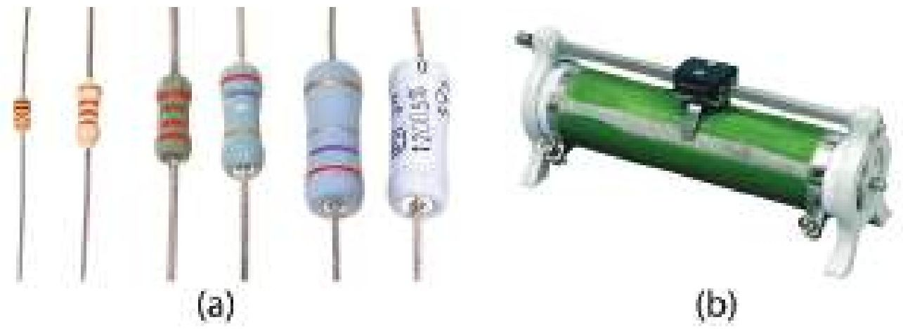

<!-- physics-9-10-bn-c11-t11.2-p033 · figure · p.307 -->
**চিত্র ১১.০৬: (a) স্থির এবং (b) পরিবর্তী রোধ**

<!-- physics-9-10-bn-c11-t11.2-p034 · text · p.308 -->
**পরিবর্তী রোধ:** মাঝে মাঝেই কোনো বৈদ্যুতিক বর্তনীতে একটি রোধের প্রয়োজন হয়, যেটির মান প্রয়োজনমতো পরিবর্তন করা যেতে পারে। যে ধরনের রোধের মান একটি নির্দিষ্ট সীমার ভেতরে পরিবর্তন করা যায় সেটিকে পরিবর্তী রোধ বা রিওস্টেট বলে। স্থির রোধের দুটি প্রান্ত থাকে, পরিবর্তী রোধে দুই প্রান্ত ছাড়াও মাঝখানে আরেকটি প্রান্ত থাকে, যেখানে পরিবর্তন করা রোধের মানটুকু পাওয়া যায়। ১১.০৬ চিত্রে স্থির এবং পরিবর্তী রোধের ছবি দেখানো হয়েছে।

### উদাহরণ

<!-- physics-9-10-bn-c11-t11.2-p035 · example · p.308 · review: verify-formula -->
**প্রশ্ন:** রুপা, তামা, টাংস্টেন ও নাইক্রোম তারের আপেক্ষিক রোধ $\rho$ যথাক্রমে $1.6 \times 10^{-8} \ \Omega  m$, $1.7 \times 10^{-8} \ \Omega  m$, $5.5 \times 10^{-8} \ \Omega  m$ ও $100 \times 10^{-8} \ \Omega  m$ এসব পদার্থের $1  m^2$ প্রস্থচ্ছেদ ক্ষেত্রফল বিশিষ্ট তার ব্যবহার করে $1 \ \Omega$ রোধ তৈরি করো।

<!-- physics-9-10-bn-c11-t11.2-p036 · example · p.308 -->
**উত্তর:** আমরা জানি, রোধ

<!-- physics-9-10-bn-c11-t11.2-p037 · formula · p.308 · review: verify-formula -->
$$R = \frac{\rho L}{A}$$

<!-- physics-9-10-bn-c11-t11.2-p038 · text · p.308 · review: verify-formula -->
যেখানে $L$ দৈর্ঘ্য এবং $A$ প্রস্থচ্ছেদ।

<!-- physics-9-10-bn-c11-t11.2-p039 · text · p.308 · review: verify-formula -->
এখানে $A = 1  m^2$

<!-- physics-9-10-bn-c11-t11.2-p040 · formula · p.308 · review: verify-formula -->
$$L = \frac{RA}{\rho} = \frac{1 \times 1 \ \Omega m^2}{\rho} = \frac{1 \ \Omega m^2}{\rho}$$

<!-- physics-9-10-bn-c11-t11.2-p041 · text · p.308 -->
**রুপার জন্য:**

<!-- physics-9-10-bn-c11-t11.2-p042 · formula · p.308 · review: verify-formula -->
$$L = \frac{1 m}{1.6 \times 10^{-8}} = 6.25 \times 10^7  m$$

<!-- physics-9-10-bn-c11-t11.2-p043 · text · p.308 -->
**তামার জন্য:**

<!-- physics-9-10-bn-c11-t11.2-p044 · formula · p.308 · review: verify-formula -->
$$L = \frac{1 m}{1.7 \times 10^{-8}} = 5.9 \times 10^7  m$$

<!-- physics-9-10-bn-c11-t11.2-p045 · text · p.308 -->
**টাংস্টেনের জন্য:**

<!-- physics-9-10-bn-c11-t11.2-p046 · formula · p.308 · review: verify-formula -->
$$L = \frac{1 m}{5.5 \times 10^{-8}} = 1.8 \times 10^7  m$$

<!-- physics-9-10-bn-c11-t11.2-p047 · text · p.308 -->
**নাইক্রোমের জন্য:**

<!-- physics-9-10-bn-c11-t11.2-p048 · formula · p.308 · review: verify-formula -->
$$L = \frac{1 m}{100 \times 10^{-8}} = 10^6  m$$

<!-- physics-9-10-bn-c11-t11.2-p049 · text · p.308 · review: verify-formula -->
দেখতেই পাচ্ছ $1 \ \Omega$ রোধ তৈরি করার জন্য অনেক দীর্ঘ (প্রায় লক্ষ কিলোমিটার) পদার্থ নিতে হয়। বাস্তবে কখনোই $A = 1  m^2$ হয় না দৈনন্দিন ব্যবহারের জন্য অনেক সরু তার ব্যবহার করা হয়। যদি $0.1  mm$ ব্যাসারের প্রস্থচ্ছেদ নির্দিষ্ট করে দিই তাহলে $1 \ \Omega$ রোধ তৈরি করতে কত দীর্ঘ তারের প্রয়োজন?

<!-- physics-9-10-bn-c11-t11.2-p050 · text · p.309 -->
আমরা জানি

<!-- physics-9-10-bn-c11-t11.2-p051 · formula · p.309 · review: verify-formula -->
$$L = \frac{RA}{\rho}$$

<!-- physics-9-10-bn-c11-t11.2-p052 · formula · p.309 · review: verify-formula -->
$$A = \pi r^2 = \pi(10^{-4})^2 m^2 = 3.14 \times 10^{-8} m^2$$

<!-- physics-9-10-bn-c11-t11.2-p053 · text · p.309 -->
রূপার জন্য:

<!-- physics-9-10-bn-c11-t11.2-p054 · formula · p.309 · review: verify-formula -->
$$L = \frac{3.14 \times 10^{-8} m}{1.6 \times 10^{-8}} = 1.96 m$$

<!-- physics-9-10-bn-c11-t11.2-p055 · text · p.309 -->
তামার জন্য:

<!-- physics-9-10-bn-c11-t11.2-p056 · formula · p.309 · review: verify-formula -->
$$L = \frac{3.14 \times 10^{-8} m}{1.7 \times 10^{-8}} = 1.84 m$$

<!-- physics-9-10-bn-c11-t11.2-p057 · text · p.309 -->
টাংস্টেনের জন্য:

<!-- physics-9-10-bn-c11-t11.2-p058 · formula · p.309 · review: verify-formula -->
$$L = \frac{3.14 \times 10^{-8} m}{5.5 \times 10^{-8}} = 0.57 m = 57  cm$$

<!-- physics-9-10-bn-c11-t11.2-p059 · text · p.309 -->
নাইক্রোমের জন্য:

<!-- physics-9-10-bn-c11-t11.2-p060 · formula · p.309 · review: verify-formula -->
$$L = \frac{3.14 \times 10^{-8} m}{100 \times 10^{-8}} = 0.03 m = 3  cm$$

<!-- physics-9-10-bn-c11-t11.2-p061 · text · p.309 -->
পরিবাহীতে তাপমাত্রা বাড়ালে রোধ বেড়ে যায়; কিন্তু অর্ধপরিবাহীর বা সেমিকন্ডাক্টরের বোঝায় ঠিক তার উল্টো ব্যাপারটা ঘটে। সেমিকন্ডাক্টরে তাপমাত্রা বাড়ালে রোধ কমে যায়। তার কারণ পরিবাহীতে যেমন বিদ্যুৎপ্রবাহের জন্য মুক্ত ইলেকট্রন রয়েছে, সেমিকন্ডাক্টরে তা নেই। সেখানে তাপমাত্রা বাড়ালেই শুধু কিছু ইলেকট্রন বিদ্যুৎপ্রবাহের জন্য পাওয়া যায়। তাই সেখানে তাপমাত্রা বাড়ালে রোধ কমে যায়।

<!-- physics-9-10-bn-c11-t11.2-p062 · text · p.309 -->
> ফিলামেন্ট যুক্ত লাইট বাল্বের ফিলামেন্ট ও’মের সূত্র মানছে কি না পরীক্ষা করা কঠিন কেন?

### ১১.২.৩ বর্তনী বা সার্কিট বিশ্লেষণ (Circuit Analysis)

<!-- physics-9-10-bn-c11-t11.2-p063 · text · p.309 -->
আমরা যদি ও’মের সূত্র বুঝে থাকি তাহলে আমরা এখন সার্কিট বিশ্লেষণ করতে পারি। সেটা করার আগে সার্কিটে ব্যবহার করা হয় এ রকম কয়েকটি প্রতীকের সাথে আগে পরিচিত হবো: (চিত্র ১১.০৭)

<!-- physics-9-10-bn-c11-t11.2-p064 · text · p.309 -->
সব পদার্থেরই কিছু না কিছু রোধ আছে কিন্তু আমাদের দৈনন্দিন জীবনে বর্তনীতে ব্যবহারের সময় বৈদ্যুতিক তারের রোধকে আমরা ধরবোর মাঝে নেই না। যখন রোধ প্রয়োজন হয়, তখন আমরা বিশেষভাবে তৈরি বিভিন্ন মানের রোধ ব্যবহার করি। কখনো কখনো বিশেষ প্রয়োজনে এমন রোধ ব্যবহার করা হয় যেখানে রোধের মানটি পরিবর্তনও করা যায়, এগুলোকে পরিবর্তনশীল রোধ বলে।

<!-- physics-9-10-bn-c11-t11.2-p065 · text · p.310 -->
কোনো সার্কিট বিশ্লেষণ করতে হলে নিচের কয়েকটা সোজা বিষয় মনে রাখাই যথেষ্ট:

<!-- physics-9-10-bn-c11-t11.2-p066 · figure · p.310 -->
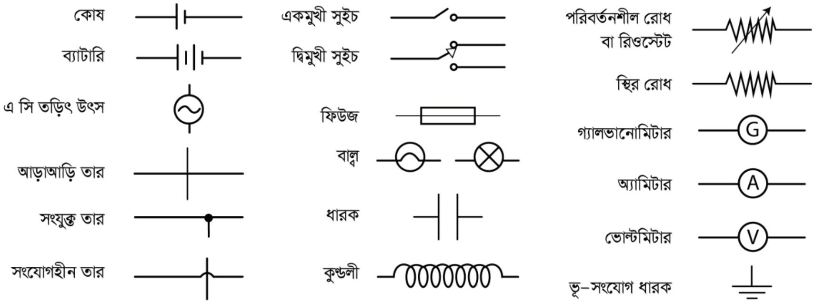

<!-- physics-9-10-bn-c11-t11.2-p067 · figure · p.310 -->
**চিত্র ১১.০৭: সার্কিট বা বর্তনীতে ব্যবহৃত হয় এ রকম কিছু প্রতীক।**

<!-- physics-9-10-bn-c11-t11.2-p068 · text · p.310 -->
(a) বিদ্যুতের উৎসের (ব্যাটারি, জেনারেটর যা-ই হোক) উচ্চ বিভব থেকে যে পরিমাণ বিদ্যুৎ বের হয়, পুরো বর্তনীর ভেতর দিয়ে প্রবাহিত হয়ে ঠিক সেই পরিমাণ বিদ্যুৎ কম বিভবে ফিরে আসে।

<!-- physics-9-10-bn-c11-t11.2-p069 · text · p.310 -->
(b) বর্তনীর যেকোনো জায়গায় যেকোনো বিন্দুতে যে পরিমাণ বিদ্যুৎ ঢোকে ঠিক সেই পরিমাণ বিদ্যুৎ বের হয়ে যায়, সার্কিটের ভেতরে বিদ্যুতের কোনো সৃষ্টি বা ধ্বংস নেই কারণ চার্জ বা আধানের ক্ষেত্রে ধ্বংস বা সৃষ্টি হয় না; শুধু স্থানান্তর হয়।

<!-- physics-9-10-bn-c11-t11.2-p070 · text · p.310 -->
(c) সার্কিটের ভেতরে যেকোনো অংশের দুই বিন্দুতে ও’হমের সূত্র সব সময় সত্যি হবে, অর্থাৎ সেই দুই অংশের যে পরিমাণ বিভব পার্থক্য রয়েছে তাকে সেই অংশের রোধ দিয়ে ভাগ দিলেই তার ভেতর দিয়ে প্রবাহিত বিদ্যুতের মান পাওয়া যাবে।

<!-- physics-9-10-bn-c11-t11.2-p071 · figure · p.310 -->
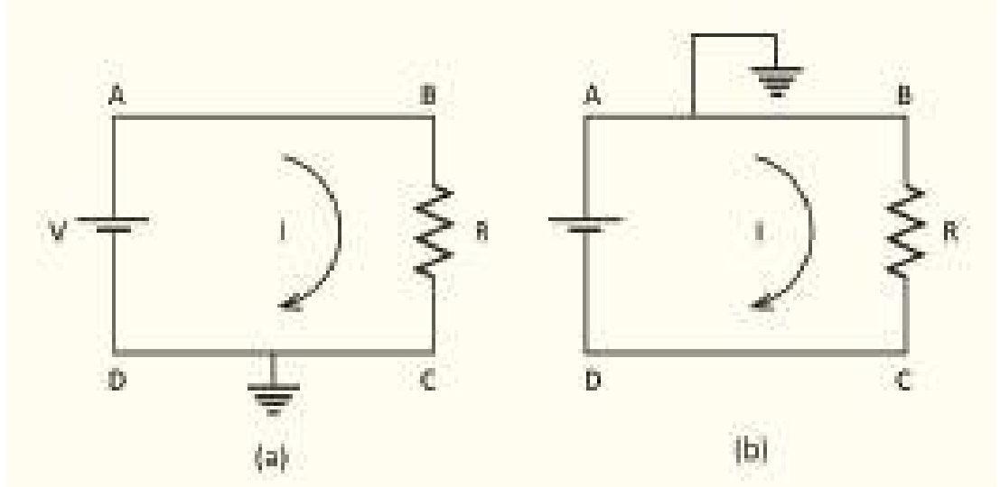

<!-- physics-9-10-bn-c11-t11.2-p072 · figure · p.310 -->
**চিত্র ১১.০৮: একটি ব্যাটারি এবং একটি রোধ বা রেজিস্টর সংযুক্ত দুটি বর্তনী বা সার্কিট।**

<!-- physics-9-10-bn-c11-t11.2-p073 · text · p.311 -->
আমরা এখন যেকোনো বর্তনী বা সার্কিট বিশ্লেষণ করতে প্রস্তুত। একটা সার্কিটের যেকোনো অংশ দিয়ে কতটুকু বিদ্যুৎ প্রবাহিত হচ্ছে এবং যেকোনো অংশের দুই প্রান্তের বিভব পার্থক্য কত সেটা জানলেই আমরা ধরে নেব সার্কিটটা আমরা পুরোপুরি বুঝে গেছি। একটা সার্কিটে ব্যাটারি, রোধ, ক্যাপাসিটর, ডায়োড, ট্রানজিস্টর অনেক কিছু থাকতে পারে। তবে আমরা আপাতত শুধু ব্যাটারি আর রোধ দিয়ে তৈরি সার্কিট বিশ্লেষণ করব। সার্কিটে বিভিন্ন রোধ তামার তার দিয়ে সংযুক্ত করা হয়, যদিও আমরা দেখেছি তামারও একটি আপেক্ষিক রোধ আছে। কিন্তু বাস্তব জীবনে সার্কিটে যে রোধ ব্যবহার করা হয়, তাদের তুলনায় এটি এত কম যে আমরা এটাকে ধর্তবের মাঝেই আনব না। ধরে নেব তামার তারের রোধ নেই। কাজেই একটা তারের সব জায়গায় বিভব সমান।

<!-- physics-9-10-bn-c11-t11.2-p074 · text · p.311 · review: latin-junk,verify-formula -->
এবারে ১১.০৮ a চিত্রে দেখানো একটা বর্তনী বিশ্লেষণ করা যাক, এখানে একটা রোধকে দুটো তার দিয়ে একটা ব্যাটারি সেলের দুই মাথায় লাগানো হয়েছে। যেহেতু CD অংশটুকু ভূমিসংলগ্ন করা হয়েছে তাই আমরা বলতে পারব ব্যটারির নিচের প্রান্তটির বিভব হচ্ছে শূন্য। তাই ব্যটারির উপরের প্রান্তের বিভব $V$ এবং BC অংশে একটা রোধ, রোধের দুই পাশে বিভব পার্থক্য হচ্ছে

<!-- physics-9-10-bn-c11-t11.2-p075 · formula · p.311 · review: verify-formula -->
$$V - 0 = V$$

<!-- physics-9-10-bn-c11-t11.2-p076 · text · p.311 · review: verify-formula -->
কাজেই রোধ যদি $R$ হয় তাহলে এর ভেতর দিয়ে যে বিদ্যুৎ $I$ প্রবাহিত হচ্ছে তার মান

<!-- physics-9-10-bn-c11-t11.2-p077 · formula · p.311 · review: verify-formula -->
$$I = \frac{V}{R}$$

<!-- physics-9-10-bn-c11-t11.2-p078 · text · p.311 · review: verify-formula -->
কাজেই ব্যটারির A থেকে $I$ বিদ্যুৎ বের হয়ে B বিন্দুতে ঢুকে যাচ্ছে। আমরা এই সার্কিটের প্রত্যেকটা বিন্দুতে বিভব আর বিদ্যুৎ বের করে ফেলেছি।

<!-- physics-9-10-bn-c11-t11.2-p079 · text · p.311 · review: latin-junk,verify-formula -->
ধরা যাক হুবহু একই সার্কিটে আমরা যদি DC অংশ ভূমিসংলগ্ন না করে AB অংশ ভূমিসংলগ্ন করি (চিত্র ১১.০৮ b) তাহলে কী হবে? ব্যটারিটা যেহেতু $V$ ভোল্টের তাই A এবং D এর পার্থক্য $V$ থাকতেই হবে, যেহেতু A এর বিভব শূন্য তাই D এর বিভব নিশ্চয়ই $-V$। কাজেই B এবং C এর বিভব পার্থক্য

<!-- physics-9-10-bn-c11-t11.2-p080 · formula · p.311 · review: verify-formula -->
$$0 - (-V) = V$$

<!-- physics-9-10-bn-c11-t11.2-p081 · text · p.311 · review: verify-formula -->
ভেতরকার রোধ $R$, কাজেই বিদ্যুৎ প্রবাহ:

<!-- physics-9-10-bn-c11-t11.2-p082 · formula · p.311 · review: verify-formula -->
$$I = \frac{V}{R}$$

<!-- physics-9-10-bn-c11-t11.2-p083 · text · p.311 -->
অর্থাৎ ঠিক আগের মান, যেটাই হওয়ার কথা। লক্ষ্য করো বিভবের মান পরিবর্তন হয়েছে কিন্তু পার্থক্য পরিবর্তন হয়নি।

### উদাহরণ

<!-- physics-9-10-bn-c11-t11.2-p084 · example · p.312 -->
**প্রশ্ন: ১১.০৯ a** সার্কিটে A, B, C ও D বিন্দুতে ভোল্টেজ কত?

<!-- physics-9-10-bn-c11-t11.2-p085 · example · p.312 -->
**উত্তর:** C ও D বিন্দুতে ভোল্টেজ 0, A বিন্দুতে ভোল্টেজ 3 V

<!-- physics-9-10-bn-c11-t11.2-p086 · text · p.312 -->
B বিন্দুতে ভোল্টেজ বের করার জন্য বর্তনী বা সার্কিটের কারেন্ট I বের করতে হবে।

<!-- physics-9-10-bn-c11-t11.2-p087 · formula · p.312 · review: verify-formula -->
$$I = \frac{V}{R} = \frac{3}{1 + 2} A = 1.0  A$$

<!-- physics-9-10-bn-c11-t11.2-p088 · text · p.312 -->
কাজেই A থেকে B বিন্দুতে যেটুকু ভোল্টেজ কম তার পরিমাণ

<!-- physics-9-10-bn-c11-t11.2-p089 · formula · p.312 · review: verify-formula -->
$$V = RI = 1 \Omega \times 1  A = 1  V$$

<!-- physics-9-10-bn-c11-t11.2-p090 · text · p.312 · review: verify-formula -->
কাজেই B বিন্দুর ভোল্টেজ $3V - 1V = 2V$

<!-- physics-9-10-bn-c11-t11.2-p091 · text · p.312 -->
যেহেতু প্রত্যেকটা বিন্দুর ভোল্টেজ (পটেনশিয়াল বা বিভব) বের হয়ে গেছে, যাচাই করে দেখো সব ক্ষেত্রে ও’মের সূত্র কাজ করেছে কি না।

<!-- physics-9-10-bn-c11-t11.2-p092 · figure · p.312 -->

<!-- physics-9-10-bn-c11-t11.2-p093 · figure · p.312 -->
**চিত্র ১১.০৯:** ব্যাটারি এবং একাধিক রেজিস্টর বা রোধ দিয়ে তৈরি দুটি সার্কিট।

<!-- physics-9-10-bn-c11-t11.2-p094 · text · p.312 -->
**প্রশ্ন: ১১.০৯ b** চিত্রটির সার্কিটে A, B, C, D এবং E বিন্দুতে ভোল্টেজ কত?

<!-- physics-9-10-bn-c11-t11.2-p095 · text · p.312 -->
**উত্তর:** D বিন্দুতে ভোল্টেজ 0 এবং A বিন্দুতে ভোল্টেজ 6 V। আবার E বিন্দুতে ভোল্টেজ কত হতে পারে তা কেমন করে বের করা যেতে পারে সেটা নিয়ে অনেককেই নানা রকম দৃষ্টিভঙ্গি করতে দেখা যায়।

<!-- physics-9-10-bn-c11-t11.2-p096 · text · p.313 -->
আসলে ব্যাপারটা খুবই সহজ। রেজিস্টরের বা রোধের ভেতর দিয়ে কারেন্ট প্রবাহিত হলেই ভোল্টেজের পরিবর্তন হয়। সার্কিটের এই অংশে কোনো কারেন্ট প্রবাহের সুযোগ নেই। B দিয়ে রওনা দিয়ে E বিন্দুতে পৌঁছে অন্য কোথাও যেতে পারবে না। কাজেই B এবং E বিন্দুতে (কিংবা এর ভেতরে যেকোনো বিন্দুতে) ভোল্টেজের কোনো পরিবর্তন নেই, B বিন্দুতে যে ভোল্টেজ E বিন্দুতে একই ভোল্টেজ।

<!-- physics-9-10-bn-c11-t11.2-p097 · text · p.313 · review: verify-formula -->
B এবং C বিন্দুর ভোল্টেজ বের করার জন্য কারেন্ট বের করতে হবে। কারেন্ট $I$ হলে

<!-- physics-9-10-bn-c11-t11.2-p098 · formula · p.313 · review: verify-formula -->
$$I = \frac{V}{R} = \frac{6 V}{5\ \Omega + 10\ \Omega + 15\ \Omega} = \frac{1}{5} A$$

<!-- physics-9-10-bn-c11-t11.2-p099 · text · p.313 -->
কাজেই A থেকে B তে ভোল্টেজের পার্থক্য :

<!-- physics-9-10-bn-c11-t11.2-p100 · formula · p.313 · review: verify-formula -->
$$V_1 = R_1 I = 5\ \Omega \times \frac{1}{5} A = 1 V$$

<!-- physics-9-10-bn-c11-t11.2-p101 · text · p.313 -->
কাজেই A বিন্দুতে ভোল্টেজ 6 V হলে B বিন্দুতে ভোল্টেজ 1 V কম অর্থাৎ

<!-- physics-9-10-bn-c11-t11.2-p102 · formula · p.313 · review: verify-formula -->
$$6 V - V_1 = 6 V - 1 V = 5 V$$

<!-- physics-9-10-bn-c11-t11.2-p103 · text · p.313 -->
B বিন্দুতে যেহেতু ভোল্টেজ 5 V, তাই E বিন্দুতেও ভোল্টেজ 5 V। ঠিক একইভাবে

<!-- physics-9-10-bn-c11-t11.2-p104 · formula · p.313 · review: verify-formula -->
$$V_2 = R_2 I = 10\ \Omega \times \frac{1}{5} A = 2 V$$

<!-- physics-9-10-bn-c11-t11.2-p105 · text · p.313 · review: verify-formula -->
কাজেই C বিন্দুর ভোল্টেজ B বিন্দুর ভোল্টেজ থেকে 2 V কম। অর্থাৎ C বিন্দুর ভোল্টেজ $5 V - 2 V = 3 V$।

<!-- physics-9-10-bn-c11-t11.2-p106 · text · p.313 · review: verify-formula -->
D বিন্দুর ভোল্টেজ 0 সেটা আমরা প্রথমেই বলে দিয়েছি, আসলেই সেটা সত্যি কি না, পরীক্ষা করে দেখতে পারি। D বিন্দুর ভোল্টেজ C বিন্দুর ভোল্টেজ থেকে $V_3$ কম। $V_3$ হচ্ছে

<!-- physics-9-10-bn-c11-t11.2-p107 · formula · p.313 · review: verify-formula -->
$$V_3 = R_3 I = 15\ \Omega \times \frac{1}{5} A = 3 V$$

<!-- physics-9-10-bn-c11-t11.2-p108 · text · p.313 -->
কাজেই D বিন্দুর ভোল্টেজ

<!-- physics-9-10-bn-c11-t11.2-p109 · formula · p.313 · review: latin-junk,verify-formula -->
$$3 V - 3 V = 0, \quad ঠিক যে রকম ভেবেছিলাম।$$

<!-- physics-9-10-bn-c11-t11.2-p110 · figure · p.313 -->
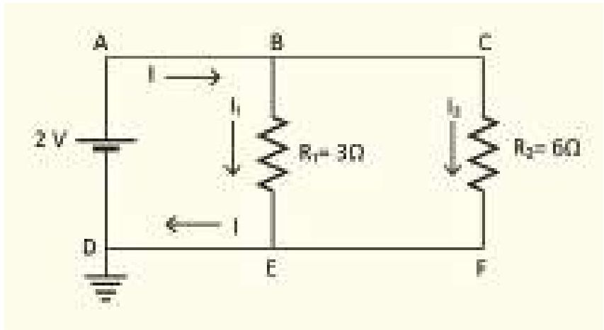

<!-- physics-9-10-bn-c11-t11.2-p111 · text · p.313 · review: verify-formula -->
**প্রশ্ন: ১১.১০** চিত্রটিতে দেখানো সার্কিটে $I_1$ এবং $I_2$ এর মান কত?

<!-- physics-9-10-bn-c11-t11.2-p112 · text · p.313 · review: latin-junk -->
**উত্তর:** 2 V তড়িৎ চালক শক্তির ব্যাটারির জন্য A বিন্দুতে ভোল্টেজ বা বিভব হলো 2 V। তাই A, B এবং C বিন্দুতে ভোল্টেজ 2 V। D, E এবং F বিন্দুতে ভোল্টেজ 0 ভোল্ট। কাজেই BE রেজিস্টরের ভেতর দিয়ে প্রবাহিত তড়িৎ

<!-- physics-9-10-bn-c11-t11.2-p113 · figure · p.313 -->
**চিত্র ১১.১০: সমান্তরালভাবে রাখা দুটি রোধ বা রেজিস্টরের একটি সার্কিট।**

<!-- physics-9-10-bn-c11-t11.2-p114 · formula · p.314 · review: verify-formula -->
$$I_1 = \frac{V}{R_1} = \frac{2}{3}  A$$

<!-- physics-9-10-bn-c11-t11.2-p115 · text · p.314 · review: latin-junk -->
CF রেজিস্টরের ভেতর দিয়ে প্রবাহিত তড়িৎ

<!-- physics-9-10-bn-c11-t11.2-p116 · formula · p.314 · review: verify-formula -->
$$I_2 = \frac{V}{R_2} = \frac{2}{6}  A = \frac{1}{3}  A$$

<!-- physics-9-10-bn-c11-t11.2-p117 · text · p.314 -->
মোট কারেন্ট

<!-- physics-9-10-bn-c11-t11.2-p118 · formula · p.314 · review: verify-formula -->
$$I = I_1 + I_2 = \frac{2}{3}  A + \frac{1}{3}  A = 1  A$$

### ১১.২.৪ তুল্য রোধ: শ্রেণি সংযোগ (Equivalent Resistance: Series Connection)

<!-- physics-9-10-bn-c11-t11.2-p119 · text · p.314 · review: verify-formula -->
এবারে কোনো বর্তনীতে একাধিক রোধ থাকলে সেগুলোকে কীভাবে একটি তুল্য রোধ হিসেবে বিবেচনা করা যায় আমরা সেই বিষয়টি দেখে নেই। ১১.১১ চিহ্নের সার্কিটে দুটো রোধ লাগানো আছে, যেহেতু C ভূমিসংলগ্ন তাই এর বিভব বা ভোল্টেজ শূন্য এবং A এর বিভব V। আমরা B এর বিভব কত জানি না, কিন্তু এটুকু জানি যে $R_1$ এবং $R_2$ দুটোর ভেতর দিয়েই সমান পরিমাণ বিদ্যুৎ I প্রবাহিত হচ্ছে। আমরা এমনিতেই বলে দিতে পারি যে দুটো রোধের যোগফলটি হবে মোট রোধ R এবং বিদ্যুৎ প্রবাহ হবে $I = V/R$ কিন্তু সেভাবে না লিখে আমরা বরং এটা প্রমাণ করে ফেলি।

<!-- physics-9-10-bn-c11-t11.2-p120 · figure · p.314 -->
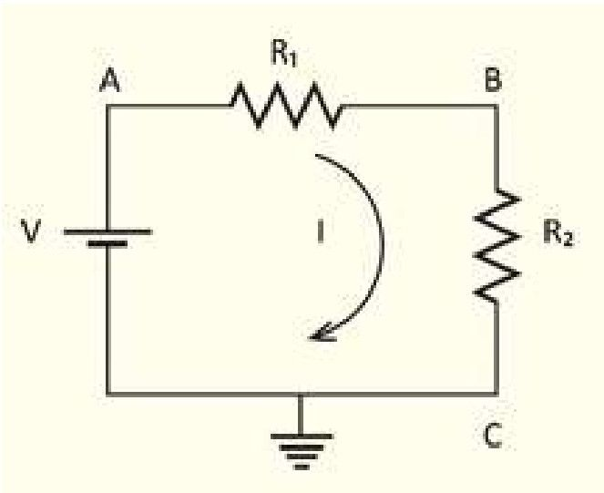

<!-- physics-9-10-bn-c11-t11.2-p121 · figure · p.314 -->
**চিত্র ১১.১১: একটি বর্তনী বা সার্কিটে দুটি রোধ পরপর লাগানো।**

<!-- physics-9-10-bn-c11-t11.2-p122 · text · p.314 · review: verify-formula -->
যদি ধরে নিই B এর বিভব $V_B$ তাহলে প্রথম রোধ $R_1$ এর জন্য লিখতে পারি :

<!-- physics-9-10-bn-c11-t11.2-p123 · formula · p.314 · review: verify-formula -->
$$I = \frac{V - V_B}{R_1}$$

<!-- physics-9-10-bn-c11-t11.2-p124 · text · p.314 · review: verify-formula -->
আবার দ্বিতীয় রোধ $R_2$ এর জন্য লিখতে পারি

<!-- physics-9-10-bn-c11-t11.2-p125 · formula · p.314 · review: verify-formula -->
$$I = \frac{V_B - 0}{R_2} = \frac{V_B}{R_2}$$

<!-- physics-9-10-bn-c11-t11.2-p126 · text · p.314 -->
কাজেই

<!-- physics-9-10-bn-c11-t11.2-p127 · formula · p.314 · review: verify-formula -->
$$I = \frac{V - V_B}{R_1} = \frac{V_B}{R_2}$$

<!-- physics-9-10-bn-c11-t11.2-p128 · formula · p.315 · review: verify-formula -->
$$(V - V_B)R_2 = V_B R_1$$

<!-- physics-9-10-bn-c11-t11.2-p129 · formula · p.315 · review: verify-formula -->
$$V_B(R_1 + R_2) = VR_2$$

<!-- physics-9-10-bn-c11-t11.2-p130 · formula · p.315 · review: verify-formula -->
$$V_B = \frac{R_2}{R_1 + R_2} V$$

### কাজেই

<!-- physics-9-10-bn-c11-t11.2-p131 · formula · p.315 · review: verify-formula -->
$$I = \frac{V_B}{R_2} = \frac{V}{R_1 + R_2}$$

<!-- physics-9-10-bn-c11-t11.2-p132 · text · p.315 · review: verify-formula -->
আমরা $R_1$ এবং $R_2$ এই দুটি রোধকে একটি রোধ $R = R_1 + R_2$ হিসেবে কল্পনা করতে পারি:

<!-- physics-9-10-bn-c11-t11.2-p133 · formula · p.315 · review: verify-formula -->
$$I = \frac{V}{R}$$

<!-- physics-9-10-bn-c11-t11.2-p134 · figure · p.315 -->
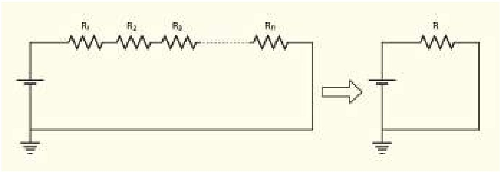

<!-- physics-9-10-bn-c11-t11.2-p135 · figure · p.315 -->
**চিত্র ১১.১২: অনেকগুলো পর্যায়ক্রম রোধ বা রেজিস্টরকে একটি তুল্য রোধ বা রেজিস্টর হিসেবে কল্পনা করা যায়।**

<!-- physics-9-10-bn-c11-t11.2-p136 · text · p.315 · review: verify-formula -->
যদি এখানে দুটি না হয়ে তিন-চারটি বা আরো বেশি রোধ থাকত (চিত্র ১১.১২) তাহলেও আমরা দেখাতে পারতাম যে সেগুলোকে সম্মিলিতভাবে একটি রোধ $R$ কল্পনা করতে পারি। এটাকে তুল্য রোধ বলে। অর্থাৎ যখন কোনো সার্কিটে $R_1, R_2, R_3..$ এ রকম অনেকগুলো রোধ পরপর থাকে (শ্রেণি বর্তনী) তখন তাদের তুল্য রোধ

<!-- physics-9-10-bn-c11-t11.2-p137 · formula · p.315 · review: verify-formula -->
$$R = R_1 + R_2 + R_3 + ... + R_n$$

### ১১.২.৫ তুল্য রোধ: সমান্তরাল বর্তনী সংযোগ (Equivalent Resistance: Parallel Connection)

<!-- physics-9-10-bn-c11-t11.2-p138 · text · p.315 -->
এবারে আমরা রোধগুলো পরপর না রেখে সমান্তরালভাবে রাখব (চিত্র ১১.১৩)। এই সার্কিটে আমরা বিভিন্ন বিন্দুকে A, B, C, D, E এবং F নাম দিয়েছি। চিত্রটি দেখেই বোঝা যাচ্ছে D, E এবং F বিন্দু ভূমিসংলগ্ন হওয়ায় এই বিন্দুগুলোর বিভব শূন্য। কাজেই A, B এবং C বিন্দুতে বিভব V.

<!-- physics-9-10-bn-c11-t11.2-p139 · text · p.316 · review: verify-formula -->
ব্যাটারি থেকে $I$ কারেন্ট বের হয়েছে। এই বিদ্যুৎ $B$ বিন্দুতে দুই ভাগে ভাগ হয়ে $R_1$ এবং $R_2$ রোধের ভেতর দিয়ে যথাক্রমে $I_1$ এবং $I_2$ হিসেবে প্রবাহিত হয়ে $E$ বিন্দুতে একত্র হয়ে $I$ হিসেবে ব্যাটারিতে ফিরে যাচ্ছে। আমরা আগেই বলেছি সার্কিটে ব্যাটারি থেকে বিদ্যুৎ বের হয়, সার্কিটে ঘুরে আবার ব্যাটারিতে ফিরে যায়। পুরো হতে সার্কিটে এর বাইরে কোনো বিদ্যুতের জন্য পারে না, আবার ক্ষয়ও হতে পারে না। তাই

<!-- physics-9-10-bn-c11-t11.2-p140 · figure · p.316 -->
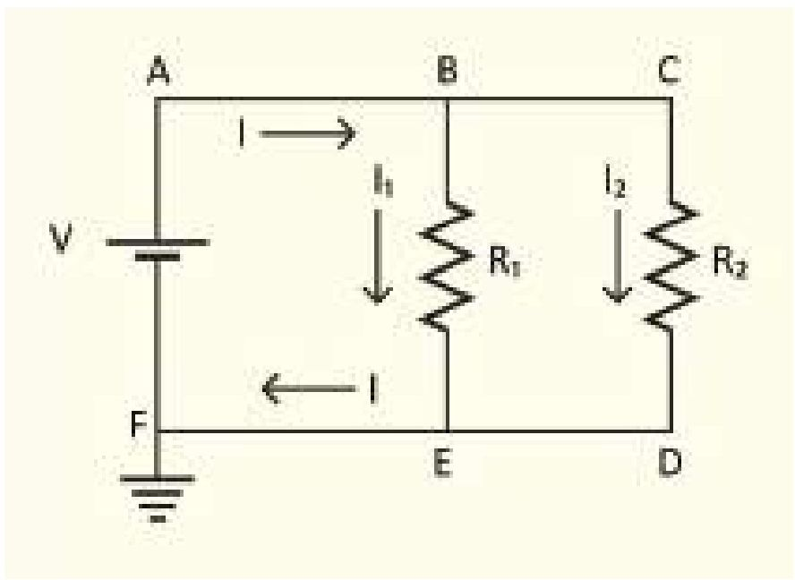

<!-- physics-9-10-bn-c11-t11.2-p141 · figure · p.316 -->
**চিত্র ১১.১৩: একটি সার্কিটে দুটি রোধ সমান্তরালভাবে রাখা।**

<!-- physics-9-10-bn-c11-t11.2-p142 · formula · p.316 · review: verify-formula -->
$$I = I_1 + I_2$$

<!-- physics-9-10-bn-c11-t11.2-p143 · text · p.316 · review: verify-formula -->
এবারে আমরা $I_1$ এবং $I_2$ কত হবে বের করতে পারি

<!-- physics-9-10-bn-c11-t11.2-p144 · formula · p.316 · review: verify-formula -->
$$I_1 = \frac{V_B - V_E}{R_1} = \frac{V - 0}{R_1} = \frac{V}{R_1}$$

<!-- physics-9-10-bn-c11-t11.2-p145 · formula · p.316 · review: verify-formula -->
$$I_2 = \frac{V_C - V_D}{R_2} = \frac{V - 0}{R_2} = \frac{V}{R_2}$$

<!-- physics-9-10-bn-c11-t11.2-p146 · text · p.316 -->
কাজেই

<!-- physics-9-10-bn-c11-t11.2-p147 · formula · p.316 · review: verify-formula -->
$$I = I_1 + I_2 = \frac{V}{R_1} + \frac{V}{R_2} = V \left( \frac{1}{R_1} + \frac{1}{R_2} \right)$$

<!-- physics-9-10-bn-c11-t11.2-p148 · text · p.316 · review: verify-formula -->
অর্থাৎ এবারেও আমরা একটা তুল্য রোধ $R$ সংজ্ঞায়িত করতে পারি যেখানে

<!-- physics-9-10-bn-c11-t11.2-p149 · formula · p.316 · review: latin-junk,verify-formula -->
$$I = \frac{V}{R}  এবং  \frac{1}{R} = \frac{1}{R_1} + \frac{1}{R_2}$$

<!-- physics-9-10-bn-c11-t11.2-p150 · figure · p.316 -->
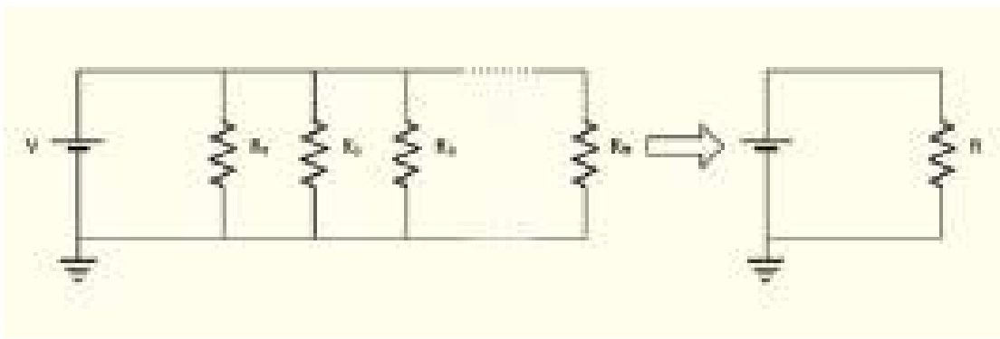

<!-- physics-9-10-bn-c11-t11.2-p151 · figure · p.316 -->
**চিত্র ১১.১৪: অনেকগুলো সমান্তরাল রোধ বা রেজিস্টরকে একটি তুল্য রোধ বা রেজিস্টর হিসেবে কল্পনা করা যায়।**

<!-- physics-9-10-bn-c11-t11.2-p152 · text · p.317 · review: verify-formula -->
এখানে যদি দুটো না হয়ে আরো বেশি রোধ থাকে (চিত্র ১১.১৪) তাহলেও আমরা দেখতে পারি: তুল্য রোধ $R$ হচ্ছে

<!-- physics-9-10-bn-c11-t11.2-p153 · formula · p.317 · review: verify-formula -->
$$\frac{1}{R} = \frac{1}{R_1} + \frac{1}{R_2} \quad \frac{1}{R_3} + \dots + \frac{1}{R_n}$$

## 11.3 তড়িৎ ক্ষমতা (Electric Power)

<!-- physics-9-10-bn-c11-t11.3-p001 · text · p.317 · review: verify-formula -->
আমরা যখন বিভব বা পটেনশিয়াল আলোচনা করছিলাম তখন দেখেছি পটেনশিয়াল প্রয়োগ করে চার্জকে সরানো হলে কাজ করা হয় বা শক্তি ক্ষয় হয়। তাই যদি একটা সার্কিটে $V$ বিভব প্রয়োগ করে $Q$ চার্জকে সরানো হয় তাহলে কাজের পরিমাণ বা শক্তি প্রয়োগের পরিমাণ

<!-- physics-9-10-bn-c11-t11.3-p002 · formula · p.317 · review: verify-formula -->
$$W = VQ$$

<!-- physics-9-10-bn-c11-t11.3-p003 · text · p.317 · review: verify-formula -->
ক্ষমতা $P$ হচ্ছে প্রতি সেকেন্ডে কাজ করার ক্ষমতা, কাজেই যদি $t$ সময়ে $Q$ চার্জ সরানো হয়ে থাকে তাহলে

<!-- physics-9-10-bn-c11-t11.3-p004 · formula · p.317 · review: verify-formula -->
$$P = \frac{W}{t} = \frac{VQ}{t} = VI$$

<!-- physics-9-10-bn-c11-t11.3-p005 · text · p.317 · review: verify-formula -->
যদি একটা রোধ $R$ এর ওপর এটা ব্যবহার করি তাহলে ও'মের সূত্র ব্যবহার করে লিখতে পারি

<!-- physics-9-10-bn-c11-t11.3-p006 · text · p.317 · review: verify-formula -->
যেহেতু
$$V = RI$$
$$P = I^2R$$

<!-- physics-9-10-bn-c11-t11.3-p007 · text · p.317 -->
কিংবা

<!-- physics-9-10-bn-c11-t11.3-p008 · formula · p.317 · review: verify-formula -->
$$I = \frac{V}{R}$$

<!-- physics-9-10-bn-c11-t11.3-p009 · text · p.317 -->
কাজেই

<!-- physics-9-10-bn-c11-t11.3-p010 · formula · p.317 · review: verify-formula -->
$$P = \left(\frac{V}{R}\right)^2 R = \frac{V^2}{R}$$

<!-- physics-9-10-bn-c11-t11.3-p011 · text · p.317 · review: verify-formula -->
একটি রোধের ভেতর যদি $t$ সময় বিদ্যুৎ প্রবাহিত করা হয় তাহলে তার ভেতর $Pt$ শক্তি দেওয়া হয়। এই শক্তিটি কোথায় যায়? তোমরা যখন সার্কিটে একটি রোধ ব্যবহার করবে তখন দেখবে তার ভেতর দিয়ে যথেষ্ট বিদ্যুৎপ্রবাহ করলে সব সময়ই সেটা উত্তপ্ত হয়ে ওঠে অর্থাৎ শক্তিটুকু তাপশক্তি হিসেবে বের হয়ে আসে।

<!-- physics-9-10-bn-c11-t11.3-p012 · text · p.317 · review: verify-formula -->
ফিলামেন্টযুক্ত বাল্বগুলোর প্রচলন ধীরে ধীরে কমে আসছে, কারণ এটা দিয়ে আলো তৈরি করার জন্য ফিলামেন্টকে উত্তপ্ত করতে হয়, বিদ্যুৎশক্তির বড় অংশ তাপ হিসেবে খরচ হয়ে যায় বলে এখানে শক্তির অপচয় হয়। এই ধরনের বাল্বগুলো হাত দিয়ে স্পর্শ করলেই দেখা যায় এখানে উচ্চ তাপমাত্রা তৈরি হয় এবং এই তাপশক্তি তৈরি হয় প্রতি সেকেন্ডে $I^2R$ কিংবা $\frac{V^2}{R}$ হিসেবে।

<!-- physics-9-10-bn-c11-t11.3-p013 · text · p.318 · review: verify-formula -->
বৈদ্যুতিক শক্তি শুধু যে একটি রোধে তাপশক্তি হিসেবে খরচ হয় তা নয়, সেটি ফ্যান, ফ্রিজ, টেলিভিশন, কম্পিউটার, চার্জার ইত্যাদি নানা ধরনের যন্ত্রপাতিতে নানা ধরনের কাজ করার সময়, শক্তি সরবরাহ করে থাকে। কোনো একটি বৈদ্যুতিক যন্ত্রে প্রতি সেকেন্ডে কী পরিমাণ বৈদ্যুতিক শক্তি খরচ হচ্ছে সেটি খুব সহজেই $VI$ থেকে বের করতে পারব। প্রত্যেক বাসায় বিদ্যুৎ মিটার থাকে, সেটি কত বিভবে ($V$) কত বিদ্যুৎপ্রবাহ ($I$) করেছে সেটি মাপতে থাকে, সেখান থেকে একটি বাসায় প্রতি সেকেন্ডে কী পরিমাণ বৈদ্যুতিক শক্তি ($P = VI$) সরবরাহ করেছে সেটি জানতে পারে। এর সাথে মোট সময় গুণ করে ব্যবহৃত মোট বৈদ্যুতিক শক্তি বের করা হয়। বৈদ্যুতিক শক্তি ব্যয়ের প্রচলিত একক হচ্ছে কিলোওয়াট-ঘণ্টা (kWh)। এই একককে বোর্ড অব ট্রেড (BOT) ইউনিট বা সংক্ষিপে ইউনিট বলে। আমরা যে বিদ্যুৎ বিল পরিশোধ করি তা এই এককেই হিসাব করা হয়।

### উদাহরণ

<!-- physics-9-10-bn-c11-t11.3-p014 · example · p.318 -->
**প্রশ্ন:** 220 V ভোল্টেজে ব্যবহৃত একটি 100 W বাল্ব ফিলামেন্টের রোধ কত?

<!-- physics-9-10-bn-c11-t11.3-p015 · example · p.318 -->
**উত্তর:** 220 V এর বাল্ব 100 W লেখা, যেহেতু

<!-- physics-9-10-bn-c11-t11.3-p016 · formula · p.318 · review: verify-formula -->
$$P = \frac{V^2}{R}$$

<!-- physics-9-10-bn-c11-t11.3-p017 · text · p.318 -->
কাজেই

<!-- physics-9-10-bn-c11-t11.3-p018 · formula · p.318 · review: verify-formula -->
$$R = \frac{V^2}{P} = \frac{(220)^2}{100} \frac{V^2}{W} = 484 \ \Omega$$

<!-- physics-9-10-bn-c11-t11.3-p019 · text · p.318 -->
এখানে কী পরিমাণ কারেন্ট প্রবাহিত হচ্ছে?

<!-- physics-9-10-bn-c11-t11.3-p020 · formula · p.318 · review: verify-formula -->
$$I = \frac{V}{R} = \frac{220 \ V}{484 \ \Omega} = 0.45  A$$

<!-- physics-9-10-bn-c11-t11.3-p021 · text · p.318 · review: verify-formula -->
অন্যভাবেও এটি বের করা সম্ভব: $P = VI$

<!-- physics-9-10-bn-c11-t11.3-p022 · formula · p.318 · review: verify-formula -->
$$I = \frac{P}{V} = \frac{100  W}{220  V} = 0.45  A$$

<!-- physics-9-10-bn-c11-t11.3-p023 · text · p.318 -->
**প্রশ্ন:** 60 ওয়াটার একটি বাল্ব প্রতিদিন 5 ঘণ্টা করে 30 দিন জ্বালালে কত তড়িৎ শক্তি ব্যয় হবে? যদি প্রতি ইউনিটের মূল্য 10 টাকা হয় তা হলে এই পরিমাণ বিদ্যুতের জন্য মোট ব্যয় কত?

<!-- physics-9-10-bn-c11-t11.3-p024 · text · p.319 · review: latin-junk -->
উত্তর: আমরা জানি, ব্যয়িত শক্তি = ( (P × t) /1000 ) কিলোওয়াট ঘণ্টা বা ইউনিট
P = 60 W এবং t = 5 × 30 hour
ব্যয়িত শক্তি = ( 60 × (5 × 30)/1000 ) ইউনিট = 9 ইউনিট

<!-- physics-9-10-bn-c11-t11.3-p025 · text · p.319 -->
প্রতি ইউনিটের মূল্য 10 টাকা হিসাবে মোট তড়িৎ ব্যয় = 9 × 10 টাকা = 90 টাকা

## 11.4 বিদ্যুৎ সরবরাহ (Electrical Supply)

<!-- physics-9-10-bn-c11-t11.4-p001 · text · p.319 · review: verify-formula -->
যখন দেশের এক জায়গা থেকে অন্য জায়গায় বিদ্যুৎ সরবরাহ করতে হয়, তখন সেটি অনেক উচ্চ ভোল্টেজে নিয়ে যাওয়া হয়। বৈদ্যুতিক তারে বিদ্যুতের অপচয় কমানোর জন্য এটি করা হয়। তোমরা জানো তাপ হিসেবে প্রতি সেকেন্ডে যে পরিমাণ শক্তি ক্ষয় হয় সেটি হচ্ছে $I^2R$ কাজেই যদি বৈদ্যুতিক তারে কোনো রোধ R না থাকত তাহলে তাপ হিসেবে কোনো শক্তির অপচয় হতো না। কিন্তু সেটি বাস্তবসম্মত নয়, সব কিছুরই কিছু না কিছু রোধ থাকে। তাই কারেন্ট বা বিদ্যুৎপ্রবাহ $I$ কমাতে পারলে তাপ হিসেবে শক্তি ক্ষয় $I^2R$ এর মান কমানো সম্ভব। প্রতি সেকেন্ডে বৈদ্যুতিক শক্তি যেহেতু $VI$ হিসেবে যায় তাই যদি পটেনশিয়াল দশ গুণ বাড়িয়ে দেওয়া হয়, তাহলে দশ গুণ কম কারেন্টে সমান শক্তি প্রেরণ করা সম্ভব। দশ গুণ কম কারেন্ট প্রবাহিত হলে 100 গুণ কম তাপশক্তির অপচয় হবে। কারণ তারের রোধ R এর মান দুইবারই সমান।

<!-- physics-9-10-bn-c11-t11.4-p002 · text · p.319 · review: verify-formula -->
এখানে তোমাদের মনে হতে পারে তাপশক্তির অপচয় $\frac{V^2}{R}$ হিসেবেও লেখা যায় তাই দশ গুণ বেশি ভোল্টেজ নেওয়া হলে 100 গুণ বেশি তাপশক্তির অপচয় কেন হবে না? মনে রাখতে হবে আমরা যখন প্রতি সেকেন্ডে তাপশক্তির অপচয় হিসেবে $\frac{V^2}{R}$ বের করেছিলাম তখন $V$ ছিল রোধের দুই পাশের বিভব পার্থক্য। এখানে আমরা যখন $V$ বলছি সেটি বৈদ্যুতিক তারের দুই পাশের বিভব পার্থক্য নয়। এটি বৈদ্যুতিক তারের বিভবের মান। বৈদ্যুতিক তারের দুই পাশে বিভব প্রায় একই সমান। সেই পার্থক্য ধর্তব্যের মধ্যে নয়।

### ১১.৮.১ তড়িৎয়ের সিস্টেম লস (Electric System Loss)

<!-- physics-9-10-bn-c11-t11.4-p003 · text · p.319 -->
আমরা জানি দেশের বিভিন্ন স্থানে অবস্থিত পাওয়ার প্ল্যান্টগুলোতে বিদ্যুৎশক্তি উৎপাদন করে। এই বিদ্যুৎকে প্রয়োজন অনুসারে বিভিন্ন এলাকায় পাঠাতে হয়। বিদ্যুৎ বিতরণ করার জন্য প্রথমে বিভিন্ন এলাকার সাবস্টেশনে পাঠানো হয়। সাবস্টেশন থেকে বিদ্যুৎ বিতরণব্যবস্থা ব্যবহার করে বিদ্যুৎ শক্তিকে একেবারে গ্রাহক পর্যায়ে নিয়ে যাওয়া হয়।

<!-- physics-9-10-bn-c11-t11.4-p004 · text · p.320 · review: verify-formula -->
বিদ্যুৎশক্তিকে এক জায়গা থেকে অন্য জায়গায় বিতরণ করার জন্য যে পরিবাহী তার ব্যবহার করা হয় কম হলেও তাদের এক ধরনের রোধ থাকে। একটা রোধের (R) ভেতর দিয়ে বিদ্যুৎপ্রবাহ (I) হলে সব সময়ই ($I^2R$) তাপ উৎপন্ন হয় এবং সেটি বিদ্যুৎশক্তির লস বা ক্ষয়। এই লসকে বলা হয় সিস্টেম লস। তোমরা এর মাঝে জেনে গেছ যে একটা নির্দিষ্ট বিদ্যুৎশক্তির জন্য যদি উচ্চ ভোল্টেজ বিদ্যুৎ সরবরাহ করা হয়, তাহলে রোধজনিত তাপশক্তি হিসেবে লস কমে যায়। সে জন্য বিদ্যুৎকেন্দ্রে যে বিদ্যুৎ উৎপাদন করা হয় তার বিভবকে বা ভোল্টেজকে সেটিকে স্টেপ আপ ট্রান্সফর্মার দিয়ে উচ্চ ভোল্টেজে রূপান্তর করা হয়। গ্রাহকদের ব্যবহারের জন্য বিদ্যুৎশক্তিকে বিতরণ করার আগে স্টেপ ডাউন ট্রান্সফর্মার ব্যবহার করে বিদ্যুতের ভোল্টেজকে আবার ব্যবহারযোগ্য নিম্ন ভোল্টেজে নামিয়ে আনা হয়।

### ১১.৪.২ লোডশেডিং (Load Shedding)

<!-- physics-9-10-bn-c11-t11.4-p005 · text · p.320 -->
প্রত্যেকটি বিদ্যুৎকেন্দ্রে একটি নির্দিষ্ট পরিমাণ বিদ্যুৎশক্তি উৎপাদন করে এবং সবগুলো বিদ্যুৎকেন্দ্রের উৎপাদিত বিদ্যুৎ জাতীয় গ্রিডে যোগ হয়। আগেই বলা হয়েছে এই বিদ্যুৎ স্থানীয় সাবস্টেশন (বিদ্যুৎ উপকেন্দ্র) এর মাধ্যমে গ্রাহকদের মাঝে বিতরণ করা হয়। বিভিন্ন এলাকার চাহিদা অনুযায়ী জাতীয় গ্রিড থেকে বিদ্যুৎ সরবরাহ করা হয়। কোনো এলাকায় বিদ্যুতের চাহিদা যদি উৎপাদন থেকে বেশি হয়, তাহলে স্বাভাবিকভাবেই সেখানে প্রয়োজনীয় বিদ্যুৎ সরবরাহ করতে পারে না। তখন সাবস্টেশনগুলো এক এলাকায় বিদ্যুৎ সরবরাহ করার জন্য অন্য একটি এলাকায় বিদ্যুৎ সরবরাহ বন্ধ রাখতে বাধ্য হয়। এই প্রক্রিয়াটার নাম লোডশেডিং। সাবস্টেশন যখন আবার প্রয়োজনীয় বিদ্যুৎ সরবরাহ পায় তখন সেই এলাকায় বিদ্যুৎ সরবরাহ শুরু করে।

<!-- physics-9-10-bn-c11-t11.4-p006 · text · p.320 -->
যদি একনাগাড়ে কয়েক ঘণ্টা লোডশেডিং করতে হয়, তখন গ্রাহক পর্যায়ে লোডশেডিংকে সহনীয় করার জন্য কৃত্রিমপক্ষ চক্রাকারে বিভিন্ন জায়গা আলাদা আলাদা সময়ে লোডশেডিং করে থাকে।

## 11.5 বিদ্যুতের নিরাপদ ব্যবহার (Safe Use of Electricity)

<!-- physics-9-10-bn-c11-t11.5-p001 · text · p.320 -->
বিদ্যুৎ ছাড়া আমরা এখন এক মুহূর্তও চিন্তা করতে পারি না। আমাদের ঘরে এটি বৈদ্যুতিক বাল্ব বা বাতি জ্বালিয়ে আলো সরবরাহ করে, গরমের সময় ফ্যান চালিয়ে এটা আমাদের শীতল রাখে। এটা দিয়ে আমরা টেলিভিশন চালাই, কম্পিউটার চালাই। খাবার সংরক্ষণ করার জন্য এটা দিয়ে ফ্রিজ চালানো হয়। কাপড় ইস্টি করার জন্য এটি ব্যবহার করা হয়। আমাদের মোবাইলের ব্যাটারির চার্জ শেষ হয়ে গেলে আমরা এই বিদ্যুৎ দিয়ে ব্যাটারি চার্জ করি। বিলাসী মানুষ বিদ্যুৎ দিয়ে বাসায় এসি ব্যবহার করে, কাপড় ধোয়ার জন্য ওয়াশিং মেশিন ব্যবহার করে, ইলেকট্রিক হিটার দিয়ে রান্না করে। মাইক্রোওয়েভ ওভেনে খাবার গরম করে।

<!-- physics-9-10-bn-c11-t11.5-p002 · text · p.320 -->
বাসার বাইরে স্কুল, কলেজ, বিশ্ববিদ্যালয়, খেত-খামার, কারখানা, হাসপাতাল এসবের কথা বিবেচনা করলে আমরা বিদ্যুতের ব্যবহারের কথা বলে শেষ করতে পারব না। আমাদের দেশে সাধারণত বিদ্যুৎ 220 V (AC) হিসেবে সরবরাহ করা হয়, এই বিদ্যুতের ভোল্টেজের পরিমাণ মানুষকে ইলেকট্রিক শক দিতে পারে এমনকি সেই শকে মৃত্যু পর্যন্ত ঘটতে পারে। তাই সকল বৈদ্যুতিক যন্ত্রপাতি এমনভাবে তৈরি করা হয় যেন ভুলেও কখনো কেউ সরাসরি এই ভোল্টেজের সংস্পর্শে চলে না আসে।

<!-- physics-9-10-bn-c11-t11.5-p003 · text · p.321 · review: verify-formula -->
সরাসরি হৃৎপিণ্ডের ভেতর দিয়ে বিদ্যুৎ চলে গেলে মাত্র 10 mA বিদ্যুতেই মানুষ মারা যেতে পারে। ব্যবহার করার জন্য আমরা যে বিদ্যুৎ ব্যবহার করি সেটি AC। শুকনো অবস্থায় মানুষের চামড়ার রোধ প্রায় 100,000 $\Omega$ হলেও ভেজা অবস্থায় সেটি হাজার গুণ কমে আসে। কাজেই ও’মের সূত্র ব্যবহার করে আমরা দেখাতে পারি, আমাদের দেশের 220 V শরীরের ভেতর দিয়ে মানুষকে মেরে ফেলার মতো বিদ্যুৎপ্রবাহ করতে পারে। যখন কেউ ভেজা মাটিতে ভেজা পা নিয়ে দাঁড়ানো অবস্থায় বিদ্যুৎস্পষ্ট হয় সেটি হয় সবচেয়ে বিপজ্জনক।

<!-- physics-9-10-bn-c11-t11.5-p004 · text · p.321 -->
যখন কেউ হঠাৎ করে বিদ্যুৎস্পষ্ট হয় তখন শরীরের ভেতর দিয়ে বিদ্যুৎপ্রবাহের কারণে হাত-পা নাড়াতে পারে না, তাই বিপজ্জনক পরিস্থিতি থেকে নিজেকে সারিয়ে আনার কথা বুঝতে পারলেও সেখান থেকে সরে আসতে পারে না।

<!-- physics-9-10-bn-c11-t11.5-p005 · text · p.321 -->
আমরা যে বিদ্যুৎ ব্যবহার করি সেটি যথেষ্ট বিপজ্জনক হতে পারে; কিন্তু সাধারণ সতর্কতা বজায় রাখলেই নিরাপদে বিদ্যুৎ ব্যবহার করা যায় এবং সারা পৃথিবীতে কোটি কোটি মানুষ প্রতি মুহূর্তে নিরাপদে বিদ্যুৎ ব্যবহার করছে। বিদ্যুতের নিরাপদ ব্যবহার করার জন্য নিচের কয়েকটা বিষয় জানা থাকা প্রয়োজন।

<!-- physics-9-10-bn-c11-t11.5-p006 · text · p.321 -->
**(a) বিদ্যুৎ অপরিবাহক আস্তরণ:** বিদ্যুতের খোলা তার বিপজ্জনক, তাই সব সময়ই সেটা প্লাস্টিক বা অন্য কোনো ধরনের বিদ্যুৎ অপরিবাহী একটা আস্তরণ দিয়ে ঢাকা থাকে। যদি কোনো কারণে শর্ট সার্কিট হয় অর্থাৎ সরাসরি কোনো রোধ ছাড়াই পজিটিভ এবং নেগেটিভ ভোল্টেজের প্রান্ত স্পর্শ করে ফেলে তখন ও’মের সূত্র অনুযায়ী অনেক বেশি বিদ্যুৎ প্রবাহ হয়, তারটি গরম হয়ে যায় এবং প্লাস্টিক পুড়ে গিয়ে আগুন পর্যন্ত ধরে যায়। তাই সব সময়ই সতর্ক থাকতে হয় যেন বৈদ্যুতিক তারের ওপর অপরিবাহী আস্তরণটা অবিকৃত এবং অক্ষত থাকে।

<!-- physics-9-10-bn-c11-t11.5-p007 · text · p.321 · review: verify-formula -->
**(b) ভালো সংযোগ:** যখন কোনো বৈদ্যুতিক যন্ত্রপাতি ব্যবহার করার সময় অনেক বিদ্যুৎ ব্যবহার হয়, তখন বৈদ্যুতিক সংযোগগুলো খুব ভালো হতে হয়। বৈদ্যুতিক সংযোগ ভালো না হলে সেখানে বাড়তি রোধ তৈরি হয় এবং $I^2R$ হিসেবে সেটা উৎপন্ন হয়ে যেতে পারে এবং উৎপন্ন হয়ে অপরিবাহী আস্তরণ পুড়ে যেতে পারে, বৈদ্যুতিক সংযোগ ক্ষতিগ্রস্ত হতে পারে।

<!-- physics-9-10-bn-c11-t11.5-p008 · text · p.321 -->
**(c) আর্দ্রতা:** পানি বিদ্যুৎপরিবাহী, কাজেই কোনো বৈদ্যুতিক সার্কিটে পানি ঢুকে গেলে সেখানে শর্ট সার্কিট হয়ে বিপজ্জনক অবস্থা হতে পারে। হেয়ার ড্রায়ার বা ইন্ড্রির মতো জিনিস পানির কাছাকাছি ব্যবহার করা খুব বিপজ্জনক, হঠাৎ পানিতে পড়ে গেলে এবং সেই পানি কেউ স্পর্শ করলে বৈদ্যুতিক শক খেয়ে অনেক বড় বিপদ হতে পারে।

<!-- physics-9-10-bn-c11-t11.5-p009 · text · p.322 · review: verify-formula -->
**(d) সার্কিট ব্রেকার এবং ফিউজ:** বিদ্যুতের বড় বড় দুর্ঘটনা হয় যখন হঠাৎ কোনো একটা ত্রুটির কারণে অনেক বেশি বিদ্যুৎ প্রবাহিত হয়। হঠাৎ করে বিপজ্জনক বিদ্যুৎ প্রবাহ বন্ধ করার জন্য সার্কিট ব্রেকার কিংবা ফিউজ ব্যবহার করা হয়। সার্কিট ব্রেকার এমনভাবে তৈরি করা হয় যে এর ভেতর থেকে নিরাপদ সীমার বেশি বিদ্যুৎ প্রবাহিত হলেই সার্কিট ব্রেক (বিচ্ছিন্ন) করে দেয়। ফিউজ সে তুলনায় খুবই সরল একটা পদ্ধতি, একটি যন্ত্রে যে বিদ্যুৎ প্রবাহিত হয় সেটি যন্ত্রে ঢোকানোর আগে সবু একটা তারের ভেতর দিয়ে নেওয়া হয়। যদি কোনো কারণে বেশি বিদ্যুৎ যাওয়ার চেষ্টা করে ফিউজের সবু তার সেই (রোধ বেশি, কাজেই $I^2R$ বেশি অর্থাৎ তাপ বেশি) বিদ্যুতের কারণে উত্তপ্ত হয়ে পুড়ে বিদ্যুৎ সরবরাহ বন্ধ করে ফেলে।

<!-- physics-9-10-bn-c11-t11.5-p010 · figure · p.322 -->
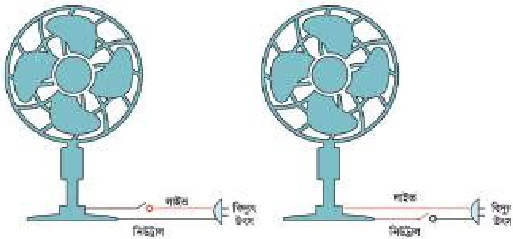

<!-- physics-9-10-bn-c11-t11.5-p011 · figure · p.322 -->
**চিত্র ১১.১৫: সুইচের সঠিক এবং ভুল সংযোগ।**

<!-- physics-9-10-bn-c11-t11.5-p012 · text · p.322 -->
**(e) সঠিক সংযোগ:** বিদ্যুৎ সরবরাহে সব সময়ই দুটি তার থাকে, একটিতে উচ্চ বিভব (জীবন্ত বা Live) অন্যটি ভোল্টেজহীন নিরপেক্ষ (Neutral)। একটা যন্ত্র যখন ব্যবহার করা হয় তখন Live তার থেকে বিদ্যুৎকে যন্ত্রের ভেতর দিয়ে ঘুরিয়ে নিরপেক্ষ তার দিয়ে তার উৎসে ফিরিয়ে নেওয়া হয়। ভোল্টেজহীন নিরপেক্ষ তারটি নিরাপদ কিন্তু উচ্চ বিভবের তারটি অনিরাপদ, তাই সতর্কভাবে ব্যবহার করতে হয়। কোনো যন্ত্রপাতিতে যখন একটা সুইচ দিয়ে বিদ্যুতের সংযোগ দেওয়া হয় তখন সুইচটি উচ্চ ভোল্টেজের তার এবং নিরপেক্ষ তার দুটিতেই দেওয়া যায়। বুদ্ধিমানের কাজ হয় যখন সুইচটি লাগানো হয় উচ্চ ভোল্টেজের তারের সাথে (চিত্র ১১.১৫) তাহলে শুধু যখন যন্ত্রটি চালু করা হয় তখনই উচ্চ ভোল্টেজ যন্ত্রের ভেতর প্রবেশ করে। যখন যন্ত্রটি বন্ধ থাকে তখন যন্ত্রের ভেতর কোথাও উচ্চ ভোল্টেজ থাকে না।

<!-- physics-9-10-bn-c11-t11.5-p013 · text · p.323 -->
**(f) গ্রাউন্ড:** তোমরা যদি তোমাদের বাসায় স্কুলে কিংবা অন্য কোথাও বিদ্যুতের সংযোগ লক্ষ্য করে থাকো, তাহলে দেখবে সব সময় অন্তত দুটি সংযোগ থাকে; একটি উচ্চ ভোল্টেজ অন্যটি নিউট্রাল। কিন্তু সেই বিদ্যুতের সাথে যদি মূল্যবান কোনো যন্ত্র যুক্ত করা হয় (যেমন কম্পিউটার, ফ্রিজ) তাহলে দেখবে সেখানে উচ্চ বিভব আর নিউট্রাল ছাড়াও তৃতীয় একটা সংযোগ থাকে, যেটি হলো ভূমি সংযোগ বা Ground. সাধারণত এটা যন্ত্রপাতির ঢাকনা বা কার্ঠামোতে লাগানো থাকে। যদি কোনো দুর্ঘটনায় যন্ত্রপাতিটি বিদুতায়িত হয়ে যায় তাহলে ঢাকনা বা কার্ঠামোটি থেকে ভূমিতে সরাসরি বিদ্যুৎ প্রবাহিত হয়ে যায়। বিদ্যুতের এই প্রবাহের কারণে সাধারণত ফিউজ পুড়ে যন্ত্রটি বিপদমুক্ত হয়ে যায়। কাজেই কেউ যদি ভুলে যন্ত্রটি স্পর্শ করে তার ইলেকট্রিক শক খাওয়ার আশঙ্কা থাকে না।

<!-- physics-9-10-bn-c11-t11.5-p014 · figure · p.323 -->

<!-- physics-9-10-bn-c11-t11.5-p015 · figure · p.323 -->
**চিত্র ১১.১৬: বিদ্যুৎ নিয়ে বিপজ্জনক কাজকর্ম।**

<!-- physics-9-10-bn-c11-t11.5-p016 · text · p.323 -->
> ১১.১৬ ছবিতে বিদ্যুতের ব্যবহার নিয়ে কী কী বিপজ্জনক কাজ করা হয়েছে?

## 11.6 বাসাবাড়িতে তড়িৎ বর্তনীর নকশা

### (Household Electric Circuit Diagram)

<!-- physics-9-10-bn-c11-t11.6-p001 · text · p.323 -->
একটি বাসায় বিদ্যুৎ সরবরাহ করার জন্য একটি সার্কিট কেমন হতে পারে সেটি ১১.১৭ চিত্রে দেখানো হয়েছে। বিদ্যুৎকেন্দ্র থেকে সাপ্লাই ক্যাবল দিয়ে সেটি একটি বাসায় সরবরাহ করা হয়। এর মাঝে একটি লাইভ অন্যটি নিউট্রাল। লাইভ লাইনটির উচ্চ বিভব, নিউট্রালটি শূন্য বিভব। চিত্রে লাইভ লাইনটি লাল রং এবং নিউট্রাল লাইনটি নীল রং দিয়ে দেখানো হয়েছে। সেটি প্রথমে একটি বৈদ্যুতিক মিটারের ভেতরে দিয়ে যায়, বাসায় কতটুকু বিদ্যুৎ ব্যবহার হয়েছে সেটি এই মিটারে রেকর্ড করা হয়। মিটারের পর এটি কনজিউমার ইউনিটি দিয়ে বাসার ভেতরে বিতরণ করা হয়।

<!-- physics-9-10-bn-c11-t11.6-p002 · text · p.324 -->
১১.১৭ চিত্রে 5 A, 15 A এবং 30 A এর তিনটি সার্কিট ব্রেকার বা ফিউজ দেখানো হয়েছে। এই তিনটি সার্কিট ব্রেকারই মেইন সুইচের সাথে সংযুক্ত। মেইন সুইচটি দিয়ে যেকোনো সময় পুরো বাসার

<!-- physics-9-10-bn-c11-t11.6-p003 · figure · p.324 -->
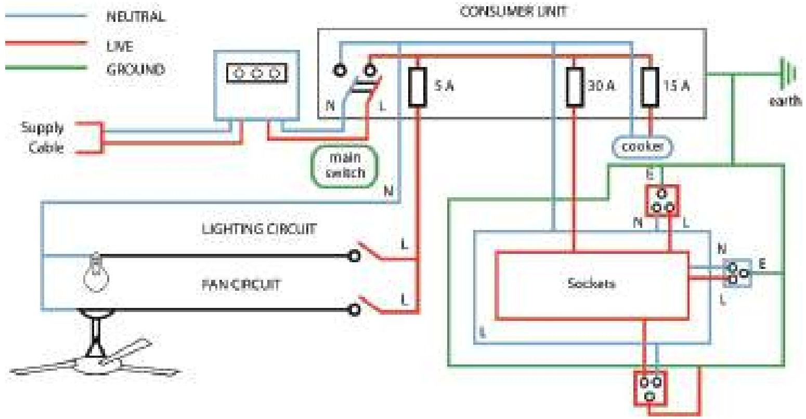

<!-- physics-9-10-bn-c11-t11.6-p004 · figure · p.324 -->
**চিত্র ১১.১৭ : একটি বাসায় বিদ্যুৎ সরবরাহ করার জন্য সন্মাব্য বিদ্যুৎ বত্নী।**

<!-- physics-9-10-bn-c11-t11.6-p005 · text · p.324 -->
বিদ্যুৎপ্রবাহ কেটে দেওয়া সম্ভব। চিত্রটিতে 5 A এর সার্কিট ব্রেকার থেকে লাইট এবং ফ্যানে বিদ্যুৎ সরবরাহ করা হয়েছে। 15 A থেকে বাসায় বৈদ্যুতিক চুলার সাথে সংযুক্ত। 30 A সার্কিট ব্রেকারটি দিয়ে বাসার প্ল্যাগ পয়েন্টগুলো যুক্ত করা হয়েছে। তোমরা নিশ্চয়ই লক্ষ্য করেছ এই অংশটুকু একটি রিংয়ের মতো। ফলে বিদ্যুৎপ্রবাহ সব সময়ই দুটি ভিন্ন পথে হতে পারে। এই অংশটিতে নিরাপত্তার জন্য ভূমির সংযোগ (সবুজ রং) আলাদাভাবে দেখানো হয়েছে।

### নিজে করো

<!-- physics-9-10-bn-c11-t11.6-p006 · activity · p.324 -->
বিদ্যুৎশক্তির অপচয় রোধ করার জন্য কী কী করা যেতে পারে সেগুলো বর্ণনা করে একটি সুন্দর পোস্টার তৈরি করো।

<!-- physics-9-10-bn-c11-t11.6-p007 · activity · p.324 -->
পোস্টারগুলো দিয়ে সবার সচেতনতা সৃষ্টি করার জন্য স্কুলের ছেলেমেয়েদের দেখানোর জন্য সেগুলো কোথাও টাঙানোর ব্যবস্থা করো।

<!-- physics-9-10-bn-c11-t11.6-p008 · activity · p.325 -->
**উদ্দেশ্য:** শিক্ষার্থীরা বাসাবাড়িতে ব্যবহারের উপযোগী বৈদ্যুতিক সার্কিটের নকশাকে বিশ্লেষণ করতে পারবে।

<!-- physics-9-10-bn-c11-t11.6-p009 · activity · p.325 -->
**কাজের ধারা:** ১১.১৭ চিত্রে একটি বাসার বিদ্যুৎ সরবরাহ করার জন্য সম্ভাব্য সার্কিট দেখানো হয়েছে। এই সার্কিটটিতে নিচের পরিবর্তনগুলো করে নতুন একটি সার্কিট তৈরি করো।

<!-- physics-9-10-bn-c11-t11.6-p010 · text · p.325 -->
(a) তিনটি প্লাগ পয়েন্ট যথেষ্ট নয় বলে আরো দুইটি নতুন প্লাগ পয়েন্ট যুক্ত করো।
(b) বিদ্যুৎ ব্যবহার করে এরকম একটি পানির পাম্প উপযুক্ত সার্কিট ব্রেকারসহ যুক্ত করো।
(c) লাইট এবং ফ্যানের সাথে দ্বিতীয় আরেকটি লাইটে দুইটি সুইচ ব্যবহার করে এমনভাবে যুক্ত করো যেন যেকোনো সুইচ দিয়েই লাইটটি জ্বালানো এবং নেভানো যায়।

<!-- physics-9-10-bn-c11-t11.6-p011 · figure · p.325 -->
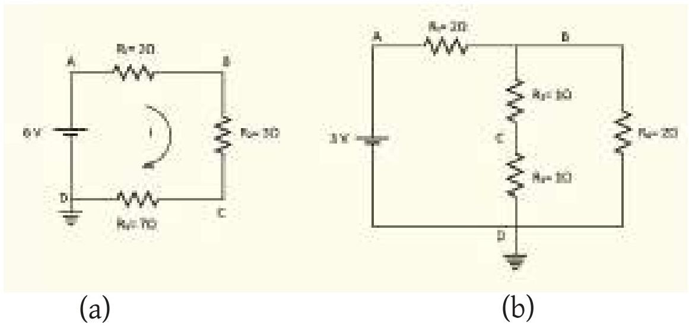

<!-- physics-9-10-bn-c11-t11.6-p012 · activity · p.325 -->
(a) (b)

<!-- physics-9-10-bn-c11-t11.6-p013 · figure · p.325 -->
**চিত্র ১১.১৮ : (a) এবং (b) ব্যাটারি ও রোধ সংযুক্ত দুটি সার্কিট।**

<!-- physics-9-10-bn-c11-t11.6-p014 · activity · p.325 -->
১১.১৮(a) চিত্রটিতে দেখানো সার্কিটে যদি D বিন্দুকে ভূমিসংলগ্ন করা হয় তাহলে A, B, C ও D বিন্দুতে বিভব কত? I এর মান কত?

<!-- physics-9-10-bn-c11-t11.6-p015 · activity · p.325 -->
১১.১৮(a) চিত্রটিতে দেখানো সার্কিটে D বিন্দুকে ভূমিসংলগ্ন না করে যদি C বিন্দুকে ভূমিসংলগ্ন করা হয় তাহলে বিভব কত? I এর মান কত?

<!-- physics-9-10-bn-c11-t11.6-p016 · activity · p.325 -->
১১.১৮(b) চিত্রটিতে দেখানো সার্কিটে D বিন্দুকে ভূমিসংলগ্ন করা হলে সার্কিটে A, B, C ও D বিন্দুতে বিভব কত?

## 11.ex নমুনা প্রশ্ন

### বহুনির্বাচনি প্রশ্ন

<!-- physics-9-10-bn-c11-t11.ex-p001 · exercise · p.326 -->
সঠিক উত্তরটির পাশে টিক (✓) চিহ্ন দাও

<!-- physics-9-10-bn-c11-t11.ex-p002 · exercise · p.326 -->
১. যে সকল পদার্থের মধ্য দিয়ে খুব সহজেই তড়িৎপ্রবাহ চলতে পারে তাদেরকে কী বলে?

<!-- physics-9-10-bn-c11-t11.ex-p003 · exercise · p.326 -->
(ক) অপরিবাহী
(খ) কুপরিবাহী
(গ) অর্ধপরিবাহী
(ঘ) পরিবাহী

<!-- physics-9-10-bn-c11-t11.ex-p004 · exercise · p.326 · review: verify-formula -->
২. ২ $\Omega$, ৩ $\Omega$ ও ৪ $\Omega$ মানের তিনটি রোধ শ্রেণি সমবায়ে সংযুক্ত থাকলে তুল্য রোধের মান হবে—

<!-- physics-9-10-bn-c11-t11.ex-p005 · exercise · p.326 · review: verify-formula -->
(ক) ৪ $\Omega$
(খ) ৭ $\Omega$
(গ) ৯ $\Omega$
(ঘ) ২০ $\Omega$

<!-- physics-9-10-bn-c11-t11.ex-p006 · exercise · p.326 -->
৩. কোনো পরিবাহীর দুই প্রান্তের বিভব পার্থক্য ১০০ V এবং তড়িৎপ্রবাহমাত্রা ১০ A হলে এর রোধ কত?

<!-- physics-9-10-bn-c11-t11.ex-p007 · exercise · p.326 · review: verify-formula -->
(ক) ১০০০ $\Omega$
(খ) ০.১ $\Omega$
(গ) ১০ $\Omega$
(ঘ) ১ $\Omega$

<!-- physics-9-10-bn-c11-t11.ex-p008 · exercise · p.327 -->
৪. বর্তনীতে বৈদ্যুতিক অবস্থা পরিমাপের জন্য ব্যবহার করা হয়—

<!-- physics-9-10-bn-c11-t11.ex-p009 · exercise · p.327 · review: latin-junk -->
i. ভোল্টমিটার
ii. অ্যামিটার
iii. জেনারেটর

<!-- physics-9-10-bn-c11-t11.ex-p010 · exercise · p.327 -->
কোনটি সঠিক?

<!-- physics-9-10-bn-c11-t11.ex-p011 · exercise · p.327 · review: latin-junk -->
(ক) i ও ii
(খ) i ও iii
(গ) ii ও iii
(ঘ) i, ii ও iii

<!-- physics-9-10-bn-c11-t11.ex-p012 · exercise · p.327 -->
নিচের উদ্দীপকের (চিত্র ১১.১৯) আলোকে ৫ ও ৬ নং প্রশ্নের উত্তর দাও।

<!-- physics-9-10-bn-c11-t11.ex-p013 · exercise · p.327 -->
৫. বর্তনীর তুল্যরোধ কত?

<!-- physics-9-10-bn-c11-t11.ex-p014 · exercise · p.327 · review: verify-formula -->
(ক) $11\Omega$
(খ) $4\Omega$
(গ) $1.64\Omega$
(ঘ) $0.61\Omega$

<!-- physics-9-10-bn-c11-t11.ex-p015 · exercise · p.327 -->
৬. উদ্দীপকে—

<!-- physics-9-10-bn-c11-t11.ex-p016 · exercise · p.327 · review: verify-formula -->
i. $I_1 = I_2$
ii. $I_1 > I_2$
iii. $I_1 = 2I_2$

<!-- physics-9-10-bn-c11-t11.ex-p017 · exercise · p.327 -->
নিচের কোনটি সঠিক?

<!-- physics-9-10-bn-c11-t11.ex-p018 · exercise · p.327 · review: latin-junk -->
(ক) i ও ii
(খ) ii ও iii
(গ) i ও iii
(ঘ) i, ii ও iii

<!-- physics-9-10-bn-c11-t11.ex-p019 · figure · p.327 -->
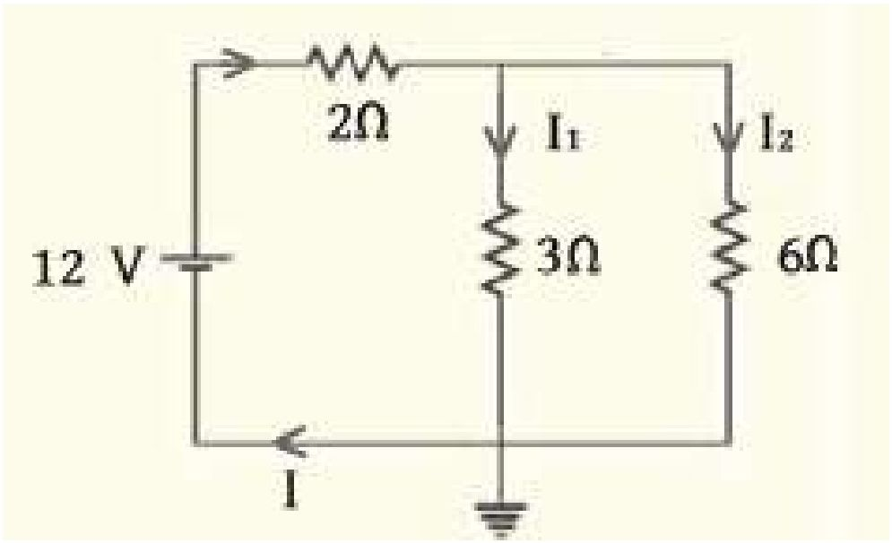

<!-- physics-9-10-bn-c11-t11.ex-p020 · figure · p.327 -->
**চিত্র ১১.১৯**

### সৃজনশীল প্রশ্ন

<!-- physics-9-10-bn-c11-t11.ex-p021 · exercise · p.328 · review: known-confusable-corrected,verify-formula -->
১. পড়ার সময় আলাভি $220\ V - 100\ W$ এর একটি বাতি দৈনিক ৩ ঘণ্টা করে ব্যবহার করে। অন্যদিকে তার ভাই আলিফ $220\ V - 40\ W$ একটি টেবিল ল্যাম্প দৈনিক ৪ ঘণ্টা করে ব্যবহার করে। প্রতি ইউনিট বিদ্যুৎ শক্তির মূল্য ৬ টাকা।

<!-- physics-9-10-bn-c11-t11.ex-p022 · exercise · p.328 · review: known-confusable-corrected -->
(ক) ও’মের সূত্রটি লেখ।

<!-- physics-9-10-bn-c11-t11.ex-p023 · exercise · p.328 · review: known-confusable-corrected -->
(খ) নির্দিষ্ট তাপমাত্রা, উপাদান ও প্রস্থচ্ছেদের পরিবাহকের দৈর্ঘ্য ৫ গুণ বড় করলে রোধের কী পরিবর্তন হবে ব্যাখ্যা করো।

<!-- physics-9-10-bn-c11-t11.ex-p024 · exercise · p.328 · review: known-confusable-corrected -->
(গ) আলিফের বাতির প্রবাহমাত্রা নির্ণয় করো।

<!-- physics-9-10-bn-c11-t11.ex-p025 · exercise · p.328 · review: known-confusable-corrected -->
(ঘ) আর্থিক দিক বিবেচনায় আলাভি ও আলিফের মধ্যে কে মিতব্যয়ী? গাণিতিক যুক্তিসহ বিশ্লেষণ করো।

<!-- physics-9-10-bn-c11-t11.ex-p026 · exercise · p.328 · review: known-confusable-corrected,verify-formula -->
২. আমাদের দেশে বিদ্যুৎ সরবরাহ লাইনের তড়িৎ চালক শক্তি ২২০ ভোল্ট। একটি বৈদ্যুতিক বাত্নের ফিলামেন্টের রোধ ৪৮৪ ও’ম। বাত্নের গায়ে লেখা আছে $220\ V-100\ W$।

<!-- physics-9-10-bn-c11-t11.ex-p027 · exercise · p.328 · review: known-confusable-corrected -->
(ক) অ্যাম্পিয়ারের সংজ্ঞা দাও।

<!-- physics-9-10-bn-c11-t11.ex-p028 · exercise · p.328 · review: known-confusable-corrected -->
(খ) একটি ড্রাইসেলের তড়িৎচালক শক্তি ১.৫ V বলতে কী বোঝায়?

<!-- physics-9-10-bn-c11-t11.ex-p029 · exercise · p.328 · review: known-confusable-corrected -->
(গ) বাত্নটি সরবরাহ লাইনে সংযুক্ত করা হলে তড়িৎ প্রবাহ কত হবে তা নির্ণয় করো।

<!-- physics-9-10-bn-c11-t11.ex-p030 · exercise · p.328 · review: known-confusable-corrected,verify-formula -->
(ঘ) বাত্নের গায়ে লেখা $220\ V-100\ W$ এর সত্যতা যাচাইয়ে একটি পরীক্ষণ প্রস্তাব করো।

### সংক্ষিপ্ত উত্তর প্রশ্ন

<!-- physics-9-10-bn-c11-t11.ex-p031 · exercise · p.328 -->
১. দূর-দূরান্তে বিদ্যুৎ সরবরাহ করার জন্য উচ্চ ভোল্টেজ প্রয়োগ করা হয় কেন?

<!-- physics-9-10-bn-c11-t11.ex-p032 · exercise · p.328 -->
২. ও’মের সূত্র ব্যাখ্যা করো।

<!-- physics-9-10-bn-c11-t11.ex-p033 · exercise · p.328 -->
৩. তাপমাত্রা বাড়লে পরিবাহীর রোধ বাড়ে কেন? ব্যাখ্যা করো।

<!-- physics-9-10-bn-c11-t11.ex-p034 · exercise · p.328 -->
৪. তড়িৎের সিস্টেম লস বলতে কি বোঝায়?
