# 12. বিদ্যুতের চৌম্বক ক্রিয়া

Source: Physics Bangla Version, printed pp. 329-345

## 12.0 ভূমিকা ও শিখনফল

<!-- physics-9-10-bn-c12-t12.0-p001 · figure · p.329 -->

<!-- physics-9-10-bn-c12-t12.0-p002 · text · p.329 -->
কুলিয়ারচরে আয়োজিত পৃথিবীর সবচেয়ে বড় প্র্যাকটিক্যাল ক্লাসে ছেলেমেয়েরা বৈদ্যুতিক চুমক তৈরি করছে।

<!-- physics-9-10-bn-c12-t12.0-p003 · text · p.329 -->
আমরা সবাই আমাদের জীবনে কখনো না কখনো চুমকের আকর্ষণ এবং বিকর্ষণ দেখে চমৎকৃত হয়েছি। আপাতদৃষ্টিতে চৌম্বকত্ব এবং বিদ্যুৎপ্রবাহকে পুরোপুরি ভিন্ন দুটি বিষয় বলে মনে হলেও এই দুটোই যে একই শক্তির ভিন্ন রূপ সেটি এই অধ্যায়ে আলোচনা করা হবে। আমরা দেখব বিদ্যুতের প্রবাহ হলে যেরকম চৌম্বক ক্ষেত্র তৈরি হতে পারে ঠিক সেরকম চৌম্বক ক্ষেত্রকে পরিবর্তন করে বিদ্যুৎ প্রবাহ করা যেতে পারে।

<!-- physics-9-10-bn-c12-t12.0-p004 · text · p.329 -->
এই অধ্যায়ে বিদ্যুতের চৌম্বক ক্রিয়ার সাথে সাথে কীভাবে চুমক এবং বিদ্যুৎকে ব্যবহার করে নানা ধরনের যন্ত্রপাতি তৈরি করা হয় এবং ব্যবহার করা হয় সেই বিষয়গুলোও আলোচনা করা হয়েছে।

### এ অধ্যায় শেষে আমরা –

<!-- physics-9-10-bn-c12-t12.0-p005 · objective · p.330 -->
* তড়িৎপ্রবাহের চৌম্বক ক্রিয়া ব্যাখ্যা করতে পারব।
* তড়িৎচৌম্বক আবেশ ব্যাখ্যা করতে পারব।
* আবিষ্কত তড়িৎপ্রবাহ ও আবিষ্কত তড়িচ্চালক শক্তি ব্যাখ্যা করতে পারব।
* মোটর ও জেনারেটরের মূলনীতি ব্যাখ্যা করতে পারব।
* ট্রান্সফর্মারের মূলনীতি ব্যাখ্যা করতে পারব।
* স্টেপ আপ ও স্টেপ ডাউন ট্রান্সফর্মারের কার্যপ্রণালি ব্যাখ্যা করতে পারব।
* আমাদের জীবনে তড়িৎের নানাবূপের ব্যবহার ও এর অবদানকে প্রশংসা করতে পারব।

## 12.1 চুম্বক (Magnet)

<!-- physics-9-10-bn-c12-t12.1-p001 · text · p.331 -->
তোমরা সবাই নিশ্চয়ই চুম্বক দেখেছ, একটা চুম্বক লোহাজাতীয় পদার্থের কাছে আনলে সেটা লোহাকে আকর্ষণ করে। চুম্বক এবং লোহার মাঝখানে কিছু নেই; কিন্তু একটা অদ্ভুত বল সেটাকে টেনে আনছে। সেটি প্রথমবার দেখার পর সবাই এক ধরনের বিস্ময় হয়। যারা দুটি চুম্বক হাতে নিয়ে নাড়াচাড়া করার সুযোগ পেয়েছে তারা নিশ্চয়ই লক্ষ্য করেছে (চিত্র ১২.০১) যে চুম্বকের দুটি মেরু আছে

<!-- physics-9-10-bn-c12-t12.1-p002 · figure · p.331 -->
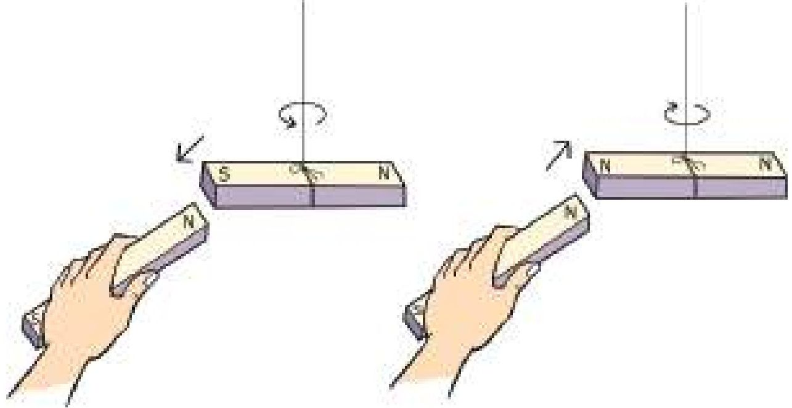

<!-- physics-9-10-bn-c12-t12.1-p003 · figure · p.331 -->
**চিত্র ১২.০১: চুম্বকের বিপরীত মেরুতে আকর্ষণ ও সমমেরুতে বিকর্ষণ হয়।**

<!-- physics-9-10-bn-c12-t12.1-p004 · text · p.331 -->
যদি দুইটি চুম্বকের কাছাকাছি নিয়ে আনা মেরু দুটি একই ধরনের হয়ে থাকে তাহলে তারা পরস্পর বিকর্ষণ করে; আর মেরু দুটি যদি ভিন্ন ধরনের হয় তাহলে তারা পরস্পর আকর্ষণ করে। চুম্বকের মেরু দুটিকে উত্তর আর দক্ষিণ মেরু নাম দেওয়া হয়েছে। কারণ দেখা গেছে একটা চুম্বককে মুক্তভাবে ঝুলিয়ে দিলে সেটা উত্তর-দক্ষিণ বরাবর থাকে। যে অংশটুকু উত্তর দিকে থাকে সেটার নাম উত্তর মেরু (বা উত্তরসন্ধানী মেরু) যেটা দক্ষিণ দিক বরাবর থাকে সেটা দক্ষিণ মেরু (দক্ষিণ সন্ধানী মেরু)। এটা ঘটে তার কারণ পৃথিবীর একটা চৌম্বক ক্ষেত্র রয়েছে। কোনো চুম্বক ঝোলালে সেই ক্ষেত্র বরাবর চুম্বকটা নিজেকে সাজিয়ে নেয়। দুটো চুম্বক কেমন করে একে অন্যকে আকর্ষণ করে আমরা সেগুলো নিয়ে আলোচনা করতেই পারি কিন্তু সবার আগে জানা দরকার চুম্বকের যে বল। সেটা আসে কোথা থেকে?

## 12.2 বিদ্যুতের চৌম্বক ক্রিয়া (Magnetic Effects of Current)

<!-- physics-9-10-bn-c12-t12.2-p001 · text · p.331 -->
যারা সাধারণভাবে চুম্বক হাতে নিয়ে নাড়াচাড়া করেছে, তারা নিশ্চয়ই কল্পনাও করতে পারবে না যে এর সাথে তড়িৎ বা বিদ্যুতের সম্পর্ক আছে এবং তড়িৎ বা বিদ্যুতের প্রবাহ দিয়ে চুম্বক তৈরি করা যায়। একটা চার্জ থাকলে তার পাশে যেমন তড়িৎ ক্ষেত্র থাকে ঠিক সে রকম একটা তারের ভেতর দিয়ে বিদ্যুৎ প্রবাহিত হলে সেই তারের চারপাশে চৌম্বক ক্ষেত্র তৈরি হয়। ধরা যাক তুমি একটা কার্ডবোর্ডের মাঝখান দিয়ে একটা তার ঢোকিয়েছ এবং কার্ডের ওপর অনেকগুলো ছোট ছোট কম্পাস রেখেছ (চিত্র ১২.০২)। তারের ভিতর দিয়ে কোন বিদ্যুৎপ্রবাহ না থাকলে কম্পাসগুলো অবশ্যই উত্তর-দক্ষিণ বরাবর থাকবে ঠিক যে রকম থাকার কথা। এখন যদি এই তারের ভেতর দিয়ে কোনোভাবে বিদ্যুৎ বা তড়িৎ প্রবাহিত করতে পারো (মোটামুটি শক্তিশালী) তাহলে তুমি অবাক হয়ে দেখবে হঠাৎ করে সবগুলো কম্পাসের কাঁটা একটা আরেকটার পেছনে সারিবদ্ধভাবে নিজেদের সাজিয়ে নেবে। তোমার স্পষ্ট অনুভূতি হবে যে এই বিদ্যুৎপ্রবাহের জন্য তাকে ঘিরে একটা বৃত্তাকার চৌম্বক ক্ষেত্র তৈরি হয়েছে।

<!-- physics-9-10-bn-c12-t12.2-p002 · figure · p.332 -->
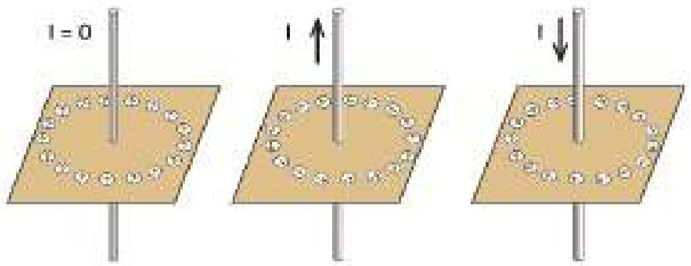

<!-- physics-9-10-bn-c12-t12.2-p003 · figure · p.332 -->
**চিত্র ১২.০২: বিদ্যুৎ প্রবাহকে ঘিরে কম্পাসের দিক।**

<!-- physics-9-10-bn-c12-t12.2-p004 · text · p.332 -->
তুমি যদি বিদ্যুৎপ্রবাহ বন্ধ করে দাও তাহলে আবার সবগুলো ছোট ছোট কম্পাসের কাঁটা উত্তর-দক্ষিণ বরাবর হয়ে যাবে। এবারে তুমি যদি বিদ্যুৎপ্রবাহের দিক পাল্টে দাও তাহলে দেখবে আবার কম্পাসগুলো নিজেদের সাজিয়ে নেবে কিন্তু এবারের বৃত্তটিতে কম্পাসের দিকটা হবে উল্টো দিকে। তার কারণ বিদ্যুৎ প্রবাহ সব সময় তাকে ঘিরে একটা নির্দিষ্ট দিকে চৌম্বক ক্ষেত্র তৈরি করে। চৌম্বক ক্ষেত্রের কোন

<!-- physics-9-10-bn-c12-t12.2-p005 · figure · p.332 -->
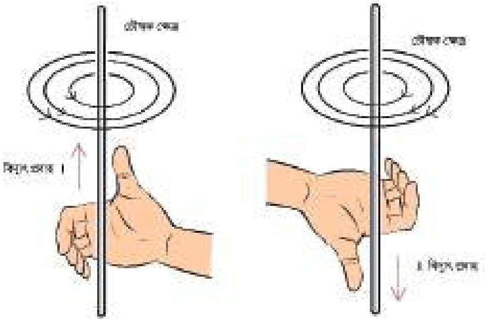

<!-- physics-9-10-bn-c12-t12.2-p006 · figure · p.332 -->
**চিত্র ১২.০৩: বিদ্যুৎপ্রবাহকে ঘিরে তৈরি চৌম্বক ক্ষেত্রের দিক নির্ণয়ের ডানহাতি নিয়ম।**

<!-- physics-9-10-bn-c12-t12.2-p007 · text · p.333 -->
একটা তারের ভেতর দিয়ে বিদ্যুৎ প্রবাহিত হলে তার জন্য তৈরি হওয়া চৌম্বক বলরেখাগুলোর দিক কোন দিকে হবে সেটা ডান হাতের নিয়ম দিয়ে বের করা যায়। বুড়ো আঙুলটা যদি বিদ্যুৎপ্রবাহের দিক দেখায় তাহলে হাতের অন্য আঙুলগুলো চৌম্বক ক্ষেত্রের দিকটি নির্দেশ করে (চিত্র ১২.০৩)।

<!-- physics-9-10-bn-c12-t12.2-p008 · text · p.333 -->
বিদ্যুতে ক্ষেত্র বরাবর আমরা কতকগুলো রেখা কল্পনা করতে পারি, যাদের চৌম্বক বলরেখা বলে। এর সাথে তোমরা বৈদ্যুতিক বলরেখার তুলনা করতে পারো। তাদের পার্থক্য হলো যে চৌম্বক বলরেখাসমূহ সবসময় আবদ্ধ হয় কিন্তু বৈদ্যুতিক বলরেখাসমূহ ধনাত্মক চার্জে শুরু হয়ে ঋণাত্মক চার্জে শেষ হয়।

<!-- physics-9-10-bn-c12-t12.2-p009 · text · p.333 -->
> তোমার ঘরের এক মাথা থেকে অন্য মাথায় ইলেকট্রনের রশ্মিগুচ্ছ পাঠাতে গিয়ে যদি দেখো সেটা উপরে উঠে যাচ্ছে তাহলে তুমি কী ব্যাখ্যা দেবে?

<!-- physics-9-10-bn-c12-t12.2-p010 · text · p.333 -->
**প্রশ্ন:** ১২.০৪ চিত্রে দেখানো উপায়ে বিদ্যুৎ বইয়ের ভেতর থেকে উপরের দিকে যাচ্ছে, চৌম্বক ক্ষেত্র কোনটি সঠিক?

<!-- physics-9-10-bn-c12-t12.2-p011 · text · p.333 -->
**উত্তর:** বাম দিকেরটি সঠিক।

<!-- physics-9-10-bn-c12-t12.2-p012 · figure · p.333 -->
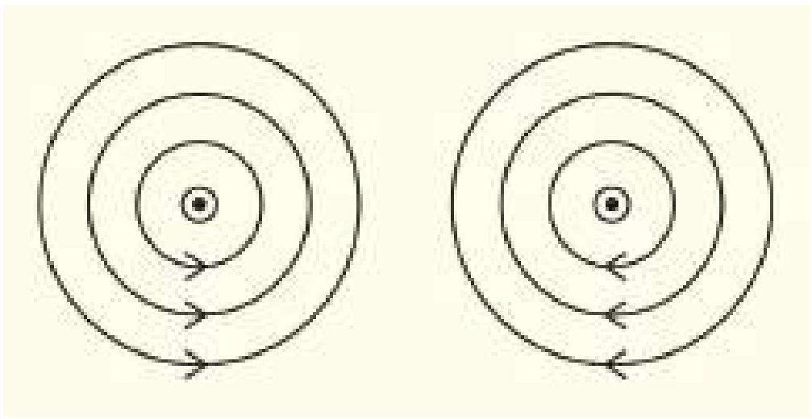

<!-- physics-9-10-bn-c12-t12.2-p013 · figure · p.333 -->
**চিত্র ১২.০৪ : বিদ্যুৎপ্রবাহী তারকে ঘিরে চৌম্বক ক্ষেত্র। কোনটি সঠিক?**

### ১২.২.১ সলিনয়েড (Solenoid)

<!-- physics-9-10-bn-c12-t12.2-p014 · text · p.333 · review: verify-formula -->
একটা তার যদি সোজা থাকে এবং তার ভেতর দিয়ে বিদ্যুৎপ্রবাহ হলে চৌম্বক বলরেখা কেমন হয় সেটা ১২.০৩ চিত্রে দেখানো হয়েছিল। যদি তারটা সোজা না হয়ে বৃত্তাকার হয় তাহলে চৌম্বক বলরেখা কেমন হবে? ১২.০৫ চিত্রে সেটা দেখানো হয়েছে। বুঝতেই পারছ বিদ্যুৎপ্রবাহ যত বেশি হবে, চৌম্বক ক্ষেত্রটি তত শক্তিশালী হবে। একটা তারের ভেতর দিয়ে কতখানি বিদ্যুৎ প্রবাহিত করা যায় তার একটা সীমা আছে, তারটা $I^2R$ হিসেবে গরম হয়ে যায় তা ছাড়াও সবচেয়ে বেশি কতখানি বিদ্যুৎ প্রবাহ দেওয়া সম্ভব সেটা বিদ্যুতের উৎসের ওপর নির্ভর করে। তাই যদি শক্তিশালী চৌম্বক ক্ষেত্র তৈরি করতে হয় তাহলে একটা মাত্র বৃত্তাকার লুপ-এর ওপর নির্ভর না করে অপরিসীমী আস্তরণ দিয়ে ঢাকা তার দিয়ে অনেকবার প্যাঁচিয়ে একটা কুণ্ডলী বা কয়েল তৈরি করা হয়। এরকম কুণ্ডলীকে বলে সলিনয়েড। সেই কুণ্ডলী দিয়ে শক্তিশালী চৌম্বক ক্ষেত্র তৈরি করা যায়। কয়েলের প্রত্যেকটা লুপই তার ভেতর দিয়ে প্রবাহিত বিদ্যুতের জন্য চৌম্বক ক্ষেত্র তৈরি করবে, তাই সম্মিলিত চৌম্বক ক্ষেত্র হবে অনেক বেশি।

<!-- physics-9-10-bn-c12-t12.2-p015 · figure · p.334 -->
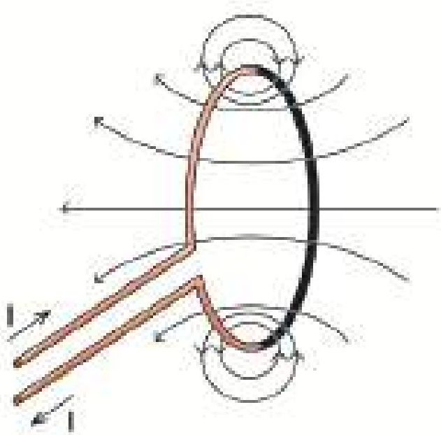

<!-- physics-9-10-bn-c12-t12.2-p016 · figure · p.334 -->
**চিত্র ১২.০৫: লুপের ভেতর দিয়ে বিদ্যুৎপ্রবাহের কারণে তৈরি চৌম্বক ক্ষেত্র।**

<!-- physics-9-10-bn-c12-t12.2-p017 · figure · p.334 -->
**চিত্র ১২.০৬: লুপের ভেতর দিয়ে বিদ্যুৎপ্রবাহ করলে ডান হাতের নিয়ম ব্যবহার করে।**

<!-- physics-9-10-bn-c12-t12.2-p018 · text · p.334 -->
বৃত্তাকার তারের ভেতর দিয়ে বিদ্যুৎ প্রবাহিত হলে তার চৌম্বক ক্ষেত্র কোন দিকে হবে সেটাও ডান হাতের নিয়ম দিয়ে বের করা যায়। বুড়ো আঙুলটি হবে চৌম্বক ক্ষেত্রের দিক যদি অন্য আঙুলগুলো বিদ্যুৎ প্রবাহের দিক দেখায় (চিত্র ১২.০৬)। একটা তারের কুণ্ডলী বা সলিনয়েড আসলে দণ্ড চুম্বকের মতো কাজ করে এবং বুড়ো আঙুলের দিকটা হবে এই চুম্বকের উত্তর মেরু।

<!-- physics-9-10-bn-c12-t12.2-p019 · text · p.334 -->
একটা তারের ভেতর দিয়ে বিদ্যুৎ প্রবাহিত হলে তার জন্য তৈরি হওয়া চৌম্বক বলরেখাগুলোর দিক কোন দিকে হবে সেটা ডান হাতের নিয়ম দিয়ে বের করা যায়। বুড়ো আঙুলটা যদি বিদ্যুৎপ্রবাহের দিক দেখায়, তাহলে হাতের অন্য আঙুলগুলো চৌম্বক ক্ষেত্রের দিকটি নির্দেশ করে।

### ১২.২.২ তড়িৎচুম্বক (Electromagnet)

<!-- physics-9-10-bn-c12-t12.2-p020 · text · p.334 -->
শুধু বিদ্যুৎ ব্যবহার করে যে চৌম্বক ক্ষেত্র তৈরি করা যায় তার থেকে অনেক বেশি শক্তিশালী চৌম্বক ক্ষেত্র তৈরি করা সম্ভব যদি এই কুণ্ডলীর ভেতর এক টুকরো লোহা ঢুকিয়ে দেওয়া যায়। লোহা, কোবাল্ট আর নিকেল এই তিনটি ধাতুর বিশেষ চৌম্বকীয় ধর্ম আছে। এগুলোকে এলোমেলোভাবে থাকা অসংখ্য ছোট ছোট চুম্বক হিসেবে কল্পনা করা যায়। যেহেতু সবগুলো ছোট চুম্বক এলোমেলোভাবে আছে তাই পুরো লোহার টুকরোটা কোনো চুম্বক হিসেবে কাজ করে না।

<!-- physics-9-10-bn-c12-t12.2-p021 · figure · p.335 -->
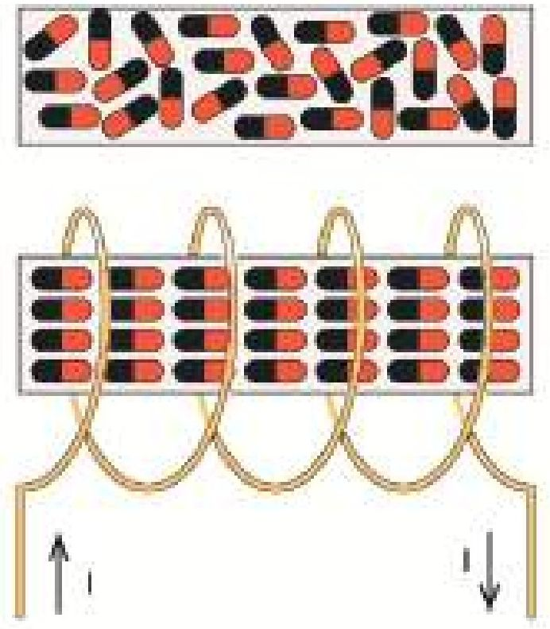

<!-- physics-9-10-bn-c12-t12.2-p022 · figure · p.335 -->
**চিত্র ১২.০৭: বিদ্যুৎ প্রবাহের কারণে এলোমেলোভাবে থাকা ছোট ছোট চুম্বক সারিবদ্ধ হয়ে শক্তিশালী চৌম্বক ক্ষেত্র তৈরি করে।**

<!-- physics-9-10-bn-c12-t12.2-p023 · text · p.335 -->
কিন্তু যখন এটাকে একটা কয়েল বা সলিনয়েডের মাঝে ঢোকানো হয় এবং সেই সলিনয়েডে বিদ্যুৎ প্রবাহিত করা হয় তখন সেটা যে চৌম্বক ক্ষেত্র তৈরি করে সেটা লোহার টুকরার ছোট ছোট চুম্বকগুলোকে সারিবদ্ধ করে ফেলে তাই বিদ্যুৎপ্রবাহের জন্য তৈরি চৌম্বক ক্ষেত্রের সাথে সাথে লোহার নিজস্ব চৌম্বক ক্ষেত্র একত্র হয়ে অনেক শক্তিশালী একটা চৌম্বক ক্ষেত্র তৈরি হয়ে যায় (চিত্র ১২.০৮)। মজার ব্যাপার হচ্ছে, বিদ্যুৎপ্রবাহ বন্ধ করার সাথে সাথে লোহার টুকরোর ভেতরকার সারিবদ্ধ ছোট ছোট চুম্বকগুলো তাপশক্তির কারণে সব আবার এলোমেলো হয়ে যাবে এবং পুরো চৌম্বক ক্ষেত্র অদৃশ্য হয়ে যাবে।

<!-- physics-9-10-bn-c12-t12.2-p024 · text · p.335 -->
এভাবে তৈরি করা চুম্বককে বলা হয় তাড়িতচুম্বক । তাড়িতচুম্বকের ব্যবহারের কোনো

<!-- physics-9-10-bn-c12-t12.2-p025 · text · p.335 -->
শেষ নেই । স্পিকারে বা এয়ারফোনে যে শব্দ শোনা যায় সেখানে তাড়িতচুম্বক ব্যবহার করা হয় । (চিত্র ১২.০৮) এখানে শব্দের কম্পন এবং তীব্রতার সমান বিদ্যুৎপ্রবাহ পাঠানো হয়, সেই বিদ্যুৎ একটা তাড়িতচুম্বক বা ইলেকট্রোম্যাগনেটের চৌম্বকত্ব শব্দের কম্পন বা তীব্রতার উপযোগী করে তৈরি করে সেটা একটা ডায়ফ্রামকে কাঁপায় এবং সেই ডায়ফ্রাম সঠিক শব্দ তৈরি করে ।

### ১২.২.৩ তাড়িতপ্রবাহী তারের ওপর চুম্বকের প্রভাব (Effect of a Magnet on a Current Carrying Wire)

<!-- physics-9-10-bn-c12-t12.2-p026 · text · p.335 -->
আমরা জানি, একটা চুম্বক অন্য চুম্বকের সম্মুখে বিকর্ষণ এবং বিপরীত মেরুকে আকর্ষণ করে । আবার একটা তারের ভেতর দিয়ে বিদ্যুৎ প্রবাহিত হলে সেটি তাকে ঘিরে একটি চৌম্বক ক্ষেত্র তৈরি করে । কাজেই একটা চৌম্বক ক্ষেত্রে যদি একটা তার রাখা হয় এবং সেই তারের ভেতর দিয়ে বিদ্যুৎ প্রবাহিত করা হয়, তাহলে তারটি চৌম্বক ক্ষেত্র তৈরি করার কারণে একটি

<!-- physics-9-10-bn-c12-t12.2-p027 · figure · p.335 -->
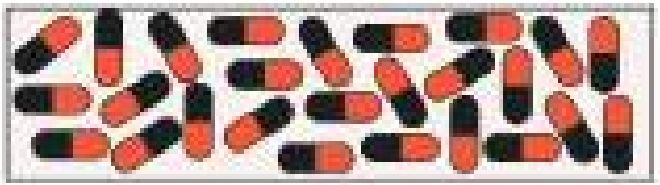

<!-- physics-9-10-bn-c12-t12.2-p028 · figure · p.335 -->
**চিত্র ১২.০৮: স্পিকারে তাড়িতচুম্বক ব্যবহার করা হয়।**

<!-- physics-9-10-bn-c12-t12.2-p029 · text · p.336 -->
বল অনুভব করে। ১২.০৯ চিত্রে একটা চুম্বকের উত্তর মেরু থেকে দক্ষিণ মেরুতে যাওয়া চৌম্বক বলরেখা এবং তার মাঝে একটা তারকে দেখানো হয়েছে, তারটি কাগজের ভেতর থেকে উপরের দিকে বের হয়ে এসেছে। তারের ভেতর দিয়ে নিচ থেকে উপরে বিদ্যুৎপ্রবাহ হলে এটি তাকে ঘিরে বৃত্তাকার চৌম্বক ক্ষেত্র তৈরি করবে এবং উত্তর মেরু থেকে দক্ষিণ মেরুতে যাওয়া চৌম্বক ক্ষেত্রের সাথে যুক্ত হয়ে চৌম্বক বলরেখাকে পুনর্বিন্যাস করবে। তারের নিচে চৌম্বক বলরেখাগুলো ঘনত্ব বেশি এবং উপরে চৌম্বক বলরেখার ঘনত্ব কমে যাওয়ার কারণে তারটি উপরে উঠে যাবে।

<!-- physics-9-10-bn-c12-t12.2-p030 · figure · p.336 -->
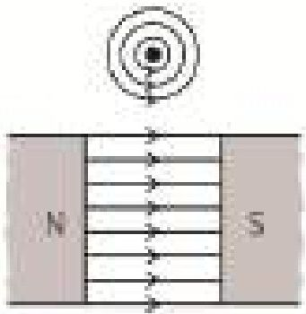

<!-- physics-9-10-bn-c12-t12.2-p031 · figure · p.336 -->
**চিত্র ১২.০৯: চৌম্বক ক্ষেত্রে বিদ্যুৎপ্রবাহী তার রাখা হলে সেটি বল অনুভব করে।**

<!-- physics-9-10-bn-c12-t12.2-p032 · text · p.336 -->
যদি তারটিতে বিদ্যুৎপ্রবাহের দিক পরিবর্তন করা হয়, তাহলে তারকে ঘিরে বৃত্তাকার চৌম্বক ক্ষেত্রের দিক পাল্টে যাবে এবং তারের ওপর চৌম্বক বলরেখার ঘনত্ব বেড়ে গিয়ে তারটিকে নিচে ঠেলে দেবে।

<!-- physics-9-10-bn-c12-t12.2-p033 · text · p.336 -->
> বৈদ্যুতিক চুম্বক বানানোর সময় এক টুকরো লোহার ওপর বিদ্যুৎ অপরিবাহী আবরণে ঢাকা তার প্যাঁচানো হয়। মোটা তার দিয়ে একটি প্যাঁচ দেওয়া ভালো নাকি সরু তার দিয়ে অনেকগুলো প্যাঁচ দেওয়া ভালো? কেন?

### ১২.২.৪ ডিসি মোটর (DC Motor)

<!-- physics-9-10-bn-c12-t12.2-p034 · text · p.336 -->
তোমরা জান একটি চুম্বক দিয়ে অন্য চুম্বকের উপর বল প্রয়োগ করা যায়। অন্যভাবে আমরা বলতে পারি একটি চৌম্বক ক্ষেত্র দিয়ে অন্য একটি চুম্বক বা বিদ্যুৎপ্রবাহী তারের উপর বল প্রয়োগ করা যায়। একটি তারের ভেতর দিয়ে খুব বেশি বিদ্যুৎ প্রবাহিত করা যায় না, তাই সেটি খুব বড় চৌম্বক ক্ষেত্র তৈরি করতে পারে না। কাজেই অন্য একটি চৌম্বক ক্ষেত্র দিয়ে তার ওপর শক্তিশালী বল প্রয়োগ করা যায় না। তোমরা দেখেছ যদি অনেকগুলো পাক দিয়ে একটা তারের কুণ্ডলী তৈরি করা যায় এবং তার ভেতরে একটা লোহার টুকরো বা আর্মেচার রাখা হয় তাহলে তারের ভেতর হালকা বিদ্যুৎ প্রবাহিত করা হলেই সেটি একটি তাড়িতচুম্বক বা ইলেকট্রোম্যাগনেট হয়ে শক্তিশালী চৌম্বক ক্ষেত্র তৈরি করতে পারে। এই কয়েলকে আমরা একটা দড়ি চুম্বক হিসেবে কল্পনা করে অন্য চৌম্বক ক্ষেত্রে তাকে রাখা হলে সেটি কী ধরনের আকর্ষণ বা বিকর্ষণ বলের মুখোমুখি হবে এবং সে কারণে সেটির কোন দিকে গতি হবে সেটা বিশ্লেষণ করতে পারি। ১২.১০ চিত্রে এ রকম একটা তাড়িতচুম্বককে অন্য একটি চৌম্বক ক্ষেত্রে বিকর্ষণ বলের কারণে কীভাবে তার অবস্থান পরিবর্তন করবে সেটি দেখানো হয়েছে।

<!-- physics-9-10-bn-c12-t12.2-p035 · text · p.337 -->
তাড়িতচুম্বকটিকে যদি তার কেন্দ্র বরাবর একটা অক্ষে ঘুরতে দেওয়া হয় তাহলে এটি পরের চিহ্নের মতো অবস্থানে যাওয়ার চেষ্টা করবে।

<!-- physics-9-10-bn-c12-t12.2-p036 · figure · p.337 -->
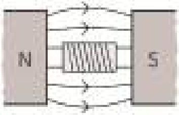

<!-- physics-9-10-bn-c12-t12.2-p037 · text · p.337 · review: known-confusable-corrected -->
**চিত্র ১২.১০: বৈদ্যুতিক মোটর একটি তাড়িতচুম্বকের ভেতর দিয়ে এমনভাবে পরিবর্তী বিদ্যুৎ প্রবাহ করানো হয়, যেন সব সময়েই এটি ঘুরতে থাকে।**

<!-- physics-9-10-bn-c12-t12.2-p038 · text · p.337 -->
যদি কোনো বিশেষ অবস্থা তৈরি করে পরের অবস্থানে যাওয়ার সাথে সাথে তাড়িতচুম্বকটির বিদ্যুৎপ্রবাহের দিক পরিবর্তন করে দেওয়া যায়, তাহলে সেখানে পৌঁছানোর সাথে সাথে কয়েল দিয়ে তৈরি দণ্ড চুম্বকটির উত্তর মেরু দক্ষিণ মেরুতে আর দক্ষিণ মেরু উত্তর মেরুতে পাল্টে যাবে, তাই বিকর্ষণের কারণে আবার সেটি সরে যাবার চেষ্টা করবে অর্থাৎ এটি একটি ঘূর্ণন তৈরিকারী টর্ক বা ভ্রামক অনুভব করবে। এটি চেষ্টা করবে পরের স্থায়ী অবস্থানে পৌঁছাতে কিন্তু সেখানে পৌঁছানোর সাথে সাথে আবার এটার বিদ্যুতের দিক পরিবর্তন করে দিলে এটি সেখানে থেমে যাবে না, আবার ঘুরতে শুরু করবে। তাই যখনই এটা একটা সাম্যাবস্থানে পৌঁছাবে তখনই যদি এটাকে এমনভাবে বিদ্যুৎ প্রবাহ করানো হয় যেন বিকর্ষণের কারণে এটি একটি ঘূর্ণন সৃষ্টিকারী টর্ক বা ভ্রামক অনুভব করে তাহলে এটি ঘুরতেই থাকবে।

<!-- physics-9-10-bn-c12-t12.2-p039 · figure · p.337 -->
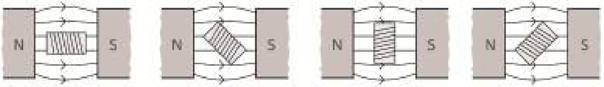

<!-- physics-9-10-bn-c12-t12.2-p040 · text · p.337 · review: known-confusable-corrected -->
**চিত্র ১২.১১: একটি বৈদ্যুতিক মোটর।**

<!-- physics-9-10-bn-c12-t12.2-p041 · text · p.337 -->
বিদ্যুতের দিক পরিবর্তন করার জন্য কম্যুটেশনের নামে একটি উপকরণের মাধ্যমে খানিকটা যান্ত্রিক কৌশল ব্যবহার করতে হয়। মূল কয়েল যে অক্ষে ঘুরতে থাকে সেই ঘূর্ণায়মান অক্ষটির দুই পাশে তড়িৎ চুম্বকের দুটি তার এমনভাবে বসানো হয় যেন সেটি কম্যুটেশনের মূল বিদ্যুৎপ্রবাহের টার্মিনালকে স্পর্শ করে থাকে। যখনই স্পর্শ করে তখনই এমনভাবে বিদ্যুৎ প্রবাহিত করবে যেন সব সময়ই সেটি তাড়িতচুম্বক টিকে বিকর্ষণ করে সরিয়ে দেওয়ার চেষ্টা করে। মাঝামাঝি সময়ে যখন এটি মূল বিদ্যুৎপ্রবাহের টার্মিনাল থেকে সরে যাওয়ার কারণে তাড়িতচুম্বকটিতে কোনো বিদ্যুৎপ্রবাহ হয় না তখনো এটি থেমে না গিয়ে ঘূর্ণন গতি জড়তার কারণে ঘুরতে থাকে।

<!-- physics-9-10-bn-c12-t12.2-p042 · text · p.338 -->
তোমাদেরকে বোঝানোর জন্য (চিত্র ১২.১১) এটাকে সহজভাবে দেখানো হয়েছে। সত্যিকার মোটরে আর্মচারকে ঘিরে বেশ অনেকগুলো কয়েল থাকতে পারে এবং প্রত্যেকটা কয়েল তারা নিজের মতো করে কম্যুটের থেকে বিদ্যুৎপ্রবাহ পায় এবং আর্মচারটি ঘুরতে থাকে।

## 12.3 তড়িৎ চুম্বকীয় আবেশ (Electromagnetic Induction)

<!-- physics-9-10-bn-c12-t12.3-p001 · text · p.338 -->
আমরা আমাদের চারপাশে অসংখ্য যন্ত্রপাতিকে ঘুরতে দেখি, তাই আমাদের মনে হতে পারে এটাই বৃষ্টি চুম্বক বা চৌম্বক ক্ষেত্রের সবচেয়ে বড় অবদান। আসলে চুম্বকের এবং চৌম্বক ক্ষেত্রের সবচেয়ে বড় অবদান তড়িৎ চুম্বকীয় আবেশ অর্থাৎ চৌম্বক ক্ষেত্র দিয়ে বিদ্যুৎ তৈরি করা। বিজ্ঞানী ওয়েরস্টেড প্রথমে দেখিয়েছিলেন কোনো একটা পরিবাহী তারের লুপের ভেতর যদি চৌম্বক ক্ষেত্রের পরিবর্তন করা হয় তাহলে সেই লুপের ভেতর তড়িৎচালক শক্তি (EMF) তৈরি হয়, যেটা সেই লুপের ভেতর দিয়ে বিদ্যুৎ প্রবাহিত করতে পারে। এই বিষয়টি ব্যবহার করে বিদ্যুৎ জেনারেটর তৈরি করা হয়েছে, যেখানে পরিবাহী তারের ভেতর দিয়ে চৌম্বক ক্ষেত্রের পরিবর্তন করে বিদ্যুৎ তৈরি হয়।

<!-- physics-9-10-bn-c12-t12.3-p002 · text · p.338 -->
একটা কয়েলের দুই মাথা যদি একটা অ্যামিটারে লাগানো হয় এবং যদি সেই কয়েলের ভেতর একটা দণ্ড চুম্বক ঢোকানো হয় (চিত্র ১২.১২) তাহলে আমরা ঠিক ঢোকানোর সময় অ্যামিটারের কাঁটাটি স্ক্রণিকের জন্য নড়তে দেখতে পাব। আমরা যখন চুম্বকটা টেনে বের করে আনব তখন আবার আমরা অ্যামিটারের কাঁটাকে স্ক্রণিকের জন্য নড়তে দেখব তবে এবারে উল্টো দিকে। আমরা যদি চুম্বকের মেরু পরিবর্তন করি তাহলে অ্যামিটারেও বিদ্যুৎ প্রবাহ দিক পরিবর্তন দেখতে পাবো সুতরাং আমরা বলতে পারি একটি তারের কুণ্ডলীতে চৌম্বক ক্ষেত্রের পরিবর্তন করার সময় কুণ্ডলীর ভেতর ভোল্টেজ এবং বিদ্যুৎপ্রবাহ সৃষ্টি করাকে তড়িৎ চুম্বকীয় আবেশ বলে। এই ভোল্টেজকে আবিষ্ক ভোল্টেজ এবং বিদ্যুৎপ্রবাহকে আবিষ্ক বিদ্যুৎপ্রবাহ বলে।

<!-- physics-9-10-bn-c12-t12.3-p003 · figure · p.338 -->
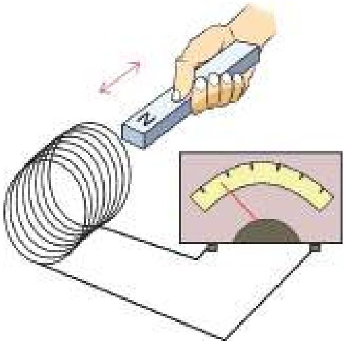

<!-- physics-9-10-bn-c12-t12.3-p004 · figure · p.338 -->
**চিত্র ১২.১২: সলিনয়েডে চুম্বক প্রবেশ করানোর সময় বিদ্যুৎপ্রবাহ দেখা যায়।**

<!-- physics-9-10-bn-c12-t12.3-p005 · text · p.339 -->
এই পরীক্ষাটি করার সময় আমরা কয়েলের ভেতর চৌম্বক ক্ষেত্র পরিবর্তন করার জন্য একটা চুম্বককে কয়েলের ভেতর নিয়েছি এবং বের করে এনেছি। আমরা যদি অন্য কোনোভাবে চৌম্বক ক্ষেত্র পরিবর্তন করতে পারতাম, তাহলেও আমরা একই বিষয় দেখতে পেতাম। কয়েলের ভেতর চৌম্বক ক্ষেত্র পরিবর্তন করার আরেকটা উপায় হচ্ছে, এর কাছে চুম্বকের বদলে দ্বিতীয় একটা কয়েল নিয়ে আসা এবং সেই কয়েলে বিদ্যুৎ প্রবাহিত করিয়ে সেখানে চৌম্বক ক্ষেত্র তৈরি করা। যদি দ্বিতীয় কয়েলটিতে চৌম্বক ক্ষেত্র তৈরি করার জন্য একটা ব্যাটারিকে একটা সুইচ দিয়ে সংযোগ দেওয়া হয় তাহলে সুইচটি অন করে দ্বিতীয় কয়েলে চৌম্বক ক্ষেত্র তৈরি করা যাবে, আবার সুইচটি অফ করে চৌম্বক ক্ষেত্র অদৃশ্য করে দেওয়া যাবে। প্রথম কয়েলটির কাছে দ্বিতীয় কয়েলটি রেখে যদি সেটিতে চৌম্বক ক্ষেত্র একবার তৈরি করা হয় এবং আরেকবার নিঃশেষ করা হয় তাহলে প্রথম কয়েলের ভেতর চৌম্বক ক্ষেত্রের পরিবর্তন হবে এবং আমরা অ্যামিটারে সেজন্য বিদ্যুৎপ্রবাহ দেখব। সুইচ অন করে যখন বিদ্যুৎ প্রবাহ তৈরি করা হবে তখন অ্যামিটারের একদিকে তার কাঁটাটি নড়ে বিদ্যুৎপ্রবাহ দেখাবে—সুইচটি অফ করার সময় আবার কাঁটাটি অন্যদিকে নড়ে বিপরীত দিকে বিদ্যুৎপ্রবাহ দেখাবে।

<!-- physics-9-10-bn-c12-t12.3-p006 · text · p.339 -->
এখানে যে বিষয়টি মনে রাখতে হবে সেটি হচ্ছে, যখন চৌম্বক ক্ষেত্র পরিবর্তন হয় শুধু তখন বিদ্যুৎপ্রবাহ হয়। একটা কয়েলের মাঝখানে প্রচণ্ড শক্তিশালী একটা চুম্বক রেখে দিলে কিন্তু নড়াচড়া না করলে কয়েল দিয়ে কোনো বিদ্যুৎ প্রবাহিত হবে না। শুধু যখন চুম্বকটি নাড়িয়ে চৌম্বক ক্ষেত্র পরিবর্তন করা হবে তখনই বিদ্যুৎ প্রবাহিত হবে।

### ১২.৩.১ জেনারেটর (Generator)

<!-- physics-9-10-bn-c12-t12.3-p007 · text · p.339 -->
মোটর কীভাবে কাজ করে সেটা যখন আমরা বোঝার চেষ্টা করছিলাম, তখন দেখেছি সেখানে একটা চৌম্বক ক্ষেত্রের মাঝে একটা তড়িৎচুম্বকের ভেতর বিদ্যুৎপ্রবাহ করানো হয়, যে কারণে সেটা ঘোরে। এবারে ব্যাপারটা একটু অন্যভাবে চিন্তা করা যাক। মোটরের তড়িৎচুম্বকের দুই প্রান্তে যদি আমরা ব্যাটারি সেলের সংযোগ না দিয়ে সেখানে একটা অ্যামিটার লাগিয়ে তড়িৎচুম্বকটা ঘোরাই তাহলে কী হবে?

<!-- physics-9-10-bn-c12-t12.3-p008 · text · p.339 -->
অবশ্যই তখন কয়েলের মাঝে চৌম্বক ক্ষেত্রের পরিবর্তন হবে, কাজেই কুণ্ডলীর ভেতর দিয়ে বিদ্যুৎ প্রবাহ হবে। অর্থাৎ বিদ্যুৎপ্রবাহ করিয়ে যে মোটরের তড়িৎচুম্বক বা কয়েলকে আমরা ঘুরিয়েছি, সেই তড়িৎচুম্বক বা কয়েলটিকে ঘোরালে ঠিক তার উল্টো ব্যাপারটা ঘটে, বিদ্যুৎ তৈরি হয়। এভাবেই জেনারেটর তৈরি হয়। অর্থাৎ ডিসি মোটরের আর্মচারকে ঘোরালে সেটা ডিসি বিদ্যুৎপ্রবাহ দেয়, এসি মোটরকে ঘোরালে ঠিক সেভাবে এসি বিদ্যুৎপ্রবাহ দেয়।

### ১২.৩.২ ট্রান্সফর্মার (Transformer)

<!-- physics-9-10-bn-c12-t12.3-p009 · figure · p.340 -->
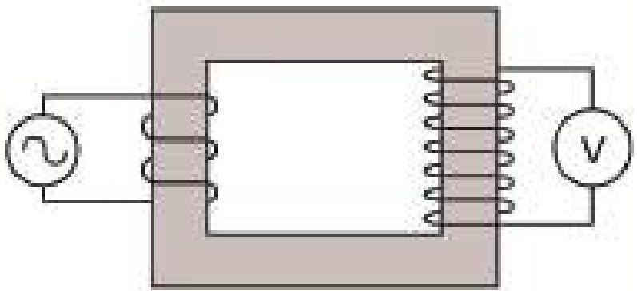

<!-- physics-9-10-bn-c12-t12.3-p010 · text · p.340 -->
চৌম্বক ক্ষেত্রের পরিবর্তন হলে বিদ্যুৎ তৈরি হয়— এই নীতি ব্যবহার করে ট্রান্সফর্মার তৈরি করা হয়। ট্রান্সফর্মার কীভাবে কাজ করে বুঝার জন্য ১২.১৩ চিত্রে একটা আয়তাকার লোহার মজ্জা বা কোর দেখানো হয়েছে। এই কোরের দুই পাশে পরিবাহী তার প্যাঁচানো হয়েছে— অবশ্যই এই পরিবাহী তারের ওপর অপরিবাহী আস্তরণ রয়েছে, যেন এটা ধাতব কোনো কিছুকে স্পর্শ করলেও 'শার্ট সার্কিট' না হয়। চিত্রে দেখানো হয়েছে কোরের বাম পাশে একটা এসি ভোল্টেজের উৎস লাগানো হয়েছে। তারটি যেহেতু লোহার কোরকে ঘিরে লাগানো হয়েছে তাই যখন বিদ্যুৎ প্রবাহিত হবে, তখন লোহার ভেতরে চৌম্বকত্ব তৈরি হবে এবং সেই চৌম্বক বলরেখা আয়তাকার লোহার ভেতর দিয়ে যাবে।

<!-- physics-9-10-bn-c12-t12.3-p011 · text · p.340 · review: latin-junk -->
আমরা যেহেতু এসি ভোল্টেজের উৎস লাগিয়েছি তাই লোহার কোরে চৌম্বকত্ব বাড়বে-কমবে এবং দিক পরিবর্তন করবে, অর্থাৎ ক্রমাগত চৌম্বক ক্ষেত্রের পরিবর্তন হবে। লোহার কোরের অন্য পাশেও তার প্যাঁচানো আছে (অবশ্যই অপরিবাহী আবরণে ঢাকা) সেই কয়েলের মাঝে লোহার কোরের ভেতর দিয়ে চৌম্বক ক্ষেত্রটির ক্রমাগত পরিবর্তন হতে থাকবে এবং এই পরিবর্তন ডান পাশের কয়েলে একটা তড়িৎচালক শক্তি বা EMF তৈরি করবে— একটা ভোল্টমিটারে আমরা সেটা ইচ্ছে করলে পরিমাপ করতে পারব। এই পদ্ধতিতে সরাসরি বৈদ্যুতিক সংযোগ ছাড়াই একটি কয়েল থেকে অন্য কয়েলে বিদ্যুৎ পাঠানো যায়। যে যন্ত্রের মাধ্যমে এই কাজ করা হয় তাকে ট্রান্সফর্মার বলে।

<!-- physics-9-10-bn-c12-t12.3-p012 · text · p.340 -->
এই ট্রান্সফর্মার দিয়ে আমরা অত্যন্ত চমকপ্রদ কিছু বিষয় করতে পারি। দুই পাশে কয়েলের প্যাঁচসংখ্যা যদি সমান হয়, তাহলে বাম দিকে আমরা যে এসি ভোল্টেজ প্রয়োগ করব ডান দিকে ঠিক সেই এসি ভোল্টেজ ফেরত পাব। ডান দিকে প্যাঁচের সংখ্যা যদি দশ গুণ বেশি হয় তাহলে ভোল্টেজ দশ গুণ বেশি হবে। প্যাঁচের সংখ্যা যদি দশ গুণ কম হয় তাহলে ভোল্টেজ দশ গুণ কম হবে। বাম দিকের কয়েল যেখানে এসি ভোল্টেজ প্রয়োগ করা হয়, তার নাম প্রাইমারি কয়েল বা মুখ্য কুণ্ডলী এবং ডান দিকে যেখানে ভোল্টেজ আবিষ্ট হয় তার নাম সেকেন্ডারি কয়েল বা গৌণ কুণ্ডলী।

<!-- physics-9-10-bn-c12-t12.3-p013 · text · p.340 · review: latin-junk,verify-formula -->
তোমরা হয়তো মনে করতে পারো যদি সত্যি এটা ঘটানো সম্ভব হয় তাহলে আমরা প্রাইমারিতে অল্পসংখ্যক প্যাঁচ দিয়ে অল্প ভোল্টেজ প্রয়োগ করে, সেকেন্ডারি কয়েলে অনেক বেশি প্যাঁচ দিয়ে বিশাল একটা ভোল্টেজ বের করে অফুরন্ত বৈদ্যুতিক শক্তির ব্যবস্থা করে ফেলি না কেন? এখানে একটি বিষয় মনে রাখতে হবে প্রতি সেকেন্ডে কতটুকু বৈদ্যুতিক শক্তি প্রয়োগ করা হচ্ছে, সেটা পরিমাপ করা হয় VI (ভোল্টেজ × কারেন্ট) দিয়ে, একটা ট্রান্সফর্মারে প্রাইমারিতে যে পরিমাণ VI প্রয়োগ করা হয়, সেকেন্ডারি কয়েল থেকে ঠিক সেই পরিমাণ $VI$ ফেরত পাওয়া যায়। কাজেই সেকেন্ডারিতে যদি ভোল্টেজ দশ গুণ বাড়িয়ে নেয়া যায় তাহলে সেখানে বিদ্যুৎও দশ গুণ কমে যাবে। তোমাদের বোঝানোর জন্য আয়তাকার একটি কোর দেখানো হয়েছে। সত্যিকারের ট্রান্সফরমার একটু অন্যভাবে তৈরি হয়, সেখানে প্রাইমারির উপরেই সেকেন্ডারি কয়েল পঁ্যাচানো হয় এবং কোরটাও একটু অন্য রকম হয়।

<!-- physics-9-10-bn-c12-t12.3-p014 · text · p.341 · review: verify-formula -->
প্রাইমারি কয়েলে পঁ্যাচসংখ্যা যদি $n_P$ এবং সেকেন্ডারি কয়েলের পঁ্যাচসংখ্যা $n_S$ হয়, তাহলে প্রাইমারি কয়েলে যদি এসি $V_P$ ভোল্টেজ প্রয়োগ করা হয় তাহলে সেকেন্ডারি কয়েলে যে এসি ভোল্টেজ $V_S$ পাওয়া যাবে তা নির্ভর করবে পঁ্যাচ সংখার উপর:

<!-- physics-9-10-bn-c12-t12.3-p015 · formula · p.341 · review: verify-formula -->
$$V_S \propto n_S, V_P \propto n_P$$

<!-- physics-9-10-bn-c12-t12.3-p016 · text · p.341 · review: verify-formula -->
অর্থাৎ, $\frac{V_P}{n_P} = \frac{V_S}{n_S} = ধ্রুবক$

<!-- physics-9-10-bn-c12-t12.3-p017 · text · p.341 · review: verify-formula -->
অর্থাৎ, $V_S = \left( \frac{n_S}{n_P} \right) V_P$

<!-- physics-9-10-bn-c12-t12.3-p018 · text · p.341 · review: verify-formula -->
প্রাইমারি কয়েলে যদি $I_P$ বিদ্যুৎ প্রবাহিত হয় তাহলে সেকেন্ডারি কয়েলে বিদ্যুৎ প্রবাহ $I_S$ পাওয়া যাবে। $I_S$ এর মান পাওয়া যায় বৈদ্যুতিক সমতার সংরক্ষণ থেকে, অর্থাৎ

<!-- physics-9-10-bn-c12-t12.3-p019 · formula · p.341 · review: verify-formula -->
$$V_P I_P = V_S I_S$$

<!-- physics-9-10-bn-c12-t12.3-p020 · text · p.341 · review: verify-formula -->
অর্থাৎ $I_S = \left( \frac{V_P}{V_S} \right) I_P = \left( \frac{n_P}{n_S} \right) I_P$

<!-- physics-9-10-bn-c12-t12.3-p021 · text · p.341 -->
যে ট্রান্সফরমারে প্রাইমারি কয়েলের তুলনায় সেকেন্ডারি কয়েলের পঁ্যাচসংখ্যা বেশি হয় এবং সে কারণে প্রাইমারি কয়েলে প্রয়োগ করা এসি ভোল্টেজ সেকেন্ডারি কয়েলে বেড়ে যায়, তাকে স্টেপ আপ ট্রান্সফরমার বলে। বিদ্যুৎ পরিবহনের জন্য স্টেপ আপ ট্রান্সফরমার ব্যবহার করে ভোল্টেজকে অনেক গুণ বাড়ানো হয়।

<!-- physics-9-10-bn-c12-t12.3-p022 · text · p.341 -->
যে ট্রান্সফরমারে প্রাইমারি কয়েলের তুলনায় সেকেন্ডারি কয়েলের পঁ্যাচসংখ্যা কম হয় এবং সে কারণে প্রাইমারি কয়েলে প্রয়োগ করা এসি ভোল্টেজ সেকেন্ডারি কয়েলে কমে যায় তাকে স্টেপ ডাউন ট্রান্সফরমার বলে।

### উদাহরণ

<!-- physics-9-10-bn-c12-t12.3-p023 · example · p.342 -->
**প্রশ্ন:** একটি ট্রান্সফর্মারের প্রাইমারি কয়েলের প্যাঁচসংখ্যা 100, সেকেন্ডারি কয়েলের প্যাঁচসংখ্যা 1000, প্রাইমারি কয়েল দিয়ে 10V DC দেওয়া হলো। সেকেন্ডারি কয়েলে ভোল্টেজ কত?

<!-- physics-9-10-bn-c12-t12.3-p024 · example · p.342 -->
**উত্তর:** শূন্য। ট্রান্সফর্মার ডিসি ভোল্টেজে কাজ করে না।

<!-- physics-9-10-bn-c12-t12.3-p025 · text · p.342 -->
**প্রশ্ন:** একটি ট্রান্সফর্মারের প্রাইমারি কয়েলের প্যাঁচসংখ্যা 100, সেকেন্ডারি কয়েলের প্যাঁচসংখ্যা 1000, প্রাইমারি কয়েল দিয়ে 12V AC দেওয়া হলো। সেকেন্ডারি কয়েলে ভোল্টেজ কত?

<!-- physics-9-10-bn-c12-t12.3-p026 · text · p.342 · review: verify-formula -->
**উত্তর:** $V_S = \left( \frac{n_S}{n_P} \right) V_P = \left( \frac{1000}{100} \right) \times 12V = 120V  AC$

<!-- physics-9-10-bn-c12-t12.3-p027 · text · p.342 -->
**প্রশ্ন:** উপরের ট্রান্সমিটারে প্রাইমারি কয়েল দিয়ে 1A বিদ্যুৎ প্রবাহিত হলে সেকেন্ডারি কয়েলে সর্বোচ্চ কত কারেন্ট প্রবাহিত হতে পারবে?

<!-- physics-9-10-bn-c12-t12.3-p028 · text · p.342 · review: verify-formula -->
**উত্তর:** $I_S = \left( \frac{V_P}{V_S} \right) I_P = \left( \frac{12}{120} \right) \times 1  A = 0.1  A$

## 12.ex নমুনা প্রশ্ন

### বহুনির্বাচনি প্রশ্ন

<!-- physics-9-10-bn-c12-t12.ex-p001 · exercise · p.343 · review: known-confusable-corrected -->
সঠিক উত্তরটির পাশে টিক (√) চিহ্ন দাও

<!-- physics-9-10-bn-c12-t12.ex-p002 · exercise · p.343 · review: known-confusable-corrected -->
১. কোনো চৌম্বকের উপর অন্তরিত তার পেঁচিয়ে সলিনয়েড তৈরি করে তাতে তড়িৎপ্রবাহ চালালে চৌম্বক ক্ষেত্রের কী ঘটবে?

<!-- physics-9-10-bn-c12-t12.ex-p003 · exercise · p.343 · review: known-confusable-corrected -->
(ক) ঘনীভূত ও দুর্বল হবে
(খ) ঘনীভূত ও শক্তিশালী হবে
(গ) কম ঘনীভূত ও দুর্বল হবে
(ঘ) কম ঘনীভূত কিন্তু শক্তিশালী হবে

<!-- physics-9-10-bn-c12-t12.ex-p004 · exercise · p.343 · review: known-confusable-corrected -->
২. কোনটির কার্যপ্রণালিতে তড়িৎ চৌম্বক আবেশকে ব্যবহার করা হয়?

<!-- physics-9-10-bn-c12-t12.ex-p005 · exercise · p.343 · review: known-confusable-corrected -->
(ক) ট্রানজিস্টর
(খ) মোটর
(গ) অ্যাম্প্লিফায়ার
(ঘ) ট্রান্সফর্মার

<!-- physics-9-10-bn-c12-t12.ex-p006 · exercise · p.343 · review: known-confusable-corrected -->
৩. কোন প্রক্রিয়া বা কার্যধারায় তড়িচ্চালক শক্তি উৎপন্ন হয়?

<!-- physics-9-10-bn-c12-t12.ex-p007 · exercise · p.343 · review: known-confusable-corrected -->
(i) কোনো তারকুণ্ডলীর ভেতর একটি চুম্বক স্থির অবস্থায় রাখলে
(ii) কোনো চৌম্বকক্ষেত্রে কোনো তারকুণ্ডলী ঘোরালে
(iii) কোনো স্থির তারকুণ্ডলীর চারদিকে কোনো চুম্বক ঘোরালে

<!-- physics-9-10-bn-c12-t12.ex-p008 · exercise · p.343 · review: known-confusable-corrected -->
নিচের কোনটি সঠিক?

<!-- physics-9-10-bn-c12-t12.ex-p009 · exercise · p.343 · review: latin-junk,known-confusable-corrected -->
(ক) i
(খ) ii
(গ) i ও ii
(ঘ) ii ও iii

<!-- physics-9-10-bn-c12-t12.ex-p010 · exercise · p.344 · review: known-confusable-corrected -->
নিচের উদ্দীপকের (চিত্র ১২.১৪) আলোকে ৪ ও ৫ নং প্রশ্নের উত্তর দাও।

<!-- physics-9-10-bn-c12-t12.ex-p011 · exercise · p.344 · review: known-confusable-corrected,verify-formula -->
৪. $n_S$ এর মান কত?

<!-- physics-9-10-bn-c12-t12.ex-p012 · exercise · p.344 · review: known-confusable-corrected -->
(ক) 100
(খ) 300
(গ) 400
(ঘ) 600

<!-- physics-9-10-bn-c12-t12.ex-p013 · figure · p.344 · review: known-confusable-corrected -->
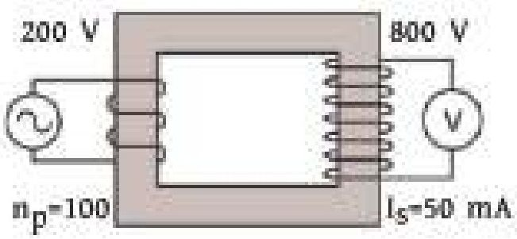

<!-- physics-9-10-bn-c12-t12.ex-p014 · figure · p.344 · review: known-confusable-corrected -->
চিত্র ১২.১৪

<!-- physics-9-10-bn-c12-t12.ex-p015 · exercise · p.344 · review: known-confusable-corrected -->
৫. উদ্দীপক অনুসারে-

<!-- physics-9-10-bn-c12-t12.ex-p016 · exercise · p.344 · review: latin-junk,known-confusable-corrected -->
**i.** প্রাইমারি কয়েলের তড়িৎ প্রবাহ সেকেন্ডারি কয়েলের তড়িৎ প্রবাহের চেয়ে কম
**ii.** সেকেন্ডারি কয়েলের ভোল্টেজ প্রাইমারি কয়েলের ভোল্টেজের ৪-গুণ
**iii.** প্রাইমারি ও সেকেন্ডারি কয়েলে বৈদ্যুতিক ক্ষমতার পার্থক্য শূন্য

<!-- physics-9-10-bn-c12-t12.ex-p017 · exercise · p.344 · review: known-confusable-corrected -->
নিচের কোনটি সঠিক?

<!-- physics-9-10-bn-c12-t12.ex-p018 · exercise · p.344 · review: latin-junk,known-confusable-corrected -->
(ক) i ও ii
(খ) ii ও iii
(গ) i ও iii
(ঘ) i, ii ও iii

### সৃজনশীল প্রশ্ন

<!-- physics-9-10-bn-c12-t12.ex-p019 · exercise · p.344 · review: known-confusable-corrected -->
১. ১২.১৫ চিত্রটি দেখে নিচের প্রশ্নগুলোর উত্তর দাও।

<!-- physics-9-10-bn-c12-t12.ex-p020 · exercise · p.344 · review: known-confusable-corrected -->
(ক) তাড়িতচৌম্বক কী?
(খ) যন্ত্রটি যে নীতি বা ঘটনার উপর তৈরি তা ব্যাখ্যা করো।
(গ) এই যন্ত্রের মুখ্য কুণ্ডলীতে প্রবাহমান্ত্রা নির্ণয় করো।
(ঘ) উপান্তের আলোকে যন্ত্রটির ক্রিয়া গাণিতিকভাবে ব্যাখ্যা করো।

<!-- physics-9-10-bn-c12-t12.ex-p021 · figure · p.344 · review: known-confusable-corrected -->
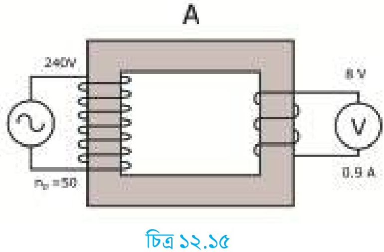

<!-- physics-9-10-bn-c12-t12.ex-p022 · figure · p.344 · review: known-confusable-corrected -->
চিত্র ১২.১৫

<!-- physics-9-10-bn-c12-t12.ex-p023 · exercise · p.345 · review: known-confusable-corrected -->
২. একটি লম্বা সোজা তারকে একটি বড় কাগজের টুকরার মধ্যে দিয়ে লম্বভাবে প্রবেশ করিয়ে এর মধ্যে দিয়ে 1.5 ভোল্টের পেন্সিল ব্যটারির সাহায্যে বিদ্যুৎ প্রবাহিত করা হলো এবং কাগজের উপর কিছু লোহার গুঁড়া ছড়িয়ে দেওয়া হলো।

<!-- physics-9-10-bn-c12-t12.ex-p024 · exercise · p.345 · review: known-confusable-corrected -->
(ক) তড়িৎপ্রবাহের চৌম্বক ক্রিয়া কী?

<!-- physics-9-10-bn-c12-t12.ex-p025 · exercise · p.345 · review: known-confusable-corrected -->
(খ) কাগজটির উপর লোহার গুঁড়া কীভাবে সজ্জিত হবে?

<!-- physics-9-10-bn-c12-t12.ex-p026 · exercise · p.345 · review: known-confusable-corrected -->
(গ) তারটির গঠনে কী পরিবর্তন আনলে এর দ্বারা তৈরি চৌম্বকক্ষেত্রের প্রাবল্য বাড়বে ব্যাখ্যা করো।

<!-- physics-9-10-bn-c12-t12.ex-p027 · exercise · p.345 · review: known-confusable-corrected -->
(ঘ) তারটিকে একটি লোহার তারকাঁটার উপর পেঁচিয়ে তারকাঁটার এক মাথা লোহার গুঁড়ার কাছাকাছি নিলে যা ঘটবে তা বিশ্লেষণ করো?

### সংক্ষিপ্ত উত্তর প্রশ্ন

<!-- physics-9-10-bn-c12-t12.ex-p028 · exercise · p.345 -->
১. জেনারেটর ও তড়িৎ মোটরের মধ্যে পার্থক্য ব্যাখ্যা করো।

<!-- physics-9-10-bn-c12-t12.ex-p029 · exercise · p.345 -->
২. ড্রাইভফরমারের মুখ্য কুণ্ডলীতে এসি ভোল্টেজ প্রয়োগ করা হয় কেন?

<!-- physics-9-10-bn-c12-t12.ex-p030 · exercise · p.345 -->
৩. ড্রাইভফরমারের কোরের দুইপাশে পর্দাচানো তারে অপরিবাহী আন্তুরণ থাকে কেন? ব্যাখ্যা করো।

<!-- physics-9-10-bn-c12-t12.ex-p031 · exercise · p.345 -->
৪. বৈদ্যুতিক মোটরে কমুটেটর ব্যবহার করা হয় কেন? ব্যাখ্যা করো।
